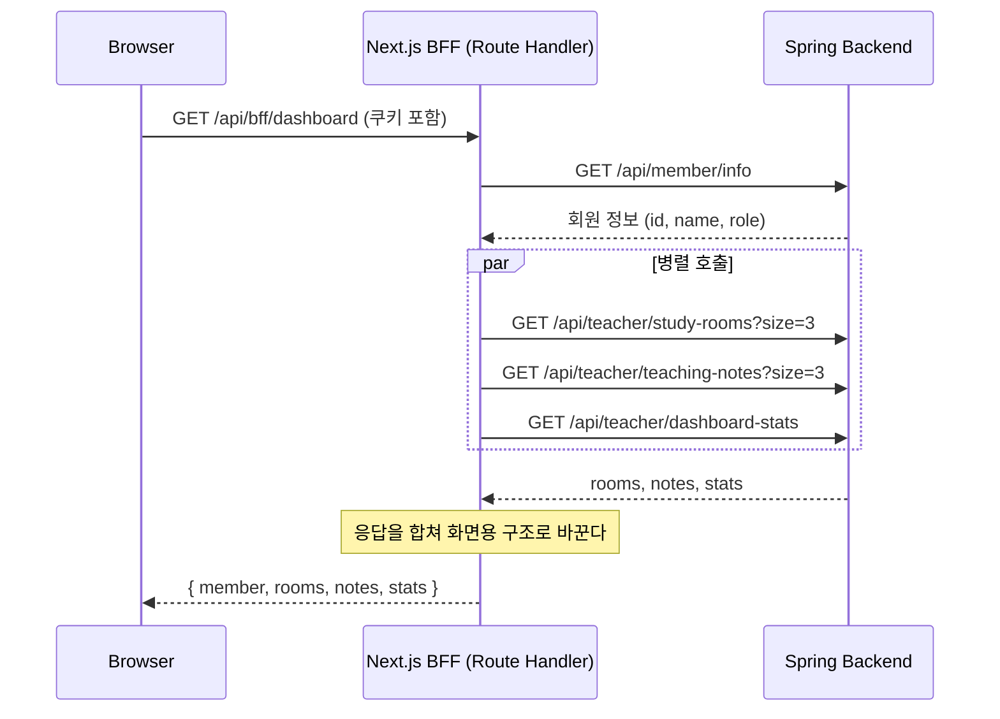

## BFF란 ?
- BFF(Backend For Frontend)는 특정 프론트엔드 화면이나 플랫폼(웹, 모바일, 관리자 등) 하나만을 위해 두는 전용 백엔드 계층이다
- 여러 백엔드 API를 대신 불러 합치고, 그 화면이 쓰기 편한 모양으로 바꿔 내려준다
- Sam Newman이 2015년 글 "Pattern: Backends For Frontends"로 정리해 알려졌다. 그는 이 방식을 REA와 SoundCloud에서 보았고, 이름은 SoundCloud 출신 Phil Calçado에게서 왔다고 적었다. 이름을 처음 붙인 사람이 누구인지는 이 글 말고 따로 확인하지 못했다(확인 필요)
- 이 노트는 디에듀(D-edu) 프로젝트에서 Next.js Route Handler를 BFF로 쓰고 뒤에 Spring 백엔드를 둔 경험을 바탕으로 정리했다

### Backend For Frontend
말 그대로 프론트엔드를 위한 백엔드다. 백엔드가 여러 화면이 함께 쓰는 도메인 중심 API를 제공한다면, BFF는 화면 하나가 필요로 하는 모양에 맞춘 API를 제공한다.

식당의 홀 담당과 같다. 손님(브라우저)은 홀 담당에게 한 번 주문하고, 홀 담당이 주방의 여러 파트(백엔드 API)에 나눠 전하고 받아 온 음식을 한 상으로 차려 낸다.

<br/>

## 어떻게 알게 됐나
디에듀 대시보드 화면 하나를 그리려면 회원 정보, 스터디룸 목록, 수업 노트, 통계 API를 각각 불러야 했다. 그 데이터를 프론트에서 다시 합치고 가공하는 코드가 반복되면서, 클라이언트가 이 일을 다 맡는 것이 맞는지 고민하다가 BFF 패턴을 알게 됐다.

<br/>

## 언제 필요할까
### 서비스가 여러 개로 나뉜 경우
회원, 권한, 콘텐츠, 통계가 각각 별도 서비스(마이크로서비스, MSA)로 운영되면, 화면 하나를 그리는 데 여러 서비스의 데이터를 합쳐야 한다. 프론트가 직접 여러 번 호출하면 요청 흐름과 로딩, 에러 처리가 복잡해지고, 브라우저와 서버 사이의 왕복도 그만큼 늘어난다.

### 플랫폼마다 필요한 데이터 모양이 다른 경우
웹, 모바일, 관리자 콘솔은 필요한 필드와 데이터 양이 다르다. 프론트마다 가공을 따로 하면 같은 가공 코드가 흩어지고, 백엔드가 모든 플랫폼에 맞춘 API를 만들면 API가 끝없이 커진다. Sam Newman은 Stewart Gleadow의 지침 "one experience, one BFF", 즉 사용자 경험 하나에 BFF 하나를 두라는 말을 소개한다. Newman 자신은 클라이언트 종류마다 BFF를 하나씩 엄격하게 두는 쪽을 선호한다. 함께 쓰는 경우도 iOS와 Android처럼 같은 종류의 화면에 한정해서 말한다. 두 앱의 경험이 아주 비슷하면 BFF 하나를 정당화하기 쉽고, 크게 다르면 따로 두는 편이 낫다고 쓴다.

### 클라이언트에서 하기엔 무거운 가공이 있는 경우
여러 데이터를 합산하거나 정렬, 필터링, 통계를 내는 일을 브라우저에서 하면 받아야 할 데이터도 많고 계산도 무겁다. BFF가 서버에서 미리 정리해 내려주면 클라이언트는 그리기만 하면 된다.

<br/>

## BFF가 하는 일
### 여러 API를 하나로 합친다
대시보드 위젯 세 개를 그리려면 원래 API를 세 번 불러야 한다. BFF는 서버 안에서 이 API들을 병렬로 부른 뒤 하나로 묶어 돌려준다. 클라이언트는 `/api/bff/dashboard` 를 한 번만 부른다.

Sam Newman은 이렇게 여러 곳을 부를 때 가능하면 병렬로 부르라고 권한다. 실패 처리는 부른 서비스가 그 화면에 꼭 필요한지에 따라 다르다. 위시리스트 화면에서 위시리스트 서비스가 죽으면 할 수 있는 일이 없다. 반면 재고 서비스만 죽었다면 재고 표시만 빼고 나머지를 응답하는 식으로 기능을 줄이는 편이 낫다고 쓴다. 이때 클라이언트는 일부 데이터가 빠진 응답도 그릴 수 있어야 한다.

### 응답을 화면에 맞는 모양으로 바꾼다
백엔드 API마다 응답 구조가 달라도 BFF에서 화면이 쓰기 좋은 하나의 구조로 바꿔 내려준다. 백엔드 응답이 바뀌어도 BFF만 고치면 되므로, 프론트 코드가 백엔드 변경에 덜 흔들린다.

### 권한 확인을 서버에서 한다
클라이언트가 보내는 역할(role) 값은 사용자가 조작할 수 있어서 믿을 수 없다. BFF는 쿠키에 담긴 세션으로 백엔드의 회원 정보 API를 불러 역할을 직접 확인한다. 그래서 "선생님만 볼 수 있다" 같은 규칙을 서버에서 지킬 수 있다. 다만 최종 권한 검사는 백엔드도 해야 한다. BFF를 거치지 않고 백엔드를 직접 부르는 길이 열려 있다면 BFF의 검사는 우회될 수 있다.

### 누가 맡나
Sam Newman은 BFF를 그 화면을 만드는 프론트엔드 팀이 맡으라고 권한다. 화면이 바뀔 때 BFF도 같은 팀이 바로 고치고 함께 배포할 수 있기 때문이다. Next.js Route Handler로 BFF를 만들면 프론트엔드 코드와 같은 저장소, 같은 배포 단위에 들어가서 이 조건을 자연스럽게 채운다.

<br/>

## 디에듀 대시보드의 요청 흐름


1. 브라우저가 `/dashboard` 페이지를 받는다. 이 예시는 클라이언트에서 데이터를 요청하는 구조라, 처음에는 화면 틀만 그려지고 데이터는 아직 없다.
2. 클라이언트가 `/api/bff/dashboard` 를 한 번 부른다. fetch, axios, React Query 중 무엇을 쓰든 브라우저에서 나가는 요청은 이것 하나다.

```ts
const { data } = useQuery({
  queryKey: ["dashboard"],
  queryFn: () => fetch("/api/bff/dashboard").then((r) => r.json()),
});
```

3. Route Handler가 먼저 회원 정보로 역할을 확인하고, 나머지 세 API를 병렬로 부른다.
4. 응답 네 개를 하나로 합쳐 돌려준다.

```js
{
  member: { id, name, role },
  rooms: [/* 최근 3개 */],
  notes: [/* 최근 3개 */],
  stats: { totalStudents, totalNotes /* ... */ }
}
```

화면은 이 응답 하나로 상단 프로필(member), 스터디룸 카드 세 개(rooms), 최근 노트 세 개(notes), 통계 박스(stats)를 그린다.

<br/>

## 구현 예시 (Next.js Route Handler)
```ts
import { DashboardSchema } from "./dashboard.schema";
import { authBffHttp } from "@/shared/api";

export async function GET() {
  // 1. 회원 정보로 역할 확인
  const memberRes = await authBffHttp.get("/api/member/info");
  const member = memberRes.data.data;
  if (member.role !== "TEACHER") {
    return Response.json({ message: "권한이 없습니다" }, { status: 403 });
  }

  // 2. 나머지 API 병렬 호출
  const [rooms, notes, stats] = await Promise.all([
    authBffHttp.get("/api/teacher/study-rooms?size=3"),
    authBffHttp.get("/api/teacher/teaching-notes?size=3"),
    authBffHttp.get("/api/teacher/dashboard-stats"),
  ]);

  // 3. 화면용 구조로 바꾸고 스키마로 검증
  const dashboard = DashboardSchema.parse({
    member,
    rooms: rooms.data.data,
    notes: notes.data.data,
    stats: stats.data.data,
  });

  return Response.json(dashboard);
}
```

역할이 선생님이 아니면 나머지 API를 부르지 않고 403을 돌려준다. 역할 값 `"TEACHER"` 는 이 예시에서 정한 이름이다. `authBffHttp`, `DashboardSchema` 는 디에듀 프로젝트의 코드라 이 노트만으로는 실행되지 않는다. `Promise.all` 은 하나라도 실패하면 전체가 실패하므로, 일부만 빠진 응답을 내려주려면 `Promise.allSettled` 로 바꿔 실패한 부분을 따로 처리해야 한다.

<br/>

## 성능과 비용
브라우저에서 직접 API 세 개를 부르면 브라우저와 서버 사이를 세 번 오가고, BFF를 두면 한 번 오간다. 브라우저 쪽 네트워크는 서버끼리의 통신보다 느리고 불안정한 경우가 많아서, 특히 모바일에서 이 차이가 크게 느껴진다. BFF와 백엔드 사이의 호출은 서버끼리의 통신이고 병렬로 보낼 수 있다.

대신 요청 경로에 서버가 하나 더 끼므로, BFF와 백엔드가 멀리 떨어져 있으면 그만큼 지연이 더해진다. 디에듀는 BFF가 Vercel, 백엔드가 AWS에 있었는데, 두 서버 사이의 실제 지연은 재 보지 않았다.

비용도 Vercel 기준으로 보면, 브라우저가 Route Handler를 세 번 부르던 구조라면 함수 실행이 세 번에서 한 번으로 준다. 브라우저가 Spring을 직접 부르던 구조와 비교하면 오히려 함수 실행이 한 번 늘어난다. 정확한 비용 차이는 요금제와 트래픽에 따라 달라서 확인하지 않았다.

<br/>

## Route Handler가 Route Handler를 부르는 구조는 피한다
디에듀에서 한때 요청이 아래처럼 이어졌다.

```text
Client → Next.js Route Handler A (/api/some-feature)
       → Next.js Route Handler B (/api/v1/member/info)
       → Spring
```

A가 회원 정보를 얻으려고 같은 Next.js 서버의 B를 HTTP로 다시 부르는 구조다. 같은 서버 안이어도 HTTP 요청을 한 번 더 만들고 받아야 해서 지연과 처리 부하가 늘고, 인증 쿠키와 헤더를 A에서 B로 직접 넘겨줘야 한다. 인증과 에러 처리 로직도 두 곳에 흩어진다.

회원 정보를 가져오는 로직은 함수(repository)로 만들고, A가 그 함수를 직접 불러 Spring에 바로 요청하게 바꿨다.

```text
Client → Next.js Route Handler → Spring
```

```ts
import { NextRequest } from "next/server";
import { repository } from "@/entities/member"; // Spring으로 바로 요청하는 함수

export async function GET(request: NextRequest) {
  // Route Handler를 거치지 않고 repository 함수를 직접 호출
  const member = await repository.member.getMember(request);

  // ... 나머지 로직
}
```

<br/>

## 정리
BFF는 단순히 요청을 넘겨주는 프록시가 아니라, 화면 하나를 위해 데이터를 모으고 다듬는 전용 계층이다. Next.js와 Spring 조합에서는 Route Handler가 이 역할을 맡을 수 있어서 별도 서버를 띄우지 않아도 된다. 디에듀처럼 한 화면에서 여러 API를 조합해야 하는 구조에서는 클라이언트 코드가 단순해지는 효과가 컸다.

<br/>

## 참고 자료
- Sam Newman, [Pattern: Backends For Frontends](https://samnewman.io/patterns/architectural/bff/), 2015-11-18

<br/>

## 더 볼 것 (TODO)
- BFF가 여러 개일 때 겹치는 로직을 어디에 둘지 (공유 라이브러리, 하위 서비스)
- BFF와 API 게이트웨이의 차이
- 일부 API가 실패했을 때 부분 응답을 내려주고 화면에서 처리하기
