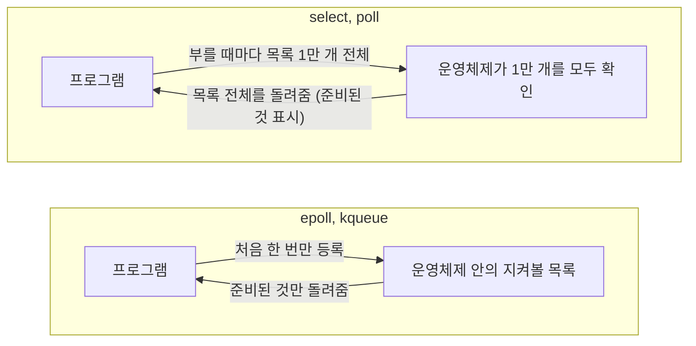

## C10K 문제란 ?
- 서버 한 대가 클라이언트 연결 1만 개를 동시에 붙잡고 처리하는 문제다. C는 클라이언트(Client), 10K는 1만(10 Kilo)을 뜻한다
- 이름은 Dan Kegel이 1999년부터 고쳐 써 온 글 「The C10K problem」에서 왔다
- 그 글의 요지는 하드웨어는 이미 충분한데, 연결을 다루는 소프트웨어 방식(연결마다 스레드를 두는 구조, 준비된 연결을 찾는 방법)이 걸림돌이라는 것이다

이 노트는 [서버의 동시 처리 방식](../서버의%20동시%20처리%20방식(Server%20Concurrency)/README.md) 노트와 [블로킹과 논블로킹](../블로킹과%20논블로킹(Blocking%20and%20Non-blocking)/README.md) 노트의 TODO에서 나왔다. 멀티 프로세스, 멀티 스레드, 이벤트 루프가 무엇인지, I/O 모델이 어떻게 나뉘는지, 컨텍스트 스위칭이 무엇인지는 앞 노트들에 있으니 여기서는 되풀이하지 않는다. 이 노트는 그 개념들이 연결 1만 개라는 숫자 앞에서 어떻게 부딪혔고 어떻게 풀렸는지를 본다.

<br/>

## 단어의 뜻
### C10K
클라이언트(Client)의 사전적 의미는 의뢰인, 고객이다. 서비스를 부탁하는 쪽이라는 뜻에서 네트워크에서는 서버에 요청을 보내는 쪽을 가리킨다. K는 천을 뜻하는 킬로(Kilo)의 머리글자라서 10K는 1만이다.

공학적으로 C10K는 동시에 연결된 클라이언트 1만 개를 서버 한 대가 감당한다는 목표, 또는 그 목표를 막는 문제를 부르는 이름이다. 요청을 1초에 1만 번 처리한다는 뜻이 아니라, 연결 1만 개가 한꺼번에 열려 있는 상태를 버틴다는 뜻이다. 대부분의 연결은 열려만 있고 대부분의 시간은 조용하다는 점이 중요하다.

식당으로 치면 하루 손님 1만 명이 아니라, 한순간에 1만 명이 자리에 앉아 있는 것이다. 그중 대부분은 메뉴판을 보거나 음식을 기다리고 있고, 지금 막 주문하려는 손님은 몇 명뿐이다.

### 파일 디스크립터 (File Descriptor)
디스크립터(Descriptor)의 사전적 의미는 서술하는 것, 기술자다. 무언가를 가리키고 설명해 주는 표시라는 뜻이다.

공학적으로 파일 디스크립터는 프로그램이 파일이나 소켓을 열었을 때 운영체제가 돌려주는 번호다. 유닉스 계열 운영체제에서는 소켓도 파일처럼 이 번호로 다룬다. 프로그램은 이후 이 번호로 읽기와 쓰기를 부탁한다. 연결 1만 개를 붙잡고 있다는 말은 이 번호 1만 개를 들고 있다는 말이기도 하다. 윈도우에서는 비슷한 역할을 핸들(Handle)이 한다.

옷 보관소에서 받는 번호표와 같다. 번호표만 내밀면 맡긴 옷이 무엇이든 찾아 준다.

<br/>

## 문제가 생긴 배경
Kegel의 글은 "It's time for web servers to handle ten thousand clients simultaneously, don't you think?"라는 문장으로 시작한다. 이제는 웹 서버가 클라이언트 1만 개를 동시에 다룰 때가 됐다는 말이다.

근거로 든 것은 글을 고쳐 쓰던 무렵의 하드웨어다. 1000MHz CPU, 2GB 메모리, 1000Mbit/s 이더넷 카드를 단 컴퓨터를 1,200달러쯤에 살 수 있으니, 클라이언트 2만 개로 나눠도 하나에 CPU 50KHz, 메모리 100KB, 대역폭 50Kbit/s가 돌아간다는 계산이다. 이 계산이 몇 년 판에 들어갔는지는 페이지에 없어 확인 필요다. 글은 1999년에 당시 가장 바쁜 FTP 사이트 중 하나였던 cdrom.com이 기가비트 이더넷으로 클라이언트 1만 개를 실제로 동시에 처리했다는 사례도 든다.

그러니 막히는 곳은 하드웨어가 아니라 운영체제와 서버 프로그램이 연결을 다루는 방식이라는 것이 이 글의 문제 제기다. 주방도 넓고 재료도 넉넉한데, 손님을 맞는 방식이 손님 1만 명을 감당하지 못하는 셈이다.

글은 1999년부터 고쳐 써 왔고(저작권 표기 1999-2018), 페이지에 적힌 마지막 갱신은 2014년 2월 5일, 작은 수정은 2019년 5월 28일이다. 처음 올린 정확한 날짜는 페이지에 없어 확인 필요다.

<br/>

## 연결마다 스레드를 두면 어디서 막히나
가장 쉬운 서버 구조는 [멀티 스레드](../서버의%20동시%20처리%20방식(Server%20Concurrency)/README.md#멀티-스레드-multi-thread) 방식으로 연결 하나에 스레드 하나를 붙이고, 각 스레드가 [블로킹 I/O](../블로킹과%20논블로킹(Blocking%20and%20Non-blocking)/README.md#스레드마다-블로킹-io)로 기다리게 하는 것이다. 연결이 1만 개면 스레드도 1만 개가 된다. 손님마다 요리사를 한 명씩 붙이면 손님 1만 명에 요리사 1만 명이 필요한 것과 같다. 요리사 대부분은 손님이 메뉴를 고르길 기다리며 서 있을 뿐인데도 각자 자리를 차지한다.

### 메모리: 스레드마다 스택이 따로 있다
스레드마다 자기 호출 스택이 있고, 운영체제는 스레드를 만들 때 스택 자리를 잡아 둔다. 이 자리는 프로세스가 쓸 수 있는 메모리 주소 범위(주소 공간) 안에 잡아야 한다. 32비트 CPU는 주소를 2^32개(4GB)까지만 매길 수 있고, Kegel이 예로 든 설정에서는 그중 사용자 프로그램이 쓸 수 있는 몫이 1GB다.

Kegel에 따르면 스레드 하나에 2MB 스택을 주는 것은 드물지 않은 기본값이다. 1GB를 2MB씩 나누면 2^30 / 2^21 = 512개이므로, 스레드 512개에서 주소 공간이 바닥난다. 연결 1만 개는커녕 512개에서 막히는 셈이다. 스택을 작게 잡는 방법도 있지만, 대부분의 스레드 라이브러리는 만든 뒤 스택을 키울 수 없어서 프로그램이 스택을 적게 쓰도록 짜야 한다. 64비트 CPU에서는 주소 공간이 넉넉해 이 계산 자체는 문제가 되지 않는다는 점도 같은 글에 있다.

리눅스 pthread_create(3) 매뉴얼의 NOTES에 따르면 리눅스의 새 스레드 기본 스택 크기는 프로그램이 시작할 때의 스택 크기 제한(RLIMIT_STACK)을 따르고, 그 제한이 무제한이면 대부분의 아키텍처에서 2MB를 쓴다.

주소 공간 걱정이 없는 64비트에서도 스레드 1만 개는 공짜가 아니다. 아래는 아무 일 없이 기다리기만 하는 스레드를 1천, 5천, 1만 개로 늘리며, 프로세스가 운영체제에 쓰겠다고 확보한 메모리(윈도우의 Private Bytes, 커밋된 메모리)를 잰 파이썬 코드다. 위쪽의 PMC 클래스와 private_mb 함수는 윈도우에 이 프로세스의 메모리 사용량을 물어보는 부분이라 그대로 두고 읽어도 된다. 볼 곳은 아래 for 문에서 스레드를 늘리는 부분이다.

```python
import ctypes, ctypes.wintypes as wt, threading, time

class PMC(ctypes.Structure):
    _fields_ = [("cb", wt.DWORD), ("PageFaultCount", wt.DWORD)] + \
               [(n, ctypes.c_size_t) for n in ("PeakWorkingSetSize", "WorkingSetSize",
                "QuotaPeakPagedPoolUsage", "QuotaPagedPoolUsage", "QuotaPeakNonPagedPoolUsage",
                "QuotaNonPagedPoolUsage", "PagefileUsage", "PeakPagefileUsage", "PrivateUsage")]

k32 = ctypes.WinDLL("kernel32"); psapi = ctypes.WinDLL("psapi")
k32.GetCurrentProcess.restype = wt.HANDLE
psapi.GetProcessMemoryInfo.argtypes = [wt.HANDLE, ctypes.c_void_p, wt.DWORD]

def private_mb():
    # 이 프로세스가 확보한 메모리(Private Bytes)
    pmc = PMC(); pmc.cb = ctypes.sizeof(PMC)
    psapi.GetProcessMemoryInfo(k32.GetCurrentProcess(), ctypes.byref(pmc), pmc.cb)
    return pmc.PrivateUsage / 2**20

stop = threading.Event()
threads = []
base = private_mb()
print(f"스레드     0개: {base:6.1f} MB")
for target in (1000, 5000, 10000):
    while len(threads) < target:
        t = threading.Thread(target=stop.wait)  # 연결 하나를 맡아 기다리는 스레드를 흉내 냄
        t.start(); threads.append(t)
    time.sleep(0.5)
    now = private_mb()
    print(f"스레드 {target:5d}개: {now:6.1f} MB (스레드당 약 {(now - base) * 1024 / target:.0f} KB)")
stop.set()
for t in threads: t.join()
```

```text
스레드     0개:    8.9 MB
스레드  1000개:   68.2 MB (스레드당 약 61 KB)
스레드  5000개:  307.6 MB (스레드당 약 61 KB)
스레드 10000개:  604.7 MB (스레드당 약 61 KB)
```

Python 3.13.14, Windows 11 Pro, 8코어 CPU에서 2026-10-29에 세 번 실행했고 세 번 모두 0.2MB 안쪽으로 같은 값이 나왔다. 기다리기만 하는 스레드 1만 개가 600MB를 차지했다. 스레드당 61KB는 2MB보다 훨씬 작은데, 이 값은 스택 자리로 예약만 해 둔 주소 공간은 빼고 커밋된 메모리만 센 것이기 때문이다. 또 이 61KB에는 스택뿐 아니라 운영체제와 파이썬이 스레드마다 따로 두는 자료도 들어 있다. 윈도우가 파이썬 스레드에 스택 주소 공간을 얼마나 잡아 두는지는 재지 못했다(확인 필요). 숫자는 운영체제, 언어 런타임, 스레드가 하는 일에 따라 크게 달라지고, 실제 서버의 스레드는 요청을 처리하며 스택과 데이터를 더 쓴다.

### 컨텍스트 스위칭: 번갈아 돌리는 비용
스레드가 1만 개면 운영체제는 그 사이를 번갈아 돌려야 한다. 블로킹될 때마다, 데이터가 와서 깨어날 때마다 컨텍스트 스위칭이 일어나고, 스레드마다 자기 데이터를 쓰니 CPU 캐시도 자주 식는다. 무엇을 저장하고 복원하는지, 왜 캐시가 식는지는 [컨텍스트 스위칭 노트의 요청마다 스레드 하나인 서버](../컨텍스트%20스위칭(Context%20Switching)/README.md#요청마다-스레드-하나인-서버)와 [바꿀 때 드는 비용](../컨텍스트%20스위칭(Context%20Switching)/README.md#바꿀-때-드는-비용)에 정리했다.

### 스레드 방식이 아예 안 되는 것은 아니다
Kegel도 스레드 지원이 좋아지면 클라이언트마다 스레드를 두는 방식을 1만 개 클라이언트에도 쓸 수 있으리라 기대했다. 다만 글을 쓸 당시에는 다른 방식이 낫다고 본다. 스레드를 몇 개까지 감당하는지는 운영체제의 스레드 구현과 메모리에 따라 달라진 이야기라서, 이 노트에서는 그 시절에 스레드 방식이 먼저 벽에 부딪혔다는 데까지만 본다.

<br/>

## select와 poll로는 왜 부족했나
스레드를 늘리는 대신 스레드 하나가 여러 연결을 맡는 방법이 [I/O 다중화](../블로킹과%20논블로킹(Blocking%20and%20Non-blocking)/README.md#io-다중화-io-multiplexing)다. 지켜볼 소켓 목록을 운영체제에 넘기고, 그중 읽을 준비가 된 것을 알려 달라고 부탁한다. 오래된 함수가 select와 poll이다. 그런데 이 둘도 1만 개 앞에서는 한계가 드러났다.

### select: 지켜볼 수 있는 범위에 상한이 있다
리눅스 select(2) 매뉴얼의 DESCRIPTION에 있는 경고(WARNING)에 따르면 select는 번호가 FD_SETSIZE(1024)보다 작은 파일 디스크립터만 지켜볼 수 있다. 개수가 아니라 번호의 제한이라서, 번호가 1024 이상인 소켓은 하나만 넘겨도 지켜볼 수 없다. 매뉴얼은 요즘 프로그램이라면 이 제한이 없는 poll이나 epoll을 쓰라고 권한다. 또 select는 돌아올 때 넘겨받은 목록을 그 자리에서 고쳐 준비된 것만 남기므로, 반복문에서 부를 때는 매번 목록을 다시 채워야 한다.

윈도우의 파이썬에서는 select에 한 번에 넘길 수 있는 소켓 개수에 상한이 있다. 아래는 소켓을 100개, 512개, 513개 만들어 select에 넘겨 본 코드다.

```python
import select, socket, sys

print(sys.version.split()[0], sys.platform)
for n in (100, 512, 513):
    socks = [socket.socket() for _ in range(n)]
    try:
        select.select(socks, [], [], 0)
        print(n, "개: 성공")
    except ValueError as e:
        print(n, "개: ValueError:", e)
    finally:
        for s in socks:
            s.close()
```

```text
3.13.14 win32
100 개: 성공
512 개: 성공
513 개: ValueError: too many file descriptors in select()
```

Python 3.13.14, Windows 11 Pro에서 실행했다. 이 환경에서는 513개부터 거절된다. CPython 3.13 소스의 Modules/selectmodule.c는 윈도우의 기본값 64가 너무 작다며 FD_SETSIZE를 512로 늘려 정의해 두었고, 이 값이 상한이 된다. 리눅스의 제한은 파일 디스크립터 번호가 1024보다 작아야 한다는 것이고 윈도우의 제한은 한 번에 넘기는 소켓 개수라서, 상한의 성격도 숫자도 다르다. 어느 쪽이든 연결 1만 개에는 한참 모자란다.

### poll: 상한은 없지만 느려진다
poll은 지켜볼 목록을 배열로 넘겨서 select 같은 고정 상한이 없다. Kegel은 poll이 다룰 수 있는 개수에 하드코딩된 제한은 없지만 수천 개쯤에서 느려진다고 쓴다. 어느 순간이든 대부분의 연결은 조용한데, 부를 때마다 그 수천 개를 모두 훑어야 하기 때문이다.

### 근본 원인: 부를 때마다 처음부터 다시 훑는다
select와 poll은 부를 때마다 지켜볼 목록 전체를 운영체제에 넘기고, 운영체제는 그 전체를 하나씩 확인하고, 돌아온 뒤에는 프로그램이 다시 목록 전체를 훑어 준비된 것을 찾는다. 연결 1만 개 중 지금 준비된 것이 10개라면, 10개를 찾으려고 1만 개를 확인하는 일을 매번 되풀이한다. 지켜보는 연결 수에 비례해 일이 늘어나는데, 그 대부분은 아무 소득 없는 확인이다.

블로킹과 논블로킹 노트에서는 I/O 다중화를 요리사가 보는 알림판에 비유했다. select와 poll은 요리사가 알림판을 볼 때마다 손님 1만 명의 자리 목록을 새로 적어 넘기면, 관리인이 1만 개 자리를 하나씩 돌아보고 주문하려는 자리에만 불을 켜 주는 알림판이다. 불이 들어오는 자리는 몇 개뿐인데, 알림판을 볼 때마다 1만 개 자리를 다시 돈다.

<br/>

## 이벤트 통지 방식으로 풀다
Kegel은 /dev/poll을 소개하며 실마리를 이렇게 짚는다. 프로그램은 poll을 같은 목록으로 여러 번 부르는 경우가 많으니, 지켜볼 목록은 한 번만 등록해 두고 이후에는 준비된 것만 받아 오자는 것이다. 리눅스의 epoll과 BSD 계열의 kqueue 같은 방법이 이 생각을 따른다. 목록을 운영체제 안에 두고, 준비된 것만 알려 준다. 이렇게 읽거나 쓸 준비가 됐다고 알리는 방식을 준비 통지(Readiness Notification)라고 한다. 윈도우의 IOCP는 일이 끝났다고 알리는 완료 통지(Completion Notification) 방식으로 조금 다른 길을 갔는데, 뒤에서 본다.

알림판으로 치면 자리마다 호출벨을 달아 두는 것과 같다. 자리 목록은 처음 한 번만 넘기고, 이후에는 벨을 누른 자리만 알림판에 올라온다. 손님이 1만 명이어도 요리사가 확인할 것은 울린 벨 수만큼이다.



### 준비 통지: epoll과 kqueue
리눅스의 epoll(7) 매뉴얼에 따르면 epoll은 poll과 비슷한 일을 하면서, 지켜볼 파일 디스크립터가 많아져도 잘 확장된다(scales well). 운영체제 안에 두 목록을 둔다. 프로세스가 지켜보겠다고 등록한 파일 디스크립터의 목록(interest list)과, 그중 I/O 준비가 된 것의 목록(ready list)이다. 프로그램은 등록을 한 번 해 두고, 기다릴 때는 준비 목록에 들어온 것만 받는다. 같은 매뉴얼의 HISTORY에 따르면 epoll은 리눅스 2.5.44에서 들어왔다. Kegel의 글은 2.5.46에 합쳐졌다고 적어 서로 다르다.

FreeBSD의 kqueue(2) 매뉴얼에 따르면 kqueue는 어떤 사건이 일어나거나 조건이 성립했을 때 사용자에게 알리는 범용 방법이고, FreeBSD 4.1에서 처음 나왔다(HISTORY). macOS도 kqueue를 쓴다. Kegel의 글은 솔라리스의 /dev/poll이 솔라리스 7에서 조용히 들어오고 솔라리스 8에서 공개됐다고 쓴다.

epoll은 알리는 방식을 두 가지 고를 수 있다. 수준 트리거(Level-triggered)는 준비된 상태가 이어지는 동안 기다릴 때마다 계속 알려 주는 방식으로, epoll의 기본값이다. 매뉴얼은 이때의 epoll을 그냥 더 빠른 poll이라고 표현한다. 에지 트리거(Edge-triggered)는 상태가 바뀌는 순간에만 알려 주는 방식이다. 수준(Level)은 신호가 어떤 높이에 머물러 있는 상태, 에지(Edge)는 신호가 바뀌는 순간의 모서리를 뜻하는 전자 회로의 말에서 왔다. 두 방식에 따라 프로그램이 읽기를 어떻게 짜야 하는지가 달라지는데, 이 노트에서는 다루지 않는다.

### 완료 통지: 윈도우의 IOCP
윈도우는 다른 길로 갔다. IOCP(I/O Completion Port)는 [블로킹과 논블로킹 노트의 비동기 I/O](../블로킹과%20논블로킹(Blocking%20and%20Non-blocking)/README.md#비동기-io-asynchronous-io)에서 본 완료 통지 방식이다. epoll과 kqueue가 읽을 준비가 됐다고 알리면 프로그램이 직접 읽는 데 비해, IOCP는 읽기를 맡겨 두면 운영체제가 다 읽은 뒤 완료됐다고 알린다.

Microsoft 문서에 따르면 IOCP는 여러 비동기 I/O 요청을 멀티프로세서 시스템에서 처리하기 위한 스레드 모델이다. 요청마다 스레드를 만드는 대신 미리 만들어 둔 적은 수의 스레드와 함께 쓰고, 동시에 돌릴 스레드 수는 CPU 수로 잡는 것이 가장 좋다. 연결 수가 아니라 CPU 수만큼의 스레드로 많은 연결을 처리한다는 점에서 C10K의 답과 같은 방향이다.

호출벨은 주문하려는 손님이 있다고만 알려 주고, 요리사가 가서 주문을 받아 적어야 한다. IOCP는 주문 받아 적기까지 맡겨 두고, 다 적힌 주문서를 건네받는 쪽이다.

### Kegel이 정리한 다섯 가지 방법
Kegel의 글은 I/O 전략을 아래 다섯 가지로 나눈다. 앞의 셋이 스레드 하나가 여러 클라이언트를 맡는 방식이다.

1. 스레드 하나가 여러 클라이언트를 맡고, 논블로킹 I/O와 수준 트리거 준비 통지를 쓴다 (select, poll, /dev/poll, kqueue)
2. 스레드 하나가 여러 클라이언트를 맡고, 논블로킹 I/O와 준비 상태 변화 통지(에지 트리거)를 쓴다 (epoll, kqueue 등)
3. 스레드 하나가 여러 클라이언트를 맡고, 비동기 I/O를 쓴다 (POSIX aio, 윈도우의 IOCP 등)
4. 스레드 하나가 클라이언트 하나를 맡고, 블로킹 I/O를 쓴다
5. 서버 코드를 커널 안에 넣는다 (웹 서버를 운영체제 커널 안에서 돌리는 방식. 이 노트에서는 다루지 않는다)

kqueue는 두 방식을 모두 지원해서 1번과 2번에 함께 들어 있다. 오늘날 [이벤트 루프](../서버의%20동시%20처리%20방식(Server%20Concurrency)/README.md#이벤트-루프-event-loop) 서버가 쓰는 구조가 1~3번이다. 이벤트 루프가 많은 연결을 적은 스레드로 감당할 수 있는 것은 그 아래에서 epoll, kqueue, IOCP가 준비되거나 끝난 연결만 골라 주기 때문이다.

### 직접 보기: 스레드 하나로 연결 1만 개
Node.js는 libuv라는 라이브러리 위에서 이벤트 루프를 돌린다. libuv 설계 문서는 이벤트 루프가 단일 스레드 비동기 I/O 방식을 따르고, 플랫폼마다 가장 나은 방법을 쓴다고 설명한다. 리눅스에서는 epoll, macOS와 BSD 계열에서는 kqueue, SunOS에서는 event ports, 윈도우에서는 IOCP다.

아래는 받은 데이터를 그대로 돌려주는 서버와, 연결 1만 개를 열어 모두에 한 번씩 메시지를 보내는 클라이언트다. 서버와 클라이언트는 다른 터미널에서 따로 실행한다.

```js
// server.js: 스레드 하나(이벤트 루프)로 연결을 모두 받는 에코 서버
const net = require('net');
let open = 0;
const base = process.memoryUsage().rss;
net.createServer((sock) => {
  open++;
  sock.on('data', (d) => sock.write(d)); // 받은 그대로 돌려준다
  sock.on('close', () => open--);
  sock.on('error', () => {});
}).listen(9000, '127.0.0.1', () => console.log('listening, pid', process.pid));

setInterval(() => {
  const rss = process.memoryUsage().rss;
  console.log(`연결 ${open}개, 메모리 ${(rss / 2 ** 20).toFixed(1)} MB (시작 대비 +${((rss - base) / 2 ** 20).toFixed(1)} MB)`);
}, 2000);
```

```js
// client.js: 연결 N개를 500개씩 나눠 열고, 모두에 한 번씩 메시지를 보내 답을 받는다
const net = require('net');
const N = Number(process.argv[2] || 10000);
const socks = [];
let replied = 0;

function openBatch(i) {
  if (i >= N) return sendAll();
  let left = Math.min(500, N - i), done = 0;
  for (let k = 0; k < left; k++) {
    const s = net.connect(9000, '127.0.0.1', () => { if (++done === left) openBatch(i + left); });
    s.on('error', (e) => { console.log('오류', e.code); process.exit(1); });
    socks.push(s);
  }
}
function sendAll() {
  console.log(`연결 ${socks.length}개 열림`);
  const t0 = Date.now();
  for (const s of socks) {
    s.once('data', () => {
      if (++replied === N) {
        console.log(`${N}개 연결 모두 답을 받음 (${Date.now() - t0} ms)`);
        setTimeout(() => { socks.forEach((x) => x.destroy()); }, 3000);
      }
    });
    s.write('ping');
  }
}
openBatch(0);
```

`node client.js 10000` 을 실행한 결과다.

```text
연결 10000개 열림
10000개 연결 모두 답을 받음 (731 ms)
```

같은 시각 서버 쪽 출력(2초마다 찍힘)은 아래와 같다. 연결이 모두 닫힌 뒤의 줄은 뺐다.

```text
listening, pid 46092
연결 0개, 메모리 53.0 MB (시작 대비 +1.7 MB)
연결 3621개, 메모리 63.9 MB (시작 대비 +12.6 MB)
연결 5965개, 메모리 70.3 MB (시작 대비 +19.0 MB)
연결 7996개, 메모리 74.4 MB (시작 대비 +23.2 MB)
연결 9377개, 메모리 79.2 MB (시작 대비 +28.0 MB)
연결 10000개, 메모리 88.6 MB (시작 대비 +37.4 MB)
```

연결 1만 개가 열린 동안(netstat으로 9000번 포트의 ESTABLISHED 연결이 서버 쪽과 클라이언트 쪽을 합쳐 2만 개인 것을 확인했다) PowerShell의 `(Get-Process -Id <pid>).Threads.Count` 로 본 서버 프로세스의 스레드 수는 11개였다. 이 11개에는 자바스크립트를 돌리는 이벤트 루프 스레드 하나 말고도 Node.js 런타임이 내부에서 쓰는 스레드가 들어 있다. 각 스레드가 무슨 일을 하는지는 확인하지 않았다. 연결 1만 개를 맡은 스레드 수가 연결 수와 상관없이 그대로라는 점이 앞의 스레드 실험과 다르다.

Node.js v24.22.1, Windows 11 Pro, 8코어 CPU에서 서버와 클라이언트를 같은 컴퓨터에 띄워 2026-10-29에 실행했다. 걸린 시간과 메모리는 실행할 때마다, 컴퓨터마다 달라지는 측정값이다. 앞서 한 번 더 실행했을 때는 답을 모두 받기까지 534ms가 걸렸고 연결 1만 개일 때 서버 메모리는 87.7MB였다. 서버 메모리에는 소켓마다 쓰는 버퍼와 Node.js 객체가 들어 있고, 앞의 파이썬 스레드 실험과는 언어도 재는 메모리 종류도 달라 두 숫자를 그대로 나란히 비교할 수는 없다. 이 예시에서 볼 것은 연결이 1만 개로 늘어도 스레드는 늘지 않는다는 점이다.

같은 컴퓨터에서 연결 1만 개를 열었다 닫는 실험을 곧바로 다시 하면 클라이언트에서 EADDRINUSE 오류가 날 수 있다. 먼저 연결을 끊은 쪽(여기서는 클라이언트)의 포트가 TCP 규칙에 따라 한동안 [TIME_WAIT](../Network/TCP%20연결%20과정(TCP%20Handshake)/README.md#time_wait) 상태로 남고, 이 컴퓨터에서 클라이언트가 빌려 쓸 수 있는 포트는 16,384개(netsh로 확인한 동적 포트 범위)라서 1만 개를 두 번 쓰기에 모자라기 때문이다. 실제로 연달아 실행했을 때 이 오류가 났고, TIME_WAIT가 풀린 뒤 다시 실행해야 했다.

<br/>

## 오늘날: C10M
이벤트 통지 방식이 자리 잡은 뒤, 같은 질문을 1천만 연결로 키운 C10M이라는 말이 나왔다. 이 말은 보안 회사 Errata Security의 Robert Graham이 Shmoocon 2013에서 한 발표로 널리 알려졌다(확인 필요). 아래는 그 발표를 요약한 High Scalability의 2013년 5월 13일 글을 읽고 정리한 것이고, 발표 원본은 보지 못했다.

요약 글이 전하는 주장은 이제는 커널이 해결책이 아니라 문제라는 것이다. C10K는 운영체제가 더 나은 통지 방법(epoll 등)을 내놓아 풀렸지만, 1천만 연결에서는 패킷 하나하나가 커널의 네트워크 처리를 거치는 비용 자체가 걸림돌이 된다. 그래서 네트워크 카드의 패킷을 커널을 거치지 않고 프로그램이 직접 받고(글이 드는 예는 Intel DPDK, netmap, PF_RING), TCP 처리도 사용자 프로그램 안에서 하고, 코어마다 일을 나눠 맡겨 락을 줄이자고 한다. 글이 목표로 드는 숫자는 동시 연결 1천만 개, 1초에 연결 1백만 개, 10Gbit/s, 1초에 패킷 1천만 개 등이다.

식당으로 치면, 호출벨로 손님 1만 명은 감당하게 됐지만 손님이 1천만 명이 되자 주문이 반드시 거쳐야 하는 중앙 접수처 자체가 병목이 되어, 각 구역이 접수처를 거치지 않고 직접 주문을 받자는 이야기다. 이 방법들은 운영체제의 일반적인 경로를 벗어나는 특수한 기법이라 이 노트에서는 이름만 적는다.

<br/>

## 함께 보면 좋은 노트
- [서버의 동시 처리 방식](../서버의%20동시%20처리%20방식(Server%20Concurrency)/README.md)은 멀티 프로세스, 멀티 스레드, 이벤트 루프를 비교한다.
- [블로킹과 논블로킹](../블로킹과%20논블로킹(Blocking%20and%20Non-blocking)/README.md)은 블로킹 I/O, 논블로킹 I/O, I/O 다중화, 비동기 I/O를 나눠 본다.
- [컨텍스트 스위칭](../컨텍스트%20스위칭(Context%20Switching)/README.md)은 스레드를 번갈아 돌릴 때 드는 비용을 다룬다.
- [소켓](../Network/소켓(Socket)/README.md)은 서버가 연결을 받는 과정을 다룬다.
- [TCP 연결 과정](../Network/TCP%20연결%20과정(TCP%20Handshake)/README.md)은 연결을 끊은 뒤 포트가 남는 TIME_WAIT를 다룬다.

<br/>

## 참고 자료
- Dan Kegel, [The C10K problem](http://www.kegel.com/c10k.html): 첫 문단과 하드웨어 계산, cdrom.com 사례, I/O Strategies의 다섯 가지 방법, poll과 /dev/poll 항목, kqueue와 epoll 항목, Serve one client with each server thread의 스레드 스택 계산, 갱신 날짜와 저작권 표기
- Linux man-pages 6.19
  - [select(2)](https://man7.org/linux/man-pages/man2/select.2.html): DESCRIPTION의 WARNING(FD_SETSIZE 1024), File descriptor sets
  - [poll(2)](https://man7.org/linux/man-pages/man2/poll.2.html): DESCRIPTION
  - [epoll(7)](https://man7.org/linux/man-pages/man7/epoll.7.html): DESCRIPTION(interest list, ready list, 수준 트리거와 에지 트리거), HISTORY
  - [pthread_create(3)](https://man7.org/linux/man-pages/man3/pthread_create.3.html): NOTES(기본 스택 크기)
- FreeBSD Manual Pages, [kqueue(2)](https://man.freebsd.org/cgi/man.cgi?query=kqueue&sektion=2): DESCRIPTION, HISTORY
- Microsoft Learn, [I/O Completion Ports](https://learn.microsoft.com/en-us/windows/win32/fileio/i-o-completion-ports): 첫 문단, Threads and Concurrency
- CPython 3.13 소스, [Modules/selectmodule.c](https://github.com/python/cpython/blob/3.13/Modules/selectmodule.c): 윈도우의 FD_SETSIZE 정의
- libuv 문서, [Design overview](https://docs.libuv.org/en/v1.x/design.html): 플랫폼별 I/O 통지 방법, 이벤트 루프가 한 스레드에 묶인다는 설명
- High Scalability, [The Secret to 10 Million Concurrent Connections: The Kernel is the Problem, Not the Solution](https://highscalability.com/the-secret-to-10-million-concurrent-connections-the-kernel-i/) (2013-05-13): C10M 발표 요약

<br/>

## 더 볼 것 (TODO)
- epoll, kqueue, IOCP의 실제 사용법과 시스템 호출 (epoll_create, epoll_ctl, epoll_wait, kevent, GetQueuedCompletionStatus)
- 수준 트리거와 에지 트리거에서 읽기 코드를 어떻게 다르게 짜야 하는지
- 리액터(Reactor) 패턴과 프로액터(Proactor) 패턴
- 열 수 있는 파일 디스크립터 수 제한 (ulimit, setrlimit)과 클라이언트 포트 고갈
- 리눅스의 스레드 구현 변화 (LinuxThreads에서 NPTL로)와 스레드 방식이 다시 쓸 만해진 이야기
- io_uring 같은 새 비동기 I/O
- 커널 우회 네트워킹 (DPDK, netmap)과 사용자 공간 TCP 스택
- 가상 스레드처럼 스레드 방식의 코드로 이벤트 방식의 효율을 얻는 방법 ([코루틴과 async/await](../코루틴과%20async-await(Coroutine%20and%20async-await)/README.md)은 따로 정리했다)
