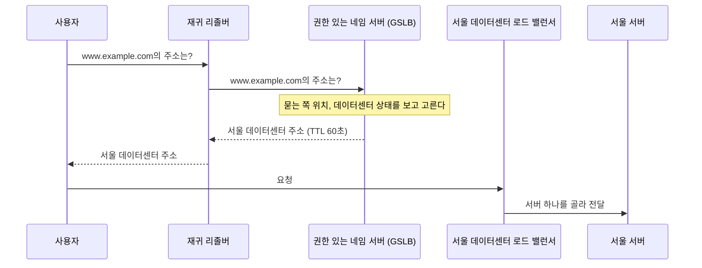
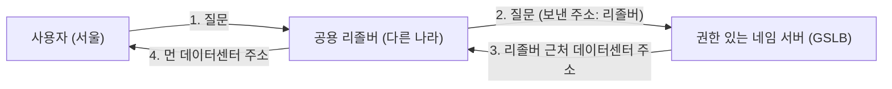

## DNS 로드 밸런싱과 GSLB란 ?
- DNS 로드 밸런싱(DNS Load Balancing)은 도메인 이름을 IP 주소로 바꿔 주는 단계에서 요청을 여러 서버로 나누는 방법이다. 같은 이름에 주소를 여러 개 두고, 묻는 쪽마다 다른 주소나 다른 순서를 돌려준다
- GSLB(Global Server Load Balancing)는 이 방식을 넓혀, 여러 지역에 흩어진 데이터센터 가운데 사용자에게 가깝거나 지금 건강한 곳의 주소를 골라 돌려주는 방법이다
- 주소를 고르는 일은 DNS 응답을 만드는 순간에만 일어난다. 그 뒤로는 리졸버와 운영체제가 답을 캐시에 두고 쓰기 때문에, 네임 서버가 답을 바꿔도 바로 반영되지 않는다는 한계가 있다

[로드 밸런싱](../로드%20밸런싱(Load%20Balancing)/README.md) 노트에서는 요청이 로드 밸런서 한 곳을 지나가며 나뉘는 방식을 봤다. 이 노트는 그보다 한 단계 앞, 사용자가 서버 주소를 알아내는 DNS 단계에서 나누는 방식을 다룬다. DNS의 기본 동작(리졸버, 캐시, TTL)은 [DNS](../Network/DNS(Domain%20Name%20System)/README.md) 노트에 정리했다.

### DNS 로드 밸런싱 (DNS Load Balancing)
로드 밸런싱이라는 말의 뜻은 로드 밸런싱 노트에서 봤다. 짐을 여러 사람에게 고르게 나눠 지게 한다는 뜻이다.
앞에 DNS가 붙으면 나누는 자리가 달라진다. 요청이 서버에 도착한 뒤에 나누는 것이 아니라, 클라이언트가 어느 주소로 갈지 정하는 순간에 나눈다. 권한 있는 네임 서버가 답으로 줄 IP 주소를 조절하는 것이 전부다.

### GSLB (Global Server Load Balancing)
Global의 사전적 의미는 지구 전체의, 세계적인이다. globe(지구, 공)에서 왔다.
공학적으로 GSLB는 한 데이터센터 안의 서버들이 아니라 서울, 도쿄, 미국처럼 지역(Region)이 다른 여러 데이터센터 사이에서 부하를 나누는 일을 말한다. DNS로 구현하는 경우가 많아 GSLB를 DNS 로드 밸런싱의 한 갈래로 보기도 한다(비율은 확인 필요). 다만 이 노트에서 읽은 RFC 가운데 GSLB라는 용어를 정의한 문서는 없었다. 업계에서 제품과 서비스 이름으로 쓰는 말이라 가리키는 범위가 제품마다 다를 수 있다(확인 필요).

전국에 지점이 있는 가게의 대표 전화와 비슷하다. 대표 번호로 전화하면 상담원이 "고객님 댁에서 가까운 강남점으로 가세요"라고 주소를 알려 준다. 손님은 그 주소를 받아 적고 직접 찾아간다. 상담원은 손님을 데려다주지 않고, 주소만 알려 준다.

<br/>

## 왜 필요할까
### 로드 밸런서 앞에도 고르는 단계가 있다
로드 밸런싱 노트에서 본 로드 밸런서는 보통 한 데이터센터 안에 있다. 로드 밸런서를 두 대로 이중화해도 둘 다 같은 건물에 있으면, 정전이나 네트워크 사고로 그 데이터센터 전체가 멈출 때 같이 멈춘다. 이를 피하려면 데이터센터를 여러 지역에 두어야 하고, 그러면 사용자를 어느 데이터센터로 보낼지 정하는 일이 새로 생긴다.

그 결정을 로드 밸런서에 맡길 수는 없다. 로드 밸런서는 이미 어느 한 데이터센터에 속해 있기 때문이다. 그런데 이름으로 접속하는 사용자는 처음에 DNS로 주소를 알아내야 한다. 그래서 이 질문에 답하는 권한 있는 네임 서버가 어느 데이터센터의 주소를 줄지 정하면, 따로 장비를 앞에 세우지 않고도 데이터센터를 고를 수 있다.

### 멀리 있는 서버는 느리다
데이터가 서울에서 미국 동부까지 오가는 데는 빛의 속도로도 시간이 걸린다. 같은 서비스라도 사용자와 가까운 데이터센터로 보내면 응답이 빨라진다. 사용자가 어디서 접속하는지에 따라 다른 주소를 주는 것이 GSLB의 두 번째 목적이다.

### 정리하면
GSLB는 데이터센터를 고르고, 그 안의 로드 밸런서는 서버를 고른다. 두 단계가 나눠서 일한다.



<br/>

## 라운드 로빈 DNS (Round Robin DNS)
가장 단순한 DNS 로드 밸런싱이다. 라운드 로빈이라는 말은 로드 밸런싱 노트에서 봤다. 순서대로 한 번씩 돌아간다는 뜻이다.

### 한 이름에 A 레코드 여러 개
한 이름에 A 레코드를 여러 개 넣을 수 있다. 이름, 클래스, 타입이 같고 데이터(IP 주소)만 다른 레코드들을 레코드 묶음(RRSet, Resource Record Set)이라고 한다(RFC 2181 5절). 그 이름을 물으면 RRSet 안의 레코드가 하나든 여럿이든 전부 돌려준다(RFC 2181 5.1절). 같은 RRSet의 레코드는 TTL도 모두 같아야 한다(RFC 2181 5.2절).

DNS 노트에서 example.com을 물었을 때 A 레코드 두 개가 함께 온 것이 이 경우다.

### 순서를 돌린다
주소를 여러 개 주기만 하면, 클라이언트가 늘 첫 번째 주소로 접속할 경우 첫 번째 서버만 바빠진다. 그래서 네임 서버가 답할 때마다 주소의 순서를 돌려서 준다. 첫 번째 응답은 주소 1, 2, 3, 두 번째는 주소 2, 3, 1 순서다. 이것이 라운드 로빈 DNS다.

RFC 1794 2절에 따르면 1986년 무렵 BIND(널리 쓰이는 DNS 서버 프로그램)를 고친 여러 방식이 나왔고, 그중 가장 널리 퍼진 것은 아마 A 레코드 순서를 돌리는 수정이었다고 적는다. 같은 절은 이 방식이 대상 서버의 실제 부하를 보지 않았다는 점을 한계로 적는다.

순서를 돌리는 것은 규칙이라기보다 관례에 가깝다. RFC 1034 3.6절은 레코드 묶음 안의 순서는 의미가 없고, 네임 서버나 리졸버가 순서를 지키지 않아도 된다고 적는다. RFC 1794 4절도 DNS 프로토콜은 순서를 보장하지 않으며 클라이언트가 순서를 다시 정할 수 있다고 적는다. 중간의 리졸버가 순서를 다시 섞거나, 클라이언트가 자기 기준으로 다시 정렬할 수 있다는 뜻이다.

### 고르는 것은 클라이언트다
라운드 로빈 DNS에서 네임 서버는 목록만 준다. 그 가운데 어느 주소로 접속할지는 클라이언트가 정한다.

- RFC 1034 5.2.1절은 이름을 주소로 바꾸는 리졸버 함수가 받은 주소를 정렬하거나 가장 좋은 주소 하나를 고를 수 있다고 적는다.
- 운영체제도 RFC 6724 6절의 규칙에 따라 받은 주소의 순서를 다시 정렬할 수 있다. 쓸 수 없는 주소를 뒤로 미루는 식이고, 규칙으로 정해지지 않으면 받은 순서를 그대로 둔다.
- RFC 6724 부록 B에 따르면 이 규칙의 옛 판(RFC 3484)은 늘 같은 주소를 맨 앞에 두어 DNS 로드 밸런싱을 무력화하는 일이 있어서 고쳐졌다. 규칙의 자세한 내용은 이 노트에서 다루지 않는다.

받은 목록을 어떻게 쓰는지는 클라이언트마다 다르다. RFC 8305 5절은 브라우저 같은 클라이언트가 정렬한 목록의 첫 주소부터 접속을 시도하고, 정해 둔 시간(권장 기본값 250ms) 안에 성공하지 못하면 다음 주소로도 시도를 시작하라고 권한다. 먼저 성공한 연결을 쓰고 나머지는 취소한다. 주소를 여러 개 받아 두면 한 서버가 응답하지 않을 때 클라이언트가 스스로 다음 서버로 넘어갈 수 있다는 뜻이다. RFC 1794 2절도 여러 주소를 보내는 이유로, 가장 좋은 주소의 서버가 TTL 안에 멈추더라도 두 번째, 세 번째 주소로 회복을 시도할 수 있다는 점을 든다.

### 직접 확인하기
아래 결과는 2026-10-29에 한국어 윈도우 11, Python 3.13.14에서 실행한 값이다. 조회 결과는 시점과 장소, 쓰는 리졸버에 따라 달라지므로 이 노트를 읽을 때 같은 이름을 물으면 다른 주소가 나올 수 있다. 이 PC에 설정된 리졸버의 주소는 적지 않았다.

www.naver.com은 이 PC에서 물었을 때 A 레코드 네 개를 돌려줬다. `socket.getaddrinfo()` 는 운영체제의 이름 찾기 기능을 거쳐 주소 목록을 받는다. 2초 간격으로 다섯 번 물었다.

```python
import socket, sys, time

name = sys.argv[1] if len(sys.argv) > 1 else "www.naver.com"
for i in range(5):
    infos = socket.getaddrinfo(name, 443, socket.AF_INET, socket.SOCK_STREAM)
    print(f"{i + 1}회:", [info[4][0] for info in infos])
    time.sleep(2)
```

```text
1회: ['223.130.192.247', '223.130.200.219', '223.130.192.248', '223.130.200.236']
2회: ['223.130.192.247', '223.130.200.219', '223.130.192.248', '223.130.200.236']
3회: ['223.130.192.248', '223.130.200.236', '223.130.192.247', '223.130.200.219']
4회: ['223.130.192.248', '223.130.200.236', '223.130.192.247', '223.130.200.219']
5회: ['223.130.192.248', '223.130.200.236', '223.130.192.247', '223.130.200.219']
```

주소 네 개는 같고 순서만 바뀌었다. 순서는 매번 바뀌지 않고 몇 번 같은 순서가 이어지다가 바뀌었다. 운영체제가 받은 답을 잠시 캐시에 두고 그대로 돌려주다가, 캐시가 만료되어 다시 물었을 때 새 순서를 받은 것으로 보이지만 확인 필요다. 같은 날 앞서 실행했을 때는 네 번 같은 순서가 나오고 다섯 번째에 바뀌었다. 순서가 바뀌는 시점은 실행할 때마다 다르다.

`nslookup` 으로 공용 리졸버(1.1.1.1)에 1.5초 간격으로 네 번 물었을 때도 순서가 바뀌었다. 출력에서 주소 줄만 뽑아 한 줄로 이었다.

```text
223.130.200.219 | 223.130.200.236 | 223.130.192.247 | 223.130.192.248
223.130.200.219 | 223.130.200.236 | 223.130.192.247 | 223.130.192.248
223.130.192.248 | 223.130.200.219 | 223.130.200.236 | 223.130.192.247
223.130.200.219 | 223.130.200.236 | 223.130.192.247 | 223.130.192.248
```

순서를 돌린 것이 권한 있는 네임 서버인지 리졸버인지는 이 결과만으로는 알 수 없다. 앞 절에서 본 것처럼 중간의 누구든 순서를 바꿀 수 있다.

### 한계
라운드 로빈 DNS는 설정이 쉽지만 약점이 분명하다.

- 서버가 살아 있는지 모른다. 멈춘 서버의 주소도 계속 목록에 넣어 준다.
- 서버의 부하를 모른다. RFC 1794 2절이 지적한 그대로다.
- 고르는 것은 클라이언트이고, 답은 캐시에 남는다. 네임 서버가 순서를 고르게 돌려도 실제 요청이 고르게 나뉜다는 보장이 없다. 이 문제는 아래 TTL 절에서 시뮬레이션으로 본다.

GSLB는 첫 번째 약점을 헬스 체크로 메운다. 데이터센터의 부하나 응답 시간을 함께 보기도 하지만 방식은 제품마다 다르다(확인 필요). 여기에 사용자 위치를 보고 가까운 곳을 고르는 기능을 더한다. 세 번째 약점은 DNS를 쓰는 한 GSLB에도 그대로 남는다.

<br/>

## TTL과 캐시 때문에 생기는 한계
### 답은 한 번 정하면 TTL 동안 남는다
TTL의 뜻과 리졸버 캐시는 [DNS 노트의 캐시와 TTL](../Network/DNS(Domain%20Name%20System)/README.md#캐시와-ttl)에서 봤다. RFC 1035 3.2.1절은 TTL을 레코드를 캐시에 둘 수 있는 시간, 다시 말해 원본에 다시 물어보기 전까지의 시간으로 정의한다. 이 정의는 뒤에서 볼 RFC 8767 4절에서 일부 고쳐졌다.

DNS 로드 밸런싱에서 이것이 뜻하는 바는 크다. 권한 있는 네임 서버가 어떤 리졸버에게 서울 주소를 준 순간, 그 리졸버를 쓰는 모든 사용자는 TTL이 끝날 때까지 서울로 간다. 그 사이에 서울 데이터센터가 멈추고 네임 서버가 곧바로 답을 도쿄로 바꿔도, 이미 서울 주소를 캐시에 둔 리졸버는 다시 묻지 않는다.

앞의 비유로 말하면, 손님이 수첩에 적어 둔 지점 주소다. 그 지점이 문을 닫아도 대표 전화를 다시 걸기 전까지 손님은 수첩에 적힌 곳으로 간다.

### TTL은 최대값일 뿐이다
캐시는 리졸버에만 있는 것이 아니다. 운영체제, 브라우저 같은 프로그램도 답을 따로 캐시에 둘 수 있고, 각 층이 TTL을 어떻게 다루는지는 구현마다 다르다(브라우저별 동작은 확인 필요).

RFC 2181 8절은 TTL이 지켜야 할 최대 시간이지 반드시 그만큼 두어야 하는 시간이 아니라고 적고, 구현이 받은 TTL에 상한을 둘 수 있다고 한다. RFC 8767 4절은 한 걸음 더 나아가, 재귀 리졸버가 TTL이 끝났는데 권한 있는 네임 서버에 닿지 못해 답을 새로 받지 못하면 만료된 답을 계속 써도 된다고 정한다. 권한 있는 네임 서버가 잠시 응답하지 않을 때 서비스가 끊기지 않게 하려는 규칙이지만, 옛 답이 TTL보다 오래 남을 수 있는 경우가 하나 더 생긴 셈이다.

### TTL을 짧게 하면
TTL을 짧게 하면 바뀐 답이 빨리 퍼진다. 그래서 GSLB는 보통 TTL을 짧게 둔다. RFC 1794 4절도 순서가 자주 바뀌는 영역은 TTL도 매우 짧아야 하며, 조건이 분 단위로 바뀌는데 한 시간짜리 TTL을 주는 것은 쓸모없다고 적는다. RFC 1034 3.6절은 바뀔 일이 미리 예상되면 그 전에 TTL을 줄여 두었다가 바꾼 뒤 원래대로 늘리는 방법을 권한다.

대신 질문이 많아진다. 리졸버가 그만큼 자주 권한 있는 네임 서버에 다시 물어야 하고, 사용자도 캐시를 못 쓰는 만큼 이름 찾기를 기다리는 일이 늘어난다.

www.naver.com을 1.1.1.1에 `nslookup -debug` 로 물었을 때 이 구조가 보였다. www.naver.com을 www.naver.com.nheos.com이라는 다른 이름으로 잇는 CNAME 레코드는 TTL이 21558초(약 6시간) 남아 있었고, 그 이름의 A 레코드 네 개는 18초 남아 있었다. nheos.com의 권한 있는 네임 서버(gns1.nheos.com)에 직접 물으니 A 레코드의 TTL은 60초였다. 잘 바뀌지 않는 별명은 길게, 실제로 고르는 주소는 짧게 둔 것으로 보인다. nheos.com이 GSLB 용도로 쓰는 영역인지는 이름과 TTL로 짐작할 뿐이고 확인 필요다.

### 시뮬레이션 1: 서버가 멈춘 뒤 실패가 이어지는 시간
TTL이 장애 조치에 얼마나 걸리는지 Python 3.13.14로 단순하게 흉내 냈다. 가정은 이렇다.

- 재귀 리졸버 1000개가 있고, 리졸버마다 1초에 요청 1개가 들어온다.
- 서버는 A와 B 두 대다. 여기서 A, B는 서버 이름이고 A 레코드와는 상관없다.
- 권한 있는 네임 서버는 서버 A와 B의 주소를 번갈아 하나씩 답한다. 클라이언트는 받은 주소 하나만 쓰고 다른 주소로 다시 시도하지 않는다.
- 리졸버들이 처음 물어본 시각은 TTL 범위 안에서 흩어져 있다.
- 서버 A가 100초에 멈춘다. 헬스 체크는 10초마다 하고, 세 번 연속 실패하면 A를 응답에서 뺀다.

```python
import random

FAIL_AT = 100          # 서버 A가 멈추는 시각(초)
CHECK_EVERY = 10       # 헬스 체크 간격(초)
FAILS_TO_REMOVE = 3    # 연속 몇 번 실패하면 응답에서 뺄지
END = 1000             # 시뮬레이션 끝 시각(초)
RESOLVERS = 1000       # 재귀 리졸버 수 (리졸버마다 1초에 요청 1개가 들어온다고 본다)


def removed_at():
    """헬스 체크가 A를 응답에서 빼는 시각"""
    fails, t = 0, 0
    while True:
        t += CHECK_EVERY
        if t > FAIL_AT:
            fails += 1
            if fails == FAILS_TO_REMOVE:
                return t


def simulate(ttl, seed=1):
    rng = random.Random(seed)
    remove = removed_at()
    turn = 0  # 권한 있는 네임 서버가 A, B를 번갈아 준다

    def answer(now):
        nonlocal turn
        if now >= remove:
            return "B"
        turn += 1
        return "A" if turn % 2 else "B"

    # 리졸버마다 캐시가 만료되는 시각이 다르도록, 처음 물어본 시각을 흩어 둔다
    cache = []
    for _ in range(RESOLVERS):
        asked = -rng.randrange(ttl)
        cache.append([answer(asked), asked + ttl])

    failed, last_fail = 0, None
    for now in range(END):
        for entry in cache:
            if now >= entry[1]:                # TTL이 지나면 다시 묻는다
                entry[0], entry[1] = answer(now), now + ttl
            if now >= FAIL_AT and entry[0] == "A":  # 멈춘 서버로 간 요청은 실패
                failed += 1
                last_fail = now
    return remove, failed, last_fail


for ttl in (30, 60, 300):
    remove, failed, last = simulate(ttl)
    print(f"TTL {ttl:>3}초: A를 응답에서 뺀 시각 {remove}초, "
          f"마지막 실패 {last}초, 실패한 요청 {failed}개")
```

```text
TTL  30초: A를 응답에서 뺀 시각 130초, 마지막 실패 158초, 실패한 요청 22252개
TTL  60초: A를 응답에서 뺀 시각 130초, 마지막 실패 188초, 실패한 요청 29759개
TTL 300초: A를 응답에서 뺀 시각 130초, 마지막 실패 428초, 실패한 요청 87861개
```

헬스 체크는 TTL과 상관없이 130초에 A를 뺐다. 그런데 실패는 그 뒤로도 TTL만큼 더 이어졌다. 129초에 A를 받아 간 리졸버는 TTL이 끝날 때까지 A를 쓰기 때문이다. 서버가 멈춘 뒤 실패가 이어지는 시간은 대략 헬스 체크가 알아채는 시간(30초)에 TTL을 더한 만큼이다. TTL 300초는 30초보다 실패한 요청이 네 배 가까이 많았다.

실제로는 이보다 덜 나쁠 수도, 더 나쁠 수도 있다. 응답에 주소를 여러 개 주고 클라이언트가 RFC 8305처럼 다음 주소로 다시 시도하면 실패가 줄어든다. 반대로 어떤 층이 TTL보다 오래 캐시를 들고 있으면 실패가 더 길어진다.

### 시뮬레이션 2: 나누는 단위는 사용자가 아니라 리졸버다
권한 있는 네임 서버는 사용자를 보지 못하고 리졸버만 본다. 리졸버 하나가 받은 답은 그 리졸버 뒤의 모든 사용자가 함께 쓴다. 그래서 사용자가 한 리졸버에 몰려 있으면 비율을 정해 둬도 실제 부하는 그 비율대로 나뉘지 않는다.

권한 있는 네임 서버가 서울과 도쿄를 3대 1 비율로 무작위로 골라 답하고, TTL은 300초라고 하자. 리졸버 100개에 사용자가 고르게 나뉘어 있을 때와, 그중 하나에 사용자가 몰려 있을 때를 비교했다.

```python
import random
from collections import Counter

WEIGHTS = {"서울": 3, "도쿄": 1}   # 서울에 3, 도쿄에 1 비율로 답한다
TTL = 300                          # 초
MINUTES = 20


def run(users_per_resolver, seed=7):
    rng = random.Random(seed)
    names, weights = list(WEIGHTS), list(WEIGHTS.values())

    def answer():
        return rng.choices(names, weights)[0]   # 가중치 비율로 하나를 고른다

    # 리졸버마다 처음 물어본 시각을 흩어 둔다
    cache = [[answer(), -rng.randrange(TTL) + TTL] for _ in users_per_resolver]
    shares = []
    for minute in range(MINUTES):
        count = Counter()
        for now in range(minute * 60, minute * 60 + 60):
            for entry, users in zip(cache, users_per_resolver):
                if now >= entry[1]:                    # TTL이 지나면 다시 묻는다
                    entry[0], entry[1] = answer(), now + TTL
                count[entry[0]] += users               # 사용자 한 명이 1초에 요청 1개
        shares.append(round(count["서울"] / sum(count.values()) * 100))
    print("  분마다 서울 비율(%):", shares)


print("리졸버 100개, 각각 사용자 10명")
run([10] * 100)
print("리졸버 100개, 그중 하나에 사용자 1000명이 몰림")
run([1000] + [10] * 99)
```

```text
리졸버 100개, 각각 사용자 10명
  분마다 서울 비율(%): [81, 77, 74, 71, 71, 70, 71, 75, 74, 73, 75, 78, 78, 81, 80, 80, 82, 81, 78, 78]
리졸버 100개, 그중 하나에 사용자 1000명이 몰림
  분마다 서울 비율(%): [91, 88, 87, 72, 35, 35, 36, 38, 51, 86, 88, 89, 89, 91, 90, 90, 91, 90, 75, 39]
```

사용자가 고르게 있을 때는 서울 비율이 70%에서 82% 사이로, 정해 둔 75% 근처에 머문다. 사용자가 한 리졸버에 몰려 있으면 35%에서 91%까지 오르내린다. 큰 리졸버가 도쿄 주소를 받은 5분 동안은 도쿄 쪽이 더 바빠지고, 서울 주소를 받으면 다시 서울로 몰린다. 무작위로 고르는 대신 정해진 순서로 돌려도, 큰 리졸버 하나가 받은 답이 사용자 1000명에게 TTL 동안 그대로 쓰인다는 점은 같다.

<br/>

## 헬스 체크와 장애 조치
### GSLB의 헬스 체크
헬스 체크(Health Check)는 로드 밸런싱 노트에서 본 그대로, 서버가 살아 있는지 주기적으로 확인하는 일이다. GSLB는 이 확인을 데이터센터 단위로 한다. 각 지역의 로드 밸런서나 대표 서버에 일정 간격으로 요청을 보내 보고, 응답이 없거나 느린 곳의 주소는 DNS 답에서 뺀다. 확인을 한 곳에서만 하면 확인하는 쪽의 네트워크 문제를 서버 장애로 착각할 수 있다. 그래서 여러 곳에서 확인해 결과를 모으는 방식을 쓰기도 한다(구체적인 방식은 제품마다 다르고 확인 필요).

### 장애 조치 (Failover)
Fail은 실패하다, over는 넘어가다. 장애 조치는 하나가 실패하면 다른 쪽으로 넘기는 일이다. DNS로 하는 장애 조치는 크게 두 가지 모습이다.

- 액티브-스탠바이(Active-Standby): 평소에는 주 데이터센터 주소만 답하고, 헬스 체크가 실패하면 예비 데이터센터 주소로 바꿔 답한다.
- 액티브-액티브(Active-Active): 평소에도 여러 데이터센터 주소를 나눠 답하고, 실패한 곳만 답에서 뺀다.

어느 쪽이든 앞의 시뮬레이션 1에서 본 것처럼, 답을 바꾼 뒤에도 TTL 동안은 옛 주소로 가는 사용자가 남는다. 그래서 DNS 장애 조치는 몇 초 안에 끝나는 전환이 아니라, 헬스 체크 간격과 TTL을 더한 시간에 걸쳐 서서히 옮겨 가는 전환으로 봐야 한다. 데이터센터 안의 서버나 로드 밸런서 한 대가 멈추는 일은 그 안의 이중화가 DNS를 거치지 않고 처리한다. 데이터센터 전체를 빠르게 옮겨야 한다면 아래의 애니캐스트처럼 DNS 캐시와 상관없는 방법을 함께 쓴다.

<br/>

## 지리 기반 응답과 리졸버 위치 문제
### 묻는 쪽의 주소로 위치를 짐작한다
GSLB가 사용자와 가까운 데이터센터를 고르려면 사용자가 어디 있는지 알아야 한다. 아래에서 볼 ECS가 없으면 권한 있는 네임 서버가 볼 수 있는 단서는 질문을 보낸 쪽의 IP 주소뿐이다. 이 주소를 IP 주소와 지역을 짝지어 둔 데이터베이스에서 찾아 위치를 짐작한다.

문제는 질문을 보낸 쪽이 사용자가 아니라는 점이다. RFC 7871 1절은 권한 있는 네임 서버 대부분이 질문이 들어온 IP 주소로 사용자 위치를 짐작하는데, 질문 대부분은 중간의 재귀 리졸버가 보내므로 그 주소는 사용자가 아니라 리졸버의 주소라고 적는다. 전통적으로 리졸버는 사용자와 가까이 있어서 리졸버 주소로 짐작해도 충분했다. 그런데 같은 절은 사용자와 멀리 떨어진 곳에서 많은 사용자의 질문을 모아 처리하는 중앙 집중형 리졸버가 늘었다고 적고, 리졸버를 한곳에 모아 둔 통신사와 기관을 예로 든다. 누구나 쓸 수 있는 공용 DNS 서비스도 사용자와 멀리 있을 수 있다는 점에서 비슷하다. 이런 리졸버를 쓰면 GSLB가 사용자 대신 리졸버 근처의 데이터센터를 골라 버린다.

대표 전화 비유로 보면, 손님 대신 비서가 전화를 걸었는데 비서의 사무실이 다른 도시에 있는 상황이다. 상담원은 비서가 있는 도시의 지점을 알려 준다.



### 직접 확인하기
2026-10-29에 같은 PC에서 몇 분 사이에 www.naver.com을 리졸버만 바꿔 물었다(9.9.9.9의 출력은 생략했다). 공용 리졸버 주소는 누구나 쓰는 공개 주소라 그대로 적었다.

```text
> nslookup www.naver.com 1.1.1.1
Name:    www.naver.com.nheos.com
Addresses:  223.130.192.248
	  223.130.200.219
	  223.130.200.236
	  223.130.192.247
Aliases:  www.naver.com

> nslookup www.naver.com 8.8.8.8
Name:    e6030.a.akamaiedge.net
Address:  23.60.184.249
Aliases:  www.naver.com
	  www.naver.com.nheos.com
	  www.naver.com.edgekey.net
```

이 PC에 설정된 리졸버와 1.1.1.1은 223.130.x.x 주소 네 개를 줬다. 8.8.8.8과 9.9.9.9는 같은 www.naver.com.nheos.com에서 출발했는데, 그 이름이 다시 콘텐츠 전송 네트워크(CDN, Content Delivery Network)의 이름을 가리켜 전혀 다른 주소 하나(8.8.8.8은 23.60.184.249, 9.9.9.9는 23.36.20.242)로 끝났다. 같은 이름을 비슷한 시각에 물어도 어느 리졸버를 거치느냐에 따라 답이 달라진 것이다.

왜 이렇게 갈렸는지는 이 결과만으로 확인할 수 없다. 권한 있는 네임 서버가 각 리졸버가 질문을 보낸 주소를 서로 다른 지역으로 판단했을 가능성이 있지만 추정이다.

<br/>

## EDNS Client Subnet (RFC 7871)
### 무엇인가
DNS 메시지에는 옵션을 덧붙일 수 있는데, 이를 가능하게 한 확장을 DNS 확장 방식(EDNS, Extension Mechanisms for DNS)이라고 한다. EDNS Client Subnet(줄여서 ECS)은 그 옵션 가운데 하나로(RFC 7871 6절, 옵션 번호 8), 재귀 리졸버가 권한 있는 네임 서버에 질문할 때, 사용자 IP 주소의 앞부분(서브넷)을 함께 실어 보내는 방법이다. 앞 절의 리졸버 위치 문제를 풀려고 나왔다.

Client는 손님, 의뢰인이다. 네트워크에서는 서비스를 요청하는 쪽을 말한다. Subnet은 큰 네트워크를 나눈 작은 네트워크, 즉 주소 앞부분이 같은 묶음이다. 192.0.2.0/24 같은 표기는 [주소체계](../Network/주소체계(Addressing)/README.md#서브넷-마스크)에서 봤다. 이름 그대로 클라이언트가 속한 주소 묶음을 알려 주는 옵션이다.

대표 전화 비유로 보면, 비서가 전화하면서 "손님은 강남구에 사세요"라고 동네까지만 알려 주는 것이다.

### 어떻게 동작할까
1. 재귀 리졸버가 사용자의 IP 주소에서 앞부분만 남겨 질문에 싣는다. RFC 7871 11.1절은 사생활 보호를 위해 IPv4는 앞 24비트, IPv6는 앞 56비트까지만 보내라고 강하게 권한다. 192.0.2.77을 쓰는 사용자라면 192.0.2.0/24만 보내는 식이다.
2. 권한 있는 네임 서버는 이 서브넷으로 위치를 짐작해 맞춤 답을 만든다(7.2.1절). 답에는 이 답이 어느 범위의 주소에 맞는 답인지를 SCOPE PREFIX-LENGTH라는 값으로 적어 돌려준다.
3. 재귀 리졸버는 답을 캐시에 넣을 때 이 범위와 묶어 둔다(7.3.1절). 같은 범위의 다른 사용자에게는 캐시에서 주고, 범위 밖의 사용자가 물으면 다시 묻는다.

SCOPE PREFIX-LENGTH가 0이면 모든 주소에 맞는 답, 즉 서브넷을 쓰지 않은 답이라는 뜻이다. ECS를 지원하지만 이번 답에 쓰지 않았다면 0을 돌려줘야 하고(12.1절), 응답에 ECS가 아예 없으면 리졸버는 0을 받은 것처럼 다룬다(7.3절).

### 대가
- 캐시가 잘게 쪼개진다. 같은 이름의 답을 서브넷마다 따로 들고 있어야 하니 캐시가 커지고, 캐시에서 바로 답하는 비율은 줄어든다. RFC 7871 5절은 캐시 증가를 걱정거리의 하나로 꼽고, 11.3절은 악의가 없어도 여러 네트워크의 사용자를 받는 리졸버는 네트워크마다 다른 답을 들고 있어야 해서 캐시 부담이 커진다며 기본 설정에서는 ECS를 꺼 두라고 한다.
- 사용자 정보가 새어 나간다. 11.1절은 ECS를 쓰면 사용자의 네트워크 주소가 이름 찾기에 관여한 모든 서버와, DNS 패킷이 지나는 모든 네트워크에 보인다고 적는다. 2절은 처음부터 설계했다면 꼭 이 방식 그대로 만들지는 않았을 것이라며, 모든 네임 서버 소프트웨어에서 기본으로 꺼 두고 분명한 이득이 있을 때만 켜라고 권한다.
- 모두가 쓰지는 않는다. 12.2절은 리졸버가 정해 둔 권한 있는 네임 서버에만 ECS를 보내거나, 권한 있는 네임 서버가 정해 둔 리졸버에게만 ECS를 적용하는 허용 목록(whitelist) 방식을 소개한다.

### 직접 확인하기
권한 있는 네임 서버에 ECS를 붙인 질문을 직접 보내 봤다. 파이썬 표준 라이브러리만으로 DNS 질문 패킷을 만들어 UDP 53번 포트로 보내는 스크립트다. 재귀 요청을 하지 않는 읽기 전용 질문이다. 넣은 서브넷 세 개는 임의로 고른 공개 주소 대역이고, 각 대역의 실제 위치는 확인하지 않았다.

<details>
<summary>ecs_query.py 전체 코드</summary>

```python
"""권한 있는 네임 서버에 ECS 옵션을 붙인 A 질의를 보내고 답을 출력한다 (표준 라이브러리만 사용)."""
import ipaddress
import random
import socket
import struct
import sys


def encode_name(name):
    out = b""
    for label in name.rstrip(".").split("."):
        out += bytes([len(label)]) + label.encode()
    return out + b"\x00"


def build_query(name, subnet):
    qid = random.randint(0, 0xFFFF)
    # 헤더: ID, 플래그 0 (재귀 요청 안 함), 질문 1, 답 0, 권한 0, 추가 1 (OPT)
    header = struct.pack("!HHHHHH", qid, 0, 1, 0, 0, 1)
    question = encode_name(name) + struct.pack("!HH", 1, 1)  # A, IN
    opt_data = b""
    if subnet is not None:
        net = ipaddress.ip_network(subnet)
        nbytes = (net.prefixlen + 7) // 8
        addr = net.network_address.packed[:nbytes]
        family = 1 if net.version == 4 else 2
        ecs = struct.pack("!HBB", family, net.prefixlen, 0) + addr
        opt_data = struct.pack("!HH", 8, len(ecs)) + ecs  # OPTION-CODE 8 = ECS
    # OPT 레코드: 이름 루트, TYPE 41, CLASS = UDP 크기, TTL 0, RDATA = 옵션
    opt = b"\x00" + struct.pack("!HHIH", 41, 1232, 0, len(opt_data)) + opt_data
    return qid, header + question + opt


def skip_name(msg, i):
    while True:
        n = msg[i]
        if n == 0:
            return i + 1
        if n & 0xC0 == 0xC0:
            return i + 2
        i += n + 1


def parse(msg):
    qd, an, ns, ar = struct.unpack("!HHHH", msg[4:12])
    i = 12
    for _ in range(qd):
        i = skip_name(msg, i) + 4
    answers, scope = [], None
    for k in range(an + ns + ar):
        i = skip_name(msg, i)
        rtype, rclass, ttl, rdlen = struct.unpack("!HHIH", msg[i:i + 10])
        i += 10
        rdata = msg[i:i + rdlen]
        if k < an and rtype == 1:
            answers.append((socket.inet_ntoa(rdata), ttl))
        if rtype == 41:
            j = 0
            while j + 4 <= len(rdata):
                code, length = struct.unpack("!HH", rdata[j:j + 4])
                if code == 8:
                    scope = rdata[j + 7]  # SCOPE PREFIX-LENGTH
                j += 4 + length
        i += rdlen
    return answers, scope


def ask(server, name, subnet):
    qid, packet = build_query(name, subnet)
    with socket.socket(socket.AF_INET, socket.SOCK_DGRAM) as s:
        s.settimeout(3)
        s.sendto(packet, (server, 53))
        msg, _ = s.recvfrom(4096)
    answers, scope = parse(msg)
    return sorted(a for a, _ in answers), sorted({t for _, t in answers}), scope


if __name__ == "__main__":
    server, name = sys.argv[1], sys.argv[2]
    for subnet in sys.argv[3:]:
        sub = None if subnet == "none" else subnet
        addrs, ttls, scope = ask(server, name, sub)
        print(f"ECS {subnet:>18} -> {addrs} TTL {ttls} scope {scope}")
```

</details>

`python ecs_query.py <권한 있는 네임 서버 주소> <이름> none 8.8.8.0/24 ...` 처럼 실행한다. none은 ECS를 붙이지 않은 질문이다. 세 곳의 권한 있는 네임 서버에 물은 결과다(주소 목록은 길어서 줄였다).

```text
# gns1.nheos.com에 www.naver.com.nheos.com
ECS               none -> ['223.130.192.247', '223.130.192.248', '223.130.200.219', '223.130.200.236'] TTL [60] scope None
ECS         8.8.8.0/24 -> ['223.130.192.247', '223.130.192.248', '223.130.200.219', '223.130.200.236'] TTL [60] scope 0
ECS       81.2.69.0/24 -> ['223.130.192.247', '223.130.192.248', '223.130.200.219', '223.130.200.236'] TTL [60] scope 0

# ns1.google.com에 www.google.com
ECS               none -> ['142.251.150.119', ... 8개] TTL [300] scope None
ECS         8.8.8.0/24 -> ['142.251.150.119', ... 8개] TTL [300] scope 24
ECS       81.2.69.0/24 -> ['142.251.150.119', ... 8개] TTL [300] scope 24
ECS   223.130.200.0/24 -> ['142.251.150.119', ... 8개] TTL [300] scope 19

# n1a.akamaiedge.net에 e6030.a.akamaiedge.net
ECS               none -> ['23.60.184.249'] TTL [20] scope None
ECS         8.8.8.0/24 -> ['23.60.184.249'] TTL [20] scope None
ECS       81.2.69.0/24 -> ['23.60.184.249'] TTL [20] scope None
```

세 서버의 반응이 달랐다.

- gns1.nheos.com은 ECS 옵션을 돌려주면서 범위를 0으로 적었다. ECS를 지원하지만 이번 답에 쓰지 않았다는 뜻(RFC 7871 12.1절)일 수도 있고, ECS를 구현하지 않은 서버가 받은 옵션을 그대로 되돌려 보낸 것(7.2.1절)일 수도 있다. 어느 쪽이든 리졸버는 모든 주소에 맞는 답으로 다룬다. 서브넷을 바꿔도 답이 같았다.
- ns1.google.com은 범위를 24나 19로 적었다. 이 답을 그 범위의 주소에만 맞는 답으로 캐시하라는 뜻이다. 다만 이번 질문에서는 서브넷을 바꿔도 주소 목록이 같았다.
- n1a.akamaiedge.net은 응답에 ECS 옵션이 없었다. 리졸버라면 범위 0으로 다룰 응답이다(7.3절).

서브넷에 따라 주소가 달라지는 모습은 이번 실험에서 보지 못했다. nheos와 akamai는 이 PC가 허용 목록에 든 리졸버가 아니라서 ECS를 쓰지 않았을 수 있다. 구글은 범위를 0이 아닌 값으로 돌려줬으니 서브넷을 보고 답했지만, 고른 서브넷들이 같은 답을 받는 범위에 들었던 것으로 보인다. 어느 쪽도 확인 필요다.

<br/>

## 애니캐스트와의 차이
애니캐스트(Anycast)는 같은 IP 주소를 여러 곳에서 동시에 광고하고, 라우팅이 패킷을 그중 한 곳으로 보내게 하는 방법이다(RFC 4786 2절). 여기서 광고(Advertisement)는 이 주소로 가는 길이 여기 있다고 이웃 네트워크에 알리는 일이다. Any는 아무것이나, cast는 던지다. 받을 곳 여럿 가운데 아무 곳에나 보낸다는 뜻이다.

119에 전화하면 번호는 하나인데 거는 곳에서 가까운 상황실로 연결되는 것과 비슷하다. 어느 상황실로 갈지는 거는 사람이 아니라 전화망이 정한다. DNS 노트에서 루트 네임 서버 이름 하나 뒤에 서버가 여러 곳에 있다고 한 것이 이 방식이다.

DNS 로드 밸런싱과의 가장 큰 차이는 누가 고르느냐다. DNS 로드 밸런싱은 장소마다 다른 주소를 두고, 네임 서버가 어느 주소를 어떤 순서로 줄지 정한다. 마지막에 하나를 고르는 것은 클라이언트다. 애니캐스트는 주소가 하나뿐이고, 어느 곳으로 갈지는 라우팅 시스템이 망 구조와 요청이 출발한 위치를 보고 정한다(RFC 4786 3.1절). 그래서 DNS 캐시나 리졸버 위치의 영향을 받지 않는다. 한 곳이 멈추면 그곳이 경로 광고를 거두는 방식으로 빠질 수 있다(4.4.1절).

대신 약점도 있다. RFC 4786 3.1절은 애니캐스트 노드 사이의 부하는 대개 고르게 나뉘지 않는다고 적고, 3.2절은 라우팅에서 가까운 것과 실제 응답 시간은 일반적으로 상관이 없고, 응답이 오히려 느려질 수도 있다고 적는다. 4.1절은 한 번의 주고받기 동안 같은 노드와 통신해야 하므로, 경로가 바뀌지 않고 유지되는 시간이 거래 시간보다 충분히 길어야 한다고 적는다. 질문 하나, 답 하나로 끝나는 UDP DNS는 잘 맞고, 오래 이어지는 다운로드는 더 따져 봐야 한다는 뜻이다. 3.1절은 애니캐스트와 라운드 로빈 DNS를 함께 쓸 수도 있다고 적는다.

| 방식 | 누가 고르나 | 바뀐 결정이 반영되는 시간 | 약점 |
| --- | --- | --- | --- |
| 라운드 로빈 DNS | 네임 서버가 순서를 돌리고 클라이언트가 고름 | TTL과 캐시에 달림 | 서버 상태와 부하를 모름 |
| GSLB (DNS 기반) | 권한 있는 네임 서버가 위치와 상태를 보고 고름 | 헬스 체크 간격 + TTL과 캐시 | 리졸버 단위로 나뉨, 리졸버 위치로 착각 |
| 애니캐스트 | 라우팅 시스템이 경로로 고름 | 경로 광고가 바뀌는 시간 | 부하 조절이 어렵고 긴 연결에 주의 |

<br/>

## 참고 자료
- [RFC 1034](https://www.rfc-editor.org/rfc/rfc1034), Domain Names - Concepts and Facilities: 3.6절(레코드 묶음 안의 순서는 의미가 없다, TTL의 뜻, 바꾸기 전에 TTL을 줄이는 방법), 5.2.1절(리졸버 함수가 주소를 정렬하거나 하나를 고를 수 있다)
- [RFC 1035](https://www.rfc-editor.org/rfc/rfc1035), Domain Names - Implementation and Specification: 3.2.1절(TTL 필드 정의), 6.1.3절(캐시 데이터의 TTL이 줄어드는 방식)
- [RFC 1794](https://www.rfc-editor.org/rfc/rfc1794), DNS Support for Load Balancing: 2절(라운드 로빈 순서 돌리기의 역사, 여러 주소를 보내는 이유), 4절(순서는 보장되지 않음, 자주 바뀌는 정보에는 짧은 TTL), 5절(당시 BIND 구현)
- [RFC 2181](https://www.rfc-editor.org/rfc/rfc2181), Clarifications to the DNS Specification: 5절, 5.1절, 5.2절(RRSet, 전부 돌려주기, 같은 TTL), 8절(TTL은 최대값)
- [RFC 6724](https://www.rfc-editor.org/rfc/rfc6724), Default Address Selection for IPv6: 6절(목적지 주소 선택 규칙), 부록 B(규칙 9 변경과 DNS 로드 밸런싱)
- [RFC 8305](https://www.rfc-editor.org/rfc/rfc8305), Happy Eyeballs Version 2: 4절(주소 정렬), 5절(연결 시도 간격, 먼저 성공한 연결 사용)
- [RFC 8767](https://www.rfc-editor.org/rfc/rfc8767), Serving Stale Data to Improve DNS Resiliency: 1절, 4절(만료된 답을 쓸 수 있는 경우)
- [RFC 7871](https://www.rfc-editor.org/rfc/rfc7871), Client Subnet in DNS Queries: 1절, 2절, 5절, 6절, 7.1절, 7.2.1절, 7.3절, 7.3.1절, 11.1절, 11.3절, 12절, 13절
- [RFC 4786](https://www.rfc-editor.org/rfc/rfc4786), Operation of Anycast Services: 1절, 2절, 3.1절, 3.2절, 4.1절, 4.4.1절

<br/>

## 확인한 환경
- 2026-10-29, 한국어 윈도우 11, Python 3.13.14
- 조회 결과(IP 주소, TTL, CNAME 경로)는 실행한 날짜와 장소, 리졸버에 따라 다르고 이 노트를 읽는 시점에는 바뀌었을 수 있다
- 시뮬레이션 두 개는 같은 환경에서 실행했고, 난수 시드를 고정해 두어 다시 실행하면 같은 값이 나온다

<br/>

## 더 볼 것 (TODO)
- 애니캐스트 자세히 (BGP 경로 광고, 캐치먼트, 루트 네임 서버의 쓰임)
- CDN이 DNS와 애니캐스트로 가까운 엣지 서버를 고르는 방식
- IP 주소로 위치를 찾는 데이터베이스(GeoIP)의 원리와 정확도
- 헬스 체크를 여러 곳에서 할 때 결과를 모으는 방법과 오탐
- 브라우저와 운영체제의 DNS 캐시가 TTL을 다루는 방식
- DNS over HTTPS가 리졸버 위치 문제와 ECS에 주는 영향
- 응답 크기를 키우는 EDNS0 자체 (RFC 6891)
- 운영체제의 목적지 주소 정렬 규칙 (RFC 6724)
- DNS 메시지와 ECS 옵션을 바이트 단위로 직접 만들어 보기
