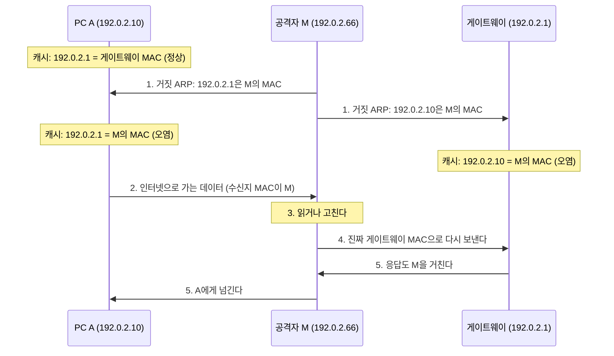

## ARP 스푸핑이란 ?
- 같은 네트워크 안에서 거짓 ARP 메시지를 보내, 다른 장치의 ARP 캐시에 틀린 IP 주소와 MAC 주소 짝을 적게 만드는 공격
- 속은 장치는 게이트웨이 같은 상대에게 보낼 데이터를 공격자의 MAC 주소로 보낸다. 공격자는 그 데이터를 엿보거나, 고쳐서 넘기거나, 넘기지 않고 끊을 수 있다
- ARP에는 답을 보낸 쪽이 그 IP 주소의 진짜 주인인지 확인하는 절차가 없어서 생긴다. 이 노트는 그 원리와 막는 방법, 알아채는 방법을 방어하는 쪽에서 정리한다. 공격 도구 사용법은 다루지 않는다

ARP 자체의 동작(Request, Reply, ARP 캐시)은 [ARP](../ARP(Address%20Resolution%20Protocol)/README.md) 문서를 먼저 보면 좋다.

### 스푸핑 (Spoofing)
Spoof의 사전적 의미는 남을 속이다, 장난으로 흉내 내다이다.
공학적으로는 보내는 데이터의 출처 정보를 거짓으로 꾸며 다른 누군가인 척하는 일을 말한다. 무엇을 꾸미느냐에 따라 IP 스푸핑([SYN Flood](../SYN%20Flood(SYN%20Flood)/README.md#출발지-주소-위조-ip-spoofing) 문서의 출발지 주소 위조), DHCP 스푸핑처럼 이름이 붙는다. ARP 스푸핑은 ARP 메시지에 적는 송신자 정보를 꾸며, 공격자의 MAC 주소를 남의 IP 주소의 주인처럼 알리는 것이다.

### ARP 캐시 포이즈닝 (ARP Cache Poisoning)
Poisoning의 사전적 의미는 독을 타는 것이다.
공학적으로는 ARP 캐시에 틀린 짝을 섞어 넣어 캐시를 오염시키는 일을 말한다. ARP 스푸핑과 거의 같은 뜻으로 함께 쓰인다. 이름으로 보면 스푸핑은 거짓 메시지를 꾸며 보내는 행위에, 포이즈닝은 그 결과 캐시가 더럽혀진 상태에 초점을 둔 말이다.

[ARP](../ARP(Address%20Resolution%20Protocol)/README.md#왜-arp가-필요할까) 문서의 아파트 단지 방송 비유로 이어 보면, 누군가 단지 방송에 끼어들어 관리사무소(게이트웨이)는 105호라고 외치는 것과 같다. 105호는 사실 자기 집이다. 택배 기사는 방송한 사람이 진짜 관리사무소인지 확인하지 않고 수첩에 그대로 적고, 그 뒤로 관리사무소에 맡길 택배를 105호에 맡긴다.

<br/>

## 왜 이런 일이 생길까
### ARP 메시지는 확인 없는 주장이다
ARP Request에는 묻는 쪽이 자기 IP 주소와 MAC 주소를 함께 적는다. RFC 5227 1.2절은 이 송신자 칸이 이 IP 주소는 이 MAC 주소에 대응한다는 사실의 주장(assertion)이라고 설명한다. Reply도 마찬가지로 답하는 쪽이 자기 짝을 적어 보낸다.

문제는 이 주장을 확인할 방법이 없다는 점이다. 받는 쪽은 송신자 칸에 적힌 IP 주소가 정말 그 MAC 주소를 가진 장치의 것인지 검사하지 않는다. 진짜임을 확인하는 일, 즉 인증(Authentication)은 [HTTPS와 TLS](../../WEB/HTTPS와%20TLS(HTTPS%20and%20TLS)/README.md#인증-authentication) 문서에서 본 것처럼 따로 설계해야 생기는 기능인데, ARP에는 그런 장치가 없다. 내려받은 RFC 826 원문을 security, authentication, trust 같은 단어로 찾아보면 한 번도 나오지 않는다.

RFC 5227 5절도 이 점을 그대로 적는다. 악의를 가진 호스트가 거짓 ARP 패킷을 보내 다른 호스트의 정상 동작을 방해할 수 있고, 모든 ARP Request에 자기 MAC 주소로 답해 네트워크의 모든 주소가 자기 것이라고 주장하기도 쉽다는 것이다.

### 받는 쪽은 묻지 않은 답도 적는다
RFC 826의 Packet Reception 부분은 ARP 패킷을 받았을 때의 처리 순서를 아래처럼 정한다.

1. 송신자 IP 주소가 이미 내 표(ARP 캐시)에 있으면, 그 항목의 MAC 주소를 패킷에 적힌 송신자 MAC 주소로 바꾼다.
2. 패킷이 묻는 대상 IP 주소가 내 주소이면, 아직 표에 없던 송신자 짝도 새로 적는다.
3. 그다음에야 이 패킷이 Request인지 Reply인지(opcode)를 본다. Request면 Reply를 돌려보낸다.

RFC 826은 opcode를 맨 나중에 본다는 점을 일부러 강조한다. 1번 덕분에 랜카드를 바꾼 장치가 한 번 ARP를 보내면 다른 장치들의 표가 저절로 새 값으로 바뀌고(Related issue 부분), 2번은 A가 B에게 말을 걸었으면 B도 곧 A에게 답할 것이라는 가정에서 나왔다. 1982년에 같은 케이블에 붙은 장치들끼리 쓰려고 만든 규칙이라, 같은 네트워크에 거짓말하는 장치가 있을 경우는 다루지 않는다(빠른 갱신을 우선한 설계로 보인다).

이 규칙에는 내가 물어본 적이 있는지를 따지는 단계가 없다. 그래서 순서를 그대로 따르는 구현이라면 아무도 묻지 않았는데 날아온 ARP 메시지로도 캐시가 바뀐다. ARP 스푸핑은 바로 이 지점을 노린다.

<br/>

## 캐시가 덮어써지는 두 가지 길
### 요청하지 않은 Reply (Unsolicited ARP Reply)
Solicit의 사전적 의미는 간청하다, 요청하다이고, unsolicited는 청하지 않은이라는 뜻이다.
공학적으로는 내가 ARP Request를 보낸 적이 없는데 도착한 ARP Reply를 말한다. 공격자는 PC에게 Reply를 직접 보내면서 송신자 IP 칸에는 게이트웨이의 IP 주소를, 송신자 MAC 칸에는 자기 MAC 주소를 적는다. 대상 IP 칸은 그 PC의 주소다. 앞의 처리 순서대로라면 PC는 게이트웨이 항목이 있으면 1번으로 덮어쓰고, 없더라도 대상 IP가 자기 주소이니 2번으로 새로 적는다.

택배 기사가 묻지도 않았는데 누군가 관리사무소는 105호라고 적힌 쪽지를 건네고, 기사가 그대로 수첩을 고치는 것과 같다.

실제 운영체제가 이 Reply를 다 받아들이는지는 구현마다 다르다. RFC 5227 3절은 일부 구현이 최근에 자기가 보낸 Request에 대한 Reply만 받고 묻지 않은 Reply는 무시할 수 있다고 적는다(이 RFC는 이런 구현을 RFC 826을 정확히 따르지 않는 구현으로 본다). RFC 826의 처리 순서만 놓고 보면, 묻지 않은 Reply를 무시하더라도 아래의 Gratuitous ARP로는 여전히 캐시가 바뀔 수 있다. 윈도우, 리눅스, 맥이 이 두 가지를 실제로 어떻게 처리하는지는 이 노트에서 시험하지 않았다(확인 필요).

### Gratuitous ARP
Gratuitous의 사전적 의미는 대가 없는, 무료의이고, 굳이 하지 않아도 되는, 이유 없는이라는 뜻으로도 쓴다.
공학적으로는 아무도 묻지 않았는데 장치가 자기 IP 주소와 MAC 주소를 네트워크 전체에 알리는 ARP 메시지를 말한다. RFC 5227 4절은 흔히 Gratuitous ARP라고 부르는 패킷이 이 RFC가 ARP Announcement라고 부르는 패킷과 같다고 정리한다. 송신자 IP 칸과 대상 IP 칸을 모두 자기 주소로 채운 ARP Request를 브로드캐스트로 보내는 것이다(1.1절). 같은 RFC 3절은 Reply 대신 Request를 쓰는 이유로, 묻지 않은 Reply를 무시하는 구현이 있어도 브로드캐스트 Request는 원래 예고 없이 오는 메시지라 더 잘 받아들여진다는 점을 든다.

원래는 정상적인 쓰임이 있다. RFC 5227 2.3절은 장치가 새 주소를 쓰기 시작할 때 Announcement를 두 번 보내, 예전에 그 주소를 쓰던 다른 장치의 오래된 짝이 다른 장치들의 캐시에 남아 있지 않게 하라고 정한다. 이사 온 사람이 단지 방송으로 홍길동은 이제 302호에 산다고 알려 두는 것과 같다.

같은 형식에 송신자 IP만 남의 주소(예: 게이트웨이)로 바꿔 넣으면 공격이 된다. 브로드캐스트라 네트워크의 모든 장치가 받고, 처리 순서 1번에 따라 게이트웨이 항목을 이미 가진 장치는 모두 그 항목을 공격자 MAC 주소로 덮어쓴다. 대상 IP가 자기 주소가 아니니 2번은 해당하지 않아서, 항목이 없던 장치에 새로 적히지는 않는다. 게이트웨이는 거의 모든 장치가 수시로 쓰는 상대라 대개 이미 캐시에 있다.

<br/>

## 중간자 공격으로 이어지는 흐름
### 중간자 공격 (MITM, Man-In-The-Middle)
사전적 의미는 가운데 끼어 있는 사람이다.
공학적으로는 통신하는 두 당사자 사이에 끼어들어, 양쪽은 서로 직접 주고받는다고 믿는 동안 실제로는 모든 데이터가 중간자를 거치게 만드는 공격을 말한다. [보안 응답 헤더](../../WEB/보안%20응답%20헤더(Security%20Response%20Headers)/README.md#strict-transport-security-hsts) 문서의 부트스트랩 MITM도 같은 뜻이다. ARP 스푸핑은 같은 네트워크 안에서 이 자리를 차지하는 대표적인 방법이다.

편지를 주고받는 두 사람 사이에서 우체부가 편지를 몰래 뜯어 읽고 다시 봉해 배달하는 것과 같다. 두 사람은 편지가 제대로 오가니 아무것도 모른다.

### 흐름
PC A(192.0.2.10)가 기본 게이트웨이(192.0.2.1)를 거쳐 인터넷을 쓰고 있고, 같은 네트워크에 공격자 M(192.0.2.66)이 붙어 있는 상황이다. 주소는 모두 설명을 위한 예시 값이다.



1. M이 A에게는 게이트웨이의 IP 주소가 M의 MAC 주소라고, 게이트웨이에게는 A의 IP 주소가 M의 MAC 주소라고 거짓 ARP 메시지를 보낸다. 앞 절의 두 가지 길 중 어느 쪽이든 쓸 수 있다. 다만 브로드캐스트로 A의 주소를 사칭하면 A도 그 메시지를 받으므로, 뒤에서 볼 충돌 감시에 걸릴 수 있다.
2. A가 인터넷의 서버로 데이터를 보낸다. [ARP](../ARP(Address%20Resolution%20Protocol)/README.md#기본-게이트웨이-default-gateway) 문서에서 본 것처럼 수신지 IP 주소에는 서버 주소를, 수신지 MAC 주소에는 게이트웨이의 MAC 주소를 적어야 하는데, 캐시가 오염되어 M의 MAC 주소가 들어간다.
3. 스위치는 [MAC 주소만 보고](../ARP(Address%20Resolution%20Protocol)/README.md#스위치에서-보면) 프레임을 M이 연결된 포트로 보낸다. 스위치는 IP 헤더를 열어 보지 않으므로 이상한 점을 알 수 없다([계층 모델](../계층%20모델(OSI%20and%20TCP-IP%20Layers)/README.md#중간-장비는-어디까지-벗길까) 참고). M은 받은 데이터를 읽거나 고친다.
4. M이 진짜 게이트웨이의 MAC 주소로 다시 보낸다. 데이터가 결국 서버에 닿으니 A는 인터넷이 정상으로 된다고 느낀다.
5. 게이트웨이도 오염되어 있어서 응답 역시 M을 거쳐 A에게 간다.

한쪽만 속이면 한 방향의 데이터만 M을 지난다. 그래서 양쪽을 모두 속여야 대화 전체가 중간자를 거친다. 또 진짜 게이트웨이가 ARP Request를 브로드캐스트하면 처리 순서 1번으로, A의 캐시 항목이 시간이 지나 지워지면 A가 다시 물어 받은 진짜 답으로 바른 값이 돌아오므로, 공격이 이어지려면 거짓 메시지가 계속 반복되어야 한다. 이 반복은 뒤의 탐지에서 단서가 된다.

### 공격자가 할 수 있는 일
[HTTPS와 TLS](../../WEB/HTTPS와%20TLS(HTTPS%20and%20TLS)/README.md#http만-쓰면-생기는-문제) 문서에서 본 세 가지 문제가 그대로 생긴다.

- 엿보기. 암호화되지 않은 데이터(HTTP 요청, 쿠키, 비밀번호)를 읽는다.
- 바꿔치기. 지나가는 응답에 다른 내용을 끼워 넣는다. [DNS](../DNS(Domain%20Name%20System)/README.md) 답을 고치면 A를 가짜 서버로 보내는 사칭으로도 이어진다.
- 끊기. M이 데이터를 넘기지 않으면 A의 통신이 끊긴다. 엿보지 않고 방해만 하는 [서비스 거부](../SYN%20Flood(SYN%20Flood)/README.md#서비스-거부-dos-denial-of-service)다.

### 어디까지 닿을까
ARP 메시지는 IP 헤더 없이 이더넷 프레임에 바로 실려 간다([계층 모델](../계층%20모델(OSI%20and%20TCP-IP%20Layers)/README.md#인터넷-계층과-링크-계층-사이) 참고). 라우터가 다음 네트워크로 넘길 IP 패킷이 아니라서 브로드캐스트든 유니캐스트든 [라우터](../ARP(Address%20Resolution%20Protocol)/README.md#라우터-router)를 넘지 못한다. 그래서 ARP 스푸핑은 공격자가 같은 네트워크(같은 브로드캐스트 도메인)에 붙어 있어야 가능하다. 인터넷 저편에서 내 PC의 ARP 캐시를 바꿀 수는 없다. 반대로 카페나 공항 와이파이처럼 모르는 사람과 같은 네트워크를 쓰는 곳에서는 이 조건이 쉽게 갖춰진다.

<br/>

## 막는 방법
막는 방법은 장치(PC) 쪽, 스위치 쪽, 위 계층 쪽에 하나씩 있다. ARP 자체를 막는 것은 앞의 두 가지이고, HTTPS는 속더라도 피해를 줄이는 쪽이다.

| 방법 | 어디서 | 무엇을 하나 | 한계 |
| --- | --- | --- | --- |
| 정적 ARP 항목 | 각 장치 | 중요한 짝을 손으로 고정한다 | 장치마다 따로, 바뀌면 손으로 고친다 |
| DHCP 스누핑과 DAI | 스위치 | 주소를 받은 기록과 맞지 않는 ARP를 버린다 | 설정할 수 있는 스위치가 있어야 한다 |
| HTTPS(TLS) | 응용 프로그램 | 가로채도 읽거나 고치지 못하게 한다 | 끊기와 겉 정보 노출은 막지 못한다 |

### 정적 ARP 항목 (Static ARP Entry)
Static의 사전적 의미는 정지한, 움직이지 않는이다.
공학적으로는 ARP 메시지로 알아낸 값이 아니라 사람이 직접 넣은 ARP 캐시 항목을 말한다. 받은 ARP 메시지로 바뀌지 않게 고정해 두려는 것이 목적이다. 윈도우의 `arp -a` 출력에서는 Type 칸이 static으로 나온다. 다만 브로드캐스트 주소나 멀티캐스트(여러 장치에 한꺼번에 보내는 방식) 주소처럼 운영체제가 처음부터 넣어 두는 항목도 static으로 나오므로, static이라고 모두 사람이 넣은 것은 아니다.

택배 기사 수첩의 관리사무소 칸만 볼펜으로 적어 두고, 방송으로 다른 호수를 들어도 고치지 않는 것과 같다.

윈도우에서는 `arp -s` 로 정적 항목을 넣는다. `arp /?` 도움말은 이렇게 넣은 항목을 영구(permanent)라고 적는다. 이 명령은 캐시를 바꾸므로 이 노트를 쓰면서는 실행하지 않았다. 그래서 다시 시작한 뒤에도 남는지, 정적 항목이 있을 때 거짓 ARP 메시지가 와도 정말 그대로인지는 확인 필요다.

한계도 분명하다.

- 장치마다 따로 넣어야 한다. 장치가 많으면 관리할 수 없다.
- 상대 장치(예: 공유기)를 바꾸면 모든 장치의 항목을 손으로 고쳐야 한다. 고치지 않으면 통신이 끊긴다.
- 내 PC만 고정해도 게이트웨이 쪽 캐시가 오염되면 돌아오는 방향은 여전히 가로채인다.

그래서 보통은 게이트웨이처럼 꼭 지켜야 하는 몇 개의 짝에만 쓴다.

### DHCP 스누핑 (DHCP Snooping)
Snoop의 사전적 의미는 기웃거리며 살피다, 염탐하다이다.
공학적으로는 스위치가 자기를 지나가는 [DHCP](../DHCP(Dynamic%20Host%20Configuration%20Protocol)/README.md) 메시지를 들여다보며, 믿을 수 없는 포트에서 온 DHCP 메시지를 걸러 내고 어느 포트의 어느 장치가 어떤 IP 주소를 받았는지 표로 쌓아 두는 기능이다. 여기서는 Cisco Catalyst 9300 설정 안내서(IOS XE 17.9.x, IP Addressing Services Configuration Guide의 Configuring DHCP 장)를 기준으로 정리한다. 다른 제조사 장비는 이름과 기본값이 다를 수 있다.

- 스위치는 포트를 믿는 포트(trusted)와 믿지 않는 포트(untrusted)로 나눈다. 기본값은 모든 포트가 믿지 않는 포트다. DHCP 서버나 다른 스위치로 이어진 포트를 믿는 포트로 정하고, 사용자 PC가 붙는 포트는 믿지 않는 포트로 둔다.
- 믿지 않는 포트에서 DHCPOFFER, DHCPACK처럼 서버만 보내야 하는 메시지가 들어오면 버린다. 사용자 자리에 몰래 꽂은 가짜 DHCP 서버가 잘못된 게이트웨이를 나눠 주는 일(DHCP 스푸핑)을 여기서 막는다.
- 믿지 않는 포트에서 주소를 받은 장치마다 MAC 주소, IP 주소, 임대 기간, VLAN 번호, 포트를 기록한다. 이 표를 DHCP 스누핑 바인딩 데이터베이스(Binding Database)라고 한다. Binding은 묶어 두는 것이라는 뜻으로, IP 주소와 MAC 주소와 포트를 한 줄로 묶어 둔 기록이다.

VLAN(Virtual LAN)은 스위치 하나를 여러 개의 논리 네트워크로 나눈 단위다. 여기서는 스위치가 기능을 켜고 끄는 범위라고만 알아 두고 자세한 내용은 TODO로 남긴다.

[DHCP](../DHCP(Dynamic%20Host%20Configuration%20Protocol)/README.md#dhcp-dynamic-host-configuration-protocol) 문서의 호텔 프런트 비유로 치면, 경비원이 프런트 옆에서 어느 손님이 몇 호를 받았는지 장부에 베껴 적고, 손님 쪽 문으로 들어와 프런트인 척 방 번호를 나눠 주는 사람은 내보내는 것이다.

DHCP 스누핑만으로는 ARP 스푸핑을 막지 못한다. 그러나 이 장부가 다음의 DAI가 검사에 쓰는 기준이 된다.

### DAI (Dynamic ARP Inspection)
Dynamic은 움직이는, 그때그때 달라지는, Inspection은 검사라는 뜻이다.
공학적으로는 스위치가 믿지 않는 포트로 들어오는 ARP Request와 Reply를 가로채, 그 안의 IP 주소와 MAC 주소 짝이 올바른지 확인한 뒤 맞는 것만 넘기고 틀린 것은 버리는 기능이다. 올바른 짝의 기준은 DHCP 스누핑 바인딩 데이터베이스다. 고정된 목록이 아니라 DHCP로 그때그때 쌓인 표로 검사한다. 아래 내용은 Cisco Catalyst 9300 설정 안내서(IOS XE 17.18.x, Security Configuration Guide의 Configuring Dynamic ARP Inspection 장) 기준이다.

경비원이 단지 방송을 엿듣다가 관리사무소는 105호라는 방송이 나오면, 입주 때 적어 둔 명부와 대조해 보고 맞지 않으면 그 방송을 끊는 것과 같다.

- 검사는 믿지 않는 포트로 들어오는 ARP에만 한다. 사용자 PC 쪽 포트는 믿지 않는 포트로, 다른 스위치로 이어진 포트는 믿는 포트로 두는 것이 보통이다. 믿을 수 없는 포트를 믿는 포트로 잘못 정하면 그 포트는 검사를 건너뛰니 구멍이 된다.
- DHCP로 주소를 받지 않고 손으로 IP 주소를 정한 장치는 바인딩 데이터베이스에 없어서, 허용 목록을 따로 만들어 줘야 한다.
- 믿지 않는 포트로 ARP가 너무 많이 쏟아지면 그 포트를 꺼 버린다. 거짓 ARP를 쏟아붓는 장치를 포트째 떼어 내는 셈이다(안내서 기준 기본 한도는 초당 15개).
- 버린 패킷은 포트, IP 주소, MAC 주소와 함께 로그에 남겨 어느 자리에서 거짓 ARP가 나왔는지 찾을 수 있게 한다.

제조사별 설정 방법과 기본값은 실무 문서로 미룬다(TODO).

DAI는 이런 설정을 할 수 있는 관리형 스위치(회사, 학교 네트워크에서 쓰는 장비)의 기능이다. 집에서 쓰는 공유기에 같은 기능이 있는지는 제품마다 달라 확인 필요다.

### HTTPS와 TLS가 피해를 줄이는 방식
HTTPS는 ARP 스푸핑 자체를 막지 못한다. ARP는 링크 계층 쪽 일이고, TLS는 그보다 한참 위인 응용 계층과 전송 계층 사이에서 동작한다([HTTPS와 TLS](../../WEB/HTTPS와%20TLS(HTTPS%20and%20TLS)/README.md#계층으로-보면) 참고). 캐시가 오염되면 HTTPS 데이터도 똑같이 공격자를 거친다. 다만 거쳐 가도 쓸모가 없게 만든다. [TLS가 주는 세 가지](../../WEB/HTTPS와%20TLS(HTTPS%20and%20TLS)/README.md#tls가-주는-세-가지)가 각각 하는 일은 아래와 같다.

- 기밀성. 공격자가 받는 것은 암호문이라 읽을 수 없다.
- 무결성. 중간에서 고치면 받는 쪽이 위조 확인값으로 알아채고 연결을 끊는다.
- 인증. 공격자가 자기가 서버인 척 TLS 연결을 맺으려 해도, 그 도메인에 맞는 인증서와 짝인 개인키가 없으니 [인증서 확인](../../WEB/HTTPS와%20TLS(HTTPS%20and%20TLS)/README.md#클라이언트는-인증서에서-무엇을-확인할까)에서 걸리고 브라우저가 경고를 띄운다.

HTTPS 문서의 상자 비유로 치면, 배달원이 가짜 우체국을 거쳐 가도 자물쇠 상자는 열 수 없고, 상자를 바꾸면 봉인 무늬가 맞지 않아 받는 사람이 알아챈다. 그러나 상자를 버리는 것까지는 막지 못한다.

그래서 HTTPS를 써도 남는 위험이 있다.

- 끊기는 막지 못한다. 공격자가 데이터를 넘기지 않으면 통신이 안 된다.
- [TLS가 숨기지 않는 것](../../WEB/HTTPS와%20TLS(HTTPS%20and%20TLS)/README.md#tls가-숨기지-않는-것)은 그대로 보인다. 어느 IP 주소의 몇 번 포트로 접속했는지, 데이터 길이, 보호되지 않은 DNS 질문이다. 접속하려는 도메인 이름도 보일 수 있다.
- 사용자가 [인증서 경고](../../WEB/HTTPS와%20TLS(HTTPS%20and%20TLS)/README.md#브라우저-경고가-뜨는-경우)를 무시하고 넘어가거나 프로그램이 인증서 검증을 꺼 두면 인증이 무너지고, 그러면 기밀성과 무결성도 의미가 없어진다.
- 처음 접속을 HTTP로 하면 그 첫 요청은 보호되지 않는다. 이 틈을 줄이는 HSTS는 [보안 응답 헤더](../../WEB/보안%20응답%20헤더(Security%20Response%20Headers)/README.md#strict-transport-security-hsts) 문서에 정리했다.
- 같은 네트워크 안에서 암호화 없이 오가는 다른 통신(오래된 프린터, 사내 장비 관리 화면 등)은 여전히 드러난다.

<br/>

## 알아채는 방법
ARP 스푸핑은 겉으로는 인터넷이 잘 되는 상태로 진행될 수 있어서, 일부러 살펴봐야 알아챈다.

### 같은 MAC 주소가 여러 IP 주소에 대응한다
중간자가 되려는 공격자는 게이트웨이의 IP 주소를 자기 MAC 주소로 알린다. 그런데 공격자도 자기 IP 주소를 갖고 그 주소로 통신한다. 그래서 내 ARP 캐시에 공격자의 IP 주소까지 들어 있으면, 게이트웨이 IP 주소와 공격자 IP 주소가 같은 MAC 주소로 나란히 보인다.

같은 사람이 관리사무소라고도 하고 105호 주민이라고도 하면 둘 중 하나는 거짓말인 것과 같다.

다만 같은 MAC 주소가 여러 IP 주소에 나온다고 모두 공격은 아니다.

- 브로드캐스트와 멀티캐스트 항목은 원래 그렇다. 아래 출력에서도 FF-FF-FF-FF-FF-FF가 192.0.2.255와 255.255.255.255 두 곳에 나온다.
- 장치 하나가 랜카드 하나에 IP 주소를 여러 개 붙여 쓰는 경우도 있다.
- 공격자의 IP 주소가 내 캐시에 없으면 이 방법으로는 보이지 않는다.

### 게이트웨이의 MAC 주소가 바뀐다
평소의 게이트웨이 MAC 주소를 적어 두었다가 `arp -a` 결과와 비교한다. 공유기를 바꾸지 않았는데 게이트웨이 MAC 주소가 달라졌거나, 짧은 시간에 두 값 사이를 오가면 의심할 만하다. 진짜 게이트웨이와 공격자가 번갈아 ARP를 보내면 앞의 처리 순서 1번에 따라 캐시 값이 계속 바뀌기 때문이다.

### 내 IP 주소를 주장하는 다른 MAC 주소
RFC 5227 2.4절은 장치가 주소를 쓰는 내내 충돌을 감시하라고 정한다. 받은 ARP 패킷(Request든 Reply든)의 송신자 IP가 내 주소인데 송신자 MAC이 내 것이 아니면, 누군가 내 주소를 쓰고 있다는 뜻이다. 장치는 주소를 내려놓거나, 자기 짝을 한 번 다시 알려 지키거나, 게이트웨이처럼 주소를 절대 바꾸면 안 되는 장치라면 계속 지키면서 그 패킷의 송신자 MAC 주소를 로그에 남기고 관리자에게 알린다(2.4절 (a), (b), (c)). 이 규칙을 따르는 게이트웨이라면 자기 주소를 사칭하는 Gratuitous ARP를 받았을 때 알아챌 수 있다. 각 운영체제나 공유기가 이를 어떻게 화면에 보여 주는지는 확인 필요다.

반대쪽 위험도 있다. RFC 5227 5절은 충돌을 보고 장치가 순순히 다른 주소로 옮겨 가면 같은 네트워크의 공격자가 그 TCP 연결을 가로채기 쉬워질 수 있다고 설명하고, 2.4절은 그래서 주소를 버리기 전에 기존 연결을 먼저 끊으려고 시도하라고 권한다.

### 스위치와 네트워크 쪽에서
- DAI를 켠 스위치는 버린 ARP 패킷을 포트와 MAC 주소와 함께 로그로 남긴다. 어느 자리에서 나왔는지 바로 찾을 수 있다.
- 네트워크를 감시하는 쪽에서는 같은 IP 주소의 MAC 주소가 자주 바뀌는지, 아무도 묻지 않은 ARP Reply나 Gratuitous ARP가 유난히 많이 오가는지를 본다. 앞에서 본 것처럼 공격이 이어지려면 거짓 메시지를 반복해야 하므로 흔적이 쌓인다.

<br/>

## 직접 확인하기
아래 예시는 모두 2026-10-29에 윈도우 11(10.0.26200), Windows PowerShell 5.1에서 실행했다. 둘 다 ARP 캐시를 읽기만 하고 바꾸지 않는다. 이 PC는 표시 언어가 영어라서 출력도 영어로 나왔다.

### arp -a
`arp -a` 는 ARP 캐시를 보여 준다([ARP](../ARP(Address%20Resolution%20Protocol)/README.md#arp-캐시-직접-보기) 참고). 아래는 실제로 인터넷에 쓰는 어댑터 부분만 남긴 것이다. 가상 머신 프로그램이 만든 가상 어댑터 부분은 뺐다. 내 IP 주소, 게이트웨이 IP 주소, 브로드캐스트 주소, 게이트웨이 MAC 주소는 실제 값 대신 문서용 예시 주소(192.0.2.x, 00-00-5e-00-53-xx)로 바꿨다. 224.0.0.x 같은 멀티캐스트 주소와 그 MAC 주소는 어느 PC에서나 같은 값이라 그대로 두었다.

```text
Interface: 192.0.2.10 --- 0xb
  Internet Address      Physical Address      Type
  192.0.2.254           00-00-5e-00-53-01     dynamic
  192.0.2.255           ff-ff-ff-ff-ff-ff     static
  224.0.0.2             01-00-5e-00-00-02     static
  224.0.0.22            01-00-5e-00-00-16     static
  224.0.0.251           01-00-5e-00-00-fb     static
  224.0.0.252           01-00-5e-00-00-fc     static
  239.255.255.250       01-00-5e-7f-ff-fa     static
  255.255.255.255       ff-ff-ff-ff-ff-ff     static
```

- 192.0.2.254가 이 어댑터의 기본 게이트웨이다. 앞의 흐름 예시(192.0.2.1)와는 다른 값이다(`Get-NetRoute -DestinationPrefix 0.0.0.0/0` 의 NextHop으로 확인했다). Type이 dynamic이니 ARP로 알아낸 값이다. 스푸핑을 당하면 바뀌는 것이 이 줄이다.
- static 항목은 브로드캐스트와 멀티캐스트 주소다. 이 PC에는 사람이 넣은 정적 항목이 없다.
- ff-ff-ff-ff-ff-ff가 두 IP 주소에 나온다. 앞에서 말한 공격이 아닌 중복의 예다.

### 같은 MAC 주소를 쓰는 IP 주소 모아 보기
윈도우의 `Get-NetNeighbor` 는 `arp -a` 와 같은 표를 PowerShell 객체로 돌려준다. 브로드캐스트와 멀티캐스트 항목을 빼고, 어댑터와 MAC 주소가 같은 항목끼리 묶어 IP 주소가 둘 이상이면 CHECK로 표시한다.

```powershell
# ARP 캐시에서 MAC 주소마다 대응하는 IP 주소를 모아 본다. 읽기만 한다.
Get-NetNeighbor -AddressFamily IPv4 |
  Where-Object {
    $_.LinkLayerAddress -and                            # 빈 값(루프백 등) 제외
    $_.LinkLayerAddress -ne 'FF-FF-FF-FF-FF-FF' -and   # 브로드캐스트 제외
    $_.LinkLayerAddress -notlike '01-00-5E-*' -and     # IPv4 멀티캐스트 제외
    $_.LinkLayerAddress -ne '00-00-00-00-00-00'        # 아직 못 알아낸 항목 제외
  } |
  Group-Object InterfaceIndex, LinkLayerAddress |
  ForEach-Object {
    $mark = if ($_.Count -gt 1) { 'CHECK' } else { 'ok' }
    '{0,-5} {1,-24} {2}' -f $mark, $_.Name, (($_.Group.IPAddress | Sort-Object) -join ', ')
  }
```

```text
ok    11, 00-00-5E-00-53-01    192.0.2.254
```

앞의 `arp -a` 와 같은 어댑터(번호 11, 16진수로 0xb) 줄만 남겼고, 주소는 위와 같은 예시 값으로 바꿨다. 이 PC의 다른 가상 어댑터 줄도 모두 ok였다. CHECK가 나오는 경우는 캐시를 일부러 바꿔야 만들 수 있어서 실행해 보지 않았다.

Windows PowerShell 5.1에서는 스크립트 파일의 한글 출력 문구가 깨진 적이 있어 출력 문구는 영어로 두었다.

CHECK가 나와도 곧바로 공격이라고 볼 수는 없다. 앞의 공격이 아닌 중복을 먼저 떠올리고, 그 MAC 주소가 게이트웨이 IP에도 걸려 있는지, 평소 적어 둔 게이트웨이 MAC 주소와 같은지를 함께 본다.

<br/>

## 참고 자료
아래는 이 노트를 쓰며 실제로 읽은 부분이다.

- RFC 826, An Ethernet Address Resolution Protocol (1982). Packet Reception, Why is it done this way, Related issue 부분. 이 문서는 절 번호가 없어 부분 제목으로 적었다.
- RFC 5227, IPv4 Address Conflict Detection (2008). 1.1절(ARP Probe, ARP Announcement 정의), 1.2절(RFC 826과의 관계, 주장과 질문), 2.3절(주소 알리기), 2.4절(계속되는 충돌 감시와 주소 지키기), 3절(Announcement에 Request를 쓰는 이유), 4절(Gratuitous ARP에 대한 역사), 5절(보안 고려 사항).
- Cisco, Security Configuration Guide, Cisco IOS XE 17.18.x (Catalyst 9300 Switches), Configuring Dynamic ARP Inspection 장. DAI 설명, 포트 신뢰 상태, 제한 사항, ARP 패킷 속도 제한, 버린 패킷 로그 부분.
- Cisco, IP Addressing Services Configuration Guide, Cisco IOS XE Cupertino 17.9.x (Catalyst 9300 Switches), Configuring DHCP 장의 DHCP Snooping, DHCP Snooping Binding Database 부분.
- 윈도우 `arp /?` 도움말(윈도우 11, 10.0.26200).

<br/>

## 더 볼 것 (TODO)
- DHCP 스푸핑(가짜 DHCP 서버)과 DHCP 스누핑 자세히
- DHCP 스누핑과 DAI 설정 자세히 (Cisco Catalyst 기준 기본값, 허용 목록 ARP ACL, 포트 차단 뒤 복구, 실무 문서)
- 윈도우, 리눅스, 맥이 묻지 않은 ARP Reply와 Gratuitous ARP를 처리하는 방식 비교
- 정적 ARP 항목이 다시 시작한 뒤에도 남는지, 거짓 ARP에 정말 안 바뀌는지 (윈도우 `arp -s`, `netsh`)
- VLAN과 브로드캐스트 도메인 나누기
- IP 소스 가드(IP Source Guard). 바인딩 데이터베이스로 송신지 IP 주소 위조를 막는 스위치 기능
- 포트 보안(Port Security)과 MAC 주소 위조(MAC 스푸핑)
- 와이파이의 단말 격리(Client Isolation)가 같은 네트워크 공격을 줄이는 방식
- IPv6에서 ARP 대신 쓰는 이웃 탐색(NDP)과 그 위조 문제, 보호 방법(SEND, RA Guard)
- [DNS](../DNS(Domain%20Name%20System)/README.md) 답 위조(DNS 스푸핑)와 DNSSEC
- 프록시 ARP(Proxy ARP)가 같은 MAC 여러 IP처럼 보이는 경우
