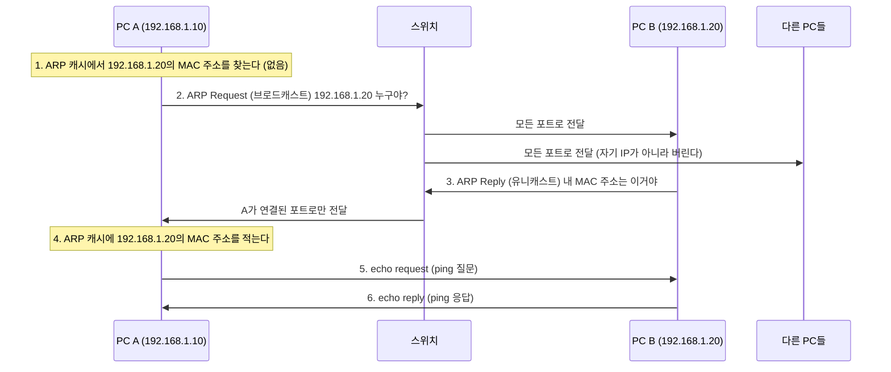

## ARP란 ?
- 같은 네트워크 안에서 IP 주소를 보고 그 장치의 MAC 주소를 알아내는 프로토콜
- 같은 네트워크의 모든 장치에게 이 IP 주소를 가진 장치가 누구인지 묻고(ARP Request), 해당 장치가 자기 MAC 주소를 알려 준다(ARP Reply)
- 알아낸 값은 ARP 캐시에 적어 두고 다음부터는 묻지 않고 바로 쓴다

### ARP (Address Resolution Protocol)
Address는 주소, Resolution은 풀어서 답을 정하는 것(해결, 결정), Protocol은 약속이다.
공학적으로는 IP 주소를 MAC 주소로 바꿔 주는 규칙을 말한다. 알고 있는 주소(IP)로 모르는 주소(MAC)를 풀어낸다는 뜻이 이름에 담겨 있다. 우리말로는 주소 결정 프로토콜이라고 한다.

<br/>

## 왜 ARP가 필요할까
[주소체계](../주소체계(Addressing)/README.md)에서 본 것처럼 네트워크는 일을 둘로 나눈다. 다른 네트워크까지 찾아가는 일은 IP 주소가, 같은 네트워크 안에서 실제 장치에 건네는 일은 MAC 주소가 맡는다.

그런데 사람이나 프로그램이 아는 것은 보통 IP 주소뿐이다. `ping 192.168.1.20` 처럼 IP 주소만 주고 보내라고 한다(ping은 상대에게 질문을 보내고 응답이 오는지 보는 명령이다). 같은 네트워크 안에서 데이터를 실제로 건네려면 받는 장치의 MAC 주소를 데이터 앞에 붙여야 하는데, 그 값을 모르니 먼저 알아내야 한다. 이 일을 ARP가 한다.

아파트 단지 방송과 비슷하다. 택배 기사가 이름만 아는 홍길동 씨를 찾아 단지 전체에 홍길동 씨 몇 호냐고 방송하면, 다른 사람은 무시하고 홍길동 씨만 302호라고 답한다. 기사는 이름과 호수를 수첩에 적어 두고 다음에는 방송하지 않는다. 이름이 IP 주소, 호수가 MAC 주소, 수첩이 ARP 캐시다.

<br/>

## 동작 순서
192.168.1.10인 PC A가 같은 네트워크(192.168.1.0/24)에 있는 192.168.1.20인 PC B에게 `ping 192.168.1.20` 을 보내는 상황이다.



1. PC A는 먼저 ARP 캐시(ARP Cache)를 본다. 예전에 알아낸 IP 주소와 MAC 주소 짝을 적어 둔 표다. 여기 있으면 2번부터 4번은 건너뛴다.
2. 캐시에 없으면 ARP Request를 보낸다. 받는 사람의 MAC 주소를 모르니 받는 MAC 주소 자리에 브로드캐스트 주소(FF:FF:FF:FF:FF:FF)를 넣는다. 브로드캐스트(Broadcast)는 원래 방송이라는 뜻이다. 네트워크에서는 같은 네트워크의 모든 장치에게 한꺼번에 보내는 방식을 말한다.
3. 요청을 받은 장치들은 물어본 IP 주소가 자기 것인지 본다. 아닌 장치는 버리고, PC B만 ARP Reply로 답한다. 요청에 PC A의 MAC 주소가 들어 있어서 PC B는 PC A에게만 보내면 된다. 한 장치에게만 보내는 이 방식을 유니캐스트(Unicast)라고 한다.
4. PC A는 받은 MAC 주소를 ARP 캐시에 적는다.
5. 이제 MAC 주소를 알았으니 ping의 질문(echo request)을 보낸다.
6. PC B가 응답(echo reply)을 돌려준다.

ARP가 주고받는 메시지는 Request와 Reply 두 가지뿐이다.

### ARP 캐시 직접 보기
윈도우와 맥 모두 터미널에서 `arp -a` 를 치면 지금 ARP 캐시에 있는 IP 주소와 MAC 주소 짝이 나온다. 같은 네트워크의 장치에 `ping` 을 한 번 보낸 뒤 다시 보면 그 장치가 새로 들어와 있다.

### 없는 장치에 물으면
같은 네트워크에 있는 주소인데 그 주소를 쓰는 장치가 없으면 ARP Request에 아무도 답하지 않는다. MAC 주소를 알아내지 못하니 ping 질문을 보내 보지도 못한다. 윈도우에서는 이때 상대가 아니라 내 PC가 스스로 답한다. 아래는 내 PC의 IP가 192.168.233.1인 네트워크에서 같은 대역의 빈 주소(192.168.233.250)로 ping을 보낸 결과다(한국어 윈도우 11). 응답을 보낸 주소가 내 IP 주소로 찍힌다.

```text
192.168.233.1의 응답: 대상 호스트에 연결할 수 없습니다.
```

영어 윈도우에서는 `Destination host unreachable` 로 나온다. 다른 운영체제의 메시지는 확인하지 않았다.

<br/>

## 스위치에서 보면
네트워크 장비와 주소는 맡는 일에 따라 층(계층)으로 나눈다. 여기서는 MAC 주소를 다루는 층을 2계층, IP 주소를 다루는 층을 3계층, 포트 번호를 다루는 층을 4계층이라고만 알아 두고, 계층 모델은 따로 정리한다.

### 스위치 (Switch)
사전적 의미는 전환기. 흐름을 이쪽저쪽으로 바꿔 주는 장치다.
공학적으로는 같은 네트워크 안의 장비들을 연결하는 2계층(데이터 링크 계층) 장비다. IP 주소는 보지 않고 MAC 주소만 보고 데이터(같은 네트워크 안에서는 프레임, Frame이라고 부른다)를 어느 포트로 보낼지 정한다.

건물 안내 데스크와 비슷하다. 누가 몇 호에 있는지 장부에 적어 두고 그 호수로만 안내하며, 장부에 없는 사람을 찾으면 전 층에 방송한다.

### 동작
스위치는 MAC 주소 테이블(MAC Address Table)에 어떤 MAC 주소가 몇 번 포트에 연결돼 있는지 적어 둔다.

- 프레임이 들어오면 송신지 MAC 주소와 들어온 포트를 테이블에 적는다(학습).
- 수신지 MAC 주소가 테이블에 있으면 그 포트로만 보낸다.
- 테이블에 없거나 브로드캐스트면 들어온 포트를 뺀 모든 포트로 보낸다. 이를 플러딩(Flooding)이라고 한다.

위의 ARP 과정을 스위치 입장에서 다시 보면 아래와 같다.

1. ARP Request는 수신지 MAC 주소가 브로드캐스트 주소라서 모든 포트로 플러딩한다.
2. 이때 요청을 보낸 PC A의 MAC 주소와 포트를 학습한다.
3. ARP Reply는 수신지 MAC 주소가 PC A의 것이고 방금 학습했으니 PC A가 연결된 포트로만 보낸다.

<br/>

## 다른 네트워크로 갈 때
### 라우터 (Router)
사전적 의미는 길(route)을 정해 주는 것.
공학적으로는 서로 다른 네트워크를 잇는 3계층(네트워크 계층) 장비다. 받은 데이터의 목적지 IP 주소를 보고 라우팅 테이블(Routing Table, 어느 네트워크로 가려면 어디로 보내야 하는지 적은 표)에서 다음에 보낼 곳을 골라 넘긴다. 이렇게 한 곳에서 받아 다음 곳으로 넘기는 일을 포워딩(Forwarding)이라고 한다.

고속도로 나들목의 이정표와 비슷하다. 목적지 지역만 보고 다음 나들목을 고르고, 동네 안 번지까지는 신경 쓰지 않는다.

라우터는 브로드캐스트를 다른 네트워크로 넘기지 않는다. 자기 IP 주소를 묻는 ARP Request에는 답하지만, 그 밖의 브로드캐스트는 거기서 끝난다. 그래서 ARP Request는 라우터를 넘지 못하고, ARP는 같은 네트워크 안에서만 동작한다. 브로드캐스트가 인터넷 전체로 퍼지면 모든 장치가 모든 질문을 받아야 하니 막아 두는 것이다.

### 기본 게이트웨이 (Default Gateway)
게이트웨이의 사전적 의미는 출입문.
공학적으로는 내 네트워크에서 바깥 네트워크로 나가는 출구 역할을 하는 라우터를 말한다. 집에서는 공유기가 이 역할을 한다. 목적지가 내 네트워크 밖이면(예: 192.168.1.10에서 인터넷의 어느 서버로) 데이터를 일단 게이트웨이에게 넘긴다.

동네 밖으로 가는 우편물을 집집마다 직접 들고 가지 않고 우체국에 맡기는 것과 같다.

회사처럼 큰 네트워크에서는 나가는 길이 여러 개라 라우터가 여럿일 수 있다. 그중 라우팅 테이블에 목적지에 맞는 길이 따로 적혀 있지 않을 때 보내는 곳이 기본 게이트웨이다.

외부로 보낼 때 ARP는 목적지 서버가 아니라 게이트웨이의 MAC 주소를 알아낸다. 목적지 서버는 다른 네트워크에 있어서 ARP Request가 닿지 않기 때문이다. 그래서 내 PC가 보낸 데이터에는 이렇게 적힌다.

- 수신지 IP 주소에는 최종 목적지 서버의 IP 주소
- 수신지 MAC 주소에는 게이트웨이의 MAC 주소

내 PC는 목적지가 내 네트워크 안인지 밖인지를 [서브넷 마스크](../주소체계(Addressing)/README.md#서브넷-마스크)로 판단한다. 목적지 IP 주소의 네트워크 ID가 내 것과 같으면 직접 ARP로 찾고, 다르면 게이트웨이에게 보낸다.

### 라우터를 지날 때마다 바뀌는 것
데이터는 출발지에서 목적지까지 여러 라우터를 거친다. 라우터는 데이터를 받을 때마다 2계층 정보(MAC 주소가 든 프레임 헤더)를 떼고, 다음 구간에 맞는 MAC 주소로 새로 붙여서 보낸다. 다음 라우터의 MAC 주소도 ARP로 알아낸다.

- MAC 주소는 구간마다 바뀐다. 한 구간 안에서 건네주는 데만 쓰기 때문이다.
- IP 주소는 출발지부터 목적지까지 그대로다. 최종 목적지를 가리키기 때문이다. (공유기의 NAT처럼 IP 주소를 바꾸는 예외는 따로 다룬다.)

릴레이 택배와 비슷하다. 송장의 최종 주소는 끝까지 그대로지만, 구간마다 다음 터미널로 가는 트럭 번호는 새로 정한다.

강의에서는 이 과정을 Media Translation이라고 불렀다(표준 용어인지는 확인 필요). 이름보다 2계층 주소는 바뀌고 3계층 주소는 그대로라는 점이 핵심이다.

### 데이터에 붙는 주소 정리
보낼 데이터에는 계층마다 주소가 붙는다. 안쪽부터 데이터, 포트 번호(어느 프로그램인지), IP 주소(어느 컴퓨터인지), MAC 주소(이번 구간에서 누구에게 건네는지) 순이다.

```text
| 수신지 MAC | 송신지 MAC | 송신지 IP | 수신지 IP | 포트 번호 | 데이터 |
  2계층 (구간마다 바뀜)     3계층 (끝까지 그대로)   4계층      
```

포트 번호는 [소켓](../소켓(Socket)/README.md#포트-port) 문서에 정리했다.

<br/>

## ARP와 헷갈리는 프로토콜
RARP, DHCP, DNS와의 비교는 [주소체계](../주소체계(Addressing)/README.md#주소를-서로-바꾸는-프로토콜)에 정리했다. 이 가운데 IP 주소에서 MAC 주소로 가는 방향은 ARP뿐이다.

<br/>

## 더 볼 것 (TODO)
- 라우팅 테이블 읽는 법 (`route print`, `netstat -r`)
- ICMP와 ping, traceroute
- NAT와 공유기
- ARP 스푸핑 (거짓 ARP Reply로 통신을 가로채는 공격)
- 계층 모델(OSI 7계층)
