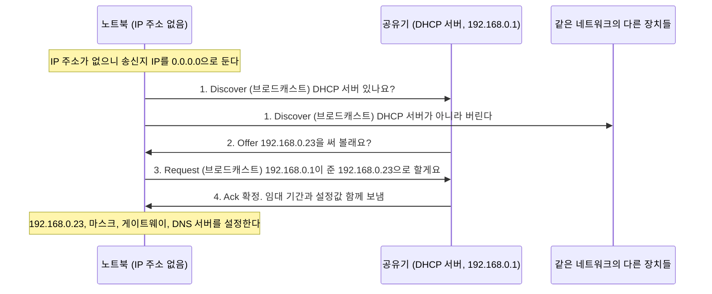

## DHCP란 ?
- 네트워크에 새로 붙은 장치에게 IP 주소와 그 네트워크에서 쓸 설정값을 자동으로 나눠 주는 프로토콜
- 장치(클라이언트)가 설정을 달라고 묻고, DHCP 서버가 쓸 주소를 정해 빌려준다. 집에서는 보통 공유기가 DHCP 서버다
- 주소는 영원히 주지 않고 기간을 정해 빌려주며(임대), 장치는 기간이 끝나기 전에 연장한다(갱신)

### DHCP (Dynamic Host Configuration Protocol)
Dynamic은 움직이는, 그때그때 달라지는(동적), Host는 손님을 맞는 주인, Configuration은 여러 요소를 짜 맞춘 배치(구성)라는 뜻이다.
공학적으로 호스트는 네트워크에 연결된 장치 하나를 말하고, 구성은 그 장치가 통신하는 데 필요한 설정값을 말한다. 합치면 장치의 네트워크 설정을 사람이 미리 정해 두지 않고 장치가 네트워크에 붙을 때마다 그때그때 정해 주는 약속이라는 뜻이다. 우리말로는 동적 호스트 구성 프로토콜이라고 한다.

호텔 프런트와 비슷하다. 손님이 도착해 체크인하면 프런트가 빈 방 하나를 골라 방 번호를 주고, 와이파이 비밀번호와 식당 위치도 함께 알려 준다. 손님이 방 번호를 스스로 정하지 않고, 체크아웃 날짜가 정해져 있다는 점도 같다.

<br/>

## 왜 DHCP가 필요할까
[주소체계](../주소체계(Addressing)/README.md#ip-주소)에서 본 것처럼 IP 주소는 하드웨어에 붙어 있지 않고 연결한 네트워크가 정해 주는 논리적 주소다. 그래서 장치를 새 네트워크에 연결할 때마다 누군가는 그 네트워크에 맞는 주소를 정해 줘야 한다.

### 직접 설정하면 생기는 문제
DHCP 없이 장치마다 사람이 주소를 직접 적어 넣는 방식을 정적(Static) 설정이라고 한다. 장치가 몇 대 안 되고 잘 바뀌지 않으면 이 방식도 쓸 수 있지만, 장치가 많아지면 문제가 생긴다.

1. 같은 주소를 두 장치에 주기 쉽다. 같은 네트워크에서 IP 주소가 겹치면 둘 중 어느 쪽으로 데이터를 보내야 할지 정할 수 없어 통신이 꼬인다.
2. 값 하나만 틀려도 통신이 안 된다. 서브넷 마스크나 기본 게이트웨이를 잘못 적으면 같은 네트워크 안은 되는데 인터넷만 안 되는 식의 문제가 생기고, 원인을 찾기 어렵다.
3. 옮겨 다니는 장치에 맞지 않는다. 노트북을 집에서 카페로 들고 가면 카페 네트워크에 맞는 주소로 다시 적어야 한다.
4. 쓰지 않는 주소가 묶인다. 한 번 나눠 준 주소는 그 장치가 떠나도 사람이 기억해서 지우기 전까지 다른 장치에 줄 수 없다.

### DHCP로 바꾸면
DHCP 서버가 나눠 줄 수 있는 주소 목록(주소 풀, Address Pool)을 들고 있다가, 장치가 붙으면 아직 아무도 쓰지 않는 주소를 하나 골라 준다. 누구에게 어떤 주소를 줬는지 서버가 한곳에서 기록하니 겹치지 않고, 장치가 떠나 임대 기간이 끝나면 그 주소를 다시 다른 장치에 줄 수 있다. 사람은 서버 한 곳의 설정만 관리하면 된다.

모든 장치를 DHCP로 하지는 않는다. 서버나 프린터처럼 다른 장치들이 늘 같은 주소로 찾아와야 하는 장치는 정적 설정을 하거나, DHCP 서버에 이 MAC 주소에는 항상 이 IP 주소를 주라고 정해 두기도 한다(공유기 설정 화면에서 고정 할당, 예약 같은 이름으로 부르는데 이름은 제품마다 다르다).

<br/>

## DHCP로 무엇을 받을까
IP 주소 하나만 받아서는 통신할 수 없다. 내 네트워크의 범위, 밖으로 나가는 출구, 도메인 이름을 물어볼 곳도 알아야 한다. DHCP는 이 값들을 한 번에 준다.

| 받는 값 | 하는 일 | 자세한 설명 |
| --- | --- | --- |
| IP 주소 | 이 네트워크에서 내 장치를 가리키는 주소 | [주소체계](../주소체계(Addressing)/README.md#ip-주소) |
| 서브넷 마스크 | 목적지가 내 네트워크 안인지 밖인지 가르는 기준 | [주소체계](../주소체계(Addressing)/README.md#서브넷-마스크) |
| 기본 게이트웨이 | 목적지가 내 네트워크 밖일 때 데이터를 넘길 라우터 | [ARP](../ARP(Address%20Resolution%20Protocol)/README.md#기본-게이트웨이-default-gateway) |
| DNS 서버 | 도메인 이름을 IP 주소로 바꿔 달라고 물어볼 서버 | [DNS](../DNS(Domain%20Name%20System)/README.md) |

이 밖에 임대 기간, 이 값들을 준 DHCP 서버 자신의 주소도 함께 받는다. 표준(RFC 2132)에는 이보다 많은 설정 항목(옵션, Option)이 정의돼 있지만 입문 단계에서는 위 네 가지만 알아도 충분하다.

<br/>

## 주소를 받는 4단계 과정
장치가 네트워크에 붙으면 DHCP 서버와 메시지 네 개를 주고받아 주소를 받는다. 메시지 이름의 앞 글자를 따서 DORA라고 부르기도 한다.

### 단계마다 이름의 뜻
- Discover는 찾아내다라는 뜻이다. 네트워크에 DHCP 서버가 있는지 찾는다.
- Offer는 제안하다라는 뜻이다. 서버가 이 주소를 쓰면 어떠냐고 제안한다.
- Request는 요청하다라는 뜻이다. 클라이언트가 그 제안대로 달라고 요청한다.
- Ack는 Acknowledgement의 줄임말로, 받았다고 알리는 확인이라는 뜻이다. 서버가 요청을 받아들였고 이제 그 주소를 써도 된다고 확정한다.

### 흐름
MAC 주소가 00:00:5E:00:53:01인 노트북이 집 와이파이에 처음 붙는 상황이다. 공유기(192.168.0.1)가 DHCP 서버 역할을 한다. 주소는 모두 설명을 위한 예시 값이다.



1. Discover. 노트북은 아직 자기 IP 주소도, DHCP 서버의 주소도 모른다. 그래서 같은 네트워크의 모든 장치에게 DHCP 서버가 있는지 묻는다. 메시지 안에는 자기 MAC 주소를 적어 서버가 누가 물었는지 알 수 있게 한다.
2. Offer. Discover를 받은 DHCP 서버는 주소 풀에서 아직 쓰지 않는 주소를 하나 골라 서브넷 마스크, 게이트웨이, DNS 서버, 임대 기간과 함께 제안한다. 네트워크에 DHCP 서버가 여럿이면 Offer도 여러 개 올 수 있다.
3. Request. 노트북은 받은 Offer 중 하나를 골라 그 서버가 제안한 주소를 달라고 요청한다. 이 요청도 브로드캐스트로 보낸다. 고른 서버뿐 아니라 Offer를 보냈다가 선택받지 못한 다른 서버도 이 메시지를 보고 자기가 제안한 주소를 거둬들여야 하기 때문이다(RFC 2131).
4. Ack. 서버가 요청을 확정하고 임대 기간을 알려 준다. 노트북은 이제부터 받은 값으로 통신한다. 그 사이 주소를 다른 장치에 줬다거나 하는 이유로 서버가 요청을 받아들일 수 없으면 Ack 대신 거절(NAK, Negative Acknowledgement)을 보내고, 노트북은 1단계부터 다시 한다.

RFC 2131은 클라이언트가 Ack를 받은 뒤 그 주소를 이미 누가 쓰고 있지 않은지 한 번 더 확인하라고 권한다. 이때 쓰는 방법의 예로 [ARP](../ARP(Address%20Resolution%20Protocol)/README.md#동작-순서)를 든다. 받은 주소로 ARP Request를 보냈는데 누군가 답하면 이미 쓰는 주소이므로, 서버에 거절 메시지(DHCPDECLINE)를 보내고 다시 처음부터 받는다.

표준 문서에서 메시지 이름은 DHCPDISCOVER, DHCPOFFER, DHCPREQUEST, DHCPACK처럼 앞에 DHCP를 붙여 쓴다.

<br/>

## 주소가 없는데 어떻게 보낼까
1단계에서 이상한 점이 하나 있다. 데이터를 보내려면 송신지와 수신지 IP 주소를 적어야 하는데, 노트북은 자기 주소도 서버 주소도 모른다. DHCP는 이 문제를 브로드캐스트와 미리 정해 둔 포트 번호로 푼다.

### 브로드캐스트로 보낸다
브로드캐스트(Broadcast)는 원래 방송이라는 뜻이고, 네트워크에서는 같은 네트워크의 모든 장치에게 한꺼번에 보내는 방식을 말한다. [ARP](../ARP(Address%20Resolution%20Protocol)/README.md#동작-순서)가 MAC 주소를 모를 때 쓰던 그 방식이다. DHCP에서는 IP 주소까지 모르니 IP와 MAC 양쪽 모두 브로드캐스트를 쓴다.

```text
Discover에 적는 주소
송신지 IP   0.0.0.0              아직 내 주소가 없다는 뜻
수신지 IP   255.255.255.255      같은 네트워크의 모두에게
송신지 MAC  00:00:5E:00:53:01    내 랜카드 주소 (예시 값)
수신지 MAC  FF:FF:FF:FF:FF:FF    같은 네트워크의 모두에게
```

MAC 주소는 랜카드에 처음부터 있으니(주소체계의 [MAC 주소](../주소체계(Addressing)/README.md#mac-주소)) 송신지 MAC 주소는 적을 수 있다. 서버는 이 MAC 주소를 보고 누구에게 답할지 안다. 그래서 서버의 Offer와 Ack는 상황에 따라 그 MAC 주소로 직접 보내기도 하고(유니캐스트), 클라이언트가 브로드캐스트로 답해 달라고 표시했으면 브로드캐스트로 보내기도 한다(RFC 2131).

전학 첫날 아직 자리도 이름표도 없는 학생이 교실에 들어와 선생님이 누구시냐고 반 전체에 묻는 것과 같다. 누구에게 물어야 할지 모르니 모두에게 묻고, 선생님만 대답한다.

### 정해진 포트로 보낸다
IP 주소로 컴퓨터를 고른 뒤 그 안의 어느 프로그램이 받을지는 포트 번호로 정한다([소켓](../소켓(Socket)/README.md#포트-port) 참고). DHCP는 연결을 맺지 않고 바로 보내는 UDP(User Datagram Protocol, [소켓](../소켓(Socket)/README.md#udp-소켓-데이터그램-소켓-datagram-socket) 참고)를 쓰고, 서버는 67번, 클라이언트는 68번 포트를 쓰기로 정해져 있다(RFC 2131). 서로 주소를 몰라도 받을 포트가 미리 정해져 있으니 브로드캐스트를 받은 장치들 중 DHCP 서버 프로그램만 메시지를 받아 처리한다.

### 브로드캐스트는 라우터를 넘지 못한다
[ARP](../ARP(Address%20Resolution%20Protocol)/README.md#다른-네트워크로-갈-때)에서 본 것처럼 라우터는 브로드캐스트를 다른 네트워크로 넘기지 않는다. 그래서 Discover는 같은 네트워크 안에만 퍼지고, 기본 구조에서는 DHCP 서버가 클라이언트와 같은 네트워크에 있어야 한다. 네트워크가 여럿인 회사에서 서버 하나로 여러 네트워크에 주소를 나눠 줄 때는 라우터가 DHCP 메시지만 골라 서버로 넘겨 주는 DHCP 릴레이(DHCP Relay)를 쓴다. 릴레이는 따로 정리한다.

<br/>

## 임대와 갱신
### 임대 (Lease)
사전적 의미는 돈을 받고 물건이나 집을 일정 기간 빌려주는 것이다.
공학적으로는 DHCP 서버가 IP 주소를 정해진 기간 동안만 쓰도록 빌려주는 것을 말하고, 그 기간을 임대 기간(Lease Time)이라고 한다. 기간이 끝날 때까지 연장하지 않으면 주소는 서버에게 돌아가고 다른 장치에 줄 수 있게 된다.

도서관 대출과 비슷하다. 책을 2주 동안 빌리고, 더 읽고 싶으면 반납일 전에 연장한다. 연장하지 않고 두면 책은 도서관으로 돌아가 다른 사람이 빌린다.

### 왜 기간을 둘까
장치는 네트워크를 떠날 때 주소를 돌려준다고 알리지 않는 경우가 많다. 노트북을 덮고 카페를 나가거나 전원이 갑자기 꺼지면 서버는 그 장치가 떠났는지 알 수 없다. 기간을 정해 두면 떠난 장치의 주소가 기간이 지나 저절로 풀리므로 주소 풀이 바닥나지 않는다. 손님이 많이 바뀌는 카페는 기간을 짧게, 장치가 잘 바뀌지 않는 회사나 집은 길게 두는 식으로 고른다.

임대 기간은 DHCP 서버 설정에 따라 정해지며 공유기나 서버 제품마다 기본값이 다르다. 이 노트를 쓰며 확인한 PC에서는 가상 머신 프로그램(VMware)이 만든 가상 네트워크의 임대 시작과 만료 날짜가 1시간 차이였다. 다만 이 차이를 그대로 임대 기간으로 읽어도 되는지는 확인 필요다(아래 직접 확인하기 참고).

### 갱신 (Renewal)
장치는 기간이 다 끝나기 전에 미리 연장을 시도한다. RFC 2131이 정한 기본값은 아래와 같다.

1. 임대 기간의 절반(50%)이 지나면 주소를 준 서버에게 직접(유니캐스트) Request를 보내 연장을 요청한다. 서버가 Ack로 답하면 임대 기간이 다시 처음부터 시작된다. 이미 서버 주소를 알고 있으니 브로드캐스트할 필요가 없고, 4단계를 처음부터 다시 하지도 않는다.
2. 서버가 답하지 않아 87.5%까지 지나면 원래 서버가 사라졌을 수 있으니 이번에는 브로드캐스트로 Request를 보내 어느 서버든 연장해 달라고 한다(재바인딩, Rebinding).
3. 그래도 답이 없이 기간이 끝나면 그 주소를 더 쓰지 않고 1단계 Discover부터 다시 한다.

50%와 87.5%는 표준이 정한 기본값이고, 서버가 다른 값을 정해 보낼 수도 있다. 운영체제가 실제로 이 시점에 맞춰 갱신하는지는 확인 필요다.

장치가 네트워크를 떠나면서 주소를 스스로 돌려주는 메시지(DHCPRELEASE)도 있다. 윈도우의 `ipconfig /release` 는 이 반납을, `ipconfig /renew` 는 주소를 다시 받는 일을 시킨다. 둘 다 지금 쓰는 네트워크 설정을 바꾸므로 이 노트를 쓰면서는 실행하지 않았다.

<br/>

## 집에서는 공유기가 DHCP 서버다
집 인터넷 회선에 공유기를 달면, 공유기는 집 안 네트워크에서 여러 역할을 한꺼번에 맡는다.

- 기본 게이트웨이다. 집 안 장치가 인터넷으로 나갈 때 거치는 출구가 공유기다.
- DHCP 서버다. 휴대폰, 노트북, TV가 와이파이나 랜선으로 붙으면 공유기가 주소를 나눠 준다.
- DNS 서버 주소로 공유기 자신의 주소를 알려 주고 대신 물어봐 주기도 하고, 통신사 DNS 서버 주소를 그대로 알려 주기도 한다. 공유기 제품과 설정마다 다르다.

그래서 집에서 확인하면 대개 기본 게이트웨이와 DHCP 서버가 같은 주소(예: 192.168.0.1)로 나온다. 집 안 장치들이 받는 192.168.x.x 같은 주소는 집 안에서만 쓰는 사설 IP 주소이고, 공유기가 바깥 인터넷과 주고받을 때 주소를 바꿔 준다. 이 주소 변환은 [NAT와 사설 IP](../NAT와%20사설%20IP(NAT%20and%20Private%20IP)/README.md)에 정리했다.

공유기 없이 PC를 통신사 회선에 바로 연결하면 PC가 통신사의 DHCP 서버에게서 주소를 받는다. 이 경우 DHCP 서버 주소가 기본 게이트웨이와 다르고, 내 네트워크 밖의 주소로 나오기도 한다. 브로드캐스트가 라우터를 넘지 못하는데도 다른 네트워크의 서버에게서 받을 수 있는 것은 앞에서 말한 DHCP 릴레이가 중간에서 메시지를 넘겨 주기 때문으로 보인다(통신사 구성은 확인 필요).

<br/>

## 직접 확인하기
윈도우에서 명령 프롬프트나 PowerShell을 열고 `ipconfig /all` 을 치면 어댑터(랜카드)마다 받은 설정이 나온다. 이 명령은 설정을 보여 주기만 하고 바꾸지 않는다.

아래는 한국어 윈도우 11에서 실행한 출력의 형식을 그대로 따른 것이다. 랜카드 이름, MAC 주소, IP 주소, 날짜는 실제 값 대신 예시 값으로 바꿨고, IPv6처럼 이 노트에서 다루지 않는 줄은 뺐다.

```text
이더넷 어댑터 이더넷:

   연결별 DNS 접미사. . . . :
   설명. . . . . . . . . . . . : (랜카드 이름)
   물리적 주소 . . . . . . . . : 00-00-5E-00-53-01
   DHCP 사용 . . . . . . . . . : 예
   자동 구성 사용. . . . . . . : 예
   IPv4 주소 . . . . . . . . . : 192.168.0.23(기본 설정)
   서브넷 마스크 . . . . . . . : 255.255.255.0
   임대 시작 날짜. . . . . . . : 2026년 10월 26일 월요일 오후 9:00:00
   임대 만료 날짜. . . . . . . : 2026년 10월 27일 화요일 오후 9:00:00
   기본 게이트웨이 . . . . . . : 192.168.0.1
   DHCP 서버 . . . . . . . . . : 192.168.0.1
   DNS 서버. . . . . . . . . . : 192.168.0.1
```

윈도우는 MAC 주소를 콜론 대신 하이픈으로 끊어 보여 준다. 00-00-5E-00-53-01은 00:00:5E:00:53:01과 같은 값이다.

DHCP와 관련된 줄은 아래처럼 읽는다. 괄호 안은 영어 윈도우의 항목 이름이다(같은 PC에서 출력 언어를 바꿔 확인했다).

- 물리적 주소(Physical Address)는 이 랜카드의 MAC 주소다. Discover에 실려 서버가 누가 물었는지 아는 값이다.
- DHCP 사용(DHCP Enabled)이 예면 이 어댑터는 DHCP로 설정을 받는다. 아니요면 사람이 직접 적은 정적 설정이고, 그때는 아래의 임대 날짜와 DHCP 서버 줄이 나오지 않는다.
- IPv4 주소(IPv4 Address), 서브넷 마스크(Subnet Mask), 기본 게이트웨이(Default Gateway), DNS 서버(DNS Servers)가 Ack로 받은 네 가지 값이다. DNS 서버는 여러 개를 받으면 다음 줄에 이어서 나온다.
- 임대 시작 날짜(Lease Obtained)와 임대 만료 날짜(Lease Expires)는 임대 기간을 보여 준다. 갱신할 때 두 값 중 무엇이 바뀌는지는 확인 필요다. 실제로 본 출력 중에는 시작 날짜가 열흘도 더 전인데 만료 날짜는 실행한 당일인 어댑터가 있어서, 두 값의 차이를 곧바로 임대 기간으로 읽으면 안 될 수 있다.
- DHCP 서버(DHCP Server)는 Offer와 Ack를 보낸 서버의 주소다. 집에서는 보통 기본 게이트웨이와 같은 공유기 주소다.

자동 구성 사용(Autoconfiguration Enabled)은 DHCP 서버를 찾지 못했을 때 윈도우가 169.254로 시작하는 주소를 스스로 붙이는 기능이다. 내 IP 주소가 169.254.x.x로 나오면 DHCP로 주소를 받지 못했다는 신호로 볼 수 있다. 이 주소로는 같은 네트워크의 장치끼리만 통신할 수 있고 인터넷에는 나가지 못한다.

<br/>

## 더 볼 것 (TODO)
- DHCP 릴레이(DHCP Relay). 라우터가 다른 네트워크의 DHCP 서버로 메시지를 넘기는 방법
- DHCPv6와 IPv6 주소 자동 설정(SLAAC)
- DHCP 스푸핑(가짜 DHCP 서버가 잘못된 게이트웨이나 DNS 서버를 알려 주는 공격)과 방어
- [공유기의 NAT와 사설 IP 주소](../NAT와%20사설%20IP(NAT%20and%20Private%20IP)/README.md)
- [DNS가 도메인 이름을 IP 주소로 찾는 과정](../DNS(Domain%20Name%20System)/README.md)
- DHCP 메시지 형식과 옵션 번호(RFC 2132)
- 169.254.x.x 자동 주소(APIPA, 링크 로컬 주소) 자세히
- 윈도우가 실제로 갱신하는 시점과 임대 날짜 표시가 바뀌는 방식
