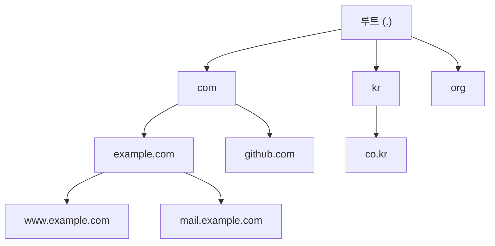
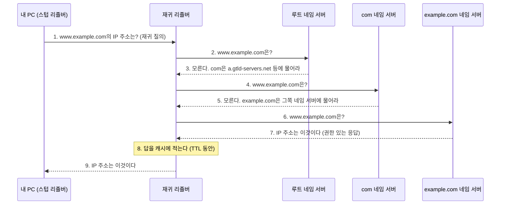

## DNS란 ?
- 도메인 이름(example.com)을 컴퓨터가 쓰는 IP 주소(104.20.23.154 같은 숫자)로 바꿔 주는 체계
- 이름 정보를 한 곳에 모아 두지 않고, 루트부터 아래로 내려가는 여러 층의 네임 서버가 나눠 맡는다
- 내 컴퓨터 대신 이 서버들을 차례로 찾아다니는 재귀 리졸버가 있고, 한 번 찾은 답은 정해진 시간(TTL) 동안 캐시에 두고 다시 쓴다

도메인 이름과 FQDN이 무엇인지는 [주소체계](../주소체계(Addressing)/README.md#도메인-이름과-fqdn)에 정리했다. 이 노트는 그 이름으로 IP 주소를 찾아가는 과정을 다룬다.

### DNS (Domain Name System)
Domain은 영역, Name은 이름, System은 여러 부분이 맞물려 돌아가는 체계다. 우리말로는 도메인 이름 시스템이라고 한다.
공학적으로는 도메인 이름과 IP 주소 같은 정보를 짝지어 저장하고, 물으면 찾아 주는 분산 데이터베이스이자 그 질문과 답의 형식을 정한 프로토콜이다. 기본 개념은 RFC 1034, 메시지 형식과 구현은 RFC 1035에 정해져 있다. 질문과 답은 주로 UDP로 53번 포트에서 주고받고, TCP 53번 포트도 쓴다(RFC 1035). 포트와 UDP는 [소켓](../소켓(Socket)/README.md#포트-port) 문서에 정리했다.

전화번호부와 비슷하다. 사람은 이름으로 찾고, 실제로 거는 것은 번호다.

### 네임 서버 (Name Server)
이름(name)을 알려 주는 서버(server, 시중드는 쪽)라는 뜻이다.
공학적으로는 DNS 정보를 가지고 있다가 질문에 답하는 서버를 말한다. 맡은 층에 따라 루트 네임 서버, 최상위 도메인 네임 서버, 권한 있는 네임 서버로 나뉜다(아래에서 다룬다).

<br/>

## 왜 DNS가 필요할까
네트워크에서 데이터를 보내려면 받는 쪽의 IP 주소가 필요하다([주소체계](../주소체계(Addressing)/README.md#ip-주소) 참고). 그런데 사람은 104.20.23.154 같은 숫자를 외우기 어렵고, 서버를 옮기면 IP 주소가 바뀌기도 한다. 이름을 그대로 두고 그 이름이 가리키는 주소만 바꿀 수 있으면 사람도 편하고 관리도 쉽다.

처음에는 이 짝을 파일 하나에 모아 두었다. RFC 1034에 따르면 초기 인터넷은 NIC(Network Information Center)라는 기관이 이름과 주소의 짝을 HOSTS.TXT라는 파일 하나로 관리했고, 모든 컴퓨터가 이 파일을 내려받아 썼다. 컴퓨터가 늘자 문제가 생겼다.

- 모든 컴퓨터가 같은 파일을 계속 내려받으니 배포에 드는 트래픽이 너무 커졌다.
- 이름을 하나 바꾸려 해도 NIC가 파일을 고쳐 줄 때까지 기다려야 했다.

그래서 이름 공간을 구역으로 나누고, 각 구역은 그 구역을 가진 조직이 직접 관리하게 한 것이 DNS다. 한 곳이 다 알 필요 없이, 각자 자기 구역만 알고 아래 구역은 누가 맡는지만 알려 주면 된다.

지금도 컴퓨터에는 그 흔적인 hosts 파일이 있다(윈도우는 `C:\Windows\System32\drivers\etc\hosts`, 맥과 리눅스는 `/etc/hosts`). 운영체제는 보통 DNS에 묻기 전에 이 파일을 먼저 본다. 순서는 운영체제 설정에 따라 다를 수 있다.

<br/>

## 이름의 계층 구조
[주소체계](../주소체계(Addressing)/README.md#도메인-이름과-fqdn)에서 본 것처럼 도메인 이름은 오른쪽으로 갈수록 큰 구역이고, 맨 끝에는 보통 생략하는 루트(점 하나)가 있다. 점으로 나뉜 각 부분이 DNS에서 하나의 층이 된다. `www.example.com.` 을 오른쪽부터 읽으면 루트, com, example, www 순이다.

나라, 시, 동, 번지로 내려가는 주소와 비슷하다. 시청은 그 시 안의 동사무소 위치만 알고 있고, 번지까지는 동사무소가 안다.



### 루트 네임 서버 (Root Name Server)
Root는 뿌리다. 나무는 뿌리에서 줄기와 가지가 갈라져 나온다. 컴퓨터에서는 이 나무 모양을 거꾸로 그려서 뿌리가 맨 위에 온다.
공학적으로는 이름 공간의 맨 위를 맡는 서버다. 루트 네임 서버는 example.com의 IP 주소를 알지 못하지만, com을 맡은 서버가 어디 있는지는 안다.

루트 네임 서버는 a.root-servers.net부터 m.root-servers.net까지 이름이 13개다. 아래 [직접 확인하기](#직접-확인하기)에서 `nslookup -type=ns .` 로 루트를 맡은 서버를 물었을 때도 이 13개가 나왔다(2026-10-26). 이름 하나가 서버 한 대라는 뜻은 아니고, 같은 주소를 쓰는 서버가 세계 여러 곳에 나뉘어 있다(실제 대수는 확인 필요).

### 최상위 도메인 (TLD, Top-Level Domain)
Top-Level은 맨 위층. 루트 바로 아래에 있는 첫 번째 구역이다.
공학적으로는 com, org, net 같은 일반 최상위 도메인(gTLD, generic TLD)과 kr, jp 같은 국가 코드 최상위 도메인(ccTLD, country code TLD)을 말한다. TLD 네임 서버는 그 아래의 이름(example.com 등)을 누가 맡는지 안다. 아래 com 네임 서버 이름 gtld-servers.net의 gtld가 이 gTLD다. 직접 물어보니 com은 a.gtld-servers.net부터 m.gtld-servers.net까지 13개 이름의 서버가 맡고 있었다(2026-10-26 기준, 바뀔 수 있다).

### 권한 있는 네임 서버 (Authoritative Name Server)
Authoritative는 권위 있는, 공인된. 남에게 전해 들은 말이 아니라 원본을 가진 쪽이 하는 말이라는 뜻이다.
공학적으로는 어떤 도메인(example.com 등)의 레코드 원본을 가지고 있는 서버다. 도메인을 가진 조직이 직접 운영하거나, 도메인 등록 업체나 DNS 서비스 업체에 맡긴다. 최종 답은 이 서버가 준다.

동사무소 민원 창구와 비슷하다. 그 동 주민의 주소 원본은 여기에만 있다.

### 한 층은 아래 층을 넘겨준다
위층 서버는 아래 이름의 답을 직접 주지 않고 아래 층을 맡은 서버의 이름과 주소를 알려 준다. 이렇게 맡은 구역의 일부를 아래 서버에 넘기는 것을 위임(Delegation)이라고 한다. 루트는 com을, com은 example.com을 위임한다. 덕분에 한 서버가 세상의 모든 이름을 알 필요가 없다.

<br/>

## 리졸버
### 리졸버 (Resolver)
Resolve는 풀다, 해결하다. Resolver는 푸는 쪽이다. [ARP](../ARP(Address%20Resolution%20Protocol)/README.md)의 Resolution과 같은 말이다.
공학적으로는 도메인 이름을 받아 IP 주소라는 답을 풀어내 주는 프로그램이나 서버를 말한다. 리졸버는 두 종류로 나눠 볼 수 있다.

- 스텁 리졸버(Stub Resolver)는 내 컴퓨터 운영체제 안에 있다. Stub은 토막, 짧은 끄트머리라는 뜻이다. 스스로 찾아다니지 않고 정해진 DNS 서버 하나에 질문을 넘기고 답을 기다린다. 이름 그대로 짧은 일만 한다.
- 재귀 리졸버(Recursive Resolver)는 통신사나 공용 DNS 업체가 운영하는 서버다. 스텁 리졸버에게 질문을 받으면 루트부터 권한 있는 네임 서버까지 직접 차례로 물어 답을 찾아온다. 와이파이에 연결하면 [DHCP](../DHCP(Dynamic%20Host%20Configuration%20Protocol)/README.md)로 받는 DNS 서버 주소가 이 재귀 리졸버다. 공유기가 자기 주소를 DNS 서버로 알려 주고, 받은 질문을 통신사 재귀 리졸버에 넘겨 주기만 하는 경우도 많다.

호텔 컨시어지와 비슷하다. 손님(스텁 리졸버)은 맛집 전화번호를 물어보기만 하고, 컨시어지(재귀 리졸버)가 여기저기 전화해 알아낸 뒤 알려 준다. 알아낸 번호는 메모해 두고 다음 손님에게는 바로 알려 준다.

<br/>

## 재귀 질의와 반복 질의
질문을 받은 서버가 일을 어디까지 해 주느냐에 따라 질의 방식을 둘로 나눈다. RFC 1034도 이 두 방식을 recursive, iterative로 구분한다.

### 재귀 질의 (Recursive Query)
Recursive는 되돌아오는, 다시 자기에게로 돌아오는. 프로그래밍에서는 함수가 자기를 다시 부르는 것을 재귀라고 한다.
질문을 받은 서버가 같은 질문을 다른 서버에 다시 던지고, 그렇게 모은 답이 처음 물은 쪽까지 되돌아온다는 데서 온 이름이다. DNS에서는 질문을 받은 서버가 끝까지 책임지고 최종 답(IP 주소, 또는 그런 이름은 없다는 답)을 돌려주는 방식이다. 질문한 쪽은 한 번 묻고 기다리기만 한다. 스텁 리졸버가 재귀 리졸버에게 묻는 것이 재귀 질의다.

### 반복 질의 (Iterative Query)
Iterative는 되풀이하는. 같은 일을 여러 번 되풀이한다는 뜻이다.
DNS에서는 질문을 받은 서버가 자기가 아는 만큼만 답하는 방식이다. 모르면 다음에 물어볼 서버를 알려 주고(이런 답을 참조, Referral이라고 한다), 질문한 쪽이 그 서버에 다시 묻는다. 재귀 리졸버가 루트, TLD, 권한 있는 네임 서버에 묻는 것이 반복 질의다.

재귀 질의는 심부름을 통째로 맡기는 것이고, 반복 질의는 길을 물을 때마다 다음 갈 곳만 듣고 한 곳씩 직접 찾아가는 것이다.

### 전체 흐름
처음 보는 이름 www.example.com을 찾는 상황이다. 리졸버의 캐시는 비어 있다고 본다.



1. 내 PC의 스텁 리졸버가 설정된 재귀 리졸버에게 묻는다. 끝까지 찾아 달라는 재귀 질의다.
2. 재귀 리졸버는 캐시에 없으면 루트 네임 서버에 묻는다. 루트 네임 서버의 주소는 리졸버가 처음부터 목록으로 가지고 있다.
3. 루트는 www.example.com의 답 대신 com을 맡은 서버 목록을 알려 준다.
4. 재귀 리졸버가 com 네임 서버에 다시 묻는다.
5. com 네임 서버는 example.com을 맡은 네임 서버 목록을 알려 준다.
6. 재귀 리졸버가 example.com의 권한 있는 네임 서버에 묻는다.
7. 권한 있는 네임 서버가 IP 주소를 답한다.
8. 재귀 리졸버는 답을 캐시에 적어 둔다. 중간에 알게 된 com, example.com 네임 서버 목록도 함께 적어 두므로 다음에 다른 .com 이름을 물으면 루트를 건너뛸 수 있다.
9. 내 PC에 답을 돌려준다. 내 PC의 운영체제도 이 답을 잠시 캐시에 둔다(윈도우 기준, 다른 운영체제는 설정에 따라 다르다).

재귀 리졸버가 이 일을 모아서 해 주는 이유는 캐시 때문이다. 많은 사용자의 질문이 한 리졸버로 모이면, 누군가 한 번 찾아 둔 답을 나머지 사람은 바로 받는다. 루트나 TLD 서버까지 가는 질문도 그만큼 줄어든다.

반복 질의 과정을 직접 따라가 보는 방법은 아래 [직접 확인하기](#직접-확인하기)에 있다.

<br/>

## 캐시와 TTL
### 캐시 (Cache)
사전적 의미는 숨겨 둔 저장소. 탐험가가 나중에 쓰려고 식량을 숨겨 두는 곳을 가리키던 말이다.
공학적으로는 한 번 가져온 데이터를 가까운 곳에 잠시 보관해 두고, 같은 요청이 오면 원본까지 가지 않고 바로 꺼내 주는 저장소를 말한다. DNS에서는 재귀 리졸버가 답을 캐시에 두고, 운영체제나 프로그램도 캐시를 두는 경우가 있다(운영체제와 설정에 따라 다르다).

### TTL (Time To Live)
살아 있는 시간, 즉 수명이라는 뜻이다.
DNS에서는 레코드마다 붙는 숫자로, 이 답을 캐시에 몇 초 동안 두어도 되는지 나타낸다. 권한 있는 네임 서버의 관리자가 정한다. 캐시에 넣은 뒤 시간이 지나면 남은 TTL이 줄어들고, 0이 되면 버리고 다시 묻는다.

우유의 유통기한과 비슷하다. 기한 안에는 냉장고(캐시)에서 꺼내 먹고, 지나면 버리고 새로 산다.

### 왜 TTL이 필요할까
캐시가 있으면 빠르지만, 원본이 바뀌었을 때 캐시에 든 옛 답을 계속 쓸 수 있다. TTL은 이 사이에서 균형을 잡는다.

- TTL이 길면 다시 묻는 일이 줄어 빠르고 네임 서버 부담도 적다. 대신 IP 주소를 바꿔도 사람들 캐시에 남은 옛 주소가 TTL만큼 더 쓰인다.
- TTL이 짧으면 바뀐 주소가 빨리 퍼진다. 대신 질문이 많아진다.

그래서 서버를 옮길 계획이 있으면 미리 TTL을 짧게 줄여 두었다가 옮기는 방법을 쓰기도 한다.

### 권한 없는 응답
재귀 리졸버는 그 도메인의 원본을 가진 서버가 아니다. 그래서 캐시에서 꺼낸 답이든 방금 권한 있는 네임 서버에 물어 온 답이든, `nslookup` 은 재귀 리졸버가 준 답에 "권한 없는 응답"(영어 윈도우에서는 Non-authoritative answer)이라고 붙인다. 틀린 답이라는 뜻이 아니라 원본 서버에게서 직접 받은 답이 아니라는 뜻이다. 권한 있는 네임 서버에 직접 물으면 이 문구가 붙지 않는다(아래 [직접 확인하기](#직접-확인하기) 참고).

<br/>

## 자주 보는 레코드
네임 서버는 정보를 레코드(Record) 단위로 저장한다. Record는 기록이라는 뜻이고, DNS에서는 이름 하나에 붙은 정보 한 줄을 말한다. 레코드마다 종류(타입)가 있어서 같은 이름이라도 무엇을 묻느냐에 따라 다른 답이 나온다.

이름표 하나에 집 주소, 회사 주소, 우편 받는 곳을 따로 적어 두는 것과 같다.

| 레코드 | 이름의 뜻 | 담는 값 | 예 (2026-10-26에 확인) |
| --- | --- | --- | --- |
| A | Address | IPv4 주소 | example.com → 104.20.23.154 |
| AAAA | IPv6 주소 | IPv6 주소 | example.com → 2606:4700:10::6814:179a |
| CNAME | Canonical Name, 정식 이름 | 다른 도메인 이름(별명이 가리키는 진짜 이름) | www.github.com → github.com |
| NS | Name Server | 이 도메인을 맡은 권한 있는 네임 서버 이름 | example.com → hera.ns.cloudflare.com |
| MX | Mail Exchanger, 메일 교환기 | 이 도메인 앞으로 온 메일을 받을 서버와 우선순위 | gmail.com → gmail-smtp-in.l.google.com (우선순위 5) |

- A와 AAAA는 같은 이름에 둘 다 있을 수 있다. 위의 example.com도 둘 다 있었다. AAAA는 RFC 3596에 정해져 있다. AAAA라는 이름은 128비트로 A(32비트)의 네 배라서 붙었다고 알려져 있지만 확인 필요다.
- CNAME은 IP 주소가 아니라 다른 이름을 준다. 리졸버는 그 이름으로 다시 A나 AAAA를 찾는다. 여러 이름이 한 서버를 가리킬 때 IP 주소를 한 곳에서만 관리하려고 쓴다.
- NS는 위의 위임에 쓰인다. com 네임 서버가 example.com은 저쪽에 물으라고 알려 줄 때 주는 것이 NS 레코드다.
- MX는 메일 서버를 알려 준다. 숫자가 작을수록 먼저 시도하고, 그 서버가 응답하지 않으면 다음 숫자의 서버로 보낸다.

<br/>

## 직접 확인하기
아래 결과는 모두 2026-10-26에 한국어 윈도우 11에서 실행한 값이다. IP 주소, TTL, 서버 목록은 실행할 때마다, 장소마다 다를 수 있다.

내 PC가 쓰는 재귀 리졸버의 이름과 주소는 개인 환경 값이라 문서용 예시 이름(resolver.example)과 문서용 예시 주소(192.0.2.53)로 바꿔 적었다. 192.0.2.0/24는 문서에 쓰라고 따로 떼어 둔 주소 대역이다(RFC 5737).

### nslookup으로 묻기
`nslookup` 은 DNS 서버에 질문을 보내는 명령이다. 윈도우와 맥에는 기본으로 있고, 리눅스는 배포판에 따라 따로 설치해야 할 수 있다. 이름만 주면 내 PC에 설정된 재귀 리졸버에게 묻는다.

```text
> nslookup example.com
권한 없는 응답:
서버:    resolver.example
Address:  192.0.2.53

이름:    example.com
Addresses:  2606:4700:10::ac42:93f3
	  2606:4700:10::6814:179a
	  104.20.23.154
	  172.66.147.243
```

서버 줄은 질문을 받은 재귀 리졸버, 그 아래가 답이다. 재귀 리졸버가 준 답이라 권한 없는 응답이 붙었다. A 레코드 두 개와 AAAA 레코드 두 개가 함께 나왔다.

`-type=` 으로 레코드 종류를 정할 수 있다. 메일 서버를 물으면 아래처럼 나온다(답 아래에 함께 온 IP 주소 줄은 생략했다).

```text
> nslookup -type=mx gmail.com
gmail.com	MX preference = 40, mail exchanger = alt4.gmail-smtp-in.l.google.com
gmail.com	MX preference = 10, mail exchanger = alt1.gmail-smtp-in.l.google.com
gmail.com	MX preference = 5, mail exchanger = gmail-smtp-in.l.google.com
gmail.com	MX preference = 30, mail exchanger = alt3.gmail-smtp-in.l.google.com
gmail.com	MX preference = 20, mail exchanger = alt2.gmail-smtp-in.l.google.com
```

CNAME이 있는 이름은 Aliases(별명) 줄로 보여 준다. www.github.com은 별명이고 진짜 이름은 github.com이다.

```text
> nslookup www.github.com
이름:    github.com
Address:  20.200.245.247
Aliases:  www.github.com
```

없는 이름을 물으면 Non-existent domain이 나온다. .example은 예시용으로 떼어 둔 최상위 도메인(RFC 2606)이라 실제로 등록된 이름이 없다.

```text
> nslookup no-such-name.example
*** resolver.example이(가) no-such-name.example을(를) 찾을 수 없습니다. Non-existent domain
```

### 반복 질의를 손으로 따라가기
위 [전체 흐름](#전체-흐름)과 같은 과정을 example.com으로 따라간다. 먼저 루트를 맡은 서버 목록을 물어본다. 이름 끝의 점 하나가 루트다(IP 주소 줄은 a, b 두 개만 남기고 줄였다).

```text
> nslookup -type=ns .
권한 없는 응답:
서버:    resolver.example
Address:  192.0.2.53

(root)	nameserver = l.root-servers.net
(root)	nameserver = i.root-servers.net
(root)	nameserver = f.root-servers.net
(root)	nameserver = k.root-servers.net
(root)	nameserver = c.root-servers.net
(root)	nameserver = m.root-servers.net
(root)	nameserver = a.root-servers.net
(root)	nameserver = b.root-servers.net
(root)	nameserver = d.root-servers.net
(root)	nameserver = e.root-servers.net
(root)	nameserver = g.root-servers.net
(root)	nameserver = j.root-servers.net
(root)	nameserver = h.root-servers.net

a.root-servers.net	internet address = 198.41.0.4
b.root-servers.net	internet address = 170.247.170.2
```

`nslookup -norecurse 이름 서버주소` 로 물으면 재귀 질의를 하지 말라고 표시해 그 서버에만 묻는다. 루트부터 차례로 물으면 재귀 리졸버가 하는 반복 질의를 직접 따라갈 수 있다. 아래 결과는 같은 내용이 반복되는 서버 목록과 질문과 상관없는 앞부분 출력을 줄였다.

이제 루트 네임 서버 하나(a.root-servers.net, 198.41.0.4)에 묻는다. 답 대신 com을 맡은 서버 목록이 온다.

```text
> nslookup -norecurse example.com 198.41.0.4
서버:    UnKnown
Address:  198.41.0.4

이름:    example.com
Served by:
- l.gtld-servers.net
	  192.41.162.30
	  2001:500:d937::30
	  com
- j.gtld-servers.net
	  192.48.79.30
	  2001:502:7094::30
	  com
(이하 생략)
```

목록에 있던 com 네임 서버 하나(a.gtld-servers.net, 192.5.6.30)에 다시 묻는다. 이번에는 example.com을 맡은 서버 목록이 온다.

```text
> nslookup -norecurse example.com 192.5.6.30
서버:    UnKnown
Address:  192.5.6.30

이름:    example.com
Served by:
- hera.ns.cloudflare.com
	  108.162.192.162
	  172.64.32.162
	  173.245.58.162
	  (IPv6 주소 생략)
	  example.com
- elliott.ns.cloudflare.com
	  (생략)
```

마지막으로 권한 있는 네임 서버에 묻는다. 드디어 IP 주소가 오고, 권한 없는 응답이라는 문구가 없다.

```text
> nslookup -norecurse example.com hera.ns.cloudflare.com
서버:    hera.ns.cloudflare.com
Address:  173.245.58.162

이름:    example.com
Addresses:  2606:4700:10::ac42:93f3
	  2606:4700:10::6814:179a
	  104.20.23.154
	  172.66.147.243
```

`nslookup -debug` 를 붙이면 응답의 머리 부분(header flags)과 TTL까지 보인다. 재귀 리졸버의 답에는 `want recursion, recursion avail.` 이 찍혀 재귀 질의를 했고 서버도 재귀를 해 준다는 것을 알 수 있다. 권한 있는 네임 서버의 답에는 `auth. answer` 가 찍힌다. TTL을 보면 권한 있는 네임 서버가 준 A 레코드는 300초였고, 몇 분 앞서 재귀 리졸버가 준 같은 레코드는 47초였다. 재귀 리졸버는 캐시에 남은 시간을 준다는 뜻이다.

### Node.js dns 모듈로 묻기
Node.js에는 DNS를 묻는 내장 모듈 `node:dns` 가 있다. 아래는 Node.js v24.22.1에서 실행했다.

```js
const dns = require('node:dns').promises;

async function main() {
  // 운영체제에 맡겨 찾는다 (hosts 파일도 본다)
  console.log('lookup', await dns.lookup('example.com', { all: true }));

  // DNS 서버에 레코드 종류를 정해 직접 묻는다
  console.log('A', await dns.resolve4('example.com'));
  console.log('AAAA', await dns.resolve6('example.com'));
  console.log('CNAME', await dns.resolveCname('www.github.com'));
  console.log('NS', await dns.resolveNs('example.com'));
  const mx = await dns.resolveMx('gmail.com');
  console.log('MX', mx.sort((a, b) => a.priority - b.priority).slice(0, 2));

  try {
    await dns.resolve4('no-such-name.example');
  } catch (err) {
    console.log('없는 이름', err.code);
  }
}
main();
```

```text
lookup [
  { address: '172.66.147.243', family: 4 },
  { address: '104.20.23.154', family: 4 }
]
A [ '104.20.23.154', '172.66.147.243' ]
AAAA [ '2606:4700:10::ac42:93f3', '2606:4700:10::6814:179a' ]
CNAME [ 'github.com' ]
NS [ 'hera.ns.cloudflare.com', 'elliott.ns.cloudflare.com' ]
MX [
  { exchange: 'gmail-smtp-in.l.google.com', priority: 5, type: 'MX' },
  {
    exchange: 'alt1.gmail-smtp-in.l.google.com',
    priority: 10,
    type: 'MX'
  }
]
없는 이름 ENOTFOUND
```

찾는 함수가 두 갈래다.

- `dns.lookup()` 은 운영체제의 이름 찾기 기능에 맡긴다. 그래서 hosts 파일과 운영체제 캐시를 거치고, 다른 프로그램이 이름을 찾을 때와 같은 결과를 낸다. 이 PC에서는 IPv4 주소만 나왔다. `nslookup` 은 AAAA도 보여 줬는데 여기서 빠진 이유는 운영체제의 IPv6 설정과 관련 있어 보이지만 확인 필요다.
- `dns.resolve4()` 같은 resolve 계열은 hosts 파일과 운영체제 캐시를 거치지 않고 운영체제에 설정된 DNS 서버에 직접 묻는다. 레코드 종류를 정해 물을 수 있다.

`resolve4()` 에 `{ ttl: true }` 를 주면 남은 TTL도 받는다. 아래처럼 5초 간격으로 세 번 물었다.

```js
const { Resolver } = require('node:dns').promises;
const resolver = new Resolver();
const wait = (ms) => new Promise((r) => setTimeout(r, ms));

async function main() {
  for (let i = 0; i < 3; i++) {
    const [first] = await resolver.resolve4('example.com', { ttl: true });
    console.log(`${i * 5}초 뒤 TTL: ${first.ttl}`);
    await wait(5000);
  }
}
main();
```

두 번 연달아 실행한 결과다.

```text
0초 뒤 TTL: 282
5초 뒤 TTL: 279
10초 뒤 TTL: 272
0초 뒤 TTL: 269
5초 뒤 TTL: 264
10초 뒤 TTL: 188
```

권한 있는 네임 서버가 정한 300초에서 시작해 시간이 지날수록 남은 TTL이 줄어드는 것이 보인다. 다만 줄어드는 폭이 정확히 5초씩은 아니었고, 마지막 줄처럼 갑자기 크게 줄기도 했다. 하나의 리졸버 주소 뒤에 캐시를 따로 가진 서버가 여러 대 있기 때문으로 보이지만 확인 필요다.

<br/>

## 더 볼 것 (TODO)
- [계층 모델(OSI 7계층, TCP/IP 4계층)](../계층%20모델(OSI%20and%20TCP-IP%20Layers)/README.md)에서 DNS가 놓이는 자리
- DNS 메시지 형식 (헤더, 질문, 답, 권한, 추가 정보 영역)
- 그 밖의 레코드 (TXT, SOA, PTR, SRV)와 IP 주소로 이름을 찾는 역방향 조회
- 도메인 등록 과정과 등록 업체(레지스트라)
- 루트 서버를 여러 곳에 두는 애니캐스트(Anycast)
- DNS 캐시 포이즈닝 같은 공격과 이를 막는 DNSSEC
- 질문을 암호화하는 DNS over HTTPS, DNS over TLS
- 답이 커질 때 TCP로 넘어가는 경우와 EDNS
