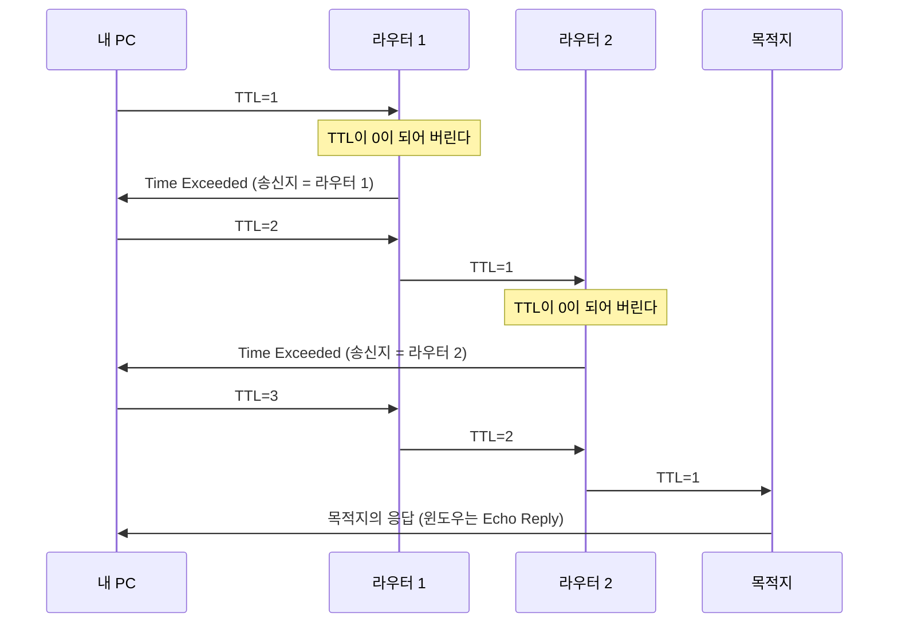

## ICMP란 ?
- IP로 데이터를 보내다가 생긴 문제나 상태를 보낸 쪽에 알려 주는 프로토콜
- 목적지에 닿지 못했다, 가는 도중 수명이 다했다 같은 오류 알림과, 상대가 살아 있는지 묻고 답하는 질의 메시지가 있다
- ping은 이 질의 메시지로 상대까지 다녀오는 시간과 손실을 재고, traceroute는 오류 알림을 이용해 가는 길의 라우터를 하나씩 알아낸다

IP 주소와 라우터는 [주소체계](../주소체계(Addressing)/README.md#ip-주소)와 [ARP](../ARP(Address%20Resolution%20Protocol)/README.md#다른-네트워크로-갈-때), 계층과 헤더는 [계층 모델](../계층%20모델(OSI%20and%20TCP-IP%20Layers)/README.md) 문서에 정리했다. 이 문서는 그 내용을 안다고 보고 쓴다. 또 IPv4의 ICMP를 다룬다. IPv6에서는 ICMPv6를 쓰고, 이 문서의 명령 출력도 모두 IPv4로 나간 결과다.

### ICMP (Internet Control Message Protocol)
Internet은 인터넷, Control은 제어, Message는 전갈, 알림이다. 우리말로는 인터넷 제어 메시지 프로토콜이라고 한다.
공학적으로는 라우터나 목적지 컴퓨터가 데이터를 처리하다 문제가 생겼을 때, 또는 상태를 확인하고 싶을 때 주고받는 짧은 알림의 형식을 정한 규칙이다. 데이터를 나르는 일은 IP가 하고, 나르는 과정이 잘 되고 있는지 알리고 다루는 일(제어)을 ICMP가 맡는다는 뜻이 이름에 담겨 있다. 표준은 RFC 792다.

우체국의 반송 안내 쪽지와 비슷하다. 편지를 배달하지 못하면 우체국은 편지를 버리기만 하지 않고, 보낸 사람에게 주소 불명으로 배달하지 못했다고 쪽지를 보낸다. 쪽지는 편지 자체가 아니라 편지를 나르다 생긴 일을 알리는 소식이다.

<br/>

## 왜 ICMP가 필요할까
### IP는 실패를 알려 주지 않는다
IP는 패킷을 목적지 쪽으로 넘기기만 하고, 잘 도착했는지 확인하지 않는다. 인터넷 호스트의 요구 사항을 정한 RFC 1122(1.1.3)는 IP가 끝에서 끝까지 전달을 보장하지 않아서 패킷이 망가지거나, 겹치거나, 순서가 바뀌거나, 아예 도착하지 않을 수 있다고 적는다. 빠진 데이터를 다시 보내는 일은 [TCP](../TCP%20연결%20과정(TCP%20Handshake)/README.md) 같은 위 계층이 맡는다.

문제는 IP만 있으면 보낸 쪽이 왜 실패했는지 모른다는 점이다. 라우터가 목적지로 가는 길을 모르거나, 목적지 컴퓨터가 그 데이터를 받을 프로그램이 없어서 버려도, 보낸 쪽은 그저 답이 오지 않는다는 것만 안다. 길이 없는 것인지, 상대가 꺼진 것인지, 한참 기다리면 오는 것인지 구분할 수 없다.

### 알림이 있으면 구분할 수 있다
그래서 패킷을 처리하던 라우터나 목적지 컴퓨터가 문제를 만나면 보낸 쪽에 ICMP 메시지로 이유를 알려 준다. 보낸 쪽은 기다리지 않고 바로 실패를 알 수 있고, 사람은 어디에서 막혔는지 짐작할 수 있다.

다만 ICMP가 IP를 믿을 수 있게 만들어 주지는 않는다. RFC 792 서문은 이 메시지들의 목적이 통신 환경의 문제를 알려 주는 것이지 IP를 신뢰할 수 있게 만드는 것이 아니라고 적고, 알림 없이 사라지는 패킷도 여전히 있을 수 있다고 적는다. 반송 쪽지도 늘 오는 것은 아니다.

또 하나, ICMP 오류 메시지 때문에 생긴 문제는 다시 ICMP 오류 메시지로 알리지 않는다(RFC 1122 3.2.2). 반송 쪽지가 반송됐다고 또 쪽지를 보내면 쪽지가 끝없이 이어질 수 있어서다. RFC 792 서문은 ICMP 메시지 전체에 대해 보내지 않는다고 적었는데, RFC 1122가 오류 메시지로 범위를 좁혔다. 그래서 질의 메시지인 Echo Request가 가는 도중 버려지면 오류 알림이 돌아오고, 뒤에서 볼 traceroute가 이것을 이용한다.

<br/>

## 어느 계층에서 동작할까
### IP 위에 실리지만 인터넷 계층이다
ICMP 메시지는 IP 패킷의 데이터 자리에 담겨 간다. [계층 모델](../계층%20모델(OSI%20and%20TCP-IP%20Layers)/README.md#받을-때) 문서에서 IP 헤더에는 그 안에 든 것이 무엇인지 알리는 칸(프로토콜)이 있다고 했는데, ICMP는 이 칸에 1을 적는다(RFC 792의 메시지 형식). TCP나 UDP처럼 IP 위에 실리는 모양이다.

```text
| IP 헤더 (프로토콜 = 1) | ICMP 메시지 |
```

모양만 보면 전송 계층처럼 보이지만, ICMP는 보통 인터넷 계층(OSI로는 3계층)에 넣는다. RFC 792는 ICMP가 IP를 위 계층 프로토콜처럼 쓰지만 실제로는 IP의 일부이고, 모든 IP 모듈이 구현해야 한다고 적는다. RFC 1122(1.1.3)도 ICMP를 구조상 IP 위에 놓이지만 IP의 일부로 여기는 제어 프로토콜이라고 하고, IP와 함께 인터넷 계층 프로토콜로 묶는다.

이유는 하는 일에 있다. TCP와 UDP는 프로그램의 데이터를 나르지만, ICMP는 프로그램의 데이터를 나르지 않는다. IP가 패킷을 나르다 생긴 일을 IP끼리 주고받는 알림이다. 그래서 담겨 가는 모양보다 누구의 일을 하느냐를 보고 IP와 같은 층에 둔다. [계층 모델](../계층%20모델(OSI%20and%20TCP-IP%20Layers)/README.md#tcpip-4계층) 문서의 TCP/IP 4계층 표에서 ICMP가 IP와 같은 칸에 있는 것도 이 때문이다.

### 포트가 없다
TCP와 UDP 헤더에는 [포트 번호](../소켓(Socket)/README.md#포트-port)가 있어서 컴퓨터 안의 어느 프로그램에게 줄지 고른다. ICMP 메시지에는 포트 번호가 없다. 프로그램에게 가는 데이터가 아니라 컴퓨터의 IP 처리 부분(운영체제)이 받아 처리하는 알림이기 때문이다.

그래서 ping에 응답하는 것은 웹 서버 같은 프로그램이 아니라 운영체제다. 이 차이가 뒤에서 볼 [ping이 안 된다고 서버가 꺼진 것은 아니다](#ping이-안-된다고-서버가-꺼진-것은-아니다)의 바탕이 된다.

포트가 없으니 여러 ping 프로그램이 동시에 돌 때 답이 누구 것인지는 어떻게 구분할까. Echo 메시지에는 식별자(Identifier)와 순서 번호(Sequence Number) 칸이 있어서 보낸 쪽이 요청과 응답을 짝지을 수 있다. RFC 792는 식별자를 TCP나 UDP의 포트처럼 쓸 수 있다고 예를 든다. 메시지 구조는 아래 더 볼 것에 남긴다.

<br/>

## 자주 보는 ICMP 메시지
ICMP 메시지는 맨 앞의 종류(Type) 값으로 무슨 메시지인지 구분하고, 코드(Code) 값으로 더 자세한 이유를 나눈다. RFC 1122(3.2.2)는 메시지를 오류를 알리는 것(오류 메시지)과 묻고 답하는 것(질의 메시지)으로 나눈다. 입문 단계에서 자주 보는 것은 아래 셋이다. 종류 번호는 RFC 792에서 확인했다.

| 메시지 | 종류 번호 | 구분 | 누가 보내나 | 언제 |
| --- | --- | --- | --- | --- |
| Echo Request, Echo Reply | 8, 0 | 질의 | 요청은 묻는 쪽, 응답은 목적지 | 상대가 살아 있는지, 얼마나 걸리는지 물을 때 |
| Destination Unreachable | 3 | 오류 | 라우터나 목적지 | 목적지에 넘겨줄 수 없을 때 |
| Time Exceeded | 11 | 오류 | 주로 라우터 | TTL이 0이 되어 패킷을 버렸을 때 |

### Echo Request와 Echo Reply
Echo의 사전적 의미는 메아리다. 산에 대고 소리치면 같은 소리가 되돌아온다.
공학적으로는 받은 내용을 그대로 되돌려 보내 달라는 요청(Echo Request)과 그 응답(Echo Reply)을 말한다. RFC 792는 Echo 메시지에 담긴 데이터를 Echo Reply에 그대로 담아 돌려줘야 한다고 적는다. RFC 1122(3.2.2.6)는 모든 호스트가 Echo Request를 받으면 Echo Reply를 보내는 기능을 구현해야 한다(MUST)고 정한다. MUST는 RFC에서 반드시 지켜야 한다는 뜻으로 쓰는 말이고, 뒤에 나올 SHOULD는 특별한 이유가 없으면 지켜야 한다는 뜻이다. ping이 이 두 메시지를 쓴다.

[ARP](../ARP(Address%20Resolution%20Protocol)/README.md#동작-순서) 문서의 순서 그림 5번과 6번이 바로 이 Echo Request와 Echo Reply다.

### Destination Unreachable
Destination은 목적지, Unreachable은 닿을 수 없다는 뜻이다.
공학적으로는 패킷을 목적지까지 넘겨줄 수 없을 때 보낸 쪽에 알리는 메시지다. 코드로 이유를 나눈다. RFC 792에 적힌 코드 가운데 몇 가지를 보면 아래와 같다.

- 0번(net unreachable)은 그 네트워크로 가는 길이 없다는 뜻이다. 라우터가 보낸다.
- 1번(host unreachable)은 그 컴퓨터에 닿을 수 없다는 뜻이다. 라우터가 보낸다.
- 3번(port unreachable)은 컴퓨터에는 닿았지만 그 포트에서 기다리는 프로그램이 없다는 뜻이다. 목적지 컴퓨터가 보낸다.

[ARP](../ARP(Address%20Resolution%20Protocol)/README.md#없는-장치에-물으면) 문서에서 같은 네트워크의 빈 주소로 ping을 보냈을 때 본 "대상 호스트에 연결할 수 없습니다"(영어 윈도우에서는 Destination host unreachable)가 이 이름의 문구다. 그 예에서는 응답한 주소가 상대가 아니라 내 PC로 찍혔다. 이때 윈도우가 실제로 ICMP 메시지를 만들어 주고받는지, ping이 문구만 그렇게 보여 주는지는 확인 필요다.

### Time Exceeded
Time은 시간, Exceeded는 넘었다는 뜻이다.
공학적으로는 패킷이 정해진 수명을 넘겨 버려졌을 때 보낸 쪽에 알리는 메시지다. 코드 0번이 가는 도중 TTL이 다했다(time to live exceeded in transit)는 뜻이고, traceroute가 이 메시지를 이용한다. TTL은 아래에서 따로 본다.

<br/>

## ping으로 왕복 시간 재기
### ping
사전적 의미는 핑 하고 울리는 짧은 소리다. 잠수함의 음파 탐지기(소나)가 소리를 쏘고 되돌아오는 메아리로 거리를 재는 데서 이름을 따왔다고 알려져 있지만 확인 필요다.
공학적으로는 상대에게 ICMP Echo Request를 보내고 Echo Reply가 돌아오는지, 돌아오는 데 얼마나 걸리는지 재는 명령이다. 윈도우, 맥, 리눅스 모두 같은 이름의 명령이 있다.

산에서 소리치고 메아리가 돌아오기까지 걸린 시간으로 건너편 산까지의 거리를 짐작하는 것과 같다. 메아리가 아예 없으면 건너편이 막혔거나 너무 멀다고 짐작한다.

### 동작
1. 보낸 쪽은 Echo Request에 순서 번호를 붙이고 보낸 시각을 기억해 둔다.
2. 목적지 운영체제는 Echo Request를 받으면 송신지 IP 주소와 수신지 IP 주소를 서로 바꾸고 종류를 0(Echo Reply)으로 바꿔 돌려보낸다(RFC 792).
3. 보낸 쪽은 응답이 오면 보낸 시각과 받은 시각의 차이를 왕복 시간(RTT, Round Trip Time)으로 찍는다.
4. 정해진 시간 안에 응답이 오지 않으면 그 요청은 잃어버린 것(손실)으로 센다. 윈도우 ping은 기본으로 4초를 기다린다(Microsoft의 ping 명령 문서).
5. 정해진 횟수(윈도우 기본 4번)를 보내고 나면 보낸 수, 받은 수, 손실률과 왕복 시간의 최소, 최대, 평균을 정리해 보여 준다.

왕복 시간은 가는 길과 오는 길을 합친 시간이다. 한쪽 길만 느린지는 ping만으로 알 수 없다.

### 출력 읽기
아래는 2026-10-26에 한국어 윈도우 11(10.0.26200)에서 `ping -n 4 example.com` 을 실행한 결과다. `-n 4` 는 4번만 보내라는 뜻이다. 목적지 example.com의 주소는 공개 서버 주소라 그대로 두었다. 주소, 시간, TTL은 실행할 때마다, 장소마다 다를 수 있다.

```text
Ping example.com [172.66.147.243] 32바이트 데이터 사용:
172.66.147.243의 응답: 바이트=32 시간=12ms TTL=58
172.66.147.243의 응답: 바이트=32 시간=13ms TTL=58
172.66.147.243의 응답: 바이트=32 시간=12ms TTL=58
172.66.147.243의 응답: 바이트=32 시간=14ms TTL=58

172.66.147.243에 대한 Ping 통계:
    패킷: 보냄 = 4, 받음 = 4, 손실 = 0 (0% 손실),
왕복 시간(밀리초):
    최소 = 12ms, 최대 = 14ms, 평균 = 12ms
```

- 첫 줄의 대괄호 안은 example.com을 [DNS](../DNS(Domain%20Name%20System)/README.md)로 찾은 IP 주소다. ping은 이름이 아니라 IP 주소로 보낸다. 32바이트는 Echo Request에 담아 보낸 데이터 크기로, 윈도우 기본값이다.
- 가운데 네 줄이 Echo Reply 하나씩이다. 바이트=32는 돌아온 Echo Reply에 담긴 데이터 크기로, 보낸 크기와 같다. 시간은 왕복 시간이다.
- TTL=58은 돌아온 Echo Reply 패킷의 IP 헤더에 남아 있던 TTL 값이다. 내가 보낸 값이 아니라 상대가 보낸 값에서 오는 길에 줄어든 결과다. 아래 TTL 절에서 다시 본다.
- 통계의 손실 0%는 4번 보내 4번 다 돌아왔다는 뜻이다. 손실이 생기면 그 줄에 "요청 시간이 만료되었습니다."가 찍히고 손실 수가 늘어난다.
- 평균이 12ms로 찍혔다. 네 값(12, 13, 12, 14)의 평균은 12.75인데, 윈도우 ping이 소수점 아래를 버리는 것으로 보이지만 확인 필요다.

<br/>

## TTL과 홉
### TTL (Time To Live)
살아 있는 시간, 즉 수명이라는 뜻이다.
공학적으로는 IP 헤더에 있는 8비트 칸으로, 이 패킷이 인터넷 안에 얼마나 오래 머물 수 있는지 정한다. 보낸 쪽이 처음 값을 적고, 패킷을 처리하는 장비마다 이 값을 줄인다. 0이 되면 그 패킷은 버린다(RFC 791 3.1).

[DNS](../DNS(Domain%20Name%20System)/README.md#ttl-time-to-live) 문서의 TTL과 이름도 뜻도 같지만 붙는 곳이 다르다. DNS의 TTL은 답을 캐시에 몇 초 둘지 정하는 값이고, 여기의 TTL은 IP 패킷 하나가 몇 번 넘겨질 수 있는지 정하는 값이다.

릴레이 택배에 붙인 남은 터미널 수 도장과 비슷하다. 터미널을 하나 지날 때마다 숫자를 하나씩 지우고, 0이 된 상자는 더 보내지 않고 폐기한 뒤 보낸 사람에게 폐기했다고 알린다.

### 왜 라우터를 지날 때마다 줄어들까
라우터의 길 안내 표(라우팅 테이블)가 잘못 적히면 패킷이 라우터 몇 대 사이를 빙글빙글 돌 수 있다. 이런 패킷이 영원히 돌면 길이 막힌다. TTL은 이런 패킷을 언젠가는 버리게 만드는 안전장치다. RFC 1122(3.2.1.7)는 TTL의 역할을 TCP 세그먼트의 수명 제한과 라우팅 고리(routing loop) 끊기 두 가지로 적는다.

이름이 Time인 것은 원래 초 단위 시간이었기 때문이다. RFC 791은 단위를 초로 정했지만, 패킷을 처리하는 장비는 1초가 걸리지 않아도 최소 1은 줄여야 한다고 했다. 실제로 한 장비를 지나는 데 1초씩 걸리는 일은 드물어서, 지금은 사실상 몇 번 넘겨질 수 있는지 세는 값(홉 수 제한)으로 쓴다. 라우터 요구 사항을 정한 RFC 1812(5.3.1)도 TTL이 사실상 홉 수 제한이라고 적는다. 홉(Hop)의 사전적 의미는 깡충 뛰기로, 네트워크에서는 패킷이 장비 하나를 건너뛰는 한 구간을 말한다.

### 0이 되면
RFC 1812(5.3.1)는 라우터가 패킷을 넘길 때 TTL을 최소 1 줄이고, 0이 되면 패킷을 버리고 보낸 쪽에 ICMP Time Exceeded(코드 0)를 보내야 한다(MUST)고 정한다. 다만 목적지가 멀티캐스트 주소(여러 장치에게 한꺼번에 보내는 주소)라면 패킷은 똑같이 버리되 Time Exceeded는 보내지 않는다. 다음 절의 traceroute가 이 규칙을 이용한다.

### ping의 TTL로 거리 짐작하기
위 ping 결과의 TTL=58로 서버까지 라우터를 몇 대 지났는지 짐작해 볼 수 있다. 처음 값을 얼마로 잡는지는 운영체제와 설정마다 다르다. RFC 1812(4.2.2.9)는 64가 흔한 값이라고 적는다. 서버가 64로 보냈다면 오는 길에 6번 줄어든 것이고, 아래 tracert에서 본 중간 라우터 수(6대)와 맞는다.

다만 이것은 짐작이다. 서버가 처음에 64로 보냈는지 알 수 없고, 돌아오는 길이 가는 길과 같다는 보장도 없다. 참고로 같은 날 같은 PC에서 자기 자신(127.0.0.1)에 ping을 보내면 TTL=128이 찍혔다. 라우터를 지나지 않으니 이 PC의 윈도우가 처음 적는 값으로 보인다.

<br/>

## traceroute로 경로 알아내기
### traceroute (tracert)
trace는 자취를 따라가다, route는 길이라는 뜻이다. 윈도우에서는 이름을 줄여 `tracert` 라고 쓴다.
공학적으로는 내 컴퓨터에서 목적지까지 패킷이 지나가는 라우터를 차례로 알아내는 명령이다. TTL이 0이 되면 라우터가 Time Exceeded를 돌려준다는 규칙을 거꾸로 이용한다.

앞의 릴레이 택배로 치면, 남은 터미널 수를 1로 적은 상자를 보내면 첫 터미널에서 폐기되며 폐기 안내가 오고, 2로 적으면 두 번째 터미널에서 안내가 온다. 안내를 보낸 터미널을 차례로 이으면 전체 노선이 된다.

### 동작
1. TTL을 1로 적은 패킷을 목적지로 보낸다. 첫 라우터가 TTL을 줄이면 0이 되니 버리고 Time Exceeded를 돌려준다. 이 메시지의 송신지 IP 주소가 첫 라우터의 주소다.
2. TTL을 2로 올려 다시 보낸다. 이번에는 두 번째 라우터에서 0이 되고, 두 번째 라우터가 Time Exceeded를 돌려준다.
3. 이렇게 TTL을 1씩 늘리며 보낸다. 보낸 시각과 응답이 온 시각의 차이가 그 라우터까지의 왕복 시간이다.
4. 패킷이 목적지에 닿으면 목적지는 Time Exceeded가 아니라 다른 응답을 준다. 그것을 받으면 끝낸다. 정해진 최대 홉 수에 닿아도 끝낸다.



목적지에 닿을 때 받는 응답은 보내는 패킷 종류에 따라 다르다.

- 윈도우 `tracert` 는 Echo Request를 보내고, 목적지의 Echo Reply를 받으면 끝낸다. 최대 홉 수 기본값은 30이다(Microsoft의 tracert 명령 문서).
- 리눅스 `traceroute` 는 기본으로 아무도 쓰지 않을 법한 UDP 포트(33434부터)로 UDP 데이터그램을 보내고, 목적지가 돌려주는 Destination Unreachable(port unreachable)을 받으면 끝낸다. `-I` 를 주면 Echo Request를 쓴다. 홉마다 기본 3번 보내고, 최대 홉 수 기본값은 30이다(man7.org의 traceroute(8) 매뉴얼). 리눅스 명령은 이 문서를 쓰며 직접 실행해 보지 않았다.

### 출력 읽기
아래는 2026-10-26에 한국어 윈도우 11(10.0.26200)에서 `tracert -h 15 -w 1000 example.com` 을 실행한 결과다. `-h 15` 는 최대 15홉까지만, `-w 1000` 은 응답을 1초까지만 기다리라는 뜻이다.

1번부터 6번 홉의 주소는 내 위치와 가입한 통신사를 드러낼 수 있어서 문서용 예시 주소로 바꿨다. 1번은 192.0.2.1로, 2번부터 5번(통신사 구간)은 198.51.100.x로, 6번(목적지 쪽 사업자의 장비로 보이는 주소)은 203.0.113.1로 바꿨다. 이 세 대역은 문서에 예로 쓰라고 따로 떼어 둔 주소다(RFC 5737). 목적지 주소와 시간 값은 실제로 찍힌 그대로다. 맨 위에 찍힌 안내 두 줄(최대 15홉, example.com과 그 IP 주소로 가는 경로를 추적한다는 문구)은 뺐다.

```text
  1     1 ms     *        2 ms  192.0.2.1 
  2     1 ms     1 ms     1 ms  198.51.100.1 
  3     2 ms     2 ms     2 ms  198.51.100.2 
  4     7 ms     7 ms     7 ms  198.51.100.3 
  5     8 ms     7 ms     7 ms  198.51.100.4 
  6    14 ms    14 ms    18 ms  203.0.113.1 
  7    12 ms    12 ms    13 ms  172.66.147.243 

추적을 완료했습니다.
```

- 맨 앞 숫자가 홉 번호, 즉 그 줄에서 보낸 TTL 값이다.
- 가운데 세 칸은 같은 TTL로 세 번 보낸 각각의 왕복 시간이다.
- 맨 뒤가 Time Exceeded(마지막 줄은 Echo Reply)를 돌려준 장비의 주소다. Microsoft 문서는 여기 찍히는 주소가 라우터에서 내 쪽을 향한 연결 지점(인터페이스, 선이 꽂히는 자리마다 따로 주소가 붙는다)의 주소라고 설명한다.
- 1번 홉은 내 네트워크의 [기본 게이트웨이](../ARP(Address%20Resolution%20Protocol)/README.md#기본-게이트웨이-default-gateway)다. 집이라면 보통 공유기이고, 그때는 192.168.0.1 같은 공유기 안쪽 주소가 찍힌다. 이 예의 1번 홉은 공유기가 아니라 통신사 쪽 장비라 공인 주소가 찍혔고, 그래서 예시 주소로 바꿨다([NAT와 사설 IP](../NAT와%20사설%20IP(NAT%20and%20Private%20IP)/README.md#내-사설-ip와-공인-ip-확인하기) 참고).
- 7번 줄의 주소가 목적지라서 추적을 마쳤다. 목적지까지 7홉이니 중간 라우터는 6대다.

6번 홉(14ms)이 7번 목적지(12ms)보다 느리게 찍혔다. 홉 번호가 커질수록 시간이 꼭 늘어나지는 않는다. 라우터는 패킷을 넘기는 일을 먼저 하고, TTL이 다한 패킷에 Time Exceeded를 만들어 보내는 일은 뒤로 미루기도 해서 그렇다고 알려져 있지만 확인 필요다.

### ping으로 tracert 흉내 내기
윈도우 ping은 `-i` 로 보내는 TTL을 정할 수 있다. TTL을 6으로 정해 보내면 6번째 장비에서 TTL이 0이 되니 Time Exceeded가 돌아온다. 같은 날 같은 PC에서 `ping -n 1 -i 6 example.com` 을 실행한 결과다. 응답한 주소는 위 tracert와 같은 이유로 203.0.113.1로 바꿨다.

```text
Ping example.com [172.66.147.243] 32바이트 데이터 사용:
203.0.113.1의 응답: 전송하는 동안 TTL이 만료되었습니다.

172.66.147.243에 대한 Ping 통계:
    패킷: 보냄 = 1, 받음 = 1, 손실 = 0 (0% 손실),
```

응답을 보낸 주소가 목적지(172.66.147.243)가 아니라 6번 홉 장비다. tracert가 TTL 6일 때 받는 것이 바로 이 응답이다. TTL을 7로 올려 `ping -n 1 -i 7 example.com` 을 보내자 목적지가 `바이트=32 시간=12ms TTL=58` 로 정상 응답했다.

통계에 받음 = 1, 손실 = 0으로 찍힌 점도 눈여겨볼 만하다. 돌아온 것은 Echo Reply가 아니라 Time Exceeded인데도 윈도우 ping은 무언가 돌아왔으니 받았다고 셌다. 손실 0%가 늘 목적지가 답했다는 뜻은 아니니 위의 응답 줄까지 읽어야 한다.

<br/>

## 응답이 * 로 나올 때
tracert와 traceroute는 기다리는 시간 안에 응답이 오지 않은 칸에 * 을 찍는다. 윈도우 tracert는 기본으로 4초를 기다린다(Microsoft의 tracert 명령 문서). * 이 찍히는 이유는 여러 가지다.

- 장비가 Time Exceeded를 보내지 않도록 설정되어 있다. Microsoft 문서도 TTL이 다한 패킷에 Time Exceeded를 돌려주지 않는 라우터가 있고, 그런 라우터는 tracert에 보이지 않는다고 적는다.
- 방화벽이 ICMP를 막는다. 장비는 응답을 보냈지만 중간이나 내 쪽 방화벽이 들어오는 ICMP를 버릴 수도 있다.
- 장비가 ICMP를 만드는 횟수를 제한한다. RFC 1812(4.3.2.8)는 라우터가 Time Exceeded 같은 ICMP 오류 메시지를 만드는 빈도를 제한할 수 있어야 한다(SHOULD)고 정한다. 오류 메시지를 만드는 데도 라우터의 자원이 들고, 돌아가는 길의 대역폭(한 번에 나를 수 있는 데이터 양)도 쓰기 때문이다. 짧은 시간에 여러 번 물으면 일부만 답할 수 있다.
- 실제로 패킷이 사라졌다.

위 tracert 출력의 1번 홉도 세 번 중 가운데 한 번이 * 였다. 같은 날 `ping -n 1 -i 1 example.com` 으로 1번 홉에 다시 물었을 때도 "요청 시간이 만료되었습니다."가 찍혔다. 이 장비가 위 이유 중 어느 쪽인지는 바깥에서 알 수 없어 확인 필요다.

중요한 점은 중간 홉 한두 줄이 * 이어도 그 뒤 홉과 목적지가 정상으로 찍히면 길은 이어져 있다는 것이다. 그 장비는 패킷을 넘기는 일은 잘 하고 있고, 자기 앞으로 답장을 쓰지 않았을 뿐이다. 반대로 어느 홉부터 끝까지 * 만 이어지면 그 근처에서 길이 끊겼거나, 목적지가 ICMP에 답하지 않는다고 볼 수 있다.

<br/>

## ping이 안 된다고 서버가 꺼진 것은 아니다
### ping이 안 되는데 서버는 살아 있는 경우
RFC 1122(3.2.2.6)는 모든 호스트가 Echo Reply를 보내는 기능을 갖춰야 한다고 정하지만, 실제로는 답하지 않게 막아 둔 서버가 많다. 서버의 방화벽이나 그 앞의 네트워크 장비가 ICMP를 막아 두면 Echo Request가 운영체제까지 가지 못하거나, 가더라도 답을 보내지 않는다. 바깥에서 서버가 있는지 함부로 확인하지 못하게 하려고 막는 곳이 있다. [NAT와 사설 IP](../NAT와%20사설%20IP(NAT%20and%20Private%20IP)/README.md#바깥에서-먼저-들어올-수-없는-이유) 문서에서 본 공유기처럼, 바깥에서 먼저 들어오는 요청을 받지 않는 구조라면 집 안의 PC에 바깥에서 ping을 보내도 닿지 않는다.

이런 서버도 웹 페이지는 잘 보여 준다. 웹은 TCP의 443번이나 80번 포트로 오가는데, 방화벽은 그 포트는 열고 ICMP만 막을 수 있기 때문이다. ping이 안 될 때 서버가 정말 꺼졌는지 보려면 실제로 쓰는 포트로 접속해 보는 편이 정확하다.

이 문서를 쓰며 ICMP를 막는 공개 서버의 실제 출력은 확인하지 않았다. 확인하려고 시도한 사이트가 ping에 답했다.

### ping은 되는데 서비스는 안 되는 경우
반대도 있다. 앞에서 본 것처럼 Echo Reply는 운영체제가 보낸다. 컴퓨터는 켜져 있고 네트워크도 되지만 웹 서버 프로그램이 멈췄다면, ping은 정상으로 답하고 웹 페이지는 열리지 않는다.

전화로 치면 ping은 그 건물의 대표 번호가 받는지만 확인하는 것이다. 대표 번호가 안 받아도 담당자 직통 번호는 받을 수 있고, 대표 번호가 받아도 찾는 담당자는 자리에 없을 수 있다.

그래서 ping은 IP 수준에서 길이 이어져 있는지, 얼마나 걸리는지 보는 도구로 쓴다. 서비스가 살아 있는지는 그 서비스로 직접 확인한다.

<br/>

## 함께 보면 좋은 노트
- [계층 모델](../계층%20모델(OSI%20and%20TCP-IP%20Layers)/README.md)은 ICMP가 놓이는 인터넷 계층과 IP 헤더가 붙는 과정을 다룬다.
- [ARP](../ARP(Address%20Resolution%20Protocol)/README.md)는 ping 예시로 같은 네트워크 안에서 MAC 주소를 알아내는 과정과 라우터, 기본 게이트웨이를 다룬다.
- [주소체계](../주소체계(Addressing)/README.md)는 IP 주소와 서브넷 마스크를 다룬다.
- [NAT와 사설 IP](../NAT와%20사설%20IP(NAT%20and%20Private%20IP)/README.md)는 공유기가 주소를 바꾸는 과정과 바깥에서 먼저 들어올 수 없는 이유를 다룬다.
- [DNS](../DNS(Domain%20Name%20System)/README.md)는 ping과 tracert가 이름을 IP 주소로 바꿀 때 쓰는 과정과, 이름이 같은 DNS의 TTL을 다룬다.
- [네트워크 목차](../README.md)

<br/>

## 더 볼 것 (TODO)
- ICMP 메시지 구조 자세히 (종류, 코드, 체크섬, 오류 메시지에 원래 패킷 앞부분을 담는 방식)
- ICMPv6와 IPv6에서 ICMP가 맡는 일 (IPv6에서는 ARP 대신 ICMPv6로 MAC 주소를 찾는다고 알려져 있지만 확인 필요)
- MTU와 경로 MTU 탐색 (Destination Unreachable의 fragmentation needed 코드)
- ping flood, ICMP를 이용한 공격과 방어
- NAT가 포트 없는 ICMP의 응답을 어느 장치에 돌려줄지 구분하는 방법
- Redirect, Source Quench 같은 다른 ICMP 메시지
- 윈도우 `pathping` 으로 홉마다 손실률 보기
- 리눅스 `traceroute` 의 UDP 방식과 TCP 방식 직접 실행해 비교하기
- IP 헤더 구조 (TTL과 프로토콜 칸의 위치)
