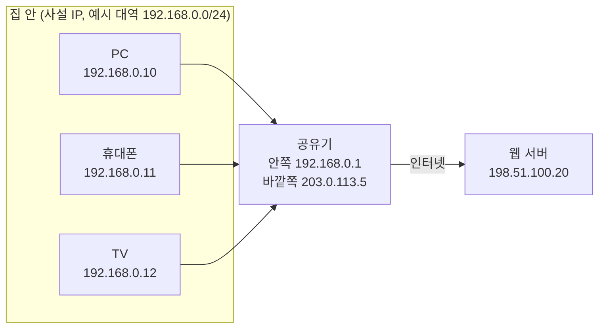
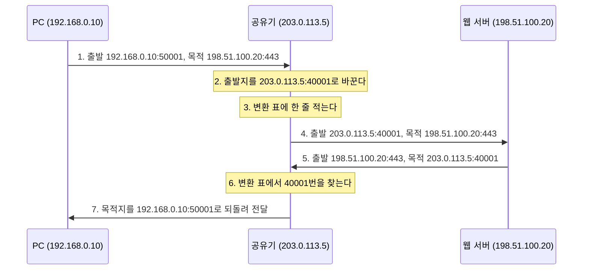

## NAT와 사설 IP란 ?
- 사설 IP는 집이나 회사 같은 내부 네트워크 안에서만 쓰는 IP 주소이고, 공인 IP는 인터넷 전체에서 다른 장치와 겹치지 않는 IP 주소다
- NAT는 내부 네트워크와 인터넷 사이에서 IP 주소(와 포트 번호)를 바꿔 주는 기술이다. 집에서는 공유기가 이 일을 한다
- 덕분에 집 안의 여러 장치가 공인 IP 하나를 나눠 쓰며 인터넷에 나갈 수 있다

IP 주소, 서브넷 마스크는 [주소체계](../주소체계(Addressing)/README.md#ip-주소), 라우터와 게이트웨이는 [ARP](../ARP(Address%20Resolution%20Protocol)/README.md#기본-게이트웨이-default-gateway), 포트 번호는 [소켓](../소켓(Socket)/README.md#포트-port) 문서에 정리했다. 이 문서는 그 내용을 안다고 보고 쓴다.

### 공인 IP (Public IP)
공인(公認)의 사전적 의미는 국가나 공공 단체가 정식으로 인정한다는 것이다.
공학적으로는 인터넷 주소를 관리하는 기관이 정식으로 나눠 준 IP 주소를 말한다. 인터넷 전체에서 겹치지 않으므로 어디서든 이 주소로 찾아올 수 있다. 주소는 인터넷 할당 번호 관리 기관(IANA, Internet Assigned Numbers Authority)가 대륙별 기관에 나눠 주고, 그 기관이 다시 통신사 같은 곳에 나눠 주는 방식으로 내려온다. 집에서 쓰는 공인 IP는 보통 가입한 통신사가 공유기에 붙여 준다.

### 사설 IP (Private IP)
사설(私設)의 사전적 의미는 개인이나 민간이 따로 세운 것이다. 사설 도서관처럼 공공이 아니라 자기 쪽에서 마련했다는 뜻이다.
공학적으로는 내부 네트워크 안에서만 쓰기로 약속한 IP 주소를 말한다. 누구나 허락 없이 쓸 수 있는 대신 인터넷에서는 통하지 않는다. 우리 집 공유기 안의 192.168.0.10과 옆집 공유기 안의 192.168.0.10이 동시에 있어도 문제가 없다. 서로 다른 내부 네트워크 안에서만 쓰이기 때문이다.

### NAT (Network Address Translation)
Network는 네트워크, Address는 주소, Translation은 번역이다. 우리말로는 네트워크 주소 변환이라고 한다.
공학적으로는 데이터가 내부 네트워크와 바깥 네트워크의 경계를 지날 때 데이터에 적힌 IP 주소를 다른 주소로 바꿔 적는 일을 말한다. 한쪽에서만 통하는 주소를 다른 쪽에서 통하는 주소로 옮겨 적는다는 뜻에서 번역이라는 이름이 붙었다.

### 회사 우편실로 이해하기
이 문서는 회사 우편실 하나로 설명한다. 회사 바깥에서 보면 회사 주소는 하나뿐이고, 회사 안에서는 3층 12번 자리처럼 자리 번호로 사람을 구분한다. 자리 번호는 다른 회사에도 똑같이 있을 수 있다. 직원이 바깥으로 편지를 보내면 우편실이 보내는 사람 칸을 회사 주소로 바꿔 적고, 누가 보낸 편지인지 장부에 적어 둔다. 답장이 오면 장부를 보고 그 직원 자리로 건넨다.

회사 주소가 공인 IP, 자리 번호가 사설 IP, 우편실이 NAT를 하는 공유기, 장부가 아래에서 볼 변환 표다.

<br/>

## 왜 사설 IP가 생겼을까
### IPv4 주소가 모자라다
IPv4 주소는 32비트라서 만들 수 있는 주소는 2의 32제곱, 약 43억 개다. 그중 일부는 특수한 용도로 빼 두었으니 실제로 나눠 줄 수 있는 수는 더 적다. 컴퓨터만 인터넷에 붙던 시절에는 넉넉해 보였지만, 휴대폰, 태블릿, TV, 가전까지 붙으면서 사람 수보다 장치 수가 많아졌다. IANA가 대륙별 기관에 나눠 줄 수 있는 IPv4 주소는 2011년에 바닥났다.

근본적인 해결은 주소를 128비트로 늘린 IPv6다. 하지만 인터넷의 모든 장비와 프로그램을 한꺼번에 IPv6로 바꿀 수는 없어서, 그 전부터 쓰던 방법이 사설 IP와 NAT다.

### 사설 IP와 NAT로 아끼는 방법
집 안의 장치마다 공인 IP를 하나씩 주지 않고, 공유기 하나만 공인 IP를 받는다. 집 안의 장치에는 사설 IP를 주고, 인터넷에 나갈 때 공유기가 NAT로 출발지 주소를 공인 IP로 바꿔 준다. 장치가 열 대여도 공인 IP는 하나면 된다.

우편실 비유로는 직원 모두에게 회사 주소를 하나씩 따로 마련해 주지 않고, 회사 주소 하나를 같이 쓰는 셈이다.



이 문서의 주소는 모두 예시다. 192.168.0.x는 사설 대역에서 고른 예시이고, 203.0.113.x와 198.51.100.x는 문서에 예로 쓰라고 따로 정해 둔 주소(RFC 5737)라서 실제 인터넷의 누구와도 겹치지 않는다.

<br/>

## 사설 IP 대역
### 세 가지 대역
사설 IP로 쓸 수 있는 IPv4 주소는 RFC 1918 문서에 세 덩어리로 정해져 있다. 이 범위 안의 주소는 인터넷에서 쓰지 않기로 약속했으므로, 인터넷의 라우터는 이 주소로 가는 길을 갖고 있지 않다.

| 대역 | CIDR 표기 | 범위 | 주소 개수 |
| --- | --- | --- | --- |
| 10 대역 | 10.0.0.0/8 | 10.0.0.0 ~ 10.255.255.255 | 16,777,216 |
| 172 대역 | 172.16.0.0/12 | 172.16.0.0 ~ 172.31.255.255 | 1,048,576 |
| 192.168 대역 | 192.168.0.0/16 | 192.168.0.0 ~ 192.168.255.255 | 65,536 |

집 공유기는 대부분 192.168 대역을 쓰고, 장치가 많은 회사나 클라우드 내부 네트워크는 10 대역을 자주 쓴다. 172 대역은 172.16부터 172.31까지만 사설이라는 점을 자주 헷갈린다. 172.32.0.1은 사설 IP가 아니다.

내 IP 주소가 이 세 범위 중 하나에 들어 있고 인터넷이 된다면, 대개 공유기 같은 NAT 장비 뒤에 있다는 뜻이다. 인터넷에 연결하지 않는 내부망처럼 NAT 없이 사설 IP만 쓰는 곳도 있어서 늘 그런 것은 아니다.

### 왜 대역 크기가 제각각일까
세 대역의 크기가 다른 것은 예전 주소 클래스에 맞춰 정했기 때문이다. 클래스는 사설 대역을 이해하는 데 필요한 만큼만 보고 넘어간다.

초기 IPv4는 주소의 첫 숫자(첫 8비트)로 네트워크 크기를 정했다. 이를 주소 클래스(Address Class)라고 한다. 클래스(Class)의 사전적 의미는 등급, 반이다. 주소를 크기에 따라 몇 등급으로 나눠 두었다는 뜻이다.

| 클래스 | 첫 숫자 범위 | 네트워크 ID 길이 | 네트워크 하나의 주소 개수 |
| --- | --- | --- | --- |
| A | 0 ~ 127 | 앞 8비트 (/8) | 16,777,216 |
| B | 128 ~ 191 | 앞 16비트 (/16) | 65,536 |
| C | 192 ~ 223 | 앞 24비트 (/24) | 256 |

이 밖에 224부터 239까지는 여러 장치에 한꺼번에 보내는 멀티캐스트용(D 클래스), 240부터는 예약용(E 클래스)이다. A 클래스 범위의 127로 시작하는 주소는 자기 자신을 가리키는 주소(루프백, Loopback)로 따로 빼 두었다.

이 표로 사설 대역을 다시 보면 크기가 이해된다.

- 10.0.0.0/8은 A 클래스 네트워크 하나다.
- 172.16.0.0/12는 B 클래스 네트워크 16개(172.16부터 172.31까지)를 이은 것이다.
- 192.168.0.0/16은 C 클래스 네트워크 256개(192.168.0부터 192.168.255까지)를 이은 것이다.

### 지금은 클래스 대신 CIDR
클래스 방식은 크기가 셋뿐이라 낭비가 컸다. 장치가 300대인 조직은 C 클래스(256개)로는 모자라고, B 클래스를 받으면 6만 개 넘는 주소가 남는다. 그래서 1993년부터 네트워크 ID 길이를 8, 16, 24에 묶지 않고 원하는 만큼 정하는 CIDR(Classless Inter-Domain Routing) 방식을 쓴다. 이름의 Classless가 클래스 없이라는 뜻이다. 위 표의 /12처럼 슬래시 뒤 숫자로 길이를 적는 표기는 [주소체계](../주소체계(Addressing)/README.md#서브넷-마스크) 문서에서 본 그 표기다.

지금 주소를 나누고 길을 찾는 일은 모두 CIDR 기준이고, 클래스는 사설 대역처럼 옛 기준이 이름이나 크기에 남아 있는 곳을 읽을 때 정도만 쓴다.

<br/>

## 공유기가 주소를 바꾸는 과정
### 주소만 바꾸면 생기는 문제
가장 단순한 NAT는 사설 IP 하나를 공인 IP 하나로 바꾼다(기본 NAT, Basic NAT). 이러면 동시에 인터넷에 나가는 장치 수만큼 공인 IP가 필요하다. 공인 IP 하나로 여러 장치가 나가려면, 돌아온 응답이 어느 장치 것인지 구분할 다른 값이 있어야 한다. 그 값으로 쓰는 것이 포트 번호다.

### NAPT, PAT
주소와 포트 번호를 함께 바꾸는 방식을 NAPT(Network Address Port Translation)라고 한다. 같은 것을 PAT(Port Address Translation)라고도 부른다. 집 공유기가 하는 NAT는 보통 이 방식이라서, 일상에서 NAT라고 하면 대개 NAPT를 가리킨다. 두 방식은 모두 RFC 3022에 정리되어 있다.

우편실 비유로는 보내는 사람 칸에 회사 주소만 쓰지 않고 접수번호를 함께 적는 것이다. 회사 주소는 모두 같아도 접수번호가 다르니, 답장에 적힌 접수번호만 보면 어느 자리로 갈 편지인지 알 수 있다.

### 나갈 때 바꾸고 표에 적는다
PC(192.168.0.10)의 브라우저가 웹 서버(198.51.100.20)의 443번 포트에 접속하는 상황이다. PC의 운영체제는 이 연결에 임시 포트 50001번을 붙였다고 하자(임시 포트는 [소켓](../소켓(Socket)/README.md#클라이언트-쪽) 문서 참고). 주소와 포트는 모두 예시다.

1. PC는 목적지가 내 네트워크 밖이므로 데이터를 기본 게이트웨이인 공유기에 넘긴다. 이때 출발지는 192.168.0.10:50001, 목적지는 198.51.100.20:443이다.
2. 공유기는 출발지를 자기 공인 IP와 비어 있는 포트 번호로 바꾼다. 여기서는 203.0.113.5:40001로 바꿨다고 하자. 데이터가 오는 길에 망가지지 않았는지 확인하는 검사 값(체크섬, Checksum)은 주소와 포트를 넣어 계산하므로, 주소를 바꾸면 이 값도 다시 계산해 넣는다.
3. 공유기는 무엇을 무엇으로 바꿨는지 변환 표(NAT Table)에 한 줄 적는다.
4. 바뀐 데이터가 인터넷을 거쳐 서버에 도착한다. 서버는 203.0.113.5:40001에서 온 요청으로 알고, 그 뒤에 PC가 있다는 것은 모른다.

이때 적힌 변환 표는 아래와 같다.

| 안쪽 주소:포트 | 바깥쪽 주소:포트 | 상대 주소:포트 |
| --- | --- | --- |
| 192.168.0.10:50001 | 203.0.113.5:40001 | 198.51.100.20:443 |

### 돌아올 때 표를 보고 되돌린다
5. 서버는 응답을 203.0.113.5:40001로 보낸다.
6. 공유기는 응답의 목적지 203.0.113.5:40001을 변환 표에서 찾는다.
7. 표에 적힌 대로 목적지를 192.168.0.10:50001로 되돌려 PC에 넘긴다.



[ARP](../ARP(Address%20Resolution%20Protocol)/README.md#라우터를-지날-때마다-바뀌는-것) 문서에서 IP 주소는 출발지부터 목적지까지 그대로라고 했다. NAT는 그 예외다. 공유기를 지나는 순간 출발지(나갈 때)나 목적지(돌아올 때)의 IP 주소와 포트 번호가 바뀐다. ARP 문서에서 나눈 층으로 보면 3계층의 IP 주소와 4계층의 포트 번호를 함께 고치는 셈이다.

### 두 장치가 같은 포트를 쓰면
같은 시간에 휴대폰(192.168.0.11)도 우연히 임시 포트 50001번으로 같은 서버에 접속했다고 하자. 공유기는 휴대폰의 연결을 다른 바깥쪽 포트(예: 40002)로 바꿔 표에 따로 적는다.

| 안쪽 주소:포트 | 바깥쪽 주소:포트 | 상대 주소:포트 |
| --- | --- | --- |
| 192.168.0.10:50001 | 203.0.113.5:40001 | 198.51.100.20:443 |
| 192.168.0.11:50001 | 203.0.113.5:40002 | 198.51.100.20:443 |

서버 쪽에서 보면 둘 다 203.0.113.5에서 왔지만 포트가 달라서 [서로 다른 연결](../소켓(Socket)/README.md#연결-하나를-구분하는-방법)이다. 응답도 40001번과 40002번으로 따로 돌아오니 공유기가 헷갈리지 않는다.

바깥쪽 포트를 고르는 방법은 공유기마다 다르다. 안쪽 포트 번호를 그대로 쓸 수 있으면 그대로 쓰는 장비도 있고, 처음부터 다른 번호를 붙이는 장비도 있다. 위의 40001, 40002는 설명을 위해 고른 값이다.

### 표의 줄은 언제 지워질까
변환 표의 줄은 연결이 끝나거나 한동안 데이터가 오가지 않으면 지워진다. 그래야 포트 번호를 다시 쓸 수 있다. 얼마 동안 두는지는 장비와 설정, TCP인지 UDP인지에 따라 달라 확인 필요다. 오래 아무것도 주고받지 않은 연결이 공유기 뒤에서 끊기는 일이 있는 것은 이 때문이다.

<br/>

## 바깥에서 먼저 들어올 수 없는 이유
### 표에 없으면 누구에게 줄지 모른다
NAT는 기본적으로 안에서 먼저 나간 연결의 응답만 되돌려 준다. 변환 표의 줄이 안에서 나갈 때 생기기 때문이다. 예외는 아래 포트 포워딩이고, 장비 종류에 따른 차이는 TODO의 NAT 종류에서 따로 정리한다.

바깥의 누군가가 203.0.113.5:8080으로 먼저 연결을 요청하면, 공유기는 표에서 8080번을 찾지만 그런 줄이 없다. 집 안의 PC, 휴대폰, TV 중 누구에게 줄지 알 수 없으니 버린다. 우편실에 장부에 없는 접수번호가 적힌 편지가 오면, 어느 자리로 보낼지 몰라 그냥 버리는 것과 같다.

사설 IP로 직접 찾아오는 것도 안 된다. 바깥에서 192.168.0.10으로 보내 봐야 인터넷의 라우터는 사설 대역으로 가는 길을 모르고, 같은 주소를 쓰는 집이 셀 수 없이 많으니 어느 집인지도 정할 수 없다.

이 성질 덕분에 바깥에서 집 안 장치를 함부로 두드리기 어려워지는 효과가 있다. 다만 NAT는 주소를 아끼려고 만든 기술이지 보안 장치로 만든 것이 아니라서, 들어오는 데이터를 규칙으로 걸러 내는 방화벽(Firewall)을 대신하지는 않는다.

### 포트 포워딩 (Port Forwarding)
포워딩(Forwarding)의 사전적 의미는 앞으로 보내 주는 것, 전달이다.
공학적으로는 공유기의 특정 바깥쪽 포트로 들어온 요청을 내부의 정해진 장치와 포트로 넘겨 주도록 미리 규칙을 적어 두는 것을 말한다. 표에 없는 요청은 버린다는 문제를, 사람이 표에 줄을 미리 적어 두는 방식으로 푼다. [ARP](../ARP(Address%20Resolution%20Protocol)/README.md#라우터-router) 문서에서 본 라우터의 포워딩과 넘겨 준다는 뜻은 같지만, 포트 포워딩은 사람이 미리 정한 규칙에 따라 넘긴다는 점이 다르다.

우편실 비유로는 접수번호 8080으로 오는 편지는 언제나 3층 12번 자리로 보낸다고 장부 맨 앞에 고정해 적어 두는 것이다.

예를 들어 집 PC(192.168.0.10)의 3000번 포트에 띄운 서버를 바깥에서 쓰게 하려면 공유기 설정 화면에 아래 규칙을 넣는다.

| 바깥쪽 포트 | 안쪽 주소 | 안쪽 포트 | 프로토콜 |
| --- | --- | --- | --- |
| 8080 | 192.168.0.10 | 3000 | TCP |

이제 바깥에서 203.0.113.5:8080으로 오는 요청은 192.168.0.10:3000으로 넘어간다.

포트 포워딩을 쓸 때 주의할 점이 두 가지 있다.

- 규칙은 안쪽 주소를 가리키므로, 공유기가 자동으로 나눠 주는 주소([DHCP](../DHCP(Dynamic%20Host%20Configuration%20Protocol)/README.md))가 바뀌면 규칙이 엉뚱한 장치를 가리킨다. 그래서 대상 장치는 공유기 설정에서 주소를 고정해 두는 경우가 많다.
- 가정용 회선은 통신사가 주는 공인 IP 자체가 바뀔 수 있다. 바뀌는지, 얼마나 자주 바뀌는지는 통신사와 가입 상품에 따라 다르다.

포트를 열면 그 포트로는 인터넷의 누구나 요청을 보낼 수 있다. 필요한 포트만 열고, 쓰지 않으면 규칙을 지운다.

<br/>

## 내 사설 IP와 공인 IP 확인하기
### 사설 IP
내 장치가 받은 IP 주소는 장치 안에서 바로 볼 수 있다.

- 윈도우는 터미널에서 `ipconfig` 를 실행한다.
- 맥은 시스템 설정의 네트워크 화면에서 보거나, 터미널에서 `ifconfig` 를 실행한다.
- 리눅스는 터미널에서 `ip addr` 을 실행한다.

윈도우 11(한국어)에서 `ipconfig` 를 실행하면 어댑터마다 아래 모양으로 나온다. 주소 값은 예시로 바꿔 적었고, 이 문서와 관계없는 줄(연결별 DNS 접미사, 링크-로컬 IPv6 주소)은 뺐다.

```text
이더넷 어댑터 이더넷:

   IPv4 주소 . . . . . . . . . : 192.168.0.10
   서브넷 마스크 . . . . . . . : 255.255.255.0
   기본 게이트웨이 . . . . . . : 192.168.0.1
```

가상 머신 프로그램 같은 것이 깔려 있으면 어댑터가 여러 개 나온다. 실제로 인터넷에 쓰는 어댑터는 보통 기본 게이트웨이 값이 있는 쪽이다. IPv4 주소가 앞에서 본 사설 대역 세 개 중 하나라면 이 장치는 대개 NAT 뒤에 있다. 기본 게이트웨이 주소는 공유기의 안쪽 주소다.

맥과 리눅스 명령은 이 문서를 쓰며 직접 실행해 보지 않았다.

### 공인 IP
공인 IP는 장치 안에서 보이지 않는다. 장치는 사설 IP만 알고, 공인 IP로 바꾸는 일은 공유기가 하기 때문이다. 확인하는 방법은 두 가지다.

- 공유기 관리 화면에 들어가 인터넷(WAN) 쪽 주소를 본다. 관리 화면 주소는 보통 위에서 본 기본 게이트웨이 주소다.
- 내 IP를 알려 주는 웹사이트에 접속한다. 이런 사이트는 요청이 서버에 도착했을 때 출발지 주소를 그대로 보여 준다. 공유기가 바꾼 뒤의 주소이니 이것이 바깥에서 본 내 공인 IP다.

VPN이나 프록시를 쓰지 않는다면, `ipconfig` 의 주소와 웹사이트가 보여 주는 주소가 다르다는 것이 NAT가 출발지 주소를 바꿨다는 증거다.

공유기 관리 화면의 WAN 주소가 사설 대역처럼 인터넷에서 쓰지 않는 주소이거나 웹사이트가 보여 주는 주소와 다르다면, 공유기 바깥에서 통신사가 NAT를 한 번 더 하고 있을 수 있다. 이 경우(CGNAT)는 따로 정리한다.

<br/>

## 함께 보면 좋은 노트
- [주소체계](../주소체계(Addressing)/README.md)는 IP 주소, 서브넷 마스크, CIDR 표기를 다룬다.
- [ARP](../ARP(Address%20Resolution%20Protocol)/README.md)는 라우터와 기본 게이트웨이가 데이터를 넘기는 방식을 다룬다.
- [소켓](../소켓(Socket)/README.md)은 포트 번호와 임시 포트, 연결 하나를 구분하는 네 가지 값을 다룬다.
- [네트워크 목차](../README.md)

<br/>

## 더 볼 것 (TODO)
- NAT 종류(Full cone, Restricted cone, Port restricted cone, Symmetric)와 각각 바깥에서 들어오는 요청을 어디까지 받아 주는지
- NAT 뒤의 장치끼리 직접 연결하는 방법(NAT traversal, STUN, TURN)
- 통신사가 NAT를 한 번 더 하는 CGNAT(Carrier-Grade NAT)
- IPv6 자세히, IPv6에서도 NAT가 필요한지
- 공유기 포트 포워딩을 프로그램이 자동으로 여는 UPnP
- [DHCP가 IP 주소를 나눠 주는 과정](../DHCP(Dynamic%20Host%20Configuration%20Protocol)/README.md)
- [계층 모델](../계층%20모델(OSI%20and%20TCP-IP%20Layers)/README.md)에서 NAT가 어느 계층 정보를 바꾸는지
- 방화벽과 NAT의 차이
