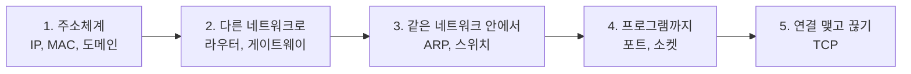

## 네트워크란 ?
- 여러 장치가 선이나 전파로 연결되어 데이터를 주고받는 체계
- 데이터를 주고받으려면 받을 곳을 가리키는 주소, 주소를 찾아가는 장비, 서로 지키는 약속(프로토콜)이 필요하다
- 이 폴더는 주소부터 시작해 데이터가 실제 장치에 닿는 과정, 프로그램끼리 연결을 맺는 과정 순서로 정리한다

### 네트워크 (Network)
사전적 의미는 그물(net)처럼 얽힌 짜임(work). 철도망, 인맥처럼 여러 점이 선으로 이어진 구조를 말한다.
공학적으로는 컴퓨터 같은 장치(점)가 통신 회선(선)으로 이어져 데이터를 주고받는 구조를 말한다. 인터넷은 이런 네트워크들을 다시 서로 이은 네트워크의 네트워크다.

### 프로토콜 (Protocol)
사전적 의미는 외교 의례, 지켜야 할 격식. 나라끼리 만날 때 정해 둔 순서와 말투다.
공학적으로는 장치끼리 데이터를 주고받을 때 지키는 형식과 순서의 약속이다. 서로 다른 회사가 만든 장치라도 같은 프로토콜을 따르면 대화할 수 있다.

 

## 데이터가 목적지까지 가는 흐름
우편과 비슷하다. 편지에 주소를 쓰고, 우체국이 동네 단위로 길을 골라 옮기고, 마지막에 집배원이 그 집에 건넨다. 받는 집에서는 편지에 적힌 이름을 보고 해당 사람이 연다.

네트워크도 같은 순서로 나눠 생각할 수 있다.

1. 주소를 정한다. 장치마다 IP 주소와 MAC 주소가 있고, 사람은 도메인 이름으로 부른다.
2. 다른 네트워크까지 찾아간다. 라우터가 IP 주소의 네트워크 부분을 보고 길을 고른다.
3. 같은 네트워크 안에서 건넨다. ARP로 MAC 주소를 알아내고 스위치가 그 장치로 보낸다.
4. 컴퓨터 안의 프로그램에 전달한다. 포트 번호로 프로그램을 고르고, 프로그램은 소켓으로 데이터를 넣고 꺼낸다.
5. 믿을 수 있게 주고받는다. TCP는 먼저 연결을 맺고, 빠진 데이터는 다시 보낸다.

 

## 노트 목록
읽는 순서대로 적었다.

1. [주소체계](주소체계(Addressing)/README.md)는 IP 주소, MAC 주소, 서브넷 마스크, 도메인 이름이 각각 무엇이고 왜 여러 종류가 필요한지 다룬다.
2. [ARP](ARP(Address%20Resolution%20Protocol)/README.md)는 IP 주소로 MAC 주소를 알아내는 과정과, 스위치, 라우터, 게이트웨이가 데이터를 넘기는 방식을 다룬다.
3. [소켓](소켓(Socket)/README.md)은 프로그램이 네트워크에 연결되는 출입구와 포트 번호, 서버가 연결을 받는 과정을 다룬다.
4. [TCP 연결 과정](TCP%20연결%20과정(TCP%20Handshake)/README.md)은 3-way handshake로 연결을 맺고 4-way handshake로 끊는 과정을 다룬다.

### 함께 보면 좋은 노트
- [클라이언트-서버 구조](../클라이언트-서버%20구조(Client-Server%20Architecture)/README.md)는 네트워크 위에서 요청과 응답을 주고받는 역할 구분을 다룬다.
- [서버의 동시 처리 방식](../서버의%20동시%20처리%20방식(Server%20Concurrency)/README.md)은 서버가 여러 연결을 한꺼번에 처리하는 방법을 다룬다.
- [로드 밸런싱](../로드%20밸런싱(Load%20Balancing)/README.md)은 요청을 여러 서버에 나눠 주는 방법을 다룬다.
- [HTTP 메서드와 상태 코드](../WEB/HTTP%20메서드와%20상태%20코드(HTTP%20Methods%20and%20Status%20Codes)/README.md)와 [HTTP 헤더](../WEB/HTTP%20헤더(HTTP%20Headers)/README.md)는 이 네트워크 위에서 웹이 주고받는 메시지를 다룬다.

 

## 더 볼 것 (TODO)
- 계층 모델(OSI 7계층, TCP/IP 4계층)과 각 노트가 어느 계층 이야기인지
- DNS가 도메인 이름을 IP 주소로 찾는 과정
- DHCP가 IP 주소를 나눠 주는 과정
- NAT와 공유기, 사설 IP
- UDP 자세히 (TCP와의 비교는 소켓 문서)
- HTTPS (HTTP 자체는 [HTTP 메서드와 상태 코드](../WEB/HTTP%20메서드와%20상태%20코드(HTTP%20Methods%20and%20Status%20Codes)/README.md), [HTTP 헤더](../WEB/HTTP%20헤더(HTTP%20Headers)/README.md)에 정리했다)
