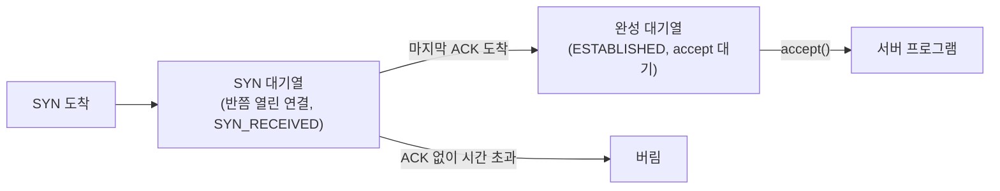
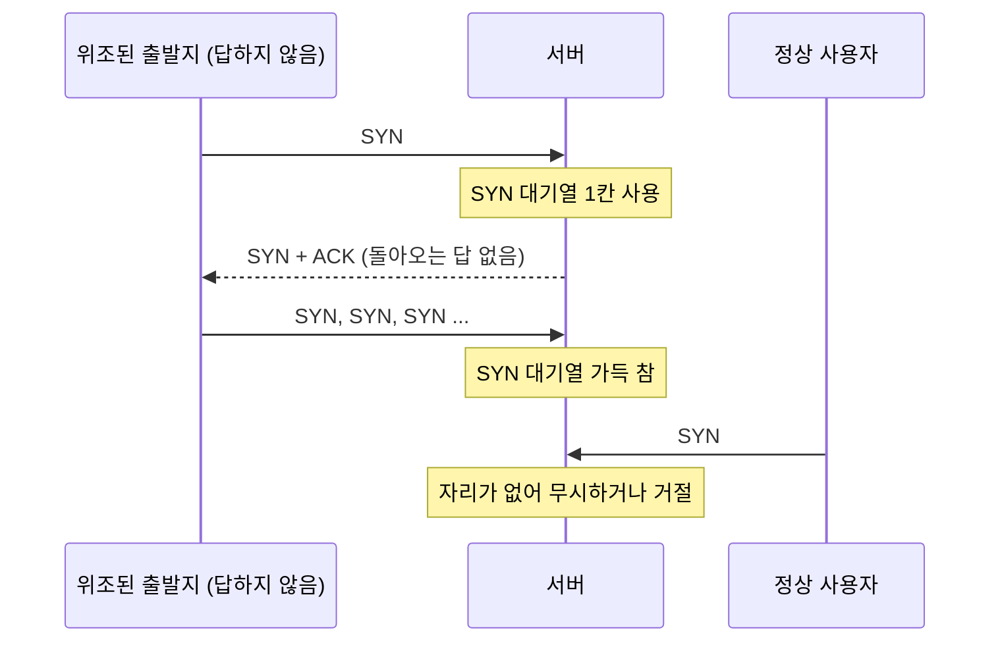

## SYN Flood란 ?
- TCP 연결을 맺는 첫 단계(SYN)만 잔뜩 보내고 마무리는 하지 않아서, 서버가 새 연결을 받지 못하게 만드는 공격
- 서버는 SYN을 받을 때마다 반쯤 열린 연결을 기억해 두는데, 이 자리가 정해진 수만큼만 있다. 공격자는 이 자리를 가짜 요청으로 채운다
- 서비스를 못 쓰게 만드는 공격(서비스 거부)의 한 종류다. 이 노트는 공격이 왜 통하는지와 어떻게 막는지를 방어하는 쪽에서 정리한다

주 출처는 SYN Flood와 흔한 대응을 정리한 RFC 4987이다. 이 RFC는 표준을 정하는 문서가 아니라 정보 제공용(Informational) 문서이고, 1절에서 스스로 어떤 표준도 정하지 않는다고 밝힌다. 3-way handshake와 연결 상태 이름은 [TCP 연결 과정](../TCP%20연결%20과정(TCP%20Handshake)/README.md) 문서에서 본 것을 그대로 쓴다.

### 플러드 (Flood)
사전적 의미는 홍수, 넘쳐흐름이다. 물이 한꺼번에 밀려와 둑을 넘는 모습이다.
공학적으로는 상대가 받아 둘 수 있는 자리보다 많은 요청을 밀어 넣어 넘치게 하는 공격을 말한다. SYN Flood는 밀어 넣는 것이 SYN이고, 넘치게 하는 것이 회선이 아니라 서버의 대기열이라는 뜻이다.

### 서비스 거부 (DoS, Denial of Service)
Denial의 사전적 의미는 거부, 거절이다.
공학적으로는 정상 사용자가 서비스를 쓰지 못하게 만드는 공격을 통틀어 말한다. 데이터를 훔치거나 고치는 것이 아니라, 쓰지 못하게 막는 것 자체가 목적이다. 여러 컴퓨터가 한꺼번에 공격하면 분산 서비스 거부(DDoS, Distributed DoS)라고 부른다. RFC 4987 1절은 SYN Flood를 TCP 서버를 돌리는 컴퓨터를 노리는 서비스 거부 방법이라고 소개한다.

### 식당 예약으로 이해하기
이 노트는 전화 예약을 받는 식당 하나로 설명한다. 식당은 예약 장부에 줄이 스무 개뿐이다. 누군가 가짜 이름으로 예약 전화만 수십 통 걸고 아무도 오지 않는다. 장부는 오지 않을 손님으로 꽉 차고, 진짜 손님이 전화하면 자리가 없다는 말을 듣는다. 식당 안의 음식과 자리는 멀쩡한데도 손님을 못 받는다.

예약 장부가 아래에서 볼 백로그, 오지 않는 예약이 반쯤 열린 연결이다.

<br/>

## 반쯤 열린 연결과 백로그
### 반쯤 열린 연결 (Half-open Connection)
[3-way handshake](../TCP%20연결%20과정(TCP%20Handshake)/README.md#연결-맺기-3-way-handshake)에서 서버는 SYN을 받으면 SYN + ACK를 보내고 SYN_RECEIVED 상태가 된다. 클라이언트의 마지막 ACK가 와야 ESTABLISHED가 된다. 그 사이, SYN은 받았지만 마지막 ACK는 아직 받지 못한 연결을 반쯤 열린 연결이라고 한다. RFC 4987은 이것을 half-open 또는 half-connection이라고 적는다. TCP 표준(RFC 9293)에서 half-open은 한쪽이 연결을 잃은 줄 다른 쪽이 모르는 상태라는 다른 뜻으로도 쓰인다. 이 노트에서는 RFC 4987을 따라 핸드셰이크가 끝나지 않은 연결만 가리킨다.

서버는 이 연결을 그냥 잊을 수 없다. 마지막 ACK가 오면 이어서 연결을 완성해야 하므로, 상대 주소와 포트, 서로 정한 [순서 번호](../TCP%20연결%20과정(TCP%20Handshake)/README.md#순서-번호-sequence-number) 같은 정보를 기억해 둔다. RFC 4987 2.2절은 RFC 793이 연결 하나의 상태를 담는 자료 구조를 TCB(Transmission Control Block, 전송 제어 블록)라 부른다고 소개하고, 연결마다 메모리 공간이 든다는 점이 핵심이라고 적는다. 같은 절에 따르면 리눅스 2.6.10에서 이 구조는 1300바이트가 넘었고, 단순한 구현에서도 보통 280바이트를 넘는다.

### 백로그 (Backlog)
사전적 의미는 밀린 일, 쌓여 있는 주문이다. 아직 처리하지 못하고 줄 서 있는 일거리라는 뜻이다.
공학적으로는 서버가 아직 프로그램에 넘기지 못한 연결 요청을 쌓아 두는 대기열과 그 크기를 말한다. [소켓](../소켓(Socket)/README.md#연결-대기열) 문서에서 listen을 할 때 대기열 크기를 정할 수 있다고 했는데, 그 값이 listen 함수의 backlog 인자다.

RFC 4987 2.2절은 메모리가 연결 요청으로 바닥나지 않도록 운영체제가 TCB 개수에 상한을 두고, 흔히 listen의 backlog 인자로 응용 프로그램이 그 값을 제안하게 한다고 설명한다. 백로그가 가득 찼을 때 새 SYN을 무시할지, 미완성 연결을 바꿔 넣을지, RST를 보낼지는 표준에 없어서 운영체제마다 다르다.

### 대기열은 두 개일 수 있다
[TCP 연결 과정](../TCP%20연결%20과정(TCP%20Handshake)/README.md#소켓-함수와-연결해-보기) 문서에서 핸드셰이크가 끝난 연결이 대기열에 쌓이고 accept가 하나씩 꺼내 간다고 했다. 리눅스는 핸드셰이크가 아직 안 끝난 연결도 따로 센다. 리눅스 listen(2) 매뉴얼은 리눅스 2.2부터 backlog 인자가 핸드셰이크가 끝나 accept를 기다리는 연결의 줄 길이를 뜻하고, 끝나지 않은 연결 요청의 최대 길이는 tcp_max_syn_backlog 설정으로 따로 정한다고 적는다.

이 노트에서는 앞의 것을 완성 대기열, 뒤의 것을 SYN 대기열이라고 부른다. SYN Flood가 채우는 것은 SYN 대기열이다. RFC 4987이 말하는 백로그는 반쯤 열린 연결이 쌓이는 쪽, 즉 이 노트의 SYN 대기열에 해당한다. 아래에서 RFC를 옮길 때 쓰는 백로그도 이 뜻이다. 대기열을 이렇게 둘로 나누는지는 운영체제마다 다를 수 있고, Windows의 구조는 확인하지 못했다(확인 필요).



<br/>

## 공격은 어떻게 통할까
### 마지막 ACK를 보내지 않는다
RFC 4987 2.2절은 공격의 목표를 네트워크나 서버 메모리를 넘치게 하는 것이 아니라, 포트 하나에 딸린 반쯤 열린 연결의 백로그를 바닥내는 것이라고 정리한다. 서버가 보낸 SYN + ACK에 답하지 않을 주소에서 SYN을 빠르게 연달아 보내고, 백로그를 가짜 연결로 계속 채워 두면 정상 요청이 거절된다.



### 출발지 주소 위조 (IP Spoofing)
Spoofing의 사전적 의미는 속이기, 흉내 내기다.
공학적으로는 IP 패킷의 출발지 주소 칸에 내 주소가 아닌 다른 주소를 적어 보내는 일을 말한다. 편지 봉투의 보내는 사람 칸에 남의 주소를 적어 우체통에 넣는 것과 같다. 우체국은 보내는 사람 칸이 진짜인지 확인하지 않고 받는 사람 주소만 보고 배달한다.

[NAT와 사설 IP](../NAT와%20사설%20IP(NAT%20and%20Private%20IP)/README.md#나갈-때-바꾸고-표에-적는다) 문서의 공유기도 출발지 주소를 바꾸지만, 그것은 답장이 다시 돌아오게 하려고 표에 적어 두고 바꾸는 것이다. 위조는 반대로 답장이 나에게 오지 않게 하려고 바꾼다.

SYN Flood에서 위조가 쓰이는 이유는 두 가지다.

- SYN + ACK가 공격자에게 돌아오지 않으니 공격자는 답할 필요도, 상태를 기억할 필요도 없다.
- 서버가 보는 출발지가 매번 달라서 누가 보냈는지 가려 막기 어렵다.

RFC 4987 2.2절은 위조할 주소가 SYN + ACK에 답하지 않는 주소여야 한다고 짚는다. 실제로 켜져 있는 컴퓨터의 주소를 쓰면, 그 컴퓨터는 보낸 적 없는 SYN + ACK를 받고 RST를 보낸다. [TCP 연결 과정](../TCP%20연결%20과정(TCP%20Handshake)/README.md#왜-두-번이-아니라-세-번일까) 문서에서 옛 SYN에 대한 SYN + ACK를 받은 클라이언트가 RST로 거절하던 그 동작이다. 서버는 RST를 받으면 그 자리를 바로 비우므로 공격 효과가 줄어든다.

같은 절은 위조 대신 공격자가 장악한 많은 컴퓨터(봇넷, botnet)를 쓰는 경우도 적는다. 이때는 각 컴퓨터가 운영체제의 자동 RST를 막아 두어야 한다고 한다.

### 서버는 왜 버티지 못할까
서버가 버티지 못하는 이유는 비용이 한쪽으로만 쏠리기 때문이다.

- 공격자는 SYN 한 개를 보내고 잊는다. 출발지를 위조했으니 답을 기다릴 일도 없다.
- 서버는 SYN 한 개마다 TCB 하나를 만들고, SYN + ACK를 보내고, 답이 없으면 [지수 백오프](../TCP%20재전송(TCP%20Retransmission)/README.md#지수-백오프-exponential-backoff)로 다시 보내며 한동안 붙들고 있다.
- 자리 수는 정해져 있다. RFC 4987 2.2절은 흔한 기본 백로그가 여섯 개 남짓에서 수십 개라고 적었다(2007년 기준). 큰 서버는 관리자가 더 크게 잡는다.

얼마나 붙들고 있는지도 공격에 쓰인다. 같은 절은 첫 SYN + ACK를 보낼 때 75초 타이머를 걸어 두는 구현과, 4.4 BSD-Lite에서 볼 수 있는 총 511초 뒤에 포기하는 구현을 예로 든다. [TCP 재전송](../TCP%20재전송(TCP%20Retransmission)/README.md#연결-맺기syn-재전송) 문서에서 클라이언트가 SYN을 다시 보내다 포기하는 쪽을 봤다면, 여기서는 서버가 SYN + ACK를 다시 보내다 포기하는 쪽이다. 공격자는 서버가 자리를 비우는 속도보다 빠르게 새 SYN을 보내기만 하면 된다. RFC 4987 2.2절도 새 SYN이 들어오는 속도가 TCB를 거둬 가는 속도를 넘는 한 공격은 성공한다고 적는다.

식당으로 치면 예약 전화 한 통은 몇 초면 걸지만, 식당은 그 예약을 몇 분 동안 장부에 남겨 두고 확인 전화까지 몇 번 건다.

### 무엇이 멀쩡하고 무엇이 막히나
RFC 4987 2.2절은 이 공격이 컴퓨터 전체나 네트워크가 아니라 특정 포트에서 듣고 있는 프로그램을 노린다고 적는다. 막히는 것은 그 포트로 새로 들어오는 연결뿐이다. 서버가 바깥으로 거는 연결과, 이미 맺어져 있던 연결은 영향을 받지 않는다.

1절은 아주 많은 패킷으로 네트워크 처리 능력 자체를 넘치게 하는 공격은, SYN을 쓰더라도 이 문서의 범위 밖이라고 따로 밝힌다. 그런 공격에서는 패킷 종류보다 양이 문제이기 때문이다. 이 노트도 백로그를 노리는 경우만 다룬다.

<br/>

## 대기열이 가득 차면 생기는 일 확인하기
위조 SYN을 만들어 보내는 것은 실제 공격과 같으므로 이 노트에서는 하지 않는다. 대신 대기열에 자리가 없을 때 새 연결이 어떻게 되는지를 내 컴퓨터 안(127.0.0.1)에서만 확인했다. 서버는 listen(1)로 대기열 크기 1을 요청하고 accept를 부르지 않는다. 그러면 핸드셰이크를 마친 연결이 꺼내지지 않고 대기열에 남는다.

이 실험이 채우는 것은 핸드셰이크가 끝난 연결이 기다리는 대기열이다. SYN Flood가 채우는 반쯤 열린 연결의 대기열과는 다르고, 자리가 정해져 있다는 점만 같다.

```python
# 내 컴퓨터(127.0.0.1) 안에서만 도는 대기열 실험
# 서버는 listen(1)만 하고 accept를 부르지 않는다
import socket
import time

server = socket.socket(socket.AF_INET, socket.SOCK_STREAM)
server.bind(("127.0.0.1", 0))   # 비어 있는 포트를 운영체제가 고른다
server.listen(1)                # 대기열 크기 1을 요청
port = server.getsockname()[1]

clients = []
for i in range(1, 6):
    c = socket.socket(socket.AF_INET, socket.SOCK_STREAM)
    c.settimeout(3)
    start = time.time()
    try:
        c.connect(("127.0.0.1", port))
        result = "연결됨"
    except OSError as e:
        result = type(e).__name__
    print(f"{i}번째 연결: {result} ({time.time() - start:.1f}초)")
    clients.append(c)

for c in clients:
    c.close()
server.close()
```

2026-10-29에 Windows 11 Pro(10.0.26200), Python 3.13.14에서 다섯 번 실행했다. 네 번은 아래와 똑같았고, 한 번은 네 번째 줄만 2.1초였다.

```text
1번째 연결: 연결됨 (0.0초)
2번째 연결: ConnectionRefusedError (2.0초)
3번째 연결: ConnectionRefusedError (2.0초)
4번째 연결: ConnectionRefusedError (2.0초)
5번째 연결: ConnectionRefusedError (2.0초)
```

- 대기열 한 칸이 차자 그다음 연결은 모두 거절됐다. accept를 부르지 않았으니 자리가 빌 일이 없었다.
- 거절은 연결 거부(ConnectionRefusedError)로 왔다. 리눅스 listen(2) 매뉴얼은 대기열이 찼을 때 클라이언트가 ECONNREFUSED를 받을 수도 있고, 요청이 무시되어 나중에 다시 시도할 때 성공할 수도 있다고 적는다. 이 PC에서는 앞쪽처럼 동작했다.
- 거절까지 2.0초가 걸린 것은 서버 쪽 사정이 아닌 것으로 보인다. 아무도 듣지 않는 포트에 연결해 봐도 같은 PC에서 네 번 모두 2.0초 뒤 ConnectionRefusedError가 났다. Windows 클라이언트가 거절을 받은 뒤 바로 포기하지 않고 몇 번 더 시도하는 것으로 짐작하지만, 패킷을 잡아 보지 않아 확인하지 못했다(확인 필요).

<br/>

## 대응 방법
RFC 4987 3절은 널리 알려진 대응 여덟 가지를 정리하고, 4절에서 평가한다. 크게 보면 위조 자체를 막는 방법, 서버 안에서 버티는 방법, 서버 앞에서 막아 주는 방법으로 나뉜다.

### 출발지 위조 걸러 내기 (Filtering)
RFC 4987 3.1절은 장악한 컴퓨터 무리가 없다면 이 공격에는 출발지 위조가 꼭 필요하므로, 위조 패킷을 보내지 못하게 막는 것이 TCP를 고치지 않고도 효과적인 해결이라고 적는다. 같은 절은 RFC 2827, 3013, 3704가 이런 걸러 내기의 모범 사례라고 소개할 뿐 방법 자체는 설명하지 않는다. 흔히 알려진 방식은 통신사나 회사 네트워크의 출구에서 안쪽 주소가 아닌 출발지를 단 패킷을 내보내지 않는 것이다. 이 세 RFC의 본문은 읽지 않아 자세한 방법은 확인하지 못했다(확인 필요).

우체국 창구에서 보내는 사람 칸이 이 동네 주소가 아니면 편지를 받지 않는 것과 같다.

다만 같은 절은 서버가 이 방법에 기대면 안 된다고 덧붙인다. 전 세계 모든 네트워크가 걸러 낸다는 보장이 없고, 봇넷을 쓰거나 접속 회선을 빠르게 바꾸는 공격자에게는 소용이 없기 때문이다.

### 백로그 늘리기 (Increasing Backlog)
가장 먼저 떠오르는 방법은 자리를 늘리는 것이다. 예약 장부를 두꺼운 것으로 바꾸는 셈이다.

RFC 4987 3.2절은 이 방법에 한계가 있다고 적는다. FreeBSD 4.4에서는 백로그가 몇백을 넘으면 자료 구조와 찾는 방식이 비효율적이 된다는 연구를 소개하고, 다른 구현도 비슷할 것이라고 본다. 공격자 쪽에서 보면 장부가 두꺼워진 만큼 전화를 더 걸면 된다. 4절은 백로그 늘리기와 아래의 타이머 줄이기를 눈에 띄게 문제가 있는 방법으로 평가한다.

### SYN_RECEIVED 타이머 줄이기 (Reducing SYN-RECEIVED Timer)
반쯤 열린 연결을 붙들고 있는 시간을 줄이면 가짜 연결이 자리를 빨리 비운다. 예약을 확인 없이 10분만 잡아 두고 지나면 지우는 셈이다.

RFC 4987 3.3절은 이 방법도 결함이 있다고 적는다. 시간을 줄이면 정상 연결 일부도 완성되기 전에 잘린다. 늦게 오는 진짜 손님의 예약까지 지워지는 것이다. 게다가 공격자는 줄어든 시간에 비례해 SYN을 더 자주 보내기만 하면 된다. 같은 절은 이 방법이 백로그가 일정 수준 이상 찼을 때나 SYN이 일정 속도 이상 들어올 때만 켜지도록 구현되기도 한다고 적는다.

### 가장 오래된 반쯤 열린 연결 덮어쓰기
RFC 4987 3.4절은 백로그가 찼을 때 새 SYN이 가장 오래된 반쯤 열린 연결을 밀어내게 하는 구현도 소개한다. 정상 연결은 공격 SYN이 백로그를 다 채우기 전에 완성된다는 가정에 기댄다. 공격 속도가 빠르거나 백로그가 작으면 정상 연결도 밀려나서, 같은 절은 튼튼한 방어가 아니라고 평가한다.

### SYN 캐시 (SYN Cache)
RFC 4987 3.5절의 SYN 캐시는 SYN을 받았을 때 TCB 전체를 만들지 않고 꼭 필요한 정보만 작게 저장해 두었다가, 연결이 완성되면 그때 TCB 전체를 만드는 방법이다. 작은 기록은 서버만 아는 비밀 값과 주소, 포트로 계산한 해시 값에 따라 큰 표의 칸에 나뉘어 들어가고, 칸마다 개수 상한이 있어 넘치면 가장 오래된 것을 버린다. 비밀 값 때문에 공격자가 특정 칸만 골라 넘치게 만들 수 없다. 같은 절은 공격 중에도 정상 연결이 맺어지는 시간이 공격이 없을 때보다 약 15% 길어지는 정도였다는 연구를 소개한다.

4절에 따르면 FreeBSD 4.4 구현에서 SYN 캐시 항목은 160바이트, TCB 전체는 736바이트였다. 예약 장부에 손님 이름과 전화번호만 적는 얇은 메모지를 쓰는 셈이다. 자리는 여전히 유한하지만 같은 메모리로 훨씬 많이 받는다.

<br/>

## SYN 쿠키 (SYN Cookies)
### 이름 짚고 가기
쿠키(Cookie)의 사전적 의미는 작은 구운 과자다.
컴퓨터에서는 상대에게 건네 두었다가 나중에 돌려받아 확인하는 작은 값을 흔히 쿠키라고 부른다. 웹 브라우저의 쿠키도 같은 이름을 쓴다. SYN 쿠키는 서버가 SYN + ACK에 실어 건네고, 마지막 ACK로 돌려받는 값이다. 왜 하필 과자 이름이 붙었는지는 확인하지 못했다(확인 필요).

### 무엇을 하나
RFC 4987 3.6절은 SYN 쿠키가 SYN 캐시에서 한 걸음 더 나가 SYN_RECEIVED 상태의 연결에 대해 아무 상태도 저장하지 않는다고 설명한다. 저장했어야 할 정보 중 꼭 필요한 것을 SYN + ACK의 순서 번호 안에 넣어 보낸다. SYN이 위조되지 않았다면 클라이언트는 그 번호에 1을 더해 마지막 ACK의 확인 번호로 돌려줄 테니, 서버는 그 ACK만 보고 연결 정보를 다시 만들어 낸다.

식당으로 치면 예약 장부에 아무것도 적지 않고, 전화한 손님에게 식당만 아는 도장을 찍은 번호표를 불러 주는 것이다. 손님이 찾아와 번호표를 내밀면 도장이 진짜인지만 확인하고 들여보낸다. 가짜 예약 전화가 백 통 와도 장부는 비어 있다.

### 순서 번호에 무엇을 담나
아래 표와 코드는 원리를 숫자로 확인하려는 것이다. 처음 읽을 때는 시간, MSS, 주소와 포트로 만든 비밀 계산 값을 32비트 번호 하나에 나눠 담는다는 것만 잡고 넘어가도 된다.

해시(Hash)의 사전적 의미는 잘게 썰어 섞은 요리다. 공학적으로는 입력을 뒤섞어 정해진 길이의 값으로 만드는 계산을 말한다. 입력이 조금만 달라도 결과가 크게 바뀌고, 결과에서 입력을 거꾸로 알아내기 어렵다. 비밀 값을 섞은 해시는 그 비밀 값을 아는 쪽만 같은 결과를 만들 수 있다.

[TCP 연결 과정](../TCP%20연결%20과정(TCP%20Handshake)/README.md#순서-번호-sequence-number) 문서에서 시작 순서 번호는 시계 값에 비밀 값으로 계산한 값을 더해 정한다고 했다. SYN 쿠키는 이 32비트 자리를 서버가 나중에 꺼내 볼 정보를 담는 그릇으로 쓴다.

RFC 4987 부록 A는 D. J. Bernstein의 설명을 옮겨 아래 배치를 소개한다. 32비트 값을 만든 뒤 클라이언트 SYN의 순서 번호와 비트 단위 XOR(배타적 논리합)을 해서 쿠키로 쓴다.

| 자리 | 비트 수 | 담는 것 |
| --- | --- | --- |
| 맨 위 | 5 | 64초마다 1씩 오르는 시간 카운터를 32로 나눈 나머지 |
| 그다음 | 3 | SYN에 적힌 MSS(Maximum Segment Size, 한 세그먼트에 담을 최대 데이터 크기)에 가까운 값의 표 번호 |
| 맨 아래 | 24 | 양쪽 IP 주소, 양쪽 포트 번호, 시간 카운터로 계산한, 서버만 아는 비밀 함수의 값 |

부록 A는 이 배치 말고도 조금씩 다른 구현 방법이 있다고 밝힌다. 3.6절은 정확한 배치가 구현마다 다를 수 있고, 다시 써먹기(replay)를 막으려고 시간에 따라 바뀌는 비트를 넣는 것이 공통이라고 적는다. 해시는 실제로 MD5를 썼지만, 만든 서버가 직접 확인하므로 다른 일방향 해시를 써도 상대와 호환에 문제가 없다고 한다.

### 돌아온 ACK 확인하기
부록 A에 따르면 ACK가 돌아오면 서버는 확인 번호와 ACK의 순서 번호 차이를 최근 카운터 값들과, 그 카운터와 ACK의 주소, 포트로 계산한 비밀 함수 값에 맞춰 본다. 맞으면 상대가 실제로 쿠키를 받았을 가능성이 통계적으로 매우 높으니 연결을 받아들이고, 맞지 않으면 최근에 보낸 SYN + ACK에 대한 답이 아닐 것으로 보고 거절한다.

이 흐름을 계산으로만 흉내 낸 스크립트다. 패킷을 보내지 않고 숫자만 계산하며, 실제 운영체제의 구현과는 다르다. 비트 배치는 위 표를 따랐고, 비밀 함수는 표준 라이브러리의 HMAC-SHA256(비밀 값을 섞어 계산하는 해시)으로 대신했다. MSS 후보 표와 최근 카운터를 두 개까지 받아 주는 규칙은 예시로 정한 것이다. 주소는 문서 예시용 주소(RFC 5737)다.

```python
# SYN 쿠키의 원리만 흉내 낸 계산 (실제 운영체제 구현과 다르다)
# 비트 배치는 RFC 4987 부록 A를 따랐다: 위 5비트 시간 카운터, 다음 3비트 MSS 번호, 아래 24비트 비밀 해시
import hashlib
import hmac

SECRET = b"server-only-secret"          # 서버만 아는 비밀 값
MSS_TABLE = [536, 1300, 1440, 1460]     # 미리 정해 둔 MSS 후보 (예시)
MOD = 2**32                             # 순서 번호는 32비트


def secret_bits(src, sport, dst, dport, counter):
    msg = f"{src}:{sport}>{dst}:{dport}#{counter}".encode()
    digest = hmac.new(SECRET, msg, hashlib.sha256).digest()
    return int.from_bytes(digest[:3], "big")          # 24비트만 쓴다


def make_cookie(src, sport, dst, dport, client_isn, mss, counter):
    """SYN을 받았을 때. 아무것도 저장하지 않고 쿠키만 계산한다."""
    mss_idx = max(i for i, m in enumerate(MSS_TABLE) if m <= mss)
    value = ((counter % 32) << 27) | (mss_idx << 24) | secret_bits(src, sport, dst, dport, counter)
    return value ^ client_isn                          # 서버의 시작 순서 번호로 쓴다


def check_ack(src, sport, dst, dport, seq, ack, now_counter):
    """ACK를 받았을 때. ACK에 적힌 값만으로 다시 계산해 맞춰 본다."""
    client_isn = (seq - 1) % MOD                       # ACK의 순서 번호 = 클라이언트 시작 번호 + 1
    value = ((ack - 1) % MOD) ^ client_isn             # ACK의 확인 번호 = 쿠키 + 1
    counter_bits = value >> 27
    mss_idx = (value >> 24) & 0b111
    for counter in (now_counter, now_counter - 1):     # 최근 카운터 값 두 개만 받아 준다
        if counter % 32 == counter_bits and (value & 0xFFFFFF) == secret_bits(src, sport, dst, dport, counter):
            return f"통과, MSS {MSS_TABLE[mss_idx]} 복원"
    return "거절"


client, server = ("192.0.2.10", 50001), ("198.51.100.20", 443)
client_isn = 1000                      # 클라이언트 SYN의 순서 번호 (계산을 쉽게 하려고 작게 둠)
cookie = make_cookie(*client, *server, client_isn, mss=1460, counter=100)
print("SYN + ACK에 실어 보낸 쿠키:", cookie)

seq, ack = client_isn + 1, (cookie + 1) % MOD   # 진짜 클라이언트가 보내는 ACK
print("진짜 클라이언트의 ACK:", check_ack(*client, *server, seq, ack, now_counter=100))
print("카운터가 한 번 오른 뒤:", check_ack(*client, *server, seq, ack, now_counter=101))
print("카운터가 세 번 오른 뒤:", check_ack(*client, *server, seq, ack, now_counter=103))
print("다른 주소에서 온 ACK:", check_ack("192.0.2.99", 50001, *server, seq, ack, now_counter=100))
print("확인 번호를 짐작한 ACK:", check_ack(*client, *server, seq, 123456789, now_counter=100))
```

2026-10-29에 Windows 11 Pro(10.0.26200), Python 3.13.14에서 세 번 실행해 세 번 모두 아래와 같았다. 비밀 값이 코드에 고정되어 있어 쿠키 값도 매번 같다.

```text
SYN + ACK에 실어 보낸 쿠키: 596857307
진짜 클라이언트의 ACK: 통과, MSS 1460 복원
카운터가 한 번 오른 뒤: 통과, MSS 1460 복원
카운터가 세 번 오른 뒤: 거절
다른 주소에서 온 ACK: 거절
확인 번호를 짐작한 ACK: 거절
```

- make_cookie는 쿠키를 돌려줄 뿐 어디에도 저장하지 않는다. check_ack는 ACK에 적힌 주소, 포트, 순서 번호, 확인 번호만으로 다시 계산한다. 서버가 반쯤 열린 연결을 기억하지 않는데도 확인할 수 있는 이유다.
- MSS 1460이 ACK만으로 되살아났다. 저장해 두지 않은 정보를 순서 번호 3비트에 담아 돌려받은 것이다.
- 카운터가 많이 오른 뒤 온 ACK는 거절됐다. 오래된 쿠키를 다시 써먹지 못하게 하는 시간 비트의 역할이다.
- 다른 주소에서 온 ACK와 짐작한 번호는 비밀 함수 값이 맞지 않아 거절됐다. 비밀 값을 모르는 쪽은 맞는 쿠키를 만들기 어렵다.

### SYN 쿠키의 대가
상태를 저장하지 않는 대신 순서 번호 32비트에 들어가지 않는 정보는 잃는다. RFC 4987 3.6절과 부록 A가 꼽는 대가는 아래와 같다.

- TCP 옵션 일부를 쓸 수 없다. MSS는 몇 비트로 대략 담지만, [윈도우 배율(Window Scale)](../흐름%20제어와%20혼잡%20제어(Flow%20and%20Congestion%20Control)/README.md) 같은 옵션은 담을 자리가 없다. 부록 A는 가장 큰 대가가 윈도우 배율을 못 쓰게 되어 높은 성능을 내지 못하는 것이라고 적는다. 3.6절은 FreeBSD 7.0이 타임스탬프 옵션의 비트까지 써서 이런 정보를 담는 방법을 개발했다고 소개한다.
- SYN에 실려 온 데이터는 처리하지 못한다.
- 서버가 먼저 말하는 프로토콜에서 문제가 생긴다. 클라이언트의 마지막 ACK가 사라지면 클라이언트는 연결됐다고 믿지만, 서버는 연결이 있다는 것조차 모르니 먼저 보낼 인사를 보내지 않는다. 3.6절은 SMTP(메일 전송)를 예로 든다.

그래서 3.6절은 SYN 쿠키를 보통 기본으로 켜지 않고 공격이 의심될 때나 관리자가 켤 때만 쓴다고 적고, 4절은 기본으로 켜지 말라고 권한다. 반대로 SYN 캐시는 이런 부작용이 없어 기본으로 써도 된다고 4절은 적는다. 3.7절은 두 방법을 섞어 평소에는 SYN 캐시를 쓰다가 캐시가 가득 차면 SYN 쿠키로 넘어가는 방법도 소개한다.

<br/>

## 서버 앞에서 막기
### 방화벽과 프록시 (Firewalls and Proxies)
프록시(Proxy)의 사전적 의미는 대리인, 대리 행위다.
공학적으로는 클라이언트와 서버 사이에서 한쪽을 대신해 통신을 받아 주고 넘겨 주는 중간 장치나 프로그램을 말한다.

RFC 4987 3.8절은 방화벽이 서버 대신 연결 맺기를 먼저 받아 보고, 핸드셰이크가 끝까지 완성된 연결만 보호하는 서버로 넘겨 주는 방법을 소개한다. 이런 장비도 안에서는 앞에서 본 SYN 캐시나 SYN 쿠키 같은 방법을 쓴다. 문제를 서버에서 방화벽이나 프록시로 옮기는 셈이다. 같은 절은 이 방식이 양 끝이 직접 대화한다는 TCP의 기대를 바꿔 다른 문제를 낳을 수 있다고 적고, 실제 장비는 핸드셰이크 단계마다 양쪽에 출발지를 바꾼 패킷을 보내 이 일을 한다고 설명한다.

건물 1층 안내 데스크가 방문객의 신원을 먼저 확인하고, 확인된 사람만 위층 사무실로 올려 보내는 것과 같다. 사무실은 확인된 손님만 맞는다.

[NAT와 사설 IP](../NAT와%20사설%20IP(NAT%20and%20Private%20IP)/README.md#바깥에서-먼저-들어올-수-없는-이유) 문서에서 NAT는 방화벽을 대신하지 않는다고 했다. 서버를 바깥에 공개하려고 포트를 열었다면 그 포트로 오는 SYN은 그대로 서버에 닿으므로, 이런 방어는 따로 필요하다.

### 트래픽 정화 (Traffic Scrubbing)
Scrubbing의 사전적 의미는 북북 문질러 씻기다. 서버로 가는 트래픽을 처리 능력이 큰 중간 시설로 돌려 공격으로 보이는 패킷을 걸러 내고 나머지만 서버로 보내는 방식을 가리키는 말이다. 이 방식은 RFC 4987에 나오지 않고, 이 노트를 쓰며 확인한 자료도 없다(확인 필요). RFC 4987 1절이 범위 밖으로 둔, 회선 자체를 넘치게 하는 대량 공격을 막는 이야기에 가까워서 이름만 적고 TODO로 남긴다.

<br/>

## 대응 견주어 보기
| 대응 | 어디서 | 효과 | 한계 (RFC 4987) |
| --- | --- | --- | --- |
| 위조 걸러 내기 | 공격자 쪽 네트워크 출구 | 위조 자체를 못 하게 함 | 모든 네트워크가 한다는 보장 없음, 봇넷에는 소용없음 (3.1) |
| 백로그 늘리기 | 서버 | 자리를 늘림 | 공격자가 더 보내면 그만, 큰 백로그에서 비효율 (3.2) |
| 타이머 줄이기 | 서버 | 자리를 빨리 비움 | 정상 연결 일부가 잘림, 공격자가 더 자주 보내면 그만 (3.3) |
| 가장 오래된 것 덮어쓰기 | 서버 | 새 SYN이 오래된 자리를 밀어냄 | 공격이 빠르거나 백로그가 작으면 정상 연결도 밀림 (3.4) |
| SYN 캐시 | 서버 | 한 자리를 작게 만듦 | 자리 자체는 유한함 (3.5) |
| SYN 쿠키 | 서버 | 자리를 아예 쓰지 않음 | 일부 TCP 옵션 손실, 서버가 먼저 말하는 프로토콜 문제 (3.6) |
| 방화벽, 프록시 | 서버 앞 | 완성된 연결만 넘김 | 문제를 장비로 옮김, 양 끝 통신의 기대가 바뀜 (3.8) |

RFC 4987 4절은 네트워크 쪽 장비는 효과가 크지만 서버가 늘 그런 장비 뒤에 있다고 기대하는 것은 낙관적이니, TCP를 구현하는 쪽이 서버 자체에도 방어 수단을 넣어야 한다고 정리한다. 그리고 서버 안의 방법 중에서는 SYN 캐시와 SYN 쿠키만이 지금까지 찾은 쓸 만한 방법으로 보인다고 적는다.

<br/>

## 운영체제의 설정
### 리눅스
리눅스 커널 문서(ip-sysctl)의 설명은 아래와 같다. 2026-10-29에 커널 소스 저장소의 최신 문서를 받아 읽었고, 리눅스에서 직접 실행해 보지는 않았다.

- tcp_syncookies는 한 소켓의 SYN 대기열이 넘칠 때 SYN 쿠키를 보내게 한다. 기본값은 1이다. 쿠키가 어떤 영향을 주는지 시험해 보려면 2로 두어 넘치지 않아도 늘 쿠키를 쓰게 할 수 있다. 커널을 CONFIG_SYN_COOKIES로 빌드했을 때만 쓸 수 있다.
- tcp_max_syn_backlog는 ACK를 아직 받지 못한 연결 요청(SYN_RECV)을 리스너 하나당 몇 개까지 기억할지 정한다. 메모리가 적은 컴퓨터는 최소 128이고 메모리에 비례해 커진다. 같은 문서는 SYN_RECV 요청 하나가 약 304바이트를 쓴다고 적는다.
- somaxconn은 listen의 backlog 인자 상한이다. 기본값은 4096이고, 리눅스 5.4 전에는 128이었다. listen(2) 매뉴얼은 이보다 큰 backlog를 주면 조용히 이 값으로 깎는다고 적는다.
- tcp_synack_retries는 SYN + ACK를 다시 보내는 횟수다. 기본값 5는 처음 RTO 1초 기준으로 마지막 재전송까지 31초, 최종 포기까지 63초에 해당한다고 문서에 적혀 있다. 앞에서 본 타이머 줄이기를 리눅스에서 하는 자리다.

기본값 1은 평소에는 쿠키를 쓰지 않다가 대기열이 넘칠 때만 쓴다는 뜻이다. RFC 4987이 SYN 쿠키를 기본으로 켜지 말고 공격이 의심될 때만 쓰라고 한 것과 같은 방향이다. 그런데 listen(2) 매뉴얼과 커널 문서는 SYN 대기열 길이를 tcp_max_syn_backlog로 정한다고 적으면서, 같은 매뉴얼은 SYN 쿠키가 켜져 있으면 미완성 연결 대기열에 논리적인 최대 길이가 없어 이 값이 무시된다고도 적는다. 쿠키가 켜진 기본 설정에서 SYN 대기열이 넘쳤다고 보는 실제 기준이 무엇인지는 커널 소스로 확인하지 못했다(확인 필요).

커널 문서는 SYN 쿠키가 비상용(fallback)이라는 점을 강하게 적는다. 정상 연결이 많아서 SYN Flood 경고가 뜨는 서버를 버티게 하려고 쓰면 안 되며(MUST NOT), 그럴 때는 tcp_max_syn_backlog, tcp_synack_retries, tcp_abort_on_overflow 같은 다른 값을 조정하라고 한다. 쿠키가 TCP 확장 기능을 못 쓰게 해서 SMTP 중계 같은 서비스가 크게 나빠질 수 있다는 경고도 있다. 다만 이 문장이 언제 쓰였는지, 지금의 리눅스가 RFC 4987 3.6절의 FreeBSD처럼 타임스탬프 옵션에 옵션 정보를 담아 이 문제를 덜었는지는 확인하지 못했다(확인 필요).

### Windows
RFC 4987 4절은 Windows 2000부터 레지스트리로 켜고 끄는 TCP SYN 공격 보호 기능이 있었고, Windows 2003 SP1부터 기본으로 켜졌다고 적는다. 반쯤 열린 연결 수가 정해 둔 문턱을 넘으면 SYN + ACK 재전송 횟수를 줄이는 등 동작을 바꾸는 방식이었다고 한다.

지금의 Windows가 같은 기능을 쓰는지, SYN 쿠키에 해당하는 방법이 있는지는 확인하지 못했다(확인 필요). 아래는 이 PC의 TCP 전역 설정을 읽기만 한 결과다(2026-10-29, Windows 11 Pro 10.0.26200). 맨 앞의 조회 중 안내 한 줄은 뺐다.

```powershell
netsh int tcp show global
```

```text
TCP Global Parameters
----------------------------------------------
Receive-Side Scaling State          : enabled
Receive Window Auto-Tuning Level    : normal
Add-On Congestion Control Provider  : default
ECN Capability                      : disabled
RFC 1323 Timestamps                 : allowed
Initial RTO                         : 1000
Receive Segment Coalescing State    : enabled
Non Sack Rtt Resiliency             : disabled
Max SYN Retransmissions             : 4
Fast Open                           : enabled
Fast Open Fallback                  : enabled
HyStart                             : enabled
Proportional Rate Reduction         : enabled
Pacing Profile                      : off
```

이 목록에는 SYN Flood 방어를 직접 가리키는 항목이 보이지 않는다. Initial RTO와 Max SYN Retransmissions는 이 PC가 클라이언트로서 SYN을 다시 보낼 때의 값으로, [TCP 재전송](../TCP%20재전송(TCP%20Retransmission)/README.md#내-컴퓨터의-설정-보기) 문서에서 본 값과 같다. 서버로서 SYN + ACK를 몇 번 다시 보내는지는 이 목록으로 알 수 없었다(확인 필요).

<br/>

## TCP 이후의 설계에 남긴 것
RFC 4987 4절 끝은 SYN Flood가 프로토콜 설계자에게 교훈을 남겼다고 적는다. 나중에 만든 SCTP(Stream Control Transmission Protocol)는 연결을 맺을 때 4-way handshake를 쓰고, 받는 쪽은 상태를 저장하지 않는 쿠키를 먼저 건넨다. 그래서 상대가 그 주소에 정말 있다는 증거를 얻은 뒤에야 상태를 만든다. 상대를 확인하기 전까지 상태를 만들지 않는다는 생각은 SYN 쿠키와 같은 방향이다. RFC는 이를 SYN Flood가 남긴 교훈으로 소개하고, 연결 설정을 상태 없이 설계하는 일반적인 생각은 Aura와 Nikander의 논의로 돌린다.

<br/>

## 참고 자료
- RFC 4987, [TCP SYN Flooding Attacks and Common Mitigations](https://www.rfc-editor.org/rfc/rfc4987.html) 1절(정의, 정보 제공 문서, 대량 패킷 공격은 범위 밖), 2.2절(TCB, 백로그, 공격 원리, 위조 주소, 봇넷, 영향 범위), 3.1~3.8절(대응 여덟 가지), 4절(평가, BSD와 리눅스와 Windows 구현, SCTP), 부록 A(SYN 쿠키 비트 배치와 확인 방법)
- RFC 9293, [Transmission Control Protocol (TCP)](https://www.rfc-editor.org/rfc/rfc9293.html)는 이 노트에서 새로 읽지 않았고, [TCP 연결 과정](../TCP%20연결%20과정(TCP%20Handshake)/README.md) 문서의 내용을 이어 썼다
- RFC 2827, 3013, 3704는 RFC 4987 3.1절이 걸러 내기 모범 사례로 든 문서라는 점만 확인했다. 본문은 읽지 않았다
- RFC 5737 3절 (문서 예시용 주소 192.0.2.0/24, 198.51.100.0/24)
- Linux kernel, [ip-sysctl](https://docs.kernel.org/networking/ip-sysctl.html) 문서의 tcp_syncookies, tcp_max_syn_backlog, tcp_synack_retries, tcp_abort_on_overflow, somaxconn 항목 (2026-10-29에 커널 저장소 최신본을 읽음)
- Linux man-pages, [listen(2)](https://man7.org/linux/man-pages/man2/listen.2.html) DESCRIPTION과 NOTES (backlog의 뜻, 대기열이 찼을 때, 리눅스 2.2 이후 두 대기열, somaxconn)

<br/>

## 함께 보면 좋은 노트
- [TCP 연결 과정](../TCP%20연결%20과정(TCP%20Handshake)/README.md)은 3-way handshake, SYN_RECEIVED 상태, 시작 순서 번호를 다룬다.
- [TCP 재전송](../TCP%20재전송(TCP%20Retransmission)/README.md)은 SYN 재전송과 지수 백오프를 다룬다.
- [소켓](../소켓(Socket)/README.md)은 listen, accept와 연결 대기열을 다룬다.
- [NAT와 사설 IP](../NAT와%20사설%20IP(NAT%20and%20Private%20IP)/README.md)는 출발지 주소가 바뀌는 정상적인 경우와 NAT가 방화벽이 아니라는 점을 다룬다.
- [ARP 스푸핑](../ARP%20스푸핑(ARP%20Spoofing)/README.md)은 출처 정보를 꾸미는 스푸핑을 같은 네트워크 안의 ARP에서 다룬다.
- [네트워크 목차](../README.md)

<br/>

## 더 볼 것 (TODO)
- 트래픽 정화와 대량 패킷 공격(볼륨형 DDoS)을 네트워크 쪽에서 막는 방법
- 출발지 위조 걸러 내기 자세히 (RFC 2827 ingress filtering, RFC 3704)
- 리눅스 SYN 쿠키의 실제 구현과 타임스탬프 옵션 활용 여부, 서버 쪽 SYN + ACK 재전송 동작
- 지금의 Windows가 SYN Flood에 대응하는 방식과 관련 설정
- 패킷 캡처로 핸드셰이크와 대기열이 찼을 때의 RST 보기, Windows 클라이언트가 거절 뒤 2초를 기다린 이유
- SCTP의 4-way handshake와 쿠키
- 같은 원리의 다른 자원 고갈 공격 (연결을 맺고 아주 느리게 보내는 공격 등)
