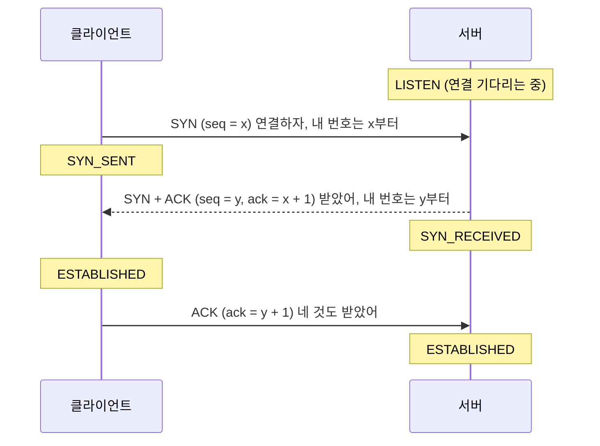
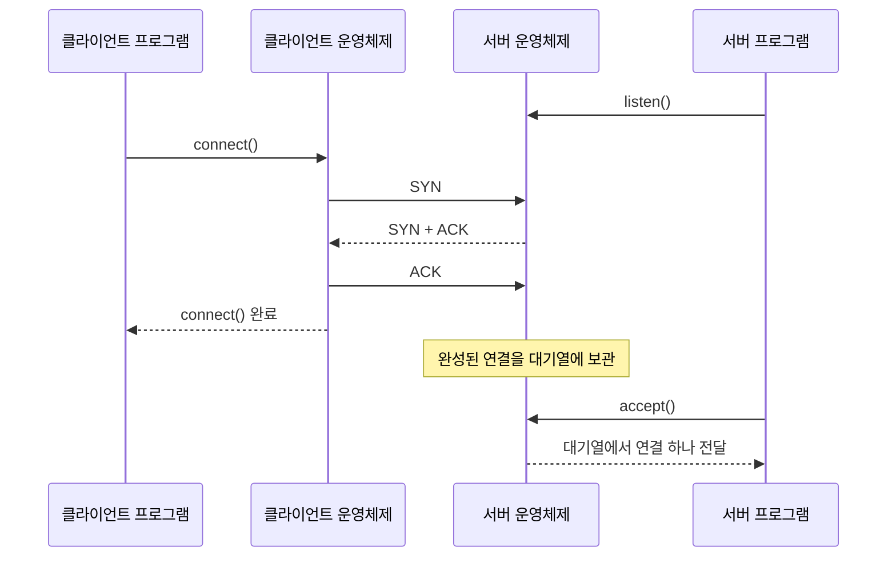
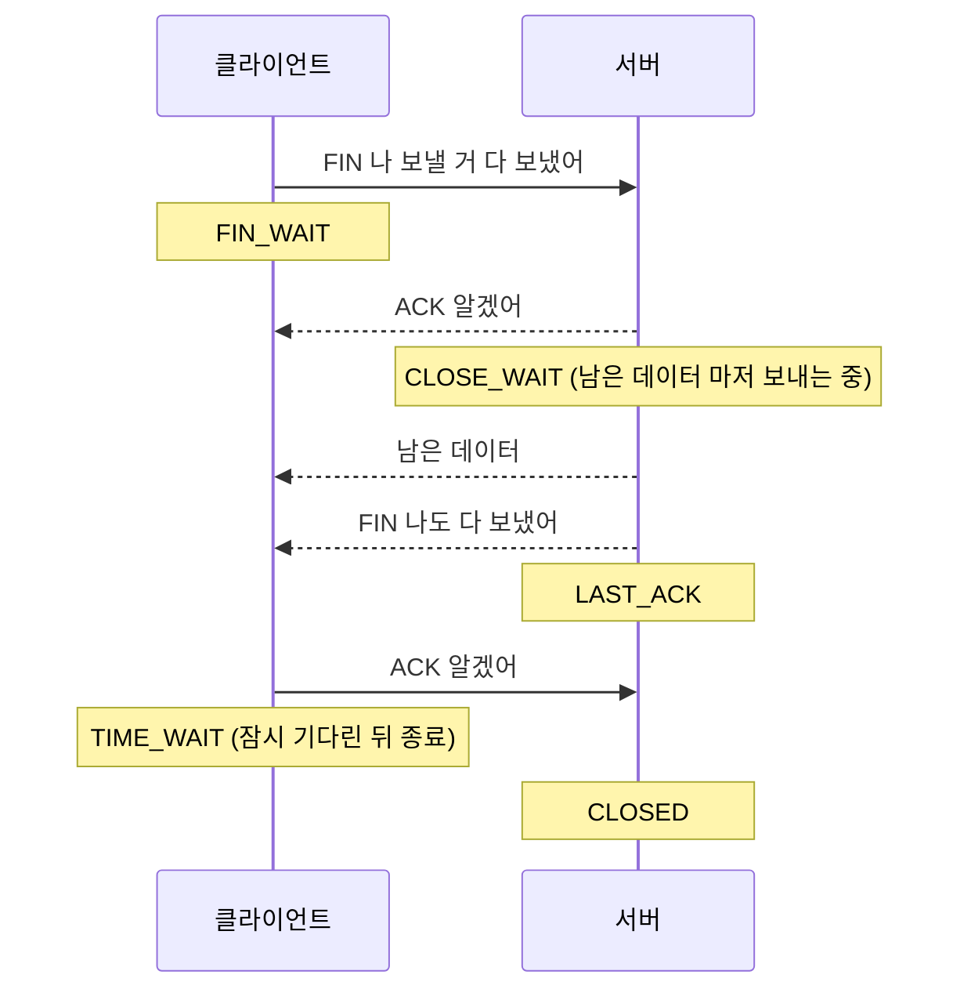

## TCP 연결 과정이란 ?
- TCP로 통신하는 두 컴퓨터가 데이터를 주고받기 전에 연결을 맺고, 다 쓴 뒤 연결을 끊는 정해진 절차
- 연결을 맺을 때는 메시지를 세 번 주고받고(3-way handshake), 끊을 때는 네 번 주고받는다(4-way handshake)
- 소켓 함수(connect, accept, close)를 부를 때 그 아래에서 실제로 일어나는 일이다. 소켓은 [소켓](../소켓(Socket)/README.md) 문서에 정리했다

<br/>

## TCP 짚고 가기
### TCP (Transmission Control Protocol)
Transmission의 사전적 의미는 전송, Control은 제어, Protocol은 약속.
공학적으로는 데이터가 빠짐없이, 순서대로 도착하도록 관리하면서 보내는 전송 규칙을 말한다. 보내기만 하는 게 아니라 잘 도착했는지 확인하고 제어까지 한다는 점이 이름에 담겨 있다.

[소켓](../소켓(Socket)/README.md#tcp-소켓-스트림-소켓-stream-socket) 문서에서 TCP 소켓은 전화처럼 먼저 연결하고 대화한다고 했다. 이 문서는 그 연결을 맺고 끊는 과정을 다룬다.

<br/>

## 왜 먼저 연결을 맺을까
무전기로 대화를 시작하는 장면을 떠올려 보자.

1. A: 여기는 A, 내 말 들리나?
2. B: 잘 들린다. 여기는 B, 내 말도 들리나?
3. A: 잘 들린다.

이 세 마디로 두 가지가 확인된다. A가 말한 게 B에게 들리고, B가 말한 게 A에게도 들린다. 양쪽 방향 모두 통한다는 걸 확인한 뒤에야 본격적으로 대화한다.

TCP가 연결부터 맺는 이유도 같다. 데이터를 빠짐없이 순서대로 전달하려면 먼저 두 가지를 맞춰야 한다.

- 서로 보내고 받을 수 있는 상태인지
- 앞으로 주고받을 데이터에 몇 번부터 번호를 매길지

<br/>

## 연결 맺기: 3-way handshake
### 핸드셰이크 (Handshake)
사전적 의미는 악수. 처음 만난 두 사람이 손을 맞잡으며 인사하는 일이다.
공학적으로는 통신을 시작하기 전에 두 쪽이 정해진 메시지를 주고받으며 서로 준비됐는지 확인하는 절차를 말한다. 본격적인 대화 전에 나누는 인사라는 점에서 악수와 같다.

### 플래그 (Flag)
사전적 의미는 깃발. 멀리서도 알아보게 들어 올리는 표시다.
공학적으로는 TCP 메시지 머리(헤더)에 켜고 끄는 표시로, 이 메시지가 무슨 용도인지 알린다. 핸드셰이크에서 쓰는 플래그는 두 가지다.

SYN(Synchronize)은 동기화하자는 뜻이다. 앞으로 주고받을 데이터의 시작 순서 번호를 서로 맞추자, 즉 연결하고 싶다는 표시다.
ACK(Acknowledgment)는 확인, 인정이라는 뜻이다. 네 메시지를 잘 받았다는 표시다.

### 세 번의 인사
1. 클라이언트가 서버에 SYN을 보낸다. 연결하고 싶어, 내 번호는 x부터 시작할게.
2. 서버가 SYN + ACK를 보낸다. 네 SYN 잘 받았어(ACK), 나도 연결할게, 내 번호는 y부터 시작할게(SYN).
3. 클라이언트가 ACK를 보낸다. 네 SYN도 잘 받았어.

이제 연결이 맺어졌고(ESTABLISHED), 양쪽은 데이터를 주고받을 수 있다. 정확히는 클라이언트는 SYN + ACK를 받은 순간, 서버는 마지막 ACK를 받은 순간 ESTABLISHED가 된다.



### 순서 번호 (Sequence Number)
그림의 seq와 ack 숫자가 순서 번호다. 여러 장짜리 편지를 보낼 때 장마다 쪽 번호를 적어 두는 것과 같다. 받는 쪽은 번호를 보고 빠진 장이 있는지, 순서가 뒤바뀌었는지 알 수 있다.

ack = x + 1은 x번까지 잘 받았으니 다음엔 x + 1번을 보내 달라는 뜻이다. 시작 번호 x와 y는 0부터 시작하지 않는다. 표준 문서(RFC 9293)는 약 4마이크로초마다 1씩 오르는 시계 값에, 연결의 주소와 포트, 바깥에 알리지 않는 비밀 값으로 계산한 값을 더해 정하라고 권한다. 시계 값은 예전 연결에서 늦게 도착한 데이터와 번호가 겹치지 않게 하고, 비밀 값은 다른 사람이 번호를 추측해 연결에 끼어들기 어렵게 한다. 그래서 바깥에서 보면 시작 번호가 무작위처럼 보인다.

### 왜 두 번이 아니라 세 번일까
무전기 예시로 돌아가 보자. 두 번째 마디에서 대화를 멈추면, B는 자기 말이 A에게 들렸는지 아직 모른다. 양쪽이 모두 내 말이 상대에게 들린다는 걸 확인하려면 최소 세 번이 필요하다.

또 네트워크가 느려서 한참 전에 보낸 옛 SYN이 뒤늦게 도착하는 경우도 있다. 두 번만으로 연결을 맺으면 서버는 이 옛 요청에도 연결을 열어 버린다. 세 번째 단계를 두면, 옛 SYN에 대한 SYN + ACK를 받은 클라이언트가 이건 지금 내가 보낸 요청이 아니라고 거절 신호(RST, Reset)를 보낸다. 서버는 그 신호를 받고 잘못된 연결을 열지 않는다.

<br/>

## 소켓 함수와 연결해 보기
소켓 문서에서 본 connect와 accept 사이에 이 핸드셰이크가 일어난다.

- 서버가 listen을 부르면 운영체제가 연결 요청(SYN)을 받을 준비를 한다.
- 클라이언트가 connect를 부르면 운영체제가 SYN을 보낸다. 기본([블로킹](../../블로킹과%20논블로킹(Blocking%20and%20Non-blocking)/README.md)) 방식에서 connect는 핸드셰이크가 끝나야 돌아온다.
- 핸드셰이크는 서버 프로그램이 아니라 운영체제가 알아서 처리한다. 완성된 연결은 대기열에 쌓인다.
- 서버 프로그램이 accept를 부르면 대기열에서 이미 핸드셰이크가 끝난 연결을 하나 꺼내 온다.

즉 accept는 핸드셰이크를 하는 함수가 아니라, 핸드셰이크가 끝난 연결을 받아 오는 함수다. 소켓 문서에서는 accept를 수화기를 드는 일에 비유했지만, 실제로는 운영체제가 먼저 전화를 받아 둔다. 고객센터로 치면 자동 응답이 전화를 받아 대기열에 올려 두고, 상담원(accept)은 대기 중인 통화를 하나씩 넘겨받는 것이다.



<br/>

## 연결 후 데이터 주고받기
연결이 맺어지면 데이터를 보낼 때도 같은 원리가 이어진다. 보내는 쪽은 데이터마다 순서 번호를 붙이고, 받는 쪽은 ACK로 어디까지 받았는지 알려 준다. 일정 시간 안에 ACK가 오지 않으면 보내는 쪽은 그 데이터가 사라졌다고 보고 다시 보낸다.

택배를 보내고 수령 확인 문자가 안 오면 다시 보내는 것과 같다. TCP가 데이터를 빠짐없이 전달할 수 있는 이유가 이것이다.

<br/>

## 연결 끊기: 4-way handshake
### FIN (Finish)
사전적 의미는 끝, 마침. 공학적으로는 나는 보낼 데이터를 다 보냈다는 플래그다.

### 네 번의 인사
전화를 끊는 장면과 비슷하다.

1. A: 나 할 말 다 했어 (FIN)
2. B: 알겠어 (ACK). 그런데 나 아직 할 말이 조금 남았어
3. B: (남은 말을 마저 한 뒤) 이제 나도 다 했어 (FIN)
4. A: 알겠어, 끊자 (ACK)



### 왜 연결은 세 번인데 끊을 때는 네 번일까
연결할 때는 서버가 ACK와 SYN을 한 번에 묶어 보낼 수 있었다. 끊을 때는 그럴 수 없는 경우가 있다. 상대가 끝내자고 해도 내 쪽에는 아직 보낼 데이터가 남아 있을 수 있기 때문이다. 그래서 일단 알겠다(ACK)고만 답하고, 남은 데이터를 다 보낸 뒤에 따로 나도 끝(FIN)을 보낸다. 반대로 보낼 데이터가 남아 있지 않으면 ACK와 FIN을 한 메시지에 묶어 보내 세 번 만에 끝나기도 한다.

TCP 연결은 사실 보내는 길과 받는 길 두 개가 붙어 있는 것과 같다. 각자 자기 쪽 길을 따로 닫아야 해서 네 번이 된다.

### TIME_WAIT
마지막 ACK를 보낸 쪽은 바로 연결을 없애지 않고 잠시 기다린다. 이 상태를 TIME_WAIT라고 한다.

전화를 끊기 직전에 혹시 상대가 마지막 말을 못 들었을까 봐 잠깐 수화기를 들고 있는 것과 같다. 마지막 ACK가 사라졌다면 상대가 FIN을 다시 보낼 텐데, 그때 다시 답해 주기 위해서다. 또 네트워크에 떠돌던 옛 데이터가 같은 주소와 포트로 새로 맺은 연결에 섞여 들어가는 일도 막아 준다.

표준 문서(RFC 9293)는 기다리는 시간을 데이터가 네트워크에 머물 수 있는 최대 시간(MSL, Maximum Segment Lifetime)의 두 배(2MSL)로 정하고, MSL을 2분으로 잡는다. 그러면 TIME_WAIT는 4분이 된다. 실제 운영체제는 이보다 짧게 쓴다. 리눅스는 MSL을 따로 계산하지 않고 TIME_WAIT 길이 자체를 60초로 고정해 두었다(커널 소스의 TCP_TIMEWAIT_LEN). 윈도우 값은 버전과 설정에 따라 달라 확인 필요다.

<br/>

## 연결 상태 한눈에 보기
지금까지 나온 상태 이름을 정리하면 다음과 같다. 그림 속 Note에 적힌 이름들이다.

| 상태 | 뜻 | 누가 |
| --- | --- | --- |
| LISTEN | 연결 요청을 기다리는 중 | 서버 |
| SYN_SENT | SYN을 보내고 답을 기다리는 중 | 클라이언트 |
| SYN_RECEIVED | SYN을 받고 SYN + ACK를 보낸 상태 | 서버 |
| ESTABLISHED | 연결 완료, 데이터를 주고받는 중 | 양쪽 |
| FIN_WAIT | 끝내자고 FIN을 보낸 상태 | 먼저 끊는 쪽 |
| CLOSE_WAIT | FIN을 받았고 내 쪽 정리를 기다리는 상태 | 나중에 끊는 쪽 |
| LAST_ACK | 내 FIN을 보내고 마지막 ACK를 기다리는 상태 | 나중에 끊는 쪽 |
| TIME_WAIT | 마지막 ACK를 보내고 잠시 기다리는 상태 | 먼저 끊는 쪽 |
| CLOSED | 연결 없음 | 양쪽 |

FIN_WAIT는 실제로는 FIN_WAIT_1, FIN_WAIT_2 두 단계로 나뉘는데, 여기서는 하나로 묶었다. 상태 이름 표기는 운영체제마다 조금씩 다르다(예: 리눅스는 SYN_RECV, FIN_WAIT1).

### 직접 확인해 보기
터미널에서 netstat 명령으로 내 컴퓨터의 연결 상태를 볼 수 있다.

```bash
# Windows
netstat -an | findstr 3000

# macOS, Linux
netstat -an | grep 3000
```

리눅스에 netstat이 없으면 `ss -tan` 을 쓴다.

3000번 포트로 서버를 띄우면 LISTENING(또는 LISTEN)이 보이고, 클라이언트가 접속해 있는 동안에는 ESTABLISHED, 연결을 끊은 직후에는 먼저 끊은 쪽에 TIME_WAIT가 잠시 보인다. 아래는 소켓 문서의 예제 서버를 켜고 클라이언트를 한 번 실행한 직후의 결과다(윈도우 11). 클라이언트가 먼저 끊었으므로 클라이언트 쪽 포트(53267)에 TIME_WAIT가 남았다.

```text
  TCP    0.0.0.0:3000           0.0.0.0:0              LISTENING
  TCP    [::]:3000              [::]:0                 LISTENING
  TCP    [::1]:53267            [::1]:3000             TIME_WAIT
```

<br/>

## 연결에는 비용이 든다
핸드셰이크는 공짜가 아니다. 데이터를 보내기 전에 한 번 왕복하는 시간이 꼭 필요하다. 서버가 멀리 있으면 이 시간만으로도 체감될 만큼 늦어진다. 보안 연결(HTTPS)이라면 그 위에 암호화를 위한 핸드셰이크가 한 번 더 붙는다.

그래서 웹에서는 요청마다 연결을 새로 맺지 않고, 한 번 맺은 연결을 여러 요청에 다시 쓰는 방법을 쓴다. 단골 가게에 매번 인사부터 다시 하지 않는 것과 같다. 이 방식(HTTP Keep-Alive)은 아래 더 볼 것에 남겨 두었다.

<br/>

## 더 볼 것 (TODO)
- [흐름 제어와 혼잡 제어 (받는 쪽과 네트워크가 감당할 만큼만 보내기)](../흐름%20제어와%20혼잡%20제어(Flow%20and%20Congestion%20Control)/README.md)
- [재전송 방식 자세히 (타임아웃, 중복 ACK)](../TCP%20재전송(TCP%20Retransmission)/README.md)
- [TLS handshake (HTTPS 연결 과정)](../../WEB/HTTPS와%20TLS(HTTPS%20and%20TLS)/README.md)
- [SYN Flood 공격과 대응](../SYN%20Flood(SYN%20Flood)/README.md)
- [HTTP Keep-Alive와 연결 재사용](../../WEB/HTTP%20버전(HTTP%20Versions)/README.md)
- [TCP 대신 UDP 위에서 동작하는 QUIC와 HTTP/3](../../WEB/HTTP%20버전(HTTP%20Versions)/README.md)
