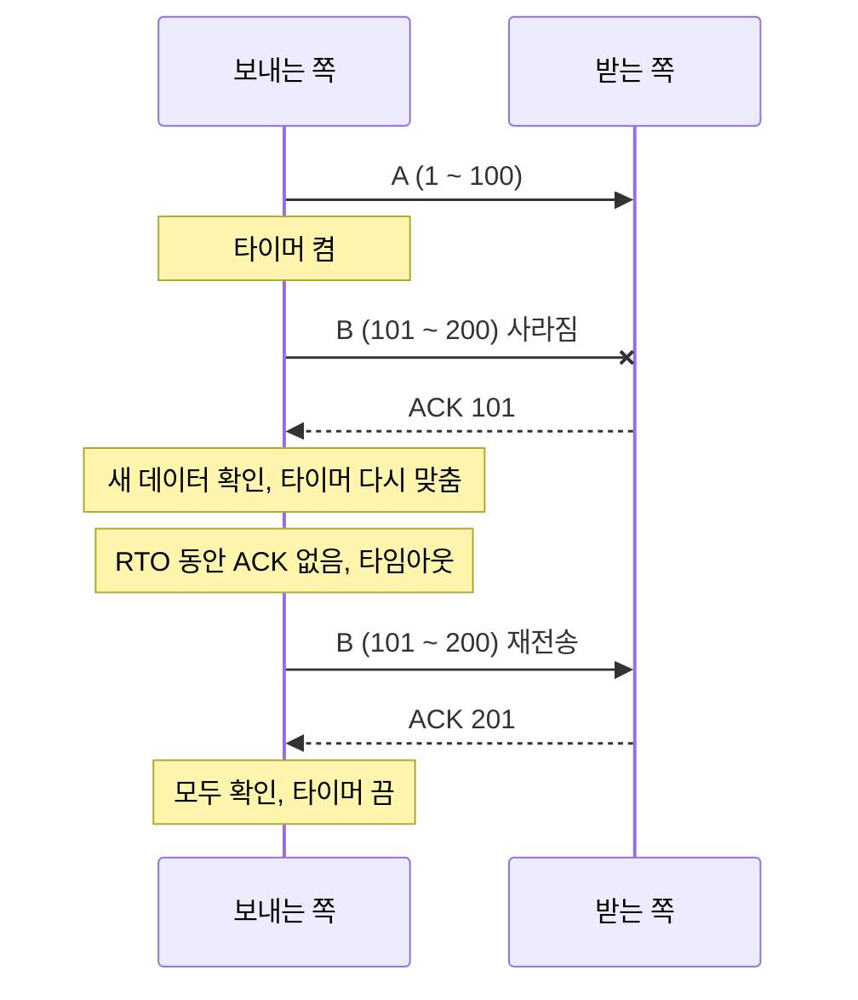
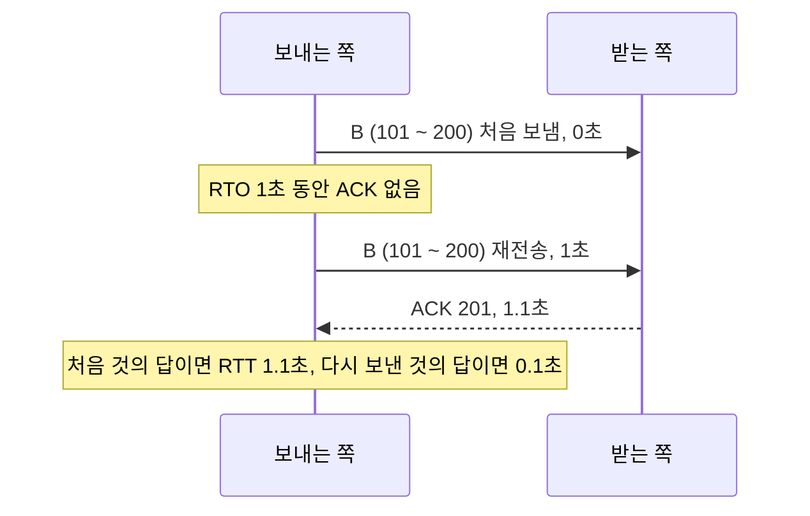
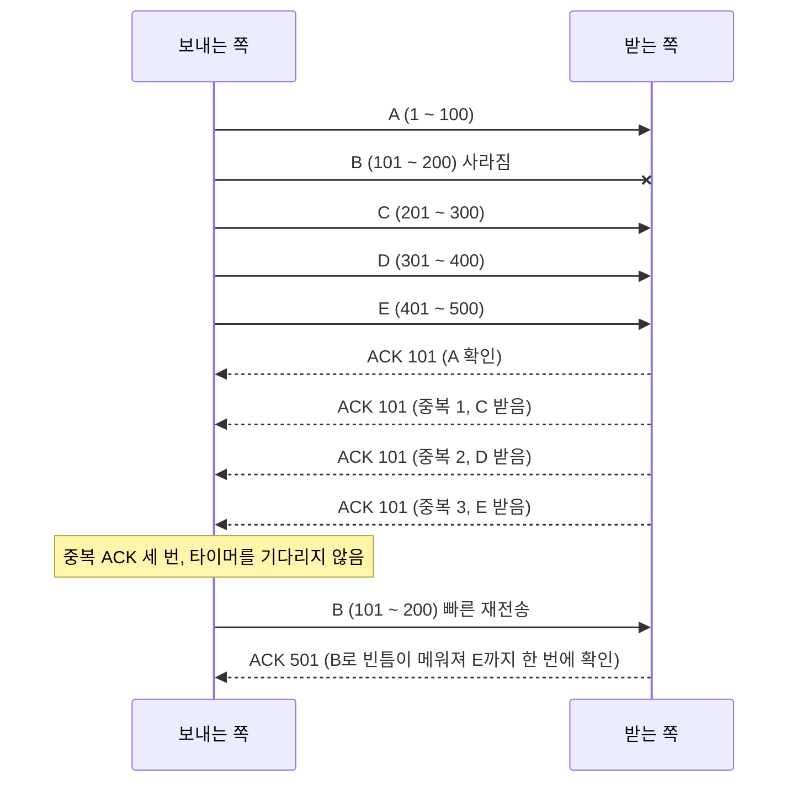

## TCP 재전송이란 ?
- TCP가 보낸 데이터가 상대에게 도착하지 않았다고 판단하면, 그 데이터를 다시 보내는 일
- 보내는 쪽은 ACK가 정해진 시간 안에 오지 않을 때(타임아웃), 또는 같은 ACK가 여러 번 반복해서 올 때(중복 ACK) 데이터가 사라졌다고 판단한다
- [TCP 연결 과정](../TCP%20연결%20과정(TCP%20Handshake)/README.md#연결-후-데이터-주고받기) 문서에서 ACK가 오지 않으면 다시 보낸다고만 짧게 적었다. 이 문서는 무엇을, 언제 다시 보내는지를 자세히 본다

<br/>

## 이름 짚고 가기
### 재전송 (Retransmission)
Re는 다시, Transmission은 전송이라는 뜻이다. 사전적 의미 그대로 다시 보냄이다.
공학적으로는 이미 한 번 보낸 세그먼트를 같은 순서 번호로 한 번 더 보내는 일을 말한다. 새 데이터를 보내는 것이 아니라, 앞에서 보낸 것을 똑같이 다시 보낸다는 점이 이름에 담겨 있다.

### 타임아웃 (Timeout)
사전적 의미는 정해진 시간이 다 됨이다.
공학적으로는 무언가를 기다리며 정해 둔 시간이 지났는데도 기다리던 일이 일어나지 않은 상황을 말한다. TCP에서는 보낸 데이터의 ACK를 기다리는 시간이 다 된 것이다.

<br/>

## 왜 다시 보내야 할까
TCP 아래의 IP는 패킷을 전달하려 애쓰지만, 도착을 약속하지는 않는다. 라우터가 붐비면 패킷을 버리고, 회선 잡음으로 망가진 패킷도 버려진다. [UDP](../UDP(User%20Datagram%20Protocol)/README.md#도착-확인과-재전송)는 이걸 그대로 둔다. TCP는 빠짐없이 전달하겠다고 약속한 프로토콜이라 사라진 것을 스스로 알아내고 다시 보내야 한다.

택배를 보냈는데 수령 확인 문자가 오지 않으면 다시 보내는 것과 같다. 다만 다시 보내려면 두 가지를 정해야 한다. 어느 상자가 안 갔는지, 그리고 확인 문자를 언제까지 기다릴지다. 이 문서의 내용은 이 두 질문에 대한 TCP의 답이다.

<br/>

## 무엇이 빠졌는지 아는 방법
### 순서 번호는 바이트마다 붙는다
[순서 번호](../TCP%20연결%20과정(TCP%20Handshake)/README.md#순서-번호-sequence-number)는 세그먼트마다가 아니라 데이터 1바이트마다 붙는다. RFC 9293 3.4절은 TCP 연결로 보내는 모든 바이트(octet)가 순서 번호를 가지며, 그래서 바이트 하나하나를 확인할 수 있다고 적는다. 세그먼트 헤더에 적히는 순서 번호는 그 세그먼트에 담긴 첫 바이트의 번호다.

이 문서의 예시는 계산을 쉽게 하려고 세그먼트 하나에 100바이트씩 담고 첫 바이트 번호를 1로 둔다. 실제 시작 번호는 TCP 연결 과정 문서에서 본 것처럼 무작위처럼 보이는 값이다.

| 세그먼트 | 담긴 바이트 번호 |
| --- | --- |
| A | 1 ~ 100 |
| B | 101 ~ 200 |
| C | 201 ~ 300 |
| D | 301 ~ 400 |
| E | 401 ~ 500 |

### 누적 확인 (Cumulative Acknowledgment)
Cumulative의 사전적 의미는 누적되는, 차곡차곡 쌓이는 것이다.
공학적으로는 ACK의 확인 번호 하나로 그 번호 앞의 데이터 전부를 한꺼번에 확인하는 방식을 말한다. RFC 9293 3.4절은 TCP의 확인이 누적 방식이어서, 확인 번호 X는 X 바로 앞까지의 모든 바이트를 받았다는 뜻이라고 정의한다. X 자체는 포함하지 않는다. 그래서 확인 번호는 다음에 받고 싶은 번호로 읽으면 된다.

A, B, C를 차례로 받은 쪽은 ACK 301을 보낸다. 1부터 300까지 다 받았으니 301부터 보내 달라는 뜻이다. A와 B의 ACK가 오는 길에 사라졌더라도 ACK 301 하나가 도착하면 보내는 쪽은 A, B, C가 모두 도착했다는 것을 안다.

택배 상자에 번호를 매겨 보냈을 때 받는 사람이 상자 하나하나를 알리는 대신 "3번 상자까지는 다 받았다"고만 알려 주는 것과 같다. 중간 연락 하나가 사라져도 다음 연락이 앞의 것을 모두 덮어 준다.

### 누적 확인만으로는 모르는 것
B가 사라지고 C, D, E는 도착했다고 해 보자. 받는 쪽은 100번까지만 빈틈없이 받았으므로 C, D, E를 받을 때마다 계속 ACK 101을 보낸다. 누적 확인은 빈틈 없이 이어진 앞부분까지만 말할 수 있어서, 101부터 빠졌다는 것은 알려도 그 뒤의 C, D, E가 이미 와 있다는 것은 알리지 못한다.

RFC 2018 1절도 이 점을 짚는다. 누적 확인에서는 받는 쪽 [윈도우](../흐름%20제어와%20혼잡%20제어(Flow%20and%20Congestion%20Control)/README.md#윈도우-window)의 왼쪽 끝, 즉 빈틈없이 받은 부분 바로 뒤에 붙어 있지 않은 세그먼트는 확인되지 않는다. 그래서 보내는 쪽은 사라진 세그먼트마다 한 번씩 왕복 시간을 기다려 알아내거나, 이미 잘 도착한 세그먼트까지 쓸데없이 다시 보내게 된다. 이 한계를 푸는 방법이 뒤에서 볼 [선택 확인](#선택-확인-sack)이다.

<br/>

## 재전송 타이머와 RTO
### 재전송 타이머 (Retransmission Timer)
보내는 쪽이 ACK를 언제까지 기다릴지 재는 타이머다. RFC 6298 1절은 TCP가 상대에게서 아무 응답이 없을 때도 데이터 전달을 보장하려고 재전송 타이머를 쓰고, 이 타이머의 길이를 재전송 타임아웃(RTO, Retransmission Timeout)이라 부른다고 설명한다.

RFC 6298 5절이 권하는(RECOMMENDED) 타이머 관리 방법은 아래와 같다.

1. 데이터가 담긴 세그먼트를 보낼 때(재전송 포함) 타이머가 멈춰 있으면, RTO 뒤에 끝나도록 켠다(5.1).
2. 보낸 데이터가 모두 확인되면 타이머를 끈다(5.2).
3. 새 데이터를 확인하는 ACK가 오면 타이머를 RTO로 다시 맞춘다(5.3).
4. 타이머가 끝나면 아직 확인 받지 못한 세그먼트 중 가장 앞의 것을 다시 보낸다(5.4).

세그먼트마다 타이머를 따로 두는 것이 아니라, 확인을 기다리는 데이터 전체에 타이머 하나를 둔다는 점이 눈에 띈다. 새 데이터를 확인하는 ACK가 계속 오는 동안은 타이머가 다시 맞춰지므로 끝나지 않는다. 같은 번호만 되풀이하는 중복 ACK로는 타이머가 다시 맞춰지지 않는다. 새 데이터를 확인하는 ACK가 한동안 오지 않아야 타이머가 끝난다. 같은 절은 어떤 세그먼트도 직전에 보낸 때로부터 RTO가 지나기 전에 다시 보내면 안 된다(MUST)고 정한다.

괄호 속 MUST, SHOULD, RECOMMENDED 같은 낱말은 RFC가 요구 수준을 나타내는 표시다([UDP](../UDP(User%20Datagram%20Protocol)/README.md#혼잡-제어-congestion-control) 문서 참고).

### 타임아웃으로 다시 보내는 모습
B가 사라졌고, 그 뒤로 보낼 데이터가 없어 중복 ACK도 오지 않는 경우다.



### RTO가 너무 짧거나 길면
RFC 9293 3.8.1절은 인터넷을 이루는 네트워크가 제각각이고 TCP 쓰임새도 넓어서, RTO는 고정값이 아니라 그때그때 정해야 한다고 적는다.

RTO가 너무 짧으면 ACK가 오는 중인데 기다리지 못하고 다시 보낸다. 사라지지 않은 데이터를 또 보내니 길만 더 붐빈다. RTO가 너무 길면 정말 사라졌을 때 한참을 멍하니 기다린다. 그래서 RTO는 이 연결의 실제 왕복 시간보다 조금 길게 잡아야 한다.

<br/>

## RTO는 어떻게 정할까
### 왕복 시간 (RTT, Round Trip Time) 재기
RTT는 세그먼트를 보낸 때부터 그 세그먼트를 확인하는 ACK가 돌아올 때까지 걸린 시간이다. [ICMP와 ping](../ICMP와%20ping(ICMP%20and%20ping)/README.md#ping으로-왕복-시간-재기) 문서에서 ping으로 잰 왕복 시간과 같은 개념인데, TCP는 따로 ping을 보내지 않고 데이터와 ACK로 잰다. RFC 6298 3절은 적어도 한 RTT마다 한 번은 재야 한다(MUST)고 정한다. 이렇게 잰 값 하나를 RTT 표본(sample)이라 한다.

문제는 RTT가 매번 다르다는 점이다. 같은 길이라도 라우터가 붐비면 줄을 서느라 늦어진다. 방금 잰 값 하나로 RTO를 정하면 RTO가 매번 출렁인다. 그래서 TCP는 지금까지 잰 값의 평균과 흔들림을 따로 기억한다.

출근길에 알람 시간을 정하는 것과 같다. 평소 30분 걸리는 길이라도 매일 25분에서 35분 사이를 오가면 여유를 조금 두고, 어떤 날은 20분 어떤 날은 50분이 걸린다면 여유를 훨씬 많이 둔다. 평균만 보지 않고 얼마나 들쭉날쭉한지도 보는 것이다. 택배 수령 확인을 사흘만 기다리고 다시 보내면 멀쩡히 가고 있는 상자를 또 보내게 되고, 한 달을 기다리면 정말 잃어버렸을 때 너무 늦게 알게 된다.

### 다듬은 평균 RTT (SRTT, Smoothed RTT)
Smoothed의 사전적 의미는 매끄럽게 다듬은 것이다. 울퉁불퉁한 표면을 사포로 문질러 고르게 만든 모양을 떠올리면 된다.
공학적으로는 RTT 표본들을 최근 값에 조금 더 무게를 두어 낸 평균을 말한다. 새 표본이 올 때마다 예전 평균에 조금씩만 섞어서, 표본 하나가 튀어도 평균이 크게 흔들리지 않게 다듬는다.

### RTT 흔들림 (RTTVAR, RTT Variation)
Variation의 사전적 의미는 변화, 변동이다.
공학적으로는 RTT 표본이 평균에서 얼마나 벗어나는지, 즉 흔들림의 크기를 말한다. 표본이 평균 근처에 모여 있으면 작아지고, 평균에서 멀리 떨어진 표본이 오면 커진다.

### 계산식
RFC 6298 2절이 정한 계산은 아래와 같다. 2.2와 2.3은 MUST, 2.3의 alpha와 beta 값은 SHOULD다.

```text
처음 잰 RTT가 R일 때 (2.2)
  SRTT   = R
  RTTVAR = R / 2

그다음 RTT를 R'으로 잴 때마다 (2.3)
  RTTVAR = (1 - beta) x RTTVAR + beta x |SRTT - R'|
  SRTT   = (1 - alpha) x SRTT + alpha x R'
  (alpha = 1/8, beta = 1/4)

RTO = SRTT + max(G, 4 x RTTVAR)
```

- alpha가 1/8이므로 새 표본은 평균에 8분의 1만 반영된다. 나머지 8분의 7은 예전 평균이다.
- RTTVAR을 먼저 고치고 SRTT를 나중에 고친다. RTTVAR 식의 SRTT는 고치기 전 값이어야 하고, 이 순서는 MUST다(2.3).
- G는 시계의 정밀도(clock granularity)다. 4 x RTTVAR가 0이 되더라도 RTO가 평균과 똑같아지지 않도록 최소 G만큼은 더한다(2.2, 4절).
- RFC 원문은 4 x RTTVAR의 4를 K라는 상수로 적는다(K = 4, 2.2절). 평균에 흔들림의 네 배만큼 여유를 더한다는 뜻이다.

### 최소 1초와 처음 1초
RFC 6298은 계산 결과와 따로 두 가지 하한을 둔다.

2.4절은 RTO를 계산했을 때 1초보다 작으면 1초로 올려야 한다(SHOULD)고 정한다. 같은 절은 그 이유를, 예전부터 거친 시계를 써 와서 RTO 최솟값이 컸고, 연구에 따르면 큰 최솟값이 TCP를 보수적으로 유지하며 쓸데없는 재전송(spurious retransmission)을 막는 데 필요하다고 설명한다. 다만 앞으로 연구가 더 작은 최솟값이 괜찮다고 보일 수도 있다고 덧붙인다.

2.1절은 아직 RTT를 한 번도 재지 못했을 때 RTO를 1초로 두라(SHOULD)고 한다. 연결을 처음 맺을 때가 이 경우다. 예전 문서(RFC 2988)는 3초였고 지금도 3초나 1초보다 큰 값을 써도 된다(MAY). 2.5절은 RTO에 상한을 둘 수 있되(MAY) 그 상한은 60초 이상이어야 한다고 정한다.

### 숫자로 계산해 보기
위 식을 그대로 옮긴 작은 스크립트다. 멀리 있는 서버라 RTT가 300ms 언저리라고 가정하고, 다섯 번째 표본만 900ms로 튀게 넣었다. 단위는 밀리초, G는 1ms로 두었다. 2026-10-28에 Node.js v24.22.1, Windows 11 Pro(10.0.26200)에서 실행했고, 세 번 실행해 같은 출력이 나왔다.

```js
// RFC 6298 2절의 RTO 계산 (단위: ms)
const ALPHA = 1 / 8;
const BETA = 1 / 4;
const K = 4;
const G = 1;        // 시계 정밀도 1ms로 가정
const MIN_RTO = 1000; // 2.4: 1초보다 작으면 1초로 올린다

let srtt, rttvar;

function update(r) {
  if (srtt === undefined) {
    srtt = r;            // 2.2: 첫 측정
    rttvar = r / 2;
  } else {
    rttvar = (1 - BETA) * rttvar + BETA * Math.abs(srtt - r); // 2.3: RTTVAR 먼저
    srtt = (1 - ALPHA) * srtt + ALPHA * r;
  }
  const raw = srtt + Math.max(G, K * rttvar);
  const rto = Math.max(raw, MIN_RTO);
  console.log(`R=${r}  SRTT=${srtt.toFixed(1)}  RTTVAR=${rttvar.toFixed(1)}  계산값=${raw.toFixed(1)}  RTO=${rto.toFixed(1)}`);
}

[300, 320, 280, 300, 900, 300].forEach(update);
```

```text
R=300  SRTT=300.0  RTTVAR=150.0  계산값=900.0  RTO=1000.0
R=320  SRTT=302.5  RTTVAR=117.5  계산값=772.5  RTO=1000.0
R=280  SRTT=299.7  RTTVAR=93.8  계산값=674.7  RTO=1000.0
R=300  SRTT=299.7  RTTVAR=70.4  계산값=581.3  RTO=1000.0
R=900  SRTT=374.8  RTTVAR=202.9  계산값=1186.2  RTO=1186.2
R=300  SRTT=365.4  RTTVAR=170.8  계산값=1048.8  RTO=1048.8
```

두 번째 줄을 손으로 검산하면 RTTVAR = 0.75 x 150 + 0.25 x |300 - 320| = 112.5 + 5 = 117.5, SRTT = 0.875 x 300 + 0.125 x 320 = 262.5 + 40 = 302.5로 출력과 같다.

- 처음 네 표본은 300ms 근처에 모여 있어서 RTTVAR이 150에서 70.4로 줄었다. 길이 안정적이라고 보고 여유를 줄인 것이다. 계산값은 1초보다 작아 RTO는 1초로 올려졌다(2.4).
- 900ms 표본 하나에 SRTT는 299.7에서 374.8로 조금만 올랐지만, RTTVAR은 70.4에서 202.9로 크게 뛰었다. 평균은 천천히 따라가고, 흔들림은 빠르게 반응한다. 그 결과 RTO가 1186.2ms로 늘었다.
- 다음 표본이 다시 300ms로 돌아와도 RTTVAR은 한 번에 줄지 않는다. 한 번 흔들린 길은 한동안 여유를 더 두고 지켜본다.

<br/>

## 지수 백오프 (Exponential Backoff)
### 이름 짚고 가기
Exponential의 사전적 의미는 지수의, 거듭제곱으로 늘어나는 것이다. Back off는 물러서다, 뒤로 빠지다라는 뜻이다.
공학적으로는 실패할 때마다 다시 시도하기 전 기다리는 시간을 두 배, 네 배처럼 곱으로 늘려 가는 방법을 말한다. 상대가 응답하지 않을수록 한 걸음씩 더 물러나 기다린다는 뜻이 이름에 담겨 있다.

### 무엇을 하나
RFC 6298 5.5절은 재전송 타이머가 끝나면 RTO를 두 배로 늘려야 한다(MUST)고 정한다. 그다음 늘어난 RTO로 타이머를 다시 켠다(5.6). 같은 세그먼트를 또 잃으면 또 두 배가 된다. 2.5절의 상한을 두었다면 그 상한에서 멈춘다.

아래는 RTO 1초에서 시작해 계속 타임아웃이 나는 경우를 계산한 것이다. 상한은 2.5절이 허락하는 가장 작은 값인 60초로 두었다. 실행 환경은 위 예시와 같다.

```js
// RFC 6298 5.5의 지수 백오프 (단위: 초)
const MAX_RTO = 60; // 2.5: 상한을 두려면 60초 이상
let rto = 1;
let elapsed = 0;

for (let n = 1; n <= 8; n++) {
  console.log(`${n}번째 보냄: 시작 후 ${elapsed}초, 이번 RTO ${rto}초`);
  elapsed += rto;
  rto = Math.min(rto * 2, MAX_RTO);
}
```

```text
1번째 보냄: 시작 후 0초, 이번 RTO 1초
2번째 보냄: 시작 후 1초, 이번 RTO 2초
3번째 보냄: 시작 후 3초, 이번 RTO 4초
4번째 보냄: 시작 후 7초, 이번 RTO 8초
5번째 보냄: 시작 후 15초, 이번 RTO 16초
6번째 보냄: 시작 후 31초, 이번 RTO 32초
7번째 보냄: 시작 후 63초, 이번 RTO 60초
8번째 보냄: 시작 후 123초, 이번 RTO 60초
```

### 왜 두 배씩 늘릴까
타임아웃이 계속 난다는 것은 길이 심하게 막혔거나, 상대가 멀리 있어서 지금 RTO가 너무 짧을 수 있다는 뜻이다. 어느 쪽이든 같은 간격으로 계속 다시 보내면 막힌 길에 짐만 더 얹는다. RFC 9293 3.8.2절은 혼잡 붕괴를 막기 위해 느린 시작, 혼잡 회피와 함께 RTO의 지수적 늘림을 반드시 구현해야 한다(MUST)고 정한다. 같은 길을 쓰는 모든 연결이 물러나야 길이 풀린다.

통화량이 몰려 전화가 안 걸릴 때와 같다. 모두가 1분마다 다시 걸면 회선은 계속 막혀 있다. 실패할 때마다 2분, 4분으로 간격을 늘려야 회선이 풀린다.

### 언제 원래대로 돌아오나
RFC 6298 5절 끝의 설명에 따르면, 재전송 뒤 새 데이터를 보내고 그 확인을 받아 새 RTT 표본을 얻으면 2절의 계산을 다시 하고, 두 배로 불어났던 RTO도 계산값으로 돌아온다. RFC 9293 3.8.2절은 이것을 늘어난 값을 재전송 없이 새 데이터가 보내지고 확인될 때까지 유지한다고 정리한다. 여기서 재전송 없이라는 조건이 다음 절의 카른 알고리즘과 이어진다.

같은 5절은 여러 번 물러난 뒤라면 지금의 SRTT와 RTTVAR이 엉터리일 가능성이 크니 지워도 된다(MAY)고 적는다. 지웠다면 다음 표본은 처음 잰 값처럼 2.2절로 다시 시작한다.

### 타임아웃 뒤의 혼잡 윈도우
타임아웃은 RTO만 늘리는 것이 아니다. 보내는 양을 정하는 혼잡 윈도우(cwnd)도 한 세그먼트로 떨어진다. 이 부분은 [흐름 제어와 혼잡 제어](../흐름%20제어와%20혼잡%20제어(Flow%20and%20Congestion%20Control)/README.md#타임아웃-강한-신호) 문서에 정리했다. 이 문서는 무엇을 언제 다시 보내는지만 본다.

<br/>

## 카른 알고리즘 (Karn's Algorithm)
### 무엇이 문제일까
B를 보냈는데 타임아웃이 나서 다시 보냈고, 그 뒤에 ACK 201이 왔다고 해 보자. 이 ACK는 처음 보낸 B에 대한 답일까, 다시 보낸 B에 대한 답일까. 두 B는 순서 번호도 내용도 같아서 ACK만 봐서는 구분할 수 없다.



어느 쪽으로 읽든 틀릴 수 있다. 처음 것의 답으로 읽었는데 사실 처음 것은 사라졌다면, RTT를 실제보다 훨씬 길게 잰 셈이다. 다시 보낸 것의 답으로 읽었는데 사실 처음 것이 늦게 도착한 것이라면, RTT를 실제보다 짧게 잰 셈이고 RTO가 너무 작아져 쓸데없는 재전송이 늘어난다.

같은 문자를 두 번 보냈는데 답장이 하나만 왔을 때와 같다. 답장이 첫 문자를 보고 쓴 것인지 두 번째 문자를 보고 쓴 것인지 모르니, 상대가 답하는 데 얼마나 걸렸는지 잴 수 없다.

### 다시 보낸 세그먼트로는 재지 않는다
카른 알고리즘은 Phil Karn과 Craig Partridge가 1987년 논문에서 낸 방법이다(RFC 6298 참고 문헌 [KP87]). RFC 6298 3절은 RTT 표본을 잴 때 카른 알고리즘을 반드시 써야 한다(MUST)고 정하고, 그 내용을 다시 보낸 세그먼트로는 RTT 표본을 재면 안 된다(MUST NOT)고 설명한다. 답이 어느 쪽에 대한 것인지 애매하기 때문이다. RFC 9293 3.8.1절도 RTO를 RFC 6298대로, 카른 알고리즘을 포함해 계산해야 한다(MUST)고 정한다.

애매하면 아예 재지 않는다는 단순한 규칙이다. 그러면 RTO는 어떻게 다시 줄어들까. 위에서 본 것처럼 백오프로 늘어난 RTO는 재전송 없이 보내고 확인 받은 새 데이터로 표본을 얻을 때까지 그대로 유지된다(RFC 9293 3.8.2절). 재전송한 세그먼트는 표본에서 빼고, 늘어난 RTO는 깨끗한 표본이 생길 때까지 지킨다. 이 두 가지가 맞물려 RTO가 엉뚱한 값으로 바뀌지 않는다.

### 예외: 타임스탬프 옵션
RFC 6298 3절은 TCP 타임스탬프 옵션을 쓰는 경우만은 다시 보낸 세그먼트로도 안전하게 잴 수 있다고 적는다. 타임스탬프 옵션은 보낼 때마다 시각 값을 실어 보내고 받는 쪽이 그 값을 ACK에 돌려주므로, 어느 쪽에 대한 답인지 애매함이 사라지기 때문이다. 같은 절은 타임스탬프를 쓰면 ACK마다 표본을 잴 수 있다고도 적는다. 옵션의 자세한 형식은 TODO로 남긴다.

<br/>

## 중복 ACK 세 번과 빠른 재전송
### 타임아웃만 기다리면 느리다
타임아웃은 확실하지만 느리다. RFC 6298은 RTO를 1초 아래로 내리지 말라고 권하므로(2.4절), RTT가 수십 밀리초인 연결에서도 그 권고를 따르는 구현이라면 1초를 꼬박 기다려야 한다. 그 사이 보낼 수 있는 데이터는 묶여 있다. 그래서 TCP는 타이머가 끝나기 전에 손실을 알아차리는 방법을 하나 더 쓴다.

### 중복 ACK (Duplicate ACK)
Duplicate의 사전적 의미는 똑같이 베낀 것, 사본이다.
공학적으로는 앞서 받은 ACK와 같은 확인 번호를 다시 담고 온 ACK를 말한다. RFC 5681 2절은 다섯 조건을 모두 만족할 때 중복으로 본다. 보내는 쪽에 확인 받지 못한 데이터가 있고, 들어온 ACK에 데이터가 없고, SYN과 FIN이 꺼져 있고, 확인 번호가 지금까지 받은 가장 큰 확인 번호와 같고, 알려 온 윈도우가 직전 ACK와 같아야 한다.

[누적 확인](#누적-확인-cumulative-acknowledgment)에서 본 대로, 받는 쪽은 B가 빠진 채 C를 받으면 아직 101을 기다린다는 ACK 101을 다시 보낸다. RFC 5681 3.2절은 받는 쪽이 순서가 어긋난 세그먼트를 받으면 곧바로 중복 ACK를 보내야 한다(SHOULD)고 정한다. 그 목적은 순서가 어긋난 세그먼트가 왔다는 것과, 어느 번호를 기다리는지를 보내는 쪽에 알리는 것이다.

### 왜 하필 세 번일까
RFC 5681 3.2절은 중복 ACK가 손실 말고도 생긴다고 적는다. 네트워크가 세그먼트 순서를 바꿔 전달해도(어떤 경로에서는 드물지 않다고 한다) 생기고, ACK나 세그먼트가 네트워크에서 복제되어도 생긴다. 순서만 바뀐 경우라면 한두 번의 중복 ACK 뒤에 빠졌던 세그먼트가 곧 도착한다. 그래서 같은 번호의 중복 ACK가 세 번 올 때까지 기다린 뒤에야 손실로 본다. RFC 5681은 왜 하필 세 번인지 따로 설명하지 않는다. 순서 바뀜에 쉽게 속지 않으면서도 타임아웃보다는 빨리 알아차리려는 절충으로 이해하면 된다.

택배 상자에 번호를 매겨 보냈는데 받는 사람이 "아직 2번 상자가 안 왔다"고 한 번 연락하면 조금 늦는 중일 수 있다. 같은 연락이 세 번이나 오면, 그 사이 3번, 4번, 5번은 도착했는데 2번만 없다는 뜻이니 중간에 사라졌다고 본다. 흐름 제어와 혼잡 제어 문서의 비유와 같은 장면이다.

### 빠른 재전송 (Fast Retransmit)
RFC 5681 3.2절은 보내는 쪽이 중복 ACK로 손실을 알아내고 고치는 빠른 재전송을 써야 한다(SHOULD)고 정한다. 중복 ACK 세 번이 그 사이에 확인 번호를 앞으로 움직이는 ACK 없이 오면 세그먼트를 잃은 것으로 보고, 재전송 타이머가 끝나기를 기다리지 않고 빠진 것으로 보이는 세그먼트를 바로 다시 보낸다.



마지막 ACK가 201이 아니라 501인 것이 누적 확인의 힘이다. 받는 쪽은 C, D, E를 버리지 않고 쥐고 있다가, B가 와서 빈틈이 메워지자 500까지 한꺼번에 확인한다. RFC 5681 3.2절도 받는 쪽은 들어온 세그먼트가 빈틈의 전부나 일부를 메우면 곧바로 ACK를 보내야 한다(SHOULD)고 정한다.

빠른 재전송은 중복 ACK가 세 번 올 만큼 뒤에 세그먼트가 더 있어야 동작한다. 사라진 것이 마지막 세그먼트이거나 뒤로 보낼 데이터가 적으면 중복 ACK가 모자라 결국 타임아웃을 기다린다. 이 경우를 다루는 방법은 TODO로 남긴다.

### 다시 보낸 뒤 cwnd는
빠른 재전송 다음에는 빠른 회복(Fast Recovery)이 이어져 cwnd를 한 세그먼트까지 떨어뜨리지 않고 줄인 채로 이어 간다. 이 부분은 [흐름 제어와 혼잡 제어](../흐름%20제어와%20혼잡%20제어(Flow%20and%20Congestion%20Control)/README.md#빠른-재전송과-빠른-회복) 문서에 정리했다.

### 여러 개를 잃으면
RFC 6582 1절은 RFC 5681의 빠른 재전송이 한 번 동작할 때마다 세그먼트 하나만 다시 보낸다고 적는다. 한 번에 보낸 묶음에서 B와 D를 함께 잃었다면, 중복 ACK는 계속 101만 말하므로 보내는 쪽은 B가 빠졌다는 것만 안다. B를 다시 보내고 ACK 301을 받은 뒤에야 301부터 빠졌다는 것을 안다. 같은 절은 이때 [Reno](../흐름%20제어와%20혼잡%20제어(Flow%20and%20Congestion%20Control)/README.md#reno) 방식이 타임아웃을 자주 겪거나, 빠른 재전송과 윈도우 줄이기를 여러 번 겪는다고 적는다.

SACK을 쓸 수 없는 연결에서 이 경우를 다루는 방법이 NewReno(RFC 6582)다. 같은 절은 SACK을 쓸 수 있으면 보내는 쪽이 어느 세그먼트를 다시 보내고 어느 것을 다시 보내지 않을지 똑똑하게 정할 정보를 갖게 된다고 적는다. 그 정보를 주는 것이 다음 절의 선택 확인이다.

<br/>

## 선택 확인 (SACK)
### 이름 짚고 가기
SACK은 Selective Acknowledgment의 줄임말이다. Selective의 사전적 의미는 골라낸, 선택적인 것이다.
공학적으로는 받는 쪽이 앞에서부터 이어진 부분만이 아니라, 띄엄띄엄 받아 둔 부분까지 골라서 보내는 쪽에 알려 주는 방식을 말한다. RFC 2018 1절은 SACK을 쓰면 받는 쪽이 성공적으로 도착한 모든 세그먼트를 알릴 수 있어서, 보내는 쪽은 실제로 사라진 세그먼트만 다시 보내면 된다고 설명한다.

택배 비유로는 "1번까지는 다 받았다"고만 말하는 대신 "1번, 3번, 5번, 6번은 받았다"고 받은 상자 목록을 함께 알려 주는 것과 같다. 보내는 사람은 목록을 보고 2번과 4번만 다시 보낸다.

### 어떻게 쓰기로 하나
SACK은 TCP 옵션 두 개로 이루어진다(RFC 2018 1절).

- SACK 허용(SACK-Permitted) 옵션은 연결을 맺을 때 SYN에 실어 보낸다. 나는 SACK 옵션을 받아 처리할 수 있다는 표시다. SYN이 아닌 세그먼트에 실으면 안 된다(MUST NOT, 2절).
- SACK 옵션은 연결이 맺어진 뒤 ACK에 실려 간다. 상대에게서 SACK 허용 옵션을 받지 못한 연결에서는 보내면 안 된다(MUST NOT, 4절).

### SACK 블록
SACK 옵션에는 받는 쪽이 받아서 쌓아 둔, 띄엄띄엄 떨어진 데이터 덩어리(블록)의 목록이 담긴다. 블록마다 두 숫자를 적는다(RFC 2018 3절).

- 왼쪽 끝(Left Edge)은 그 블록의 첫 번호다.
- 오른쪽 끝(Right Edge)은 그 블록의 마지막 번호 바로 다음 번호다. 확인 번호와 같은 읽는 법이다.

SACK은 확인 번호의 뜻을 바꾸지 않는다(같은 절). 확인 번호는 여전히 누적 확인이고, SACK 블록은 그 뒤쪽 상황을 덧붙이는 정보다. 옵션 자리는 TCP 헤더에 최대 40바이트라 블록은 최대 4개까지 담을 수 있고, 타임스탬프 옵션을 함께 쓰면 3개까지다(같은 절).

### 여러 개 손실을 한 번에 알리기
앞의 예시를 F(501 ~ 600)까지 늘리고 B와 D를 함께 잃었다고 해 보자. 아래는 RFC 2018 7절의 예시(Case 3)와 같은 규칙으로 이 문서의 번호에 맞춰 만든 표다. 실제로 잡은 패킷이 아니다.

| 세그먼트 | 확인 번호 | 첫 번째 블록 | 두 번째 블록 |
| --- | --- | --- | --- |
| A (1 ~ 100) | 101 | 없음 | 없음 |
| B (101 ~ 200), 사라짐 | ACK 없음 | | |
| C (201 ~ 300) | 101 | 201 ~ 301 | 없음 |
| D (301 ~ 400), 사라짐 | ACK 없음 | | |
| E (401 ~ 500) | 101 | 401 ~ 501 | 201 ~ 301 |
| F (501 ~ 600) | 101 | 401 ~ 601 | 201 ~ 301 |

- 확인 번호는 끝까지 101이다. 누적 확인만 보면 B가 빠졌다는 것밖에 모른다.
- 마지막 ACK의 블록을 보면 201부터 300까지, 401부터 600까지는 받는 쪽에 와 있다. 보내는 쪽은 그 사이의 101 ~ 200(B)과 301 ~ 400(D)이 빠졌다는 것을 ACK 하나로 안다.
- 첫 번째 블록에는 이 ACK를 만든 세그먼트가 든 블록을 넣어야 한다(MUST, RFC 2018 4절). 가장 최근의 변화를 맨 앞에 알리기 위해서다. 그래서 E를 받은 뒤에는 401 ~ 501이 앞으로 왔고, F가 도착하자 E와 이어져 401 ~ 601로 늘었다.
- 블록은 최근에 알린 것을 반복해서 다시 싣는다(SHOULD, 4절). ACK 하나가 사라져도 다음 ACK에 같은 정보가 다시 실려 오게 하려는 것이다.

RFC 2018 5절이 예로 드는 보내는 쪽 구현은 재전송을 기다리는 세그먼트마다 SACK으로 확인됐다는 표시를 두고, 다시 보낼 때 그 표시가 켜진 세그먼트는 건너뛰는 방식이다. 위 예에서는 C, E, F에 표시가 켜지고 B와 D만 다시 보낸다.

### SACK은 참고용이다
RFC 2018 3절은 SACK을 참고용(advisory)이라고 적는다. 받는 쪽은 SACK으로 받았다고 알린 데이터를 나중에 버려도 된다. 그래서 보내는 쪽은 SACK으로 확인된 세그먼트라도 누적 확인 번호가 그 너머로 넘어가기 전까지는 버퍼에서 지우지 않는다(5절). 또 타임아웃이 나면 SACK 표시를 모두 끄는 것이 좋고(SHOULD), 윈도우 왼쪽 끝의 세그먼트는 표시와 상관없이 다시 보내야 한다(MUST, 5절). 받는 쪽이 이미 알린 데이터를 버리는 일(reneging)은 8절에 있고, 이 문서에서는 다루지 않는다.

SACK 정보를 바탕으로 손실 회복 중에 무엇을 얼마나 보낼지 정하는 표준 절차는 RFC 6675에 따로 있다. 이 문서에서는 존재만 알리고 TODO로 넘긴다.

<br/>

## 세 방법 견주어 보기
지금까지 본 세 방법은 서로 대신하는 관계가 아니라 함께 쓰인다. SACK은 중복 ACK에 실려 오는 정보라 빠른 재전송과 짝을 이루고, 타임아웃은 둘 다 실패했을 때의 마지막 안전장치다.

| 방법 | 손실을 아는 신호 | 아는 속도 | 알 수 있는 것 |
| --- | --- | --- | --- |
| 타임아웃 | RTO 동안 ACK가 없음 | 느림 (최소 1초 권고) | 가장 앞의 확인 안 된 세그먼트 |
| 빠른 재전송 | 같은 번호의 중복 ACK 세 번 | 약 한 왕복 | 확인 번호가 가리키는 세그먼트 하나 |
| 선택 확인 | 중복 ACK에 실린 SACK 블록 | 약 한 왕복 | 빠진 구간 여러 개 |

<br/>

## 언제 포기할까
### 다시 보내도 답이 없으면
백오프로 기다리는 시간을 늘려도 끝없이 다시 보낼 수는 없다. RFC 9293 3.8.3절은 같은 세그먼트를 지나치게 많이 다시 보낸다는 것은 상대 컴퓨터나 경로가 고장 났다는 뜻이라고 보고, 두 문턱값 R1과 R2를 두도록 정한다(MUST).

- 같은 세그먼트를 보낸 횟수가 R1에 닿으면 IP 계층에 이 경로가 의심스럽다고 알린다.
- R2에 닿으면 연결을 닫는다.
- R1은 지금 RTO로 적어도 세 번 재전송하는 만큼, R2는 적어도 100초에 해당해야 한다(SHOULD).
- 응용 프로그램은 연결마다 R2를 정할 수 있어야 한다(MUST).

전화를 몇 번 걸어도 받지 않으면 어딘가 문제가 있나 의심하고(R1), 그래도 계속 안 받으면 포기하는 것(R2)과 같다.

### 연결 맺기(SYN) 재전송
SYN도 사라질 수 있고, 사라지면 다시 보낸다. RFC 9293 3.8.3절은 SYN 재전송도 데이터 재전송과 같은 방식으로 다뤄야 한다고 정하면서, SYN의 R2는 적어도 3분 동안 재전송할 수 있을 만큼 크게 잡아야 한다(MUST)고 적는다. 응용 프로그램이 그보다 먼저 연결 시도를 그만두는 것은 괜찮다고 덧붙인다.

RFC 6298 5.7절에는 SYN에 관한 규칙이 하나 더 있다. SYN의 ACK를 기다리다 타이머가 끝났고 RTO를 3초보다 작게 쓰고 있었다면, 핸드셰이크가 끝나고 데이터를 보내기 시작할 때 RTO를 3초로 다시 맞춰야 한다(MUST). 처음 RTO를 1초로 낮추면서(2.1) 함께 둔 안전장치다(7절).

실제 운영체제가 SYN을 몇 번까지 다시 보내고 언제 포기하는지는 운영체제와 설정마다 다르다. 자세한 기본값과 튜닝은 TODO로 남긴다.

### 내 컴퓨터의 설정 보기
이 노트에서는 TCP 윈도우와 헷갈리지 않게 운영체제 이름을 영문 Windows로 쓴다. Windows에서는 PowerShell의 Get-NetTCPSetting으로 설정 묶음마다 재전송 관련 값을 볼 수 있다. 아래는 2026-10-28에 Windows 11 Pro(10.0.26200)에서 실행한 결과다.

```powershell
Get-NetTCPSetting | Select-Object SettingName, MinRto, InitialRto, MaxSynRetransmissions
```

```text
SettingName      MinRto InitialRto MaxSynRetransmissions
-----------      ------ ---------- ---------------------
Automatic
InternetCustom   300    1000       4
DatacenterCustom 60     1000       4
Compat           300    1000       4
Datacenter       60     1000       4
Internet         300    1000       4
```

Microsoft의 Set-NetTCPSetting 문서는 각 값을 아래처럼 설명한다.

- MinRto는 밀리초 단위의 재전송 타임아웃 값이다. 문서가 허용하는 범위는 20ms부터 300ms까지다. 이 PC에서는 인터넷용 설정이 300ms, 데이터센터용 설정이 60ms였다.
- InitialRto는 연결(SYN) 재전송 전까지 기다리는 밀리초다. 1000ms는 RFC 6298 2.1절의 처음 1초와 같다. 같은 PC에서 netsh int tcp show global을 실행해도 Initial RTO가 1000으로 나온다.
- MaxSynRetransmissions는 문서에 응답 없이 SYN을 보내는 최대 횟수라고 적혀 있다. 이 값 4가 처음 SYN을 포함한 횟수인지, 다시 보낸 횟수인지는 문서만으로 확인하지 못했다(확인 필요).

MinRto 300ms는 RFC 6298 2.4절의 1초 권고(SHOULD)보다 작다. 이름으로 보면 RTO의 하한 값으로 보이지만, Windows가 이 값을 2.4절의 하한처럼 쓰는지 다른 방식으로 쓰는지는 확인하지 못했다(확인 필요). RFC 6298 2.4절이 앞으로 더 작은 최솟값이 괜찮다고 밝혀질 수 있다고 적은 것처럼, 실제 운영체제는 RFC 권고와 다른 값을 쓰기도 한다는 정도로만 기억해 둔다. 어떤 연결에 어느 설정 묶음이 붙는지도 확인하지 않았다(확인 필요).

### SYN 재전송을 기다려 보기
응답이 오지 않는 주소에 연결을 시도하면 SYN 재전송 끝에 연결이 실패한다. 192.0.2.1은 RFC 5737 3절이 문서 예시용으로 정해 둔 주소(TEST-NET-1)라 실제 서버가 없다. Node.js로 이 주소의 80번 포트에 연결을 시도하고, 실패할 때까지 걸린 시간을 쟀다. 실행 환경은 위와 같다(Node.js v24.22.1, Windows 11 Pro 10.0.26200, 2026-10-28).

```js
const net = require('node:net');

const start = Date.now();
const sock = net.connect({ host: '192.0.2.1', port: 80 });
sock.on('connect', () => {
  console.log('연결됨', Date.now() - start, 'ms');
  sock.destroy();
});
sock.on('error', (err) => {
  const sec = ((Date.now() - start) / 1000).toFixed(1);
  console.log(`${err.code}, ${sec}초 뒤 포기`);
});
```

```text
ETIMEDOUT, 21.0초 뒤 포기
```

세 번 실행해 세 번 모두 21.0초였다. Node에는 시간 초과(ETIMEDOUT) 오류로 전달됐다.

이 실험은 패킷을 직접 잡아 보지 않았다. 그래서 SYN이 실제로 몇 번, 어떤 간격으로 나갔는지는 확인하지 못했다(확인 필요). InitialRto 1초에서 두 배씩 늘리며 4번 다시 보냈다고 단순 계산하면 1 + 2 + 4 + 8 + 16 = 31초가 나와 실제 21초와 맞지 않는다. Windows가 SYN 재전송 간격이나 포기 시점을 다른 방식으로 정하는 것으로 보이지만, 패킷 캡처로 확인하기 전까지는 짐작일 뿐이다. 데이터 세그먼트의 재전송과 타임아웃, 중복 ACK, SACK도 실제 패킷 손실을 만들어 재현해 보지는 못했다. 패킷 캡처로 직접 보는 일은 TODO로 남긴다.

RFC 9293 3.8.3절은 SYN의 R2를 3분 이상으로 잡으라고(MUST) 하면서 응용 프로그램이 그보다 먼저 그만두는 것은 괜찮다고 했다. 21초에 포기한 것이 운영체제 TCP의 R2 때문인지, 그 위의 연결 시도 쪽 제한 때문인지도 이 실험으로는 가릴 수 없다(확인 필요).

<br/>

## 참고 자료
- RFC 9293, [Transmission Control Protocol (TCP)](https://www.rfc-editor.org/rfc/rfc9293.html) 3.4절(바이트마다 붙는 순서 번호, 누적 확인), 3.8.1절(RTO는 동적으로, 카른 알고리즘 포함), 3.8.2절(RTO 지수적 늘림 필수, 늘어난 값 유지), 3.8.3절(R1, R2, SYN 재전송 3분)
- RFC 6298, [Computing TCP's Retransmission Timer](https://www.rfc-editor.org/rfc/rfc6298.html) 1절(재전송 타이머와 RTO), 2절(SRTT, RTTVAR, RTO 계산, 2.1 처음 1초, 2.4 최소 1초, 2.5 상한 60초 이상), 3절(카른 알고리즘, 타임스탬프 예외), 4절(시계 정밀도), 5절(타이머 관리, 5.5 백오프, 5.7 SYN 뒤 3초), 7절
- RFC 5681, [TCP Congestion Control](https://www.rfc-editor.org/rfc/rfc5681.html) 2절(중복 ACK 정의), 3.2절(즉시 중복 ACK, 빠른 재전송)
- RFC 6582, [The NewReno Modification to TCP's Fast Recovery Algorithm](https://www.rfc-editor.org/rfc/rfc6582.html) 1절(빠른 재전송은 한 번에 하나, 여러 개 손실 문제)
- RFC 2018, [TCP Selective Acknowledgment Options](https://www.rfc-editor.org/rfc/rfc2018.html) 1절(누적 확인의 한계), 2, 3절(옵션 형식, 블록, 참고용), 4절(받는 쪽 규칙), 5절(보내는 쪽 구현 예), 7절(예시)
- RFC 6675는 SACK 기반 손실 회복 절차, RFC 8985는 RACK-TLP라는 점만 문서 머리에서 확인했다. 본문 내용은 읽지 않았다
- RFC 5737 3절 (문서 예시용 주소 192.0.2.0/24)
- Microsoft, [Set-NetTCPSetting](https://learn.microsoft.com/en-us/powershell/module/nettcpip/set-nettcpsetting) (MinRtoMs, InitialRtoMs, MaxSynRetransmissions 설명)

<br/>

## 더 볼 것 (TODO)
- 시간으로 손실을 판단하는 RACK-TLP (RFC 8985), 마지막 세그먼트를 잃어 중복 ACK가 모자란 경우
- SACK 기반 손실 회복 절차 (RFC 6675)와 NewReno의 부분 확인(partial ACK) 처리 (RFC 6582)
- 쓸데없는 재전송을 알아내는 방법 (D-SACK, RFC 2883 등)
- TCP 타임스탬프 옵션의 형식과 RTT 재기 (RFC 7323)
- 운영체제별 재전송 기본값과 튜닝 (Windows MinRto와 MaxSynRetransmissions의 실제 동작, Linux의 tcp_syn_retries와 tcp_retries2)
- 패킷 캡처로 재전송, 중복 ACK, SACK 블록과 SYN 재전송 간격 직접 보기
- 받는 쪽이 SACK으로 알린 데이터를 버리는 경우 (reneging, RFC 2018 8절)
