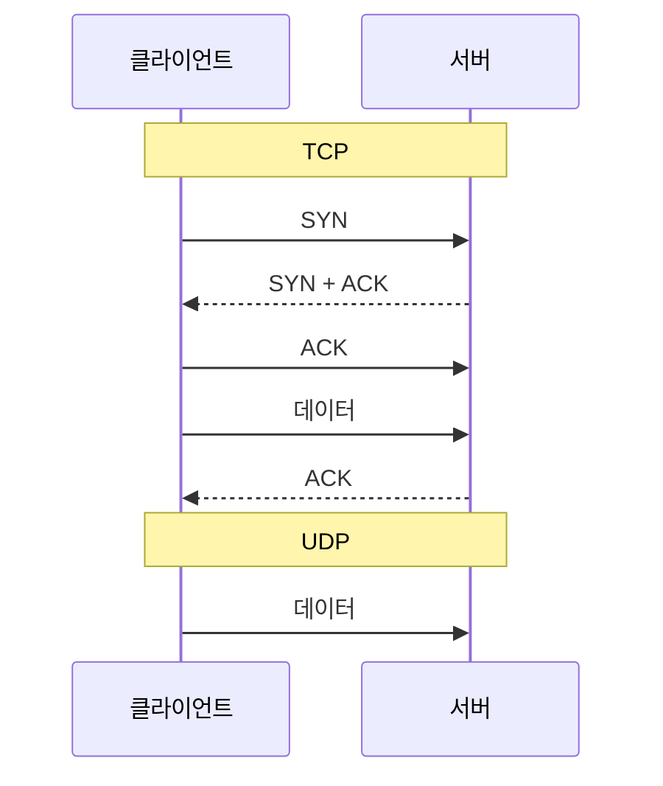

## UDP란 ?
- 연결을 맺지 않고 데이터를 한 통씩 바로 보내는 전송 계층 프로토콜
- 해 주는 일은 포트 번호로 받을 프로그램을 가려 주는 것과 체크섬으로 망가진 데이터를 걸러 내는 것 두 가지뿐이다. 도착 확인, 재전송, 순서 맞추기는 하지 않는다
- 그래서 빠르고 단순하며, 더 필요한 장치는 UDP를 쓰는 응용 프로그램이 직접 만든다. TCP와의 기본 비교는 [소켓](../소켓(Socket)/README.md#tcp-소켓과-udp-소켓) 문서에 정리했고, 이 문서는 그보다 자세히 본다

<br/>

## 이름 짚고 가기
### UDP (User Datagram Protocol)
User의 사전적 의미는 사용자, Datagram은 데이터와 전보(telegram)를 합친 말로 한 통씩 따로 보내는 데이터, Protocol은 약속이다.
공학적으로는 사용자 쪽 프로그램이 데이터그램을 주고받을 때 쓰는 전송 규칙을 말한다. 여기서 사용자는 사람이라기보다 응용 프로그램에 가깝다. UDP를 처음 정한 RFC 768도 UDP를 응용 프로그램이 최소한의 장치만으로 다른 프로그램에 메시지를 보내는 방법이라고 소개한다.

데이터그램이라는 이름은 [소켓](../소켓(Socket)/README.md#udp-소켓-데이터그램-소켓-datagram-socket) 문서에서, 전송 계층의 데이터 단위로서의 데이터그램은 [계층 모델](../계층%20모델(OSI%20and%20TCP-IP%20Layers)/README.md#데이터-단위의-이름) 문서에서 다뤘다. UDP는 계층 모델의 전송 계층에 놓이고, IP 헤더의 프로토콜 칸에는 UDP를 뜻하는 17이 들어간다(RFC 768 Protocol Number).

<br/>

## 연결 없이 보낸다는 것
### 비연결형 (Connectionless)
사전적 의미는 연결(connection)이 없는(less) 것이다.
공학적으로는 데이터를 보내기 전에 상대와 연결을 맺는 절차가 없는 통신 방식을 말한다. 보내는 쪽은 받는 쪽 IP 주소와 포트 번호만 적어서 바로 보낸다. 받는 쪽이 준비돼 있는지 미리 묻지 않는다.

소켓 문서의 비유대로 편지와 같다. 편지를 부치기 전에 상대에게 전화해서 받을 준비가 됐는지 확인하지 않는다. 봉투에 주소를 적어 우체통에 넣으면 끝이다.

TCP는 데이터를 보내기 전에 [3-way handshake](../TCP%20연결%20과정(TCP%20Handshake)/README.md#연결-맺기-3-way-handshake)로 연결부터 맺는다. 아래 그림처럼 UDP는 그 단계 없이 첫 메시지부터 데이터를 싣는다.



### 왜 연결 없이 보낼까
연결을 맺는 데는 시간과 기억할 거리가 든다. TCP는 데이터를 보내기 전에 한 번 왕복해야 하고, 연결마다 순서 번호와 상태를 기억해 둬야 한다.

질문 하나에 답 하나로 끝나는 통신이라면 이 준비가 배보다 배꼽이 크다. 짧은 질문 하나를 보내려고 매번 인사부터 나누는 셈이다. UDP는 연결을 맺고 끊는 비용이 없고 양쪽이 기억할 상태도 적다. UDP 사용 지침인 RFC 8085는 1절에서 이 점을 UDP가 어떤 응용 프로그램에는 아주 효율적인 전송이 될 수 있는 이유로 든다.

<br/>

## UDP가 해 주는 것
### 포트로 받을 프로그램 구분하기
IP 주소는 컴퓨터까지만 데려다준다. 그 컴퓨터 안의 어느 프로그램이 받을지는 [포트](../소켓(Socket)/README.md#포트-port) 번호로 정한다. UDP 헤더에는 보내는 프로그램의 포트와 받는 프로그램의 포트가 들어 있어서, 운영체제는 받는 포트 번호를 보고 그 포트를 열어 둔 프로그램에게 데이터그램을 넘긴다.

소켓 문서의 비유로는 회사 대표 번호(IP 주소)로 회사까지 가고, 내선 번호(포트 번호)로 누구와 통화할지 정해지는 것과 같다.

같은 번호라도 TCP 포트와 UDP 포트는 따로 세므로 서로 부딪히지 않는다. DNS가 TCP 53번과 UDP 53번을 함께 쓰는 것이 그 예다.

### 체크섬 (Checksum)
사전적 의미는 확인(check)하기 위한 합계(sum)다.
공학적으로는 보내는 쪽이 데이터를 일정한 규칙으로 더한 값을 헤더에 적어 두고, 받는 쪽이 같은 계산을 다시 해서 값이 다르면 데이터가 오는 길에 망가졌다고 판단하는 장치를 말한다. UDP는 16비트 단위로 1의 보수(one's complement) 방식의 덧셈을 하고, 그 결과의 비트를 모두 뒤집은 값을 체크섬으로 쓴다(RFC 768 Fields). 계산 방법은 TODO로 남긴다.

영수증 맨 아래 적힌 합계와 같다. 받는 사람이 품목 값을 다시 더해 봤는데 합계와 다르면 어딘가 잘못 적혔다는 걸 안다.

UDP 체크섬에는 UDP 헤더와 데이터뿐 아니라 IP 헤더의 보내는 주소, 받는 주소, 프로토콜 번호와 UDP 길이를 모은 의사 헤더(Pseudo Header)도 들어간다. RFC 768은 이것이 엉뚱한 곳으로 잘못 배달된 데이터그램을 막아 준다고 설명한다. 오는 길에 주소가 망가져 엉뚱한 컴퓨터에 닿으면, 보낸 쪽이 계산에 쓴 주소와 받은 쪽이 쓰는 주소가 달라 값이 맞지 않는다.

체크섬이 틀린 데이터그램은 받는 쪽 UDP가 아무 알림 없이 버린다(RFC 1122 4.1.3.4절). 고쳐 주지도, 다시 보내 달라고 하지도 않는다. 체크섬은 망가진 것을 걸러 낼 뿐 되살리지는 않는다.

IPv4에서는 체크섬이 선택 사항이다. 보내는 쪽이 계산하지 않았으면 체크섬 칸에 0을 넣는다(RFC 768 Fields). 다만 RFC 1122 4.1.3.4절은 기본값을 계산하는 쪽으로 두라고 정한다. IPv6에서는 계산이 기본으로 필수이고, 체크섬이 0인 UDP 패킷은 받는 쪽이 버린다(RFC 8200 8.1절). 같은 절은 IPv6 헤더가 IPv4 헤더와 달리 인터넷 계층의 체크섬으로 보호되지 않는다고 적는다. 이 설명은 ICMP 체크섬을 바꾼 이유로 나온 것이고, UDP 체크섬이 필수가 된 것도 같은 맥락으로 보이지만 RFC 8200이 UDP에 대해 직접 밝힌 이유는 아니다(확인 필요).

<br/>

## UDP가 해 주지 않는 것
아래 일들은 TCP가 해 주지만 UDP는 하지 않는다. RFC 8085 3.3절은 UDP가 잃어버린 패킷을 다시 보내지 않는다는 점이 오히려 UDP를 고르는 주된 이유인 경우가 많다고 적고 있다. 필요 없는 장치를 빼고 싶을 때 UDP를 쓴다는 뜻이다.

### 도착 확인과 재전송
보낸 데이터그램이 도착했는지 UDP는 알려 주지 않는다. 받는 쪽이 받았다는 신호(ACK)를 보내지 않고, 보내는 쪽도 기다리지 않는다. 오는 길에 사라져도 아무도 모르고, 당연히 다시 보내지도 않는다.

편지를 부친 뒤 우체국이 배달됐다고 알려 주지 않는 것과 같다. 수령 확인을 받고 싶으면 받는 사람에게 답장을 달라고 직접 부탁해야 한다.

### 순서 맞추기와 중복 거르기
1번, 2번, 3번 순서로 보내도 3번, 1번, 2번 순서로 도착할 수 있다. 데이터그램마다 다른 길로 갈 수 있고, 어떤 길은 더 느리기 때문이다. UDP 헤더에는 순서 번호가 없어서 받는 쪽 UDP는 순서가 바뀌었는지조차 모른다. 같은 데이터그램이 두 번 도착할 수도 있는데 이것도 거르지 않는다(RFC 8085 3.3절).

### 흐름 제어 (Flow Control)
흐름(flow)을 조절(control)한다는 뜻이다. 공학적으로는 받는 쪽이 처리할 수 있는 만큼만 보내도록 보내는 속도를 맞추는 일을 말한다. TCP는 받는 쪽이 아직 비어 있는 공간이 얼마인지 알려 주고, 보내는 쪽은 그만큼만 보낸다. UDP에는 이런 장치가 없어서 받는 쪽이 감당하지 못하면 넘친 데이터그램은 버려진다.

### 혼잡 제어 (Congestion Control)
혼잡(congestion)은 길이 막혀 붐비는 상태다. 공학적으로는 받는 쪽이 아니라 그 사이의 네트워크가 붐비지 않도록 보내는 속도를 줄이는 일을 말한다. 흐름 제어가 받는 사람이 다 먹을 수 있을 만큼만 접시에 담는 일이라면, 혼잡 제어는 도로가 막히면 출발하는 차를 줄이는 일이다. TCP가 이 둘을 어떻게 하는지는 [흐름 제어와 혼잡 제어](../흐름%20제어와%20혼잡%20제어(Flow%20and%20Congestion%20Control)/README.md) 노트에 정리했다.

UDP는 혼잡 제어를 하지 않는다. RFC 8085 1절은 UDP 응용 프로그램이 장치가 낼 수 있는 최대 속도로 보낼 수 있고, 이것이 경로를 막히게 만들 수 있다고 지적한다. 그래서 같은 문서 3.1절은 혼잡 제어가 있는 전송 프로토콜을 쓰지 않는다면 응용 프로그램이 직접 보내는 속도를 조절해야 한다(SHOULD)고 권한다. RFC는 꼭 지켜야 하는 것을 MUST, 특별한 이유가 없으면 따라야 하는 것을 SHOULD처럼 정해진 낱말로 구분해 적는다(RFC 2119). 이 문서의 괄호 속 영어 낱말이 그 표시다.

<br/>

## 헤더가 8바이트로 단순한 이유
UDP 헤더는 2바이트짜리 칸 네 개, 모두 8바이트다(RFC 768 Format).

```text
 0      7 8     15 16    23 24    31
+--------+--------+--------+--------+
|  Source Port    |Destination Port |
+--------+--------+--------+--------+
|     Length      |    Checksum     |
+--------+--------+--------+--------+
|            데이터 ...
+---------------- ...
```

- 보내는 포트(Source Port)는 답장을 보낼 곳이다. 답장이 필요 없으면 0을 넣어도 된다(RFC 768 Fields).
- 받는 포트(Destination Port)는 받는 컴퓨터 안에서 데이터그램을 넘겨받을 프로그램을 가리킨다.
- 길이(Length)는 헤더와 데이터를 합친 바이트 수다. 헤더만 8바이트이므로 가장 작은 값은 8이다.
- 체크섬(Checksum)은 위에서 본 망가짐 검사 값이다.

TCP 헤더는 옵션을 빼고도 20바이트이고, 순서 번호, 확인 번호, 플래그, 받는 쪽 여유 공간(윈도우) 같은 칸이 더 있다(RFC 9293 3.1절의 헤더 그림). 이 칸들은 모두 TCP가 하는 일, 곧 순서 맞추기, 도착 확인, 연결 관리, 흐름 제어를 위해 있다. UDP는 그 일을 하지 않으니 그 칸도 필요 없다. 헤더가 짧은 것은 아껴서가 아니라 UDP가 하는 일이 포트 구분과 체크섬뿐이기 때문이다.

봉투에 받는 곳과 보내는 곳의 포트, 무게, 검산 값만 적은 편지와 같다. 쪽 번호나 수령 확인란 같은 것은 없다.

길이 칸이 16비트이므로 헤더 기준 최댓값은 65535바이트다. 다만 실제로 한 번에 실을 수 있는 양은 그 아래 IP 쪽 제한 때문에 이보다 작다. 또 데이터그램이 경로의 최대 전송 크기(MTU, Maximum Transmission Unit)를 넘으면 IP가 여러 조각으로 나눠 보내는데, 조각 하나만 잃어도 데이터그램 전체를 잃는다. 그래서 RFC 8085 3.2절은 MTU를 넘는 UDP 데이터그램을 보내지 말라(SHOULD NOT)고 권한다. 조각내기는 TODO로 남긴다.

<br/>

## 데이터그램 경계가 지켜진다
### 경계 (Boundary)
사전적 의미는 사물이 서로 나뉘는 한계, 곧 어디까지가 하나인지 가르는 선이다.
공학적으로는 보낸 데이터 덩어리 하나가 어디서 시작해 어디서 끝나는지를 말한다.

UDP는 보내는 쪽이 한 번 보낸 것이 받는 쪽에서도 한 번에, 한 덩어리로 나온다. 세 번 보내면 세 번 받는다. 데이터그램 하나가 통째로 오거나 통째로 사라지지, 반쪽만 오거나 두 통이 하나로 붙어 오지 않는다.

TCP는 다르다. TCP는 데이터를 끊김 없는 바이트의 흐름(스트림)으로 다룬다. RFC 9293 3.7절은 TCP 세그먼트가 응용 프로그램의 쓰기 호출과 흔히 일대일로 대응하지 않고, TCP는 주고받는 세그먼트의 경계와 응용 프로그램이 읽고 쓰는 단위의 경계 사이에 아무 관계도 보장하지 않는다고 밝힌다. 세 번 나눠 써도 받는 쪽은 한 번에 붙은 채로 읽을 수 있고, 반대로 한 번에 쓴 것이 여러 번에 나눠 읽힐 수도 있다.

편지 세 통을 부치면 받는 사람도 봉투 세 개를 받는다. 반면 소켓 문서에서 스트림의 뜻을 시냇물이라고 했듯, TCP는 물을 세 번 나눠 부어도 반대편에서는 그냥 이어진 물이 나온다. 그래서 TCP로 메시지를 주고받는 프로그램은 메시지마다 길이를 앞에 붙이거나 줄바꿈 같은 구분 기호를 넣어 경계를 직접 표시한다. 아래 [코드로 보기](#경계가-지켜지는지-보기)에서 직접 확인한다.

<br/>

## 잃어버림과 순서 뒤바뀜은 응용 프로그램이 다룬다
UDP가 도착과 순서를 보장하지 않는다고 해서 UDP를 쓰는 프로그램이 모두 잃어버림을 견디는 것은 아니다. 필요한 만큼의 장치를 UDP 위의 응용 프로그램이 직접 만든다. RFC 8085 3.3절도 믿을 만한 전달이 필요한 응용 프로그램은 알맞은 장치를 스스로 갖춰야 하고(MUST), 순서가 필요하면 순서도 스스로 다시 맞춰야 한다(MUST)고 정한다.

[게임 관점 노트](../../클라이언트-서버%20구조%20게임%20관점(Game)/README.md#데이터를-어떻게-보낼까)에서 UDP를 스포츠 생중계에 비유했다. 놓친 장면은 다시 보여 주지 않고 지금 장면을 계속 보낸다. 다만 게임 노트에서 말했듯 아이템 획득처럼 꼭 전달돼야 하는 정보는 응용 프로그램이 직접 확인하고 다시 보낸다. 아래 두 방법이 그 장치다.

### 순서 번호 붙이기
보내는 쪽이 메시지마다 1, 2, 3처럼 [순서 번호](../TCP%20연결%20과정(TCP%20Handshake)/README.md#순서-번호-sequence-number)를 붙인다. TCP가 헤더에 넣는 순서 번호를 응용 프로그램이 데이터 안에 직접 넣는 셈이다. 받는 쪽은 이 번호로 두 가지를 안다.

- 순서가 바뀌었는지. 5번을 받은 뒤에 2번이 오면 2번은 늦게 온 옛 소식이다.
- 빠진 것이 있는지. 3번 다음에 5번이 오면 4번이 빠졌다.

알고 나서 어떻게 할지는 데이터의 성격에 따라 다르다. 캐릭터 위치처럼 최신 값만 중요한 데이터라면 늦게 온 옛 번호는 그냥 버리고, 빠진 번호도 다시 달라고 하지 않는다. 다음 위치가 곧 오기 때문이다.

### 필요한 것만 다시 보내기
아이템 획득처럼 빠지면 안 되는 메시지만 골라 도착 확인을 받는다. 받는 쪽은 받았다는 답(ACK)을 보내고, 보내는 쪽은 정해 둔 시간 안에 답이 오지 않으면 같은 메시지를 다시 보낸다. 다시 보낸 메시지와 원래 메시지가 둘 다 도착할 수도 있으므로, 받는 쪽은 번호를 보고 이미 처리한 것은 한 번 더 처리하지 않는다.

모든 메시지에 이걸 하면 TCP가 하는 일의 일부를 다시 만드는 셈이 된다. 꼭 필요한 메시지에만 하기 때문에 나머지는 기다리지 않고 빠르게 흘려보낼 수 있다. RFC 8085 3.3절은 다시 보내는 것도 네트워크를 붐비게 할 수 있으니 혼잡 제어를 함께 해야 하고, 믿을 만하고 순서가 맞는 전달이 모두 필요하다면 이런 장치를 직접 만들기보다 TCP 같은 표준 전송 프로토콜을 고르라(SHOULD)고 권한다.

DNS도 잃어버림과 순서 뒤바뀜을 응용 프로그램 쪽에서 다룬다. 순서 번호로 골라 보내는 대신 질의를 통째로 다시 보낸다. RFC 1035 4.2.1절은 UDP로 보낸 질의가 사라질 수 있으니 다시 보내는 방법이 필요하고, 질의와 응답의 순서가 바뀔 수 있으니 순서에 기대지 말라고 적고 있다.

<br/>

## 어디에 쓰나
### DNS
[DNS](../DNS(Domain%20Name%20System)/README.md)는 도메인 이름에 해당하는 IP 주소를 묻는다. 질문 하나, 답 하나로 끝나는 짧은 통신이라 연결을 맺는 비용을 아끼는 UDP가 잘 맞는다. RFC 1035 4.2.1절은 UDP 53번 포트를 쓰고, 일반 질의에는 UDP를 권한다고 정한다. 같은 절은 UDP로 보내는 DNS 메시지의 크기도 제한한다. 제한을 넘는 응답을 어떻게 다루는지는 TODO로 남긴다.

### DHCP
[DHCP](../DHCP(Dynamic%20Host%20Configuration%20Protocol)/README.md)는 처음 네트워크에 붙은 장치에 IP 주소를 나눠 준다. 서버는 67번, 클라이언트는 68번 UDP 포트를 쓴다(RFC 2131 4.1절). 아직 자기 IP 주소도 없고 서버 주소도 모르는 장치는 같은 네트워크의 모두에게 한꺼번에 보내는 브로드캐스트로 말을 건다. TCP 연결은 정해진 상대 한 명과 맺는 것이라 브로드캐스트에 쓸 수 없고, 연결 없이 보내는 UDP는 쓸 수 있다.

### 실시간 게임, 음성 통화와 영상 통화
게임의 캐릭터 위치나 통화의 목소리는 조금 늦게 정확히 오는 것보다 지금 오는 것이 중요하다. 0.1초 전 목소리를 다시 받으려고 지금 목소리를 멈추면 대화가 끊긴다. 그래서 조금 빠지더라도 기다리지 않는 UDP를 쓴다. 게임은 꼭 필요한 정보만 위에서 본 방식으로 다시 보낸다. 통화는 빠진 소리를 다시 받기보다 넘기는 쪽이 많은 것으로 알려져 있지만, 구체적인 방식은 TODO의 실시간 전송 프로토콜에서 확인한다(확인 필요). 게임에서의 쓰임은 [게임 관점 노트](../../클라이언트-서버%20구조%20게임%20관점(Game)/README.md#데이터를-어떻게-보낼까)에 정리했다.

### QUIC과 HTTP/3
QUIC은 HTTP/3 아래에서 TCP 대신 쓰는 전송 프로토콜이다. QUIC은 도착 확인, 재전송, 순서 맞추기, 혼잡 제어를 스스로 하면서 그 아래로는 UDP를 쓴다. 자세한 내용은 [HTTP 버전](../../WEB/HTTP%20버전(HTTP%20Versions)/README.md#quic) 문서에 정리했다.

TCP가 하는 일을 다 할 거라면 왜 UDP 위에 얹었을까. RFC 9000 1절은 QUIC 패킷을 UDP 데이터그램에 싣는 이유를 기존 시스템과 네트워크에 더 쉽게 펼치기 위해서라고 설명한다. RFC 8085 3절도 인터넷 중간 장비 중에는 TCP와 UDP만 통과시키는 것이 있어서, 새 프로토콜 번호를 쓰는 전송 프로토콜은 퍼지기 어렵다고 적는다. UDP는 포트 구분과 체크섬만 해 주고 나머지는 비워 두니, 그 빈자리에 새 전송 방식을 직접 채우기 좋다.

<br/>

## TCP와 짧게 비교
TCP는 연결을 맺고, 도착과 순서를 보장하고, 받는 쪽과 네트워크의 사정에 맞춰 속도를 조절한다. 그 대가로 연결을 맺는 시간이 들고, 하나가 빠지면 뒤에 온 데이터도 기다린다. UDP는 이 모두를 하지 않는 대신 바로 보내고 기다리지 않으며, 한 번 보낸 덩어리의 경계가 그대로 지켜진다. 전화와 편지 비유로 정리한 기본 비교는 [소켓](../소켓(Socket)/README.md#tcp-소켓과-udp-소켓) 문서를 본다.

<br/>

## 코드로 보기
Node.js에는 UDP 소켓을 다루는 내장 모듈 `node:dgram` 이 있다. 이름의 dgram은 datagram을 줄인 것이다. 아래 예시는 모두 2026-10-26에 Node.js v24.22.1, 윈도우 11 Pro(10.0.26200)에서 실행했다. 주소는 내 컴퓨터 자신을 뜻하는 127.0.0.1만 썼다. 보내는 쪽 포트 번호는 운영체제가 임시로 골라 주므로 실행할 때마다 달라진다.

### 보내고 받기
서버 소켓을 41234번 포트에 묶고(bind), 클라이언트 소켓이 메시지 하나를 보낸다. 서버는 받은 메시지에 답장을 보낸다.

```js
const dgram = require('node:dgram');

const server = dgram.createSocket('udp4');
const client = dgram.createSocket('udp4');

server.on('message', (msg, rinfo) => {
  console.log(`[서버] ${rinfo.address}:${rinfo.port} 에서 ${rinfo.size}바이트: ${msg}`);
  server.send(`받음: ${msg}`, rinfo.port, rinfo.address);
});

client.on('message', (msg) => {
  console.log(`[클라이언트] ${msg}`);
  client.close();
  server.close();
});

server.bind(41234, '127.0.0.1', () => {
  console.log('[서버] 41234번 포트에서 기다리는 중');
  client.send('안녕', 41234, '127.0.0.1');
});
```

```text
[서버] 41234번 포트에서 기다리는 중
[서버] 127.0.0.1:55467 에서 6바이트: 안녕
[클라이언트] 받음: 안녕
```

[소켓](../소켓(Socket)/README.md#서버가-연결을-받는-과정) 문서의 TCP 서버와 비교하면 listen과 accept가 없고, 연결을 맺는 connect도 부르지 않는다(dgram에도 connect가 있지만 뜻이 다르다. 아래에서 본다). 서버는 포트에 묶고 기다리기만 하고, 클라이언트는 send를 부를 때마다 받는 주소와 포트를 적는다. 서버는 메시지와 함께 온 보낸 곳 정보(rinfo)를 보고 그쪽으로 답장한다. 안녕은 UTF-8로 한 글자에 3바이트라 6바이트로 나왔다.

### 경계가 지켜지는지 보기
같은 세 메시지 A, BB, CCC를 UDP로 세 번 보내고, TCP로도 세 번 써 본다.

```js
const dgram = require('node:dgram');
const net = require('node:net');

// UDP: send를 세 번 부른다
function udp() {
  return new Promise((done) => {
    const server = dgram.createSocket('udp4');
    const client = dgram.createSocket('udp4');
    let count = 0;
    server.on('message', (msg) => {
      console.log(`UDP 받은 덩어리 ${++count}: ${msg}`);
      if (count === 3) {
        client.close();
        server.close(done);
      }
    });
    server.bind(41235, '127.0.0.1', () => {
      for (const m of ['A', 'BB', 'CCC']) client.send(m, 41235, '127.0.0.1');
    });
  });
}

// TCP: write를 세 번 부른다
function tcp() {
  return new Promise((done) => {
    let count = 0;
    const server = net.createServer((sock) => {
      sock.on('data', (data) => console.log(`TCP 받은 덩어리 ${++count}: ${data}`));
      sock.on('end', () => server.close(done));
    });
    server.listen(41236, '127.0.0.1', () => {
      const client = net.connect(41236, '127.0.0.1', () => {
        for (const m of ['A', 'BB', 'CCC']) client.write(m);
        client.end();
      });
    });
  });
}

udp().then(tcp);
```

```text
UDP 받은 덩어리 1: A
UDP 받은 덩어리 2: BB
UDP 받은 덩어리 3: CCC
TCP 받은 덩어리 1: ABBCCC
```

세 번 실행해 세 번 모두 같은 결과가 나왔다. UDP는 보낸 대로 세 덩어리로 받았고, TCP는 세 번 쓴 것이 한 덩어리로 붙어서 왔다. TCP가 언제나 이렇게 붙여 준다는 뜻은 아니다. 데이터 양과 타이밍에 따라 나뉘어 올 수도 있다. TCP는 경계를 보장하지 않는다는 것이 요점이다.

### 서버가 없어도 보내기는 끝난다
41237번 포트에는 아무 서버도 띄우지 않고 UDP로 보내 본다. 비교를 위해 같은 포트로 TCP 연결도 시도한다.

```js
const dgram = require('node:dgram');
const net = require('node:net');

// 41237번 포트에는 아무 서버도 띄우지 않았다
const client = dgram.createSocket('udp4');
client.on('error', (err) => console.log('UDP error 이벤트:', err.code));
client.on('message', (msg) => console.log('UDP 받은 것:', msg.toString()));

client.send('듣고 있나요?', 41237, '127.0.0.1', (err) => {
  console.log('UDP send 콜백 err:', err);
  // 1초 동안 무슨 일이 생기는지 지켜본 뒤 닫는다
  setTimeout(() => {
    client.close();
    console.log('UDP 1초 동안 아무 소식 없음, 소켓 닫음');

    // 같은 일을 TCP로 해 본다
    const sock = net.connect(41237, '127.0.0.1');
    sock.on('connect', () => console.log('TCP 연결됨'));
    sock.on('error', (e) => console.log('TCP error 이벤트:', e.code));
  }, 1000);
});
```

```text
UDP send 콜백 err: null
UDP 1초 동안 아무 소식 없음, 소켓 닫음
TCP error 이벤트: ECONNREFUSED
```

UDP의 send는 오류 없이(err가 null) 끝났다. send 콜백이 알려 주는 것은 내 쪽에서 보내기를 마쳤다는 것까지이고, 상대가 받았다는 뜻이 아니다. send만 봐서는 받는 프로그램이 있는지 알 수 없다. 알 길이 있다면 아래의 ICMP 알림뿐이다. 반면 TCP는 연결부터 맺어야 하므로 받는 쪽이 없으면 연결 거부(ECONNREFUSED) 오류가 바로 난다.

받을 프로그램이 없는 UDP 포트로 데이터그램이 오면, 받는 컴퓨터는 ICMP(Internet Control Message Protocol, 전달 중 생긴 오류를 알리는 프로토콜)로 그 포트에 닿을 수 없다(Port Unreachable)는 메시지를 돌려보내는 것이 좋다(SHOULD)고 RFC 1122 4.1.3.1절은 정한다. 같은 문서 4.1.3.3절은 UDP가 받은 ICMP 오류를 응용 프로그램에 넘기라고 정하지만, 이 오류는 send와 따로 늦게 도착하고 응용 프로그램이 어떻게 받는지는 운영체제와 API마다 다르다. 이 PC에서는 1초를 기다려도 error 이벤트가 오지 않았다. 다른 운영체제에서 결과가 어떻게 다른지는 확인하지 못했다(확인 필요).

dgram 소켓에도 connect가 있지만 TCP의 connect와 다르다. 앞으로 보낼 상대 주소를 정해 두고 그 상대가 보낸 것만 받도록 걸러 둘 뿐, 상대에게 아무것도 묻지 않는다. 걸러 두는 동작은 이 PC에서 connect한 소켓에 다른 소켓이 보낸 것이 들어오지 않는 것으로 확인했다.

```js
const dgram = require('node:dgram');

const client = dgram.createSocket('udp4');
client.on('error', (err) => console.log('error 이벤트:', err.code));
client.on('message', (msg) => console.log('받은 것:', msg.toString()));

// connect는 상대 주소를 정해 둘 뿐 핸드셰이크를 하지 않는다
client.connect(41237, '127.0.0.1', () => {
  console.log('connect 콜백 호출됨');
  client.send('듣고 있나요?', (err) => {
    console.log('send 콜백 err:', err);
    setTimeout(() => {
      client.send('한 번 더', (err2) => console.log('두 번째 send 콜백 err:', err2 && err2.code));
      setTimeout(() => { client.close(); console.log('소켓 닫음'); }, 1000);
    }, 500);
  });
});
```

```text
connect 콜백 호출됨
send 콜백 err: null
두 번째 send 콜백 err: null
소켓 닫음
```

서버가 없는데도 connect가 성공했다. 핸드셰이크 없이 주소만 정해 두었기 때문이다. 이 PC에서는 두 번 보내는 동안에도 오류가 오지 않았다.

### 순서 번호와 다시 보내기 흉내 내기
내 컴퓨터 안(127.0.0.1)에서는 데이터그램이 거의 사라지지 않는다. 그래서 보내는 쪽 함수에서 잃어버림과 늦은 도착을 일부러 흉내 냈다. 위치 메시지 5개를 50ms 간격으로 보내는데 4번은 버리고 2번은 120ms 늦게 보낸다. 그다음 아이템 메시지를 보내는데 처음 한 번은 버린다.

```js
const dgram = require('node:dgram');

const PORT = 41238;
const receiver = dgram.createSocket('udp4');
const sender = dgram.createSocket('udp4');

// 내 컴퓨터 안에서는 거의 잃어버리지 않으므로, 보내는 쪽에서 일부러 흉내 낸다
const dropOnce = new Set(['pos-4', 'item-1']); // 처음 한 번은 버린다
const delayed = { 'pos-2': 120 };              // 120ms 늦게 보낸다

function send(obj) {
  const key = `${obj.type}-${obj.seq}`;
  if (dropOnce.has(key)) {
    dropOnce.delete(key);
    console.log(`  (네트워크) ${key} 잃어버림`);
    return;
  }
  const data = JSON.stringify(obj);
  setTimeout(() => sender.send(data, PORT, '127.0.0.1'), delayed[key] || 0);
}

// 받는 쪽
let lastPos = 0;
const gotItems = new Set();
receiver.on('message', (msg, rinfo) => {
  const m = JSON.parse(msg);
  if (m.type === 'pos') {
    if (m.seq <= lastPos) {
      console.log(`[받는 쪽] 위치 ${m.seq}번은 ${lastPos}번보다 옛것이라 버림`);
      return;
    }
    lastPos = m.seq;
    console.log(`[받는 쪽] 위치 ${m.seq}번 반영: x = ${m.x}`);
  } else if (m.type === 'item') {
    receiver.send(JSON.stringify({ type: 'ack', seq: m.seq }), rinfo.port, rinfo.address);
    if (gotItems.has(m.seq)) return; // 같은 것이 두 번 와도 한 번만 처리
    gotItems.add(m.seq);
    console.log(`[받는 쪽] 아이템 ${m.seq}번 획득 처리, 확인 응답 보냄`);
  }
});

// 보내는 쪽
const waiting = new Map(); // 확인을 기다리는 중요한 메시지
sender.on('message', (msg) => {
  const m = JSON.parse(msg);
  console.log(`[보내는 쪽] 아이템 ${m.seq}번 확인 받음`);
  clearTimeout(waiting.get(m.seq));
  waiting.delete(m.seq);
  if (waiting.size === 0) setTimeout(() => { sender.close(); receiver.close(); }, 300);
});

function sendItem(seq) {
  console.log(`[보내는 쪽] 아이템 ${seq}번 보냄`);
  send({ type: 'item', seq });
  // 200ms 안에 확인이 없으면 다시 보낸다
  waiting.set(seq, setTimeout(() => sendItem(seq), 200));
}

receiver.bind(PORT, '127.0.0.1', () => {
  sender.bind(() => {
    for (let seq = 1; seq <= 5; seq++) {
      setTimeout(() => send({ type: 'pos', seq, x: seq * 10 }), seq * 50);
    }
    setTimeout(() => sendItem(1), 300);
  });
});
```

```text
[받는 쪽] 위치 1번 반영: x = 10
[받는 쪽] 위치 3번 반영: x = 30
  (네트워크) pos-4 잃어버림
[받는 쪽] 위치 2번은 3번보다 옛것이라 버림
[받는 쪽] 위치 5번 반영: x = 50
[보내는 쪽] 아이템 1번 보냄
  (네트워크) item-1 잃어버림
[보내는 쪽] 아이템 1번 보냄
[받는 쪽] 아이템 1번 획득 처리, 확인 응답 보냄
[보내는 쪽] 아이템 1번 확인 받음
```

여섯 번 실행해 여섯 번 모두 위와 같았다. 위치 메시지는 순서 번호로 늦게 온 2번을 옛것으로 알아보고 버렸고, 사라진 4번은 다시 달라고 하지 않았다. 곧 5번이 와서 최신 위치가 맞춰졌기 때문이다. 아이템 메시지는 확인 응답이 200ms 안에 오지 않자 다시 보냈고, 두 번째에 도착해 확인을 받았다. 받는 쪽의 gotItems는 같은 아이템이 두 번 도착해도 한 번만 처리하게 막는다.

이 예시는 원리를 보이려고 줄인 것이다. 실제 프로그램이라면 다시 보내는 횟수에 한도를 두고, 네트워크 상태에 맞춰 기다리는 시간과 보내는 속도를 조절해야 한다.

<br/>

## 참고 자료
- RFC 768, [User Datagram Protocol](https://www.rfc-editor.org/rfc/rfc768.html) (1980년 8월). 번호 붙은 절이 없어 Format, Fields 같은 소제목으로 적었다
- RFC 1122, [Requirements for Internet Hosts](https://www.rfc-editor.org/rfc/rfc1122.html) 4.1.3.1, 4.1.3.3, 4.1.3.4절
- RFC 8085, [UDP Usage Guidelines](https://www.rfc-editor.org/rfc/rfc8085.html) 1, 3, 3.1, 3.2, 3.3절
- RFC 8200, [IPv6 Specification](https://www.rfc-editor.org/rfc/rfc8200.html) 8.1절
- RFC 9293, [TCP](https://www.rfc-editor.org/rfc/rfc9293.html) 3.1, 3.7절
- RFC 1035, [Domain Names, Implementation and Specification](https://www.rfc-editor.org/rfc/rfc1035.html) 4.2.1절
- RFC 2131, [DHCP](https://www.rfc-editor.org/rfc/rfc2131.html) 4.1절
- RFC 9000, [QUIC](https://www.rfc-editor.org/rfc/rfc9000.html) 1절
- RFC 2119, [Key words for use in RFCs to Indicate Requirement Levels](https://www.rfc-editor.org/rfc/rfc2119.html) 1, 3절 (MUST, SHOULD의 뜻)
- Node.js `node:dgram` 의 동작은 위 실행 결과로만 확인했다. 운영체제마다 다를 수 있는 ICMP 오류 전달은 확인 필요

<br/>

## 더 볼 것 (TODO)
- 체크섬을 손으로 계산해 보기 (1의 보수 덧셈, 의사 헤더)
- IP 조각내기와 MTU, 경로 MTU 찾기
- 브로드캐스트와 멀티캐스트
- 운영체제마다 ICMP 오류를 UDP 응용 프로그램에 알려 주는 방식의 차이
- TCP 위에서 메시지 경계를 직접 표시하는 방법 (길이 붙이기, 구분 기호)
- UDP 응용 프로그램의 혼잡 제어 (RFC 8085 3.1절 자세히)
- DNS의 UDP 메시지 크기 제한(RFC 1035는 512바이트), 잘림 표시(TC 비트, truncated), 이후 확장과 TCP로 다시 묻기
- 음성, 영상 통화에 쓰는 실시간 전송 프로토콜
- UDP-Lite (체크섬 범위를 일부로 줄인 변형)
