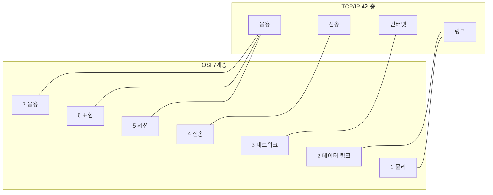
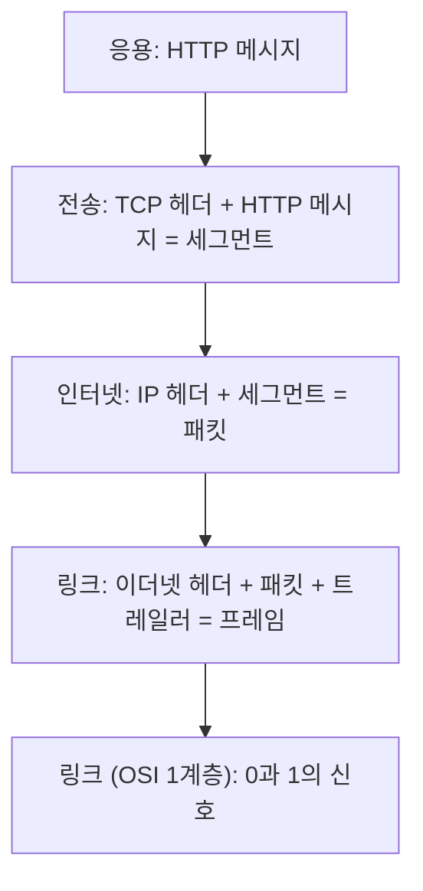
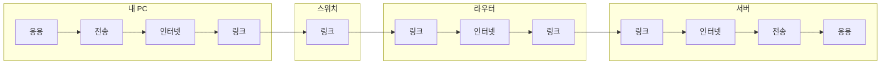
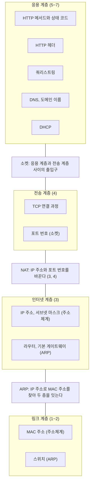

## 계층 모델이란 ?
- 네트워크 통신에 필요한 일을 역할별로 나눠 층층이 쌓아 정리한 틀
- 대표적으로 일곱 층으로 나눈 OSI 7계층과, 실제 인터넷 프로토콜을 기준으로 네 층으로 나눈 TCP/IP 4계층이 있다
- 이 폴더의 다른 노트에서 본 MAC 주소, IP 주소, 포트, TCP, HTTP가 각각 어느 층의 이야기인지 이 틀 위에 놓아 보면 전체 흐름이 한 장의 지도로 보인다

### 계층 (Layer)
사전적 의미는 층, 켜. 케이크나 지층처럼 위아래로 포개진 한 겹을 말한다.
공학적으로는 큰 일을 여러 단계로 나눴을 때 그 한 단계를 말한다. 각 계층은 바로 아래 계층이 해 주는 일을 가져다 쓰고, 자기 일을 더해 바로 위 계층에 넘긴다. 아래층이 어떻게 일하는지 몰라도 위층은 자기 일만 하면 된다는 점이 층이라는 이름에 담겨 있다.

### 모델 (Model)
사전적 의미는 본보기, 모형. 실제 건물을 작게 줄여 구조만 보여 주는 모형 같은 것이다.
공학적으로는 복잡한 대상을 이해하고 설명하기 위해 핵심 구조만 뽑아 정리한 틀이다. 계층 모델도 실제 장비나 프로그램 그 자체가 아니라, 통신 과정을 나눠 보는 기준이다.

<br/>

## 왜 계층으로 나눌까
택배를 보내는 과정을 떠올려 보자. 보내는 사람은 물건을 상자에 담아 받는 사람 주소만 적는다. 택배사는 상자를 지역 터미널로 보내고, 터미널끼리는 트럭이 옮기고, 마지막에는 기사가 집 앞까지 건넨다. 보내는 사람은 트럭이 어느 고속도로로 가는지 몰라도 되고, 트럭 기사는 상자 안에 무엇이 들었는지 몰라도 된다. 각자 맡은 일만 하고 다음 사람에게 넘긴다.

네트워크 통신도 할 일이 많다. 전기 신호나 전파로 비트를 실어 보내고, 같은 네트워크 안의 장치에 건네고, 다른 네트워크까지 길을 찾고, 빠진 데이터를 다시 보내고, 마지막에 프로그램이 알아듣는 형식으로 전달해야 한다. 이걸 한 덩어리로 만들면 어느 한 부분만 바꿔도 전체를 다시 만들어야 한다.

그래서 일을 층으로 나누고 층 사이의 약속(무엇을 받아 무엇을 넘기는지)만 정해 둔다. 이렇게 하면 세 가지가 좋아진다.

1. 한 층만 바꿀 수 있다. 유선 랜에서 와이파이로 바꿔도 아래쪽 층만 달라지고, 그 위의 TCP와 HTTP는 그대로 쓴다.
2. 서로 다른 회사가 만든 장비와 프로그램이 맞물린다. 같은 층끼리 같은 프로토콜을 따르기만 하면 된다.
3. 문제가 생겼을 때 어느 층의 문제인지 좁혀 갈 수 있다. 선이 빠졌는지(아래층), 주소가 틀렸는지(중간층), 서버 프로그램이 오류를 냈는지(위층) 나눠 볼 수 있다.

### 같은 층끼리 대화한다
계층 모델에서 데이터는 실제로는 보내는 쪽에서 아래로 내려가 선을 타고 건너간 뒤 받는 쪽에서 위로 올라간다. 그런데 각 층의 입장에서는 상대 컴퓨터의 같은 층과 대화하는 것처럼 보인다. 보내는 쪽 TCP가 적은 순서 번호는 받는 쪽 TCP만 읽고, 보내는 쪽 HTTP가 적은 메서드는 받는 쪽 HTTP만 읽는다.

택배로 치면 보내는 사람이 상자 안에 넣은 편지는 받는 사람만 읽고, 송장은 택배사 사람들만 읽는 것과 같다.

<br/>

## OSI 7계층
### OSI 참조 모델 (OSI Reference Model)
OSI는 Open Systems Interconnection의 약자다. Open은 열린, Systems는 시스템, Interconnection은 서로 잇는다는 뜻이다. Reference는 참고, 기준이다.
공학적으로는 서로 다른 회사의 시스템끼리도 통신할 수 있도록 국제 표준화 기구(ISO, International Organization for Standardization)가 정한 일곱 층짜리 기준 틀을 말한다. 특정 회사 제품에 묶이지 않고 누구에게나 열린 연결 방식을 만들자는 뜻이 이름에 담겨 있다.

아래층부터 번호를 매긴다. 1계층이 선과 신호에 가장 가깝고, 7계층이 사용자의 프로그램에 가장 가깝다.

| 번호 | 이름 | 하는 일 |
| --- | --- | --- |
| 7 | 응용 계층 (Application) | 프로그램이 주고받는 메시지의 약속 (HTTP, DNS 등) |
| 6 | 표현 계층 (Presentation) | 데이터를 어떤 형식으로 나타낼지 (문자 인코딩, 압축, 암호화 등) |
| 5 | 세션 계층 (Session) | 대화의 시작과 끝, 이어 가기를 관리 |
| 4 | 전송 계층 (Transport) | 어느 프로그램에게 줄지(포트), 빠짐없이 갈지(TCP) |
| 3 | 네트워크 계층 (Network) | 다른 네트워크까지 길 찾기 (IP 주소, 라우터) |
| 2 | 데이터 링크 계층 (Data Link) | 같은 네트워크 안의 옆 장치에 건네기 (MAC 주소, 스위치) |
| 1 | 물리 계층 (Physical) | 비트를 전기 신호, 빛, 전파로 실어 보내기 (케이블, 허브) |

### 위 세 층은 경계가 흐리다
1계층부터 4계층까지는 데이터를 상대 컴퓨터의 프로그램까지 옮기는 일이고, 5계층부터 7계층까지는 옮겨 온 데이터를 프로그램이 어떻게 쓸지에 대한 일이다.

아래 네 층은 실제 프로토콜과 잘 맞아떨어지지만, 위 세 층은 그렇지 않다. 실제로는 응용 프로그램이나 그 프로그램이 쓰는 프로토콜이 표현과 세션의 일까지 함께 맡는 경우가 많다. 예를 들어 HTTPS에서 암호화를 맡는 TLS(Transport Layer Security, 전송 계층 보안)는 이름에 전송 계층이 들어 있지만, TCP 위에서 동작해서 몇 계층으로 볼지는 책마다 다르다. 그래서 OSI 7계층은 실제 프로토콜을 하나하나 끼워 맞추는 표라기보다, 이 기능이 대략 어디쯤의 일인지 말하는 공통 언어로 쓴다.

<br/>

## TCP/IP 4계층
### TCP/IP 모델 (TCP/IP Model)
TCP/IP는 이 모델의 중심에 있는 두 프로토콜, TCP(Transmission Control Protocol)와 IP(Internet Protocol)의 이름을 붙인 것이다. 두 프로토콜만 가리키는 것이 아니라 HTTP, DNS, UDP, ARP처럼 인터넷에서 함께 쓰는 프로토콜 묶음 전체를 TCP/IP라고 부른다.
공학적으로는 실제 인터넷 프로토콜을 기준으로 통신 과정을 네 층으로 나눈 틀을 말한다. 인터넷 호스트의 요구 사항을 정한 표준 문서(RFC 1122)가 이 네 층을 응용(Application), 전송(Transport), 인터넷(Internet), 링크(Link) 계층으로 나눠 설명한다.

OSI 7계층이 먼저 칸을 정해 두고 거기에 맞는 프로토콜을 생각한 틀이라면, TCP/IP 4계층은 이미 쓰이던 인터넷 프로토콜을 정리하면서 나온 틀이다. 실제 인터넷은 TCP/IP 프로토콜로 돌아가고, OSI 7계층은 주로 설명과 분류의 기준으로 쓴다.

위에서 아래 순서로 적으면 아래와 같다.

| 이름 | 하는 일 | 대표 프로토콜 |
| --- | --- | --- |
| 응용 계층 (Application) | 프로그램끼리 주고받는 메시지 | HTTP, DNS, DHCP, SSH |
| 전송 계층 (Transport) | 프로그램 사이의 전달, 신뢰성 | TCP, UDP |
| 인터넷 계층 (Internet) | 네트워크를 넘나드는 길 찾기 | IP, ICMP |
| 링크 계층 (Link) | 같은 네트워크 안에서 건네기, 실제 신호 | 이더넷, 와이파이 |

표에 처음 나온 프로토콜 몇 가지를 짚어 둔다. SSH(Secure Shell)는 다른 컴퓨터에 암호화된 연결로 원격 접속하는 프로토콜이다. UDP(User Datagram Protocol)는 연결을 맺지 않고 바로 보내는 전송 프로토콜로, TCP와의 차이는 [소켓](../소켓(Socket)/README.md#tcp-소켓과-udp-소켓) 문서에 정리했다. ICMP(Internet Control Message Protocol)는 전달 중 생긴 오류나 상태를 알리는 프로토콜이고, [ARP](../ARP(Address%20Resolution%20Protocol)/README.md#동작-순서) 문서에서 쓴 ping이 이것을 쓴다. 자세한 내용은 [ICMP와 ping](../ICMP와%20ping(ICMP%20and%20ping)/README.md) 문서에 정리했다.

링크 계층은 책에 따라 네트워크 접근 계층(Network Access Layer), 네트워크 인터페이스 계층(Network Interface Layer)이라고도 부른다. 링크 계층을 다시 물리 계층과 데이터 링크 계층으로 나눠 5계층으로 설명하는 책도 있다. 층을 몇 개로 세는지보다 어떤 일이 어느 쪽에 있는지가 중요하다.

RFC 1122는 네 층에 번호를 매기지 않는다. 흔히 L2 스위치, L4 로드 밸런서, L7 로드 밸런서처럼 말할 때의 숫자는 OSI 7계층의 번호다. TCP/IP 모델을 쓰는 사람도 층 번호를 말할 때는 대개 OSI 번호를 쓴다. 로드 밸런서가 4계층과 7계층에서 무엇을 보고 나누는지는 [로드 밸런싱](../../로드%20밸런싱(Load%20Balancing)/README.md#무엇을-보고-나눌까-l4와-l7) 문서에 정리했다.

<br/>

## 두 모델의 대응
두 모델은 같은 통신 과정을 다르게 자른 것이다. OSI의 위 세 층(응용, 표현, 세션)은 TCP/IP에서 응용 계층 하나로 합쳐지고, OSI의 아래 두 층(데이터 링크, 물리)은 TCP/IP에서 링크 계층 하나로 합쳐진다. 가운데 전송 계층과 네트워크(인터넷) 계층은 거의 그대로 맞는다.



층마다 데이터 한 덩어리를 부르는 이름(데이터 단위)도 다르다.

| OSI | TCP/IP | 데이터 단위 |
| --- | --- | --- |
| 7 응용, 6 표현, 5 세션 | 응용 | 메시지 (Message) |
| 4 전송 | 전송 | 세그먼트 (Segment), UDP는 데이터그램 (Datagram) |
| 3 네트워크 | 인터넷 | 패킷 (Packet) |
| 2 데이터 링크 | 링크 | 프레임 (Frame) |
| 1 물리 | 링크 | 비트 (Bit) |

### 데이터 단위의 이름
- 세그먼트(Segment)의 사전적 의미는 조각, 마디다. 전송 계층이 메시지를 알맞은 크기로 잘라 TCP 헤더를 붙인 한 조각을 말한다.
- 데이터그램(Datagram)은 데이터와 전보(telegram)를 합친 말이다. 한 통씩 따로 보내는 UDP의 한 덩어리를 말한다([소켓](../소켓(Socket)/README.md#udp-소켓-데이터그램-소켓-datagram-socket) 참고).
- 패킷(Packet)의 사전적 의미는 작은 꾸러미, 소포다. 인터넷 계층에서 IP 헤더를 붙여 네트워크를 넘어 보내는 한 꾸러미를 말한다.
- 프레임(Frame)의 사전적 의미는 틀, 액자다. 링크 계층에서 앞뒤로 헤더와 꼬리를 붙여 틀에 끼운 한 덩어리를 말한다.

일상에서는 이 이름들을 엄격히 가려 쓰지 않고 통틀어 패킷이라고 부르는 일도 많다.

<br/>

## 캡슐화
### 캡슐화 (Encapsulation)
사전적 의미는 캡슐(capsule)에 넣어 감싸는 것이다. 알약 가루를 캡슐 껍질로 감싸듯 안의 것을 바깥 껍질로 싼다.
공학적으로는 데이터를 아래 계층으로 내려보낼 때마다 그 계층이 필요한 정보를 머리(헤더, Header)로 붙여 감싸는 과정을 말한다. 객체 지향 프로그래밍에서도 캡슐화라는 말을 쓰지만, 그쪽은 데이터를 숨기는 설계 원칙이고 여기서는 데이터를 겹겹이 싸는 과정이라 다른 이야기다.

편지(HTTP 메시지)를 봉투에 넣고 받는 사람 이름(포트 번호)을 적고, 봉투를 상자에 넣어 송장(IP 주소)을 붙이고, 상자에 이번 구간 트럭 번호표(MAC 주소)를 다는 것과 같다. 받는 쪽은 바깥부터 하나씩 벗긴다.

### 보낼 때
브라우저가 웹 서버에 HTTP 요청을 보내는 상황이다. 위층에서 아래층으로 내려가며 헤더가 하나씩 붙는다. 층 이름은 TCP/IP 4계층을 따른다.

1. 응용 계층에서 HTTP 요청 메시지를 만든다. 요청 줄과 HTTP 헤더, 본문으로 이루어진 글자다.
2. 전송 계층(TCP)이 메시지 앞에 TCP 헤더를 붙인다. 송신지 포트와 수신지 포트, 순서 번호, SYN이나 ACK 같은 플래그가 여기 들어간다. 이 덩어리가 세그먼트다.
3. 인터넷 계층(IP)이 그 앞에 IP 헤더를 붙인다. 송신지 IP 주소와 수신지 IP 주소가 여기 들어간다. 이 덩어리가 패킷이다.
4. 링크 계층이 그 앞에 이더넷 헤더를, 뒤에 오류 검사용 꼬리(트레일러, Trailer)를 붙인다. 이번 구간의 송신지 MAC 주소와 수신지 MAC 주소가 헤더에 들어간다. 이 덩어리가 프레임이다.
5. 링크 계층은 만든 프레임을 비트로 바꿔 전기 신호나 전파로 내보낸다. OSI로 치면 이 부분이 1계층(물리)이다.



다 감싼 모양을 한 줄로 쓰면 아래와 같다. [ARP](../ARP(Address%20Resolution%20Protocol)/README.md#데이터에-붙는-주소-정리) 문서에서 본 주소 그림에 각 주소가 어느 헤더에 들어 있는지를 더한 것이다.

```text
| 이더넷 헤더 | IP 헤더 | TCP 헤더 | HTTP 메시지 | 트레일러 |
  MAC 주소     IP 주소   포트 번호   요청 줄, HTTP 헤더, 본문   오류 검사 값
  2계층        3계층     4계층       7계층                      2계층
```

아래 계층에서 보면 위 계층의 헤더는 그냥 데이터다. TCP는 HTTP 메시지 안에 무엇이 있는지 읽지 않고, IP는 TCP 헤더를 읽지 않는다. 앞에서 말한 같은 층끼리 대화한다는 것이 이런 뜻이다.

### 받을 때
받는 쪽은 반대로 아래층에서 위층으로 올라가며 헤더를 하나씩 읽고 떼어 낸다. 이 과정을 역캡슐화(Decapsulation)라고 한다.

1. 링크 계층은 수신지 MAC 주소가 내 것이거나 브로드캐스트 주소인지 보고, 트레일러로 오류가 없는지 확인한 뒤 이더넷 헤더를 뗀다. 이더넷 헤더에는 안에 든 것이 IP 패킷인지 ARP 메시지인지 알리는 칸(타입)이 있어서, 누구에게 넘길지 안다.
2. 인터넷 계층은 수신지 IP 주소가 내 것인지 보고 IP 헤더를 뗀다. IP 헤더에도 안에 든 것이 TCP인지 UDP인지 알리는 칸(프로토콜)이 있다.
3. 전송 계층은 순서 번호로 빠진 것이 없는지 확인하고, IP 주소와 포트 번호의 조합을 보고 그 연결의 소켓에 넣는다. 조합으로 연결을 구분하는 방법은 [소켓](../소켓(Socket)/README.md#연결-하나를-구분하는-방법) 문서에 정리했다.
4. 응용 계층의 웹 서버 프로그램이 HTTP 메시지를 읽는다.

이더넷 헤더의 타입, IP 헤더의 프로토콜, TCP 헤더의 포트 번호가 각각 다음에 누구에게 넘길지 알려 준다. 그래서 받는 쪽은 겉 껍질부터 차례로 벗기면서 다음 차례를 알 수 있다.

### 중간 장비는 어디까지 벗길까
데이터는 가는 길에 스위치와 라우터를 지난다. 중간 장비는 자기 층까지만 벗겨 보고 다시 싸서 넘긴다.

- 스위치는 2계층 장비라서 이더넷 헤더의 MAC 주소만 본다. IP 헤더 안쪽은 열어 보지 않는다.
- 라우터는 3계층 장비라서 이더넷 헤더를 떼고 IP 헤더의 수신지 IP 주소를 본다. 다음에 보낼 곳을 고른 뒤, 다음 구간에 맞는 MAC 주소로 이더넷 헤더를 새로 붙여 보낸다.
- 스위치와 라우터만 놓고 보면 4계층 이상은 출발지와 목적지 컴퓨터만 벗긴다. 다만 공유기의 NAT나 L4, L7 로드 밸런서처럼 중간에서 포트 번호나 HTTP 내용까지 읽는 장비도 있다.



그래서 MAC 주소는 구간마다 바뀌고 IP 주소는 끝까지 그대로다. 라우터를 지날 때 일어나는 일은 [ARP](../ARP(Address%20Resolution%20Protocol)/README.md#라우터를-지날-때마다-바뀌는-것) 문서에 정리했다.

<br/>

## 계층별 장비와 주소
층마다 쓰는 주소가 다른 이유는 층마다 찾는 대상이 다르기 때문이다. 앞의 캡슐화 비유로 치면 송장의 최종 주소가 IP 주소, 그 집에서 누가 받을지 적은 이름이 포트 번호, 이번 구간 트럭 번호표가 MAC 주소다.

| 계층 (OSI) | 주소 | 무엇을 찾나 | 구간마다 바뀌나 | 이 주소를 보는 장비 |
| --- | --- | --- | --- | --- |
| 7 응용 | 도메인 이름 | 사람이 부르는 서버 이름 | 아니오 | 없음 (DNS가 IP 주소로 바꿔 준다) |
| 4 전송 | 포트 번호 | 컴퓨터 안의 프로그램 | 아니오 (NAT는 예외) | 출발지와 목적지 컴퓨터, L4 로드 밸런서 |
| 3 네트워크 | IP 주소 | 어느 네트워크의 어느 컴퓨터 | 아니오 (NAT는 예외) | 라우터 |
| 2 데이터 링크 | MAC 주소 | 같은 네트워크 안의 옆 장치 | 예 | 스위치 |
| 1 물리 | 없음 | 신호를 그대로 실어 나른다 | 해당 없음 | 허브, 리피터 |

- 허브(Hub)는 바퀴의 중심축이라는 뜻이다. 여러 선이 모이는 자리에서 들어온 신호를 다른 모든 포트로 그대로 내보낸다. 주소를 읽지 않으니 1계층 장비다. 리피터(Repeater)는 되풀이하는 것이라는 뜻으로, 약해진 신호를 다시 키워 멀리 보내는 1계층 장비다.
- 스위치는 MAC 주소를 보고 필요한 포트로만 보낸다. 동작은 [ARP](../ARP(Address%20Resolution%20Protocol)/README.md#스위치에서-보면) 문서에 정리했다.
- 라우터는 IP 주소를 보고 다른 네트워크로 길을 고른다. 동작은 [ARP](../ARP(Address%20Resolution%20Protocol)/README.md#다른-네트워크로-갈-때) 문서에 정리했다.
- 주소 자체의 생김새(MAC 주소 48비트, IPv4 주소 32비트, 서브넷 마스크)는 [주소체계](../주소체계(Addressing)/README.md) 문서에, 포트 번호는 [소켓](../소켓(Socket)/README.md#포트-port) 문서에 정리했다.

공유기의 네트워크 주소 변환(NAT, Network Address Translation)처럼 IP 주소나 포트 번호를 바꾸는 예외도 있다. 3계층 주소와 4계층 번호를 함께 바꾸는 과정은 [NAT와 사설 IP](../NAT와%20사설%20IP(NAT%20and%20Private%20IP)/README.md#공유기가-주소를-바꾸는-과정) 문서에 정리했다.

<br/>

## 노트를 계층 위에 놓으면
이 폴더와 WEB 폴더의 노트를 TCP/IP 4계층 위에 놓으면 아래와 같다. 괄호 안 숫자는 OSI 번호다.



### 응용 계층
- [HTTP 메서드와 상태 코드](../../WEB/HTTP%20메서드와%20상태%20코드(HTTP%20Methods%20and%20Status%20Codes)/README.md)는 HTTP 메시지의 첫 줄, 즉 무엇을 해 달라는지와 어떻게 처리됐는지를 다룬다.
- [HTTP 헤더](../../WEB/HTTP%20헤더(HTTP%20Headers)/README.md)는 HTTP 메시지에 붙는 부가 정보를 다룬다.
- [쿼리스트링](../../WEB/쿼리스트링(Query%20String)/README.md)은 HTTP 요청 줄에 들어가는 URL의 일부다.
- [주소체계](../주소체계(Addressing)/README.md#도메인-이름과-fqdn)의 도메인 이름도 이 층의 주소다. 도메인 이름을 IP 주소로 바꿔 주는 [DNS](../DNS(Domain%20Name%20System)/README.md)도, IP 주소를 나눠 주는 [DHCP](../DHCP(Dynamic%20Host%20Configuration%20Protocol)/README.md)도 응용 계층 프로토콜이다. 주소를 다룬다고 해서 아래층 프로토콜인 것은 아니다. 두 프로토콜 모두 전송 계층으로 UDP를 쓴다(DNS는 TCP도 쓴다).

세 WEB 노트는 모두 HTTP 메시지라는 하나의 덩어리 안쪽 이야기다. 아래 계층에서 보면 이 메시지 전체가 캡슐화의 가장 안쪽 데이터 한 덩어리다.

### 응용 계층과 전송 계층 사이
- [소켓](../소켓(Socket)/README.md)은 프로그램(응용 계층)이 운영체제가 맡은 전송 계층 아래의 일을 가져다 쓰는 출입구다. 어느 한 층의 프로토콜이 아니라 두 층의 경계에 있다. [소켓](../소켓(Socket)/README.md#왜-소켓이-필요할까) 문서에서 프로그램은 읽기와 쓰기만 하고 실제 전송은 운영체제가 맡는다고 한 것이 바로 이 경계다.

### 전송 계층
- [TCP 연결 과정](../TCP%20연결%20과정(TCP%20Handshake)/README.md)은 TCP 헤더의 플래그(SYN, ACK, FIN)와 순서 번호로 연결을 맺고 끊는 과정이다.
- [소켓](../소켓(Socket)/README.md#포트-port)의 포트 번호와 [TCP 소켓과 UDP 소켓](../소켓(Socket)/README.md#tcp-소켓과-udp-소켓)의 구분도 이 층의 이야기다.

### 인터넷 계층
- [주소체계](../주소체계(Addressing)/README.md#ip-주소)의 IP 주소, 네트워크 ID, 서브넷 마스크가 이 층의 이야기다.
- [ARP](../ARP(Address%20Resolution%20Protocol)/README.md#다른-네트워크로-갈-때)의 라우터와, 그 라우터가 맡는 기본 게이트웨이 역할도 이 층의 이야기다.
- [NAT와 사설 IP](../NAT와%20사설%20IP(NAT%20and%20Private%20IP)/README.md)의 사설 IP 대역도 이 층의 주소 이야기다. 다만 공유기가 주소를 바꿀 때는 IP 주소(3계층)와 함께 포트 번호(4계층)까지 바꾸므로, NAT는 두 층에 걸친다.

### 인터넷 계층과 링크 계층 사이
- [ARP](../ARP(Address%20Resolution%20Protocol)/README.md)는 3계층 주소(IP)로 2계층 주소(MAC)를 알아내서 두 층을 잇는다. ARP 메시지는 IP 헤더 없이 이더넷 프레임에 바로 실려 간다. 그래서 2계층으로 분류하는 책도 있고 3계층으로 분류하는 책도 있다. RFC 1122는 ARP를 링크 계층 장에서 다룬다. 어느 칸에 넣는지보다 두 층 사이를 잇는 일을 한다는 점을 기억하면 된다.

### 링크 계층
- [주소체계](../주소체계(Addressing)/README.md#mac-주소)의 MAC 주소와 [ARP](../ARP(Address%20Resolution%20Protocol)/README.md#스위치에서-보면)의 스위치, 프레임, 브로드캐스트가 이 층의 이야기다.

[네트워크 폴더 목차](../README.md)의 데이터가 목적지까지 가는 흐름도 이 지도 위에서 보면, 주소 정리 다음으로 인터넷 계층, 링크 계층, 전송 계층을 차례로 짚은 것이다.

<br/>

## 헷갈리기 쉬운 것
### HTTP 헤더와 계층의 헤더
[HTTP 헤더](../../WEB/HTTP%20헤더(HTTP%20Headers)/README.md)도 헤더이고, 캡슐화에서 붙는 TCP 헤더, IP 헤더도 헤더다. 둘 다 본문 앞에 붙는 부가 정보라는 점은 같지만 층이 다르다. HTTP 헤더는 응용 계층 메시지 안쪽에 있는 글자이고, TCP 헤더와 IP 헤더는 그 메시지 바깥을 감싸는 껍질이다. TCP와 IP는 HTTP 헤더를 읽지 않는다.

캡슐화 비유로 치면 편지 안에 쓴 추신(HTTP 헤더)과 상자 겉에 붙은 송장(IP 헤더)의 차이다.

### 계층(Layer)과 티어(Tier)
[클라이언트-서버 구조](../../클라이언트-서버%20구조(Client-Server%20Architecture)/README.md#계층-구조-tier)의 2-Tier, 3-Tier도 우리말로 계층이라고 부르지만 다른 이야기다. 티어는 화면, 처리, 저장처럼 서비스의 역할을 여러 서버로 나눈 것이고, 이 문서의 계층은 한 번의 통신을 단계별로 나눈 것이다. 3-Tier의 서버 사이 통신 하나하나가 모두 이 문서의 계층 모델을 따라 오간다.

<br/>

## 더 볼 것 (TODO)
- 물리 계층 자세히 (케이블 종류, 신호를 비트로 바꾸는 방식)
- 이더넷 프레임 구조와 와이파이의 차이
- IP 헤더 구조 (TTL, 조각내기)
- TCP 헤더와 UDP 헤더 구조 비교
- [ICMP와 ping, traceroute (어느 계층에서 동작하는지 포함)](../ICMP와%20ping(ICMP%20and%20ping)/README.md)
- TLS는 몇 계층으로 보는지, [HTTPS 연결 과정](../../WEB/HTTPS와%20TLS(HTTPS%20and%20TLS)/README.md)
- 표현 계층과 세션 계층에 해당하는 실제 예
- OSI 참조 모델의 표준 문서와 제정 과정 (ISO와 ITU-T의 관계)
