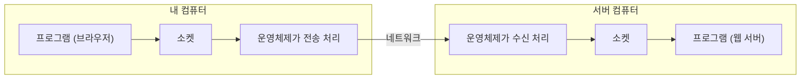
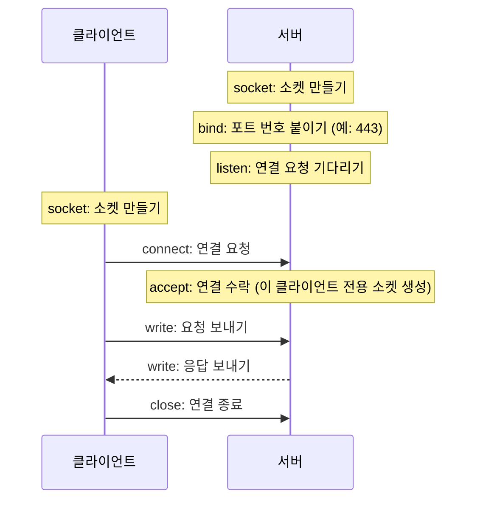
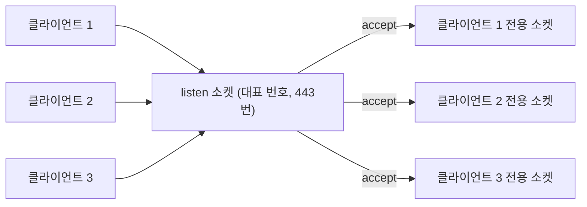

## 소켓이란 ?
- 프로그램이 네트워크로 데이터를 주고받을 때 쓰는 출입구
- 운영체제가 만들어 주고, 프로그램은 이 출입구에 데이터를 넣고 꺼내기만 하면 실제 전송은 운영체제가 처리한다
- 클라이언트-서버 구조에서 클라이언트와 서버는 결국 소켓 두 개가 연결되어 대화하는 것이다. 구조 자체는 [클라이언트-서버 구조](../../클라이언트-서버%20구조(Client-Server%20Architecture)/README.md) 문서에 정리했다

### 소켓 (Socket)
사전적 의미는 콘센트, 꽂는 구멍. 플러그를 꽂아 전기를 연결하는 자리다.
공학적으로는 네트워크 통신의 끝점(Endpoint)을 말한다. 프로그램이 네트워크에 연결되는 자리라는 점에서 콘센트에 비유할 수 있다.

<br/>

## 전화로 이해하기
소켓은 전화기와 비슷하다. 회사에 전화를 건다고 생각해 보자.

| 전화 | 네트워크 |
| --- | --- |
| 전화기 | 소켓 |
| 회사 대표 전화번호 | IP 주소 (어느 컴퓨터인지) |
| 내선 번호 | 포트 번호 (그 컴퓨터의 어느 프로그램인지) |
| 전화 걸기 | 연결 요청 (connect) |
| 수화기 들기 | 연결 수락 (accept) |
| 통화 | 데이터 주고받기 |
| 전화 끊기 | 연결 종료 (close) |

회사 번호만 알면 회사까지는 연결되지만, 누구와 통화할지는 내선 번호로 정해진다. 컴퓨터도 마찬가지다. IP 주소로 컴퓨터를 찾고, 포트 번호로 그 안의 프로그램을 찾는다.

<br/>

## 왜 소켓이 필요할까
데이터를 네트워크로 보내려면 할 일이 많다. 데이터를 작게 나누고, 주소를 붙이고, 빠진 것이 있으면 다시 보내고, 랜카드를 움직여야 한다. 프로그램마다 이걸 직접 하면 너무 복잡하다.

그래서 이런 일은 운영체제가 맡고, 프로그램에는 간단한 출입구 하나만 준다. 그 출입구가 소켓이다. 우체국 창구에 편지를 맡기면 배달은 우체국이 알아서 하는 것과 같다. 프로그램은 소켓에 쓰기(write)와 읽기(read)만 하면 된다.



<br/>

## IP 주소와 포트
### IP 주소
네트워크에서 컴퓨터 한 대를 찾아가기 위한 주소. 건물 주소나 회사 대표 번호에 해당한다.

### 포트 (Port)
사전적 의미는 항구. 배가 짐을 싣고 내리는 곳이다.
공학적으로는 한 컴퓨터 안에서 어느 프로그램이 데이터를 받을지 구분하는 번호를 말한다. 한 도시에 항구가 여러 개 있고 배마다 들어갈 항구가 정해져 있듯이, 한 컴퓨터에 들어온 데이터도 포트 번호를 보고 맞는 프로그램으로 간다.

포트 번호는 0부터 65535까지 있다. 자주 쓰는 서비스는 번호가 관례로 정해져 있다.

| 포트 | 서비스 |
| --- | --- |
| 22 | SSH (원격 접속) |
| 80 | HTTP (웹) |
| 443 | HTTPS (보안 웹) |
| 3306 | MySQL (데이터베이스) |

브라우저 주소창에 포트를 쓰지 않아도 되는 이유가 이것이다. https로 접속하면 브라우저가 알아서 443번으로 연결한다. 개발할 때 localhost:3000처럼 포트를 붙이는 건 관례 번호가 아닌 곳에 서버를 띄웠기 때문이다.

### 연결 하나를 구분하는 방법
서버 하나에 수많은 사용자가 동시에 접속해도 대화가 섞이지 않는다. 연결마다 다음 네 가지 조합이 다르기 때문이다.

- 내 IP 주소
- 내 포트 번호
- 상대 IP 주소
- 상대 포트 번호

서버의 443번 포트에 천 명이 접속해도, 각 사용자의 IP 주소나 포트 번호가 달라서 천 개의 서로 다른 연결로 구분된다. 같은 내선 번호로 걸려 온 전화라도 건 사람의 번호가 다르면 다른 통화인 것과 같다.

<br/>

## TCP 소켓과 UDP 소켓
소켓은 어떤 방식으로 데이터를 보낼지에 따라 두 종류로 나뉜다.

### TCP 소켓 (스트림 소켓)
전화와 같다. 먼저 연결을 맺고, 통화하고, 끊는다. 보낸 데이터는 빠짐없이 순서대로 도착한다. 웹, 메일, 파일 전송처럼 데이터가 하나라도 빠지면 안 되는 곳에 쓴다.

### UDP 소켓 (데이터그램 소켓)
편지와 같다. 연결 없이 주소만 적어서 바로 보낸다. 빠르지만 도착하는지, 순서가 맞는지는 보장하지 않는다. 실시간 게임, 영상 통화처럼 조금 빠져도 빠른 게 중요한 곳에 쓴다.

| 구분 | TCP 소켓 | UDP 소켓 |
| --- | --- | --- |
| 비유 | 전화 | 편지 |
| 연결 | 먼저 연결하고 대화 | 연결 없이 바로 보냄 |
| 도착 보장 | 보장 | 보장 안 함 |
| 속도 | 상대적으로 느림 | 빠름 |
| 쓰는 곳 | 웹, 메일, 파일 전송 | 실시간 게임, 영상 통화, DNS |

아래 내용은 클라이언트-서버 구조에서 가장 많이 쓰는 TCP 소켓을 기준으로 한다.

<br/>

## 서버가 연결을 받는 과정
가게를 열고 전화 주문을 받는 과정과 같다.

### 서버 쪽
1. **socket**: 전화기를 하나 산다. 소켓을 만든다
2. **bind**: 전화기에 번호를 등록한다. 소켓에 IP 주소와 포트 번호를 묶는다. bind의 사전적 의미는 묶다
3. **listen**: 전화를 받을 준비를 하고 벨이 울리길 기다린다. listen의 사전적 의미는 귀 기울이다
4. **accept**: 벨이 울리면 수화기를 든다. 들어온 연결 요청을 받아들인다. accept의 사전적 의미는 받아들이다
5. **read / write**: 통화한다. 데이터를 주고받는다
6. **close**: 전화를 끊는다

### 클라이언트 쪽
1. **socket**: 전화기를 하나 산다
2. **connect**: 가게 번호로 전화를 건다. 클라이언트는 bind를 하지 않아도 되는데, 운영체제가 남는 포트 번호를 알아서 붙여 주기 때문이다. 전화를 걸 때 내 번호를 따로 정하지 않아도 되는 것과 같다
3. **read / write**: 통화한다
4. **close**: 전화를 끊는다



### accept가 새 소켓을 만드는 이유
accept는 연결을 받을 때마다 그 클라이언트 전용 소켓을 새로 만든다. 처음 listen하던 소켓은 계속 다음 손님을 기다린다.

고객센터 대표 번호를 떠올리면 쉽다. 대표 번호는 계속 전화를 받고, 걸려 온 전화는 상담원에게 하나씩 연결된다. 상담원이 통화하는 동안에도 대표 번호로는 다른 전화가 계속 들어온다. 대표 번호가 listen 소켓이고, 상담원과의 통화 하나하나가 accept로 만들어진 소켓이다.



### 연결 대기열
accept하기 전에 연결 요청이 한꺼번에 몰리면, 운영체제가 요청을 대기열에 잠시 줄 세워 둔다. 고객센터의 통화 대기와 같다. listen을 할 때 이 대기열 크기를 정할 수 있고, 대기열이 꽉 차면 새 연결 요청은 거절되거나 무시된다.

<br/>

## 코드로 보기
Node.js의 net 모듈로 만든 간단한 TCP 서버와 클라이언트다. Node.js는 socket, bind, listen, accept를 하나하나 부르지 않고 한 번에 처리해 준다.

```js
// server.js
const net = require('net');

// 연결이 들어올 때마다(accept) 그 클라이언트 전용 소켓이 콜백으로 넘어온다
const server = net.createServer((socket) => {
  socket.on('data', (data) => {
    socket.write(`받은 메시지: ${data}`);
  });
});

// socket + bind + listen
server.listen(3000);
```

```js
// client.js
const net = require('net');

// socket + connect
const socket = net.createConnection({ port: 3000 }, () => {
  socket.write('안녕');
});

socket.on('data', (data) => {
  console.log(data.toString());
  socket.end(); // close
});
```

<br/>

## 소켓과 웹소켓은 다를까
이름이 비슷해서 헷갈리지만 다른 개념이다.

소켓은 운영체제가 제공하는 통신 출입구이고, 웹, 메일, 게임 등 거의 모든 네트워크 프로그램이 내부적으로 소켓을 쓴다. 웹소켓(WebSocket)은 브라우저와 서버가 연결을 유지한 채 양방향으로 대화하기 위한 프로토콜이다. 웹소켓도 내부에서는 TCP 소켓 위에서 동작한다.

전화기(소켓)와 그 전화기로 쓰는 특정 통화 방식(웹소켓)의 관계에 가깝다.

<br/>

## 더 볼 것 (TODO)
- [TCP 연결 과정 (3-way handshake)과 connect, accept 사이에서 일어나는 일](../TCP%20연결%20과정(TCP%20Handshake)/README.md)
- [서버가 여러 연결을 동시에 처리하는 방식](../../서버의%20동시%20처리%20방식(Server%20Concurrency)/README.md)
- 블로킹 I/O와 논블로킹 I/O
- [소켓 상태 변화 (ESTABLISHED, TIME_WAIT 등)](../TCP%20연결%20과정(TCP%20Handshake)/README.md)
- NAT와 포트 포워딩
