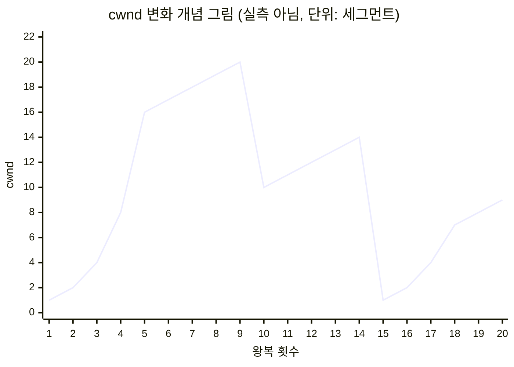

## 흐름 제어와 혼잡 제어란 ?
- TCP가 데이터를 보내는 속도를 스스로 조절하는 두 가지 장치
- 흐름 제어는 받는 쪽이 감당할 수 있는 만큼만, 혼잡 제어는 그 사이의 네트워크가 감당할 수 있는 만큼만 보내게 한다
- [UDP](../UDP(User%20Datagram%20Protocol)/README.md#흐름-제어-flow-control) 문서에서 UDP가 하지 않는 일로 짧게 소개했다. 이 문서는 TCP가 두 제어를 실제로 어떻게 하는지 본다

<br/>

## 이름 짚고 가기
### 흐름 제어 (Flow Control)
Flow의 사전적 의미는 흐름, 물이나 공기가 한쪽으로 흘러가는 것이다. Control은 제어, 원하는 대로 조절한다는 뜻이다.
공학적으로는 보내는 쪽에서 받는 쪽으로 흘러가는 데이터의 양을 받는 쪽 사정에 맞춰 조절하는 일을 말한다. 받는 쪽이 아직 처리하지 못한 데이터를 쌓아 둘 공간이 넘치지 않게 하는 것이 목적이다.

### 혼잡 제어 (Congestion Control)
Congestion의 사전적 의미는 혼잡, 길이나 장소가 붐벼 막힌 상태다. 의학에서는 피가 한곳에 몰려 고이는 충혈을 뜻하기도 한다.
공학적으로는 네트워크 중간의 라우터와 회선이 처리할 수 있는 양보다 많은 데이터가 몰려 패킷이 줄을 서거나 버려지는 상태를 혼잡이라 하고, 그렇게 되지 않도록 보내는 양을 조절하는 일을 혼잡 제어라 한다.

### 윈도우 (Window)
사전적 의미는 창, 창문이다. 벽에 뚫린 틀 너머로 바깥의 일부만 보인다.
공학적으로는 지금 보내도 되는 데이터의 범위를 말한다. 길게 이어진 데이터 중 창틀 안에 들어온 부분만 보낼 수 있다고 생각하면 이름이 이해된다. 이 문서에는 받는 쪽이 정하는 수신 윈도우와 보내는 쪽이 정하는 혼잡 윈도우 두 가지가 나온다. 창이라는 말은 이 이름 풀이에서만 쓰고, 본문에서는 윈도우로 쓴다.

<br/>

## 무엇을 기준으로 나눌까
두 제어 모두 보내는 쪽이 속도를 줄인다는 점은 같다. 다른 것은 누구 사정 때문에 줄이느냐다.

UDP 문서의 비유를 음식 배달 한 장면으로 이어 보자. 흐름 제어는 먹는 사람의 접시에 다 먹을 수 있을 만큼만 담아 보내는 일이다. 먹는 사람이 천천히 먹으면 덜 보낸다. 혼잡 제어는 도로가 막히면 출발하는 배달 차를 줄이는 일이다. 먹는 사람이 얼마든지 먹을 수 있어도, 가는 길이 막혀 있으면 음식이 도착하지 못한다.

그래서 아는 방법도 다르다. 받는 쪽 사정은 받는 쪽이 직접 알려 준다. 반면 네트워크 사정은 아무도 직접 알려 주지 않는다. 중간의 라우터는 보통 내가 붐빈다고 말해 주지 않고, 감당하지 못한 패킷을 버릴 뿐이다. 그래서 보내는 쪽은 패킷이 사라졌다는 신호를 보고 네트워크가 붐빈다고 짐작한다. 흐름 제어는 받은 숫자를 따르는 일이고, 혼잡 제어는 짐작한 숫자를 따르는 일이다.

<br/>

## 흐름 제어: 받는 쪽이 알려 준다
### 받는 쪽에는 받아 둘 공간이 있다
TCP로 받은 데이터는 곧바로 응용 프로그램에 가지 않는다. 운영체제가 연결마다 마련한 수신 버퍼(Receive Buffer)에 먼저 쌓이고, 응용 프로그램이 읽어 갈 때 비워진다. 응용 프로그램이 다른 일로 바빠 읽지 않으면 버퍼는 계속 찬다.

버퍼가 넘친 뒤에 온 데이터는 버려진다. RFC 9293 3.8.6절은 받을 수 있는 것보다 많은 데이터가 오면 버려지고, 그 결과 재전송이 지나치게 많아져 네트워크와 양쪽 컴퓨터에 쓸데없는 부담을 준다고 설명한다. 그래서 받는 쪽은 넘치기 전에 얼마나 더 받을 수 있는지를 미리 알려 준다.

### 수신 윈도우 (Receive Window, rwnd)
받는 쪽이 지금 더 받을 수 있는 양이다. 받는 쪽은 자기가 보내는 모든 TCP [세그먼트](../계층%20모델(OSI%20and%20TCP-IP%20Layers)/README.md#데이터-단위의-이름) 헤더의 윈도우 칸에 이 값을 적는다. [TCP 연결 과정](../TCP%20연결%20과정(TCP%20Handshake)/README.md#연결-후-데이터-주고받기) 문서에서 본 ACK에도 함께 실려 간다. RFC 9293 3.1절은 이 칸을 확인 번호가 가리키는 바이트부터 이 세그먼트를 보낸 쪽이 받을 의향이 있는 바이트 수라고 정의한다. RFC 5681 2절에서는 가장 최근에 알려 온 이 값을 rwnd라고 부른다.

배달 비유로는 먹는 사람이 접시에 아직 몇 숟갈 더 담을 수 있는지 매번 알려 주는 것과 같다. 보내는 사람은 그 숫자만큼만 더 담아 보낸다.

윈도우 칸은 16비트라 그대로 쓰면 65535바이트까지만 적을 수 있다. 빠르고 먼 회선에서는 이 값이 너무 작아서, 연결을 맺을 때 SYN에 윈도우 배율(Window Scale) 옵션을 실어 칸의 값을 몇 배로 읽을지 정한다. 배율은 2의 거듭제곱이고 지수는 14까지라 수신 윈도우는 최대 1GiB가 된다(RFC 7323 2.1, 2.2절).

### 슬라이딩 윈도우 (Sliding Window)
Sliding의 사전적 의미는 미끄러지는 것이다. 미닫이 창문처럼 옆으로 밀리는 창을 떠올리면 된다.
공학적으로는 보내도 되는 범위(윈도우)가 고정되어 있지 않고, ACK가 올 때마다 데이터의 앞쪽으로 밀려 나가는 방식을 말한다.

보내는 쪽에서 보면 데이터는 [순서 번호](../TCP%20연결%20과정(TCP%20Handshake)/README.md#순서-번호-sequence-number)를 따라 네 구간으로 나뉜다.

```text
        SND.UNA              SND.NXT         SND.UNA + SND.WND
           |                    |                    |
 ----------+--------------------+--------------------+-----------------
 보내고      | 보냈지만             | 아직 안 보냈지만      | 아직 보내면
 확인 받음    | 확인 못 받음          | 지금 보내도 됨        | 안 됨
 ----------+--------------------+--------------------+-----------------
           |<------------ 윈도우 (SND.WND) --------->|
```

RFC 9293 3.3.1절은 보내는 쪽이 기억하는 값으로 SND.UNA(아직 확인 받지 못한 가장 오래된 번호), SND.NXT(다음에 쓸 번호), SND.WND(받는 쪽이 알려 온 윈도우)를 든다. 윈도우의 왼쪽 끝은 SND.UNA이고 오른쪽 끝은 SND.UNA + SND.WND다.

ACK가 오면 SND.UNA가 오른쪽으로 움직이고 윈도우 전체가 함께 밀린다. 윈도우 안에 새로 들어온 부분은 확인을 기다리지 않고 바로 보낼 수 있다. 한 세그먼트를 보내고 ACK를 받을 때까지 멈추는 방식보다 훨씬 빠른 이유다. 윈도우 크기만큼은 확인 없이 한꺼번에 보내 둘 수 있기 때문이다.

반대로 받는 쪽 응용 프로그램이 읽지 않아 수신 버퍼가 차면, ACK는 오는데 그 안에 적힌 윈도우가 줄어든다. 왼쪽 끝은 밀리는데 오른쪽 끝은 그대로라 윈도우가 좁아진다.

RFC 9293 3.8.6절은 받는 쪽이 이미 알려 준 윈도우의 오른쪽 끝을 왼쪽으로 당기지 말라(SHOULD NOT)고 정한다. 이것을 윈도우 줄이기(shrinking the window)라 한다. 아까 받을 수 있다고 한 범위를 나중에 거둬들이면, 그 범위로 이미 보낸 데이터가 갈 곳을 잃기 때문이다. 괄호 속 SHOULD NOT, MUST 같은 낱말은 RFC가 요구 수준을 나타내는 표시다([UDP](../UDP(User%20Datagram%20Protocol)/README.md#혼잡-제어-congestion-control) 문서 참고).

<br/>

## 윈도우가 0이 되면
### 제로 윈도우 (Zero Window)
받는 쪽 버퍼가 가득 차면 윈도우 칸에 0을 적어 보낸다. 이제 하나도 받을 수 없으니 기다리라는 뜻이다. 보내는 쪽은 새 데이터 보내기를 멈춘다.

문제는 다시 열릴 때다. 받는 쪽 응용 프로그램이 데이터를 읽어 버퍼가 비면, 받는 쪽은 윈도우가 다시 열렸다는 ACK를 보낸다. 그런데 데이터 없는 ACK는 TCP가 다시 보내 주지 않는다. 연결 유지(Keep-Alive)를 다루는 RFC 9293 3.8.4절도 이 점을 짚는다. 이 ACK 하나가 오는 길에 사라지면, 보내는 쪽은 윈도우가 닫혀 있다고 믿고 계속 기다리고, 받는 쪽은 윈도우를 열어 줬으니 데이터가 오기를 기다린다. 양쪽이 서로를 기다리며 멈춘다.

### 윈도우 탐색 (Zero-Window Probing)
Probe의 사전적 의미는 탐침, 찔러 보며 살피는 것이다.
공학적으로는 윈도우가 0이어도 보내는 쪽이 주기적으로 작은 세그먼트를 보내 받는 쪽의 답을 끌어내는 일을 말한다. RFC 9293 3.8.6.1절은 보내는 쪽이 윈도우가 0이어도 새 데이터 1바이트 이상을 보내거나 재전송해서 윈도우를 찔러 봐야 하고, 이것이 윈도우가 다시 열린 사실을 확실히 전하는 데 꼭 필요하다고 적는다. 탐색 기능은 반드시 지원해야 한다(MUST).

받는 쪽은 탐색 세그먼트를 받지 못하더라도, 다음에 기다리는 번호와 지금의 윈도우를 적은 ACK를 꼭 돌려보낸다(같은 절). 아직 닫혀 있으면 0이, 그사이 열렸으면 열린 크기가 적혀 온다. 열린 크기를 받은 보내는 쪽은 다시 보내기 시작한다. 같은 절은 탐색 간격을 차츰 늘리라고 권한다. 상대가 오래 바쁠수록 덜 자주 묻는 셈이다.

닫힌 가게 앞에서 문을 두드려 보는 것과 같다. 아직 닫혀 있다는 대답이 오면 조금 더 있다가 다시 두드리고, 열렸다는 대답이 오면 들어간다.

받는 쪽은 윈도우를 무기한 닫아 둘 수도 있다(MAY). 받는 쪽이 탐색에 계속 답하는 한, 보내는 쪽은 연결을 끊지 말아야 한다(MUST). RFC 9293은 그 예로 프린터에 종이가 떨어진 상황을 든다(RFC 1122 4.2.2.17절을 가리킨다). 종이를 채울 때까지 프린터는 받지 못하지만 고장 난 것은 아니다.

<br/>

## 혼잡 제어: 보내는 쪽이 짐작한다
### 왜 필요할까
흐름 제어만 있다면 받는 쪽이 넉넉한 경우 보내는 쪽은 그 큰 윈도우를 한꺼번에 채워 보낸다. 같은 길을 쓰는 연결이 모두 그렇게 하면 중간의 라우터가 감당하지 못하고 패킷을 버린다. 버려진 패킷은 다시 보내야 하니 길은 더 붐비고, 더 많이 버려진다. 길은 가득 차 있는데 실제로 도착하는 데이터는 거의 없는 상태가 되는데, 이를 혼잡 붕괴(Congestion Collapse)라 한다.

RFC 9293 3.8.2절은 혼잡 붕괴를 막기 위해 모든 TCP가 느린 시작, 혼잡 회피, 재전송 타임아웃의 지수적 늘림을 구현해야 한다(MUST)고 정한다. 앞의 두 가지가 아래에서 볼 내용이고, 현재 표준 설명은 RFC 5681에 있다.

### 혼잡 윈도우 (Congestion Window, cwnd)
보내는 쪽이 네트워크에 확인 없이 내보내도 된다고 스스로 정한 양이다. RFC 5681 3.1절은 cwnd를 ACK를 받기 전에 보낼 수 있는 양에 대한 보내는 쪽의 제한, rwnd를 받는 쪽의 제한이라고 구분한다. rwnd는 상대가 헤더에 적어 보내지만 cwnd는 어디에도 적혀 오지 않는다. 보내는 쪽이 혼자 기억하고 혼자 고치는 값이다.

### 실제로 보낼 수 있는 양
두 윈도우 중 작은 쪽이 실제로 보낼 수 있는 양이 된다. RFC 5681 2절은 어느 순간에도 TCP는 확인 받은 가장 큰 순서 번호에 cwnd와 rwnd 중 작은 값을 더한 번호보다 큰 데이터를 보내면 안 된다(MUST NOT)고 정의한다.

```text
보낼 수 있는 양 = min(rwnd, cwnd)
```

받는 쪽이 64KiB를 받을 수 있다고 해도(rwnd) 보내는 쪽이 네트워크에 10KiB만 보내자고 판단했다면(cwnd) 10KiB만 보낸다. 반대로 cwnd가 커도 받는 쪽 버퍼가 4KiB만 남았다면 4KiB만 보낸다(숫자는 설명용 예시다). 배달 비유로 보면, 한 번에 보내는 음식의 양은 접시에 남은 자리와 도로 사정 중 더 빡빡한 쪽에 맞춘다.

cwnd를 어떻게 늘리고 줄이는지가 혼잡 제어 알고리즘의 내용이다. RFC 5681 3절은 느린 시작, 혼잡 회피, 빠른 재전송, 빠른 회복 네 가지를 정의한다.

<br/>

## 느린 시작 (Slow Start)
### 무엇을 하나
연결을 막 맺었을 때 보내는 쪽은 이 길이 얼마나 넓은지 모른다. RFC 5681 3.1절은 상황을 모르는 네트워크에 처음 보낼 때는 지나치게 큰 덩어리로 길을 막지 않도록, 쓸 수 있는 용량을 천천히 찔러 봐야 한다고 설명한다. 느린 시작은 작은 cwnd로 시작해 ACK가 돌아올 때마다 키우는 방법이다.

### 얼마나 늘리나
느린 시작 동안에는 새 데이터를 확인하는 ACK 하나마다 cwnd를 최대 한 세그먼트(SMSS, Sender Maximum Segment Size, 보내는 쪽이 한 세그먼트에 싣는 최대 데이터 크기)만큼 늘린다(RFC 5681 3.1절).

ACK 하나에 한 세그먼트씩이면 생각보다 빠르게 는다. cwnd가 4세그먼트일 때 4개를 보내면 ACK도 4개가 돌아오고, 그때마다 하나씩 늘어 cwnd는 8이 된다. 한 왕복 시간(RTT, Round Trip Time)마다 대략 두 배가 되는 셈이다. 받는 쪽이 두 세그먼트마다 ACK 하나를 보내는 지연 ACK(Delayed ACK)를 쓰면 ACK 수가 줄어 그보다 덜 늘어난다.

이름은 느린 시작이지만 실제로는 지수적으로 커진다. 처음부터 받는 쪽 윈도우 전체를 쏟아붓는 것에 비하면 느리게 시작한다는 뜻으로 붙은 이름이다.

처음 들어가는 수영장에서 발끝부터 담가 보는 것과 같다. 차갑지 않으면 무릎, 허리로 금방 들어가지만, 처음부터 뛰어들지는 않는다.

### 처음 크기 (Initial Window)
핸드셰이크가 끝난 직후의 cwnd를 초기 윈도우(IW)라 한다. RFC 5681 3.1절은 세그먼트 크기에 따라 IW의 상한을 2에서 4세그먼트로 정한다. 세그먼트가 클수록 개수 상한은 작아진다.

RFC 6928은 이 상한을 10세그먼트로 올리자는 실험(Experimental) 문서다(1, 2절). 인터넷 표준(Standards Track) 문서가 아니라 실험 문서라는 점은 구분해 둔다. 정확한 계산식은 TODO로 남긴다. 실제 운영체제가 어떤 값을 쓰는지는 이 문서에서 확인하지 않았다(확인 필요).

### 언제 멈추나
느린 시작 임계값(ssthresh, Slow Start Threshold)이라는 값을 하나 더 둔다. Threshold의 사전적 의미는 문지방, 어떤 일이 바뀌는 경계다. cwnd가 ssthresh보다 작으면 느린 시작, 크면 혼잡 회피를 쓴다(RFC 5681 3.1절). 처음 ssthresh는 아주 크게 잡아 두고, 혼잡을 겪으면 줄인다. 그래서 첫 느린 시작은 보통 혼잡 신호가 올 때까지 이어진다.

<br/>

## 혼잡 회피 (Congestion Avoidance)
### 무엇을 하나
cwnd가 ssthresh를 넘으면 늘리는 속도를 확 줄인다. 혼잡 회피 동안에는 한 왕복마다 대략 한 세그먼트씩만 늘리고, 한 왕복에 한 세그먼트보다 많이 늘리면 안 된다(MUST NOT, RFC 5681 3.1절). 느린 시작이 왕복마다 두 배였다면 이제는 왕복마다 하나씩 더하는 셈이다.

손실을 겪은 뒤의 임계값은 예전에 막혔던 양의 절반쯤으로 잡힌다(아래 식). 거기서부터는 다시 막혔던 곳에 다가가는 중이니, 조심스럽게 조금씩 늘리며 길이 어디까지 버티는지 살핀다.

### AIMD (Additive Increase, Multiplicative Decrease)
Additive Increase는 덧셈으로 늘림, Multiplicative Decrease는 곱셈으로 줄임이라는 뜻이다.
공학적으로는 혼잡이 없을 때는 일정한 양을 더해서 늘리고, 혼잡 신호가 오면 일정한 비율을 곱해서 줄이는 방식을 말한다. RFC 2914 9.2절은 TCP가 혼잡이 없을 때 한 왕복에 최대 한 패킷씩 늘리고, 혼잡 신호를 받으면 절반으로 줄인다고 설명한다.

줄일 때의 식은 RFC 5681 3.1절에 있다. 손실을 알아차리면 ssthresh를 아직 확인 받지 못한 채 네트워크에 나가 있는 양(FlightSize)의 절반 이하로 낮춘다. 다만 두 세그먼트보다는 작게 하지 않는다.

```text
ssthresh = max(FlightSize / 2, 2 x SMSS)
```

왜 늘릴 때는 더하고 줄일 때는 곱할까. 혼잡은 한번 생기면 빠르게 나빠지므로 줄일 때는 크게 줄여야 길이 금방 풀린다. 늘릴 때는 조금씩 늘려야 다시 막히기 직전까지 천천히 다가갈 수 있다. 또 같은 길을 쓰는 여러 연결이 모두 이렇게 움직이면, 많이 쓰던 연결은 절반으로 줄 때 많이 줄고 적게 쓰던 연결은 적게 줄어, 시간이 지나며 서로 비슷한 몫으로 모인다고 알려져 있다. 이 공평성 분석은 원문을 확인하지 않았고(확인 필요), 수식이 필요해 TODO로 남긴다.

배달 비유로 보면, 출발시키는 배달 차를 왕복마다 한 대씩 늘리다가, 보낸 차가 도착하지 못했다는 소식이 오면 한 번에 절반으로 줄이는 것과 같다.

<br/>

## 손실을 혼잡 신호로 읽기
RFC 5681 3절은 이 알고리즘들이 손실을 혼잡의 신호로 쓴다고 밝힌다. 보내는 쪽이 손실을 알아차리는 길은 두 가지이고, 어느 쪽으로 알았느냐에 따라 cwnd를 줄이는 정도가 다르다. 손실을 알아낸 뒤 무엇을 어떻게 다시 보내는지의 자세한 방법은 [TCP 재전송](../TCP%20재전송(TCP%20Retransmission)/README.md) 문서에서 따로 다룬다. 여기서는 혼잡 신호로서만 본다.

### 타임아웃: 강한 신호
보낸 세그먼트의 ACK가 재전송 타이머가 끝날 때까지 오지 않은 경우다. RFC 5681 3.1절은 이때 ssthresh를 위 식으로 낮추고, cwnd는 초기 윈도우와 상관없이 한 세그먼트(손실 윈도우, Loss Window)로 줄여야 한다(MUST)고 정한다. 그다음 느린 시작으로 다시 키우다가 새 ssthresh에서 혼잡 회피로 넘어간다.

한참 동안 ACK가 하나도 오지 않았다는 것은 길이 심하게 막혔을 수 있다는 뜻이다. 그래서 처음부터 다시 조심스럽게 시작한다.

### 중복 ACK 세 번: 약한 신호
받는 쪽은 순서가 어긋난 세그먼트를 받으면 곧바로 같은 확인 번호를 다시 보낸다(SHOULD, RFC 5681 3.2절). 5번을 기다리는데 6번이 오면 아직 5번을 기다린다는 ACK를 또 보내는 것이다. 이렇게 같은 번호가 반복된 ACK를 중복 ACK(Duplicate ACK)라 한다.

같은 절은 중복 ACK가 순서 바뀜이나 중복 전달 때문에도 생긴다고 적는다. 한두 번은 순서만 바뀌었을 수 있으니, 같은 번호의 중복 ACK가 세 번 오면 그 세그먼트를 잃어버린 것으로 본다.

택배 상자에 번호를 매겨 보냈는데 받는 사람이 아직 5번 상자가 안 왔다고 세 번이나 연락해 오면, 5번이 중간에 사라졌다고 보는 것과 같다. 그 사이 6번, 7번, 8번은 잘 도착했다는 뜻이기도 하다.

### 빠른 재전송과 빠른 회복
빠른 재전송(Fast Retransmit)은 중복 ACK 세 번을 받으면 재전송 타이머가 끝나기를 기다리지 않고, 빠진 것으로 보이는 세그먼트를 바로 다시 보내는 방법이다(RFC 5681 3.2절).

빠른 회복(Fast Recovery)은 그다음 cwnd를 한 세그먼트까지 떨어뜨리지 않고 절반 언저리에서 이어 가는 방법이다. RFC 5681 3.2절은 그 이유를 이렇게 설명한다. 받는 쪽은 세그먼트가 실제로 도착해야 중복 ACK를 만들 수 있다. 그러니 중복 ACK가 계속 온다는 것은 뒤의 세그먼트들은 길을 빠져나가 받는 쪽 버퍼에 들어갔다는 뜻이다. 길이 꽉 막힌 것은 아니므로 느린 시작부터 다시 할 필요는 없다. 다만 손실은 혼잡의 표시이므로 줄인 cwnd로 이어 간다.

정리하면 세 번째 중복 ACK에서 ssthresh를 위 식으로 낮추고, 빠진 세그먼트를 다시 보낸 뒤, 새 데이터를 확인하는 ACK가 오면 cwnd를 그 ssthresh에 맞춰 혼잡 회피로 이어 간다. 그 사이 cwnd를 잠깐 부풀렸다 가라앉히는 세부 단계가 RFC 5681 3.2절에 있는데, 이것은 TODO로 남긴다.

### cwnd가 움직이는 모양
아래 그림은 지금까지의 규칙을 따라 손으로 만든 개념 그림이다. 실제로 잰 값이 아니다. 단순하게 보이려고 초기 윈도우를 한 세그먼트로 두고, 지연 ACK와 세부 규칙은 무시했다.



1. 1에서 5번째 왕복은 느린 시작이다. 왕복마다 두 배가 된다. 여기서는 처음 ssthresh를 16으로 두었다고 가정했다.
2. 6에서 9번째 왕복은 혼잡 회피다. 왕복마다 하나씩 는다.
3. 9번째 왕복 뒤 중복 ACK 세 번으로 손실을 알았다. ssthresh는 10이 되고, 빠른 회복을 거쳐 cwnd는 10에서 혼잡 회피로 이어진다.
4. 14번째 왕복 뒤 타임아웃이 났다. ssthresh는 7이 되고 cwnd는 1로 떨어진다.
5. 15번째 왕복부터 다시 느린 시작으로 키우다가, ssthresh 7에 닿으면 혼잡 회피로 넘어간다.

톱니처럼 오르내리는 모양이 덧셈으로 오르고 곱셈으로 떨어지는 AIMD의 흔적이다.

<br/>

## 대표 알고리즘
위에서 본 규칙은 기본 틀이고, 실제 운영체제는 cwnd를 늘리고 줄이는 방식을 조금씩 바꾼 여러 알고리즘 중 하나를 쓴다. RFC 9293 3.8.2절도 여러 대안 알고리즘이 있고, IETF 표준의 요건을 지키는 한 구현해도 된다(MAY)고 적는다. 여기서는 이름과 차이만 짚고 내부 수식은 TODO로 넘긴다.

### Reno
RFC 5681에 정리된 느린 시작, 혼잡 회피, 빠른 재전송, 빠른 회복을 합친 방식이다. RFC 9438 1절은 이것을 고전적인 Reno 혼잡 제어라 부르고, RFC 9438 4.3절은 Reno를 한 왕복에 한 세그먼트를 더하고 절반으로 줄이는 AIMD로 설명한다. RFC 5681 3.2절은 이 빠른 회복이 한 번에 보낸 묶음에서 여러 세그먼트를 잃으면 잘 회복하지 못한다고 적는데, 그 경우의 빠른 회복을 고친 것이 NewReno(RFC 6582)다.

### CUBIC
RFC 9438(2023년 8월)이 정한 표준(Standards Track) 알고리즘이다. Cubic은 세제곱(삼차)이라는 뜻으로, 혼잡 회피에서 cwnd를 직선으로 늘리는 대신 세제곱 함수 모양으로 늘린다(RFC 9438 요약, 1절). 빠르고 먼 회선에서 Reno가 손실 뒤 cwnd를 너무 천천히 회복하는 문제를 풀려고 만들었다. 줄일 때도 절반이 아니라 0.7을 곱한다(RFC 9438 3.4절). RFC 9438 1절은 Linux, Windows, Apple 운영체제가 CUBIC을 기본 TCP 혼잡 제어로 쓰고 있다고 적는다.

### BBR
Bottleneck Bandwidth and Round-trip propagation time의 줄임말이다. 앞의 두 알고리즘이 손실을 주된 혼잡 신호로 쓰는 것과 달리, BBR은 실제로 전달된 속도와 왕복 시간을 재서 경로의 모델을 만들고 그 모델로 보내는 속도와 양을 정한다. BBR은 RFC가 아니다. 2026-10-28에 IETF 자료(datatracker)를 확인했을 때 draft-ietf-ccwg-bbr이라는 인터넷 초안(Internet-Draft, 06판)으로 논의 중이었다. 위 설명은 그 초안의 요약을 옮긴 것이고, 모델의 내용은 TODO로 넘긴다.

### 내 컴퓨터는 무엇을 쓰나
이 노트에서는 TCP 윈도우와 헷갈리지 않게 운영체제 이름을 영문 Windows로 쓴다. Windows에서는 PowerShell의 Get-NetTCPSetting으로 설정 묶음마다 쓰는 혼잡 제어 알고리즘(CongestionProvider)을 볼 수 있다. 아래는 2026-10-28에 Windows 11 Pro(10.0.26200)에서 실행한 결과를 필요한 칸만 남긴 것이다.

```powershell
Get-NetTCPSetting | Select-Object SettingName, CongestionProvider
```

```text
SettingName      CongestionProvider
-----------      ------------------
Automatic
InternetCustom   CUBIC
DatacenterCustom CUBIC
Compat           NewReno
Datacenter       CUBIC
Internet         CUBIC
```

인터넷과 데이터센터용 설정은 CUBIC, 호환용(Compat) 설정은 NewReno다. 어떤 연결에 어느 설정 묶음이 붙는지는 확인하지 않았다(확인 필요). 같은 PC에서 netsh int tcp show global을 실행하면 HyStart가 enabled로 나온다. RFC 9438 4.10절은 CUBIC이 느린 시작에 HyStart++(RFC 9406)를 쓰라(SHOULD)고 권하는데, Windows의 HyStart가 HyStart++와 같은 것인지는 확인하지 못했다(확인 필요). Linux에서는 sysctl net.ipv4.tcp_congestion_control로 볼 수 있다고 알려져 있지만 이 문서에서는 실행해 보지 않았다.

<br/>

## 코드로 보기: 받는 쪽이 읽지 않으면
### 배압 (Backpressure)
사전적 의미는 배관 속 흐름을 거슬러 뒤로 미는 압력, 역압이다. 하수구가 막히면 물이 거꾸로 차오르는 것과 같다.
공학적으로는 뒤쪽 단계가 처리하지 못해 앞쪽 단계에 그만 보내라는 신호가 거슬러 전해지는 현상을 말한다. TCP의 흐름 제어도 배압의 한 형태다. 받는 쪽 응용 프로그램이 읽지 않으면 수신 버퍼가 차고, 그 사실이 윈도우로 보내는 쪽에 전해진다.

### 실험
Node.js의 net 모듈로 받는 쪽이 읽기를 멈췄을 때 보내는 쪽에서 무슨 일이 생기는지 본다. 받는 쪽 서버는 연결을 받자마자 socket.pause()로 읽기를 멈추고, 1초 뒤 다시 읽는다. 보내는 쪽은 64KiB짜리 데이터를 write()가 false를 돌려줄 때까지 계속 쓴다. 아래 예시는 모두 2026-10-28에 Node.js v24.22.1, Windows 11 Pro(10.0.26200)에서 실행했고, 주소는 내 컴퓨터 자신을 뜻하는 127.0.0.1만 썼다.

```js
const net = require('node:net');

const PORT = 41240;
const BLOCK = Buffer.alloc(64 * 1024, 'a'); // 한 번에 64KiB씩 쓴다

let serverSock;
let received = 0;
const server = net.createServer((sock) => {
  serverSock = sock;
  sock.pause(); // 받는 쪽 프로그램이 읽기를 멈춘다
  sock.on('data', (d) => { received += d.length; });
  sock.on('end', () => {
    console.log(`[받는 쪽] 모두 받음: ${received}바이트`);
    server.close();
  });
});

server.listen(PORT, '127.0.0.1', () => {
  const client = net.connect(PORT, '127.0.0.1', () => {
    console.log(`[보내는 쪽] Node 버퍼 기준선 ${client.writableHighWaterMark}바이트`);
    let writes = 0;
    let ok = true;
    while (ok) {
      ok = client.write(BLOCK);
      writes++;
    }
    const total = writes * BLOCK.length;
    console.log(`[보내는 쪽] write ${writes}번째에 false, 지금까지 쓴 양 ${total}바이트`);

    setTimeout(() => {
      const inSender = client.writableLength;   // 보내는 쪽 Node 안에 남은 양
      const inReceiver = serverSock.bytesRead;  // 받는 쪽 Node가 운영체제에서 꺼내 둔 양
      console.log(`[1초 뒤] 보내는 쪽 Node 버퍼 ${inSender}바이트`);
      console.log(`[1초 뒤] 받는 쪽 Node가 꺼내 둔 양 ${inReceiver}바이트`);
      console.log(`[1초 뒤] 그 사이 운영체제 버퍼에 있는 양 ${total - inSender - inReceiver}바이트`);
      console.log('[받는 쪽] 읽기 다시 시작');
      serverSock.resume();
    }, 1000);

    client.once('drain', () => {
      console.log(`[보내는 쪽] drain 이벤트, Node 버퍼 ${client.writableLength}바이트`);
      client.end();
    });
  });
});
```

```text
[보내는 쪽] Node 버퍼 기준선 16384바이트
[보내는 쪽] write 6번째에 false, 지금까지 쓴 양 393216바이트
[1초 뒤] 보내는 쪽 Node 버퍼 65536바이트
[1초 뒤] 받는 쪽 Node가 꺼내 둔 양 65536바이트
[1초 뒤] 그 사이 운영체제 버퍼에 있는 양 262144바이트
[받는 쪽] 읽기 다시 시작
[보내는 쪽] drain 이벤트, Node 버퍼 0바이트
[받는 쪽] 모두 받음: 393216바이트
```

세 번 실행해 세 번 모두 같은 값이 나왔다. 받는 쪽이 읽지 않는 동안 데이터는 세 곳에 나뉘어 머물렀다.

- 받는 쪽 Node가 운영체제에서 꺼내 둔 64KiB. pause()는 응용 프로그램에 data 이벤트를 넘기는 것만 멈추고, Node는 자기 읽기 버퍼가 기준선(이 PC에서 16384바이트)에 찰 때까지 운영체제에서 읽어 둔다. 한 번 읽을 때 64KiB를 가져와 기준선을 넘기고 멈춘 것으로 보인다(확인 필요)
- 운영체제 버퍼에 들어간 256KiB. 보내는 쪽의 송신 버퍼와 받는 쪽의 수신 버퍼를 합친 양이고, 이 실험으로는 둘을 나눠 볼 수 없다
- 운영체제가 더 받아 주지 않아 보내는 쪽 Node 안에 남은 64KiB

1초를 기다려도 운영체제로 더 넘어가지 않았다. 받는 쪽이 읽기를 다시 시작하자 쌓였던 데이터가 흘러가 drain 이벤트가 왔고, 393216바이트가 빠짐없이 도착했다.

### write()가 false를 돌려준 이유는 TCP 윈도우가 아니다
이 결과를 TCP 윈도우가 0이 되어 write()가 false가 됐다고 읽으면 틀린다. 층이 둘이다.

write()의 반환값은 Node가 정한다. 보내는 쪽 Node 안에 쌓인 양(writableLength)이 기준선(writableHighWaterMark) 이상이 되면 false를 돌려준다. 출력 첫 줄처럼 이 PC의 기준선은 16384바이트였다. 다섯 번째 write까지는 운영체제가 바로 받아 줘서 Node 버퍼가 0이었고 true가 나왔다. 여섯 번째는 운영체제가 받아 주지 않아 64KiB가 Node 버퍼에 남았고, 기준선을 넘었으니 false가 나왔다. false는 그만 쓰고 drain 이벤트를 기다리라는 Node의 신호다.

운영체제가 더 받아 주지 않은 이유는 운영체제 버퍼가 찼기 때문이다. 그 안에서 받는 쪽 TCP가 윈도우를 0으로 알렸을 가능성이 크지만, 이 실험은 패킷을 직접 잡아 보지 않았으므로 실제로 제로 윈도우가 오갔는지는 확인하지 못했다(확인 필요). 운영체제 버퍼 크기와 내 컴퓨터 안(루프백) 연결의 처리 방식도 운영체제마다 달라서, 256KiB라는 숫자는 이 PC의 결과일 뿐이다.

정리하면 받는 쪽 읽기 멈춤은 받는 쪽 운영체제 버퍼, 보내는 쪽 운영체제 버퍼, 보내는 쪽 Node 버퍼 순서로 거슬러 올라가며 쌓였다. TCP 흐름 제어는 그중 두 운영체제 사이의 구간을 맡는다.

### false를 무시하면
false를 받고도 계속 쓰면 어떻게 될까. 받는 쪽이 읽지 않는 채로 같은 64KiB를 스무 번 써 본다.

```js
const net = require('node:net');

const BLOCK = Buffer.alloc(64 * 1024, 'a');
const server = net.createServer((sock) => sock.pause()); // 받는 쪽은 읽지 않는다

server.listen(41241, '127.0.0.1', () => {
  const client = net.connect(41241, '127.0.0.1', () => {
    for (let i = 1; i <= 20; i++) {
      const ok = client.write(BLOCK); // false를 무시하고 계속 쓴다
      if (i % 5 === 0) console.log(`write ${i}번: 반환값 ${ok}, Node 버퍼 ${client.writableLength}바이트`);
    }
    setTimeout(() => {
      console.log(`1초 뒤 Node 버퍼 ${client.writableLength}바이트`);
      client.destroy();
      server.close();
    }, 1000);
  });
});
```

```text
write 5번: 반환값 true, Node 버퍼 0바이트
write 10번: 반환값 false, Node 버퍼 327680바이트
write 15번: 반환값 false, Node 버퍼 655360바이트
write 20번: 반환값 false, Node 버퍼 983040바이트
1초 뒤 Node 버퍼 983040바이트
```

세 번 실행해 같은 값이 나왔다. 운영체제 쪽은 이미 차 있으므로 그 뒤에 쓴 것은 모두 Node 버퍼에 쌓였다. TCP가 받는 쪽을 넘치지 않게 지켜 줘도, 그 위의 프로그램이 신호를 무시하면 넘칠 곳이 보내는 쪽 메모리로 옮겨 갈 뿐이다. 흐름 제어는 운영체제끼리의 약속이고, 응용 프로그램은 응용 프로그램대로 배압 신호를 지켜야 한다.

<br/>

## TCP 밖에서는
UDP에는 두 제어가 모두 없다. 그래서 UDP 위의 응용 프로그램이 직접 속도를 조절해야 한다는 이야기는 [UDP](../UDP(User%20Datagram%20Protocol)/README.md#혼잡-제어-congestion-control) 문서에 정리했다.

HTTP/3 아래의 [QUIC](../../WEB/HTTP%20버전(HTTP%20Versions)/README.md#quic)은 UDP 위에서 동작하면서 흐름 제어와 혼잡 제어를 스스로 한다. RFC 9438 1절도 CUBIC을 QUIC 같은 다른 전송 프로토콜의 기본 혼잡 제어로 쓸 수 있다고 적는다. QUIC의 방식은 TODO로 남긴다.

<br/>

## 참고 자료
- RFC 9293, [Transmission Control Protocol (TCP)](https://www.rfc-editor.org/rfc/rfc9293.html) 3.1절(윈도우 칸), 3.3.1절(SND.UNA, SND.NXT, SND.WND), 3.8.2절(혼잡 제어 요구), 3.8.4절(데이터 없는 ACK), 3.8.6절(윈도우 관리, 윈도우 줄이기), 3.8.6.1절(윈도우 탐색)
- RFC 5681, [TCP Congestion Control](https://www.rfc-editor.org/rfc/rfc5681.html) 2절(cwnd, rwnd, SMSS, 중복 ACK 정의), 3절, 3.1절(느린 시작, 혼잡 회피, 초기 윈도우, ssthresh, 타임아웃), 3.2절(빠른 재전송, 빠른 회복)
- RFC 6928, [Increasing TCP's Initial Window](https://www.rfc-editor.org/rfc/rfc6928.html) 1, 2절 (실험 문서)
- RFC 7323, [TCP Extensions for High Performance](https://www.rfc-editor.org/rfc/rfc7323.html) 2.1, 2.2절 (윈도우 배율)
- RFC 2914, [Congestion Control Principles](https://www.rfc-editor.org/rfc/rfc2914.html) 9.2절 (AIMD)
- RFC 9438, [CUBIC for Fast and Long-Distance Networks](https://www.rfc-editor.org/rfc/rfc9438.html) 요약, 1, 3.4, 4.3, 4.10절
- BBR은 IETF 인터넷 초안 [draft-ietf-ccwg-bbr](https://datatracker.ietf.org/doc/draft-ietf-ccwg-bbr/)의 요약만 참고했다 (RFC 아님, 2026-10-28 기준 06판)
- Node.js net 모듈의 write() 반환값, writableLength, drain 동작은 위 실행 결과로 확인했다

<br/>

## 더 볼 것 (TODO)
- 어리석은 윈도우 증후군(Silly Window Syndrome)과 네이글 알고리즘 (RFC 9293 3.8.6.2절)
- 지연 ACK가 흐름 제어와 혼잡 제어에 주는 영향
- 혼잡 제어 알고리즘 내부 수식 (CUBIC의 세제곱 함수, AIMD 공평성 분석)
- BBR이 경로 모델을 만드는 방법
- 손실 대신 라우터가 혼잡을 표시해 알려 주는 ECN (Explicit Congestion Notification, RFC 3168)
- 선택 확인(SACK)과 여러 세그먼트를 한꺼번에 잃었을 때의 회복
- 혼잡 제어 절차 자세히 (빠른 회복의 부풀리기와 가라앉히기 단계, RFC 6928의 초기 윈도우 계산식, 윈도우 탐색 간격)
- 운영체제 버퍼 크기와 혼잡 제어 알고리즘을 바꾸는 커널 설정
- 패킷 캡처로 제로 윈도우와 윈도우 탐색 직접 보기
- Node.js 스트림의 배압 (highWaterMark, drain, pipe)
- QUIC의 흐름 제어와 혼잡 제어 (HTTP/2의 흐름 제어는 HTTP 버전 문서 TODO에 있다)
