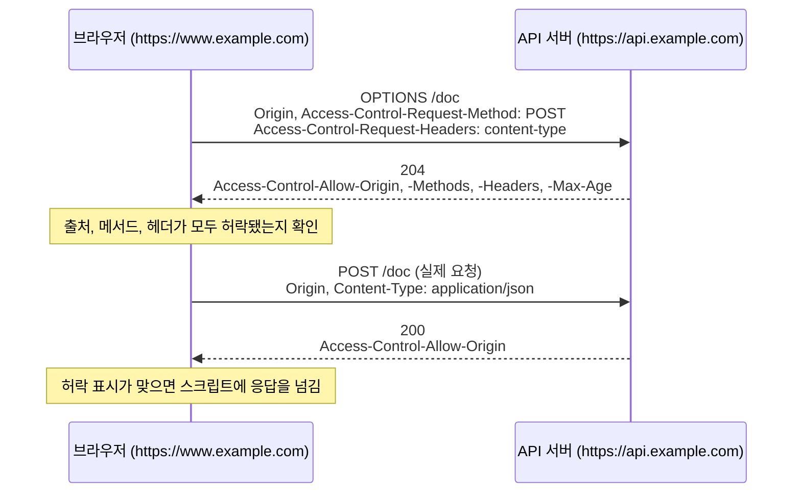

## CORS란 ?
- 다른 출처(Origin)의 응답을 페이지의 JavaScript가 읽어도 되는지, 서버가 HTTP 헤더로 허락을 알려 주는 규칙이다
- 브라우저는 기본적으로 다른 출처의 응답을 읽지 못하게 막는다. 이것을 동일 출처 정책(Same-Origin Policy)이라고 한다. CORS는 이 제한을 서버가 허락한 만큼만 풀어 준다
- 출처와 동일 출처 정책, 단순 요청과 사전 요청의 기본 흐름은 [프론트엔드 관점 문서](../../클라이언트-서버%20구조%20프론트엔드%20관점(Frontend)/README.md#다른-사이트의-데이터는-왜-막힐까)에 짧게 정리했다. 이 문서는 그 위에서 헤더 하나하나, 사전 요청이 붙는 조건, 쿠키를 함께 보내는 요청, 흔한 오해를 다룬다

### CORS (Cross-Origin Resource Sharing)
Cross는 가로지르다, 건너가다라는 뜻이고 Origin은 기원, 무언가가 처음 나온 곳이라는 뜻이다. Resource Sharing은 자원 공유다. 합치면 출처를 건너가는 자원 공유, 우리말로는 교차 출처 리소스 공유라고 옮긴다.
공학적으로는 한 출처에서 온 페이지가 다른 출처의 서버에 요청하고 그 응답을 읽는 일을 말하고, CORS는 이 일을 허락할지 정하는 헤더 묶음과 절차를 가리킨다. 지금은 웹 표준을 만드는 단체 WHATWG의 Fetch 표준(Fetch Standard) 3.3절이 이 규칙을 정한다.

<br/>

## 출처와 동일 출처 정책
### 출처 (Origin)
출처는 스킴(https, http), 호스트(example.com), 포트(443) 세 가지를 묶은 것이다. 세 가지가 모두 같아야 같은 출처다. 경로는 따지지 않는다. 프론트엔드 관점 문서에서 프로토콜, 도메인이라고 부른 것이 각각 스킴, 호스트다.

MDN의 동일 출처 정책 문서에 있는 예를 주소만 바꿔 옮기면, http://www.example.com/dir/page.html을 기준으로 아래와 같다.

| 비교할 주소 | 결과 | 이유 |
| --- | --- | --- |
| http://www.example.com/dir2/other.html | 같은 출처 | 경로만 다르다 |
| https://www.example.com/page.html | 다른 출처 | 스킴이 다르다 |
| http://www.example.com:81/dir/page.html | 다른 출처 | 포트가 다르다(http의 기본 포트는 80) |
| http://api.example.com/dir/page.html | 다른 출처 | 호스트가 다르다 |

마지막 줄의 www.example.com과 api.example.com은 [쿠키](../쿠키(Cookie)/README.md#사이트-site) 문서에서 본 기준으로는 같은 사이트(Site)다. 출처는 사이트보다 좁은 단위라서 같은 사이트 안에서도 출처가 갈린다.

### 동일 출처 정책
브라우저는 한 출처에서 온 스크립트가 다른 출처의 응답을 읽지 못하게 막는다. 프론트엔드 관점 문서에서 쓴 비유대로, 내 열쇠로 남의 집 우편함을 열 수 없는 것과 같다.

MDN은 다른 출처와 주고받는 일을 세 가지로 나눠 설명한다. 링크, 리다이렉트, 폼 제출처럼 다른 출처로 보내는 일(쓰기)은 대체로 허용된다. 이미지, 스크립트처럼 다른 출처의 자원을 페이지에 끼워 넣는 일도 대체로 허용된다. 막히는 것은 다른 출처의 응답 내용을 스크립트가 읽는 일이다. 막는 대상이 보내기가 아니라 읽기라는 점이 뒤에서 볼 오해를 푸는 열쇠다.

### 왜 필요할까
브라우저는 요청을 보낼 때 그 사이트의 쿠키를 자동으로 붙인다. 내가 은행에 로그인한 채로 수상한 사이트를 열었다고 하자. 동일 출처 정책이 없다면 수상한 사이트의 스크립트가 쿠키를 함께 보내라는 옵션(뒤에서 볼 credentials)을 주고 은행 주소로 fetch를 보낼 수 있다. 쿠키가 실리면 돌아온 내 계좌 정보를 그 스크립트가 그대로 읽어 갈 수 있다. 지금은 쿠키 쪽 규칙(SameSite)도 이런 요청에 쿠키가 실리는 것을 따로 막지만, 동일 출처 정책은 그보다 먼저 응답을 읽는 일 자체를 막는다.

Fetch 표준은 쿠키 말고 이유를 하나 더 든다. 회사 방화벽 안쪽의 사내망(Intranet) 서버처럼 바깥에서는 닿지 않는 서버가 있다. 사내 직원의 브라우저는 그 서버에 닿을 수 있으므로, 직원이 연 바깥 사이트의 스크립트가 직원 브라우저를 통해 사내 서버 응답을 읽어 갈 수 있다. 그래서 Fetch 표준은 CORS가 서버가 직접 허락해야만 열리는 방식(opt-in)이어야 한다고 적는다.

<br/>

## CORS는 어떻게 제한을 푸나
### 서버의 허락 표시
화면 사이트(https://www.example.com)와 데이터 서버(https://api.example.com)를 나눠 두는 일은 흔하다. 이대로면 화면의 스크립트는 자기 회사 API 응답도 읽지 못한다. 그래서 서버가 응답에 이 출처는 읽어도 된다는 표시를 달고, 브라우저는 그 표시가 있을 때만 응답을 스크립트에 넘긴다. 집주인이 특정 사람에게만 우편함 비밀번호를 알려 주는 것과 같다.

흐름은 아래와 같다.

1. 브라우저가 다른 출처로 요청을 보낼 때 Origin 헤더에 지금 페이지의 출처를 적는다
2. 서버는 그 출처를 허락하면 응답에 Access-Control-Allow-Origin 헤더로 그 출처(또는 `*`)를 적는다
3. 브라우저는 응답의 허락 표시와 요청의 출처를 비교한다. 맞으면 스크립트에 응답을 넘기고, 맞지 않으면 응답을 버리고 스크립트에는 네트워크 오류만 알린다

판단은 브라우저가 한다. 서버는 허락 여부를 적을 뿐 응답을 막지 않는다. 이 점은 아래 코드로 보기에서 직접 확인한다.

### 단순 요청과 사전 요청
어떤 요청은 바로 보내고, 어떤 요청은 보내기 전에 서버에 먼저 물어본다. 먼저 묻는 요청을 사전 요청(Preflight Request)이라고 한다. Flight는 비행, Pre는 앞서라는 뜻으로, 비행기가 뜨기 전에 하는 점검(preflight check)에서 온 말이다. 택배 기사가 큰 짐을 들고 올라가기 전에 인터폰으로 이런 짐인데 받으시겠냐고 먼저 묻는 것과 같다.

사전 요청 없이 바로 보내는 요청은 흔히 단순 요청(Simple Request)이라고 부른다. MDN은 이 이름이 예전 CORS 명세에서 온 것이고 지금의 Fetch 표준은 쓰지 않는다고 적는다. 이 문서에서도 편의상 단순 요청이라고 부른다.

<br/>

## 사전 요청이 붙는 조건
### 왜 나눌까
CORS가 생기기 전에도 폼 제출로 다른 출처에 GET이나 POST를 보내는 일은 원래 가능했다. 그래서 폼으로 보낼 수 있던 모양의 요청은 CORS 이전과 같이 바로 보내도 새로운 위험이 생기지 않는다. 반면 PUT, DELETE나 직접 만든 헤더는 예전 웹 페이지가 다른 출처로 보낼 수 없던 요청이다. 이런 요청을 받으리라고 생각하지 않고 만든 서버가 있을 수 있으므로, 브라우저는 먼저 서버가 CORS를 아는지, 그 요청을 받아도 되는지 묻는다. 이 배경 설명은 Fetch 표준 본문에서 그대로 찾지는 못했고 MDN과 여러 해설에 흔히 나오는 설명이다(확인 필요).

### 단순 요청의 조건
Safelist는 안전하다고 확인된 목록(허용 목록)이라는 뜻이다. Fetch 표준은 사전 요청 없이 보낼 수 있는 메서드와 헤더를 허용 목록으로 정해 둔다. MDN은 아래 조건을 모두 갖춘 요청을 단순 요청으로 본다. 하나라도 어기면 사전 요청이 붙는다.

- 메서드가 GET, HEAD, POST 중 하나다. Fetch 표준은 이 셋을 허용 목록의 메서드(CORS-safelisted method)라고 부른다(2.2.1절)
- 브라우저가 알아서 붙이는 헤더(User-Agent, Connection 등)를 빼면, 직접 넣은 헤더가 허용 목록의 요청 헤더(CORS-safelisted request-header)뿐이다. Accept, Accept-Language, Content-Language, Content-Type, Range 다섯 개다(Fetch 표준 2.2.2절)
- Content-Type의 값이 application/x-www-form-urlencoded, multipart/form-data, text/plain 셋 중 하나다. 셋 다 HTML 폼이 보낼 수 있는 형식이다
- 업로드 진행 상황을 지켜보는 요청이나 본문을 조금씩 흘려 보내는(스트림) 요청이 아니다. 자세한 조건은 이 문서에서 다루지 않는다(TODO)

Fetch 표준은 헤더 이름만 보지 않고 값도 본다. 값이 너무 길거나 정해진 문자 밖의 값이 들어가면 이름이 허용 목록에 있어도 빠진다. 길이 제한 같은 세부는 TODO로 남긴다.

그래서 흔히 쓰는 아래 두 요청에도 사전 요청이 붙는다.

- `Content-Type: application/json` 을 붙인 POST. 메서드는 허용 목록에 있지만 Content-Type 값이 세 가지 밖이다
- `Authorization` 헤더를 넣은 GET. Authorization은 허용 목록에 없다

### 사전 요청의 모양
사전 요청은 OPTIONS 메서드로 보낸다([HTTP 메서드와 상태 코드](../HTTP%20메서드와%20상태%20코드(HTTP%20Methods%20and%20Status%20Codes)/README.md#그-밖의-메서드) 참고). 본문 없이 앞으로 보낼 요청이 어떤 모양인지만 알린다. MDN의 예시에서 CORS와 관련된 헤더만 남기고 주소를 바꿔 옮기면 아래와 같다.

```http
OPTIONS /doc HTTP/1.1
Host: api.example.com
Origin: https://www.example.com
Access-Control-Request-Method: POST
Access-Control-Request-Headers: content-type,x-pingother
```

```http
HTTP/1.1 204 No Content
Access-Control-Allow-Origin: https://www.example.com
Access-Control-Allow-Methods: POST, GET, OPTIONS
Access-Control-Allow-Headers: X-PINGOTHER, Content-Type
Access-Control-Max-Age: 86400
```

Fetch 표준 4.8절의 사전 요청 절차를 보면, 브라우저는 Accept: \*/\*, 실제로 쓸 메서드를 적은 Access-Control-Request-Method, 허용 목록 밖의 헤더 이름을 쉼표로 이은 Access-Control-Request-Headers를 붙인다. 응답은 2xx 상태 코드여야 하고 아래에서 볼 허락 확인을 통과해야 한다. 통과하지 못하면 브라우저는 실제 요청을 아예 보내지 않고 스크립트에 네트워크 오류를 돌려준다.



실제 요청의 응답에도 Access-Control-Allow-Origin이 있어야 한다. 사전 요청에서 허락을 받았다고 실제 응답 확인이 빠지지는 않는다.

<br/>

## CORS 헤더
Access-Control은 접근 제어라는 뜻이다. 브라우저가 보내는 요청 헤더와 서버가 답하는 응답 헤더로 나뉜다. Fetch 표준 3.3.2절과 3.3.3절이 정한 내용이다. Origin은 [HTTP 헤더](../HTTP%20헤더(HTTP%20Headers)/README.md#그-밖에-자주-보는-헤더) 문서에서 짧게 소개했다.

### 브라우저가 보내는 헤더
- Origin은 요청을 시작한 페이지의 출처다. 스킴, 호스트, 포트만 담고 경로는 담지 않는다. Fetch 표준은 Origin 헤더가 붙은 요청을 CORS 요청이라고 부른다. 다만 GET, HEAD가 아닌 요청에는 모두 Origin이 붙기 때문에, 이 헤더만으로 CORS에 참여하는 요청인지 확실히 가릴 수는 없다고 함께 적는다(3.3.2절)
- Access-Control-Request-Method는 사전 요청에만 붙는다. 이어서 보낼 실제 요청의 메서드다
- Access-Control-Request-Headers도 사전 요청에만 붙는다. 실제 요청에 넣을, 허용 목록 밖의 헤더 이름들이다

이 헤더들은 스크립트가 넣는 것이 아니라 브라우저가 넣는다. 그래서 서버는 Origin을 보고 어느 출처에서 시작된 요청인지 알 수 있다. 단, 이것은 브라우저가 정직하게 적어 줄 때 이야기다. curl 같은 도구는 아무 값이나 적을 수 있다.

### 서버가 답하는 헤더
- Access-Control-Allow-Origin은 이 응답을 읽어도 되는 출처다. 값은 출처 하나 또는 `*` 다. 여러 출처를 쉼표로 늘어놓을 수는 없어서, 여러 출처를 허락하려면 서버가 요청의 Origin을 자기 허용 목록과 비교해 맞는 값을 그대로 돌려준다(MDN)
- Access-Control-Allow-Methods는 사전 요청의 답이다. 이 주소가 CORS로 받아 주는 메서드 목록이다
- Access-Control-Allow-Headers도 사전 요청의 답이다. 받아 주는 요청 헤더 이름 목록이다
- Access-Control-Max-Age도 사전 요청의 답이다. 위 메서드, 헤더 허락을 몇 초 동안 기억해도 되는지 적는다. 아래에서 따로 본다
- Access-Control-Allow-Credentials는 쿠키 같은 자격 증명을 함께 보낸 요청의 응답을 읽어도 되는지 적는다. 값은 `true` 하나만 의미가 있다. 아래에서 따로 본다
- Access-Control-Expose-Headers는 사전 요청이 아니라 실제 요청의 응답에 붙인다. 스크립트가 읽을 수 있는 응답 헤더를 늘린다. 기본으로는 Content-Type 같은 몇몇 헤더만 스크립트에 보이고, 직접 만든 응답 헤더는 여기에 적어야 보인다

Origin에 따라 Access-Control-Allow-Origin 값이 달라지는 서버라면 응답에 `Vary: Origin` 도 붙이라고 MDN은 권한다. Vary는 달라지다라는 뜻으로, 요청의 Origin에 따라 응답이 달라진다는 것을 캐시에 알린다. 이것이 없으면 중간 캐시가 A 출처용 응답을 저장해 두었다가 B 출처 요청에 그대로 내줄 수 있다([HTTP 캐시의 Vary](../HTTP%20캐시(HTTP%20Caching)/README.md#vary) 참고). 거절할 때도 Origin에 따라 응답이 달라지는 것은 같으므로, Vary는 허락 여부와 상관없이 붙인다.

### 사전 요청 결과 기억하기 (Access-Control-Max-Age)
Max-Age는 최대 나이, 곧 유효 기간이다. 요청마다 사전 요청을 보내면 왕복이 두 번이 되어 느려진다. 그래서 브라우저는 사전 요청의 답을 일정 시간 기억해 두고(CORS-preflight cache), 그동안 같은 출처, 같은 주소로 같은 메서드와 헤더를 쓰는 요청은 묻지 않고 바로 보낸다. 인터폰으로 한 번 허락받은 택배 기사가 10분 동안은 묻지 않고 올라가는 것과 같다.

- 헤더가 없거나 값을 읽지 못하면 5초로 본다(Fetch 표준 4.8절, 3.3.3절)
- 서버가 길게 적어도 브라우저가 정한 상한을 넘지 못한다. Fetch 표준은 상한이 있을 수 있다고만 적고 숫자는 정하지 않는다
- MDN의 Access-Control-Max-Age 문서는 Firefox가 24시간(86400초), Chromium이 v76부터 2시간(7200초), 그 전에는 10분(600초)으로 상한을 둔다고 적고 있다(2026년 10월 27일 확인, 문서 수정일 2025년 11월 21일)

<br/>

## 자격 증명을 함께 보내는 요청
### 자격 증명 (Credentials)
사전적 의미는 자격이나 신분을 증명하는 것, 신임장이다. Fetch 표준에서는 쿠키, HTTP 인증 정보, TLS 클라이언트 인증서를 가리킨다. 이 문서에서는 대표인 쿠키로 설명한다.

### 기본은 보내지 않는다
fetch로 다른 출처에 요청하면 기본값으로는 그 출처의 쿠키를 붙이지 않는다. MDN은 다른 출처 요청에 쿠키를 붙이려면 fetch의 credentials 옵션을 `"include"` 로 주라고 적는다.

```js
fetch('https://api.example.com/me', { credentials: 'include' });
```

이렇게 보내면 서버의 응답 기준이 더 엄격해진다. 쿠키가 붙은 요청의 응답에는 내 계정 정보처럼 나만 봐야 할 내용이 담기기 때문이다. Fetch 표준 4.10절의 허락 확인(CORS check) 절차를 순서대로 옮기면 아래와 같다.

1. 응답에 Access-Control-Allow-Origin이 없으면 실패
2. 자격 증명을 보내지 않은 요청이고 값이 `*` 면 성공
3. 값이 요청의 출처와 정확히 같지 않으면 실패
4. 자격 증명을 보내지 않은 요청이면 성공
5. 자격 증명을 보낸 요청이면 Access-Control-Allow-Credentials가 `true` 일 때만 성공, 아니면 실패

Fetch 표준 3.3.5절의 표와 위 절차를 합쳐 정리하면 이렇다.

| 요청 | Access-Control-Allow-Origin | Access-Control-Allow-Credentials | 스크립트가 응답을 읽나 |
| --- | --- | --- | --- |
| 자격 증명 없음 | `*` | 없음 | 읽는다 |
| 자격 증명 없음 | 요청의 출처 | 없음 | 읽는다 |
| 자격 증명 포함 | `*` | `true` | 읽지 못한다 |
| 자격 증명 포함 | 요청의 출처 | 없음 | 읽지 못한다 |
| 자격 증명 포함 | 요청의 출처 | `True` | 읽지 못한다(대소문자를 구분한다) |
| 자격 증명 포함 | 요청의 출처 | `true` | 읽는다 |

우편함 비유로 말하면, 누구나 보는 전단지라면 비밀번호를 아무에게나 알려 줘도 되지만, 내 이름으로 온 편지는 집주인이 한 사람을 지목하고 편지까지 봐도 된다고 따로 적어 줘야 볼 수 있다.

### 와일드카드 `*` 제한
Wildcard는 카드 게임에서 어떤 카드로도 쓸 수 있는 만능 패라는 뜻이다. `*` 는 아무 값이나 다 맞는다는 표시다. 자격 증명을 보낸 요청에는 이 만능 패를 쓸 수 없다. MDN은 이런 요청에 답할 때 네 헤더 모두 `*` 대신 정확한 값을 적으라고 정리한다.

- Access-Control-Allow-Origin은 `*` 가 아니라 정확한 출처
- Access-Control-Allow-Headers는 `*` 가 아니라 헤더 이름 목록
- Access-Control-Allow-Methods는 `*` 가 아니라 메서드 이름 목록
- Access-Control-Expose-Headers는 `*` 가 아니라 헤더 이름 목록

자격 증명이 없는 요청에서는 뒤의 세 헤더의 `*` 가 모든 헤더, 모든 메서드라는 뜻으로 통한다(Fetch 표준 3.3.4절은 `*` 가 자격 증명 없는 요청에서만 와일드카드로 친다고 적는다). 단, Authorization 헤더는 `*` 에 포함되지 않는다. Fetch 표준은 Authorization을 와일드카드로 허락할 수 없는 헤더(CORS non-wildcard request-header name)로 따로 정해 두어서, Access-Control-Allow-Headers에 이름을 직접 적어야 한다. 자격 증명이 있는 요청에서 Allow-Headers와 Allow-Methods의 `*` 가 이름이 \*인 헤더, 메서드라는 글자 그대로의 뜻이 되는지는 이 문서에서 원문으로 확인하지 못했다(확인 필요).

### 사전 요청에는 쿠키가 붙지 않는다
Fetch 표준 3.3.3절은 사전 요청을 늘 자격 증명 없이 보낸다고 적는다. 그래서 서버가 OPTIONS 요청에도 로그인 확인을 걸어 두면 사전 요청이 401로 실패하고 실제 요청까지 막힌다. 그리고 MDN은 사전 요청의 응답에도 Access-Control-Allow-Credentials: true가 있어야 실제 요청을 쿠키와 함께 보낼 수 있다고 적는다.

### 쿠키 쪽 조건도 따로 있다
CORS가 허락해도 쿠키가 실리는지는 쿠키 규칙이 따로 정한다. 다른 사이트로 가는 fetch에는 SameSite=Lax나 Strict 쿠키가 붙지 않고, SameSite=None과 Secure가 있어야 붙는다([쿠키의 SameSite](../쿠키(Cookie)/README.md#다른-사이트에서-온-요청을-가리는-samesite) 참고). 브라우저가 서드 파티 쿠키를 막으면 None이어도 실리지 않을 수 있다([퍼스트 파티 쿠키와 서드 파티 쿠키](../쿠키(Cookie)/README.md#퍼스트-파티-쿠키와-서드-파티-쿠키) 참고). MDN CORS 문서도 서드 파티 쿠키 정책 때문에 서버가 Access-Control-Allow-Credentials로 허락해도 자격 증명 요청이 사실상 막힐 수 있다고 적는다.

정리하면 다른 출처로 쿠키를 보내고 응답까지 읽으려면 세 쪽이 모두 맞아야 한다. 스크립트가 credentials: 'include'를 주고, 쿠키가 SameSite와 브라우저 정책을 통과하고, 서버가 정확한 출처와 Access-Control-Allow-Credentials: true로 답해야 한다. 다만 www.example.com과 api.example.com처럼 출처는 달라도 같은 사이트라면 SameSite 제한은 걸리지 않는다. SameSite는 출처가 아니라 사이트를 보기 때문이다.

<br/>

## CORS는 브라우저가 지키는 규칙이다
CORS 헤더를 읽고 응답을 넘길지 정하는 것은 브라우저다. 서버는 응답에 표시를 달 뿐이고, 표시가 없어도 응답 본문은 그대로 보낸다. 그래서 브라우저가 아닌 클라이언트에는 CORS가 걸리지 않는다.

- 서버끼리 주고받는 요청(백엔드 서버가 다른 API를 부르는 경우)
- curl, Postman 같은 도구
- Node.js의 fetch

이들은 동일 출처 정책이라는 것 자체가 없다. 보호할 페이지도, 자동으로 붙여 줄 다른 사이트의 쿠키도 없기 때문이다. 동일 출처 정책은 사용자의 브라우저 안에서 여러 사이트의 페이지가 함께 돌아갈 때, 사이트끼리 서로의 데이터를 훔쳐보지 못하게 하려는 규칙이다. 아파트 우편함 규칙은 주민(브라우저 안의 여러 사이트)끼리 서로의 우편함을 열지 못하게 하는 규칙이라, 아파트 밖에서 자기 우편물만 받는 사람(curl, 서버)에게는 해당하지 않는 것과 같다.

<br/>

## 흔한 오해
### CORS가 서버를 지켜 준다
CORS는 막는 장치가 아니라 푸는 장치다. 막는 것은 동일 출처 정책이고, CORS는 그 벽에 서버가 문을 내 주는 방법이다. CORS 헤더를 아무리 꼼꼼히 써도 curl로 직접 요청하는 사람은 막지 못한다. 서버의 데이터를 지키려면 로그인 확인과 권한 검사를 서버에서 따로 해야 한다.

반대로 `Access-Control-Allow-Origin: *` 를 여는 것이 늘 위험하지도 않다. 쿠키 없이 누구나 볼 수 있는 공개 데이터라면 `*` 로 열어도 새로 새는 정보가 없다. 위험한 것은 쿠키로 사용자를 알아보는 응답을 아무 출처에나 열어 주는 경우다. 예를 들어 요청의 Origin을 검사하지 않고 그대로 Access-Control-Allow-Origin에 되돌려 주면서 Access-Control-Allow-Credentials: true까지 붙이면, `*` 를 금지한 규칙을 우회해 모든 사이트에 내 사용자의 응답을 읽게 해 주는 셈이 된다.

### CORS 오류가 나면 요청은 서버에 가지 않았다
그렇지 않을 수 있다. 어떤 요청이었는지에 따라 다르다.

- 단순 요청은 바로 서버로 간다. 서버는 요청을 받아 처리하고 응답을 보낸다. 응답에 허락 표시가 없으면 브라우저가 그 응답을 스크립트에 넘기지 않을 뿐이다. 그 POST가 글쓰기나 송금이었다면 이미 일어났다
- 사전 요청이 붙는 요청은 사전 요청이 실패하면 실제 요청을 보내지 않는다. 이 경우 서버에 도착한 것은 OPTIONS 하나뿐이다

그래서 단순 요청으로 보낼 수 있는 POST가 서버 상태를 바꾼다면, CORS가 막아 주리라 기대하면 안 된다. 다른 사이트가 사용자 브라우저를 시켜 요청을 보내게 하는 [CSRF](../쿠키(Cookie)/README.md#csrf를-막는-원리)는 응답을 읽을 필요가 없는 공격이라 CORS와 상관없이 성립한다.

### 오류 내용을 스크립트에서 알 수 있다
알 수 없다. MDN은 CORS 실패가 오류를 일으키지만 보안상 자세한 내용은 JavaScript에 알려 주지 않는다고 적는다. 스크립트가 아는 것은 오류가 났다는 사실뿐이고, 무엇이 틀렸는지는 브라우저 개발자 도구의 콘솔에서만 볼 수 있다. 자세한 이유를 감추는 까닭은, 그 이유 자체가 다른 출처 서버에 대한 정보(그 주소에 서버가 있는지, 어떤 헤더를 쓰는지)를 흘릴 수 있어서로 보인다(확인 필요). 이 문서에서는 실제 브라우저 콘솔 문구를 확인하지 않았다.

### CORS 오류는 브라우저나 프론트엔드 코드를 고쳐서 푼다
허락을 내주는 쪽은 서버다. 사전 요청이 붙지 않게 요청 모양을 바꾸면 OPTIONS 단계만 건너뛸 뿐이고, 응답을 읽으려면 여전히 서버의 허락 표시가 필요하다. 결국 서버의 허락을 받거나, 직접 관리하는 같은 출처의 서버를 거쳐 요청하는 수밖에 없다. 같은 출처의 서버를 거치는 방법(프록시)은 위에서 본 대로 서버끼리의 요청에는 CORS가 없다는 점을 이용한다. 구체적인 설정법은 이 문서에서 다루지 않는다(TODO).

<br/>

## 코드로 보기
Node.js http 모듈로 만든 서버가 https://app.example 출처 하나만 허락한다. 같은 파일에서 curl로 브라우저가 보낼 요청을 흉내 내고, Node fetch로도 요청한다. 포트를 0으로 주면 운영체제가 비어 있는 포트를 골라 주고, 서버는 끝나면 스스로 닫는다. curl은 브라우저가 아니라서 Origin을 아무 값으로나 적을 수 있다. 아래에서 Origin을 직접 넣은 것이 그 흉내다.

```js
// cors-demo.js
const http = require('http');
const { execFile } = require('child_process');
const { promisify } = require('util');
const run = promisify(execFile);

const ALLOWED = 'https://app.example'; // 허락할 출처 하나

const server = http.createServer((req, res) => {
  console.log(`[서버] ${req.method} ${req.url} Origin=${req.headers.origin}`);

  // Vary는 늘 붙이고, 허락 표시는 허락한 출처에만 붙인다
  const allow = { Vary: 'Origin' };
  if (req.headers.origin === ALLOWED) allow['Access-Control-Allow-Origin'] = ALLOWED;

  if (req.method === 'OPTIONS') {
    // 사전 요청에 대한 답
    res.writeHead(204, {
      ...allow,
      'Access-Control-Allow-Methods': 'GET, POST, PUT',
      'Access-Control-Allow-Headers': 'Content-Type',
      'Access-Control-Max-Age': '600',
    });
    return res.end();
  }

  const body = '{"secret":42}';
  res.writeHead(200, { ...allow, 'Content-Type': 'application/json', 'Content-Length': body.length });
  res.end(body);
});

server.listen(0, async () => {
  const base = `http://localhost:${server.address().port}/data`;
  const curl = async (label, args) => {
    console.log(`\n--- ${label}`);
    const { stdout } = await run('curl', ['-s', '-i', ...args, base]);
    console.log(stdout.replace(/\r/g, '').replace(/^Date: .*\n/m, '').trim());
  };

  // 1. 사전 요청을 브라우저처럼 흉내 낸다
  await curl('1. 허락한 출처의 사전 요청', [
    '-X', 'OPTIONS',
    '-H', `Origin: ${ALLOWED}`,
    '-H', 'Access-Control-Request-Method: PUT',
    '-H', 'Access-Control-Request-Headers: content-type',
  ]);

  // 2. 허락하지 않은 출처에서 온 GET
  await curl('2. 허락하지 않은 출처의 GET', ['-H', 'Origin: https://evil.example']);

  // 3. Node fetch는 브라우저가 아니므로 사전 요청을 보내지 않는다
  console.log('\n--- 3. Node fetch로 PUT + application/json');
  const r = await fetch(base, {
    method: 'PUT',
    headers: { 'Content-Type': 'application/json', Origin: 'https://evil.example' },
    body: '{}',
  });
  console.log(r.status, r.headers.get('access-control-allow-origin'), await r.text());

  server.close();
});
```

Node.js v24.22.1, curl 8.7.1에서 2026년 10월 27일에 실행한 출력이다. Date 줄은 실행 시각이라 지웠고, Connection과 Keep-Alive는 Node가 기본으로 붙이는 연결 관련 헤더다.

```text
--- 1. 허락한 출처의 사전 요청
[서버] OPTIONS /data Origin=https://app.example
HTTP/1.1 204 No Content
Vary: Origin
Access-Control-Allow-Origin: https://app.example
Access-Control-Allow-Methods: GET, POST, PUT
Access-Control-Allow-Headers: Content-Type
Access-Control-Max-Age: 600
Connection: keep-alive
Keep-Alive: timeout=5

--- 2. 허락하지 않은 출처의 GET
[서버] GET /data Origin=https://evil.example
HTTP/1.1 200 OK
Vary: Origin
Content-Type: application/json
Content-Length: 13
Connection: keep-alive
Keep-Alive: timeout=5

{"secret":42}

--- 3. Node fetch로 PUT + application/json
[서버] PUT /data Origin=https://evil.example
200 null {"secret":42}
```

- 1번은 브라우저가 보낼 사전 요청을 흉내 낸 것이다. 서버는 출처가 맞으니 허락할 메서드와 헤더, 기억해도 되는 시간(600초)을 답한다. 브라우저였다면 이 답을 보고 PUT이 허락 목록에 있고 content-type도 허락됐으니 실제 PUT을 보냈을 것이다
- 2번에서 서버 로그가 먼저 찍힌 것은 요청이 서버에 도착해 처리됐다는 뜻이다. 응답에 Access-Control-Allow-Origin이 없지만(Vary는 허락 여부와 상관없이 붙였다) 본문 `{"secret":42}` 는 그대로 왔다. 서버는 아무것도 막지 않았다. 브라우저였다면 이 본문을 받고도 스크립트에 넘기지 않고 네트워크 오류로 알렸을 것이다
- 3번은 PUT에 application/json이라 브라우저였다면 사전 요청이 붙었을 요청이다. 서버 로그에는 OPTIONS 없이 PUT 하나만 찍혔고, 허락 표시가 없는데도(null) 본문을 읽었다. Node의 fetch는 브라우저의 동일 출처 정책을 따르지 않는다. 브라우저에서는 Origin을 스크립트가 직접 정할 수도 없다(Fetch 표준의 금지된 요청 헤더, Forbidden Request-Header)

브라우저에서 같은 요청을 보냈을 때 사전 요청이 실제로 나가는지, 오류가 어떻게 보이는지는 이 문서에서 직접 확인하지 않았다(확인 필요).

<br/>

## 참고 자료
- WHATWG, [Fetch Standard](https://fetch.spec.whatwg.org/) (Living Standard, 2026년 10월 19일 갱신판을 2026년 10월 27일에 확인). 2.2.1절 CORS-safelisted method, 2.2.2절 CORS-safelisted request-header, 3.3절 CORS protocol(3.3.2 HTTP requests, 3.3.3 HTTP responses, 3.3.5 CORS protocol and credentials, 3.3.7 CORS protocol exceptions), 4.8절 CORS-preflight fetch, 4.10절 CORS check
- MDN, [Cross-Origin Resource Sharing (CORS)](https://developer.mozilla.org/en-US/docs/Web/HTTP/Guides/CORS) (문서 수정일 2026년 9월 4일)
- MDN, [Same-origin policy](https://developer.mozilla.org/en-US/docs/Web/Security/Same-origin_policy) (문서 수정일 2026년 9월 17일)
- MDN, [Access-Control-Allow-Origin](https://developer.mozilla.org/en-US/docs/Web/HTTP/Reference/Headers/Access-Control-Allow-Origin) (문서 수정일 2025년 11월 21일)
- MDN, [Access-Control-Max-Age](https://developer.mozilla.org/en-US/docs/Web/HTTP/Reference/Headers/Access-Control-Max-Age) (문서 수정일 2025년 11월 21일)

<br/>

## 더 볼 것 (TODO)
- 브라우저 개발자 도구에서 사전 요청과 CORS 오류 직접 확인하기
- 프론트엔드 개발 서버의 프록시 설정과 서버 프레임워크별 CORS 설정법 (CS_Basic 밖 별도 문서)
- Access-Control-Expose-Headers로 응답 헤더 노출하기와 기본으로 보이는 응답 헤더 목록
- 허용 목록 헤더 값의 길이 제한과 문자 규칙, 업로드 이벤트와 스트림 요청에 사전 요청이 붙는 이유
- Origin을 그대로 되돌려 주는 잘못된 CORS 설정과 그 공격 사례
- CORS 이전의 우회 방법 (JSONP)과 postMessage
- 사설망 접근을 묻는 사전 요청 (Private Network Access)
- 자원 단위로 읽기를 막는 다른 헤더 (Cross-Origin-Resource-Policy, CORB와 ORB)
