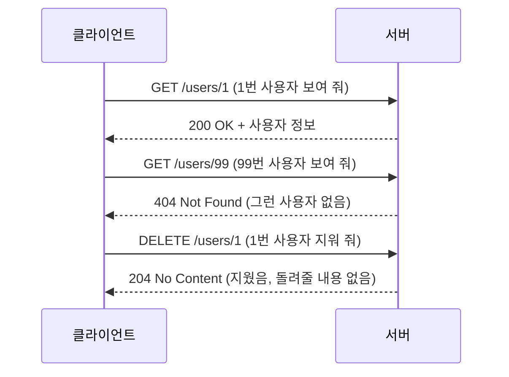
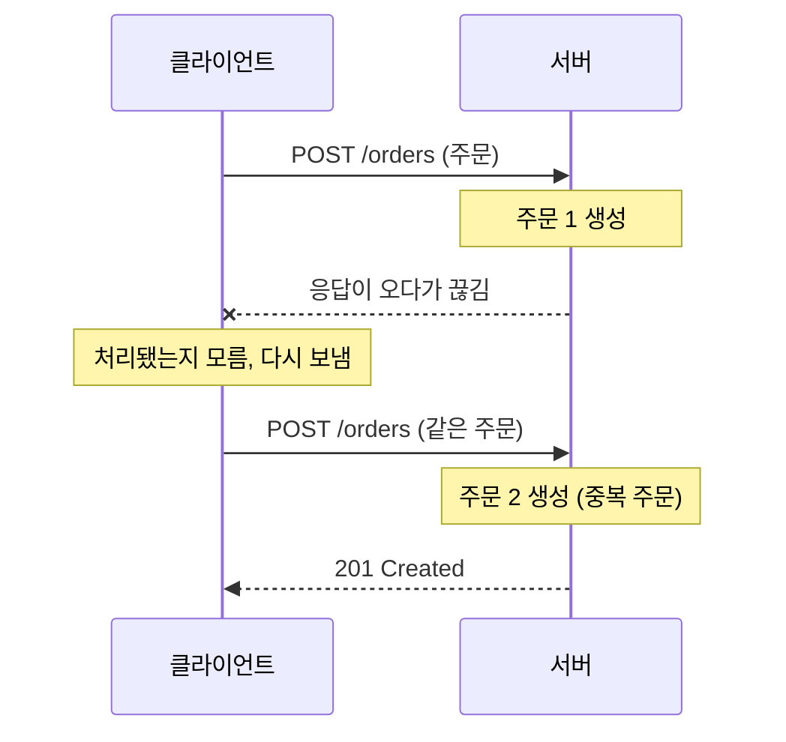
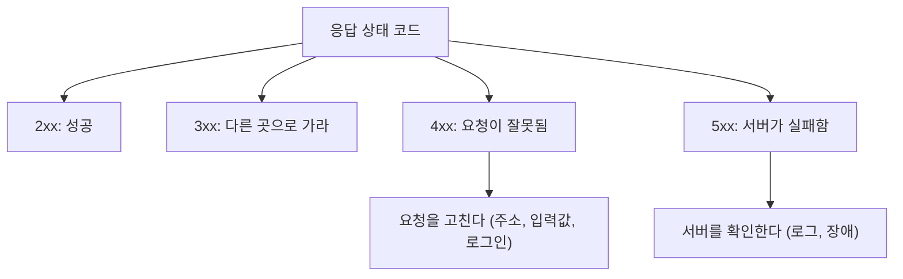
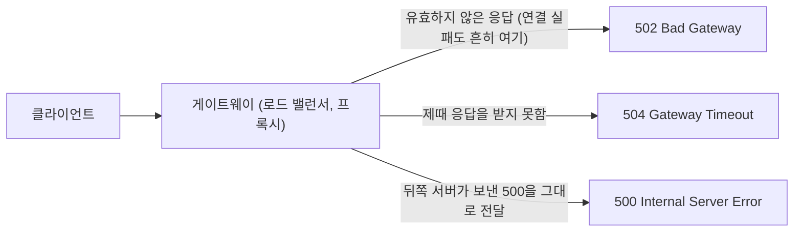

## HTTP 메서드와 상태 코드란 ?
- HTTP 메서드는 클라이언트가 요청하면서 무엇을 하고 싶은지 서버에 알리는 표시다. 조회, 생성, 수정, 삭제 같은 의도를 담는다
- HTTP 상태 코드는 서버가 응답하면서 요청이 어떻게 처리되었는지 알리는 세 자리 숫자다
- [클라이언트-서버 구조](../../클라이언트-서버%20구조(Client-Server%20Architecture)/README.md)의 요청-응답에서 요청 첫 줄의 맨 앞 단어가 메서드, 응답 첫 줄의 세 자리 숫자가 상태 코드다

### HTTP (HyperText Transfer Protocol)
Hyper는 넘어선, Text는 글, Transfer는 옮기다라는 뜻이다. Protocol의 사전적 의미는 외교 의례다([클라이언트-서버 구조](../../클라이언트-서버%20구조(Client-Server%20Architecture)/README.md)의 프로토콜 참고).
공학적으로는 웹에서 클라이언트와 서버가 데이터를 주고받을 때 지키는 약속이다. 링크로 다른 문서로 건너뛸 수 있는 글(하이퍼텍스트)을 옮기려고 만들어졌고, 지금은 글뿐 아니라 이미지, JSON 등 거의 모든 데이터를 옮긴다.

### 메서드 (Method)
사전적 의미는 방법, 방식이다.
공학적으로는 요청 대상인 자원(Resource)을 어떤 방식으로 다룰지를 말한다. 자원은 사용자 정보, 게시글, 이미지처럼 주소로 가리킬 수 있는 대상이다. 같은 주소 /users/1에 보내더라도 GET이면 보여 달라는 뜻이고, DELETE면 지워 달라는 뜻이 된다.

### 상태 코드 (Status Code)
Status는 상태, Code는 약속된 기호다.
공학적으로는 요청을 처리한 결과 상태를 정해진 숫자로 나타낸 것이다. 숫자로 정해 두었기 때문에 사람이 아니라 프로그램도 결과를 바로 판단할 수 있다.

<br/>

## 식당 주문으로 이해하기
식당에서 직원에게 말을 거는 방식은 몇 가지로 정해져 있다. 메뉴를 보여 달라, 이걸 주문하겠다, 주문을 바꾸겠다, 주문을 취소하겠다. 직원의 대답도 몇 가지로 정해져 있다. 나왔습니다, 그 메뉴는 없어요, 주방에 문제가 생겼어요.

| 식당 | HTTP |
| --- | --- |
| 메뉴 보여 주세요 | GET (조회) |
| 이거 주문할게요 | POST (생성) |
| 주문을 통째로 바꿀게요 | PUT (전체 수정) |
| 음료만 바꿀게요 | PATCH (부분 수정) |
| 주문 취소할게요 | DELETE (삭제) |
| 나왔습니다 | 200 OK |
| 그런 메뉴는 없어요 | 404 Not Found |
| 주방에 문제가 생겼어요 | 500 Internal Server Error |

손님이 할 말과 직원이 할 대답을 미리 정해 두면, 처음 가는 식당에서도 주문이 막히지 않는다. HTTP도 메서드와 상태 코드를 표준으로 정해 두었기 때문에 처음 보는 서버와도 대화할 수 있다.

<br/>

## 요청과 응답 생김새
HTTP 요청과 응답은 사람이 읽을 수 있는 글자로 되어 있다. 아래는 HTTP/1.1 기준이다.

```http
GET /users/1 HTTP/1.1
Host: example.com
Accept: application/json
```

첫 줄은 요청 줄(Request Line)이다. 메서드(GET), 대상 경로(/users/1), HTTP 버전 순서로 쓴다. 그 아래 줄들은 헤더(Header)로, 요청에 붙는 부가 정보다.

```http
HTTP/1.1 200 OK
Content-Type: application/json

{"id":1,"name":"철수"}
```

응답 첫 줄은 상태 줄(Status Line)이다. HTTP 버전, 상태 코드(200), 사람이 읽기 위한 설명(OK) 순서로 쓴다. 헤더 다음 빈 줄 아래가 실제 데이터인 본문(Body)이다.



<br/>

## 자주 쓰는 메서드
### GET
Get은 얻다, 가져오다라는 뜻이다. 자원을 조회한다. 서버의 데이터를 바꾸지 않는다. 브라우저 주소창에 주소를 입력하거나 링크를 누르면 GET 요청이 나간다. 보낼 조건은 본문 대신 주소 뒤 [쿼리스트링](../쿼리스트링(Query%20String)/README.md)에 붙인다.

### POST
Post는 우편으로 부치다, 게시판에 붙이다라는 뜻이다. 서버에 데이터를 보내 새 자원을 만들거나 처리를 맡긴다. 회원가입, 글쓰기, 결제처럼 보낼 데이터가 있을 때 쓰고, 그 데이터는 본문에 담는다.

### PUT
Put은 놓다, 두다라는 뜻이다. 지정한 자리에 보낸 내용을 통째로 놓는다. 이미 있으면 보낸 내용으로 전부 바꾸고, 보내지 않은 항목은 사라질 수 있다. 서버에 따라 없으면 새로 만들기도 한다.

### PATCH
Patch는 옷에 덧대는 헝겊 조각, 땜질이라는 뜻이다. 자원의 일부만 고친다. 이름만 바꾸고 싶으면 이름만 보낸다. 해진 곳에만 천을 덧대는 것과 같다.

### DELETE
Delete는 지우다라는 뜻이다. 자원을 삭제한다.

### 그 밖의 메서드
HEAD는 GET과 같은데 본문 없이 헤더만 받는다. 파일 크기나 수정 시각만 확인할 때 쓴다. OPTIONS는 그 자원에 어떤 메서드를 쓸 수 있는지 묻는다. 브라우저가 다른 출처로 요청하기 전에 미리 허락을 묻는 교차 출처 리소스 공유(CORS, Cross-Origin Resource Sharing)의 [사전 요청](../CORS(Cross-Origin%20Resource%20Sharing)/README.md#사전-요청의-모양)이 이 메서드를 쓴다. TRACE는 받은 요청을 그대로 되돌려 보내 달라는 메서드로, 요청이 중간에 어떻게 바뀌었는지 점검할 때 쓴다.

| 메서드 | 하는 일 | 본문 | 예시 |
| --- | --- | --- | --- |
| GET | 조회 | 보통 없음 | GET /users/1 |
| POST | 생성, 처리 요청 | 있음 | POST /users |
| PUT | 전체 교체 | 있음 | PUT /users/1 |
| PATCH | 일부 수정 | 있음 | PATCH /users/1 |
| DELETE | 삭제 | 보통 없음 | DELETE /users/1 |

### PUT과 PATCH의 차이
사용자 정보가 이름, 이메일, 나이로 되어 있다고 해 보자. 이름만 바꾸고 싶을 때 PATCH로는 이름만 보내면 된다. PUT은 통째로 교체하므로 이름, 이메일, 나이를 모두 보내야 한다. PUT에 이름만 보내면 이메일과 나이가 비어 버릴 수 있다.

<br/>

## 안전과 멱등
메서드를 구분할 때 중요한 성질이 두 가지 있다.

### 안전 (Safe)
Safe의 사전적 의미는 위험이 없다는 것이다.
공학적으로는 클라이언트가 서버의 상태를 바꿔 달라고 요청하지도, 바뀌기를 기대하지도 않는 메서드를 말한다(RFC 9110). GET, HEAD, OPTIONS, TRACE가 여기에 해당한다. 서버가 요청마다 접속 기록(로그)을 남기는 정도의 변화는 클라이언트가 요청한 것이 아니므로 안전을 깨지 않는다. 메뉴판은 몇 번을 봐도 식당에 아무 일도 생기지 않는 것과 같다. 그래서 브라우저는 사용자가 누르기 전에 링크를 미리 불러오기도 하고, 검색 로봇은 링크를 마음껏 따라간다.

메서드는 약속일 뿐이라 서버가 GET 요청에 데이터를 지우도록 만들 수도 있다. 하지만 그러면 브라우저, 캐시, 검색 엔진 로봇처럼 이 약속을 믿고 움직이는 프로그램들이 오작동한다. 링크를 따라가며 GET을 보내는 검색 로봇이 데이터를 지워 버리는 식이다. 그래서 메서드는 뜻에 맞게 쓴다.

### 멱등 (Idempotent)
멱(冪)은 거듭제곱, 등(等)은 같다는 뜻이다. 거듭해도 같다는 말이 된다. 영어 Idempotent도 라틴어 idem(같은)과 potens(힘)에서 온 말이다. 수학에서 power는 거듭제곱이므로 거듭제곱해도 같다는 뜻이 되어, 한자어 멱등과 같은 구조다. 수학에서는 여러 번 적용해도 한 번 적용한 것과 결과가 같은 연산을 말한다.
공학적으로는 같은 요청을 여러 번 보내도 서버의 최종 상태가 한 번 보낸 것과 같은 메서드를 말한다. 엘리베이터 호출 버튼은 한 번 누르든 열 번 누르든 엘리베이터가 한 번 온다. 반면 자판기 구매 버튼은 누를 때마다 음료가 하나씩 더 나온다. 앞의 것이 멱등이고 뒤의 것은 멱등이 아니다.

- DELETE /users/1은 한 번 보내면 1번이 지워진다. 두 번 보내도 1번이 지워진 상태 그대로다. 멱등이다
- PUT /users/1에 같은 내용을 여러 번 보내도 같은 내용으로 덮어쓸 뿐이다. 멱등이다
- POST /users를 두 번 보내면 사용자가 두 명 만들어진다. 멱등이 아니다

응답까지 같을 필요는 없다. DELETE를 두 번 보내면 첫 번째는 204, 두 번째는 404가 올 수 있지만, 서버 상태는 같으므로 멱등이다.

### 왜 중요할까
요청을 보냈는데 응답이 오기 전에 네트워크가 끊겼다고 해 보자. 클라이언트는 서버가 요청을 처리했는지 알 수 없다. 멱등한 요청이면 그냥 다시 보내면 된다. 이미 처리됐어도 결과가 같기 때문이다. 멱등하지 않은 POST를 다시 보내면 주문이 두 번 들어가거나 결제가 두 번 될 수 있다. 결제 버튼을 두 번 누르지 말라는 안내가 붙는 이유다.



| 메서드 | 안전 | 멱등 |
| --- | --- | --- |
| GET, HEAD, OPTIONS, TRACE | 예 | 예 |
| PUT, DELETE | 아니오 | 예 |
| POST | 아니오 | 아니오 |
| PATCH | 아니오 | 보장하지 않음 |

PATCH는 "나이를 30으로 바꿔"처럼 쓰면 여러 번 보내도 같지만, "나이를 1 늘려"처럼 쓰면 보낼 때마다 결과가 달라진다. 그래서 PATCH를 정의한 표준 문서(RFC 5789)는 PATCH가 안전하지도 멱등하지도 않다고 하면서, 멱등하게 쓰도록 요청을 만들 수는 있다고 덧붙인다.

<br/>

## 상태 코드 읽는 법
상태 코드는 첫 자리 숫자만 봐도 큰 뜻을 알 수 있다.

| 범위 | 뜻 | 식당으로 치면 |
| --- | --- | --- |
| 1xx | 정보. 최종 응답 전에 진행 상황을 알리는 중간 응답 | 주문 받았어요, 잠시만요 |
| 2xx | 성공 | 나왔습니다 |
| 3xx | 리다이렉션. 다른 곳으로 가라 | 그 메뉴는 2층에서 팔아요 |
| 4xx | 클라이언트 오류. 요청이 잘못됐다 | 주문을 잘못하셨어요 |
| 5xx | 서버 오류. 서버가 처리하지 못했다 | 주방에 문제가 생겼어요 |

4xx와 5xx를 구분하는 게 특히 중요하다. 4xx는 요청을 고쳐야 하고, 5xx는 요청은 맞는데 서버 쪽 문제다. 오류가 났을 때 어느 쪽을 봐야 하는지 이 숫자로 먼저 갈린다.



<br/>

## 자주 보는 상태 코드
### 2xx 성공
- 200 OK는 요청이 성공했다는 뜻이다. 조회 결과 같은 내용을 본문에 담는다
- 201 Created는 새 자원을 만들었다는 뜻이다. 주로 POST로 생성에 성공했을 때 쓴다
- 204 No Content는 성공했지만 돌려줄 본문이 없다는 뜻이다. 삭제에 성공했을 때 자주 쓴다

### 3xx 리다이렉션
Redirect는 다른 방향으로 돌리다라는 뜻이다. 301, 302, 307, 308처럼 다른 주소로 보내는 응답은 Location 헤더에 새 주소를 담고, 브라우저가 그 주소로 다시 요청한다.

- 301 Moved Permanently는 주소가 영원히 바뀌었다는 뜻이다. 가게가 이사 간 것과 같다. 검색 엔진도 새 주소를 기억한다
- 302 Found는 잠시 다른 주소로 가라는 뜻이다. 로그인하지 않은 사용자를 로그인 페이지로 보낼 때 자주 쓴다
- 307 Temporary Redirect와 308 Permanent Redirect는 각각 302, 301과 뜻이 같지만, 다시 요청할 때 메서드를 바꾸면 안 된다. 301과 302는 옛 브라우저 동작 때문에 POST로 보낸 요청을 GET으로 바꿔 다시 보내는 것이 허용된다(RFC 9110). POST를 그대로 옮겨 보내야 하면 307이나 308을 쓴다
- 304 Not Modified는 브라우저가 저장해 둔 사본이 아직 최신인지 물었을 때, 바뀌지 않았다고 답하는 코드다. 본문 없이 이 코드만 오고 브라우저는 사본을 그대로 쓴다. 3xx에 속하지만 다른 곳으로 보내지는 않는다

### 4xx 클라이언트 오류
- 400 Bad Request는 요청 형식이 잘못됐다는 뜻이다. 필수 값이 빠졌거나 JSON이 깨졌을 때 쓴다
- 401 Unauthorized는 누구인지 확인되지 않았다는 뜻이다. 로그인이 필요할 때 쓴다. 401을 보낼 때는 어떤 방식으로 인증하면 되는지 알리는 WWW-Authenticate 헤더를 반드시 함께 보낸다
- 403 Forbidden은 서버가 요청을 이해했지만 들어주지 않겠다는 뜻이다. 일반 회원이 관리자 페이지에 들어갈 때처럼, 누구인지는 확인했지만 권한이 없을 때 주로 쓴다. 표준은 로그인 여부와 상관없이 거절할 때도 이 코드를 쓸 수 있게 한다
- 404 Not Found는 요청한 자원이 없다는 뜻이다
- 405 Method Not Allowed는 그 자원에 그 메서드를 쓸 수 없다는 뜻이다. 조회만 되는 주소에 DELETE를 보낼 때 쓴다. 이때 그 자원에 쓸 수 있는 메서드 목록을 Allow 헤더로 반드시 함께 보낸다
- 409 Conflict는 지금 서버 상태와 충돌한다는 뜻이다. 이미 있는 아이디로 가입하려 할 때 쓴다
- 429 Too Many Requests는 짧은 시간에 요청을 너무 많이 보냈다는 뜻이다

인증(Authentication)은 누구인지 확인하는 것이고, 인가(Authorization)는 그 사람이 무엇을 할 수 있는지 정하는 것이다. 401과 403은 자주 헷갈린다. 흔히 쓰는 경우로 비유하면, 401은 신분증을 안 보여 준 것이고, 403은 신분증은 확인했는데 출입 명단에 없는 것이다. 401의 이름은 Unauthorized(권한 없음)지만 실제 뜻은 인증되지 않음(Unauthenticated)에 가깝다. 이름에 인가(Authorization)가 들어 있지만 실제로는 인증 문제를 알리는 코드라서 헷갈리는 것이다.

### 5xx 서버 오류
- 500 Internal Server Error는 서버 안에서 예상하지 못한 오류가 났다는 뜻이다. 서버 코드에서 처리하지 못한 예외가 대표적이다
- 502 Bad Gateway는 중간에서 요청을 넘겨주는 서버(게이트웨이)가 뒤쪽 서버에서 유효하지 않은 응답을 받았다는 뜻이다. 표준(RFC 9110)이 정한 뜻은 여기까지다. 실제로는 뒤쪽 서버에 아예 연결하지 못했을 때도 502를 주는 제품이 많아서, [로드 밸런서](../../로드%20밸런싱(Load%20Balancing)/README.md) 뒤의 서버가 꺼져 연결이 거절될 때 흔히 본다. 이런 경우에 어떤 코드를 줄지는 게이트웨이 제품마다 다를 수 있다
- 503 Service Unavailable은 서버가 지금 요청을 받을 수 없다는 뜻이다. 점검 중이거나 과부하일 때 쓴다
- 504 Gateway Timeout은 중간 서버가 뒤쪽 서버에서 제때 응답을 받지 못했다는 뜻이다. 연결을 맺는 단계에서 시간이 지나도 504를 주는 제품이 있다



### 실패했는데 200을 보내는 응답
오류가 났는데도 상태 코드는 200으로 보내고 본문에만 실패라고 쓰는 서버가 있다. 이러면 클라이언트는 본문을 열어 보기 전까지 실패인지 알 수 없고, 캐시나 모니터링 도구는 성공으로 착각한다. 상태 코드는 실제 결과에 맞게 보낸다.

<br/>

## 코드로 보기
Node.js의 http 모듈로 만든 작은 서버다. 클라이언트 쪽 fetch는 Node.js 18 이상에서 따로 설치 없이 쓸 수 있다. 메서드와 주소를 보고 처리한 뒤, 결과에 맞는 상태 코드를 보낸다.

```js
// server.js
const http = require('http');

const users = { 1: { id: 1, name: '철수' } };
let nextId = 2;

function send(res, status, body) {
  res.writeHead(status, { 'Content-Type': 'application/json' });
  res.end(body ? JSON.stringify(body) : '');
}

http.createServer((req, res) => {
  const match = req.url.match(/^\/users\/(\d+)$/);

  // GET /users/1: 조회
  if (req.method === 'GET' && match) {
    const user = users[match[1]];
    return user ? send(res, 200, user) : send(res, 404, { message: '없는 사용자' });
  }

  // POST /users: 생성
  if (req.method === 'POST' && req.url === '/users') {
    let data = '';
    req.on('data', (part) => (data += part));
    req.on('end', () => {
      try {
        const { name } = JSON.parse(data);
        if (!name) return send(res, 400, { message: '이름이 필요함' });
        const user = { id: nextId++, name };
        users[user.id] = user;
        send(res, 201, user);
      } catch {
        send(res, 400, { message: 'JSON 형식이 아님' });
      }
    });
    return;
  }

  // DELETE /users/1: 삭제
  if (req.method === 'DELETE' && match) {
    if (!users[match[1]]) return send(res, 404, { message: '없는 사용자' });
    delete users[match[1]];
    return send(res, 204);
  }

  send(res, 404, { message: '없는 주소' });
}).listen(3000);
```

```js
// client.js
const base = 'http://localhost:3000';

async function call(method, path, body) {
  const res = await fetch(base + path, { method, body });
  console.log(method, path, res.status, res.statusText);
}

(async () => {
  await call('GET', '/users/1');                          // GET /users/1 200 OK
  await call('POST', '/users', '{"name":"영희"}');        // POST /users 201 Created
  await call('POST', '/users', '이름');                   // POST /users 400 Bad Request
  await call('DELETE', '/users/1');                       // DELETE /users/1 204 No Content
  await call('DELETE', '/users/1');                       // DELETE /users/1 404 Not Found
  await call('GET', '/users/1');                          // GET /users/1 404 Not Found
})();
```

DELETE를 두 번 보낸 부분을 보면, 응답은 204와 404로 다르지만 1번 사용자가 없는 상태는 같다. 앞에서 본 멱등의 뜻 그대로다.

<br/>

## 더 볼 것 (TODO)
- [HTTP 헤더 (Content-Type, Authorization, Cache-Control 등)](../HTTP%20헤더(HTTP%20Headers)/README.md)
- [HTTP 버전별 차이 (HTTP/1.1, HTTP/2, HTTP/3)](../HTTP%20버전(HTTP%20Versions)/README.md)
- [HTTPS와 TLS](../HTTPS와%20TLS(HTTPS%20and%20TLS)/README.md)
- [HTTP 캐시와 조건부 요청 (ETag, Last-Modified)](../HTTP%20캐시(HTTP%20Caching)/README.md)
- [REST API 설계 원칙](../REST%20API%20설계%20원칙(REST%20API%20Design%20Principles)/README.md)
- [멱등하지 않은 요청을 안전하게 다시 보내는 방법 (멱등 키)](../멱등%20키(Idempotency%20Key)/README.md)
- [HTTP 메서드별 API 테스트 체크리스트](../../../SoftwareTest/API%20테스트%20체크리스트(API%20Test%20Checklist)/README.md)
