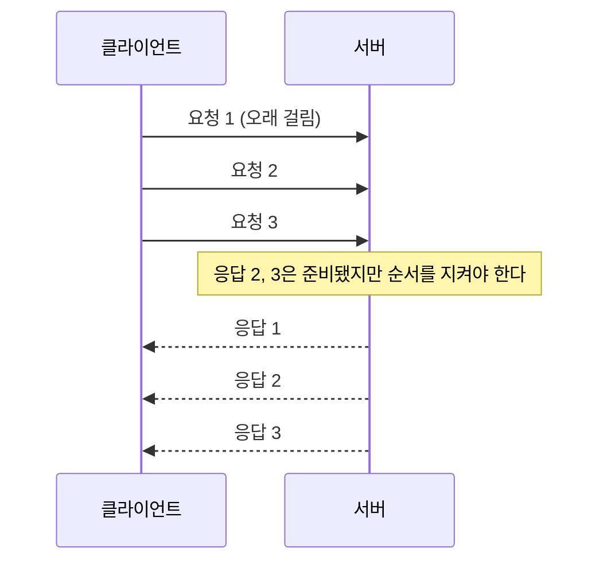
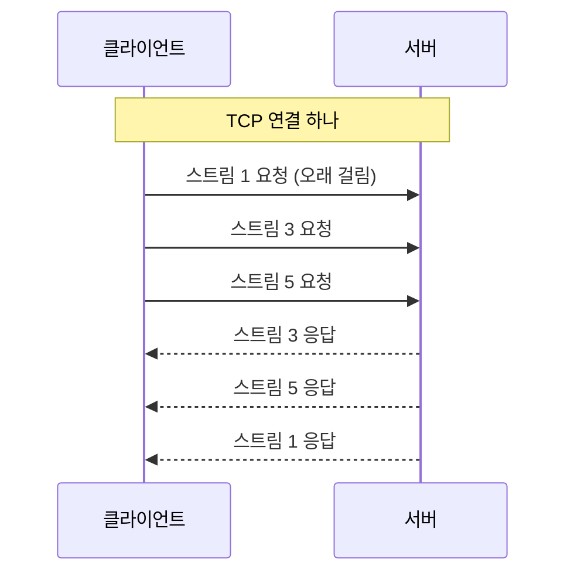
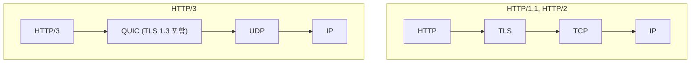

## HTTP 버전이란 ?
- HTTP는 처음 나온 뒤 HTTP/1.0, HTTP/1.1, HTTP/2, HTTP/3로 버전이 바뀌어 왔다. 이 노트는 버전마다 무엇이 달라졌고 왜 바꿨는지를 다룬다
- 버전이 바뀌어도 메서드, 상태 코드, 헤더의 뜻은 그대로다. 바뀐 것은 그 내용을 연결 위에 어떤 모양으로 싣고, 연결을 어떻게 쓰느냐다
- 메서드와 상태 코드는 [HTTP 메서드와 상태 코드](../HTTP%20메서드와%20상태%20코드(HTTP%20Methods%20and%20Status%20Codes)/README.md), 헤더는 [HTTP 헤더](../HTTP%20헤더(HTTP%20Headers)/README.md) 문서에 정리했다

### 버전 (Version)
사전적 의미는 판(版)이다. 같은 책을 고쳐 다시 찍으면 초판, 개정판처럼 판이 달라진다. 라틴어로 돌리다, 바꾸다라는 말에서 왔다.
공학적으로는 같은 이름의 프로그램이나 약속을 고쳐 낸 차례를 말한다. HTTP 버전 번호는 점을 사이에 둔 숫자 두 개로 쓴다. 앞 숫자(주 버전)는 메시지를 적는 형식이 바뀌었음을 뜻하고, 뒤 숫자(부 버전)는 같은 형식 안에서 어디까지 이해하는지를 뜻한다(RFC 9110 2.5절). HTTP/2와 HTTP/3는 뒤 숫자 없이 주 버전만 쓴다.

<br/>

## 버전이 달라도 그대로인 것
같은 내용의 편지를 손편지로 보내든, 팩스로 보내든, 이메일로 보내든 편지에 적힌 말의 뜻은 같다. 바뀌는 것은 종이에 쓰느냐 전기 신호로 보내느냐, 얼마나 빨리 가느냐다.

HTTP도 같다. GET은 어느 버전에서나 조회이고, 404는 어느 버전에서나 없음이고, Content-Type은 어느 버전에서나 본문 형식이다. 표준 문서도 이 둘을 나눠 두었다. 2022년에 나온 RFC 9110(HTTP Semantics)이 모든 버전이 함께 쓰는 의미(semantics)를 정하고, 각 버전 문서는 그 뜻을 연결 위에 어떻게 싣는지만 정한다. RFC 9110은 HTTP의 핵심 의미는 버전이 바뀌어도 변하지 않고, 회선 위에서 표현되는 모양이 바뀔 때 버전 번호가 바뀐다고 설명한다(2.5절). 아래 네 문서는 모두 2022년 6월에 함께 나왔다.

| 문서 | 다루는 것 |
| --- | --- |
| RFC 9110 | 모든 버전이 함께 쓰는 의미 (메서드, 상태 코드, 헤더) |
| RFC 9112 | HTTP/1.1 메시지 형식과 연결 관리 |
| RFC 9113 | HTTP/2 |
| RFC 9114 | HTTP/3 |

그래서 서버 코드에서 요청을 읽는 방식(메서드 보고, 경로 보고, 상태 코드 정해 보내기)은 버전이 바뀌어도 거의 그대로다. 버전 차이는 대부분 그 아래, 연결을 다루는 쪽에서 생긴다. [쿼리스트링](../쿼리스트링(Query%20String)/README.md) 노트에서 HTTP/2부터는 요청 줄 대신 `:path` 라는 자리에 경로가 실린다고 한 것도 같은 이야기다. 경로의 뜻은 같고 싣는 자리만 바뀌었다.

<br/>

## HTTP/1.0: 요청마다 새 연결
### 어떻게 동작했나
HTTP/1.0은 1996년 5월 RFC 1945로 정리되었다. 이 문서는 표준(Standards Track)이 아니라 당시 쓰던 방식을 기록한 정보 문서(Informational)다.

RFC 1945에 따르면 당시의 관행은 클라이언트가 요청마다 연결을 맺고, 서버가 응답을 보낸 뒤 연결을 닫는 것이었다. 그림 열 장이 있는 페이지라면 HTML 한 번, 그림 열 번, 모두 열한 번 연결을 맺고 끊는다.

전화로 질문 하나 하고 끊고, 다음 질문이 생기면 다시 번호를 누르는 것과 같다. 질문은 짧은데 전화를 거는 시간이 매번 붙는다.

### 왜 문제였나
[TCP 연결 과정](../../Network/TCP%20연결%20과정(TCP%20Handshake)/README.md#연결에는-비용이-든다) 문서에서 본 것처럼 연결을 맺는 데는 왕복 한 번이 꼭 든다. 요청마다 이 비용을 다시 내면 데이터를 보내는 시간보다 연결을 맺는 시간이 더 길어지기도 한다. 그래서 HTTP/1.0 시절에도 `Connection: keep-alive` 를 보내 연결을 유지하는 방식이 쓰였지만, 기본 동작이 아니라 양쪽이 따로 합의해야 하는 실험적 기능이었다(RFC 2068 19.7.1절).

<br/>

## HTTP/1.1: 한 연결을 여러 번 쓴다
HTTP/1.1은 1997년 1월 RFC 2068로 처음 표준이 되었고, 1999년 RFC 2616, 2014년 RFC 7230~7235로 고쳐졌다. 지금은 의미를 RFC 9110이, HTTP/1.1 메시지 형식과 연결 관리를 RFC 9112가 맡는다(둘 다 2022년 6월).

### 지속 연결 (Persistent Connection)
Persistent의 사전적 의미는 끈질긴, 계속 이어지는.
공학적으로는 응답 하나를 보낸 뒤에도 연결을 닫지 않고 다음 요청에 다시 쓰는 연결을 말한다. HTTP/1.1에서는 이것이 기본이다(RFC 9112 9.3절). 닫으려는 쪽은 `Connection: close` 를 보내 이 응답 뒤에 닫겠다고 알린다. 한동안 요청이 없어도 닫힐 수 있다(아래 timeout).

전화 한 통에 질문 여러 개를 이어서 하는 것과 같다. 번호를 누르는 시간은 처음 한 번만 든다.

Keep-Alive라는 이름은 HTTP/1.0 시절 연결을 유지해 달라고 따로 부탁하던 방식에서 왔다. HTTP/1.1에서는 부탁하지 않아도 유지되지만, 지금도 서버가 `Connection: keep-alive` 와 `Keep-Alive: timeout=5` 같은 헤더를 붙여 보내는 경우가 있다. 아래 직접 확인해 보기에서 Node.js 서버가 실제로 이렇게 보냈다. `timeout=5` 는 5초 동안 다음 요청이 없으면 연결을 닫겠다는 서버의 안내다.

### Host 헤더가 필수가 되었다
HTTP/1.1부터 클라이언트는 모든 요청에 Host 헤더를 반드시 보내야 하고, Host가 없는 HTTP/1.1 요청에 서버는 400 Bad Request로 답해야 한다(RFC 9112 3.2절). RFC 1945에는 Host 헤더가 정의되어 있지 않다.

IP 주소 하나에 사이트 여러 개를 함께 올리는 일이 흔해졌기 때문이다. 연결은 IP 주소와 포트로 맺으니, 연결만 보고는 어느 사이트로 온 요청인지 알 수 없다. 한 건물에 회사가 여러 개 있으면 건물 주소만으로는 부족하고 회사 이름을 적어야 하는 것과 같다. Host 헤더 자체는 [HTTP 헤더](../HTTP%20헤더(HTTP%20Headers)/README.md) 문서에 정리했다.

### 파이프라이닝 (Pipelining)
Pipeline의 사전적 의미는 송유관. 기름을 한 번에 한 통씩 나르지 않고 관으로 계속 흘려보낸다.
공학적으로는 앞 요청의 응답을 기다리지 않고 다음 요청을 연달아 보내는 방식을 말한다. HTTP/1.1이 허용하는 방식인데, 조건이 하나 있다. 서버는 응답을 요청이 들어온 순서대로 보내야 한다(RFC 9112 9.3.2절).

식당에서 주문을 한꺼번에 불러 줄 수는 있지만, 음식은 부른 순서대로만 나오는 것과 같다.

### HOL 블로킹 (Head-of-Line Blocking)
Head of line은 줄의 맨 앞, Blocking은 막힘이다. 줄 맨 앞이 막혀 뒤가 함께 막힌다는 이름이다.
공학적으로는 줄 맨 앞의 작업이 늦어지면 뒤의 작업이 준비되어 있어도 함께 기다리는 현상을 말한다.

파이프라이닝에서 응답 순서가 정해져 있으니 이 문제가 바로 생긴다. 첫 요청이 오래 걸리는 작업이라면 두 번째, 세 번째 응답은 이미 만들어졌어도 첫 응답이 나갈 때까지 내보낼 수 없다. 앞의 식당으로 보면, 1번 테이블 요리가 오래 걸리면 2번, 3번 테이블 음식이 이미 다 됐어도 1번이 나갈 때까지 주방에 두어야 하는 것과 같다.



RFC 9113 1절에 따르면 HTTP/1.1의 파이프라이닝은 동시 요청 문제를 일부만 풀었고 HTTP 수준의 HOL 블로킹이 남았다. 브라우저가 파이프라이닝을 기본으로 쓰는지는 확인 필요다.

### 그래서 연결을 여러 개 연다
한 연결에서 요청을 동시에 처리하기 어려우니, 클라이언트는 같은 서버에 연결을 여러 개 열어 동시에 요청한다(RFC 9113 1절). 주방 하나로 모자라 주방을 몇 개 더 여는 셈이다.

다만 연결마다 핸드셰이크 비용이 들고 서버 자원도 든다. 1999년 RFC 2616은 한 사용자가 한 서버에 연결을 2개까지만 유지하라고 권했지만, 지금의 RFC 9112는 이 숫자가 현실에 맞지 않았다며 상한을 정하지 않고 적게 열라고만 권한다(9.4절). 브라우저가 실제로 몇 개까지 여는지는 브라우저마다 다르고, 정확한 값은 확인 필요다.

<br/>

## HTTP/2: 연결 하나에 대화 여러 개
HTTP/2는 2015년 5월 RFC 7540으로 나왔고, 지금 기준 문서는 2022년 6월의 RFC 9113이다. 목표는 연결을 여러 개 열지 않고도 연결 하나에서 요청 여러 개를 동시에 처리하는 것이다. HTTP 아래의 TCP는 그대로 쓴다.

### 바이너리 프레임 (Binary Frame)
Binary는 둘로 된, 이진의. Frame은 틀, 액자다.
공학적으로는 메시지를 사람이 읽는 글자 줄 대신, 각 칸의 자리와 길이가 미리 정해진 틀에 나눠 담은 단위를 말한다. HTTP/1.1 메시지는 글자로 된 줄을 빈 줄과 줄바꿈으로 구분하지만, HTTP/2는 모든 것을 프레임에 담는다. 프레임은 길이와 종류, 어느 스트림 소속인지를 적은 9바이트 머리로 시작한다(RFC 9113 4.1절). 헤더는 HEADERS 프레임에, 본문은 DATA 프레임에 실린다.

편지를 정해진 모양의 봉투 여러 장에 나눠 담고, 봉투마다 몇 번 편지에 속하는지와 내용물 길이를 적는 것과 같다. 받는 쪽은 줄바꿈을 찾아 읽을 필요 없이 봉투에 적힌 길이만큼 읽으면 된다.

그래서 HTTP/2 메시지는 HTTP/1.1처럼 사람이 그대로 읽을 수 없다. 대신 요청 줄과 상태 줄에 있던 정보는 `:method`, `:path`, `:status` 같은 이름(의사 헤더, pseudo-header)으로 헤더 자리에 실린다.

### 스트림 (Stream)과 다중화 (Multiplexing)
Stream의 사전적 의미는 시내, 흐름. Multiplex는 여러 겹이라는 뜻이다.
공학적으로 스트림은 한 연결 안에서 요청 하나와 그 응답이 오가는 독립된 흐름이고, 다중화는 연결 하나에 스트림 여러 개를 섞어 보내는 것을 말한다. 프레임마다 스트림 번호가 적혀 있으니, 서로 다른 요청의 프레임이 섞여 와도 받는 쪽이 번호를 보고 다시 나눌 수 있다. 클라이언트가 여는 스트림은 홀수 번호를 쓴다(RFC 9113 5.1.1절).

택배 회사가 여러 집 상자를 트럭 여러 대에 섞어 싣고 상자마다 주소표를 붙이는 것과 같다. 집마다 전용 트럭을 따로 보내지 않아도 되고, 먼저 준비된 상자부터 실을 수 있다.



응답 순서가 묶여 있지 않으니 HTTP/1.1 파이프라이닝의 HOL 블로킹이 HTTP 수준에서는 사라진다. 아래 직접 확인해 보기에서 실제로 늦게 보낸 요청의 응답이 먼저 오는 것을 볼 수 있다.

### 헤더 압축 (HPACK)
HTTP 요청에는 매번 거의 같은 헤더가 붙는다. 같은 사이트에 보내는 요청이라면 Host(HTTP/2에서는 `:authority`), User-Agent, Accept 같은 값이 요청마다 똑같이 반복된다. HTTP/2는 이 반복을 줄이려고 HPACK이라는 압축 방식을 쓴다(RFC 7541, 2015년 5월).

원리는 표를 같이 들고 있는 것이다. 자주 쓰는 헤더 이름과 값을 미리 정한 고정 표(static table)와, 이 연결에서 한 번 보낸 헤더를 기억해 두는 표(dynamic table)를 양쪽이 함께 가진다. 이미 표에 있는 헤더는 글자 전체 대신 표의 번호만 보낸다. 단골 가게에서 메뉴 이름을 다 말하지 않고 늘 먹던 걸로 주세요라고만 하는 것과 같다.

HTTP/3는 같은 생각을 뒤에서 볼 QUIC에 맞게 고친 QPACK(RFC 9204)을 쓴다. 표가 어떻게 생겼고 어떻게 갱신되는지는 별도 문서로 미룬다.

### 서버 푸시 (Server Push)
HTTP/2는 서버가 클라이언트가 묻기 전에 필요할 것 같은 응답을 미리 보내는 기능도 만들었다. HTML을 요청하면 그 안에서 쓸 스타일 파일을 함께 보내 주는 식이다. 손님이 시키기 전에 반찬을 미리 내오는 것과 같다.

그런데 RFC 9113 8.4절에 따르면 서버가 클라이언트의 다음 요청을 정확히 예측하기 어렵고, 예측이 틀리면 보낸 데이터만큼 오히려 손해다. Chrome은 106 버전부터 서버 푸시를 기본으로 껐다(Chrome 개발자 블로그 Removing HTTP/2 Server Push from Chrome, 2022-08-18 글, 2026-10-26 확인). 다른 브라우저의 현황은 확인 필요다.

### 남은 문제: TCP의 HOL 블로킹
HTTP/2는 HTTP 수준의 HOL 블로킹을 풀었지만 TCP 수준의 HOL 블로킹은 남았다(RFC 9113 1절). TCP는 받은 데이터를 보낸 순서 그대로 위로 넘겨준다. 중간 패킷 하나가 사라지면, 그 패킷이 다시 올 때까지 뒤에 도착한 데이터도 넘겨주지 못하고 기다린다.

TCP 입장에서는 스트림이라는 구분이 보이지 않는다. 그래서 스트림 3의 패킷 하나만 사라져도 스트림 1과 5까지 함께 멈춘다(RFC 9114 1.1절). 앞의 택배로 보면, 물류센터가 트럭 번호 순서대로만 짐을 내려 주는 셈이다. 2번 트럭이 늦으면 이미 도착한 3번 트럭에 실린 다른 집 상자도 내리지 못한다.

<br/>

## HTTP/3: TCP 대신 QUIC
HTTP/3는 2022년 6월 RFC 9114로 나왔다. HTTP의 의미는 그대로 두고, 그 아래의 TCP를 QUIC으로 바꿨다.

### QUIC
QUIC은 2021년 5월 RFC 9000으로 표준이 된 전송 프로토콜이다. 무언가의 줄임말처럼 보이지만 RFC 9000은 QUIC이 줄임말이 아니라 이름이라고 밝힌다. 그래서 이 노트도 사전적 의미 대신 하는 일로 설명한다. 읽을 때는 퀵이라고 한다.

공학적으로 QUIC은 UDP 위에서 동작한다. [소켓](../../Network/소켓(Socket)/README.md) 문서에서 본 것처럼 UDP는 도착도 순서도 보장하지 않는다([UDP](../../Network/UDP(User%20Datagram%20Protocol)/README.md) 참고). 그래서 QUIC이 도착 확인, 재전송, 순서 맞추기를 직접 맡는다. [계층 모델](../../Network/계층%20모델(OSI%20and%20TCP-IP%20Layers)/README.md)로 보면 HTTP/1.1과 HTTP/2는 TCP 위에, HTTP/3는 UDP 위의 QUIC 위에 놓인다.



TLS(Transport Layer Security)는 연결 위에 암호화를 한 겹 덧대는 프로토콜이고, HTTP를 TLS 위에서 쓰는 것이 HTTPS다([HTTPS와 TLS](../HTTPS와%20TLS(HTTPS%20and%20TLS)/README.md) 참고). 그림의 TLS는 HTTPS일 때만 있다. HTTP/3는 QUIC 안에 TLS 1.3이 들어 있어 언제나 암호화된다(RFC 9114 1.2절). 또 http 주소는 TCP로 접속하는 것을 전제로 정해져 있어서, TCP를 쓰지 않는 HTTP/3로는 http 주소에 바로 접속할 수 없다(RFC 9114 3.1.2절).

### 스트림마다 따로 도착한다
HTTP/2에서는 스트림을 TCP 위의 HTTP가 다뤘지만, HTTP/3에서는 전송을 맡는 QUIC이 직접 스트림을 다룬다. 도착 보장도 스트림 단위로 한다(RFC 9114 1.2절). 그래서 스트림 3의 패킷 하나가 사라지면 스트림 3만 그 패킷을 기다리고, 스트림 1과 5는 받은 데이터를 바로 넘긴다.

택배로 보면 물류센터가 집마다 따로 짐을 내려 주는 것과 같다. 2번 트럭의 상자를 기다리는 집만 기다리고, 다른 집 상자는 도착하는 대로 내린다.

### 연결을 맺는 왕복 줄이기
HTTPS를 TCP 위에서 쓰면 TCP 핸드셰이크를 마친 뒤 TLS 핸드셰이크를 따로 한 번 더 한다. QUIC은 연결 맺기와 암호화 협상을 한 번의 핸드셰이크로 합쳐 연결을 여는 시간을 줄인다(RFC 9000 7절). 출입 명부 작성과 신분 확인을 창구 두 곳에서 따로 하지 않고 한 창구에서 한 번에 하는 것과 같다.

전에 접속한 적이 있는 서버라면 핸드셰이크가 끝나기 전에 첫 요청을 함께 보내는 0-RTT도 쓸 수 있다. RTT(Round Trip Time)는 왕복 시간이고, 0-RTT는 데이터를 보내기 전에 기다리는 왕복이 없다는 뜻이다. 다만 0-RTT로 보낸 데이터는 누군가 가로채 그대로 다시 보내는 공격(재생 공격, replay attack)을 막지 못한다(RFC 9000 5절, RFC 9001 9.2절). 어떤 요청을 0-RTT로 보내도 되는지는 [HTTP 메서드와 상태 코드](../HTTP%20메서드와%20상태%20코드(HTTP%20Methods%20and%20Status%20Codes)/README.md#멱등-idempotent) 문서의 멱등과 이어지는 주제라 별도 문서로 미룬다.

### UDP가 막혀 있으면
회사나 학교 네트워크 중에는 UDP를 막아 둔 곳이 있다. 이때는 QUIC 연결이 맺어지지 않으므로, 클라이언트는 TCP를 쓰는 HTTP 버전으로 돌아가야 한다(RFC 9114 3.1절). HTTP/3가 나왔다고 HTTP/1.1과 HTTP/2가 필요 없어지지 않는 이유 중 하나다. RFC 9110 1.2절도 HTTP/1.1, HTTP/2, HTTP/3 세 버전은 쓰임새마다 장단점이 있어 서로를 대체하지 않는다고 설명한다.

<br/>

## 한눈에 비교
| | HTTP/1.0 | HTTP/1.1 | HTTP/2 | HTTP/3 |
| --- | --- | --- | --- | --- |
| 기준 문서 | RFC 1945 (1996) | RFC 9112 (2022, 처음은 RFC 2068, 1997) | RFC 9113 (2022, 처음은 RFC 7540, 2015) | RFC 9114 (2022) |
| 메시지 모양 | 글자 | 글자 | 바이너리 프레임 | 바이너리 프레임 |
| 아래 전송 | TCP | TCP | TCP | QUIC (UDP 위) |
| 연결 재사용 | 기본은 요청마다 새 연결 | 지속 연결이 기본 | 연결 하나를 길게 씀 | 연결 하나를 길게 씀 |
| 동시 요청 | 연결을 여러 개 연다 | 연결을 여러 개 연다 (파이프라이닝은 응답 순서 고정) | 한 연결에 스트림 여러 개 | 한 연결에 스트림 여러 개 |
| HOL 블로킹 | 연결 하나에 요청 하나라 해당 없음 | HTTP 수준에서 생김 | TCP 수준에서 생김 | 스트림끼리 서로 막지 않음 |
| 헤더 압축 | 없음 | 없음 | HPACK | QPACK |
| 암호화 | 선택 (HTTPS) | 선택 (HTTPS) | 선택 (HTTPS) | 항상 |

HTTP/2도 표준상 TLS 없이 쓸 수 있다(RFC 9113 3.3절). 브라우저가 TLS 없는 HTTP/2를 지원하는지는 확인 필요다.

<br/>

## 버전은 어떻게 정해질까
주소창에 https://example.com을 넣으면 브라우저는 어느 버전으로 말을 걸지 정해야 한다. 주소에는 버전이 적혀 있지 않다.

### ALPN (Application-Layer Protocol Negotiation)
Negotiation의 사전적 의미는 협상이다. 응용 계층(Application Layer) 프로토콜을 협상한다는 이름이다.
공학적으로는 TLS 핸드셰이크 안에서 클라이언트가 쓸 수 있는 프로토콜 목록을 보내고, 서버가 그중 하나를 골라 알려 주는 방식이다(RFC 7301, 2014년 7월). HTTP/2는 `h2`, HTTP/1.1은 `http/1.1`, HTTP/3는 `h3` 라는 이름을 쓴다. 암호화 인사를 하는 김에 버전까지 정하니 왕복이 더 들지 않는다. 처음 만난 사람과 악수하며 한국어와 영어 중 무엇으로 이야기할지 정하는 것과 같다.

### Alt-Svc
HTTP/3는 TCP가 아니라 UDP로 접속하므로, 처음부터 HTTP/3로 말을 걸려면 서버가 HTTP/3를 받는다는 걸 미리 알아야 한다. 그래서 서버는 HTTP/1.1이나 HTTP/2 응답에 Alt-Svc(Alternative Services, 대체 서비스) 헤더를 붙여 HTTP/3로도 받을 수 있다고 알린다(RFC 7838, RFC 9114 3.1.1절). 클라이언트는 이걸 보고 다음부터 QUIC으로 접속을 시도할 수 있다. 가게 문에 옆 창구에서도 받는다는 안내문을 붙여 두는 것과 같다.

<br/>

## 직접 확인해 보기
아래 결과는 2026-10-26에 윈도우 11에서 실행한 값이다. Node.js는 v24.22.1이다.

### curl로 HTTP/1.0과 HTTP/1.1 비교
윈도우 11에 들어 있는 curl.exe 8.21.0으로 실행했다. PowerShell 5.1에서 curl만 치면 curl.exe가 아니라 Invoke-WebRequest가 실행되므로 curl.exe라고 끝까지 적는다.

로컬에 아주 작은 Node.js 서버를 띄웠다.

```js
// server.js
const http = require('http');

http.createServer((req, res) => {
  res.end(`hello ${req.url} ${req.httpVersion}\n`);
}).listen(3000);
```

curl에 주소 두 개를 주면 차례로 요청한다. `-v` 는 주고받은 내용과 연결 과정을 함께 보여 준다.

```powershell
curl.exe -v --http1.0 http://localhost:3000/a http://localhost:3000/b
curl.exe -v --http1.1 http://localhost:3000/a http://localhost:3000/b
```

HTTP/1.0 결과다. 앞줄이 `>` 면 보낸 것, `<` 면 받은 것, `*` 면 curl이 남긴 설명이다. 주소 풀이(DNS) 줄과 Date 헤더 줄은 뺐다.

```text
* Established connection to localhost (::1 port 3000) from ::1 port 61499
* using HTTP/1.x
> GET /a HTTP/1.0
> Host: localhost:3000
> User-Agent: curl/8.21.0
> Accept: */*
>
< HTTP/1.1 200 OK
< Connection: close
<
* shutting down connection #0
* Established connection to localhost (::1 port 3000) from ::1 port 61500
* using HTTP/1.x
> GET /b HTTP/1.0
...
< HTTP/1.1 200 OK
< Connection: close
<
* shutting down connection #1
```

요청마다 연결을 새로 맺었다. 클라이언트 쪽 포트가 61499, 61500으로 다르고, 연결 번호도 #0, #1로 다르다. 서버는 `Connection: close` 를 보내고 응답마다 연결을 닫았다. 포트 번호는 실행할 때마다 바뀐다.

요청은 HTTP/1.0인데 응답 첫 줄이 HTTP/1.1인 것은 이상한 게 아니다. 응답의 버전 번호는 서버가 어느 버전까지 이해하는지를 알리는 값이다(RFC 9110 2.5절). 서버는 상대가 HTTP/1.0인 것을 알고 연결을 닫는 방식으로 맞춰 주었다.

HTTP/1.1 결과다.

```text
* Established connection to localhost (::1 port 3000) from ::1 port 59042
* using HTTP/1.x
> GET /a HTTP/1.1
> Host: localhost:3000
> User-Agent: curl/8.21.0
> Accept: */*
>
< HTTP/1.1 200 OK
< Connection: keep-alive
< Keep-Alive: timeout=5
< Content-Length: 13
<
* Connection #0 to host localhost:3000 left intact
* Reusing existing http: connection with host localhost
> GET /b HTTP/1.1
...
< HTTP/1.1 200 OK
< Connection: keep-alive
< Keep-Alive: timeout=5
< Content-Length: 13
<
* Connection #0 to host localhost:3000 left intact
```

두 번째 요청은 새 연결을 맺지 않고 #0 연결을 다시 썼다(`Reusing existing ... connection` 줄). 지속 연결이다. 연결을 닫지 않으니 응답이 어디서 끝나는지 알려야 해서 서버가 Content-Length를 붙였다. HTTP/1.0 쪽은 연결이 닫히는 것으로 끝을 알 수 있어 이 헤더가 없었다.

### curl로 HTTP/2, HTTP/3 확인
`curl --http2` 와 `curl --http3` 는 curl이 해당 버전을 지원하도록 만들어졌을 때만 쓸 수 있다. `curl.exe -V` 를 쳐서 Features 줄에 HTTP2, HTTP3가 있는지 보면 된다.

이번에 쓴 두 curl(윈도우 11의 curl.exe 8.21.0, Git for Windows에 든 curl 8.7.1)은 둘 다 Features에 HTTP2와 HTTP3가 없었다. `--http2` 를 주면 아래처럼 실행 자체를 거부한다. 그래서 이 노트에는 curl의 HTTP/2, HTTP/3 출력을 넣지 않았고, HTTP/2는 Node.js로 확인했다.

```text
curl: option --http2: the installed libcurl version does not support this
```

### Node.js http2 모듈로 다중화 보기
Node.js에 들어 있는 http2 모듈로 서버와 클라이언트를 한 파일에서 띄운다. 클라이언트는 연결 하나를 맺고 /slow, /fast, /mid 순서로 요청 세 개를 한꺼번에 보낸다. 서버는 /slow를 0.3초, /mid를 0.1초 늦게 답한다.

```js
// h2.js
const http2 = require('http2');

const server = http2.createServer();
server.on('stream', (stream, headers) => {
  const delay = { '/slow': 300, '/fast': 0, '/mid': 100 }[headers[':path']] ?? 0;
  setTimeout(() => {
    stream.respond({ ':status': 200, 'content-type': 'text/plain' });
    stream.end(`${headers[':path']} on stream ${stream.id}`);
  }, delay);
});

server.listen(3001, () => {
  const client = http2.connect('http://localhost:3001');
  let left = 3;
  for (const path of ['/slow', '/fast', '/mid']) {
    const req = client.request({ ':method': 'GET', ':path': path });
    let body = '';
    req.setEncoding('utf8');
    req.on('data', (d) => (body += d));
    req.on('end', () => {
      console.log(body);
      if (--left === 0) { client.close(); server.close(); }
    });
  }
});
```

```text
/fast on stream 3
/mid on stream 5
/slow on stream 1
```

보낸 순서대로 스트림 번호가 1, 3, 5로 붙었고 모두 홀수다. 응답은 준비된 순서인 /fast, /mid, /slow로 왔다. HTTP/1.1 파이프라이닝이었다면 /slow 응답이 나갈 때까지 나머지가 기다렸을 것이다. :path, :status 같은 의사 헤더도 코드에 그대로 보인다.

이 예제는 TLS 없이 처음부터 HTTP/2로 말을 거는 방식(RFC 9113 3.3절)이라 Node.js 클라이언트끼리는 통하지만, 브라우저로 열어 확인하는 용도는 아니다.

### 어떤 버전으로 정해지는지 보기
example.com에 TLS로 접속하면서 ALPN 목록을 바꿔 보내고, 서버가 고른 값을 출력했다. 이어서 HTTP/2로 요청해 Alt-Svc 헤더를 읽었다.

```js
// alpn.js
const tls = require('tls');
const http2 = require('http2');

function ask(protocols) {
  return new Promise((resolve) => {
    const socket = tls.connect(
      { host: 'example.com', port: 443, servername: 'example.com', ALPNProtocols: protocols },
      () => {
        resolve(`offer ${JSON.stringify(protocols)} -> ${socket.alpnProtocol}`);
        socket.end();
      },
    );
    socket.on('error', (e) => resolve(`error ${e.message}`));
  });
}

(async () => {
  console.log(await ask(['h2', 'http/1.1']));
  console.log(await ask(['http/1.1']));

  const client = http2.connect('https://example.com');
  const req = client.request({ ':path': '/' });
  req.on('response', (headers) => {
    console.log('status', headers[':status'], 'alt-svc', headers['alt-svc']);
  });
  req.resume();
  req.on('end', () => client.close());
})();
```

```text
offer ["h2","http/1.1"] -> h2
offer ["http/1.1"] -> http/1.1
status 200 alt-svc h3=":443"; ma=86400
```

`h2` 와 `http/1.1` 을 함께 내밀면 서버는 `h2` 를 골랐고, `http/1.1` 만 내밀면 `http/1.1` 을 골랐다. Alt-Svc 값 `h3=":443"` 은 같은 호스트의 443번 포트에서 HTTP/3도 받는다는 뜻이고, `ma=86400` 은 이 안내를 86400초(하루) 동안 기억해도 된다는 뜻이다(RFC 7838). example.com의 응답은 서버 설정에 따라 바뀔 수 있다.

<br/>

## 참고 자료
아래 RFC는 2026-10-26에 rfc-editor.org에서 원문을 받아 번호, 제목, 발행 연월을 확인했다.

- RFC 1945, [HTTP/1.0](https://www.rfc-editor.org/rfc/rfc1945.html) (1996년 5월, Informational)
- RFC 2068, [HTTP/1.1](https://www.rfc-editor.org/rfc/rfc2068.html) (1997년 1월), RFC 2616 (1999년 6월), RFC 7230 (2014년 6월)
- RFC 9110, [HTTP Semantics](https://www.rfc-editor.org/rfc/rfc9110.html) (2022년 6월)
- RFC 9112, [HTTP/1.1](https://www.rfc-editor.org/rfc/rfc9112.html) (2022년 6월)
- RFC 7540, HTTP/2 (2015년 5월), RFC 9113, [HTTP/2](https://www.rfc-editor.org/rfc/rfc9113.html) (2022년 6월)
- RFC 7541, [HPACK](https://www.rfc-editor.org/rfc/rfc7541.html) (2015년 5월)
- RFC 9000, [QUIC](https://www.rfc-editor.org/rfc/rfc9000.html) (2021년 5월), RFC 9001, [Using TLS to Secure QUIC](https://www.rfc-editor.org/rfc/rfc9001.html) (2021년 5월)
- RFC 9114, [HTTP/3](https://www.rfc-editor.org/rfc/rfc9114.html) (2022년 6월), RFC 9204, QPACK (2022년 6월)
- RFC 7301, [ALPN](https://www.rfc-editor.org/rfc/rfc7301.html) (2014년 7월), RFC 7838, [HTTP Alternative Services](https://www.rfc-editor.org/rfc/rfc7838.html) (2016년 4월)
- Chrome 개발자 블로그, [Removing HTTP/2 Server Push from Chrome](https://developer.chrome.com/blog/removing-push) (2022-08-18)

<br/>

## 더 볼 것 (TODO)
- HPACK과 QPACK의 표 구조와 갱신 방식
- QUIC 자세히 (연결 ID, 연결 이전, 혼잡 제어)
- 0-RTT와 재생 공격, 어떤 요청을 먼저 보내도 되는가
- QUIC 핸드셰이크의 왕복 횟수
- 103 Early Hints (서버 푸시 대신 쓰는 방식)
- HTTP/2, HTTP/3의 흐름 제어와 우선순위
- 브라우저가 서버 하나에 여는 연결 수와 파이프라이닝 지원 현황
- HTTP 버전이 프론트엔드 리소스 전략에 주는 영향 (별도 문서)
- HTTP/2, HTTP/3를 지원하는 curl로 출력 다시 확인하기
