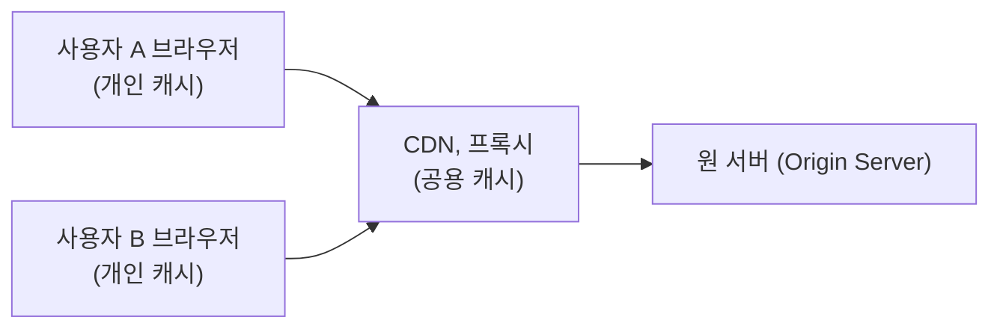
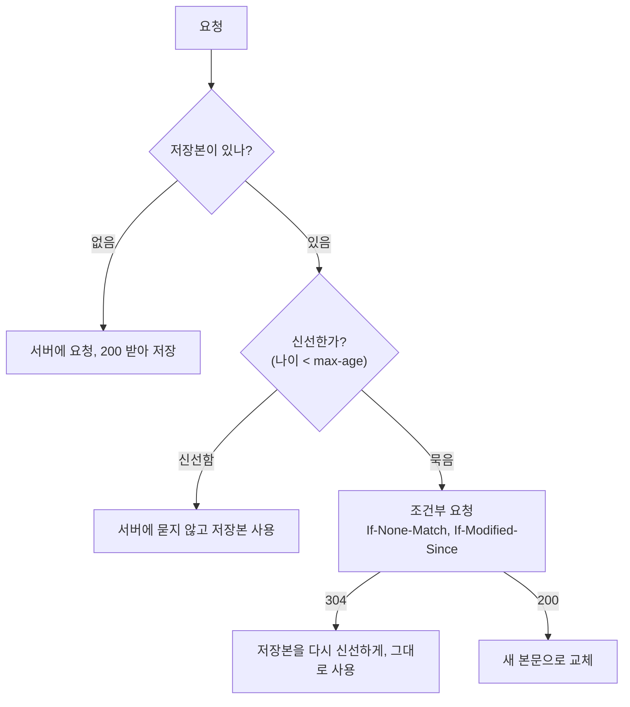

## HTTP 캐시란 ?
- HTTP 캐시(HTTP Cache)는 한 번 받은 응답을 저장해 두었다가, 다음에 같은 요청이 오면 서버에서 다시 받지 않고 저장본으로 답하는 장치다
- 저장본을 언제까지 그대로 써도 되는지, 다 되면 서버에 어떻게 확인할지를 응답 헤더로 정한다
- [캐싱](../../캐싱(Caching)/README.md)에서 본 일반 원리를 HTTP에 맞춘 것이고, [HTTP 헤더](../HTTP%20헤더(HTTP%20Headers)/README.md)에서 본 Cache-Control과 ETag를 이 노트에서 더 자세히 본다

HTTP 캐시의 규칙은 RFC 9111(HTTP Caching)에, 조건부 요청과 304는 RFC 9110(HTTP Semantics)에 정해져 있다. 이 노트의 명세 설명은 두 문서 원문을 기준으로 했다.

<br/>

## 냉장고로 이해하기
장을 봐 온 식재료를 냉장고에 넣어 두면 먹을 때마다 마트에 가지 않아도 된다. 대신 냉장고에 든 것이 언제까지 먹어도 되는지, 날짜가 지나면 버릴지 확인하고 먹을지 정해야 한다.

HTTP 캐시도 같다. 마트가 서버, 냉장고가 캐시, 식재료가 응답이다. 응답에 붙은 Cache-Control은 식재료 포장에 적힌 보관 방법과 날짜에 해당한다. 이 노트의 나머지 내용은 결국 냉장고를 어디에 둘지, 날짜를 얼마로 적을지, 날짜가 지나면 어떻게 확인할지의 이야기다.

<br/>

## 왜 필요할까
같은 로고 이미지, 같은 CSS 파일을 페이지를 열 때마다 처음부터 다시 받는다고 해 보자. 서버는 같은 일을 반복하고, 네트워크로 같은 바이트가 계속 오가고, 사용자는 그만큼 기다린다. 멀리 있는 서버일수록 왕복 시간만으로도 느려진다.

저장본을 쓰면 세 가지가 함께 준다. 응답을 기다리는 시간, 오가는 데이터의 양, 서버가 받는 요청 수다. RFC 9111도 HTTP 캐시의 목표를 이전 응답을 다시 써서 성능을 크게 높이는 것이라고 적는다.

대가도 있다. 서버의 원본이 바뀌었는데 캐시가 옛 저장본을 계속 내주면 사용자는 낡은 내용을 본다. 그래서 HTTP 캐시의 규칙 대부분은 저장본을 얼마나 믿을지, 언제 서버에 확인할지를 정하는 데 쓰인다.

<br/>

## 캐시가 놓이는 곳
### 개인 캐시 (Private Cache)
Private의 사전적 의미는 개인의, 사적인이다.
공학적으로는 사용자 한 사람만 쓰는 캐시를 말한다. 대표적인 것이 브라우저 캐시다. 내 브라우저에 저장된 응답은 나만 다시 쓴다. 그래서 로그인한 사람의 마이페이지처럼 한 사람만 봐야 하는 응답도 담을 수 있다.

### 공용 캐시 (Shared Cache)
Shared의 사전적 의미는 함께 쓰는, 나눠 쓰는이다.
공학적으로는 여러 사용자의 응답을 저장해 두고 여러 사용자에게 다시 내주는 캐시를 말한다. 클라이언트와 서버 사이에 놓인 프록시(Proxy) 캐시, 사용자와 가까운 지역에 서버를 두는 CDN(Content Delivery Network)이 대표적이다. 공용 캐시는 보통 이런 중간 서버의 일부로 놓인다(RFC 9111 1장).

공용 캐시에 한 번 저장된 응답은 다른 사람에게도 나간다. 영희의 마이페이지 응답이 공용 캐시에 저장되면, 같은 주소를 요청한 철수가 영희의 정보를 받을 수 있다. 그래서 공용 캐시에는 누구에게나 같은 응답만 두어야 한다.

집 냉장고와 회사 탕비실 냉장고의 차이와 같다. 집 냉장고에는 내 것만 있으니 무엇을 넣어도 된다. 탕비실 냉장고는 누구나 열어 꺼내 가니, 모두가 먹어도 되는 것만 넣는다.



요청은 가까운 캐시부터 거친다. 브라우저 캐시에 쓸 만한 저장본이 있으면 거기서 끝나고, 없으면 공용 캐시로, 거기에도 없으면 원본을 가진 서버까지 간다. 원본을 가진 서버를 원 서버(Origin Server)라고 부른다.

<br/>

## 신선도 (Freshness)
### fresh와 stale
Fresh의 사전적 의미는 신선한, 갓 만든이다. Stale은 빵이나 과자가 오래되어 눅눅해지거나 굳은 상태, 김빠진 상태를 말한다.
공학적으로 fresh한 응답은 서버에 확인하지 않고 그대로 다시 써도 되는 저장본이다. 정해진 기간이 지나 그대로 쓰면 안 되는 저장본은 stale하다고 한다. 이 노트에서는 각각 신선하다, 묵었다로 부른다. 묵은 저장본은 못 쓰는 것이 아니라 쓰기 전에 확인이 필요한 것이다.

Validate의 사전적 의미는 유효하다고 확인하다이다. 캐시에서 검증(Validation)은 묵은 저장본이 아직 원본과 같은지 서버에 물어 확인하는 일을 말한다. 바뀌지 않았다는 답을 받으면 저장본을 다시 신선한 것으로 쓴다.

냉장고에 넣어 둔 반찬 통에 적어 둔 날짜와 같다. 날짜 안이면 그냥 먹는다. 날짜가 지나면 반찬을 만든 사람에게 그사이 새로 만든 것이 있는지 묻고, 없다는 답을 들으면 날짜를 새로 적어 두고 계속 먹는다.

### max-age와 나이
max-age는 응답이 만들어진 뒤 몇 초 동안 신선한지를 정한다. `Cache-Control: max-age=600` 이면 10분 동안 신선하다.

캐시는 저장본의 나이(Age)를 계산해 max-age와 비교한다. 나이가 max-age보다 작으면 신선하고, 넘으면 묵었다. 명세는 이 판단을 식 하나로 적는다(RFC 9111 4.2). [캐싱](../../캐싱(Caching)/README.md)에서 본 TTL을 HTTP에서는 max-age로 적는다고 보면 된다.

```
신선하다 = 신선 기간(max-age) > 현재 나이
```

공용 캐시가 저장본을 내줄 때는 Age 헤더에 이 응답이 원 서버에서 나오거나 원 서버에 확인받은 뒤 몇 초 지났는지를 적어 보낸다(RFC 9111 5.1). 그래서 브라우저는 CDN에서 받은 응답이 이미 몇 초 묵은 것인지 알 수 있다.

Expires 헤더로 만료 시각을 직접 적는 방법도 있다. max-age와 함께 오면 max-age가 이긴다(RFC 9111 4.2.1).

### 날짜가 없으면 캐시가 짐작한다
max-age도 Expires도 없으면 저장하지 않을 것 같지만 그렇지 않다. RFC 9111은 200 OK처럼 명세가 정한 일부 상태 코드의 응답이라면, 캐시가 다른 값을 보고 신선 기간을 짐작해도 된다고 한다. 이를 휴리스틱 신선도(Heuristic Freshness)라고 한다. Heuristic은 어림짐작으로 답을 찾는 방법이라는 뜻이다.

명세가 권하는 방식은 Last-Modified(마지막 수정 시각) 이후 흐른 시간의 일정 비율을 넘지 않게 신선 기간을 잡는 것이고, 그 비율로 10% 정도를 예로 든다. 열흘 전에 고친 파일이면 하루쯤은 다시 묻지 않고 쓸 수 있다고 보는 셈이다. 다만 명세는 구체적인 계산법을 정하지 않으므로 캐시마다 다를 수 있다. 서버가 원하는 동작이 있으면 Cache-Control로 직접 적는 편이 안전하다.

<br/>

## Cache-Control의 주요 지시어
### 지시어 (Directive)
Directive의 사전적 의미는 지시, 명령이다.
공학적으로는 Cache-Control 헤더 값에 쉼표로 이어 쓰는 낱낱의 명령을 말한다. `Cache-Control: private, max-age=60` 에는 private과 max-age 두 지시어가 있다. 캐시는 응답의 Cache-Control 지시어를 반드시 따라야 한다(RFC 9111 5.2.2).

냉장고 비유로 보면 식재료 포장에 붙은 보관 안내 한 줄 한 줄이다.

### no-cache와 no-store
이름만 보면 둘 다 저장하지 말라는 뜻 같지만 다르다.

no-store는 저장 자체를 막는다. 캐시는 요청도 응답도 저장하지 않는다. 개인 캐시와 공용 캐시 모두에 적용된다. 냉장고에 아예 넣지 않는 것이다.

no-cache는 저장은 허락하되, 쓸 때마다 먼저 서버에 확인하라는 뜻이다. 확인해서 바뀌지 않았다는 답을 받아야만 저장본을 쓴다. 냉장고에 넣어 두되, 꺼낼 때마다 아직 괜찮은지 확인하고 먹는 것이다. 확인은 매번 하지만 바뀌지 않았으면 본문을 다시 받지 않으므로 전송량은 준다.

no-store는 내용 보안을 보장하지 않는다는 점도 기억해 둔다. 이 지시어를 따르지 않는 악의적인 캐시가 있을 수 있고 통신이 엿들릴 수도 있으므로, 개인 정보를 지키는 확실한 방법은 아니다(RFC 9111 5.2.2.5).

### private과 public
private은 공용 캐시가 이 응답을 저장하면 안 된다는 뜻이다. 개인 캐시인 브라우저에는 저장할 수 있다. 사용자마다 내용이 다른 응답에 붙인다. 이름이 private이라도 저장할 곳을 정할 뿐, 내용을 암호화하거나 숨겨 주지는 않는다.

public은 원래라면 저장할 수 없는 응답도 저장해도 된다고 명시하는 지시어다. 예를 들어 [HTTP 헤더](../HTTP%20헤더(HTTP%20Headers)/README.md)에서 본 Authorization(로그인 증명을 담는 헤더)이 붙은 요청의 응답은 기본적으로 공용 캐시가 다시 쓸 수 없는데, public을 붙이면 다시 쓸 수 있다. 원래 저장할 수 있는 응답에는 붙일 필요가 없다(RFC 9111 5.2.2.9).

### s-maxage
s는 shared(공용)의 첫 글자다. 공용 캐시에만 적용되는 max-age로, 공용 캐시는 max-age보다 s-maxage를 먼저 본다. 개인 캐시는 s-maxage를 무시한다.

```http
Cache-Control: max-age=60, s-maxage=600
```

이렇게 보내면 브라우저는 응답이 원 서버에서 나온 지 1분까지, CDN은 10분까지 저장본을 신선하게 본다. 나이는 원 서버에서 나온 때부터 세므로, CDN에서 이미 몇십 초 묵은 응답을 받았다면 브라우저가 확인 없이 쓸 수 있는 시간은 그만큼 짧아진다. CDN이 원 서버 앞에서 요청을 많이 막아 주면서, 브라우저는 그보다 자주 CDN에 확인하게 된다. s-maxage는 공용 캐시에서 다음 절의 must-revalidate와 같은 효과도 낸다. 묵은 저장본은 원 서버에 확인하기 전에는 다시 쓰지 않는다.

### must-revalidate
Revalidate의 사전적 의미는 다시 확인하다이다. 지시어로서는 저장본이 일단 묵으면 원 서버에 확인하기 전에는 절대 다시 쓰지 말라는 뜻이다.

이 지시어가 없을 때도 묵은 저장본은 보통 확인을 거친다. 다만 명세는 캐시가 원 서버에 연결할 수 없는 경우처럼 정해진 상황에서는 묵은 저장본을 내줄 수 있게 허락한다(RFC 9111 4.2.4). must-revalidate는 그 예외까지 막는다. 서버에 닿지 못하면 낡은 저장본을 내주는 대신 오류를 돌려주고, 이때 상태 코드는 504 Gateway Timeout을 권한다. 명세는 이 지시어를 꼭 필요할 때만 쓰라고 한다. 확인하지 못한 저장본을 내주면 잘못된 동작이 생기는 경우다. 명세가 드는 예는 결제가 처리되지 않았는데 그 사실이 조용히 묻히는 경우다.

| 지시어 | 개인 캐시에 저장 | 공용 캐시에 저장 | 다시 쓸 때 |
| --- | --- | --- | --- |
| max-age=N | 가능 | 가능 | N초 동안은 확인 없이 |
| s-maxage=N | 가능 (s-maxage는 무시) | 가능 | 공용 캐시는 N초 동안 확인 없이 |
| no-cache | 가능 | 가능 | 매번 서버에 확인 |
| no-store | 불가 | 불가 | 저장본이 없음 |
| private | 가능 | 불가 | 다른 지시어를 따름 |
| must-revalidate | 가능 | 가능 | 묵은 뒤에는 반드시 확인 |

지시어는 함께 쓸 수 있다. 서로 부딪히는 지시어가 함께 오면 가장 엄격한 쪽을 따른다(RFC 9111 4.2.1). max-age와 no-cache가 함께 오면 no-cache를 따르는 식이다.

<br/>

## 조건부 요청 (Conditional Request)
### 조건부라는 말
Conditional의 사전적 의미는 조건이 붙은, 조건에 따라 달라지는이다.
공학적으로 조건부 요청은 서버에 내가 가진 저장본의 정보를 함께 보내고, 조건이 맞을 때만 본문을 보내 달라고 하는 요청을 말한다. 묵은 저장본을 검증할 때 쓴다. 비교에 쓰는 값을 검증자(Validator)라고 하며, 꼬리표(ETag)와 수정 시각(Last-Modified) 두 가지가 있다.

### ETag와 If-None-Match
서버가 응답 내용에 버전 꼬리표를 붙이고, 클라이언트가 가진 꼬리표를 If-None-Match로 보내 비교하는 방식이다. 흐름과 코드 예시는 [HTTP 헤더](../HTTP%20헤더(HTTP%20Headers)/README.md)의 ETag 절에 정리했다.

### Last-Modified와 If-Modified-Since
서버가 응답에 Last-Modified로 마지막 수정 시각을 적어 보낸다. 캐시는 저장본이 묵으면 그 시각을 If-Modified-Since에 담아 다시 요청한다. 이 시각 이후로 바뀌었으면 보내 달라는 뜻이다.

1. 서버가 200과 본문, `Last-Modified: Thu, 01 Oct 2026 09:00:00 GMT` 를 보낸다
2. 저장본이 묵으면 캐시가 `If-Modified-Since: Thu, 01 Oct 2026 09:00:00 GMT` 를 붙여 요청한다
3. 그 뒤로 고친 적이 없으면 서버는 본문 없이 304 Not Modified를 보낸다
4. 고쳤으면 200과 새 본문, 새 Last-Modified를 보낸다

가판대에서 내가 가진 신문이 10월 1일 자인데 그 뒤로 새로 나온 것이 있냐고 묻는 것과 같다. 없다는 답을 들으면 가진 신문을 계속 본다. [HTTP 헤더](../HTTP%20헤더(HTTP%20Headers)/README.md)에서 본 ETag가 판 번호로 묻는다면 Last-Modified는 날짜로 묻는 셈이다.

### 두 방식의 차이
HTTP 시각은 초 단위까지만 적는다. 그래서 1초 안에 두 번 고치면 Last-Modified로는 구분하지 못한다. 수정 시각을 따로 저장하기 어렵거나 수정 시각이 일관되게 관리되지 않는 경우도 있다. 이런 경우에는 ETag가 수정 시각보다 더 믿을 만하다(RFC 9110 8.8.3).

둘이 함께 오면 If-None-Match가 우선이다. 요청에 If-None-Match가 있으면 서버는 If-Modified-Since를 무시해야 한다(RFC 9110 13.1.3). 두 헤더를 함께 보내는 것은 If-None-Match를 모르는 옛 중간 서버를 위한 것이다.

### 304 Not Modified
[HTTP 메서드와 상태 코드](../HTTP%20메서드와%20상태%20코드(HTTP%20Methods%20and%20Status%20Codes)/README.md)에서 본 대로, 304는 조건부 요청의 조건이 거짓이라 본문을 보낼 필요가 없을 때 쓰는 응답이다. 3xx에 속하는 이유는 RFC 9110의 설명에 있다. 서버가 클라이언트를 다른 주소가 아니라 이미 가진 저장본으로 돌려보내는 것으로 본다.

304에는 본문이 없지만 헤더는 온다. 304에도 200이었다면 보냈을 Cache-Control, ETag, Vary 같은 헤더를 함께 보내야 한다(RFC 9110 15.4.5). 캐시는 이 헤더로 저장본의 정보를 고치고 나이를 새로 센다. 그래서 304를 받으면 저장본이 다시 신선해진다.



<br/>

## 캐시 키 (Cache Key)
### 키라는 말
Key의 사전적 의미는 열쇠다. 열쇠 하나가 문 하나를 열듯, 값 하나를 찾아 꺼내는 이름표라는 뜻으로 쓰인다.
공학적으로 캐시 키는 캐시가 저장본을 찾을 때 쓰는 이름이다. RFC 9111은 캐시 키가 최소한 요청 메서드와 대상 주소(URI)로 이루어진다고 정한다. 그런데 지금 널리 쓰이는 캐시는 대부분 GET 응답만 저장하므로, 실제로는 주소만 키로 쓰는 경우가 많다고 함께 적는다.

### 주소가 조금만 달라도 다른 저장본
키가 주소이므로, 주소가 한 글자라도 다르면 캐시는 다른 자원으로 본다. 경로가 같아도 [쿼리스트링](../쿼리스트링(Query%20String)/README.md)이 다르면 다른 저장본이다.

- `/news` 와 `/news?page=2` 는 서로 다른 저장본이다
- `/news?page=2&sort=new` 와 `/news?sort=new&page=2` 는 서버에게는 같은 조건이어도 캐시 키로는 다른 문자열이다. 캐시가 매개변수 순서를 정리해 같은 키로 보는지는 캐시 제품마다 달라 확인 필요다
- 추적용 매개변수(`?ref=mail` 같은 것)가 붙으면 내용은 같아도 저장본이 따로 생긴다

냉장고를 열어 보지 않고 칸에 붙은 이름표 글자로만 물건을 찾는다고 해 보자. 한 칸에는 우유, 다른 칸에는 흰 우유라고 적혀 있으면 안에 든 것이 같아도 서로 다른 칸으로 본다. 캐시도 내용이 아니라 키의 글자만 비교한다.

이 성질은 단점이자 도구다. 같은 내용을 여러 주소로 부르면 저장본이 흩어져 캐시 적중(Cache Hit, [캐싱](../../캐싱(Caching)/README.md) 참고)이 줄어든다. 반대로 주소를 일부러 바꾸면 캐시를 확실히 건너뛸 수 있다. 다음 절의 파일 이름 버전 방식이 이 점을 쓴다.

### Vary
같은 주소라도 요청 헤더에 따라 다른 응답을 주는 경우가 있다. [HTTP 헤더](../HTTP%20헤더(HTTP%20Headers)/README.md)에서 본 콘텐츠 협상처럼 Accept-Language가 ko면 한국어, en이면 영어 페이지를 주는 식이다. 이때 서버는 `Vary: Accept-Language` 를 보낸다. Vary의 사전적 의미는 달라지다이다. 이 헤더는 응답이 어떤 요청 헤더에 따라 달라지는지를 알린다. 캐시는 이 헤더를 보고 Accept-Language 값까지 캐시 키에 넣어, 같은 값으로 요청한 경우에만 저장본을 쓴다(RFC 9111 4.1).

<br/>

## 캐시 무효화 (Cache Invalidation)
### 무효화 (Invalidation)
Invalid는 효력이 없다는 뜻이다. Invalidation은 효력을 없애는 일이다.
공학적으로 캐시 무효화는 저장본을 지우거나 쓰면 안 되는 것으로 표시해, 다음 요청 때 서버에서 새로 받게 하는 일을 말한다.

### 왜 어려울까
서버가 원본을 고쳐도 이미 퍼져 나간 저장본은 저절로 바뀌지 않는다. 저장본은 수많은 사용자의 브라우저와 여러 CDN 서버에 흩어져 있다. HTTP에서 캐시와 서버가 이야기하는 때는 캐시가 서버에 요청할 때뿐이라, 서버가 사용자 브라우저에 저장본을 지우라고 먼저 알릴 방법이 없다. CDN은 운영자가 저장본을 지우라고 명령하는 기능을 따로 두는 경우가 많지만, 이것은 HTTP 캐시 명세가 정한 기능이 아니다.

RFC 9111에도 무효화 규칙이 있기는 하다. POST, PUT, DELETE처럼 안전하지 않은 메서드의 요청이 성공하면, 그 요청이 지나간 캐시는 대상 주소의 저장본을 무효화해야 한다. 하지만 명세가 직접 적듯, 이것은 그 요청이 지나간 캐시에만 일어난다. 영희가 글을 고친 요청은 영희의 브라우저와 그 요청이 지나간 프록시에 있던 같은 주소의 저장본만 지운다. 철수 브라우저의 저장본은 max-age가 다할 때까지 그대로 남는다.

그래서 max-age를 길게 잡으면 빠르지만 고친 내용이 늦게 퍼지고, 짧게 잡으면 금방 반영되지만 서버에 묻는 일이 잦아진다. 신선 기간을 얼마로 잡을지가 늘 고민거리인 이유다.

이미 여러 집에 나눠 준 안내문은 하나하나 회수할 수 없는 것과 같다. 받은 사람들이 다음에 문의할 때까지는 옛 안내문을 계속 본다.

### 파일 이름에 버전을 넣는 방식
회수할 수 없다면 새 이름으로 내보내면 된다. 내용이 바뀌면 파일 이름도 바뀌게 만드는 방식이다.

1. 파일 이름에 내용에서 뽑은 짧은 값이나 버전 번호를 넣는다. `style.css` 대신 `style.3f9a1c.css` 처럼 쓴다
2. 이 파일은 이름이 같으면 내용도 같으므로 `Cache-Control: max-age=31536000` (1년)처럼 아주 길게 저장하게 한다
3. 파일을 고치면 이름이 `style.8b2e47.css` 로 바뀐다. 캐시 키가 다르므로 캐시는 새 파일로 보고 서버에서 받는다
4. 이 파일들을 불러오는 HTML은 이름을 바꿀 수 없으므로 no-cache로 보내 매번 확인하게 한다. HTML이 새 파일 이름을 가리키면 바뀐 파일이 바로 반영된다

옛 저장본을 지우는 것이 아니라 다시는 부르지 않게 만드는 것이다. 앞 절에서 본 캐시 키의 성질을 그대로 쓴 방법이다. 안내문을 고치면 제목에 2판이라고 적어 새로 나눠 주고, 게시판에는 늘 최신 판의 제목을 붙여 두는 셈이다.

`style.css?v=2` 처럼 쿼리스트링으로 버전을 붙이는 방법도 있다. 캐시 키가 바뀌는 원리는 같다. 다만 앞에서 본 것처럼 쿼리스트링을 캐시 키에 어떻게 넣는지는 캐시마다 달라서, 파일 이름을 바꾸는 쪽이 더 확실하다(제품별 동작은 확인 필요).

<br/>

## 코드로 보기
Node.js v24.22.1에서 실행했다. 브라우저 캐시가 하는 일을 직접 흉내 낸 예시다. Node.js의 fetch는 응답을 저장하지 않으므로, 주소를 키로 쓰는 아주 작은 개인 캐시를 Map으로 만들었다. 서버는 max-age=2와 Last-Modified를 보내고, If-Modified-Since를 받으면 비교해서 304를 돌려준다. 실제 캐시는 Age, Date, Vary 같은 헤더도 따지지만 여기서는 받은 시각만으로 나이를 셌다.

서버와 클라이언트를 한 파일에 두었다. 서버를 띄운 뒤 요청을 보내고, 끝나면 서버를 닫는다.

```js
// cache-demo.js
const http = require('http');

// 서버: 기사 하나를 max-age=2, Last-Modified와 함께 보낸다
let article = '첫 번째 기사';
let lastModified = 'Thu, 01 Oct 2026 09:00:00 GMT';

const server = http.createServer((req, res) => {
  console.log(`  [서버] ${req.url} 요청 받음`);

  const since = req.headers['if-modified-since'];
  if (since && new Date(since) >= new Date(lastModified)) {
    res.writeHead(304, { 'Cache-Control': 'max-age=2', 'Last-Modified': lastModified });
    return res.end();
  }

  res.writeHead(200, {
    'Content-Type': 'text/plain; charset=utf-8',
    'Cache-Control': 'max-age=2',
    'Last-Modified': lastModified,
  });
  res.end(`${article} ${req.url}`);
});

// 클라이언트: 주소를 키로 쓰는 아주 작은 개인 캐시
const cache = new Map(); // 주소 -> { body, lastModified, maxAge, savedAt }

async function get(url) {
  const saved = cache.get(url);
  const age = saved ? (Date.now() - saved.savedAt) / 1000 : 0;

  // 1. 신선하면 서버에 묻지 않는다
  if (saved && age < saved.maxAge) {
    return `캐시 사용 (신선, ${age.toFixed(1)}초 지남): ${saved.body}`;
  }

  // 2. 묵었으면 If-Modified-Since를 붙여 확인한다
  const headers = saved ? { 'If-Modified-Since': saved.lastModified } : {};
  const res = await fetch(url, { headers });
  const maxAge = Number(res.headers.get('cache-control').match(/max-age=(\d+)/)[1]);

  if (res.status === 304) {
    saved.savedAt = Date.now(); // 다시 신선해진다
    saved.maxAge = maxAge;
    return `304 받음, 저장본 다시 사용: ${saved.body}`;
  }

  const body = await res.text();
  cache.set(url, { body, lastModified: res.headers.get('last-modified'), maxAge, savedAt: Date.now() });
  return `${res.status} 받음, 새로 저장: ${body}`;
}

const wait = (ms) => new Promise((r) => setTimeout(r, ms));

server.listen(3000, async () => {
  const base = 'http://localhost:3000/news';

  console.log('1.', await get(base));
  console.log('2.', await get(base));
  console.log('3.', await get(`${base}?page=2`));

  await wait(2100);
  console.log('4.', await get(base));

  article = '고친 기사';
  lastModified = new Date().toUTCString();
  console.log('5.', await get(base));

  await wait(2100);
  console.log('6.', await get(base));

  server.close();
});
```

```
  [서버] /news 요청 받음
1. 200 받음, 새로 저장: 첫 번째 기사 /news
2. 캐시 사용 (신선, 0.0초 지남): 첫 번째 기사 /news
  [서버] /news?page=2 요청 받음
3. 200 받음, 새로 저장: 첫 번째 기사 /news?page=2
  [서버] /news 요청 받음
4. 304 받음, 저장본 다시 사용: 첫 번째 기사 /news
5. 캐시 사용 (신선, 0.0초 지남): 첫 번째 기사 /news
  [서버] /news 요청 받음
6. 200 받음, 새로 저장: 고친 기사 /news
```

번호마다 무슨 일이 일어났는지 보면 이 노트의 내용이 차례로 나온다.

- 1번은 저장본이 없어서 서버에 갔다
- 2번은 바로 다시 요청했으므로 저장본이 신선하다. 서버 로그가 찍히지 않았다. 서버에 묻지 않고 끝난 것이다
- 3번은 경로가 같아도 쿼리스트링이 달라서 다른 캐시 키다. 저장본이 없으므로 서버에 갔다
- 4번은 2초가 지나 저장본이 묵었다. If-Modified-Since로 확인했고, 바뀌지 않았으므로 304가 왔다. 본문을 다시 받지 않고 저장본을 썼고, 저장본은 다시 신선해졌다
- 5번은 서버에서 기사를 고친 직후다. 그런데 4번에서 저장본이 다시 신선해졌으므로 캐시는 서버에 묻지 않고 옛 기사를 내줬다. 캐시 무효화 절에서 본 문제 그대로다
- 6번은 다시 2초가 지나 저장본이 묵었다. 확인해 보니 Last-Modified가 바뀌어 있어서 200과 새 기사가 왔다

<br/>

## 참고 자료
- [RFC 9111, HTTP Caching](https://www.rfc-editor.org/rfc/rfc9111): 개인 캐시와 공용 캐시(1장), 캐시 키(2장), 신선도와 휴리스틱(4.2), 무효화(4.4), Cache-Control 지시어(5.2)
- [RFC 9110, HTTP Semantics](https://www.rfc-editor.org/rfc/rfc9110): Last-Modified와 ETag(8.8), If-None-Match와 If-Modified-Since(13.1), 조건 평가 순서(13.2.2), Vary(12.5.5), 304 Not Modified(15.4.5)

<br/>

## 더 볼 것 (TODO)
- 요청에 붙는 Cache-Control 지시어 (max-age=0, no-cache, max-stale 등)와 새로고침할 때 브라우저가 보내는 요청
- stale-while-revalidate와 stale-if-error (묵은 저장본을 먼저 내주고 뒤에서 확인하기)
- 강한 ETag와 약한 ETag (W/ 접두사)
- CDN 캐시 지우기(퍼지, Purge)와 캐시 태그
- 서비스 워커 캐시 (자바스크립트로 직접 다루는 캐시)
- 프론트엔드 빌드 도구가 파일 이름에 해시를 넣는 방식 (별도 문서)
- [캐시 스탬피드 (저장본이 한꺼번에 묵을 때 원 서버로 요청이 몰리는 문제)](../../캐시%20무효화와%20캐시%20스탬피드(Cache%20Invalidation%20and%20Cache%20Stampede)/README.md)
