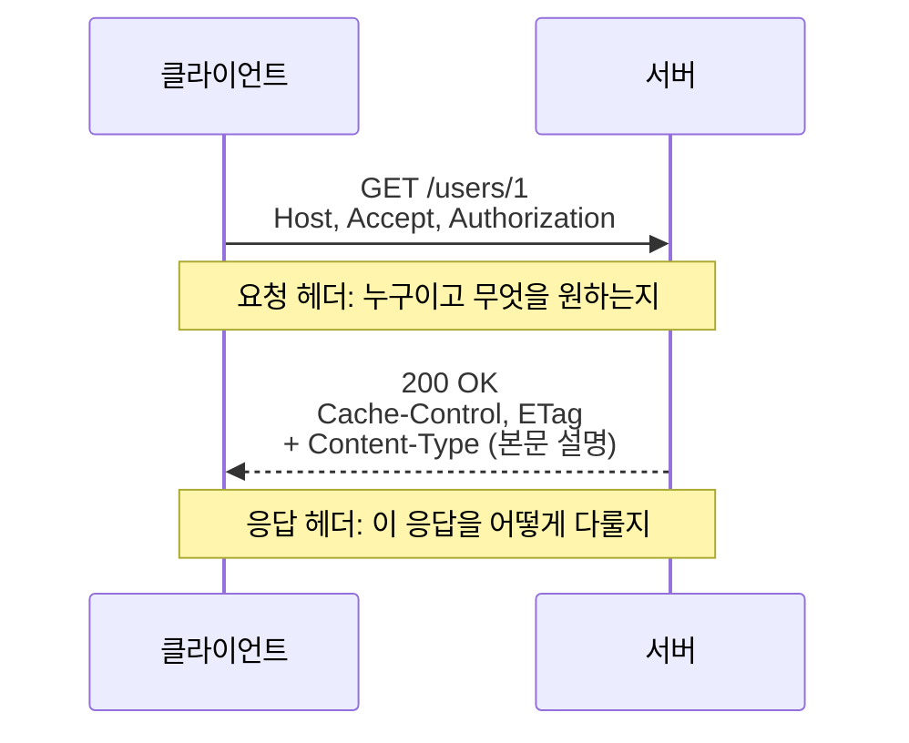
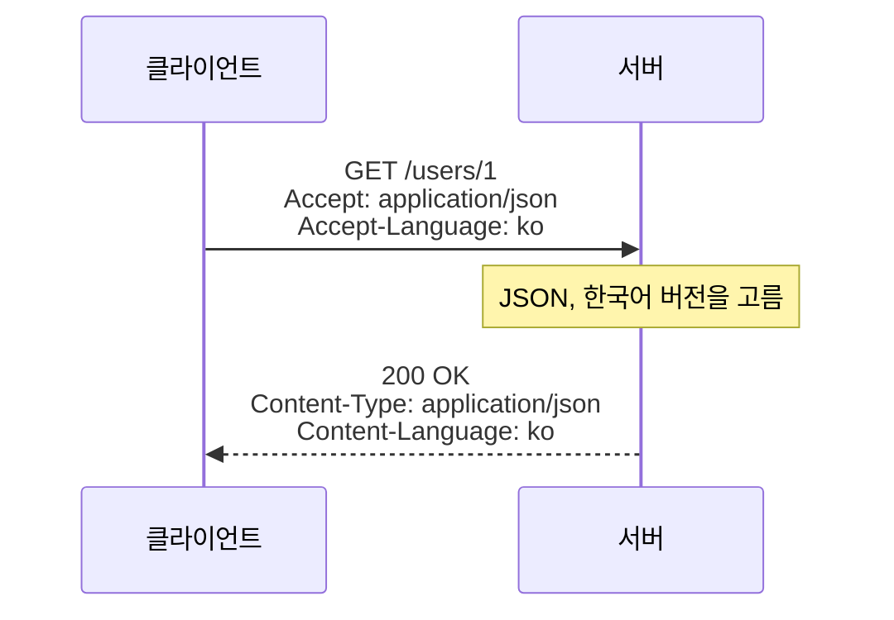
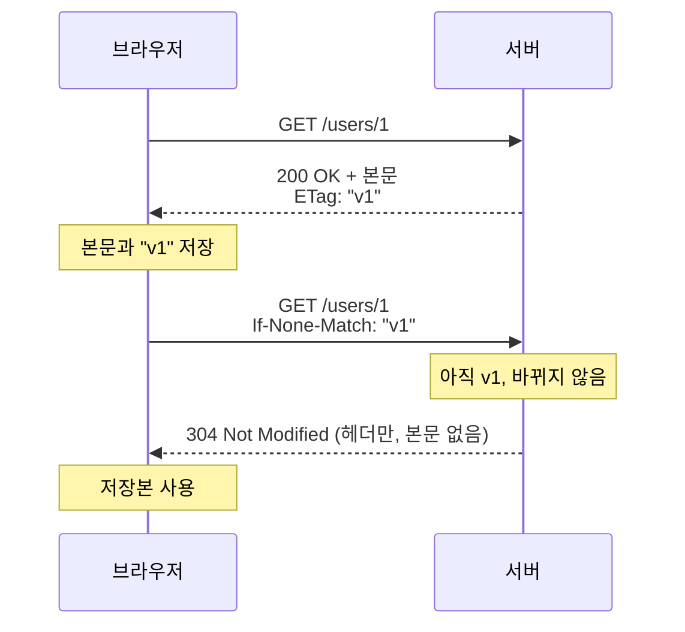

## HTTP 헤더란 ?
- HTTP 요청과 응답에 붙는 부가 정보. `이름: 값` 형태로 한 줄에 하나씩 쓴다
- 본문이 어떤 형식인지, 누가 보냈는지, 저장해 둬도 되는지처럼 본문만으로는 알 수 없는 정보를 담는다
- [HTTP 메서드와 상태 코드](../HTTP%20메서드와%20상태%20코드(HTTP%20Methods%20and%20Status%20Codes)/README.md) 문서에서 본 요청 줄, 상태 줄 바로 아래에 오는 줄들이 헤더다

### 헤더 (Header)
사전적 의미는 머리글, 문서나 페이지 맨 위에 붙는 머리말이다. Head(머리)에서 온 말이다.
공학적으로는 데이터 본문 앞에 붙어 그 데이터를 설명하는 정보를 말한다. 책의 머리말이 본문을 읽기 전에 이 책이 무엇인지 알려 주듯, HTTP 헤더도 본문을 열기 전에 이 메시지가 무엇인지 알려 준다.

<br/>

## 택배 송장으로 이해하기
택배 상자에는 송장이 붙어 있다. 택배 기사는 상자를 열지 않고 송장만 보고 어디로 갈지, 어떻게 다룰지 정한다.

| 택배 | HTTP |
| --- | --- |
| 상자 안 물건 | 본문 (Body) |
| 송장 | 헤더 |
| 받는 곳 주소 | Host |
| 내용물 종류 (식품, 서류) | Content-Type |
| 무게, 크기 | Content-Length |
| 보내는 사람 신분 | Authorization, Cookie |
| 취급 주의, 냉장 보관 | Cache-Control |

송장이 없으면 받는 사람이 상자를 열어 보기 전까지 무엇이 들었는지 모른다. 헤더가 없으면 서버도 본문이 JSON인지 이미지인지, 어디까지가 본문인지 알 수 없다.

<br/>

## 생김새와 규칙
```http
POST /users HTTP/1.1
Host: example.com
Content-Type: application/json
Content-Length: 17
Authorization: Bearer abc123

{"name":"영희"}
```

- 한 줄에 헤더 하나, `이름: 값` 형태로 쓴다
- 헤더 이름은 대소문자를 구분하지 않는다. Content-Type과 content-type은 같은 헤더다. HTTP/2부터는 이름을 소문자로만 보낸다
- 헤더가 끝나면 빈 줄 하나를 두고, 그 아래가 본문이다

<br/>

## 왜 필요할까
본문은 그저 바이트(Byte, 데이터의 기본 단위)의 나열이다. 같은 바이트라도 JSON으로 읽을지, 이미지로 읽을지, 압축을 풀어야 하는지에 따라 전혀 다른 뜻이 된다. 또 요청에는 본문에 담기 어색한 정보도 따라다닌다. 이 사람이 로그인했는지, 어떤 언어를 원하는지, 지난번에 받은 저장본이 있는지 같은 것이다.

이런 정보를 본문과 섞지 않고 정해진 이름으로 따로 적어 두면, 서버나 브라우저, 중간의 캐시(Cache)와 프록시(Proxy, 클라이언트와 서버 사이에서 요청을 대신 전달하는 서버)가 본문을 열지 않고도 메시지를 다룰 수 있다. 택배 분류 센터가 송장만 보고 상자를 나누는 것과 같다.

<br/>

## 헤더의 종류
헤더는 어디에 붙느냐에 따라 나눠 볼 수 있다.

### 요청 헤더 (Request Header)
클라이언트가 요청에 붙인다. 누가, 무엇을, 어떤 형식으로 원하는지 알린다. Host, Accept, Authorization, Cookie, User-Agent 등이 있다.

### 응답 헤더 (Response Header)
서버가 응답에 붙인다. 응답을 어떻게 다뤄야 하는지 알린다. Set-Cookie, Location, Cache-Control, ETag 등이 있다.

### 본문을 설명하는 헤더 (Representation Header)
요청이든 응답이든 본문이 있으면 붙는다. 본문의 형식과 크기, 압축 방식을 알린다. Content-Type, Content-Length, Content-Encoding이 대표적이다.

Cache-Control처럼 요청과 응답 양쪽에 쓰이는 헤더도 있다. 나누는 기준은 대략적인 것이다.



<br/>

## 본문을 설명하는 헤더
### Content-Type
본문의 형식을 알린다. 값은 MIME(Multipurpose Internet Mail Extensions) 타입이라는 정해진 이름을 쓴다. MIME은 원래 이메일에 글 말고 첨부 파일을 담으려고 만든 형식 이름표인데, 웹에서도 그대로 가져다 쓴다.

| 값 | 본문 |
| --- | --- |
| text/html | HTML 문서 |
| application/json | JSON 데이터 |
| image/png | PNG 이미지 |
| multipart/form-data | 파일이 섞인 폼 데이터 |

`text/html; charset=utf-8` 처럼 뒤에 글자 인코딩(Character Encoding)을 덧붙이기도 한다. Content-Type이 틀리면 데이터가 멀쩡해도 잘못 읽힌다. JSON을 보내면서 text/plain이라고 적으면 서버는 그 본문을 JSON으로 해석하지 않는다.

### Content-Length
본문의 크기를 바이트 단위로 알린다. 받는 쪽은 이 숫자만큼 읽으면 본문이 끝났다는 것을 안다. 앞의 예시에서 `{"name":"영희"}` 가 13글자인데 17바이트인 이유는, UTF-8에서 한글 한 글자가 3바이트이기 때문이다.

### Content-Encoding
본문을 압축했다면 어떤 방식으로 압축했는지 알린다. gzip, br(Brotli) 등이 있다. 받는 쪽은 이 값을 보고 압축을 푼다.

<br/>

## 어디로 보내는지 알리는 헤더
### Host
요청을 받을 서버의 도메인 이름이다. 기본 포트가 아니면 localhost:3000처럼 포트도 함께 적는다. 서버 컴퓨터 한 대가 여러 사이트를 함께 운영할 때, 이 값을 보고 어느 사이트로 온 요청인지 구분한다. 한 건물에 회사가 여러 개 있을 때 회사 이름을 적는 것과 같다. HTTP/1.1에서는 반드시 보내야 한다.

<br/>

## 무엇을 원하는지 알리는 헤더 (콘텐츠 협상)
### 협상 (Negotiation)
사전적 의미는 서로 의논해 조건을 맞추는 일이다.
공학적으로 콘텐츠 협상(Content Negotiation)은 같은 주소의 자원을 클라이언트가 원하는 형식으로 골라 주는 과정을 말한다. 클라이언트가 Accept 계열 헤더로 원하는 조건을 말하면, 서버는 가진 것 중 맞는 것을 고르고 무엇을 골랐는지 Content-Type, Content-Language 같은 헤더로 알린다. 식당에 한국어 메뉴판이 있으면 달라고 했을 때, 식당이 가진 메뉴판 중 한국어판을 골라 주는 것과 같다.

### Accept 계열
Accept는 받아들이다라는 뜻이다. 클라이언트가 어떤 응답을 받아들일 수 있는지 알린다.

- Accept는 원하는 본문 형식이다. application/json을 보내면 JSON으로 달라는 뜻이다
- Accept-Language는 원하는 언어다. ko를 보내면 한국어 페이지를 달라는 뜻이다
- Accept-Encoding은 풀 수 있는 압축 방식이다. gzip, br을 보내면 그중 하나로 압축해도 된다는 뜻이다



<br/>

## 누구인지 알리는 헤더
### User-Agent
Agent는 대리인이라는 뜻이다. 사용자를 대신해 요청을 보내는 프로그램(브라우저, 앱)이 무엇인지 알린다. 서버는 통계나 기기별 화면 구분에 쓴다.

### Authorization
Authorization의 사전적 의미는 허가, 권한 부여다. 이름은 권한이지만 실제로 담는 것은 내가 누구인지 증명하는 인증(Authentication) 정보다. 서버는 이 정보로 누구인지 확인한 뒤 권한(Authorization)이 있는지 판단한다. 로그인할 때 받은 토큰(Token, 로그인했다는 증명값. [프론트엔드 관점 문서](../../클라이언트-서버%20구조%20프론트엔드%20관점(Frontend)/README.md) 참고)을 `Authorization: Bearer 토큰` 형태로 보내는 방식을 많이 쓴다. Bearer는 소지자라는 뜻으로, 이 토큰을 가진 사람에게 권한을 준다는 의미다. 놀이공원 자유이용권처럼 가진 사람이 곧 주인이다.

그래서 토큰이 새면 누구든 그 사람 행세를 할 수 있다. 헤더는 본문과 마찬가지로 그대로 전송되므로, 인증 정보를 담는 요청은 반드시 HTTPS로 보낸다.

### Cookie와 Set-Cookie
서버가 응답에 Set-Cookie로 작은 값을 주면, 브라우저가 저장해 두었다가 같은 서버로 요청할 때마다 Cookie 헤더에 담아 자동으로 보낸다. 옷 보관소 번호표처럼, 서버가 준 번호표(쿠키)를 브라우저가 들고 다니며 요청마다 보여 주는 것이다. 세션(Session) 방식 로그인이 이것으로 동작한다. 쿠키와 세션은 [프론트엔드 관점 문서](../../클라이언트-서버%20구조%20프론트엔드%20관점(Frontend)/README.md)에 정리했다.

```http
HTTP/1.1 200 OK
Set-Cookie: sessionId=xyz; HttpOnly; Secure; SameSite=Lax
```

```http
GET /mypage HTTP/1.1
Cookie: sessionId=xyz
```

Set-Cookie 뒤에 붙은 HttpOnly는 JavaScript가 이 쿠키를 읽지 못하게 하고, Secure는 HTTPS 연결에서만 보내게 한다. SameSite는 다른 사이트에서 시작된 요청에 쿠키를 붙일지 정한다. Lax는 다른 사이트에서 링크를 눌러 이동해 올 때는 쿠키를 붙이고, 다른 사이트가 몰래 보내는 요청에는 붙이지 않는다.

<br/>

## 저장과 재사용을 다루는 헤더 (캐시)
### Cache-Control
Cache는 원래 숨겨 둔 저장소, 비축품이라는 뜻이다. 나중에 쓰려고 가까운 곳에 따로 챙겨 둔다는 뜻이 이어져, 컴퓨터에서는 자주 쓰는 데이터를 가까운 곳에 복사해 두는 저장소를 말한다([캐싱](../../캐싱(Caching)/README.md) 참고). Cache-Control은 응답을 저장해 두고 다시 써도 되는지, 얼마나 오래 써도 되는지 알린다.

| 값 | 뜻 |
| --- | --- |
| max-age=3600 | 3600초(1시간) 동안 다시 묻지 않고 저장본을 쓴다 |
| no-cache | 저장은 해도 되지만, 쓸 때마다 서버에 아직 최신인지 확인한다 |
| no-store | 아예 저장하지 않는다 |
| private | 사용자 브라우저에만 저장하고 중간 서버(공용 캐시, Shared Cache)에는 저장하지 않는다 |

no-cache는 이름과 달리 저장하지 말라는 뜻이 아니다. 저장하지 말라는 것은 no-store다. 자주 헷갈리는 부분이다.

### ETag와 If-None-Match
ETag(Entity Tag)는 응답 내용에 붙인 버전 꼬리표다. 내용이 바뀌면 꼬리표도 바뀐다. Entity는 HTTP에서 본문을 부르던 옛 이름이고, 지금 표준에서는 Representation이라고 부른다.

If-None-Match는 일치하는 것이 없으면이라는 뜻이다. 내가 가진 꼬리표와 일치하지 않을 때만 본문을 보내 달라는 조건을 거는 것이다. 이렇게 조건을 붙인 요청을 조건부 요청(Conditional Request)이라고 한다.

1. 서버가 응답과 함께 ETag: "v1"을 보낸다. 브라우저는 응답과 꼬리표를 저장한다
2. 다음에 같은 주소를 요청할 때 브라우저가 If-None-Match: "v1"을 붙인다. 내가 가진 게 v1인데 그사이 바뀌었냐고 묻는 것이다
3. 바뀌지 않았으면 서버는 본문 없이 304 Not Modified와 헤더만 보낸다. 브라우저는 저장본을 쓴다
4. 바뀌었으면 200과 새 본문, 새 ETag를 보낸다

내용이 그대로면 본문을 다시 받지 않으니 전송량이 준다. 가판대에 가서 내가 가진 신문의 판 번호를 말하고, 같은 판이면 새로 받지 않고 다른 판일 때만 새 신문을 받는 것과 같다.



Last-Modified와 If-Modified-Since도 같은 일을 한다. 꼬리표 대신 마지막 수정 시각으로 비교한다는 점만 다르다.

<br/>

## 그 밖에 자주 보는 헤더
- Location은 이동할 주소를 알린다. 301, 302 응답이나, 201 Created에서 새로 만든 자원의 주소를 알릴 때 쓴다
- Retry-After는 언제 다시 시도하면 되는지 알린다. 429 Too Many Requests나 503 Service Unavailable 응답에 함께 올 수 있다
- Origin은 요청이 어느 출처(스킴, 도메인, 포트의 조합)에서 시작됐는지 알린다. 서버는 응답의 Access-Control-Allow-Origin으로 그 출처를 허락할지 답한다. 이 방식을 CORS(Cross-Origin Resource Sharing)라고 하며 [프론트엔드 관점 문서](../../클라이언트-서버%20구조%20프론트엔드%20관점(Frontend)/README.md)에 정리했다

<br/>

## 직접 만드는 헤더
표준에 없는 헤더도 직접 이름을 붙여 쓸 수 있다. 예전에는 표준이 아니라는 표시로 X-Request-Id처럼 X-를 붙였다. 하지만 비표준 헤더가 널리 쓰여 표준이 되면 이름을 바꾸기 어려워지는 문제가 생겨서, 지금은 새 헤더에 X-를 붙이지 말자고 권한다(RFC 6648). 이미 널리 쓰이는 X- 헤더는 그대로 남아 있다.

<br/>

## 코드로 보기
Node.js http 모듈로 만든 서버다. Accept 헤더를 보고 JSON이나 글자로 응답하고, ETag로 304를 돌려준다. 클라이언트 쪽 fetch는 Node.js 18 이상에서 따로 설치 없이 쓸 수 있다. 실제 서버는 Accept 값을 더 꼼꼼히 해석하지만, 여기서는 단순하게 비교했다.

```js
// server.js
const http = require('http');

const user = { id: 1, name: '철수' };
const etag = '"v1"';

http.createServer((req, res) => {
  // Node.js는 요청 헤더 이름을 모두 소문자로 바꿔 둔다
  if (req.headers['if-none-match'] === etag) {
    res.writeHead(304, { ETag: etag });
    return res.end();
  }

  const common = { ETag: etag, 'Cache-Control': 'no-cache' };

  if (req.headers['accept'] === 'text/plain') {
    res.writeHead(200, { ...common, 'Content-Type': 'text/plain; charset=utf-8' });
    return res.end(`${user.id} ${user.name}`);
  }

  res.writeHead(200, { ...common, 'Content-Type': 'application/json' });
  res.end(JSON.stringify(user));
}).listen(3000);
```

```js
// client.js
const url = 'http://localhost:3000/users/1';

(async () => {
  // 1. Accept 없이 요청하면 JSON
  const r1 = await fetch(url);
  console.log(r1.status, r1.headers.get('content-type'), await r1.text());
  // 200 application/json {"id":1,"name":"철수"}

  // 2. 글자로 달라고 요청
  const r2 = await fetch(url, { headers: { Accept: 'text/plain' } });
  console.log(r2.status, r2.headers.get('content-type'), await r2.text());
  // 200 text/plain; charset=utf-8 1 철수

  // 3. 받아 둔 ETag로 바뀌었는지 확인
  const r3 = await fetch(url, { headers: { 'If-None-Match': r1.headers.get('etag') } });
  console.log(r3.status, JSON.stringify(await r3.text()));
  // 304 ""
})();
```

세 번째 요청은 본문 없이 304만 돌아온다. 브라우저였다면 저장본을 화면에 썼을 것이다.

<br/>

## 더 볼 것 (TODO)
- HTTP 캐시와 조건부 요청 자세히 (공용 캐시, CDN, 캐시 무효화)
- CORS 관련 헤더와 사전 요청 (Preflight)
- 보안 관련 응답 헤더 (Content-Security-Policy, Strict-Transport-Security)
- HTTP/2의 헤더 압축 (HPACK)
- 쿠키 속성 자세히 (Domain, Path, Expires, SameSite)
