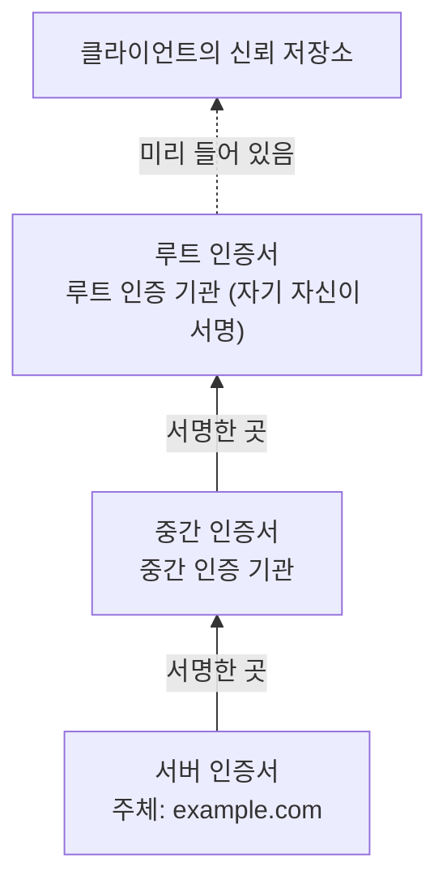
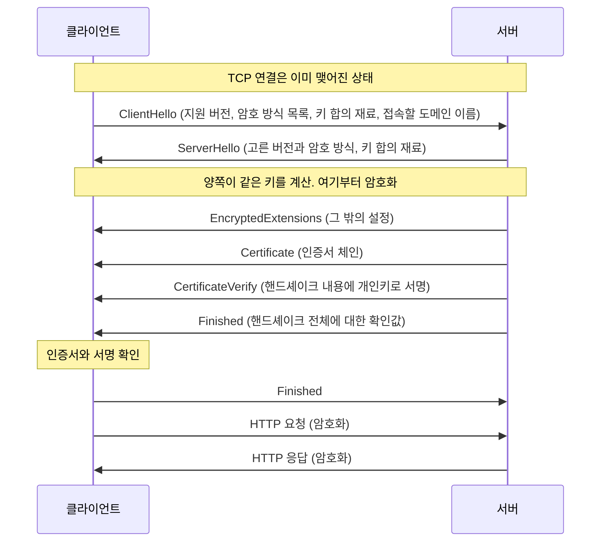
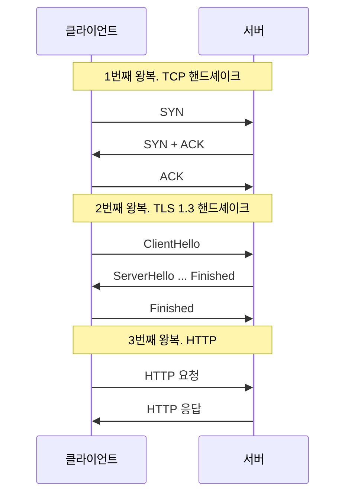

## HTTPS와 TLS란 ?
- HTTPS는 HTTP 메시지를 그대로 쓰되, 암호로 보호된 연결 위에서 주고받는 방식이다. 주소가 https://로 시작하고, 포트를 적지 않으면 443번으로 접속한다
- 그 보호된 연결을 만드는 약속이 TLS(Transport Layer Security, 전송 계층 보안)다. 중간에서 엿보거나, 내용을 바꾸거나, 다른 서버인 척하는 일을 막는다
- HTTP의 메서드, 헤더, 상태 코드([HTTP 메서드와 상태 코드](../HTTP%20메서드와%20상태%20코드(HTTP%20Methods%20and%20Status%20Codes)/README.md), [HTTP 헤더](../HTTP%20헤더(HTTP%20Headers)/README.md))는 바뀌지 않는다. HTTP와 TCP 사이에 TLS가 한 겹 끼어들 뿐이다

### HTTPS
https는 표준 문서(RFC 9110)에서 주소의 맨 앞에 붙는 이름(URI 스킴)으로 정의된다. 끝에 붙은 s는 흔히 secure의 머리글자로 읽는다. Secure의 사전적 의미는 안전한, 단단히 잠긴이다.
공학적으로는 RFC 9110의 정의대로, 서버가 그 주소의 주인을 대신해 응답하는 서버임이 확인되었고 모든 HTTP 통신이 기밀성과 무결성으로 보호되는 연결을 말한다. 기밀성과 무결성은 아래에서 다룬다.

### TLS (Transport Layer Security)
Transport는 실어 나르다, Layer는 층, Security는 보안이라는 뜻이다.
공학적으로는 TCP처럼 데이터를 순서대로 빠짐없이 실어 나르는 연결 위에 보안 층을 한 겹 덧대는 프로토콜이다. 표준(RFC 8446)은 TLS의 목표를 두 프로그램 사이에 안전한 통로를 만드는 것이라고 쓰고, 아래 연결에 바라는 것은 데이터가 믿을 수 있게 순서대로 도착하는 것 하나뿐이라고 적는다. 그래서 TLS는 HTTP 전용이 아니다. 메일, DNS 같은 다른 프로토콜도 TLS 위에 올라갈 수 있다.

<br/>

## HTTP만 쓰면 생기는 문제
HTTP 메시지는 사람이 읽을 수 있는 글자 그대로 전송된다. 엽서를 보내는 것과 같다. 엽서는 우체국 직원, 배달원 등 중간에 거치는 누구나 뒤집어 읽을 수 있고, 몰래 고쳐 쓸 수도 있고, 남의 이름으로 보낼 수도 있다.

인터넷 메시지도 내 컴퓨터에서 서버까지 가는 동안 카페 와이파이 공유기, 통신사 장비, 여러 라우터를 거친다([계층 모델](../../Network/계층%20모델(OSI%20and%20TCP-IP%20Layers)/README.md#중간-장비는-어디까지-벗길까)의 중간 장비 참고). 그 중간 어딘가에 나쁜 마음을 먹은 사람이 있으면 세 가지 일이 생길 수 있다.

### 엿보기 (도청, Eavesdropping)
Eavesdrop의 사전적 의미는 엿듣다이다. 처마(eaves)에서 빗물이 떨어지는 자리에 바짝 붙어 서서 집 안의 이야기를 엿듣던 데서 나온 말이다.
공학적으로는 오가는 데이터를 중간에서 몰래 읽는 일이다. 로그인 폼에 넣은 비밀번호, 요청 헤더의 쿠키와 토큰이 그대로 보인다.

### 바꿔치기 (변조, Tampering)
Tamper의 사전적 의미는 함부로 손대다, 조작하다이다.
공학적으로는 오가는 데이터를 중간에서 고치는 일이다. 송금 요청의 받는 사람 계좌를 바꾸거나, 응답 페이지에 광고나 악성 스크립트를 끼워 넣을 수 있다. 받는 쪽은 바뀐 줄 모른다.

### 사칭 (Impersonation)
Impersonate의 사전적 의미는 다른 사람인 척하다, 흉내 내다이다. 우리말 사칭은 이름이나 신분을 거짓으로 꾸며 대는 일이다.
공학적으로는 진짜 서버가 아닌 곳이 진짜 서버인 척 응답하는 일이다. 예를 들어 [DNS](../../Network/DNS(Domain%20Name%20System)/README.md) 답이 조작되면 은행 주소를 쳤는데 가짜 서버로 접속할 수 있다. HTTP만으로는 지금 대화하는 상대가 진짜인지 확인할 방법이 없다.

<br/>

## TLS가 주는 세 가지
표준(RFC 8446)은 TLS로 만든 통로가 갖춰야 할 성질로 인증(Authentication), 기밀성(Confidentiality), 무결성(Integrity) 세 가지를 든다. 앞의 세 문제와 하나씩 짝이 맞는다.

| 막는 문제 | TLS가 주는 성질 | 무엇으로 |
| --- | --- | --- |
| 엿보기 | 기밀성 | 대칭키 암호로 데이터를 암호화 |
| 바꿔치기 | 무결성 | 암호문에 위조 확인값을 붙여 검사 |
| 사칭 | 인증 | 인증서와 서명으로 서버 신원 확인 |

### 기밀성 (Confidentiality)
Confidential의 사전적 의미는 비밀의, 남에게 털어놓지 않는이다.
공학적으로는 통로가 만들어진 뒤 보내는 데이터를 양 끝의 두 프로그램만 읽을 수 있다는 성질이다. 엽서 대신 자물쇠 달린 상자에 넣어 보내는 것과 같다. 배달원은 상자를 나르지만 안을 볼 수 없다.

### 무결성 (Integrity)
Integrity의 사전적 의미는 온전함, 흠 없음이다.
공학적으로는 데이터가 중간에 바뀌면 받는 쪽이 반드시 알아챈다는 성질이다. 상자에 두 사람만 아는 무늬로 찍은 봉인을 붙인 것과 같다. 상자를 열지 못해도 망가뜨리거나 다른 상자로 바꿔치기할 수는 있으니 봉인이 따로 필요하다. 중간에서 상자를 바꾸면 그 무늬를 똑같이 찍을 수 없어서 받는 쪽이 알아챈다.

TLS 1.3은 암호화와 위조 확인을 한 번에 하는 방식(AEAD, Authenticated Encryption with Associated Data)만 쓴다(RFC 8446). 받는 쪽이 확인값을 검사해 맞지 않으면 그 자리에서 연결을 끊는다.

### 인증 (Authentication)
Authentic의 사전적 의미는 진짜의, 진품의다. 인증은 진짜임을 증명하는 일이다.
공학적으로는 통신 상대가 주장하는 그 상대가 맞는지 확인하는 일이다. RFC 8446은 서버 쪽은 항상 인증하고, 클라이언트 쪽 인증은 선택으로 둔다. 웹에서는 보통 서버만 인증서로 신원을 보이고, 사용자 확인은 그 위에서 로그인으로 한다.

### TLS가 숨기지 않는 것
TLS는 데이터 내용을 감출 뿐, 통신했다는 사실까지 감추지는 않는다.

- 어느 IP 주소의 몇 번 포트로 접속했는지는 보인다. 상자에 넣어도 받는 주소는 겉에 써야 배달이 되는 것과 같다
- 데이터의 길이는 숨기지 않는다(RFC 8446). 상자 크기는 보인다
- 접속하려는 도메인 이름이 연결 첫 메시지(ClientHello)에 실려 보일 수 있다. 도메인을 IP로 바꾸는 DNS 질문도 따로 보호하지 않으면 보인다
- 반대로 HTTPS에서는 HTTP 메시지 전체가 암호화된다. 경로, 쿼리스트링, 헤더, 쿠키, 본문 모두 상자 안에 들어간다(RFC 2818은 모든 HTTP 데이터를 TLS 응용 데이터로 보내라고 정한다. RFC 2818은 2022년에 RFC 9110으로 대체되었지만, 연결 절차와 443 포트를 쓰는 이유를 더 자세히 적고 있어 이 문서에서 함께 인용한다)

<br/>

## 대칭키와 공개키 암호
### 암호화 (Encryption)와 키 (Key)
Encrypt는 en(안에 넣다)과 crypt(숨겨진, 그리스어 kryptos에서 온 말)가 합쳐진 말로, 숨겨진 상태로 만든다는 뜻이다. Key는 열쇠다.
공학적으로 암호화는 정해진 계산 규칙(알고리즘)과 키라는 비밀 값으로 데이터를 알아볼 수 없게 바꾸는 일이고, 되돌리는 일을 복호화(Decryption)라고 한다. 계산 규칙은 공개되어 있어도 괜찮다. 키를 모르면 되돌릴 수 없다는 것이 핵심이다. 자물쇠 구조는 누구나 알아도 열쇠가 없으면 못 여는 것과 같다.

### 대칭키 암호 (Symmetric-key Cryptography)
Symmetric의 사전적 의미는 대칭의, 양쪽이 같은이다.
공학적으로는 잠글 때와 열 때 같은 키를 쓰는 암호다. 같은 열쇠를 두 개 복사해 한 개씩 나눠 가진 자물쇠 상자와 같다. 계산이 빨라서 많은 데이터를 암호화하기 좋다. TLS에서 실제 HTTP 데이터를 암호화하는 것이 대칭키 암호다(예: AES).

문제는 열쇠를 어떻게 나눠 갖느냐다. 처음 만나는 서버와 열쇠를 나눠 가지려고 열쇠를 엽서에 적어 보내면, 중간에서 열쇠를 베낀 사람이 이후 상자를 전부 열 수 있다.

### 공개키 암호 (Public-key Cryptography)
Public의 사전적 의미는 공개된, 누구나 쓰는이다. 비대칭키 암호(Asymmetric-key Cryptography)라고도 부른다.
공학적으로는 서로 짝을 이루는 키 두 개를 쓰는 암호다. 하나는 누구에게나 나눠 주는 공개키(Public Key), 하나는 주인만 갖는 개인키(Private Key)다. 짝을 이루지만 공개키로부터 개인키를 알아낼 수는 없게 만들어져 있다.

공개키 암호로 할 수 있는 일은 크게 두 가지다.

- 잠그기. 공개키로 잠근 것은 짝인 개인키로만 열린다. 주인이 철컥 닫히는 열린 자물쇠를 잔뜩 만들어 나눠 주고, 그 자물쇠의 열쇠는 혼자 가진 것과 같다. 누구나 상자를 잠가 보낼 수 있지만 여는 사람은 주인뿐이다
- 서명(Signature). 개인키로 데이터에 서명을 만들면, 누구나 공개키로 그 서명이 진짜인지 확인할 수 있다. 주인만 가진 도장을 찍고, 사람들은 공개된 도장 견본과 대조해 보는 것과 같다. 서명된 데이터가 한 글자라도 바뀌면 대조가 맞지 않는다

### 왜 둘을 섞어 쓸까
공개키 암호는 열쇠를 미리 나눠 갖지 않아도 되지만 계산이 무겁다. 대칭키 암호는 빠르지만 열쇠를 먼저 나눠 가져야 한다. 그래서 TLS는 연결을 시작할 때만 공개키 방식의 도움을 받아 대칭키를 안전하게 나눠 갖고, 그 뒤 실제 데이터는 대칭키로 암호화한다.

얼마나 차이가 나는지 Node.js로 재 보았다. AES-256-GCM(대칭키)으로 1KB를 암호화하는 일과, RSA-2048(공개키)로 32바이트짜리 값을 복호화하는 일을 각각 5000번 했다.

```js
const crypto = require('node:crypto');

const data = crypto.randomBytes(1024); // 1KB
const N = 5000;

// 대칭키: AES-256-GCM으로 1KB를 N번 암호화
const key = crypto.randomBytes(32);
let t = process.hrtime.bigint();
for (let i = 0; i < N; i++) {
  const c = crypto.createCipheriv('aes-256-gcm', key, crypto.randomBytes(12));
  c.update(data); c.final(); c.getAuthTag();
}
const sym = Number(process.hrtime.bigint() - t) / 1e6;

// 공개키: RSA-2048 개인키로 작은 값(32바이트)을 N번 복호화
const { publicKey, privateKey } = crypto.generateKeyPairSync('rsa', { modulusLength: 2048 });
const enc = crypto.publicEncrypt(publicKey, crypto.randomBytes(32));
t = process.hrtime.bigint();
for (let i = 0; i < N; i++) crypto.privateDecrypt(privateKey, enc);
const asym = Number(process.hrtime.bigint() - t) / 1e6;

console.log(`AES-256-GCM 1KB 암호화 ${N}번: ${sym.toFixed(0)}ms`);
console.log(`RSA-2048 32바이트 복호화 ${N}번: ${asym.toFixed(0)}ms`);
```

```text
AES-256-GCM 1KB 암호화 5000번: 63ms
RSA-2048 32바이트 복호화 5000번: 2448ms
```

데이터가 32배 적은데도 공개키 쪽이 40배쯤 오래 걸렸다(Node.js 24.22.1, 윈도우 11, 2026-10-26 실행. 숫자는 컴퓨터와 실행마다 달라진다). 게다가 RSA-2048은 한 번에 200바이트 남짓만 잠글 수 있어서, 웹 페이지처럼 큰 데이터를 잠그는 데는 애초에 맞지 않는다.

### 대칭키를 나눠 갖는 방법은 버전마다 다르다
TLS 1.2까지는 두 방법을 쓸 수 있었다.

- 키 전송(RSA Key Transport). 클라이언트가 비밀 값을 만들어 서버 인증서에 든 RSA 공개키로 잠가 보낸다(RFC 5246). 서버가 나눠 준 열린 자물쇠로 열쇠 재료를 잠가 보내는 방식이다
- 키 합의(Key Agreement, 예: ECDHE). 양쪽이 각자 비밀 재료를 하나씩 정하고, 거기서 만든 공개용 값만 주고받는다. 각자 상대의 공개용 값과 자기 비밀 재료를 섞으면 양쪽에서 같은 키가 나온다. 중간에서 공개용 값을 본 사람은 같은 키를 만들 수 없다. 키 자체는 한 번도 길 위에 오르지 않는다. ECDHE의 E는 Ephemeral(잠깐 쓰고 마는)의 머리글자로, 비밀 재료를 연결마다 새로 만들고 버린다는 뜻이다. TLS 1.2에는 서버 인증서에 고정된 재료를 계속 쓰는 정적 키 합의(정적 DH)도 있었다

TLS 1.3에서는 키 전송 방식과 정적 키 합의가 모두 빠지고, 연결마다 재료를 새로 만드는 키 합의(ECDHE 같은 방식)만 남았다(PSK라는 미리 나눠 둔 키를 쓰는 방식은 따로 있다. 아래 TODO). RFC 8446은 정적 RSA와 정적 DH 방식을 없애서, 공개키를 쓰는 모든 키 교환이 전방 비밀성(Forward Secrecy)을 갖게 되었다고 적는다. 키 전송이나 정적 키 합의에서는 서버가 오래 쓰는 개인키나 고정 재료가 나중에 새면 그동안 녹화해 둔 옛 대화도 풀 수 있다. 연결마다 쓰고 버리는 재료로 키를 만들면, 서버 개인키가 나중에 새도 옛 대화의 키는 되살릴 수 없다. 이것이 전방 비밀성이다.

그래서 TLS 1.3에서 서버의 인증서 속 공개키는 데이터를 잠그는 데 쓰이지 않는다. 내가 진짜 이 서버다라는 서명을 확인하는 데만 쓰인다. 키 합의가 어떤 수학으로 같은 키를 만들어 내는지는 TODO로 남긴다.

<br/>

## 인증서와 인증 기관
키 합의만으로는 사칭을 막지 못한다. 가짜 서버도 키 합의는 할 수 있기 때문이다. 상대가 진짜 example.com인지 확인하려면, 이 공개키가 정말 example.com의 것이라고 믿을 만한 누군가가 보증해 주어야 한다.

### 인증서 (Certificate)
Certificate의 사전적 의미는 증명서다. 어떤 사실을 공식적으로 증명하는 문서다.
공학적으로는 이 공개키의 주인은 이 도메인이다라는 내용을 담고, 인증 기관이 서명한 전자 문서다. 웹에서 쓰는 인증서는 X.509라는 형식을 따른다(RFC 5280). 주로 아래 내용이 들어 있다.

- 주체(Subject, 인증서의 주인)와 주체 대체 이름(SAN, Subject Alternative Name). 주체 대체 이름은 이 인증서를 쓸 수 있는 도메인 이름 목록이다
- 주체의 공개키
- 발급자(Issuer). 이 인증서에 서명한 인증 기관
- 유효 기간. 언제부터 언제까지 쓸 수 있는지
- 발급자의 서명

신분증과 같다. 신분증에는 이름, 사진, 유효 기간, 발급 기관의 직인이 있다. 사진이 공개키에, 직인이 발급자의 서명에 해당한다. 상대가 내민 신분증의 직인이 진짜이고, 이름이 내가 찾던 사람이고, 기간이 지나지 않았으면 그 사람을 믿는다.

### 인증 기관 (CA, Certificate Authority)
Authority의 사전적 의미는 권한을 가진 기관, 당국이다.
공학적으로는 인증서를 발급하고 서명하는 기관이다. 신청한 사람이 그 도메인을 실제로 관리하는지 확인한 뒤 인증서에 서명해 준다. 신분증을 내주는 구청이나 정부와 같다. 내가 구청을 믿기 때문에 처음 보는 사람의 신분증도 믿을 수 있다.

### 클라이언트는 인증서에서 무엇을 확인할까
RFC 9110과 RFC 5280을 기준으로 정리하면 아래와 같다.

- 서명. 인증서의 서명이 발급자의 공개키로 확인되는지, 그 발급자를 따라 올라가 내가 믿는 기관에 닿는지 본다(아래 인증서 체인)
- 기간. 지금 시각이 유효 기간 안인지 본다
- 이름. 내가 접속하려는 도메인이 인증서의 주체 대체 이름 목록에 있는지 본다. RFC 9110은 옛 방식인 주체의 이름(CN, Common Name) 칸으로 대조하지 말라고 정한다
- 폐기 여부. 기간 안이라도 개인키가 새는 등의 이유로 미리 무효가 된 인증서가 아닌지 본다. 다만 이 확인을 할지, 어떻게 할지는 클라이언트마다 달라서 위 세 가지처럼 늘 이루어진다고 보기는 어렵다(클라이언트별 동작은 확인 필요). 확인 방법(CRL, OCSP)은 TODO로 남긴다

인증서는 공개된 문서라서 누구나 복사해 내밀 수 있다. 그래서 확인이 하나 더 필요하다. 상대가 그 인증서 속 공개키의 짝인 개인키를 정말 갖고 있는지다. TLS 1.3에서는 서버가 핸드셰이크 내용에 개인키로 서명해 보내고(CertificateVerify), 클라이언트가 인증서 속 공개키로 그 서명을 확인한다. 신분증 사진과 얼굴을 대조하는 단계다.

<br/>

## 인증서 체인과 루트 인증서
### 인증서 체인 (Certificate Chain)
Chain의 사전적 의미는 사슬이다. 고리가 하나씩 다음 고리에 걸려 이어진다.
공학적으로는 서버 인증서에서 시작해 그 발급자의 인증서, 다시 그 발급자의 인증서로 이어지는 인증서의 줄이다. 보통 세 층으로 이루어진다.

1. 서버 인증서(Leaf, 잎). 사이트 도메인에 발급된 인증서
2. 중간 인증서(Intermediate). 서버 인증서에 서명한 중간 인증 기관의 인증서
3. 루트 인증서(Root, 뿌리). 중간 인증서에 서명한 최상위 인증 기관의 인증서



처음 보는 사람의 신분증을 믿는 이유를 따라가는 것과 같다. 신분증은 구청이 발급했고, 구청은 정부가 세운 기관이고, 정부는 내가 처음부터 믿는다. 클라이언트는 서버 인증서의 서명을 중간 인증서의 공개키로 확인하고, 중간 인증서의 서명을 루트 인증서의 공개키로 확인한다. 사슬의 끝이 내가 이미 믿는 루트에 닿으면 서버 인증서를 믿는다.

### 루트 인증서와 신뢰 저장소 (Trust Store)
루트 인증서는 위에 더 올라갈 곳이 없어서 자기 자신이 서명한 인증서(자체 서명 인증서, Self-signed Certificate)다. RFC 5280은 자체 서명 인증서를 인증서 경로를 시작하는 데 쓸 공개키를 전달하는 용도라고 설명한다. 자기가 자기를 보증하니 서명만으로는 믿을 근거가 없다. 그래서 루트 인증서는 핸드셰이크 중에 받아서 믿는 것이 아니라, 운영체제, 브라우저, 런타임에 미리 들어 있는 목록에 있기 때문에 믿는다. 이 목록을 신뢰 저장소라고 하고, RFC 5280은 여기서 출발점이 되는 기관을 신뢰 앵커(Trust Anchor)라고 부른다.

신뢰 저장소는 프로그램마다 따로 있을 수 있다. 예를 들어 Node.js는 자체 목록을 내장하고 있고, `tls.rootCertificates` 로 볼 수 있다. Node.js 24.22.1에서 세어 보니 118개였다. 어느 브라우저가 운영체제의 목록을 쓰고 어느 브라우저가 자체 목록을 쓰는지는 브라우저와 버전마다 달라 여기서는 다루지 않는다(확인 필요).

루트는 클라이언트가 이미 갖고 있으므로 서버는 체인을 보낼 때 루트 인증서를 빼도 된다(RFC 8446). 서버는 서버 인증서와 중간 인증서를 보내고, 클라이언트가 자기 목록의 루트로 사슬을 마무리한다.

### 왜 중간 인증 기관을 둘까
루트의 개인키는 사슬 전체의 믿음이 걸린 열쇠라서, 새면 그 루트 아래 모든 인증서를 믿을 수 없게 된다. 그래서 공개 인증 기관이 지켜야 하는 업계 기준(CA/Browser Forum Baseline Requirements, 2026-10-26에 받은 2.3.1판 6.1.7절)은 루트의 개인키로 사이트 인증서에 직접 서명하지 못하게 한다. 루트는 자기 자신, 중간 인증 기관 같은 정해진 경우에만 서명한다. 매일 신분증을 찍어 내는 일은 구청이 하고, 정부 인장은 구청을 세울 때만 꺼내는 것과 같다.

<br/>

## TLS 1.3 핸드셰이크 흐름
[TCP 연결 과정](../../Network/TCP%20연결%20과정(TCP%20Handshake)/README.md)에서 핸드셰이크(Handshake)는 본격적인 대화 전에 나누는 인사라고 했다. TLS 핸드셰이크도 인사인데, 이번에는 데이터를 보내기 전에 세 가지를 마친다. 어떤 버전과 암호 방식을 쓸지 정하고, 대칭키를 나눠 갖고, 서버가 진짜인지 확인한다.

큰 흐름은 아래와 같다(RFC 8446 Figure 1에서 자주 쓰는 경우만 남겼다).



### 1. ClientHello
Hello는 인사다. 클라이언트가 먼저 인사하며 자기가 할 수 있는 것을 내놓는다. RFC 8446 기준으로 무작위 값, 지원하는 버전 목록, 지원하는 대칭키 암호 방식 목록, 키 합의에 쓸 공개용 값(key_share)이 들어 간다. 클라이언트가 내놓는 암호 방식 하나하나를 암호 스위트(Cipher Suite)라고 부른다. Suite의 사전적 의미는 한 벌, 세트로, 함께 쓰는 암호 방식 몇 가지를 한 벌로 묶었다는 뜻이다. 접속할 도메인 이름(server_name)도 보통 함께 보낸다. IP 하나에 여러 사이트가 있어도 서버가 어느 사이트의 인증서를 내밀지 고를 수 있게 하기 위해서다.

이 메시지는 아직 키가 없으니 암호화되지 않는다.

### 2. ServerHello와 키 합의
서버는 클라이언트가 내놓은 목록에서 버전과 암호 방식을 하나씩 고르고, 키 합의에 쓸 자기 쪽 공개용 값을 보낸다. 이제 양쪽은 상대의 공개용 값과 자기 비밀 재료를 섞어 같은 키를 계산할 수 있다. RFC 8446은 이 단계 뒤의 모든 메시지가 암호화된다고 적는다.

키 합의 재료에는 여러 종류가 있다. 클라이언트가 지원한다고 적은 종류 가운데 서버가 쓸 수 있는 것이 있는데, 실제로 실어 보낸 재료가 그 종류가 아니면 서버는 그 종류로 다시 보내 달라고 답한다(HelloRetryRequest). 이때는 왕복이 한 번 더 든다. 공통으로 쓸 수 있는 종류가 아예 없으면 핸드셰이크는 실패한다.

### 3. 인증서와 서명 확인
서버는 인증서 체인(Certificate)을 보내고, 지금까지 주고받은 핸드셰이크 내용 전체에 개인키로 서명해 보낸다(CertificateVerify). 클라이언트는 앞 절에서 본 대로 체인을 루트까지 따라가 확인하고, 이름과 기간을 보고, 서명이 인증서 속 공개키로 확인되는지 본다. 서명에는 이번 연결에서만 쓰는 값이 들어 있어서, 다른 연결에서 엿본 서명을 그대로 가져와 쓸 수도 없다.

신분증(인증서)을 받아 발급 기관 직인(체인)을 확인하고, 사진과 얼굴(개인키 서명)을 대조하는 단계다.

### 4. Finished
Finish는 끝내다라는 뜻이다. 양쪽은 핸드셰이크 메시지 전체에 대한 확인값(MAC, Message Authentication Code)을 방금 만든 키로 계산해 보낸다. 상대가 보낸 값과 내가 계산한 값이 같으면, 중간에서 핸드셰이크 메시지가 바뀌지 않았고 양쪽이 같은 키를 갖게 되었다는 뜻이다. 누군가 ClientHello의 목록을 고쳐 약한 암호 방식을 고르게 만들려 해도 여기서 들킨다.

클라이언트가 Finished를 보내면 핸드셰이크가 끝나고, HTTP 요청을 암호화해 보낼 수 있다.

### TLS 1.2와 다른 점
TLS 1.3(2018, RFC 8446)이 이전 버전과 크게 다른 점을 입문 수준에서 고르면 아래와 같다.

- TLS 1.2의 기본 핸드셰이크는 2번 왕복해야 끝났는데(RFC 5246 Figure 1), TLS 1.3은 ClientHello에 키 합의 재료를 미리 실어 보내 1번 왕복으로 줄였다
- TLS 1.3은 ServerHello 다음 메시지부터 암호화한다. TLS 1.2에서는 서버 인증서도 암호화되지 않은 채로 갔다
- 앞에서 본 대로 RSA 키 전송과 정적 키 합의가 빠지고, 연결마다 재료를 새로 만드는 키 합의만 남았다
- 오래되어 약하다고 본 암호 방식을 빼고 AEAD 방식만 남겼다

<br/>

## TCP 다음에 TLS, 왕복 비용
TLS는 TCP 연결 위에서 동작한다. RFC 2818도 HTTP 클라이언트가 먼저 서버의 포트에 연결한 뒤 ClientHello를 보내 TLS 핸드셰이크를 시작하고, 핸드셰이크가 끝나면 첫 HTTP 요청을 보낸다고 적는다. 그래서 TCP 위에서 HTTPS를 쓰는 경우(HTTP/1.1, HTTP/2) 순서는 TCP 핸드셰이크, TLS 핸드셰이크, HTTP 요청이다. HTTP/3는 TCP 대신 QUIC라는 프로토콜 안에서 연결과 TLS 1.3 핸드셰이크를 함께 처리해서 이 순서를 따르지 않는다(아래 TODO).



ACK와 ClientHello는 연달아 보내고, 클라이언트의 Finished와 HTTP 요청도 연달아 보내서 기다리는 시간이 겹치지 않는다. 그래서 왕복 시간(RTT, Round-Trip Time)으로 세면, 평범한 HTTP는 TCP 1번 뒤 요청과 응답 1번으로 2 RTT 만에 첫 응답을 받고, TLS 1.3을 쓰는 HTTPS는 3 RTT, TLS 1.2를 쓰는 HTTPS는 4 RTT가 든다(DNS 조회 시간은 빼고 센 값이다).

상자로 치면 보내기 전에 전화로 받을 사람이 집에 있는지 묻고(TCP), 다시 전화해 신분증을 확인하고 상자 열쇠를 나눠 가진 뒤(TLS), 그제야 상자를 보내는 것과 같다. 서버가 멀어 한 번 왕복이 100ms라면 TLS 1.3만으로 100ms가 더 붙는다.

그래서 한 번 맺은 TCP와 TLS 연결을 여러 요청에 다시 쓰는 것이 중요하다([TCP 연결 과정](../../Network/TCP%20연결%20과정(TCP%20Handshake)/README.md#연결에는-비용이-든다)의 연결 재사용 참고). 예전에 연결했던 서버라면 핸드셰이크를 줄이는 방법(세션 재개, 0-RTT)도 있는데 TODO로 남긴다.

### 계층으로 보면
TLS는 HTTP 같은 응용 프로토콜 아래, TCP 위에 놓인다. 이름에 전송 계층(Transport Layer)이 들어 있지만, TLS가 몇 계층인지는 책마다 다르게 본다는 점은 [계층 모델](../../Network/계층%20모델(OSI%20and%20TCP-IP%20Layers)/README.md#위-세-층은-경계가-흐리다)에서 다뤘다. 이 문서에서는 응용 계층과 전송 계층 사이에 끼어드는 한 겹으로 본다. HTTP 입장에서는 TCP에 쓰던 데이터를 TLS에 쓰고, TLS가 그것을 암호화해 TCP에 넘긴다.

<br/>

## 443 포트
[소켓](../../Network/소켓(Socket)/README.md#포트-port) 문서의 관례 포트 표에서 HTTP는 80, HTTPS는 443이었다. RFC 9110은 https 주소에 포트가 없으면 TCP 443번(HTTP over TLS용으로 예약된 포트)을 기본으로 쓴다고 정한다.

포트를 따로 둔 이유는 RFC 2818에 나온다. HTTP 서버는 연결되자마자 요청 첫 줄(GET / HTTP/1.1 같은)을 기다리고, TLS 서버는 ClientHello를 기다린다. 같은 포트에서는 상대가 무엇부터 보낼지 알 수 없으니 포트로 구분해 왔다. 443은 관례이자 기본값일 뿐이라서, https://localhost:8443처럼 다른 포트에 TLS 서버를 띄워도 된다.

<br/>

## SSL과 TLS
SSL(Secure Sockets Layer, 보안 소켓 계층)은 TLS의 옛 이름이자 전신이다. 이름 그대로 [소켓](../../Network/소켓(Socket)/README.md) 위에 보안 층을 얹는다는 뜻이다. Netscape가 만든 SSL 3.0을 바탕으로 IETF가 표준을 만들면서 이름을 TLS로 바꿨다(RFC 2246은 TLS 1.0이 SSL 3.0을 바탕으로 했지만 서로 호환되지 않는다고 적는다).

| 버전 | 표준 문서 | 지금 상태 |
| --- | --- | --- |
| SSL 2.0 | Netscape 문서(1995, RFC 아님) | RFC 6176(2011)이 쓰지 말라고 정함 |
| SSL 3.0 | RFC 6101(2011년에 역사 기록용으로 공개) | RFC 7568(2015)이 쓰지 말라고 정함 |
| TLS 1.0 | RFC 2246(1999) | RFC 8996(2021)이 폐기 |
| TLS 1.1 | RFC 4346(2006) | RFC 8996(2021)이 폐기 |
| TLS 1.2 | RFC 5246(2008) | 아직 널리 쓰임 |
| TLS 1.3 | RFC 8446(2018) | 최신(2026-10-26 기준) |

SSL은 모든 버전이 금지되었지만 이름은 습관처럼 남아 있다. SSL 인증서, SSL 설정이라고 부르는 것도 실제로는 대부분 TLS에서 쓰는 인증서와 설정이다. 인증서 자체는 SSL이나 TLS 버전에 묶인 것이 아니라 X.509 형식의 문서다.

연도는 각 RFC 원문 머리에 적힌 발행 연월 기준이다. RFC 8446을 고쳐 쓰는 개정판 초안(draft-ietf-tls-rfc8446bis)이 진행되어 왔는데, 새 RFC 번호로 나왔는지는 확인하지 못했다(확인 필요). SSL 2.0의 1995는 RFC 6176의 참고 문헌에 적힌 Netscape 문서 날짜다.

<br/>

## 직접 확인하기
아래 예시는 모두 2026-10-26(한국 시각)에 윈도우 11, Node.js 24.22.1(내장 OpenSSL 3.5.9)에서 실행한 결과다. 인증서 유효 기간과 발급자는 사이트가 인증서를 갱신하면 바뀐다.

### Node.js tls 모듈로 보기
`tls.connect` 는 TCP 연결과 TLS 핸드셰이크를 차례로 하고, 핸드셰이크가 끝나면 `secureConnect` 이벤트를 낸다. 시각을 찍어 두 핸드셰이크가 따로 일어나는 것도 함께 본다.

```js
const tls = require('node:tls');

const host = process.argv[2] || 'example.com';
const start = Date.now();
const ms = () => `${Date.now() - start}ms`;

const socket = tls.connect({ host, port: 443, servername: host });

socket.once('lookup', () => console.log('DNS 조회 끝:', ms()));
socket.on('connect', () => console.log('TCP 연결 끝:', ms()));
socket.on('secureConnect', () => {
  console.log('TLS 연결 끝:', ms());
  console.log('TLS 버전:', socket.getProtocol());
  console.log('암호 스위트:', socket.getCipher().name);
  console.log('인증서 검증 통과:', socket.authorized);

  let cert = socket.getPeerCertificate(true); // true면 발급자 인증서까지 이어서 준다
  const seen = new Set();
  let depth = 0;
  while (cert && cert.subject && !seen.has(cert.fingerprint256)) {
    seen.add(cert.fingerprint256);
    console.log(`[${depth}] 주인: ${cert.subject.CN}`);
    console.log(`    발급자: ${cert.issuer.CN}`);
    console.log(`    유효 기간: ${cert.valid_from} ~ ${cert.valid_to}`);
    cert = cert.issuerCertificate;
    depth++;
  }
  socket.end();
});
socket.on('error', (err) => console.log('오류:', err.code));
```

`seen` 은 같은 인증서를 두 번 출력하지 않으려고 둔다. 루트처럼 자기 자신이 서명한 인증서는 발급자 인증서가 자기 자신이라서 이것이 없으면 같은 인증서를 계속 돈다.

```text
DNS 조회 끝: 37ms
TCP 연결 끝: 98ms
TLS 연결 끝: 163ms
TLS 버전: TLSv1.3
암호 스위트: TLS_AES_256_GCM_SHA384
인증서 검증 통과: true
[0] 주인: example.com
    발급자: Cloudflare TLS Issuing ECC CA 3
    유효 기간: Sep 26 22:49:11 2026 GMT ~ Dec 25 22:56:35 2026 GMT
[1] 주인: Cloudflare TLS Issuing ECC CA 3
    발급자: SSL.com TLS Transit ECC CA R2
    유효 기간: May 29 19:49:45 2025 GMT ~ May 27 19:49:44 2035 GMT
[2] 주인: SSL.com TLS Transit ECC CA R2
    발급자: SSL.com TLS ECC Root CA 2022
    유효 기간: Oct 21 17:02:23 2022 GMT ~ Oct 17 17:02:22 2037 GMT
[3] 주인: SSL.com TLS ECC Root CA 2022
    발급자: AAA Certificate Services
    유효 기간: Aug  1 00:00:00 2025 GMT ~ Dec 31 23:59:59 2028 GMT
```

결과를 읽어 보면 아래와 같다.

- TCP 연결에 약 61ms(37ms에서 98ms), TLS 핸드셰이크에 약 65ms(98ms에서 163ms)가 걸렸다. 두 핸드셰이크가 각각 1번 왕복이라 시간이 비슷하다. 세 번 실행해 TCP 61~71ms, TLS 62~77ms가 나왔다
- 협상된 버전은 TLS 1.3, 데이터 암호화에는 AES-256-GCM(대칭키, AEAD)을 쓴다
- 서버 인증서([0])의 유효 기간은 약 3개월이고, 중간 인증서([1], [2])는 그보다 훨씬 길다
- [3]은 이름은 루트인데 발급자가 다른 기관이다. 같은 루트 기관이 다른 오래된 루트에게도 서명을 받아 둔 인증서(교차 서명, Cross-signing)로, 그 루트를 아직 목록에 갖지 않은 옛 클라이언트도 사슬을 이을 수 있게 하려고 서버가 함께 보낸 것으로 보인다. 이 실행에서 Node.js의 기본 목록(`tls.rootCertificates`)에는 SSL.com TLS ECC Root CA 2022가 들어 있었으므로, Node.js는 [2]의 발급자에서 사슬을 마무리할 수 있다. 교차 서명은 TODO로 남긴다

### TLS 1.2와 시간 비교
`tls.connect` 에 `maxVersion: 'TLSv1.2'` 를 주면 TLS 1.2로만 접속한다. 같은 example.com에 버전만 바꿔 번갈아 세 번 접속했다.

```js
const tls = require('node:tls');
const host = 'example.com';
const maxVersion = process.argv[2]; // 'TLSv1.3' 또는 'TLSv1.2'
const start = Date.now();
const ms = () => `${Date.now() - start}ms`;
const socket = tls.connect({ host, port: 443, servername: host, maxVersion });
socket.on('connect', () => console.log('TCP 연결 끝:', ms()));
socket.on('secureConnect', () => {
  console.log('TLS 연결 끝:', ms(), socket.getProtocol(), socket.getCipher().name);
  socket.end();
});
```

```text
TCP 연결 끝: 95ms
TLS 연결 끝: 162ms TLSv1.3 TLS_AES_256_GCM_SHA384
TCP 연결 끝: 100ms
TLS 연결 끝: 226ms TLSv1.2 ECDHE-ECDSA-AES128-GCM-SHA256
```

TLS 핸드셰이크만 보면 TLS 1.3은 67ms, TLS 1.2는 126ms다. 나머지 두 번도 1.3은 71ms와 64ms, 1.2는 162ms와 133ms로, 1.2가 세 번 모두 59~91ms 더 걸렸다. 이 환경의 왕복 한 번(앞의 TCP 연결 시간으로 보면 60~70ms)과 비슷하거나 조금 더 길다. TLS 1.2 쪽 암호 스위트 이름 맨 앞의 ECDHE는 이 연결이 TLS 1.2에서도 키 전송이 아니라 키 합의를 썼다는 뜻이다.

### openssl과 curl로 보기
openssl이 깔려 있다면 `openssl s_client` 로 서버가 보낸 체인을 그대로 볼 수 있다. 아래는 Git for Windows에 들어 있는 OpenSSL 3.2.1로 실행한 결과의 앞부분이다(접속한 IP 줄은 뺐다). 끝의 `< /dev/null` 은 입력을 비워 출력 뒤 바로 끝나게 한다. 빼면 접속한 채로 입력을 기다리므로 Ctrl+C로 끝낸다. s는 주체(subject), i는 발급자(issuer), v는 유효 기간이다.

```bash
openssl s_client -connect example.com:443 -servername example.com < /dev/null
```

```text
 0 s:CN=example.com
   i:C=US, O=SSL Corporation, CN=Cloudflare TLS Issuing ECC CA 3
   a:PKEY: id-ecPublicKey, 256 (bit); sigalg: ecdsa-with-SHA256
   v:NotBefore: Sep 26 22:49:11 2026 GMT; NotAfter: Dec 25 22:56:35 2026 GMT
 1 s:C=US, O=SSL Corporation, CN=Cloudflare TLS Issuing ECC CA 3
   i:C=US, O=SSL Corporation, CN=SSL.com TLS Transit ECC CA R2
```

`curl -v https://example.com` 으로도 연결 과정을 볼 수 있지만, 무엇이 보이는지는 curl이 쓰는 TLS 라이브러리에 따라 다르다. 이번에 윈도우에서 실행한 curl(Schannel 사용)은 TLS 버전과 인증서 정보를 보여 주지 않았다. 도구별 사용법은 실무 문서로 미룬다(TODO).

<br/>

## 브라우저 경고가 뜨는 경우
클라이언트가 인증서를 확인하다 하나라도 통과하지 못하면 연결을 믿지 않는다. RFC 9110은 인증서가 접속 대상에 맞지 않으면 브라우저 같은 사용자 프로그램은 사용자에게 확인을 받거나 연결을 끊어야 한다고 정한다. 브라우저가 경고 화면을 띄우고, 그래도 계속할지 묻는 것이 이 규칙이다.

신분증 검사로 치면 아래 경우에 걸린다.

| 상황 | 신분증으로 치면 | Node.js 오류 코드 |
| --- | --- | --- |
| 유효 기간이 지났다 | 만료된 신분증 | CERT_HAS_EXPIRED |
| 인증서의 이름과 접속한 도메인이 다르다 | 남의 신분증 | ERR_TLS_CERT_ALTNAME_INVALID |
| 자체 서명 인증서다 | 자기가 만들어 직접 도장 찍은 신분증 | DEPTH_ZERO_SELF_SIGNED_CERT |
| 사슬의 끝이 신뢰 저장소에 없는 루트다 | 처음 들어 보는 기관이 발급한 신분증 | SELF_SIGNED_CERT_IN_CHAIN |

오류 코드는 일부러 잘못된 인증서를 걸어 둔 공개 시험 사이트(badssl.com)에 Node.js로 접속해 확인했다. 각각 expired, wrong.host, self-signed, untrusted-root 하위 도메인이다. 마지막 행의 코드는 badssl.com처럼 서버가 믿을 수 없는 루트까지 체인에 넣어 보냈을 때의 값이다. 루트를 보내지 않으면 다른 코드가 나올 수 있다(확인 필요). 브라우저 화면에 나오는 문구와 오류 이름은 브라우저마다 달라 여기서는 적지 않았다.

### 자체 서명 인증서로 직접 해 보기
개발할 때 내 컴퓨터에 HTTPS 서버를 띄우면 이 경고를 자주 본다. 아무 인증 기관도 서명하지 않은 인증서를 직접 만들어 쓰기 때문이다. openssl로 localhost용 자체 서명 인증서를 만들고, Node.js로 TLS 서버를 띄운 뒤 세 가지 방법으로 접속해 보았다.

```bash
# 개인키(key.pem)와 하루짜리 자체 서명 인증서(cert.pem)를 만든다
openssl req -x509 -newkey ec -pkeyopt ec_paramgen_curve:P-256 -nodes \
  -keyout key.pem -out cert.pem -days 1 \
  -subj "/CN=localhost" -addext "subjectAltName=DNS:localhost"
```

```js
const tls = require('node:tls');
const fs = require('node:fs');
const path = require('node:path');

const key = fs.readFileSync(path.join(__dirname, 'key.pem'));
const cert = fs.readFileSync(path.join(__dirname, 'cert.pem'));

const server = tls.createServer({ key, cert }, (socket) => socket.end('hello\n'));

function tryConnect(label, options) {
  return new Promise((resolve) => {
    const socket = tls.connect({ host: '127.0.0.1', port: server.address().port, ...options }, () => {
      console.log(`${label}: 연결 성공 (${socket.getProtocol()})`);
      socket.end();
      resolve();
    });
    socket.on('error', (err) => {
      console.log(`${label}: ${err.code}`);
      resolve();
    });
  });
}

server.listen(0, '127.0.0.1', async () => {
  await tryConnect('1. 그냥 접속', { servername: 'localhost' });
  await tryConnect('2. 이 인증서를 믿는다고 알려 줌', { servername: 'localhost', ca: cert });
  await tryConnect('3. 믿지만 다른 이름으로 접속', { servername: 'example.com', ca: cert });
  server.close();
});
```

```text
1. 그냥 접속: DEPTH_ZERO_SELF_SIGNED_CERT
2. 이 인증서를 믿는다고 알려 줌: 연결 성공 (TLSv1.3)
3. 믿지만 다른 이름으로 접속: ERR_TLS_CERT_ALTNAME_INVALID
```

1번은 아무도 보증하지 않은 인증서라서 거절된다. 2번은 `ca` 옵션으로 기본 목록 대신 이 인증서 하나만 믿도록 지정했더니 통과했다(`ca` 를 주면 Node.js의 기본 루트 목록을 대신하므로, 이 설정으로는 다른 사이트에 접속하지 못한다). 루트 인증서를 믿는 원리와 같다. 믿을 이유가 서명에서 오는 것이 아니라 내 목록에 있다는 사실에서 온다. 3번은 인증서는 믿지만, 인증서에 적힌 이름(localhost)과 접속하려는 이름(example.com)이 달라 거절된다. 신뢰와 이름 확인이 따로 이루어진다는 것을 보여 준다.

개발 중에 경고가 귀찮다고 검증 자체를 끄면(Node.js의 `rejectUnauthorized: false` 같은 옵션) 중간에 가짜 서버가 끼어들어도 알 수 없다. 클라이언트는 가짜 서버와 암호화 통로를 맺게 되고, 가짜 서버는 그 안의 내용을 모두 읽고 고쳐서 진짜 서버로 넘길 수 있다. 사칭을 막지 못하면 엿보기와 바꿔치기도 막지 못한다. 암호화는 열쇠를 나눠 가진 상대가 진짜일 때만 의미가 있다. 개발용 인증서를 신뢰 목록에 넣는 방법은 실무 문서로 따로 정리한다(TODO).

### 자물쇠 표시의 뜻
주소창의 자물쇠 같은 보안 표시(모양은 브라우저와 버전마다 다르다)는 이 연결이 암호화되었고 인증서가 그 도메인에 맞게 발급되었다는 뜻이다. 사이트 운영자가 정직하다는 뜻은 아니다. 인증 기관은 신청자가 그 도메인을 관리하는지를 확인할 뿐이라서, 피싱 사이트도 자기 도메인으로 인증서를 받을 수 있다. 신분증이 진짜라는 것과 그 사람이 좋은 사람이라는 것은 다른 이야기다.

<br/>

## 함께 보면 좋은 노트
- [TCP 연결 과정](../../Network/TCP%20연결%20과정(TCP%20Handshake)/README.md): TLS 핸드셰이크 앞에 오는 TCP 핸드셰이크
- [소켓](../../Network/소켓(Socket)/README.md): 443 포트와 연결 구분
- [계층 모델](../../Network/계층%20모델(OSI%20and%20TCP-IP%20Layers)/README.md): TLS를 몇 계층으로 보는지
- [DNS](../../Network/DNS(Domain%20Name%20System)/README.md): 도메인 이름을 IP로 바꾸는 과정, TLS가 감추지 못하는 질문
- [HTTP 헤더](../HTTP%20헤더(HTTP%20Headers)/README.md#cookie와-set-cookie): HTTPS 연결에서만 보내는 Secure 쿠키
- [쿠키](../쿠키(Cookie)/README.md): Secure, HttpOnly, SameSite 같은 쿠키 속성과 각각 막는 공격
- [HTTP 버전](../HTTP%20버전(HTTP%20Versions)/README.md): 버전을 고르는 ALPN, TLS 1.3을 안에 품은 QUIC와 HTTP/3

<br/>

## 더 볼 것 (TODO)
- 공개키 암호의 수학 (RSA, 디피-헬만과 ECDHE가 같은 키를 만드는 원리)
- 해시 함수, MAC, AEAD가 위조를 알아채는 원리
- 전방 비밀성 자세히
- 세션 재개(PSK)와 0-RTT, 0-RTT의 재전송 공격 위험
- 인증서 폐기 확인 (CRL, OCSP, OCSP Stapling)
- 교차 서명과 루트 인증서 교체
- 인증서 투명성 (Certificate Transparency)
- 인증서 종류 (DV, OV, EV)와 자동 발급 (ACME, Let's Encrypt)
- 클라이언트도 인증서를 내는 상호 TLS (mTLS)
- [HTTPS만 쓰도록 강제하는 HSTS](../보안%20응답%20헤더(Security%20Response%20Headers)/README.md#strict-transport-security-hsts)
- 접속 도메인 이름까지 감추는 방법 (ECH)
- DNS over TLS, DNS over HTTPS
- QUIC와 HTTP/3에서 TLS가 들어가는 방식
- 프론트엔드 개발 환경에서 로컬 HTTPS 쓰기 (개발용 인증서를 신뢰 목록에 넣기)
- curl, openssl로 TLS 연결 살펴보기 (실무 문서)
