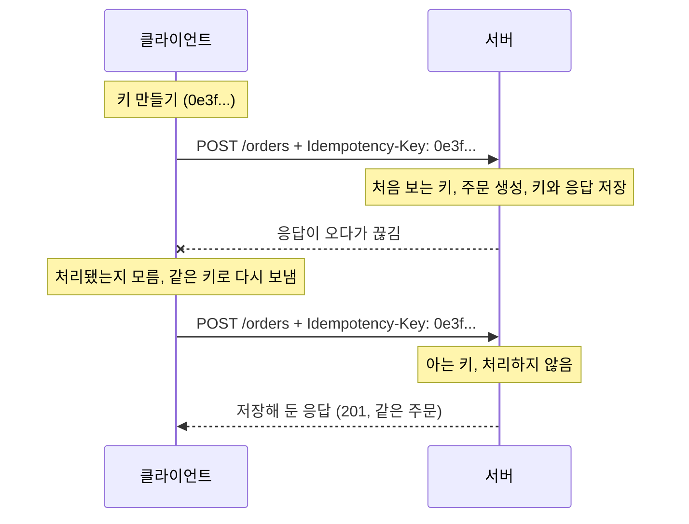

## 멱등 키란 ?
- 멱등 키(Idempotency Key)는 클라이언트가 하려는 작업 하나(주문 하나, 결제 하나)마다 만들어 요청에 붙이는 고유한 이름표다. 같은 작업을 다시 보낼 때는 같은 키를 붙이고, 서버는 이 키로 같은 요청이 다시 왔는지 알아본다
- 서버는 처음 받은 키로 요청을 처리하고 그 결과를 키와 함께 저장해 둔다. 같은 키가 다시 오면 처리하지 않고 저장해 둔 응답을 돌려준다
- 이렇게 하면 결제나 주문처럼 멱등하지 않은 POST 요청도 응답을 받지 못했을 때 안심하고 다시 보낼 수 있다

멱등이 무엇인지와 POST가 왜 멱등하지 않은지는 [HTTP 메서드와 상태 코드](../HTTP%20메서드와%20상태%20코드(HTTP%20Methods%20and%20Status%20Codes)/README.md#안전과-멱등) 노트에서 엘리베이터 버튼과 자판기 버튼으로 정리했다. 이 노트는 그 노트의 "왜 중요할까"에서 본 문제, 결제 요청을 보냈는데 응답이 오기 전에 연결이 끊긴 상황을 어떻게 푸는지 이어서 다룬다.

### 키 (Key)
사전적 의미는 열쇠다. 자물쇠 하나에 맞는 열쇠가 하나이듯, 열쇠는 무엇을 열지 정확히 가리킨다.
공학적으로는 저장해 둔 값을 찾을 때 쓰는 식별 값을 말한다. 사전에서 단어로 뜻을 찾듯, 저장소에서 키로 값을 찾는다. 멱등 키도 서버가 저장해 둔 처리 결과를 찾는 열쇠다. 그래서 서로 다른 작업끼리는 키가 겹치지 않아야 한다.

### 재시도 (Retry)
Re는 다시, Try는 해 보다라는 뜻이다. 다시 해 본다는 말이다.
공학적으로는 실패했거나 결과를 알 수 없는 요청을 같은 내용으로 다시 보내는 것을 말한다. 멱등 키는 재시도를 안전하게 만드는 장치다. 사용자가 버튼을 두 번 누르는 것처럼 같은 작업이 두 번 나가는 경우도 넓게 보면 재시도에 들어간다.

<br/>

## 왜 필요할까
### 응답이 없다는 것만으로는 알 수 없다
클라이언트가 주문 요청을 보냈는데 응답이 오지 않았다고 해 보자. 일정 시간 안에 응답이 없어 기다리기를 그만두는 타임아웃(Timeout)일 수도 있고, 중간에 연결이 끊겼을 수도 있다. 이때 클라이언트가 아는 것은 응답을 못 받았다는 사실 하나뿐이다. 실제로는 아래 셋 중 어느 것인지 알 수 없다.

- 요청이 서버에 닿지도 못했다
- 서버가 요청을 받았지만 처리하다 멈췄다
- 서버는 처리를 끝내고 응답을 보냈는데 응답이 오는 길에 사라졌다

첫 번째라면 다시 보내야 하고, 세 번째라면 다시 보내면 안 된다. 두 번째는 어디까지 처리됐는지에 따라 다르다. 클라이언트 쪽에서는 이 셋을 구별할 방법이 없다.

### 다시 보내지 않아도, 다시 보내도 문제다
다시 보내지 않으면 주문이 아예 안 들어갔을 수 있다. 다시 보내면 주문이 두 번 들어갈 수 있다. GET, PUT, DELETE처럼 멱등한 요청은 이 고민이 없다. 이미 처리됐더라도 다시 보낸 결과가 같기 때문이다. HTTP 표준(RFC 9110 9.2.2절)도 멱등한 메서드는 응답을 읽기 전에 통신이 실패하면 자동으로 다시 보낼 수 있다고 하고, 멱등하지 않은 메서드는 요청이 실제로 멱등하다는 것을 알 방법이나 원래 요청이 처리되지 않았음을 알 방법이 없다면 자동으로 다시 보내지 말라(SHOULD NOT)고 한다. 괄호 속 SHOULD NOT, MAY 같은 낱말은 RFC가 요구 수준을 나타내는 표시다([UDP](../../Network/UDP(User%20Datagram%20Protocol)/README.md#혼잡-제어-congestion-control) 노트 참고).

멱등 키는 바로 그 알 방법을 서버가 만들어 주는 것이다. 요청에 이름표를 붙여 두면, 서버는 이 요청을 이미 처리했는지 스스로 판단할 수 있다.

<br/>

## 내가 정한 주문 번호로 이해하기
전화로 피자를 주문하면서 "제 주문 번호는 A17이에요"라고 내가 정한 번호를 불러 준다고 해 보자. 가게가 주문을 받았다는 말을 듣기 전에 전화가 끊겼다. 다시 걸어 "A17번 주문이요"라고 하면, 가게는 장부를 보고 이미 받은 주문이라고 알려 준다. 피자가 두 판 오지 않는다. 처음 듣는 번호일 때만 새로 받는다.

핵심은 번호를 가게가 아니라 주문하는 쪽이 미리 정한다는 점이다. 가게가 번호를 매겨 주는 방식이라면, 대답을 못 듣고 끊긴 사람은 그 번호를 모르니 다시 걸 때 댈 번호가 없다. 또 다시 걸 때마다 새 번호를 대면 소용이 없다. 같은 주문에는 같은 번호를 대야 가게가 같은 주문이라는 것을 알아본다.

<br/>

## 어떻게 동작할까
### 흐름
클라이언트는 주문 하나를 보내기로 한 순간 키를 하나 만든다. 처음 보낼 때와 다시 보낼 때 모두 그 키를 Idempotency-Key 헤더에 담는다.



요청은 아래와 같은 모양이 된다. 헤더 이름 Idempotency-Key는 표준에 이미 정해진 이름이 아니라, 뒤에서 볼 IETF(인터넷 표준을 만드는 단체) 초안이 제안한 이름이다. 값은 Stripe처럼 따옴표 없이 적었다. 초안은 값을 큰따옴표로 감싸라고 하는데, 이 차이는 뒤의 IETF 초안 절에서 본다. [HTTP 헤더](../HTTP%20헤더(HTTP%20Headers)/README.md#직접-만드는-헤더) 노트에서 본 것처럼 새 헤더라서 X-를 붙이지 않았다.

```http
POST /orders HTTP/1.1
Host: example.com
Content-Type: application/json
Content-Length: 25
Idempotency-Key: 0e3f9854-1335-4735-950e-9a4bded66ce7

{"item":"피자","qty":1}
```

### 서버가 키를 받았을 때
서버가 보는 경우는 네 가지다.

| 경우 | 서버가 하는 일 | 초안이 권하는 응답 |
| --- | --- | --- |
| 처음 보는 키 | 요청을 처리하고 키와 응답을 저장한다 | 평소처럼 처리 결과 (예: 201) |
| 처리가 끝난 키, 같은 본문 | 처리하지 않는다 | 처리가 끝난 것과 일치하는 응답 |
| 아직 처리 중인 키 | 처리하지 않는다 | 409 Conflict |
| 이미 쓴 키, 다른 본문 | 처리하지 않는다 | 422 Unprocessable Content |

처리가 끝난 키에 대해 초안은 사용자의 의도대로 요청이 끝난 것과 일치하는 응답을 주라고만 한다(2.6절). 저장해 둔 응답을 그대로 돌려주는 것은 흔히 쓰는 방법이고, 뒤에서 볼 Stripe가 이렇게 한다.

<br/>

## 직접 재현해 보기
### 실행한 코드
Node.js v24의 http 모듈로 만든 작은 주문 서버다. 같은 파일에서 서버를 띄우고, fetch로 요청을 보낸 뒤 서버를 닫는다. 키는 Node.js의 `crypto.randomUUID()` 로 만들었다.

키와 결과는 메모리의 Map에 저장했다. 이것은 예시일 뿐이다. 서버를 다시 켜면 기록이 사라지고, 서버가 여러 대면 다른 서버가 받은 키를 알지 못한다. 실제 서비스는 모든 서버가 함께 보는 공유 저장소(데이터베이스 등)에 키를 저장해야 한다.

```js
// demo.js
const http = require('http');
const { randomUUID } = require('crypto');

const orders = [];
const saved = new Map(); // 멱등 키 -> { body, state, status, response }

function send(res, status, obj) {
  const text = JSON.stringify(obj);
  res.writeHead(status, {
    'Content-Type': 'application/json',
    'Content-Length': Buffer.byteLength(text),
  });
  res.end(text);
}

const server = http.createServer((req, res) => {
  let body = '';
  req.on('data', (part) => (body += part));
  req.on('end', () => {
    if (req.method === 'GET' && req.url === '/orders') {
      return send(res, 200, { count: orders.length });
    }
    if (req.method !== 'POST' || req.url !== '/orders') {
      return send(res, 404, { message: '없는 주소' });
    }

    const key = req.headers['idempotency-key'];

    if (key) {
      const prev = saved.get(key);
      if (prev && prev.body !== body) {
        return send(res, 422, { message: '이 키는 다른 내용의 주문에 이미 쓰였다' });
      }
      if (prev && prev.state === 'processing') {
        return send(res, 409, { message: '같은 키의 주문을 아직 처리하는 중이다' });
      }
      if (prev) {
        return send(res, prev.status, prev.response); // 처리하지 않고 저장한 응답을 돌려준다
      }
      // 확인과 기록 사이에 다른 요청이 끼어들지 않도록 곧바로 처리 중으로 기록한다
      saved.set(key, { body, state: 'processing' });
    }

    // 결제나 재고 확인처럼 시간이 걸리는 처리를 흉내 낸다
    setTimeout(() => {
      const order = { id: orders.length + 1, ...JSON.parse(body) };
      orders.push(order);
      if (key) saved.set(key, { body, state: 'done', status: 201, response: order });
      send(res, 201, order);
    }, 100);
  });
});

const base = 'http://localhost:3000';

async function order(body, key) {
  const headers = { 'Content-Type': 'application/json' };
  if (key) headers['Idempotency-Key'] = key;
  const res = await fetch(base + '/orders', { method: 'POST', headers, body });
  console.log(res.status, await res.text());
}

async function count() {
  const res = await fetch(base + '/orders');
  console.log('주문 수', (await res.json()).count);
}

server.listen(3000, async () => {
  const pizza = '{"item":"피자","qty":1}';

  console.log('1. 키 없이 같은 주문 두 번');
  await order(pizza);
  await order(pizza);
  await count();

  console.log('2. 같은 키로 같은 주문 두 번');
  const key = randomUUID();
  console.log('키', key);
  await order(pizza, key);
  await order(pizza, key);
  await count();

  console.log('3. 같은 키에 다른 주문');
  await order('{"item":"치킨","qty":1}', key);
  await count();

  console.log('4. 첫 요청이 끝나기 전에 같은 키로 또 보냄');
  const key2 = randomUUID();
  await Promise.all([order(pizza, key2), order(pizza, key2)]);
  await count();

  server.close();
});
```

같은 본문인지는 받은 본문 문자열을 그대로 비교했다. 초안은 이렇게 요청 내용으로 같은 요청인지 가리는 값을 지문(Fingerprint)이라고 부르고, 본문 전체의 체크섬(내용을 일정 규칙으로 계산한 검사 값)이나 일부 항목만 비교하는 방법 등을 예로 든다(2.4절). 지문을 쓸지는 선택(MAY)이다.

### 결과
`node demo.js` 로 실행한 출력이다. 키는 실행할 때마다 달라진다.

```text
1. 키 없이 같은 주문 두 번
201 {"id":1,"item":"피자","qty":1}
201 {"id":2,"item":"피자","qty":1}
주문 수 2
2. 같은 키로 같은 주문 두 번
키 0e3f9854-1335-4735-950e-9a4bded66ce7
201 {"id":3,"item":"피자","qty":1}
201 {"id":3,"item":"피자","qty":1}
주문 수 3
3. 같은 키에 다른 주문
422 {"message":"이 키는 다른 내용의 주문에 이미 쓰였다"}
주문 수 3
4. 첫 요청이 끝나기 전에 같은 키로 또 보냄
409 {"message":"같은 키의 주문을 아직 처리하는 중이다"}
201 {"id":4,"item":"피자","qty":1}
주문 수 4
```

1번은 키가 없어서 같은 피자 주문이 두 개 생겼다. 2번은 같은 키로 두 번 보냈더니 주문이 하나만 늘었고, 두 번째 응답도 id가 3인 같은 주문이다. 서버가 두 번째 요청을 처리하지 않고 저장해 둔 응답을 돌려준 것이다. 3번은 이미 피자 주문에 쓴 키로 치킨을 주문해서 422를 받았고 주문 수는 그대로다. 4번은 첫 요청이 처리 중일 때 같은 키가 와서 하나는 409, 하나는 201을 받았다. 주문은 하나만 늘었다.

<br/>

## 키는 무엇으로 만들까
### 겹치지 않는 값
키는 다른 요청의 키와 겹치면 안 된다. 다른 사람의 주문과 키가 같으면 서버는 내 주문을 그 사람의 주문으로 착각한다. 초안은 키가 고유해야 하고, 다른 본문의 요청에 다시 쓰면 안 된다고 한다(2.2절). 그리고 UUID나 그와 비슷한 무작위 식별자를 쓰라고 권한다(RECOMMENDED).

UUID(Universally Unique Identifier)는 Universally(어디서나) Unique(하나뿐인) Identifier(식별자)라는 이름 그대로, 서로 묻지 않고 각자 만들어도 사실상 겹치지 않는 식별자다. 128비트 값을 0e3f9854-1335-4735-950e-9a4bded66ce7처럼 16진수로 적는다. 그중 버전 4는 대부분을 무작위 값으로 채운다. 위 예시의 `crypto.randomUUID()` 가 버전 4 UUID를 만든다. UUID의 규격은 RFC 9562에 있다.

### 무엇을 피할까
Stripe 문서는 이메일 주소나 개인 식별 정보처럼 민감한 값을 키로 쓰지 말라고 한다. 이유는 문서에 적혀 있지 않다.

사용자 번호와 시각을 이어 붙이는 식으로 직접 만들면, 같은 순간에 두 번 누른 서로 다른 주문이 같은 키를 받을 수 있다. 무작위 값을 쓰는 편이 안전하다.

### 언제 만들까
키는 보내는 시도마다가 아니라, 사용자가 하려는 일 하나마다 만든다. 예를 들어 주문 화면이 열려 주문서 하나가 생길 때 키를 만들어 두면, 응답이 끊겨 다시 보낼 때도, 사용자가 버튼을 두 번 눌렀을 때도 같은 키가 나간다. 버튼을 누를 때마다 키를 만들면 두 번 누른 주문은 두 번 들어간다. 다시 보낼 때마다 새 키를 만들면 서버는 매번 새 주문으로 보고, 멱등 키가 없는 것과 같아진다. 사용자가 피자를 하나 더 주문하려는 것이라면 그때는 새 키를 만든다.

<br/>

## 같은 키에 다른 본문이 오면
같은 키로 다른 내용이 왔다는 것은 클라이언트가 키를 잘못 쓰고 있다는 뜻이다. 서버가 저장해 둔 응답을 돌려주면, 클라이언트는 치킨을 주문했는데 피자 주문 결과를 받게 된다. 새로 처리하면 같은 키에 두 결과가 생겨 키의 뜻이 사라진다. 그래서 어느 쪽도 하지 않고 오류로 알린다.

초안은 이때 422 Unprocessable Content로 답하고, 본문에 관련 문서 링크를 담으라고 권한다(2.7절). 422는 요청 형식은 맞지만 내용대로 처리할 수 없다는 상태 코드로, RFC 9110 15.5.21절에 있다. Stripe도 들어온 값을 처음 요청의 값과 비교해서 다르면 오류를 낸다고 설명한다.

<br/>

## 첫 요청이 아직 처리 중일 때
### 동시에 온 같은 키
첫 요청의 처리가 오래 걸리면, 클라이언트가 기다리다 타임아웃을 내고 같은 키로 다시 보낼 수 있다. 이때 서버에는 저장해 둔 응답이 아직 없다. 처리가 끝나지 않았기 때문이다. 그렇다고 처음 보는 키처럼 처리하면 주문이 두 번 생긴다.

이것은 [동기화 도구](../../동기화%20도구(Synchronization%20Primitives)/README.md#경쟁-상태-race-condition) 노트에서 본 경쟁 상태(Race Condition)와 같은 문제다. 두 요청이 같은 키를 두고 경주를 벌이고, 어느 쪽이 먼저 기록하느냐에 따라 결과가 달라진다.

### 처리 중이라는 표시
그래서 서버는 키를 처음 받는 순간, 처리를 시작하기 전에 이 키는 처리 중이라고 먼저 기록한다. 한 사람이 쓰는 동안 다른 사람이 못 들어오게 화장실 문에 사용 중 표시를 거는 것과 같다. 같은 키가 또 오면 표시를 보고 처리하지 않는다. 동기화 도구 노트의 락과 같은 생각이다.

이때 기다리게 할지 바로 거절할지는 서버가 정한다. 초안은 원래 요청이 처리되는 동안 다시 온 요청에는 409 Conflict로 답하라고 권한다(2.6절, 2.7절). 다른 오류와 달리 409는 요청을 고칠 필요가 없다. 조금 기다렸다가 같은 요청을 그대로 다시 보내면 된다. 위 재현의 4번이 이 경우다.

<br/>

## 왜 원자적으로 해야 할까
### 확인과 기록 사이의 틈
키가 있는지 확인하는 일과 키를 기록하는 일이 떨어져 있으면, 그 사이로 같은 키의 다른 요청이 끼어든다. 두 요청이 모두 키가 없다고 확인한 뒤 둘 다 처리해 버린다.

이 틈을 일부러 만든 서버로 확인해 봤다. 공유 저장소에 묻는 시간을 10ms 기다림으로 흉내 내고, 처리가 다 끝난 뒤에야 키를 기록한다. 같은 키로 요청 두 개를 동시에 보냈다.

```js
// broken.js: 확인하고, 처리하고, 다 끝난 뒤에야 기록하는 서버
const http = require('http');
const { randomUUID } = require('crypto');

const orders = [];
const saved = new Map();
const wait = (ms) => new Promise((r) => setTimeout(r, ms));

const server = http.createServer(async (req, res) => {
  let body = '';
  for await (const part of req) body += part;
  const key = req.headers['idempotency-key'];

  await wait(10); // 다른 컴퓨터에 있는 저장소에 묻는 시간
  const prev = saved.get(key);
  if (prev) {
    res.writeHead(prev.status, { 'Content-Length': Buffer.byteLength(prev.text) });
    return res.end(prev.text);
  }

  await wait(100); // 주문 처리
  const order = { id: orders.length + 1, ...JSON.parse(body) };
  orders.push(order);
  const text = JSON.stringify(order);
  saved.set(key, { status: 201, text }); // 처리가 끝난 뒤에야 기록
  res.writeHead(201, { 'Content-Length': Buffer.byteLength(text) });
  res.end(text);
});

server.listen(3000, async () => {
  const key = randomUUID();
  const send = () =>
    fetch('http://localhost:3000/orders', {
      method: 'POST',
      headers: { 'Idempotency-Key': key },
      body: '{"item":"피자","qty":1}',
    }).then(async (r) => console.log(r.status, await r.text()));

  await Promise.all([send(), send()]);
  console.log('주문 수', orders.length);
  server.close();
});
```

```text
201 {"id":1,"item":"피자","qty":1}
201 {"id":2,"item":"피자","qty":1}
주문 수 2
```

같은 키를 붙였는데도 주문이 두 개 생겼다. 두 번 실행해 두 번 모두 같은 결과였다.

### 한 번에 끝나는 확인과 기록
그래서 키가 없는지 확인하고 처리 중으로 기록하는 일은 [원자적 연산](../../동기화%20도구(Synchronization%20Primitives)/README.md#원자적-연산-atomic-operation)으로, 중간에 아무도 끼어들 수 없게 한 번에 해야 한다. 다른 쪽이 보기에는 키가 아직 없거나 이미 처리 중으로 기록됐거나 둘 중 하나여야 한다.

demo.js에서는 `saved.get(key)` 로 확인한 뒤 기다리는 일 없이 바로 `saved.set()` 으로 기록했다. Node.js는 자바스크립트 코드를 한 스레드에서 실행하고, 기다림(await, 콜백)이 없는 코드는 다른 요청의 처리가 끼어들지 못한 채 끝까지 실행된다. 그래서 서버 한 대, 프로세스 하나 안에서는 이 두 줄이 사실상 한 번에 일어난다.

서버가 여러 대이고 키를 공유 저장소에 두면 이 방법은 통하지 않는다. 그때는 저장소가 제공하는, 없을 때만 넣고 이미 있으면 실패하는 기능을 써서 확인과 기록을 한 번에 맡겨야 한다. 데이터베이스의 고유 제약(Unique Constraint)으로 같은 키가 두 번 들어가지 못하게 막는 방법이 대표적이다. 저장소마다 쓰는 방법은 TODO로 남긴다.

### 처리와 결과 저장도 함께
결과를 저장하는 일도 처리와 떨어지면 안 된다. 주문은 만들었는데 결과를 저장하기 전에 서버가 죽으면, 키는 처리 중 상태로 남거나 사라진다. 사라지면 재시도가 주문을 또 만들고, 처리 중으로 남으면 재시도가 계속 409를 받는다. 주문 생성과 결과 저장을 트랜잭션(Transaction, 여러 작업을 모두 성공시키거나 모두 없던 일로 되돌리는 한 묶음)으로 묶는 식으로 함께 성공하거나 함께 실패하게 해야 한다. 이 부분은 결제 시스템 설계에서 깊게 다루는 내용이라 TODO로 넘긴다.

<br/>

## 키는 얼마나 보관할까
키를 영원히 저장하면 저장소가 끝없이 커진다. 그래서 키에 유효 기간을 두고, 지나면 지운다. 택배 회사가 오래된 송장 기록을 일정 기간이 지나면 정리하는 것과 같다.

초안은 서버가 시간 기준으로 키를 만료시켜 지울 수 있고(MAY), 그런 만료 정책을 정해 문서로 공개해야 한다(SHOULD)고 한다(2.3절). 클라이언트가 언제까지 같은 키로 다시 보내도 되는지 알아야 하기 때문이다.

Stripe API v1 문서는 키가 만들어진 지 최소 24시간이 지나면 지울 수 있고, 지운 뒤에 같은 키가 다시 오면 새 요청으로 처리한다고 적고 있다. 보관 기간이 지난 뒤의 재시도는 다시 중복을 만들 수 있다는 뜻이다. 그래서 재시도는 보관 기간 안에 끝내야 한다.

<br/>

## 재시도의 예의
### 바로 다시 보내지 않는다
멱등 키가 있으면 다시 보내도 결과는 안전하다. 하지만 언제, 얼마나 자주 다시 보낼지는 따로 생각해야 한다. 서버가 과부하로 느려져 응답을 못 준 것이라면, 모든 클라이언트가 즉시 다시 보낼 때 서버는 더 큰 부하를 받는다.

### 지수 백오프 (Exponential Backoff)
지수 백오프는 [TCP 재전송](../../Network/TCP%20재전송(TCP%20Retransmission)/README.md#지수-백오프-exponential-backoff) 노트에서 본 것처럼, 실패할 때마다 다시 시도하기 전 기다리는 시간을 곱으로 늘려 가는 방법이다. 보통 기다리는 시간에 상한을 둔다. 전화가 통화 중이면 1분 뒤, 또 통화 중이면 2분 뒤, 그다음은 4분 뒤에 거는 것과 같다. 상대가 바쁠수록 덜 자주 건다.

### 지터 (Jitter)
사전적 의미는 떨림, 안절부절못하고 흔들리는 것이다.
공학적으로는 원래 신호의 시간이 조금씩 흔들리는 현상을 말한다. 재시도에서는 기다리는 시간에 일부러 무작위 흔들림을 섞는 것을 지터라고 부른다.

지수 백오프만 쓰면, 같은 순간에 실패한 클라이언트들이 같은 계산으로 같은 시간만큼 기다렸다가 또 같은 순간에 몰려온다. 수업이 끝나자마자 모두 매점으로 뛰어가면 줄이 길어진다. 각자 조금씩 다른 때에 출발하면 매점은 비슷한 속도로 계속 손님을 받는다.

AWS Architecture Blog의 "Exponential Backoff And Jitter"(Marc Brooker, 2015) 글이 이 차이를 시뮬레이션으로 보여 준다. 지터 없이 지수 백오프만 쓰면 경쟁하는 클라이언트 수는 줄지 않고 아무도 요청하지 않는 빈 시간만 생겨서, 요청이 여전히 덩어리로 몰린다고 설명한다. 지터를 섞은 방식들이 일의 양과 걸린 시간 모두에서 더 나았고, 원격 클라이언트에는 지터를 섞은 백오프를 표준처럼 써야 한다고 결론 내린다. 글에서 비교한 방식 중 하나인 풀 지터(Full Jitter)는 0부터 백오프 값 사이에서 무작위로 기다리는 시간을 고른다.

```js
// 풀 지터: 0 이상, 상한을 둔 지수 백오프 값 미만에서 무작위로 고른다
function retryDelay(attempt, base = 100, cap = 10000) {
  const backoff = Math.min(cap, base * 2 ** attempt);
  return Math.random() * backoff;
}
```

위 함수는 개념을 보여 주려고 쓴 것이고 결과 값은 실행할 때마다 다르다. 응답에 [Retry-After](../HTTP%20헤더(HTTP%20Headers)/README.md#그-밖에-자주-보는-헤더) 헤더가 있으면 서버가 알려 준 시간을 따르는 것이 먼저다.

### 다시 보낼지 말지
초안은 오류 응답을 받은 클라이언트가 요청을 고친 뒤에 다시 보내야 하고, 409만은 고치지 않고 다시 보내도 된다고 한다(2.7절). 422처럼 요청이 잘못된 경우는 몇 번을 다시 보내도 같은 오류가 온다. 401, 403, 429, 500, 503 같은 그 밖의 오류는 서비스 문서를 따르라고 한다.

<br/>

## 표준과 실제 서비스
### IETF 초안
Idempotency-Key 헤더는 아직 표준(RFC)이 아니다. IETF의 HTTP API 작업 그룹(httpapi)이 다루는 인터넷 초안(Internet-Draft) "The Idempotency-Key HTTP Header Field"이다. 2026년 10월에 datatracker에서 확인한 현재 판은 draft-ietf-httpapi-idempotency-key-header-08(2026-10-22)이고, 상태는 작업 그룹 문서로 활성(Active) 상태이며, 2027년 4월 25일에 만료된다. 초안은 최대 6개월 유효하고 언제든 바뀔 수 있으며, 진행 중인 작업으로만 인용하라고 스스로 밝힌다. 아래 내용도 08판 기준이고 다음 판에서 달라질 수 있다.

08판에서 확인한 내용은 아래와 같다.

- 헤더 값은 구조화 필드(Structured Field, RFC 9651)의 문자열(String)이어야 한다(2.1절). 그래서 초안의 예시는 `Idempotency-Key: "8e03978e-40d5-43e8-bc93-6894a57f9324"` 처럼 값을 큰따옴표로 감싼다
- 키는 고유해야 하고, UUID나 비슷한 무작위 식별자를 권한다(2.2절)
- 만료 정책은 서버가 정해 문서로 공개한다(2.3절)
- 키가 필요한 작업에 키가 없으면 400, 다른 본문에 같은 키를 쓰면 422, 처리 중에 같은 키가 오면 409를 권한다. 오류 본문은 문제 상세(Problem Details, RFC 9457) 형식이나 Link 헤더로 관련 문서를 가리키는 예를 든다(2.7절)
- 일반 클라이언트는 미리 알지 못하면 서버가 이 헤더를 지켜 줄 거라고 가정할 수 없다(2.5.1절). 헤더를 보낸다고 모든 서버가 중복을 막아 주는 것이 아니다

이 노트의 재현 코드는 Stripe 예시처럼 따옴표 없이 값을 보냈다. 따옴표를 붙일지는 쓰는 서비스의 문서를 따른다.

### Stripe
초안은 구현 사례 목록(4절)에 Stripe를 맨 앞에 두고, Idempotency-Key라는 이름의 헤더를 쓴다고 적었다. 그 밖에 Adyen, Dwolla 등도 같은 이름의 헤더를 쓰는 사례로 들었다. Stripe API 문서의 Idempotent requests 항목에서 확인한 내용은 아래와 같다(2026년 10월 확인).

- 객체를 만들거나 바꿀 때 멱등 키를 쓰면, 연결 오류가 났을 때 두 번 처리될 걱정 없이 다시 보낼 수 있다고 설명한다
- 키는 클라이언트가 만든다. 만드는 방법은 자유지만 버전 4 UUID나 충돌하지 않을 만큼 무작위인 문자열을 권하고, 길이는 255자까지다
- API v1은 처리가 시작된 뒤 첫 요청의 상태 코드와 본문을 저장하고, 같은 키의 재시도에는 저장한 응답을 돌려준다. 500 오류도 저장한 그대로 돌려준다
- 입력 값 검증에 실패했거나 동시에 실행 중인 다른 요청과 충돌하면 처리가 시작되지 않은 것이므로 결과를 저장하지 않고, 다시 보낼 수 있다
- API v1에서 키는 최소 24시간이 지나면 지울 수 있다. 들어온 값을 처음 요청과 비교해 다르면 오류를 낸다
- API v1의 모든 POST 요청이 멱등 키를 받는다. GET과 DELETE는 원래 멱등하므로 키를 보내도 효과가 없다고 한다
- API v2는 성공한 작업을 반복하지 않고, 실패했거나 일부만 처리된 작업은 가능하면 끝까지 다시 처리해 갱신된 응답을 준다고 한다. v1과 동작이 다르다

500 오류까지 저장해 돌려주는 v1의 방식은, 같은 키로는 실패한 결과가 계속 온다는 뜻이다. 이때 다시 시도하려면 어떻게 해야 하는지는 Stripe의 오류 처리 문서에 따로 있다고 안내하는데, 그 문서는 읽지 않았다(확인 필요).

<br/>

## 참고 자료
- IETF, [draft-ietf-httpapi-idempotency-key-header-08, The Idempotency-Key HTTP Header Field](https://datatracker.ietf.org/doc/draft-ietf-httpapi-idempotency-key-header/) 2.1~2.7절, 4절
- RFC 9110, [HTTP Semantics](https://www.rfc-editor.org/rfc/rfc9110.html) 9.2.2절(Idempotent Methods), 15.5.10절(409 Conflict), 15.5.21절(422 Unprocessable Content)
- Stripe API Reference, [Idempotent requests](https://docs.stripe.com/api/idempotent_requests)
- Marc Brooker, [Exponential Backoff And Jitter](https://aws.amazon.com/blogs/architecture/exponential-backoff-and-jitter/), AWS Architecture Blog, 2015

<br/>

## 더 볼 것 (TODO)
- 여러 서버가 키를 함께 쓸 때 저장소별로 확인과 기록을 한 번에 하는 방법 (데이터베이스 고유 제약, 분산 락)
- 처리와 결과 저장을 함께 묶는 방법과 처리 도중 서버가 죽었을 때의 복구
- 분산 환경에서 정확히 한 번 처리(Exactly-once)가 왜 어려운가
- 메시지 큐에서 같은 메시지가 두 번 올 때의 중복 제거
- 결제 시스템 설계에서 멱등 키를 다루는 방법
- 지터 방식 비교 (풀 지터, 이퀄 지터, 디코릴레이티드 지터)
