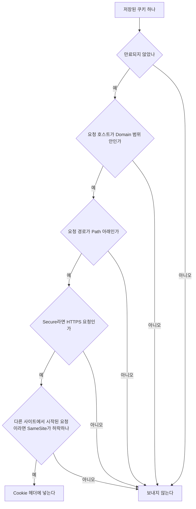
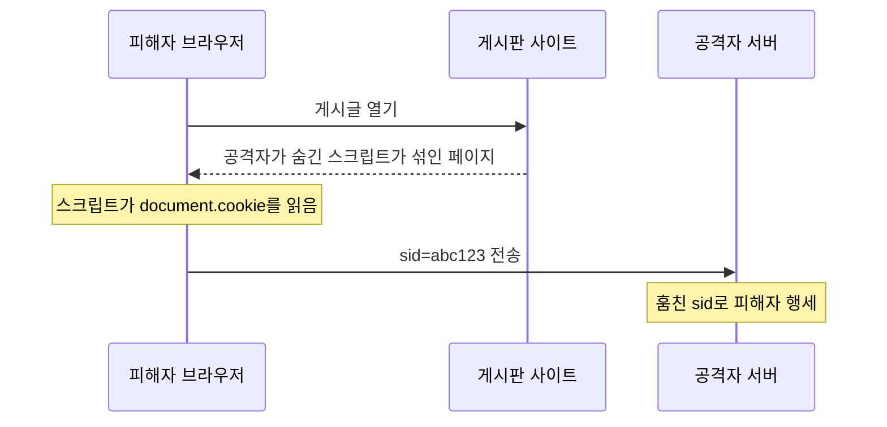
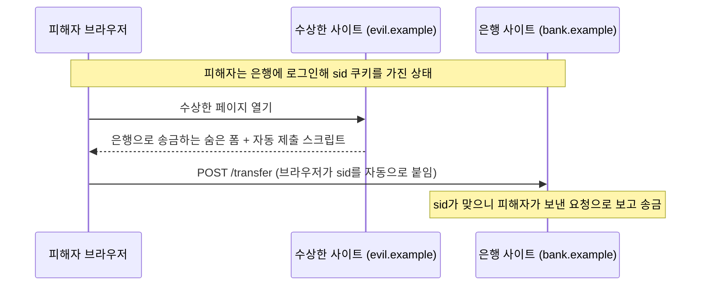

## 쿠키란 ?
- 서버가 응답의 Set-Cookie 헤더로 브라우저에 맡기는 작은 이름=값 데이터. 브라우저는 저장해 두었다가 조건에 맞는 요청마다 Cookie 헤더에 담아 자동으로 돌려보낸다
- 쿠키 자체보다 중요한 것은 함께 붙는 속성(Attribute)이다. 속성이 어느 서버, 어느 경로로, 언제까지, 어떤 연결에서 보낼지를 정하고, 몇 가지 흔한 공격을 막는다
- Cookie와 Set-Cookie 헤더의 기본 모양은 [HTTP 헤더](../HTTP%20헤더(HTTP%20Headers)/README.md#cookie와-set-cookie)에, 쿠키로 로그인 상태를 이어 가는 세션 방식은 [프론트엔드 관점 문서](../../클라이언트-서버%20구조%20프론트엔드%20관점(Frontend)/README.md#서버는-나를-어떻게-알아볼까)에 정리했다. 이 문서는 그 위에서 속성 하나하나와 보안을 다룬다

### 쿠키 (Cookie)
사전적 의미는 과자다. 기술 용어로는 프로그램끼리 주고받던 작은 데이터 조각을 부르던 매직 쿠키(Magic Cookie)라는 표현에서 왔다([프론트엔드 관점 문서](../../클라이언트-서버%20구조%20프론트엔드%20관점(Frontend)/README.md#쿠키-cookie)와 같은 설명).
공학적으로는 서버가 브라우저에 맡겨 두는 작은 메모다. 표준 문서(RFC 6265)는 Set-Cookie로 이름과 값, 그리고 그에 딸린 정보(메타데이터)를 넘기면 브라우저가 이 정보를 보고 다음 요청에 돌려보낼지 정한다고 설명한다.

### 속성 (Attribute)
사전적 의미는 사물이 가진 성질, 특징이다.
쿠키에서는 Set-Cookie 줄에서 이름=값 뒤에 세미콜론으로 이어 붙이는 조건들을 말한다. `Path=/`, `HttpOnly` 처럼 값이 있는 것도 있고 이름만 있는 것도 있다. 속성은 브라우저에게 주는 지시라서, 브라우저가 쿠키를 다시 보낼 때는 이름=값만 보내고 속성은 보내지 않는다.

<br/>

## 왜 생겼을까
HTTP는 서버가 이전 요청을 기억하지 않는 무상태(Stateless) 방식이다([클라이언트-서버 구조](../../클라이언트-서버%20구조(Client-Server%20Architecture)/README.md#서버는-손님을-기억할까) 참고). 그래서 방금 로그인했어도 다음 요청에서 서버는 내가 누구인지 모른다. 장바구니에 무엇을 담았는지, 어떤 언어를 골랐는지도 마찬가지다.

쿠키는 이 기억을 브라우저 쪽에 맡기는 방법이다. 서버가 번호표를 하나 주면 브라우저가 들고 있다가 요청마다 보여 준다. RFC 6265를 고쳐 쓰고 있는 개정 초안(RFC 6265bis, 2026년 10월 기준 아직 RFC 번호를 받지 않았다. 아래 참고 자료 참고) 첫머리도 쿠키를 대체로 무상태인 HTTP 위에서 서버가 상태를 이어 가게 해 주는 장치라고 소개한다.

이 문서는 [프론트엔드 관점 문서](../../클라이언트-서버%20구조%20프론트엔드%20관점(Frontend)/README.md#세션-방식)의 옷 보관소 번호표 비유를 이어 쓴다. 옷(사용자 정보)은 보관소(서버)에 있고 손님(브라우저)은 번호표(쿠키)만 들고 다닌다. 속성은 번호표 뒷면에 적힌 사용 조건이다. 실제로 쿠키로 번호표를 주고받는 예시는 [클라이언트-서버 구조의 데모 서버](../../클라이언트-서버%20구조(Client-Server%20Architecture)/demo/server.js)에 있다.

<br/>

## 브라우저가 쿠키를 다루는 순서
### 저장할 때
브라우저는 Set-Cookie를 받으면 이름과 값 말고도 여러 칸을 함께 적어 둔다. RFC 6265는 이름, 값, 만료 시각, 도메인, 경로, 만든 시각, 마지막으로 쓴 시각, 지속 여부, 호스트 전용 여부, Secure 여부, HttpOnly 여부를 저장하라고 정하고, 개정 초안은 여기에 SameSite 값을 더한다.

같은 이름, 같은 도메인, 같은 경로의 쿠키가 이미 있으면 새 쿠키로 바꿔 넣는다. 이름이 같아도 경로가 다르면 다른 쿠키로 따로 저장된다. 뒤에서 볼 쿠키 지우기가 이 규칙에 기댄다.

조건에 맞지 않으면 저장하지 않고 버린다. 예를 들어 shop.example.com이 보낸 응답이 Domain=other.com을 적으면 브라우저는 그 쿠키를 무시한다.

### 보낼 때
요청을 보낼 때마다 브라우저는 저장된 쿠키를 하나씩 보고 아래 조건을 모두 갖춘 것만 고른다.



고른 쿠키는 `Cookie: sid=abc123; theme=dark` 처럼 한 줄에 이어 붙인다. RFC 6265는 경로가 긴 쿠키를 앞에 두라고 권하지만, 모든 브라우저가 이 순서를 지키지는 않는다고 함께 적고 있다. 순서에 기대는 서버 코드는 만들지 않는 편이 낫다.

포트는 고르는 기준에 없다. 같은 호스트라면 3000번 포트에서 받은 쿠키가 8080번 포트로 가는 요청에도 붙는다(RFC 6265 8.5절). 브라우저의 동일 출처 정책([프론트엔드 관점 문서](../../클라이언트-서버%20구조%20프론트엔드%20관점(Frontend)/README.md#동일-출처-정책-same-origin-policy) 참고)은 포트까지 구분하지만 쿠키는 그렇지 않다.

HttpOnly는 보낼지 말지가 아니라 JavaScript에 보여 줄지를 정한다. 그래서 위 그림에 없다. 아래에서 따로 본다.

<br/>

## 어디로 보낼까: Domain과 Path
### Domain
사전적 의미는 영역, 영토다. 인터넷에서는 example.com처럼 이름으로 나눈 주소의 영역을 말한다.
Domain 속성은 이 쿠키를 어느 호스트들에게 보낼지 정한다. 번호표에 본관과 별관 어디서든 쓸 수 있다고 적는 것과 같다.

- Domain을 적지 않으면 쿠키를 준 호스트에만 보낸다. www.example.com이 준 쿠키는 www.example.com에만 간다. RFC 6265는 이것을 호스트 전용(host-only) 쿠키라고 부른다
- `Domain=example.com` 을 적으면 example.com과 그 아래 www.example.com, api.example.com에도 보낸다
- 자기를 포함하지 않는 도메인은 적을 수 없다. foo.example.com은 `Domain=example.com` 은 적을 수 있지만 `Domain=bar.example.com` 은 적을 수 없다
- com, co.uk처럼 누구나 그 아래에 도메인을 등록할 수 있는 공개 접미사(Public Suffix)도 많은 브라우저가 거절한다. 거절하지 않으면 아무 .com 사이트나 모든 .com 사이트에 쿠키를 심을 수 있기 때문이다

헷갈리기 쉬운 점은 Domain을 적으면 범위가 좁아지는 것이 아니라 넓어진다는 것이다. 하위 도메인끼리 로그인을 나눠 써야 할 때만 적고, 아니면 비워 두는 편이 안전하다.

### Path
사전적 의미는 길, 오솔길이다. 웹에서는 주소에서 도메인 뒤의 /shop/cart 같은 부분을 말한다.
Path 속성은 요청 경로가 이 값과 같거나 그 아래일 때만 쿠키를 보내게 한다. 번호표에 3층 창구에서만 보여 주라고 적는 것과 같다.

- `Path=/shop` 이면 /shop, /shop/cart에는 가고 /, /shopping에는 가지 않는다. / 를 디렉터리 구분자로 보고 비교하기 때문이다
- Path를 적지 않으면 쿠키를 준 요청 주소의 디렉터리가 기본값이 된다. /login처럼 / 가 하나뿐인 주소면 / 가 되고, /docs/guide/index.html이면 /docs/guide가 된다(RFC 6265 5.1.4절의 계산 방법). 생각보다 좁아질 수 있어서 보통 `Path=/` 를 직접 적는다

Path는 보낼 곳을 정리하는 용도이지 보안 장치가 아니다. RFC 6265는 브라우저가 Set-Cookie의 Path를 아무 값이나 받아들인다고 적는다. /foo/bar로 간 요청의 응답이 Path=/qux 쿠키를 만들 수도 있다는 것이다. MDN도 Path가 다른 경로의 페이지에서 쿠키를 읽어 가는 것을 막지 못한다고 적는다. 그래서 서로 믿지 못하는 서비스는 같은 호스트의 경로로만 나누지 말고 호스트를 따로 두는 편이 안전하다(RFC 6265 8.6절).

<br/>

## 언제까지 보관할까: Expires와 Max-Age
### Expires
사전적 의미는 기한이 끝나다, 만료되다이다.
Expires 속성은 쿠키가 만료되는 날짜와 시각을 적는다. `Expires=Thu, 31 Dec 2026 23:59:59 GMT` 처럼 쓴다. 번호표에 12월 31일까지 유효라고 적는 것과 같다.

날짜는 서버가 자기 시계로 적지만 만료됐는지는 브라우저가 판단하므로, 사용자 컴퓨터 시계가 서버와 다르면 어긋날 수 있다. MDN은 Firefox와 Chromium 계열 브라우저가 응답의 Date 헤더로 이 차이를 보정한다고 적고 있다(2026년 10월 26일 MDN Set-Cookie 문서 기준).

### Max-Age
Age는 나이, 지난 시간이다. Max-Age는 최대 나이라는 뜻으로, 지금부터 몇 초 뒤에 만료되는지를 적는다. `Max-Age=3600` 이면 한 시간이다. 번호표에 받은 때부터 한 시간 유효라고 적는 것과 같다.

둘을 함께 적으면 Max-Age가 이긴다(RFC 6265 4.1.2.2절). Max-Age는 브라우저가 받은 때부터 세므로 서버와 사용자의 시계가 서로 달라도 어긋나지 않는다.

어느 쪽이든 기한까지 반드시 보관하라는 약속은 아니다. 브라우저는 저장 공간이 모자라거나 사용자가 지우면 그 전에 쿠키를 버릴 수 있다고 RFC 6265가 적고 있다.

### 세션 쿠키와 지속 쿠키
Expires도 Max-Age도 없는 쿠키를 세션 쿠키(Session Cookie)라고 한다. 브라우저가 정한 현재 세션이 끝나면 사라진다. 보통은 브라우저를 닫을 때다. 뒷면에 기한이 없는 번호표는 그날 보관소가 문을 닫으면 버려지는 것과 같다.
기한을 적은 쿠키는 지속 쿠키(Persistent Cookie)라고 한다. 브라우저를 닫았다 열어도 기한까지 남는다. 뒷면에 날짜를 적은 번호표는 보관소가 다음 날 다시 문을 열어도 그 날짜까지 쓸 수 있는 것과 같다.

세션 쿠키의 세션은 서버의 로그인 세션과 이름만 같고 다른 이야기다. 그리고 세션이 언제 끝나는지는 브라우저가 정한다. MDN은 일부 브라우저가 다시 시작할 때 이전 세션을 되살리고(Session Restoring), 이 때문에 세션 쿠키가 끝없이 남을 수도 있다고 적고 있다.

<br/>

## 쿠키를 지우는 방법
서버가 브라우저의 쿠키를 직접 지우는 명령은 따로 없다. 대신 같은 이름의 쿠키를 이미 만료된 상태로 다시 보내 덮어쓴다.

```http
Set-Cookie: sid=; Path=/; Max-Age=0
```

RFC 6265는 Max-Age가 0 이하이면 만료 시각을 가장 이른 시각으로 정하라고 하고, 만료된 쿠키는 저장소에서 지우라고 한다. Expires에 지난 날짜를 적어도 같은 결과가 된다.

주의할 점은 앞에서 본 바꿔 넣기 규칙이다. 처음 줄 때와 이름, Domain, Path가 같아야 같은 쿠키로 보고 덮어쓴다. 처음에 `Path=/` 로 준 쿠키를 /account/logout 응답에서 지우면서 Path를 빼먹으면, 기본 Path가 /account가 되어 다른 쿠키로 취급된다. 그 쿠키가 생겼다가 사라질 뿐 원래 쿠키는 그대로 남는다. /logout처럼 / 가 하나뿐인 주소라면 기본 Path가 / 라서 우연히 지워지지만, 기본값에 기대지 말고 처음과 같은 Path를 직접 적는다. 번호표를 회수하려면 같은 번호, 같은 창구 표시가 적힌 회수증을 보내야 하는 것과 같다.

<br/>

## 엿보기를 막는 Secure
### Secure
사전적 의미는 안전한, 단단히 잠긴이다([HTTPS와 TLS](../HTTPS와%20TLS(HTTPS%20and%20TLS)/README.md#https)의 s와 같은 말).
Secure 속성이 붙은 쿠키는 HTTPS처럼 보호된 연결로 가는 요청에만 실린다. 번호표를 엽서에 적어 보내지 않고 봉한 편지에만 넣어 보내는 것과 같다.

### 왜 필요할까
HTTP로 보내는 요청은 글자 그대로 전송된다. 카페 와이파이처럼 중간에 거치는 장비에서 누군가 엿보면 Cookie 헤더의 세션 ID가 그대로 보인다([HTTPS와 TLS의 엿보기](../HTTPS와%20TLS(HTTPS%20and%20TLS)/README.md#엿보기-도청-eavesdropping) 참고). 보관소는 번호표를 누가 내밀든 그 번호의 옷을 내준다. 그래서 번호표(세션 ID)를 훔친 사람은 그대로 내 행세를 할 수 있다. 이를 세션 하이재킹(Session Hijacking)이라고 한다. Hijack은 차량이나 비행기를 납치한다는 뜻이다.

사이트가 HTTPS를 쓰더라도 사용자가 주소창에 http://로 들어오거나 페이지 안에 http:// 링크가 하나 섞여 있으면, Secure가 없는 쿠키는 그 평문 요청에 실려 나간다. Secure는 그런 순간에도 쿠키가 따라 나가지 않게 한다.

### 한계
Secure는 엿보기를 막을 뿐이다. RFC 6265는 Secure가 쿠키의 기밀성만 지키고, 중간에서 끼어든 공격자가 HTTP 응답으로 Secure 쿠키를 덮어쓰는 것까지는 막지 못한다고 적는다. 개정 초안은 HTTP 연결에서 Secure 쿠키를 만들거나 같은 이름의 Secure 쿠키를 덮어쓰지 못하게 규칙을 더했다. MDN도 HTTP 페이지는 Secure 쿠키를 설정할 수 없다고 적는다. 다만 MDN Set-Cookie 문서는 localhost를 예외로 두어, localhost에서는 Secure 쿠키를 설정하고 보낼 때 https 조건을 묻지 않는다고 적는다(2026년 10월 26일 기준, 브라우저별 차이는 확인 필요).

<br/>

## 스크립트로부터 숨기는 HttpOnly
### HttpOnly
Only는 오직이라는 뜻이다. HttpOnly는 이 쿠키를 HTTP 요청에만 쓰라는 표시다.
이 속성이 붙은 쿠키는 브라우저가 요청에 실어 보내기는 하지만, 페이지의 JavaScript가 `document.cookie` 로 읽으려 하면 목록에서 빠진다. 번호표를 창구에서만 열리는 지갑에 넣어 두는 것과 같다.

### XSS로 쿠키 훔치기
XSS(Cross-Site Scripting, 교차 사이트 스크립팅)는 공격자의 스크립트가 남의 사이트 페이지 안에서 실행되게 만드는 공격이다. 게시판 글에 스크립트를 숨겨 두고, 사이트가 그 글을 걸러 내지 않고 그대로 화면에 넣으면 글을 연 사람의 브라우저에서 그 스크립트가 돌아간다.

페이지 안에서 도는 스크립트는 그 사이트의 코드로 대접받는다. HttpOnly가 없으면 `document.cookie` 로 세션 ID를 읽어 공격자 서버로 보낼 수 있다. 공격자는 그 값을 자기 브라우저 쿠키에 넣고 내 계정으로 들어온다.



HttpOnly를 붙이면 세 번째 단계에서 sid가 보이지 않는다. 지갑 비유로 말하면 소매치기가 가방에 손을 넣어도 지갑은 열리지 않는다.

### 한계
HttpOnly는 쿠키 값을 가져가는 것만 막는다. MDN이 적듯 HttpOnly 쿠키도 페이지의 fetch 요청에는 그대로 실린다. 그래서 XSS가 일어나면 스크립트가 쿠키를 꺼내지 않고도 피해자 브라우저 안에서 바로 요청을 보내 피해자 대신 일을 할 수 있다. 소매치기가 지갑은 못 열어도 손님 대신 창구에 심부름을 보낼 수는 있는 셈이다. XSS 자체는 입력을 걸러 내고 화면에 넣을 때 바꾸는(escape) 식으로 따로 막아야 한다(TODO).

<br/>

## 다른 사이트에서 온 요청을 가리는 SameSite
### 사이트 (Site)
SameSite를 보려면 사이트가 무엇인지부터 알아야 한다. 사이트는 등록 가능한 도메인(Registrable Domain)과 스킴(https, http)으로 묶은 단위다. 등록 가능한 도메인은 앞에서 본 공개 접미사에 바로 앞 한 칸을 더한 이름으로, www.example.com이라면 example.com이다. www.example.com과 api.example.com은 같은 사이트이고, example.com과 other.com은 다른 사이트다. 출처(Origin)는 호스트와 포트까지 따지므로 사이트보다 좁다([프론트엔드 관점 문서](../../클라이언트-서버%20구조%20프론트엔드%20관점(Frontend)/README.md#동일-출처-정책-same-origin-policy) 참고).

스킴까지 사이트 구분에 넣는 방식(Schemeful Same-Site)은 브라우저마다 다르다. MDN의 브라우저 호환성 자료는 Chrome 91부터 적용, Firefox는 설정을 켜야 적용, Safari는 미지원으로 적고 있다(2026년 10월 26일 확인). 그래서 http://example.com과 https://example.com을 같은 사이트로 볼지는 브라우저에 따라 다를 수 있다.

### SameSite
사전적 의미는 같은 사이트다.
SameSite 속성은 다른 사이트에서 시작된 요청(Cross-site Request)에 이 쿠키를 붙일지 정한다. 번호표에 우리 건물 안에서 쓴 주문서에만 붙이라고 적는 것과 같다. 값은 세 가지다.

| 값 | 같은 사이트에서 시작된 요청 | 다른 사이트의 링크를 눌러 들어올 때 (GET 페이지 이동) | 다른 사이트의 폼 POST, 이미지, iframe, fetch |
| --- | --- | --- | --- |
| Strict | 보낸다 | 보내지 않는다 | 보내지 않는다 |
| Lax | 보낸다 | 보낸다 | 보내지 않는다 |
| None | 보낸다 | 보낸다 | 보낸다 (Secure 필수) |

iframe은 페이지 안에 다른 페이지를 끼워 넣는 틀이다. 이미지, iframe, fetch처럼 주소창은 그대로 둔 채 페이지가 따로 보내는 요청은 Lax에서도 쿠키가 붙지 않는다.

Strict는 가장 엄격하다. 검색 결과에서 링크를 눌러 들어와도 쿠키가 없으니, 로그인한 사용자도 첫 화면은 로그인하지 않은 것처럼 보일 수 있다. 같은 사이트 안에서 다음 페이지로 넘어가면 그때부터 쿠키가 붙는다.

Lax는 주소창의 주소가 바뀌는 페이지 이동이면서 GET처럼 안전한 메서드([HTTP 메서드와 상태 코드](../HTTP%20메서드와%20상태%20코드(HTTP%20Methods%20and%20Status%20Codes)/README.md#안전-safe) 참고)일 때만 다른 사이트에서 온 요청에도 쿠키를 붙인다. 링크로 들어오는 것은 허락하고, 남이 대신 써 준 주문서는 거절하는 셈이다.

None은 제한을 두지 않는다. 다른 사이트에 끼워 넣는 위젯처럼 일부러 여러 사이트에서 쿠키가 필요할 때 쓴다. 개정 초안과 MDN 모두 None에는 Secure가 함께 있어야 한다고 정하고, 개정 초안은 Secure 없는 None 쿠키를 버리라고 적는다.

### CSRF를 막는 원리
CSRF(Cross-Site Request Forgery, 교차 사이트 요청 위조)는 다른 사이트가 내 브라우저를 시켜 내가 로그인한 사이트로 요청을 보내게 하는 공격이다. Forgery는 위조라는 뜻이다. 공격자는 쿠키를 훔치지 않는다. 브라우저가 쿠키를 자동으로 붙여 주는 성질을 이용할 뿐이다.



SameSite=Lax나 Strict가 붙은 sid는 다른 사이트에서 시작된 POST에 실리지 않는다. 은행 서버는 sid 없는 요청을 받으니 로그인하지 않은 사용자로 보고 거절한다. 번호표가 남이 써 준 주문서에 저절로 붙어 가지 않게 된 것이다.

SameSite는 CSRF를 크게 줄이지만 하나로 끝나는 방어는 아니다. 같은 사이트 안의 다른 하위 도메인에서 시작된 요청은 SameSite로 막을 수 없고, 아래에서 보듯 속성을 적지 않았을 때의 동작도 브라우저마다 다르다. CSRF 토큰 같은 다른 방어와 함께 쓴다(TODO).

### SameSite를 적지 않으면
브라우저마다 다르고 바뀌어 온 부분이다. 2026년 10월 26일에 확인한 내용만 적는다.

- RFC 6265에는 SameSite가 없다. 개정 초안(draft-ietf-httpbis-rfc6265bis-22)은 SameSite를 적지 않은 쿠키를 Default로 저장하고, 보낼 때는 Lax와 같은 규칙을 적용한다
- MDN의 브라우저 호환성 자료는 SameSite가 없을 때 Lax로 다루는 동작을 Chrome 80부터 적용, Firefox는 설정을 켜야 적용, Safari는 미지원으로 적고 있다
- MDN은 Lax를 기본값으로 적용할 때 더 느슨한 Lax를 쓴다고 적는다. 만든 지 2분이 지나지 않은 쿠키는 다른 사이트에서 온 POST 페이지 이동에도 붙인다. 로그인 과정 끝에 다른 사이트로 POST하는 흐름이 깨지지 않게 하려는 과도기 장치로, 개정 초안은 이 방식을 Lax-allowing-unsafe라고 부른다

정리하면 SameSite를 적지 않고 브라우저 기본값에 기대면 브라우저마다 결과가 달라진다. 원하는 값을 직접 적는다.

<br/>

## 퍼스트 파티 쿠키와 서드 파티 쿠키
Party는 계약이나 거래에 참여하는 당사자라는 뜻이다. 퍼스트 파티는 사용자가 직접 찾아간 당사자, 서드 파티(Third Party, 제삼자)는 그 거래에 끼어든 바깥 쪽이다. 웹에서는 지금 주소창에 떠 있는 사이트를 기준으로 나눈다.

- 퍼스트 파티 쿠키(First-party Cookie)는 쿠키의 도메인과 스킴이 지금 보고 있는 페이지와 같은 사이트인 쿠키다
- 서드 파티 쿠키(Third-party Cookie)는 다른 사이트의 쿠키다. 뉴스 사이트에 광고 회사의 이미지나 iframe이 끼워져 있으면, 그 요청에 오가는 광고 회사 쿠키가 서드 파티 쿠키다

백화점(주소창의 사이트)에 들어가 받은 백화점 회원 번호표는 퍼스트 파티, 백화점 안에 입점한 다른 회사 매장이 준 번호표는 서드 파티다. 이 매장이 여러 백화점에 들어가 있으면 같은 번호표로 내가 어느 백화점을 돌았는지 알 수 있다. RFC 6265 7.1절도 이렇게 제삼자가 여러 사이트에 걸쳐 사용자를 추적할 수 있다는 점을 특히 우려스러운 문제로 든다.

MDN은 서드 파티 쿠키를 크로스 사이트 쿠키(Cross-site Cookie)라고 부르는 편이 더 정확하다고 적는다. 소유 회사가 같아도 사이트가 다르면 똑같이 서드 파티로 다뤄지기 때문이다. 다른 사이트 페이지에 끼워 넣은 위젯의 쿠키처럼 서드 파티로 오가야 하는 쿠키는, SameSite를 적지 않은 쿠키를 Lax로 다루는 브라우저(앞에서 본 Chrome 80 이후)에서는 SameSite=None을 직접 적어야 이미지나 iframe 요청에 실린다. 어느 브라우저에서든 같은 결과를 원하면 None과 Secure를 함께 적는다. 브라우저들이 서드 파티 쿠키를 얼마나 막는지는 브라우저마다 다르고 계속 바뀌어서 이 문서에서는 다루지 않는다(TODO).

<br/>

## 크기와 개수 제한
RFC 6265 6.1절은 브라우저가 적어도 아래만큼은 저장할 수 있어야 한다고 권한다. 이 숫자는 최소한 지원하라는 값이지 넘으면 안 되는 상한이 아니다.

- 쿠키 하나에 4096바이트(이름, 값, 속성 길이를 모두 더한 크기)
- 도메인 하나에 쿠키 50개
- 전체 3000개

개정 초안은 상한도 정한다. 이름과 값을 더해 4096바이트를 넘는 쿠키는 통째로 버리고, 속성 값 하나가 1024바이트를 넘으면 그 속성만 무시한다. 또 Expires나 Max-Age로 아무리 길게 적어도 만료 시각을 400일 이내로 줄이라고 권한다. 각 브라우저가 실제로 쓰는 상한 숫자는 이 문서에서 확인하지 못했다(확인 필요).

쿠키는 조건에 맞는 모든 요청에 실려 가므로, 크고 많을수록 이미지 요청 하나하나까지 무거워진다. RFC 6265도 서버가 쿠키를 가능한 한 적고 작게 쓰라고 권한다. 번호표에는 번호만 적고 옷은 보관소에 두는 이유다.

<br/>

## 이름으로 속성을 보증하는 접두사
서버는 Cookie 헤더로 이름=값만 받으므로, 그 쿠키가 어떤 속성으로 만들어졌는지 알 수 없다. 앞에서 본 것처럼 HTTP 연결에 끼어든 공격자나 같은 사이트의 다른 하위 도메인이 Domain을 넓혀 같은 이름의 sid를 심어도, 서버는 진짜와 구별하지 못한다. 개정 초안은 이름 앞에 정해진 접두사(Prefix)를 붙이면 브라우저가 속성을 검사해 조건에 맞지 않는 쿠키는 아예 저장하지 않게 했다. 그래서 서버는 이 이름으로 들어온 쿠키가 조건을 지켜 만들어졌다고 믿을 수 있다. 번호표 번호 앞에 본관 직인을 찍어 두어, 직인 없는 위조 번호표는 받지 않는 것과 같다.

- `__Secure-` 로 시작하는 쿠키는 Secure가 있어야 하고 HTTPS 페이지에서 설정해야 한다
- `__Host-` 로 시작하는 쿠키는 거기에 더해 Domain이 없어야 하고 Path가 / 여야 한다. 쿠키를 준 호스트 한 곳에만 묶인다

MDN의 브라우저 호환성 자료는 두 접두사를 Chrome 49, Firefox 50, Safari 13부터 지원한다고 적고 있다(2026년 10월 26일 확인).

<br/>

## 코드로 보기
Node.js http 모듈로 만든 서버가 로그인 응답에 Set-Cookie 세 개를 보내고, 로그아웃 응답에 Max-Age=0으로 지우라는 쿠키를 보낸다. 서버와 클라이언트를 한 파일에 두고, 서버는 빈 포트(0)로 띄웠다가 끝나면 스스로 닫는다.

Node.js의 fetch는 브라우저와 달리 쿠키를 저장하지 않는다. 받은 Set-Cookie를 다음 요청에 자동으로 붙여 주지 않으므로, 브라우저가 하는 일을 흉내 내려면 Cookie 헤더를 직접 만들어 붙여야 한다. 아래 3번이 그 흉내다. 실제 브라우저가 하는 만료, Secure, SameSite 검사는 하지 않고 Path 하나만 손으로 걸렀다.

```js
// cookie-demo.js
const http = require('http');

const server = http.createServer((req, res) => {
  // 서버가 받은 Cookie 헤더를 그대로 보여 준다
  console.log(`[서버] ${req.url} 에서 받은 Cookie:`, req.headers.cookie);

  if (req.url === '/login') {
    // Set-Cookie는 쿠키 하나에 한 줄이라 여러 개면 배열로 넘긴다
    res.writeHead(200, {
      'Set-Cookie': [
        'sid=abc123; Path=/; Max-Age=3600; HttpOnly; Secure; SameSite=Lax',
        'theme=dark; Path=/',
        'cart=3; Path=/shop; SameSite=Strict',
      ],
    });
    return res.end('ok');
  }

  if (req.url === '/logout') {
    // 같은 이름, 같은 Path로 Max-Age=0을 보내면 브라우저가 지운다
    res.writeHead(200, { 'Set-Cookie': 'sid=; Path=/; Max-Age=0' });
    return res.end('bye');
  }

  res.end('hello');
});

server.listen(0, async () => {
  const base = `http://localhost:${server.address().port}`;

  // 1. 로그인하면 Set-Cookie가 세 줄 온다
  const r1 = await fetch(`${base}/login`);
  console.log(r1.headers.getSetCookie());

  // 2. Node fetch는 쿠키를 저장하지 않으므로 다음 요청에 아무것도 붙지 않는다
  await fetch(`${base}/me`);

  // 3. 브라우저를 흉내 내 Cookie 헤더를 직접 만든다. 속성은 빼고 이름=값만 보낸다
  const cookie = r1.headers
    .getSetCookie()
    .filter((line) => !line.includes('Path=/shop')) // /me 는 /shop 아래가 아니므로 cart는 뺀다
    .map((line) => line.split(';')[0])
    .join('; ');
  await fetch(`${base}/me`, { headers: { Cookie: cookie } });

  // 4. 지우라는 응답
  const r4 = await fetch(`${base}/logout`);
  console.log(r4.headers.getSetCookie());

  server.close();
});
```

Node.js v24.22.1에서 2026년 10월 26일에 실행한 출력이다.

```text
[서버] /login 에서 받은 Cookie: undefined
[
  'sid=abc123; Path=/; Max-Age=3600; HttpOnly; Secure; SameSite=Lax',
  'theme=dark; Path=/',
  'cart=3; Path=/shop; SameSite=Strict'
]
[서버] /me 에서 받은 Cookie: undefined
[서버] /me 에서 받은 Cookie: sid=abc123; theme=dark
[서버] /logout 에서 받은 Cookie: undefined
[ 'sid=; Path=/; Max-Age=0' ]
```

- 1번 응답에서 쿠키 하나마다 Set-Cookie 줄이 따로 온다. `getSetCookie()` 는 그 줄들을 배열로 돌려준다. 다른 헤더처럼 `headers.get('set-cookie')` 로 꺼내면 줄들이 쉼표로 합쳐진 문자열 하나가 되는데, Expires 날짜 안에도 쉼표가 있어 다시 나누기 어렵다. Set-Cookie 두 줄을 보내는 작은 서버로 따로 시험했을 때 `"a=1; Path=/, b=2; Expires=Wed, 21 Oct 2026 07:28:00 GMT"` 가 나왔다
- 2번에서 서버가 받은 Cookie는 undefined다. 쿠키를 저장해 두고 다시 붙이는 일은 HTTP 메시지가 저절로 하는 것이 아니라 클라이언트가 맡는 일이고, Node의 fetch는 그 저장소를 갖고 있지 않다
- 3번에서 서버에 도착한 것은 `sid=abc123; theme=dark` 뿐이다. HttpOnly, Max-Age 같은 속성은 돌아오지 않는다. 서버는 이 쿠키가 어떤 속성으로 만들어졌는지 Cookie 헤더만 보고는 알 수 없고, 앞의 접두사가 필요한 이유가 이것이다. cart는 Path가 /shop이라 /me 요청에서 뺐다
- 4번은 값을 비우고 Max-Age=0을 붙여 sid를 다시 보낸다. Path를 처음과 같은 / 로 맞춘 점이 중요하다. 브라우저였다면 이 응답을 받는 즉시 sid를 지운다. 이 부분은 Node에서 확인할 수 없어 실행으로 보이지는 못했다

브라우저였다면 sid는 Secure인데 주소가 http://localhost다. MDN은 localhost를 예외로 둔다고 적지만, 브라우저마다 이 쿠키를 저장하고 다시 보내는지는 직접 확인하지 않았다. 또 페이지의 JavaScript에서 `document.cookie` 를 찍으면 HttpOnly인 sid는 빠지고 theme만 보일 것이다. 이 두 동작은 브라우저에서 직접 확인하지 않았다(확인 필요).

<br/>

## 참고 자료
- RFC 6265, [HTTP State Management Mechanism](https://www.rfc-editor.org/rfc/rfc6265.html) (2011년 4월)
- IETF, [draft-ietf-httpbis-rfc6265bis](https://datatracker.ietf.org/doc/draft-ietf-httpbis-rfc6265bis/). 2026년 10월 26일 datatracker 기준 22판(2025년 12월 1일)이 최신이고, IESG 승인을 거쳐 RFC 편집 대기열(RFC Ed Queue)에 있으며 아직 RFC 번호를 받지 않은 초안이다. 이 문서에서 개정 초안이라고 부른 것이 이것이다
- MDN, [Set-Cookie](https://developer.mozilla.org/en-US/docs/Web/HTTP/Reference/Headers/Set-Cookie)
- MDN, [Using HTTP cookies](https://developer.mozilla.org/en-US/docs/Web/HTTP/Guides/Cookies)
- MDN, [Third-party cookies](https://developer.mozilla.org/en-US/docs/Web/Privacy/Guides/Third-party_cookies)
- MDN, [browser-compat-data의 Set-Cookie 항목](https://github.com/mdn/browser-compat-data/blob/main/http/headers/Set-Cookie.json) (SameSite 기본값과 스킴 구분 지원 여부)

<br/>

## 더 볼 것 (TODO)
- 서드 파티 쿠키를 나눠 저장하는 CHIPS (Partitioned 속성)
- 브라우저별 서드 파티 쿠키 차단과 폐지 일정
- 쿠키 없이 인증하는 방식 비교 (Authorization 헤더와 토큰, 저장 위치별 장단점)
- CSRF 토큰 등 SameSite 말고 CSRF를 막는 방법
- XSS를 막는 방법 (출력 이스케이프, Content-Security-Policy)
- 브라우저에서 document.cookie와 개발자 도구로 HttpOnly, Secure, SameSite 동작 직접 확인하기
- 같은 이름의 쿠키가 여러 개일 때 서버가 받는 순서와 쿠키 고정(Cookie Fixation) 공격
