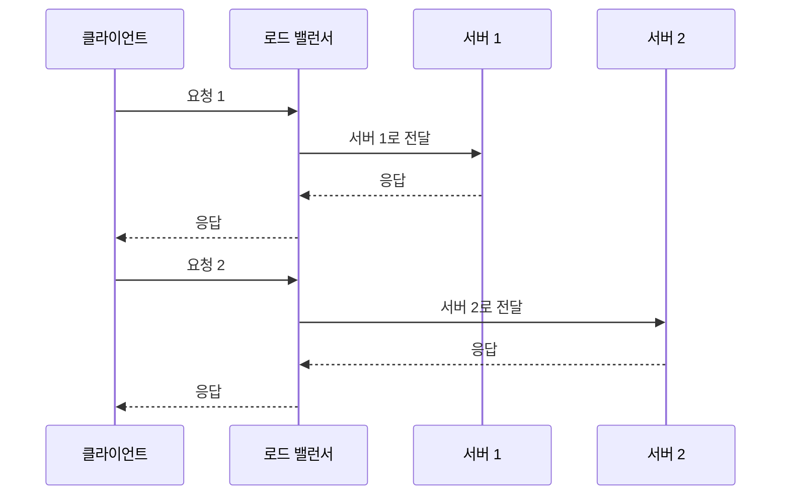
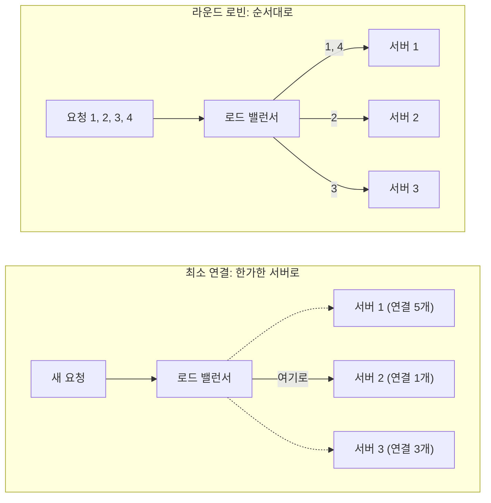
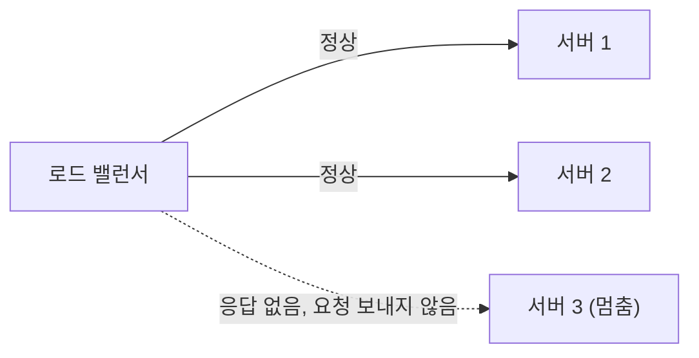
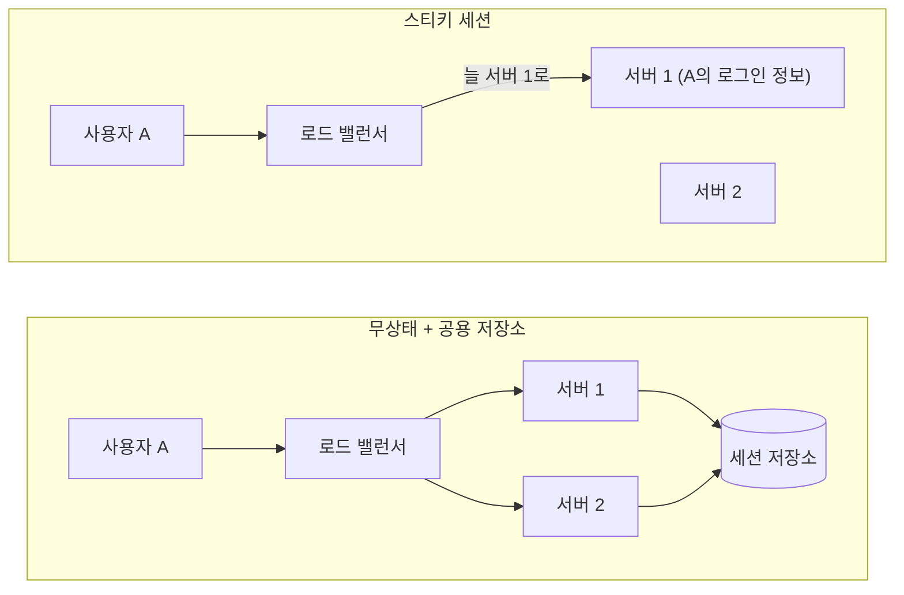
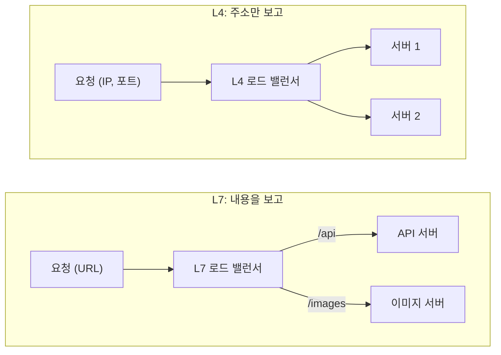

## 로드 밸런싱이란 ?
- 들어오는 요청을 여러 서버에 나눠 보내 한 서버에 일이 몰리지 않게 하는 방법
- 이 일을 맡는 장치나 프로그램을 로드 밸런서라고 한다
- [클라이언트-서버 구조](../클라이언트-서버%20구조(Client-Server%20Architecture)/README.md) 문서의 수평 확장(Scale-out)에서 본 안내 데스크가 바로 로드 밸런서다

### 로드 밸런싱 (Load Balancing)
Load의 사전적 의미는 짐, 실어야 할 양이다. Balance는 균형, 저울이라는 뜻이다. 짐을 여러 사람에게 고르게 나눠 지게 한다는 말이 된다.
공학적으로는 서버가 처리해야 할 요청(부하)을 여러 서버에 고르게 나누는 일을 말한다. 짐 대신 요청을, 사람 대신 서버를 넣으면 원래 뜻과 그대로 이어진다.

<br/>

## 마트 계산대로 이해하기
큰 마트에는 계산대가 여러 개 있고, 입구 쪽에 직원이 서서 "3번 계산대로 가세요"라고 안내한다.

| 마트 | 네트워크 |
| --- | --- |
| 손님 | 클라이언트의 요청 |
| 계산대 | 서버 |
| 안내 직원 | 로드 밸런서 |
| 어느 계산대로 보낼지 정하는 기준 | 로드 밸런싱 알고리즘 |
| 계산대가 고장 났는지 살펴보기 | 헬스 체크 (Health Check, 아래에서 다룸) |

손님은 계산대가 몇 개인지, 어느 계산대가 비었는지 몰라도 된다. 안내 직원 말만 따르면 된다. 클라이언트도 서버가 몇 대인지 모르고 로드 밸런서 주소 하나로만 접속한다.

<br/>

## 왜 필요할까
### 서버 한 대로는 버티지 못할 때
사용자가 늘면 서버를 늘려야 한다. 그런데 서버가 세 대여도 요청이 전부 1번 서버로만 가면 소용이 없다. 누군가 요청을 나눠 줘야 서버를 늘린 효과가 난다.

### 서버 하나가 멈췄을 때
계산대 하나가 고장 나면 안내 직원은 그쪽으로 손님을 보내지 않는다. 로드 밸런서도 멈춘 서버를 빼고 나머지 서버로만 요청을 보낸다. 서버 한 대가 멈춰도 서비스는 계속된다.

### 서버를 고치거나 바꿀 때
서버 하나씩 로드 밸런서에서 빼고, 업데이트하고, 다시 넣으면 서비스를 멈추지 않고 새 버전으로 바꿀 수 있다. 계산대를 하나씩 돌아가며 점검하는 것과 같다.

<br/>

## 어떻게 동작할까
1. 클라이언트는 로드 밸런서 주소로 요청을 보낸다. 서버의 실제 주소는 모른다
2. 로드 밸런서가 정해 둔 기준(알고리즘)으로 서버 하나를 고른다
3. 고른 서버로 요청을 넘긴다
4. 서버가 처리한 응답을 로드 밸런서를 거쳐 클라이언트에게 돌려준다



클라이언트 입장에서는 서버가 한 대인 것처럼 보인다. 뒤에 서버가 몇 대 있든, 몇 대가 바뀌든 클라이언트는 신경 쓰지 않아도 된다.

<br/>

## 어느 서버로 보낼까 (로드 밸런싱 알고리즘)
알고리즘은 서버를 고르는 기준이다. 크게 두 갈래가 있다. 정해진 순서대로 보내는 정적 방식과, 서버의 지금 상태를 보고 정하는 동적 방식이다.

### 라운드 로빈 (Round Robin)
Round Robin은 원래 여러 사람이 돌아가며 서명해서 누가 먼저 썼는지 모르게 한 청원서, 또는 모두가 한 번씩 돌아가며 맞붙는 리그전을 뜻한다. 공통점은 순서대로 한 번씩 돌아간다는 것이다.
공학적으로는 서버를 순서대로 하나씩 돌아가며 요청을 보내는 방식이다. 1번, 2번, 3번, 다시 1번. 마트 직원이 "1번, 2번, 3번" 순서로 계산대를 안내하는 것과 같다.

가장 단순하고, 서버 성능이 비슷하고 요청마다 처리 시간이 비슷할 때 잘 맞는다. 대신 어떤 서버가 무거운 요청을 붙잡고 있어도 순서가 오면 또 보낸다.

### 가중 라운드 로빈 (Weighted Round Robin)
Weight는 무게, 비중이라는 뜻이다. 서버마다 비중을 정해 두고 그 비율만큼 요청을 더 보낸다. 성능이 두 배인 서버에 가중치 2를 주면 다른 서버보다 두 배 많이 받는다. 안내 직원이 손이 빠른 계산대에 손님을 더 보내는 것과 같다.

### 최소 연결 (Least Connections)
지금 처리 중인 연결이 가장 적은 서버로 보낸다. 줄이 가장 짧은 계산대로 안내하는 것이다. 요청마다 처리 시간이 들쭉날쭉할 때 라운드 로빈보다 고르게 나뉜다. 로드 밸런서가 서버별 연결 수를 계속 세고 있어야 한다.

### IP 해시 (IP Hash)
Hash의 사전적 의미는 잘게 다진 것이다. 고기를 다져 섞으면 원래 모양은 사라지지만 같은 재료는 늘 같은 결과가 나온다.
공학적으로 해시는 어떤 값을 정해진 규칙으로 섞어 일정한 숫자로 바꾸는 일이다. IP 해시는 클라이언트 IP 주소를 해시해서 서버를 고른다. 같은 IP는 늘 같은 숫자가 나오므로 같은 사용자는 계속 같은 서버로 간다. 단골손님을 늘 같은 계산대로 보내는 것과 같다.

| 알고리즘 | 고르는 기준 | 잘 맞는 상황 | 약점 |
| --- | --- | --- | --- |
| 라운드 로빈 | 순서대로 | 서버 성능과 요청이 비슷할 때 | 서버 상태를 보지 않음 |
| 가중 라운드 로빈 | 정해 둔 비율 | 서버 성능이 서로 다를 때 | 비율을 사람이 정해야 함 |
| 최소 연결 | 연결 수가 가장 적은 서버 | 요청 처리 시간이 들쭉날쭉할 때 | 연결 수를 계속 세야 함 |
| IP 해시 | 클라이언트 IP | 같은 사용자를 같은 서버로 보내야 할 때 | 한 IP에 사용자가 몰리면 한쪽만 바빠짐 |



### 코드로 보기
두 알고리즘을 아주 단순하게 줄이면 이렇다. 실제 로드 밸런서는 이 밖에도 서버 상태, 가중치, 타임아웃 등을 함께 다룬다.

```js
const servers = ['서버 1', '서버 2', '서버 3'];

// 라운드 로빈: 순서를 기억해 두고 하나씩 넘긴다
let next = 0;
function roundRobin() {
  const server = servers[next];
  next = (next + 1) % servers.length;
  return server;
}

// 최소 연결: 지금 연결 수가 가장 적은 서버를 고른다
const connections = { '서버 1': 5, '서버 2': 1, '서버 3': 3 };
function leastConnections() {
  return servers.reduce((a, b) => (connections[a] <= connections[b] ? a : b));
}

console.log(roundRobin(), roundRobin(), roundRobin(), roundRobin());
// 서버 1 서버 2 서버 3 서버 1
console.log(leastConnections());
// 서버 2
```

<br/>

## 멈춘 서버 걸러내기 (헬스 체크)
헬스 체크(Health Check)는 건강 검진이라는 뜻이다. 로드 밸런서가 서버들이 살아 있는지 주기적으로 확인하는 일을 말한다.

방식은 두 가지가 있다. 로드 밸런서가 일정 시간마다 서버에 "괜찮아?" 하고 직접 요청을 보내 보는 능동적 방식과, 실제 요청을 보내다가 실패가 몇 번 쌓이면 그 서버를 잠시 빼는 수동적 방식이다. 응답이 없거나 실패가 쌓인 서버는 목록에서 빠지고, 다시 응답하면 돌아온다.



<br/>

## 같은 사용자를 같은 서버로 (세션 유지)
### 문제
로그인 정보를 서버 메모리에 저장하는 상태 유지(Stateful) 방식이라고 해 보자. 첫 요청에서 서버 1에 로그인했는데 두 번째 요청이 서버 2로 가면, 서버 2는 이 사용자를 모른다. 클라이언트-서버 구조 문서에서 본 "누구신지 모르겠어요" 상황이다.

### 스티키 세션 (Sticky Session)
Sticky는 끈적끈적하다는 뜻이다. 한 사용자를 처음 간 서버에 붙여 두고 계속 그 서버로만 보낸다. 앞의 IP 해시나, 로드 밸런서가 쿠키에 서버 표시를 남기는 방식으로 구현한다.

간단하지만 단점이 있다. 특정 서버에 사용자가 몰려도 다른 서버로 옮기지 못하고, 그 서버가 멈추면 붙어 있던 사용자의 로그인 정보가 모두 사라진다.

### 무상태로 만들기
더 흔한 해결책은 서버가 사용자 정보를 들고 있지 않게 하는 것이다. 로그인 정보를 모든 서버가 함께 보는 저장소(Redis 같은 세션 저장소)에 두거나, 토큰에 담아 클라이언트가 요청마다 보내게 한다. 그러면 어느 서버가 받아도 같은 결과가 나오고, 로드 밸런서는 아무 서버로나 보내면 된다.



<br/>

## 무엇을 보고 나눌까 (L4와 L7)
로드 밸런서는 요청의 어디까지 들여다보느냐에 따라 나뉜다. L4, L7의 L은 Layer(계층)의 약자이고, 숫자는 네트워크를 일곱 층으로 나눈 OSI 7계층의 번호다.

### L4 로드 밸런서
4계층(전송 계층)까지만 본다. IP 주소와 포트 번호만 보고 서버를 고른다. 편지 봉투의 주소만 보고 분류하는 우체국 직원과 같다. 내용을 열어 보지 않으니 빠르다. TCP, UDP 연결 단위로 나눈다.

### L7 로드 밸런서
7계층(응용 계층)까지 본다. HTTP 요청의 URL, 헤더, 쿠키까지 읽고 서버를 고른다. 편지를 열어 내용을 읽고 담당 부서로 보내는 비서와 같다. /api로 시작하는 요청은 API 서버로, /images는 이미지 서버로 보내는 식의 세밀한 분배가 가능하다. 내용을 읽는 만큼 L4보다 일이 많다.

정리하면 L4는 IP 주소와 포트만 보고 연결 단위로 나누므로 빠르고, AWS NLB가 이 방식이다. L7은 URL, 헤더, 쿠키 같은 요청 내용을 보고 요청 단위로 나누므로 더 세밀하지만 일이 많고, AWS ALB와 Nginx가 이 방식이다. HAProxy는 둘 다 할 수 있다.



<br/>

## 로드 밸런서가 멈추면
요청이 전부 로드 밸런서 한 곳을 지나가니, 로드 밸런서가 멈추면 서버가 아무리 많아도 서비스 전체가 멈춘다. 로드 밸런서가 새로운 단일 장애 지점(SPOF)이 되는 것이다.

그래서 로드 밸런서도 두 대 이상 둔다. 한 대가 일하고 다른 한 대는 대기하다가, 일하던 쪽이 멈추면 대기하던 쪽이 바로 넘겨받는다. 이를 이중화(Redundancy)라고 한다. 안내 직원이 쓰러지면 옆에 있던 직원이 바로 안내를 이어받는 것과 같다. 클라우드의 로드 밸런서 서비스는 이 이중화를 서비스 쪽에서 해 준다.

<br/>

## 실제로 쓰는 것
### Nginx 설정 예시
Nginx는 웹 서버이면서 L7 로드 밸런서로 많이 쓴다. upstream 블록에 서버 목록을 적으면 기본으로 라운드 로빈으로 나눈다.

```nginx
upstream backend {
    least_conn;                       # 최소 연결 방식 (빼면 라운드 로빈)
    server 10.0.0.1:3000 weight=2;    # 가중치 2
    server 10.0.0.2:3000;
    server 10.0.0.3:3000 max_fails=3 fail_timeout=30s;
}

server {
    listen 80;
    location / {
        proxy_pass http://backend;    # 요청을 backend 서버들에 나눠 보낸다
    }
}
```

least_conn 대신 ip_hash를 쓰면 IP 해시 방식이 된다. max_fails와 fail_timeout은 앞에서 본 수동적 헬스 체크다. 30초 안에 3번 실패하면 그 서버를 30초 동안 빼 둔다. 주기적으로 직접 확인하는 능동적 헬스 체크는 무료 버전 Nginx에는 없고 유료 버전(NGINX Plus)이나 다른 도구를 쓴다.

### 그 밖의 도구
- HAProxy: 로드 밸런싱 전용 소프트웨어. L4와 L7을 모두 지원한다
- 클라우드 서비스: AWS ELB(ALB, NLB 등), GCP Cloud Load Balancing처럼 설정만 하면 쓰는 관리형 로드 밸런서
- 하드웨어 장비: 로드 밸런싱 전용 장비. 예전 대형 서비스에서 많이 썼다

<br/>

## 더 볼 것 (TODO)
- OSI 7계층과 TCP/IP 계층
- 리버스 프록시와 로드 밸런서의 관계
- DNS 로드 밸런싱과 GSLB (지역별로 가까운 서버로 보내기)
- 일관된 해싱 (Consistent Hashing)
- 무중단 배포 방식 (롤링, 블루-그린, 카나리)
