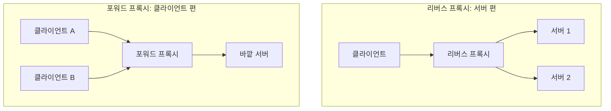

## 리버스 프록시란 ?
- 서버 앞에 서서 클라이언트의 요청을 대신 받고, 뒤쪽 서버에 넘긴 뒤 받은 응답을 돌려주는 중간 서버
- 클라이언트는 리버스 프록시를 진짜 서버로 알고 접속한다. 뒤에 서버가 몇 대인지, 어디 있는지는 보이지 않는다
- 요청을 여러 서버에 나눠 보내는 [로드 밸런싱](../로드%20밸런싱(Load%20Balancing)/README.md)은 리버스 프록시가 하는 여러 일 가운데 하나다(프록시 방식이 아닌 로드 밸런서도 있다)

### 프록시 (Proxy)
Proxy의 사전적 의미는 대리인, 그리고 남을 대신해 행동할 권한이나 그 권한을 적은 위임장이다. 주주총회에 못 가는 사람이 위임장을 써서 다른 사람에게 표를 대신 던지게 하는 것을 proxy vote라고 부른다. 영어 proxy는 중세 영어 procuracie가 줄어든 말이고, 거슬러 올라가면 관리하다라는 뜻의 라틴어 동사 procuro에서 왔다(Wiktionary 기준).
공학적으로 프록시는 두 컴퓨터 사이에 서서 한쪽을 대신해 메시지를 주고받는 프로그램이다. 대리인이 본인 대신 일을 처리하듯, 프록시는 클라이언트나 서버 대신 요청을 받고 전달한다.

### 리버스 (Reverse)
Reverse는 거꾸로, 반대 방향이라는 뜻이다. 보통 프록시라고 하면 클라이언트 쪽에 서서 클라이언트를 대신하는 것을 말한다. 리버스 프록시는 그 반대로 서버 쪽에 서서 서버를 대신한다. 대신하는 방향이 거꾸로라서 붙은 이름이다.

<br/>

## 누구를 대신하나 (포워드 프록시와 리버스 프록시)
### 포워드 프록시 (Forward Proxy)
Forward는 앞으로라는 뜻이다. 클라이언트 쪽에 서서, 클라이언트의 요청을 앞으로(바깥 서버로) 내보내 준다. 회사 네트워크에서 직원 PC의 인터넷 접속을 모두 한 프록시로 거치게 하는 경우가 대표적이다.

손님이 가게에 직접 가지 않고 심부름꾼을 보내는 것과 같다. 가게는 심부름꾼만 보고, 진짜 손님이 누구인지는 모른다.

포워드 프록시는 클라이언트가 고른다. 브라우저나 운영체제 설정에 프록시 주소를 적어야 그 프록시를 거친다. HTTP 명세(RFC 9110 3.7절)도 프록시를 클라이언트가 고른 전달자이고 보통 로컬 설정 규칙으로 정한다고 정의한다. 그래서 보통 클라이언트는 프록시가 있다는 것을 알고, 서버는 프록시의 주소만 본다. 같은 절은 클라이언트가 고르지 않았는데 네트워크에서 요청을 가로채는 가로채기 프록시(interception proxy, 흔히 투명 프록시라고 부른다)도 따로 설명한다. 이때는 클라이언트도 프록시를 모른다.

### 리버스 프록시 (Reverse Proxy)
서버 쪽에 서서, 바깥에서 들어온 요청을 안쪽 서버로 넘겨 준다. 서버를 운영하는 쪽이 둔다.

식당에 비유하면 손님과 주방 사이에서 주문을 받고 음식을 내주는 홀 직원과 같다. 손님은 홀 직원에게 주문하고 음식도 홀 직원에게 받는다. 주방이 몇 개인지, 누가 요리했는지는 보지 못한다. [클라이언트-서버 구조](../클라이언트-서버%20구조(Client-Server%20Architecture)/README.md) 문서의 수평 확장에서 본 안내 데스크(로드 밸런서)는 이 홀 직원이 맡는 일 가운데 하나다.

RFC 9110 3.7절은 리버스 프록시를 게이트웨이(gateway)라는 이름으로 정의한다. 게이트웨이(리버스 프록시라고도 한다)는 클라이언트 쪽 연결에 대해서는 원 서버(origin server)처럼 행동하는 중간자다. 명세 원문은 이 연결을 outbound connection이라고 부르는데, 같은 절에서 outbound는 사용자 에이전트(클라이언트) 쪽 방향, inbound는 원 서버 쪽 방향이라고 정한다. 게이트웨이는 받은 요청을 하나 이상의 다른 서버로 넘기고, 그 서버의 응답을 자기 응답처럼 돌려준다.

그래서 클라이언트는 원 서버와 이야기한다고 생각하고, 보통 리버스 프록시가 있다는 것을 모른다. 반대로 서버를 운영하는 쪽은 일부러 프록시를 앞에 두었으므로 알고 있고, 뒤쪽 서버 프로그램에도 그 사실을 설정해 알려 준다. 이 설정이 왜 필요한지는 아래 "이 값을 믿어도 될까"에서 본다.

### 둘을 나란히 보면
포워드 프록시는 클라이언트를 대신하고 클라이언트가 설정하며, 서버가 진짜 클라이언트를 모르게 된다. 리버스 프록시는 서버를 대신하고 서버 운영자가 설정하며, 클라이언트가 진짜 서버를 모르게 된다. 둘 다 하는 일(요청을 받아 대신 전달하기)은 같고, 누구 편에 서 있느냐만 다르다.



<br/>

## 리버스 프록시가 하는 일
요청이 모두 리버스 프록시 한 곳을 지나가니, 서버마다 따로 하던 일을 이 자리에 모아 둘 수 있다. RFC 9110 3.7절도 게이트웨이의 쓰임으로 오래되었거나 믿기 어려운 서비스를 감싸기, 캐시로 서버 성능 높이기, 여러 기계에 HTTP 서비스를 나누거나 부하를 분산하기를 든다.

### 요청 전달
가장 기본이 되는 일이다. 요청을 받아 뒤쪽 서버로 보내고, 응답을 받아 클라이언트에게 돌려준다. 뒤쪽 서버는 사설 주소만 가진 채 바깥에 드러나지 않아도 된다. 사설 주소는 [NAT와 사설 IP](../Network/NAT와%20사설%20IP(NAT%20and%20Private%20IP)/README.md) 문서에 정리했다.

### TLS 종료 (TLS Termination)
Termination은 끝, 종점이라는 뜻이다. 클라이언트와의 HTTPS 연결이 리버스 프록시에서 끝난다는 말이다. 리버스 프록시가 인증서와 개인키를 가지고 암호를 풀고, 뒤쪽 서버와는 평문 HTTP로 이야기하거나 다시 암호화해서 보낸다. 인증서를 서버마다 두지 않고 한곳에서 관리할 수 있고, 평문으로 넘기면 암호를 푸는 계산도 뒤쪽 서버가 하지 않아도 된다. TLS 자체는 [HTTPS와 TLS](../WEB/HTTPS와%20TLS(HTTPS%20and%20TLS)/README.md) 문서에 정리했다.

자물쇠 상자로 온 편지를 회사 정문 접수처에서 열고, 사내 우편으로는 그냥 봉투에 담아 돌리는 것과 같다. 그래서 프록시와 서버 사이의 통로를 믿을 수 있을 때만 평문으로 둔다. 이렇게 하면 뒤쪽 서버는 원래 요청이 HTTPS였는지 알 수 없게 되는데, 이 문제는 아래 X-Forwarded-Proto에서 다룬다.

### 캐시
같은 응답을 여러 사용자에게 다시 내줄 수 있으면 리버스 프록시가 저장해 두고 뒤쪽 서버에 묻지 않고 답한다. [HTTP 캐시](../WEB/HTTP%20캐시(HTTP%20Caching)/README.md) 문서의 공용 캐시가 이 자리에 놓인다. 홀 직원이 자주 나가는 반찬은 미리 덜어 두었다가 주방에 말하지 않고 바로 내주는 것과 같다.

### 압축
응답을 gzip 같은 방식으로 줄여서 보낸다. 압축했다는 표시는 [HTTP 헤더](../WEB/HTTP%20헤더(HTTP%20Headers)/README.md) 문서에서 본 Content-Encoding 헤더로 알린다. 뒤쪽 서버는 압축을 신경 쓰지 않아도 된다.

### 정적 파일
이미지, CSS, JS처럼 요청할 때마다 내용이 같은 파일은 뒤쪽 서버까지 보내지 않고 리버스 프록시가 디스크에서 바로 읽어 준다. 뒤쪽 서버는 매번 계산이 필요한 요청에만 힘을 쓴다.

### 보안 필터
바깥에서 보이는 것은 리버스 프록시뿐이라 뒤쪽 서버의 주소와 구성을 감출 수 있다. 너무 큰 요청, 너무 잦은 요청, 이상한 모양의 요청을 뒤쪽 서버에 닿기 전에 막을 수도 있다. 이런 검사를 전문으로 하는 것을 웹 방화벽(WAF, Web Application Firewall)이라고 부른다.

### 경로별 라우팅
URL 경로나 Host 헤더를 보고 보낼 서버를 고른다. /api로 시작하는 요청은 API 서버로, /static은 파일 서버로 보내는 식이다. 바깥에서는 주소 하나로 보이지만 안에서는 여러 서비스로 나뉜다.

<br/>

## 로드 밸런서와의 관계
### L7 로드 밸런서는 리버스 프록시의 한 쓰임
리버스 프록시가 요청을 넘길 서버가 여러 대이고, 그중 하나를 골라 보내면 그것이 로드 밸런싱이다. 서버를 고르는 기준(라운드 로빈, 최소 연결 등)은 [로드 밸런싱](../로드%20밸런싱(Load%20Balancing)/README.md) 문서에 정리했다. 그래서 L7 로드 밸런서는 사실상 리버스 프록시이고, 리버스 프록시 소프트웨어가 로드 밸런서 역할을 겸하는 경우가 많다.

반대로 리버스 프록시라고 해서 꼭 로드 밸런싱을 하는 것은 아니다. 뒤쪽 서버가 한 대뿐이어도 TLS 종료, 캐시, 정적 파일을 맡기려고 리버스 프록시를 둔다. 홀 직원은 주방이 하나여도 필요하다.

### 프록시가 아닌 로드 밸런서
프록시는 클라이언트와의 연결을 자기가 받아서 끝내고, 뒤쪽 서버와는 새 연결을 따로 맺는다. 연결이 두 개다. 그래서 HTTP 메시지를 읽고 헤더를 더하거나 바꿀 수 있다.

로드 밸런싱 문서에서 본 L4 로드 밸런서 중에는 이렇게 연결을 둘로 나누지 않는 방식이 있다. 들어온 패킷의 목적지 주소만 고른 서버로 바꿔 넘기고, 클라이언트와 서버 사이의 TCP 연결은 하나로 이어진 채 둔다. 로드 밸런싱 문서의 비유로는 편지 봉투의 주소만 고쳐 다시 부치는 우체국 직원이다. 편지를 열지 않으니 빠르지만, 편지에 메모를 덧붙일 수도 없다. 이런 방식에서는 아래에서 볼 X-Forwarded-For 같은 HTTP 헤더를 넣을 수 없다.

L4에서도 TCP 연결을 받아 끝내고 뒤쪽 서버와 새 TCP 연결을 맺는 프록시 방식이 있다. 이때도 HTTP 내용은 읽지 않으므로 HTTP 헤더는 손대지 못한다. 어느 쪽이든 L4 로드 밸런서 뒤의 서버에게 원래 클라이언트 주소를 알리는 방법은 제품마다 다르다(TODO).

<br/>

## 직접 만들어 보기
Node의 http 모듈로 뒤쪽 서버 두 대와 그 앞의 아주 작은 리버스 프록시를 만들었다. 프록시는 /static/ 요청에는 직접 답하고, 나머지는 서버 1과 서버 2에 번갈아 보내며, X-Forwarded-For와 X-Forwarded-Proto를 덧붙인다. 뒤쪽 서버는 자기가 받은 요청에서 본 값을 그대로 돌려준다.

```js
const http = require('http');

// 뒤쪽 서버: 받은 요청에서 본 것을 그대로 돌려준다
function backend(name) {
  return http.createServer((req, res) => {
    const body = [
      `받은 곳: ${name}`,
      `연결해 온 주소: ${req.socket.remoteAddress}`,
      `Host: ${req.headers.host}`,
      `X-Forwarded-For: ${req.headers['x-forwarded-for'] ?? '(없음)'}`,
      `X-Forwarded-Proto: ${req.headers['x-forwarded-proto'] ?? '(없음)'}`,
    ].join('\n') + '\n';
    res.writeHead(200, { 'Content-Type': 'text/plain; charset=utf-8', 'Content-Length': Buffer.byteLength(body) });
    res.end(body);
  });
}

const servers = [{ port: 3001 }, { port: 3002 }];
let next = 0;

// 리버스 프록시
const proxy = http.createServer((req, res) => {
  if (req.url.startsWith('/static/')) {          // 정적 파일은 직접 답한다
    const body = '프록시가 직접 답함\n';
    res.writeHead(200, { 'Content-Type': 'text/plain; charset=utf-8', 'Content-Length': Buffer.byteLength(body) });
    return res.end(body);
  }
  const target = servers[next];                  // 나머지는 번갈아 보낸다
  next = (next + 1) % servers.length;

  const prior = req.headers['x-forwarded-for'];  // 앞에서 이미 적힌 값
  const client = req.socket.remoteAddress;       // 나에게 연결해 온 주소
  const headers = {
    ...req.headers,                              // Host를 포함해 받은 헤더를 그대로 넘긴다
    'x-forwarded-for': prior ? `${prior}, ${client}` : client,
    'x-forwarded-proto': 'http',
  };
  const upstream = http.request(
    { host: '127.0.0.1', port: target.port, path: req.url, method: req.method, headers },
    (up) => { res.writeHead(up.statusCode, up.headers); up.pipe(res); }
  );
  upstream.on('error', () => { res.writeHead(502); res.end(); }); // 뒤쪽 서버에 닿지 못하면 502
  req.pipe(upstream);
});

backend('서버 1').listen(3001, '127.0.0.1');
backend('서버 2').listen(3002, '127.0.0.1');
proxy.listen(8080, '127.0.0.1');
```

클라이언트와 프록시를 구분해 보려고 curl은 `--interface 127.0.0.2` 로 127.0.0.2에서 보냈다. 프록시가 뒤쪽 서버에 연결할 때는 127.0.0.1에서 나간다. Windows 11, Node 24, curl 8.7.1에서 실행한 결과다.

### 번갈아 보내기와 경로별 라우팅
```bash
$ curl --interface 127.0.0.2 http://127.0.0.1:8080/api/users
받은 곳: 서버 1
연결해 온 주소: 127.0.0.1
Host: 127.0.0.1:8080
X-Forwarded-For: 127.0.0.2
X-Forwarded-Proto: http

$ curl --interface 127.0.0.2 http://127.0.0.1:8080/api/users
받은 곳: 서버 2
연결해 온 주소: 127.0.0.1
Host: 127.0.0.1:8080
X-Forwarded-For: 127.0.0.2
X-Forwarded-Proto: http

$ curl --interface 127.0.0.2 http://127.0.0.1:8080/static/logo.png
프록시가 직접 답함
```

같은 주소로 두 번 보냈는데 서버 1과 서버 2가 차례로 받았다. 클라이언트는 8080번 하나만 알고 있다. 뒤쪽 서버가 본 연결해 온 주소는 클라이언트(127.0.0.2)가 아니라 프록시(127.0.0.1)다. 연결이 둘로 나뉘었기 때문이다. 원래 클라이언트 주소는 프록시가 적어 준 X-Forwarded-For로만 알 수 있다. /static/ 요청은 뒤쪽 서버까지 가지 않았다. 서버 1을 끈 채로 같은 요청을 보내면 프록시는 서버 1에 닿지 못하고 502(Bad Gateway)를 돌려준다. 실제 리버스 프록시는 이 밖에도 연결에만 쓰는 헤더를 걸러 내는 등 할 일이 더 많다.

<br/>

## 원래 클라이언트 정보 넘기기
### 왜 필요할까
위 결과처럼 뒤쪽 서버 입장에서는 모든 요청이 프록시에게서 온다. 접속 기록을 남기거나, 나라별로 다른 화면을 보여 주거나, 한 사용자의 요청 횟수를 제한하려면 진짜 클라이언트 주소가 필요하다. TLS를 프록시에서 끝냈다면 원래 요청이 HTTPS였는지도 알 수 없다. 그래서 프록시가 이 정보를 헤더에 적어 함께 넘긴다.

홀 직원이 주방에 주문서를 넘기면서 귀퉁이에 몇 번 테이블 손님인지 적어 주는 것과 같다. 주방은 주문서만 보고 누구 음식인지 안다.

### 헤더 정리
| 헤더 | 담는 것 | 표준 여부 |
| --- | --- | --- |
| X-Forwarded-For | 원래 클라이언트 주소, 거쳐 온 프록시 주소 | 명세 없는 사실상 표준 |
| X-Forwarded-Proto | 원래 요청의 프로토콜(http, https) | 명세 없는 사실상 표준 |
| X-Forwarded-Host | 원래 요청의 Host 값 | 명세 없는 사실상 표준 |
| Forwarded | 위 정보를 한 헤더에 for, proto, host, by로 | RFC 7239 표준 |

### X-Forwarded-For
MDN은 이 헤더를 프록시를 거쳐 접속한 클라이언트의 원래 IP 주소를 알아내기 위한 사실상 표준(de-facto standard)이라고 설명하고, 현재 어떤 명세에도 속하지 않으며 표준화된 버전은 Forwarded라고 적는다. 프록시를 여러 번 거치면 프록시마다 자기에게 연결해 온 주소를 오른쪽 끝에 덧붙인다.

```
X-Forwarded-For: <클라이언트>, <프록시 1>, <프록시 2>
```

맨 왼쪽이 원래 클라이언트, 맨 오른쪽이 가장 최근에 거친 프록시다. 다만 MDN이 단서를 달았듯 클라이언트와 프록시가 모두 정직하게 행동할 때 이야기다.

### X-Forwarded-Proto
클라이언트가 프록시에 http로 왔는지 https로 왔는지 적는다. TLS를 프록시에서 끝내고 평문으로 넘기면 뒤쪽 서버는 늘 http 요청만 받는다. 이 값이 없으면 서버는 https로 온 사용자에게도 https로 옮기라는 리디렉션을 계속 보내 같은 자리를 맴돌게 할 수 있다. 위 예시는 TLS 없이 실행했으므로 http가 적혔다.

### 표준 Forwarded
RFC 7239(2014년 6월, Forwarded HTTP Extension)는 흩어져 있던 X-Forwarded-* 헤더를 하나로 모은 표준 헤더를 정했다. 5장에 네 가지 값이 있다. for는 프록시에 요청한 쪽, by는 요청을 받은 프록시 쪽 인터페이스, host는 프록시가 받은 Host 헤더 값, proto는 요청에 쓰인 프로토콜이다. 아래는 RFC 7239 4장과 7.5절의 예시다.

```
Forwarded: for=192.0.2.43, for=198.51.100.17
Forwarded: for=192.0.2.43, for=198.51.100.17;by=203.0.113.60;proto=http;host=example.com
```

쉼표는 거쳐 온 단계 하나하나를 나누고, 세미콜론은 한 단계 안의 값들을 잇는다. 두 번째 줄의 by, proto, host는 198.51.100.17이 있는 두 번째 단계에만 붙은 값이다.

IPv6 주소는 콜론과 대괄호가 들어가서 큰따옴표로 감싸야 한다(4장, 6장). 예를 들면 `for="[2001:db8:cafe::17]:4711"` 처럼 쓴다. 이름이 정해진 표준이지만 MDN은 Forwarded가 X-Forwarded-For보다 훨씬 덜 쓰인다고 적는다. RFC 7239 7.4절도 X-Forwarded-* 를 받은 프록시가 이를 Forwarded로 바꾸기를 권하면서, 아직 Forwarded를 모르는 쪽을 위해 X-Forwarded-For를 없애면 문제가 생길 수 있다고 적는다.

<br/>

## 이 값을 믿어도 될까
### 헤더는 누구나 적을 수 있다
X-Forwarded-For는 그냥 요청 헤더라서 클라이언트도 마음대로 적어 보낼 수 있다. 위의 프록시에 클라이언트가 직접 값을 적어 보내 보았다.

```bash
$ curl --interface 127.0.0.2 -H "X-Forwarded-For: 203.0.113.7" http://127.0.0.1:8080/api/users
받은 곳: 서버 1
연결해 온 주소: 127.0.0.1
Host: 127.0.0.1:8080
X-Forwarded-For: 203.0.113.7, 127.0.0.2
X-Forwarded-Proto: http
```

프록시는 받은 값 뒤에 실제로 연결해 온 주소(127.0.0.2)를 덧붙였을 뿐이다. 맨 왼쪽 값만 믿는 서버는 이 클라이언트를 203.0.113.7로 알게 된다. RFC 7239 8.1절도 Forwarded 헤더에 대해, 실수로든 악의로든 바뀔 수 있어서 정확하다고 기댈 수 없다고 적는다. 같은 방식으로 붙는 X-Forwarded-For도 마찬가지다.

주문서 귀퉁이에 손님이 미리 아무 테이블 번호를 써 두고 낸 것과 같다. 홀 직원이 직접 적은 번호만 믿어야 한다.

### 믿을 프록시가 적은 값만 쓴다
MDN은 요청 횟수 제한이나 IP 기반 접근 제어처럼 보안과 관련된 곳에는 믿을 수 있는 프록시가 덧붙인 주소만 써야 한다고 적는다. 고르는 방법으로 두 가지를 든다. 하나는 인터넷과 서버 사이에 있는 리버스 프록시 개수를 정해 두고 그만큼 오른쪽에서부터 세는 방법이고, 다른 하나는 믿는 프록시의 주소 목록을 정해 두고 오른쪽부터 그 주소들을 건너뛰어 처음 나오는 목록 밖 주소를 고르는 방법이다. 위 예시에서 믿는 프록시가 하나뿐이라면, 그 프록시가 적은 맨 오른쪽 127.0.0.2가 믿을 만한 클라이언트 주소다.

맨 왼쪽 값은 위조되어도 피해가 없는 곳(대략적인 통계 같은 곳)에만 쓴다. X-Forwarded-For 헤더가 한 요청에 여러 줄 오면 하나의 목록으로 이어 붙여 읽어야 하고, 한 줄만 보면 안 된다는 점도 MDN이 짚는다.

### 뒤쪽 서버에 직접 접속할 수 있으면 아무것도 믿을 수 없다
프록시를 건너뛰고 뒤쪽 서버에 바로 요청을 보내면 어떻게 될까.

```bash
$ curl --interface 127.0.0.2 -H "X-Forwarded-For: 203.0.113.7" http://127.0.0.1:3001/api/users
받은 곳: 서버 1
연결해 온 주소: 127.0.0.2
Host: 127.0.0.1:3001
X-Forwarded-For: 203.0.113.7
X-Forwarded-Proto: (없음)
```

이번에는 프록시가 덧붙인 값이 없으니 목록 전체가 클라이언트가 지어낸 값이다. MDN도 서버가 인터넷에서 바로 접속될 수 있다면 믿을 만한 리버스 프록시 뒤에 있더라도 X-Forwarded-For의 어느 부분도 보안 용도로 믿을 수 없다고 적는다. 그래서 뒤쪽 서버는 프록시에서 온 연결만 받도록 막아 둔다.

### 바깥으로 새지 않게
이런 헤더에는 사용자의 IP 주소가 그대로 담긴다. RFC 7239 8.2절은 원 서버나 중간자가 Forwarded 헤더를 응답에 복사해 넣어서는 안 된다고 적는다. MDN도 X-Forwarded-For가 개인정보를 드러내는 헤더라는 점을 염두에 두라고 한다.

<br/>

## Host 헤더
### 리버스 프록시에서 Host가 중요한 이유
Host는 요청을 받을 서버의 호스트 이름(도메인 이름이나 IP 주소)과, 기본 포트가 아니면 포트까지 적는 헤더다([HTTP 헤더](../WEB/HTTP%20헤더(HTTP%20Headers)/README.md) 참고). RFC 9110 7.2절은 사용자 에이전트(브라우저 같은 클라이언트)가 요청에 Host 헤더를 반드시 만들어 보내야 한다고 정한다. HTTP/2 이상은 같은 값을 :authority라는 별도 자리에 담아 보낼 수 있고, 그때는 예외다.

리버스 프록시 하나가 shop.example.com과 blog.example.com을 함께 받는다면, 둘을 구분하는 단서는 Host뿐이다. 경로별 라우팅처럼 Host별 라우팅도 이 값을 보고 한다. 한 건물 접수처가 방문객이 말한 회사 이름을 듣고 몇 층으로 보낼지 정하는 것과 같다.

### 넘길 때 그대로 둘까, 바꿀까
리버스 프록시가 뒤쪽 서버로 요청을 넘길 때 Host를 받은 그대로 둘 수도 있고, 뒤쪽 서버의 주소로 바꿀 수도 있다. 위 예시는 받은 헤더를 그대로 복사했으므로 뒤쪽 서버도 클라이언트가 보낸 Host를 본다.

```bash
$ curl --interface 127.0.0.2 -H "Host: example.com" http://127.0.0.1:8080/api/users
받은 곳: 서버 2
연결해 온 주소: 127.0.0.1
Host: example.com
X-Forwarded-For: 127.0.0.2
X-Forwarded-Proto: http
```

Host를 뒤쪽 서버 주소로 바꾸면, 뒤쪽 서버가 링크나 리디렉션 주소를 만들 때 바깥 사용자가 접속할 수 없는 안쪽 주소를 넣어 버릴 수 있다. 바꿔야 한다면 원래 값을 X-Forwarded-Host나 Forwarded의 host로 함께 넘긴다. 리버스 프록시 소프트웨어마다 Host를 넘기는 기본 동작이 달라서 설정을 확인해야 한다(제품별 기본값은 TODO).

<br/>

## 대표 소프트웨어
리버스 프록시로 많이 쓰는 것에는 Nginx, HAProxy, Envoy가 있다. Nginx는 웹 서버이면서 리버스 프록시로, HAProxy는 로드 밸런서로, Envoy는 여러 서비스가 서로 통신하는 환경에서 많이 쓴다. CDN(Content Delivery Network)도 사용자와 가까운 곳에 둔 리버스 프록시이자 공용 캐시라고 볼 수 있다. 각각의 설정 방법은 이 노트에서 다루지 않는다.

<br/>

## 더 볼 것 (TODO)
- Nginx, HAProxy에서 리버스 프록시 설정하기 (proxy_pass, Host와 X-Forwarded-* 기본 동작)
- L4 로드 밸런서 뒤에서 원래 클라이언트 주소를 넘기는 방법 (PROXY protocol, 직접 서버 반환 DSR)
- API 게이트웨이 (인증, 요청 제한, 경로 묶기)
- 서비스 메시 (Service Mesh)와 사이드카 프록시
- CDN 자세히 (엣지 서버, 캐시 무효화)
- 웹 방화벽 (WAF)
- 프레임워크에서 믿는 프록시 설정하기 (예: Express의 trust proxy)
