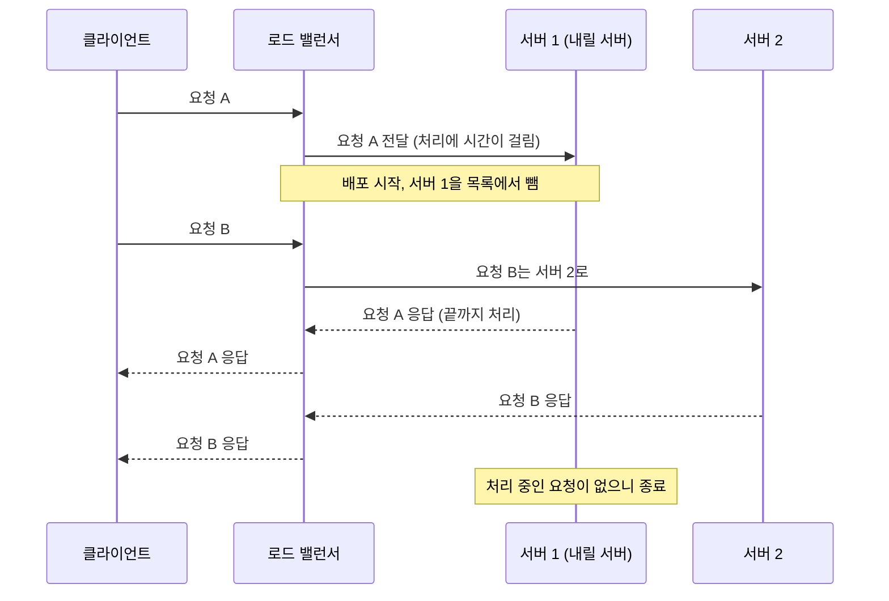
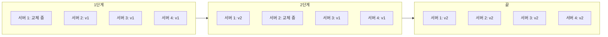
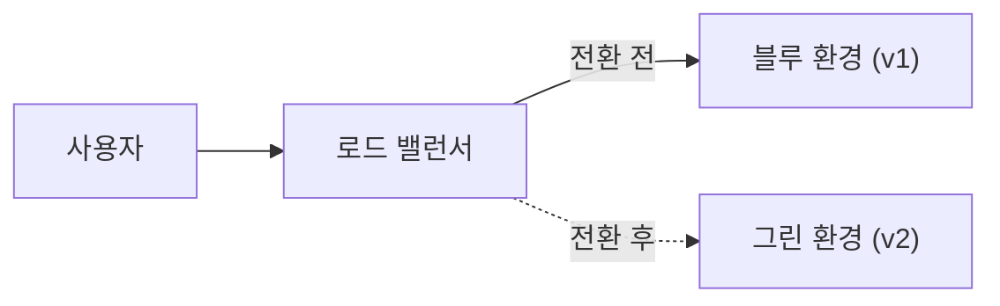
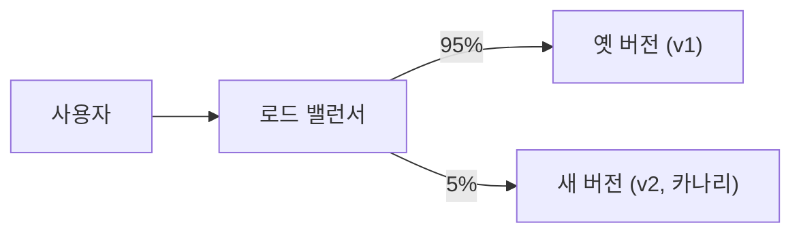

## 무중단 배포란 ?
- 서비스를 멈추지 않고 서버의 프로그램을 새 버전으로 바꾸는 방법
- 서버 여러 대와 그 앞의 [로드 밸런서](../로드%20밸런싱(Load%20Balancing)/README.md)를 이용해, 일부 서버를 바꾸는 동안 나머지 서버가 요청을 받게 한다
- 대표적인 방식으로 롤링, 블루-그린, 카나리가 있다

### 배포 (Deployment)
Deploy의 사전적 의미는 군대나 장비를 필요한 곳에 배치하는 것이다. 준비해 둔 것을 실제로 쓰일 자리에 내보낸다는 뜻이다.
공학적으로는 새로 만든 프로그램을 사용자가 실제로 쓰는 서버, 곧 운영 환경(Production)에 올려 동작하게 하는 일을 말한다.

### 무중단 (Zero-Downtime)
Downtime은 기계나 서비스가 멈춰 쓸 수 없는 시간이다. Zero-Downtime은 그 시간이 0이라는 말이다. 배포하는 동안에도 사용자가 멈춤을 느끼지 않게 하는 것이 목표다.

<br/>

## 마트 계산대로 이해하기
[로드 밸런싱](../로드%20밸런싱(Load%20Balancing)/README.md) 문서의 마트를 그대로 쓴다. 손님은 요청, 계산대는 서버, 입구의 안내 직원은 로드 밸런서다.

계산대 기계를 새 기계로 바꿔야 한다고 해 보자. 가게 문을 닫고 한꺼번에 바꾸면 그동안 손님은 계산을 못 한다. 대신 안내 직원이 한 계산대로는 손님을 보내지 않게 하고, 그 계산대에 서 있던 손님의 계산이 끝나면 기계를 바꾸고, 다시 손님을 받는다. 이를 계산대마다 돌아가며 하면 가게는 한 번도 문을 닫지 않는다. 이것이 무중단 배포의 기본 생각이다.

<br/>

## 왜 그냥 껐다 켜면 안 될까
### 꺼진 동안 오는 요청
서버가 한 대뿐이면 새 버전으로 바꾸려면 프로그램을 끄고 새 프로그램을 켜야 한다. 꺼져 있는 몇 초에서 몇 분 동안 들어온 요청은 받을 곳이 없어 실패한다. 사용자는 접속 오류 화면을 본다.

### 처리 중이던 요청
눈에 덜 띄는 문제도 있다. 끄는 순간 이미 처리하고 있던 요청이다. 결제, 파일 업로드처럼 시간이 걸리는 요청이 반쯤 진행된 상태에서 프로그램이 꺼지면 응답이 오지 않고 연결이 끊긴다. 서버 쪽에서는 일이 끝났는지 안 끝났는지도 애매해진다.

### 켜자마자 일할 수 없는 서버
프로그램을 켰다고 바로 요청을 처리할 수 있는 것은 아니다. 설정을 읽고, DB에 연결하고, 필요한 데이터를 메모리에 올리는 준비 시간이 있다. 이 사이에 요청이 들어오면 역시 실패한다.

이 세 가지를 피하려면 바꾸는 서버로 요청이 가지 않게 하고, 처리 중인 요청은 끝내 주고, 준비가 끝난 서버에만 요청을 보내야 한다. 이 일을 맡는 것이 아래의 로드 밸런서, 헬스 체크, 우아한 종료다.

<br/>

## 바탕이 되는 것 (로드 밸런서와 헬스 체크)
### 서버가 여러 대여야 한다
무중단 배포의 전제는 같은 일을 하는 서버가 두 대 이상이고, 그 앞에 로드 밸런서가 있다는 것이다. 클라이언트는 로드 밸런서 주소로만 접속하므로, 뒤에서 어떤 서버를 빼고 넣는지 알지 못한다. 서버를 여러 대로 늘리는 이야기는 [클라이언트-서버 구조](../클라이언트-서버%20구조(Client-Server%20Architecture)/README.md) 문서의 수평 확장(Scale-out)에 있다.

### 헬스 체크로 준비된 서버만 받기
헬스 체크(Health Check)는 로드 밸런서가 서버가 살아 있는지 주기적으로 확인하는 일이다. 자세한 방식은 [로드 밸런싱](../로드%20밸런싱(Load%20Balancing)/README.md) 문서의 헬스 체크 절에 정리했다.

배포에서 헬스 체크는 두 방향으로 쓰인다. 새로 켠 서버가 준비를 마친 뒤에만 헬스 체크에 정상으로 답하게 만들어 두면, 준비가 끝난 서버만 요청을 받는다. 앞에서 본 켜자마자 일할 수 없는 문제가 이렇게 풀린다. 반대로 내릴 서버는 로드 밸런서 목록에서 먼저 빼서 새 요청이 가지 않게 한다.

새 버전에 문제가 있어 헬스 체크에 실패하면 그 서버는 요청을 받지 못한다. 배포 도구가 이를 보고 다음 서버로 넘어가지 않게 하면, 고장 난 새 버전이 퍼지기 전에 멈출 수 있다. 다만 헬스 체크는 보통 살아 있는지 정도만 확인하므로, 응답은 하지만 계산이 틀리는 식의 문제는 잡지 못한다.

<br/>

## 진행 중인 요청 끝내고 내리기 (우아한 종료)
### 우아한 종료 (Graceful Shutdown)
Graceful의 사전적 의미는 우아한, 품위 있는이다. 갑자기 자리를 뜨지 않고 하던 일을 정리하고 물러나는 모습이다.
공학적으로는 프로그램을 끌 때 새 요청은 더 받지 않고, 이미 받은 요청은 끝까지 처리한 다음 종료하는 방식을 말한다. 반대로 하던 일과 상관없이 바로 끄는 것을 강제 종료라고 한다.

계산대 앞에 "계산 마감" 팻말을 세워 새 손님은 받지 않고, 이미 줄 선 손님의 계산은 끝까지 해 주는 것과 같다.

### 연결 빼기 (Connection Draining)
Drain은 물을 빼다, 배수하다라는 뜻이다. 욕조의 수도꼭지를 잠그고 마개를 뽑으면 새 물은 더 들어오지 않고 안에 있던 물만 빠져나간다.
공학적으로는 로드 밸런서가 내릴 서버로 새 요청을 보내지 않고, 그 서버에 이미 걸려 있는 연결과 요청이 끝날 때까지 기다려 주는 일을 말한다. 우아한 종료가 서버 프로그램 쪽의 정리라면, 연결 빼기는 로드 밸런서 쪽의 정리다. 둘이 함께 있어야 요청이 끊기지 않는다. 연결 빼기를 부르는 이름과 기다리는 시간 설정은 제품마다 다르다(제품별 이름은 확인 필요).

순서는 보통 이렇다.

1. 로드 밸런서 목록에서 서버를 뺀다. 새 요청은 다른 서버로 간다
2. 서버에 종료 신호를 보낸다. 리눅스에서는 보통 SIGTERM이라는 종료 요청 신호를 쓴다
3. 서버는 새 연결을 받지 않고, 처리 중인 요청을 끝낸다
4. 다 끝나면 스스로 종료한다. 너무 오래 걸리면 정해 둔 시간 뒤에 강제로 끈다



### 코드로 보기
Node.js의 http 모듈로 두 경우를 비교해 보았다. 서버는 요청마다 1초 뒤에 응답한다. 요청을 보내고 0.2초 뒤, 응답이 오기 전에 서버를 끈다.

`server.close()` 는 새 연결을 더 받지 않고, 요청을 처리하고 있지 않은 연결만 닫는다(쉬는 연결까지 닫는 동작은 Node.js v19부터, 공식 문서 기준). 처리 중인 요청은 그대로 두므로 우아한 종료에 쓸 수 있다. 바로 끄는 경우는 `server.closeAllConnections()` 로 처리 중인 연결까지 강제로 끊어서 흉내 냈다.

```js
const http = require('node:http');

function startServer() {
  const server = http.createServer((req, res) => {
    // 처리에 1초가 걸리는 요청
    setTimeout(() => {
      const body = 'done\n';
      res.writeHead(200, { 'Content-Length': Buffer.byteLength(body) });
      res.end(body);
    }, 1000);
  });
  return new Promise((resolve) => server.listen(0, () => resolve(server)));
}

function request(port, label) {
  return new Promise((resolve) => {
    const req = http.get({ port, agent: false }, (res) => {
      let data = '';
      res.on('data', (c) => (data += c));
      res.on('end', () => {
        console.log(`${label}: ${res.statusCode} ${data.trim()}`);
        resolve();
      });
    });
    req.on('error', (err) => {
      console.log(`${label}: 실패 (${err.code})`);
      resolve();
    });
  });
}

const wait = (ms) => new Promise((r) => setTimeout(r, ms));

async function abrupt() {
  console.log('[바로 끄기]');
  const server = await startServer();
  const { port } = server.address();
  const pending = request(port, '진행 중이던 요청');
  await wait(200);
  server.close();
  server.closeAllConnections(); // 진행 중인 연결까지 강제로 끊는다
  await pending;
}

async function graceful() {
  console.log('[우아한 종료]');
  const server = await startServer();
  const { port } = server.address();
  const pending = request(port, '진행 중이던 요청');
  await wait(200);
  server.close(() => console.log('서버 종료 완료'));
  await request(port, '종료 시작 뒤 새 요청');
  await pending;
  await wait(50);
}

(async () => {
  await abrupt();
  await graceful();
})();
```

Node.js v24에서 실행한 결과다.

```
[바로 끄기]
진행 중이던 요청: 실패 (ECONNRESET)
[우아한 종료]
종료 시작 뒤 새 요청: 실패 (ECONNREFUSED)
서버 종료 완료
진행 중이던 요청: 200 done
```

바로 끄면 처리 중이던 요청은 ECONNRESET(상대가 연결을 끊음)으로 실패한다. 우아한 종료에서는 처리 중이던 요청이 200으로 끝까지 응답을 받았다. 서버 종료 완료가 먼저 찍혔지만 응답은 끝까지 왔으므로, 응답 전에 서버가 꺼진 것은 아니다. 서버 쪽 로그와 클라이언트 쪽 로그가 찍히는 시점 차이다.

눈여겨볼 줄은 종료 시작 뒤 새 요청이다. ECONNREFUSED(연결 거부)로 실패했다. 서버가 새 연결을 받지 않으니 당연한 결과다. 서버 혼자서는 새 요청을 막을 수만 있고 다른 서버로 넘겨줄 수는 없다는 뜻이다. 그래서 종료 신호를 보내기 전에 로드 밸런서에서 먼저 빼서, 새 요청이 처음부터 이 서버로 오지 않게 해야 한다. 앞의 순서에서 1번이 2번보다 먼저인 이유다.

<br/>

## 롤링 배포 (Rolling Deployment)
### 이름
Roll의 사전적 의미는 구르다, 굴러가다이다. Rolling은 굴러가듯 차례로 이어지는 모습을 말한다.
공학적으로는 서버를 한 대(또는 몇 대)씩 차례로 새 버전으로 바꿔 나가는 방식이다. 바꾸는 일이 서버 무리 위를 굴러가듯 옮겨 간다.

마트 비유로는 계산대 기계를 하나씩 돌아가며 새 기계로 바꾸는 것이다.

### 동작
서버가 네 대라면 이렇게 진행한다.

1. 서버 1을 로드 밸런서에서 빼고(연결 빼기), 우아하게 종료한다
2. 서버 1에 새 버전을 올리고 켠다
3. 헬스 체크를 통과하면 다시 로드 밸런서에 넣는다
4. 서버 2, 3, 4도 같은 순서로 바꾼다



한 대씩 빼면 그동안 나머지 세 대가 요청을 나눠 받아야 한다. 평소에 서버 몇 대가 빠져도 버틸 여유가 있어야 한다. 여유가 없으면 새 서버를 먼저 한 대 더 띄우고 나서 옛 서버를 내리는 식으로 진행하기도 한다.

### 한 번에 몇 대씩 바꿀까
도구는 보통 한 번에 내려 둘 수 있는 수와 더 띄울 수 있는 수를 설정으로 정하게 한다. 예를 들어 컨테이너 운영 도구인 Kubernetes는 롤링 배포를 롤링 업데이트(Rolling Update)라고 부르고, maxUnavailable(쓸 수 없는 상태로 둘 수 있는 최대 수)과 maxSurge(원래 수보다 더 띄울 수 있는 최대 수) 두 값으로 이를 정한다(Kubernetes 공식 문서 기준).

서버가 네 대이고 두 값이 모두 한 대라면, 업데이트 중에도 최소 세 대는 일하고 많아야 다섯 대까지 동시에 떠 있게 된다. 두 값을 크게 잡으면 빨리 끝나지만 한꺼번에 바뀌는 서버가 많아진다. 같은 문서는 기존 것을 모두 내린 뒤 새것을 만드는 Recreate 방식도 소개하는데, 이 방식은 그 사이에 멈춤이 생긴다. 기본값과 설정 방법은 별도 문서로 미룬다.

### 되돌리기
새 버전에 문제가 있으면 같은 방식으로 다시 옛 버전을 한 대씩 올린다. 따로 서버를 더 둘 필요는 없지만, 되돌리는 데도 배포만큼 시간이 걸린다. 문제를 늦게 알아챘다면 그 사이 이미 많은 서버가 새 버전으로 바뀌어 있다.

또 배포하는 동안에는 옛 버전과 새 버전이 섞여서 돈다. 같은 사용자의 요청 하나는 새 버전이, 다음 요청은 옛 버전이 받을 수 있다. 이 문제는 아래 두 버전이 동시에 돌 때에서 다룬다.

<br/>

## 블루-그린 배포 (Blue-Green Deployment)
### 이름
Blue, Green은 색 이름이다. 똑같이 생긴 운영 환경 두 벌을 두고, 서로 구별하려고 색 이름을 붙였다. 글에서 색을 고른 까닭은 따로 설명하지 않는다.
공학적으로는 똑같은 운영 환경 두 벌 중 쉬고 있는 쪽에 새 버전을 올려 두고, 로드 밸런서가 요청을 보내는 곳을 한 번에 바꾸는 방식이다. Martin Fowler의 글(Blue Green Deployment, 2010)은 이 기법을 Jez Humble과 Dave Farley가 쓴 책 『Continuous Delivery』의 내용으로 소개하고, 이름은 Daniel Terhorst-North와 Jez Humble 사이에서 나왔다고 적었다.

### 동작
1. 지금 사용자 요청을 받는 환경(블루)과 똑같은 환경(그린)을 하나 더 준비한다
2. 그린에 새 버전을 올리고, 사용자 요청 없이 충분히 시험한다
3. 로드 밸런서(라우터)가 요청을 보내는 곳을 블루에서 그린으로 한 번에 바꾼다
4. 블루는 그대로 남겨 둔다. 다음 배포 때는 블루가 새 버전을 받을 쪽이 되어, 두 환경이 번갈아 역할을 맡는다

마트 비유로는 옆에 새 기계를 단 계산대 줄을 통째로 하나 더 차려 두고, 다 시험해 본 뒤 안내 직원이 모든 손님을 한 번에 새 줄로 보내는 것이다. 옛 계산대 줄은 치우지 않고 한동안 그대로 둔다.



### 되돌리기
문제가 생기면 로드 밸런서를 다시 블루로 돌리면 된다. 옛 버전이 켜진 채로 기다리고 있으니 되돌리기가 세 방식 중 가장 빠르다.

대가는 자원이다. 운영 환경을 두 벌 갖추어야 하므로, 블루를 남겨 두는 동안에는 서버가 두 배로 든다. 또 Fowler의 글은 그린이 일하는 동안 처리한 거래가 블루로 돌아가면 빠질 수 있다는 점을 짚는다. 두 환경이 DB를 함께 쓰는지, 따로 쓰는지에 따라 이 문제의 모양이 달라진다. DB 이야기는 아래에서 다룬다.

<br/>

## 카나리 배포 (Canary Deployment)
### 이름
카나리아(Canary)는 노란 작은 새다. 예전 광부들은 카나리아를 새장에 넣어 탄광에 데리고 들어갔다. 유독 가스가 새면 사람보다 먼저 카나리아가 쓰러지므로, 위험을 미리 알 수 있었다. Martin Fowler 사이트의 Canary Release 글(Danilo Sato, 2014)이 이 기법 이름이 여기서 왔다고 적었다.
공학적으로는 새 버전을 일부 사용자에게만 먼저 보내 보고, 문제가 없으면 점점 넓히는 방식이다. 소수의 사용자가 위험을 먼저 알려 주는 카나리아 역할을 한다. 같은 글은 단계적 출시(Phased Rollout), 점진적 출시(Incremental Rollout)라는 이름도 함께 소개한다.

마트 비유로는 새 기계를 단 계산대를 하나만 열고, 손님 몇 명만 그쪽으로 보내 보는 것이다. 계산에 문제가 없으면 새 계산대를 늘려 간다.

### 동작
1. 새 버전을 일부 서버에 올린다. 처음에는 사용자 요청을 받지 않는다
2. 사용자 일부를 새 버전으로 보낸다. 예를 들어 요청의 5%만 보낸다
3. 오류율, 응답 시간 같은 지표를 옛 버전과 비교한다
4. 괜찮으면 비율을 늘려 가고, 마지막에 모든 사용자를 새 버전으로 옮긴다

누구를 먼저 보낼지도 고를 수 있다. 위 글은 무작위로 고르기, 회사 직원 먼저 보내기, 사용자 특성이나 지역으로 나누기를 예로 든다.



### 되돌리기
문제가 보이면 카나리로 보내던 사용자를 다시 옛 버전으로 돌리면 된다. 옛 버전이 대부분의 요청을 계속 받고 있었으므로 금방 돌아간다. 문제를 겪은 사용자도 처음 보낸 일부뿐이다.

대신 두 버전이 일부러 오래 함께 돈다. 지표를 보고 판단할 시간이 필요하므로 배포 전체는 오래 걸리고, 지표를 모으고 비교할 수단이 있어야 한다. 요청 일부만 골라 보내려면 로드 밸런서가 비율이나 조건으로 나눠 보낼 수 있어야 한다.

<br/>

## 세 방식 비교
| | 롤링 | 블루-그린 | 카나리 |
| --- | --- | --- | --- |
| 더 필요한 서버 자원 | 거의 없음 (한두 대 여유) | 운영 환경 한 벌 더 | 일부 서버만 더 |
| 되돌리는 속도 | 느림 (다시 한 대씩) | 가장 빠름 (한 번에 전환) | 빠름 (일부만 돌리면 됨) |
| 두 버전이 동시에 도나 | 배포하는 동안 섞여 돎 | 거의 아님 (한 번에 전환) | 일부러 오래 함께 돎 |
| 문제를 겪는 사용자 | 바뀐 서버만큼 | 전환 뒤 모두 | 처음 보낸 일부 |
| 준비할 것 | 서버 여유, 헬스 체크 | 똑같은 환경 두 벌 | 비율 나누기, 지표 비교 |

블루-그린도 전환하는 순간 블루에서 처리 중이던 요청은 끝나야 하므로, 아주 짧게는 두 버전이 함께 돈다. 실제로는 한 가지만 쓰기보다 섞어 쓰기도 한다. 예를 들어 그린을 만들어 둔 뒤 요청을 한 번에 옮기지 않고 조금씩 옮기면 블루-그린과 카나리를 합친 모양이 된다.

<br/>

## 두 버전이 동시에 돌 때의 함정
롤링과 카나리는 옛 버전과 새 버전이 함께 돈다. 블루-그린도 되돌리기를 생각하면 옛 버전이 새 버전 이후의 상태를 견뎌야 한다. 호환(互換)은 서로 바꿔 써도 문제가 없다는 뜻이다. 공학적으로 호환성(Compatibility)은 새 버전이 옛 버전과 함께 돌거나 옛 버전이 남긴 데이터를 받아도 깨지지 않는 성질을 말한다. 두 버전이 함께 도는 배포에서는 새 버전을 이렇게 만들어야 한다.

### DB 스키마
스키마(Schema)는 DB에 어떤 표가 있고 각 표에 어떤 열이 있는지 정한 구조다. 두 버전은 보통 같은 DB를 쓴다. 새 버전이 DB 표의 열 이름을 바꿔 버리면, 아직 돌고 있는 옛 버전은 옛 열 이름을 찾다가 오류를 낸다. 거꾸로 새 열을 비워 둘 수 없게 만들면, 그 열을 모르는 옛 버전이 데이터를 넣을 때 오류가 난다.

그래서 DB 변경을 프로그램 변경과 떼어 여러 번에 나눠 한다. Martin Fowler 사이트의 Parallel Change 글(Danilo Sato, 2014)은 이를 넓히기(Expand), 옮기기(Migrate), 줄이기(Contract) 세 단계로 설명한다. 열 이름을 바꾸는 경우에 적용해 보면 이렇다.

1. 넓히기: 새 열을 추가한다. 옛 열은 남겨 둔다. 옛 버전과 새 버전 모두 이 DB에서 돈다
2. 옮기기: 새 버전을 배포한다. 새 버전은 옛 열과 새 열에 같은 값을 함께 써서, 아직 옛 열만 읽는 옛 버전도 데이터를 볼 수 있게 한다. 이미 있던 데이터는 옛 열에서 새 열로 옮긴다. 모든 서버가 새 버전이 될 때까지 기다린다
3. 줄이기: 옛 열을 쓰는 프로그램이 하나도 없으면 그때 옛 열을 지운다

Blue Green Deployment 글도 DB 변경을 먼저 옛 버전과 새 버전을 모두 지원하는 모양으로 배포하고, 그다음 프로그램을 배포하라고 권한다. 이렇게 하면 프로그램을 되돌려도 DB가 옛 버전을 받아 준다.

### API 호환성
서버끼리, 또는 브라우저와 서버가 주고받는 약속(API)도 같다. 롤링 배포 중에는 새 버전 서버가 준 화면에서 보낸 요청이 옛 버전 서버로 갈 수 있다. 새 버전이 응답 모양을 바꾸거나 필수 값을 추가했다면 이쪽이 깨진다.

그래서 응답에서 기존 필드를 바로 지우거나 뜻을 바꾸지 않고, 새 필드를 더하는 쪽으로 바꾼다. 지워야 할 필드는 그 필드를 쓰는 쪽이 모두 새 버전이 된 뒤 다음 배포에서 지운다. DB와 같은 넓히기, 줄이기 순서다.

브라우저가 받아 둔 정적 파일도 비슷한 문제를 만든다. 배포 전에 페이지를 연 사용자는 옛 버전 화면을 들고 있다. 이 화면이 나중에 옛 버전의 파일을 더 불러오려는데 새 서버에 그 파일이 없으면 실패한다. 반대로 브라우저에 남은 옛 파일이 새 서버와 맞지 않을 수도 있다. 파일 이름에 버전을 넣어 캐시를 다루는 방법은 [HTTP 캐시](../WEB/HTTP%20캐시(HTTP%20Caching)/README.md) 문서의 캐시 무효화에 정리했다. 옛 파일을 배포 뒤 얼마 동안 남겨 둘지는 서비스마다 정한다.

### 세션
로그인 정보를 서버 메모리에 두는 상태 유지(Stateful) 방식이면, 서버를 내리는 순간 그 서버에 붙어 있던 사용자의 로그인이 사라진다. 무중단 배포는 서버를 계속 내렸다 올리므로 이 문제가 배포 때마다 생긴다.

해결책은 로드 밸런싱 문서의 세션 유지 절에서 본 무상태로 만들기와 같다. 세션을 모든 서버가 함께 보는 저장소에 두거나 토큰에 담으면, 어느 서버를 내려도 로그인은 유지된다. 이때 세션에 담는 데이터의 모양도 두 버전이 함께 읽을 수 있어야 한다.

<br/>

## 기능 플래그 (Feature Flag)
Flag의 사전적 의미는 깃발이다. 깃발을 올리고 내리듯 켜고 끄는 표시라는 뜻으로 쓰인다.
공학적으로는 새 기능의 코드를 배포해 두되, 설정 값 하나로 그 기능을 켜고 끄게 하는 방법이다. 기능 토글(Feature Toggle)이라고도 부른다. 마트 비유로는 계산대 기계는 모두 새것으로 바꿔 두고, 새 기능 버튼에는 덮개를 씌워 두었다가 때가 되면 덮개를 여는 것이다.

이렇게 하면 코드를 서버에 올리는 일(배포)과 사용자에게 기능을 보여 주는 일(출시)을 떼어 놓을 수 있다. 문제가 생기면 다시 배포하지 않고 플래그만 끄면 된다. 앞의 Canary Release 글도 Facebook이 첫 카나리를 직원에게만 보이게 하고 기능 플래그를 모두 켜 둔다는 예를 든다. 자세한 사용법은 별도 문서로 미룬다.

<br/>

## 참고 자료
- Martin Fowler, Blue Green Deployment (martinfowler.com/bliki/BlueGreenDeployment.html)
- Danilo Sato, Canary Release (martinfowler.com/bliki/CanaryRelease.html)
- Danilo Sato, Parallel Change (martinfowler.com/bliki/ParallelChange.html)
- Kubernetes 공식 문서, Deployments (kubernetes.io/docs/concepts/workloads/controllers/deployment/)
- Node.js 공식 문서, HTTP 모듈의 server.close()와 server.closeAllConnections() (nodejs.org/api/http.html)

<br/>

## 더 볼 것 (TODO)
- Kubernetes Deployment로 롤링 업데이트와 되돌리기 설정하기 (별도 문서)
- AWS CodeDeploy, Vercel 같은 플랫폼의 배포 방식 (별도 문서)
- 로드 밸런서 제품별 연결 빼기 설정과 기다리는 시간 (별도 문서)
- 헬스 체크를 살아 있는지와 요청 받을 준비가 됐는지로 나누는 방법 (별도 문서)
- 기능 플래그 사용법과 관리 (별도 문서)
- DB 마이그레이션 도구와 넓히기, 줄이기를 실제로 적용하는 방법 (별도 문서)
- 배포 뒤 오래된 정적 파일 문제와 프론트엔드 빌드 도구의 대응 (별도 문서)
- 카나리 지표를 보고 자동으로 진행하거나 되돌리는 방법 (별도 문서)
