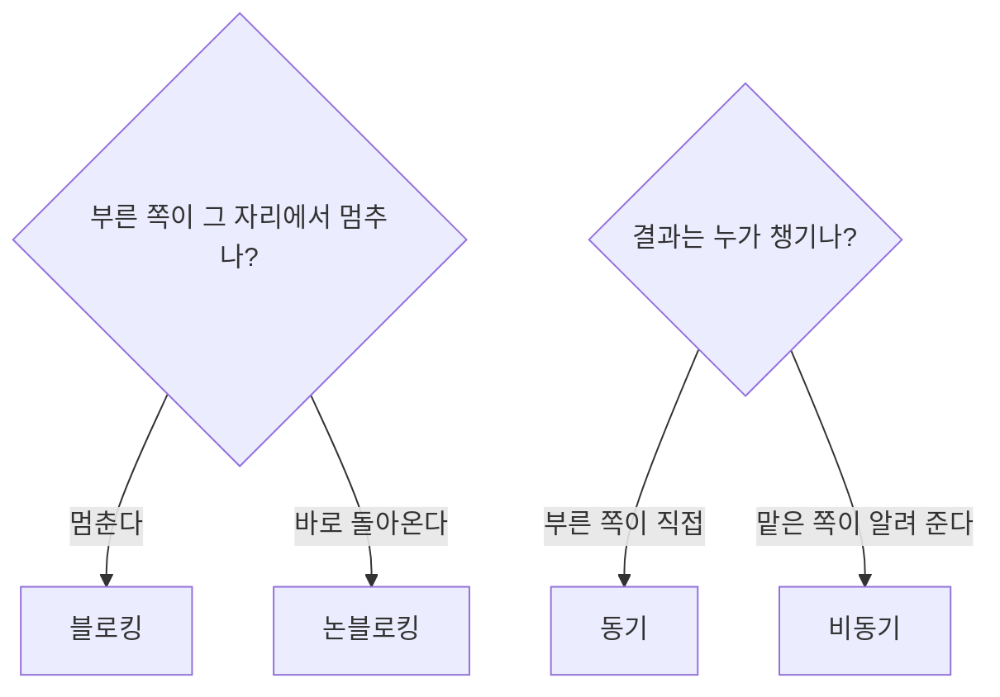
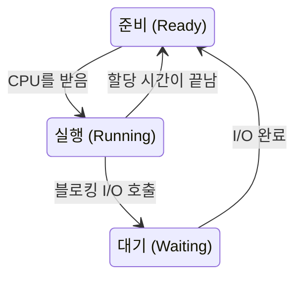
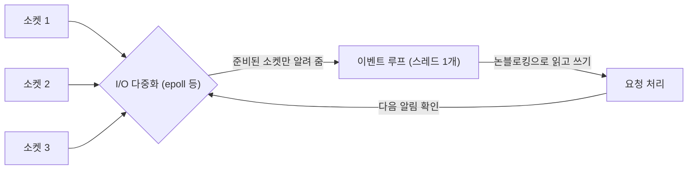

## 블로킹과 논블로킹이란 ?
- 블로킹과 논블로킹은 함수를 부른 쪽이 그 일이 끝날 때까지 멈춰 서서 기다리는지, 바로 돌아와 다른 일을 하는지의 차이다
- 동기와 비동기는 이와 다른 질문으로, 일이 끝났다는 결과를 부른 쪽이 직접 챙기는지, 일을 맡은 쪽이 끝나면 알려 주는지의 차이다
- 두 쌍의 말은 책과 글마다 다르게 쓰인다. 이 노트는 위 기준으로 나누고, 다른 기준은 [다른 기준도 있다](#다른-기준도-있다)에 따로 적는다

<br/>

## 왜 알아야 할까
[서버의 동시 처리 방식](../서버의%20동시%20처리%20방식(Server%20Concurrency)/README.md#서버의-일은-대부분-기다리기다) 노트에서 서버의 일은 대부분 기다리기라고 했다. 그 기다리는 동안 프로그램이 무엇을 하느냐가 블로킹과 논블로킹, 동기와 비동기의 이야기다.

같은 오븐을 쓰더라도 요리사가 오븐 앞에 서서 지켜볼 수도 있고, 타이머를 맞춰 두고 다른 손님 주문을 받을 수도 있다. 요리사 한 명이 손님 몇 명을 감당할 수 있는지는 이 차이에서 갈린다. 서버도 같아서, 스레드 하나가 연결 하나만 맡을지 수천 개를 맡을지가 여기서 정해진다.

두 쌍의 말은 자주 섞여 쓰인다. "비동기는 곧 논블로킹"처럼 하나로 뭉뚱그리면 이벤트 루프가 왜 멈추는지, 콜백을 넘겼는데도 왜 프로그램이 굳는지 같은 상황을 설명하기 어렵다. 그래서 둘이 서로 다른 질문이라는 점부터 나눠 본다.

<br/>

## 먼저 알아 둘 용어
### 호출한 쪽과 호출된 쪽
함수를 부르는 코드를 호출한 쪽(Caller), 불려서 일을 맡는 함수나 운영체제를 호출된 쪽(Callee)이라고 한다. 이 노트의 비유에서는 요리사가 호출한 쪽, 오븐이 호출된 쪽이다.

### I/O (Input/Output)
입력(Input)과 출력(Output)을 합친 말이다. 공학적으로는 프로그램이 CPU와 메모리 바깥의 장치와 데이터를 주고받는 일을 말한다. 파일 읽기와 쓰기, 네트워크로 데이터 보내고 받기, 키보드 입력이 모두 I/O다.

### 블로킹 (Blocking)
블록(Block)의 사전적 의미는 막다, 가로막다. 길이 막혀 더 나아가지 못하는 상태다.
공학적으로는 함수를 부른 쪽이 그 함수가 일을 끝낼 때까지 다음 줄로 넘어가지 못하고 멈춰 있는 것을 말한다. 실행 흐름이 그 자리에서 막힌다는 뜻에서 이 이름이 왔다.
요리사가 빵을 오븐에 넣고 다 구워질 때까지 오븐 앞을 떠나지 못하는 것과 같다.

### 논블로킹 (Non-blocking)
블로킹에 아니다(non)를 붙인 말로, 막히지 않음이라는 뜻이다.
공학적으로는 부른 함수가 일이 다 끝나지 않았더라도 곧바로 돌아오는 것을 말한다. 돌아올 때 결과가 준비되지 않았으면 "아직 안 됐다"는 표시만 주고 돌아온다. 부른 쪽은 그사이 다른 일을 할 수 있다.
요리사가 빵을 오븐에 넣자마자 돌아서서 다른 손님 주문을 받으러 가는 것과 같다.

### 동기 (Synchronous)
그리스어 syn(함께)과 chronos(시간)에서 온 말로, 사전적 의미는 시간을 맞춤, 같은 때에 일어남이다.
공학적으로 이 노트에서는 일을 부른 쪽이 결과를 받는 시점까지 직접 챙기는 방식을 말한다. 부른 쪽이 결과가 나올 때까지 기다리거나, 다 됐는지 스스로 물어봐서 결과를 가져온다. 요청과 결과 받기가 부른 쪽의 흐름 안에서 맞물려 진행된다는 점이 시간을 맞춘다는 원래 뜻과 이어진다.
요리사가 빵이 다 됐는지 자기 눈으로 오븐을 확인하는 것과 같다.

### 비동기 (Asynchronous)
동기에 아니다(a)를 붙인 말로, 시간을 맞추지 않음이라는 뜻이다.
공학적으로 이 노트에서는 일을 맡은 쪽이 끝나면 부른 쪽에 알려 주는 방식을 말한다. 부른 쪽은 결과를 언제 받을지 정하지 않고, 알림이 오면 그때 받아서 처리한다. 결과가 부른 쪽의 흐름과 상관없는 때에 도착한다는 점이 원래 뜻과 이어진다. 알림을 받으면 실행할 함수를 미리 넘겨 두는 방식을 콜백(Callback)이라고 하는데, 다시(back) 불러 준다(call)는 뜻이다.
요리사가 오븐 타이머를 맞춰 두고, 타이머가 울리면 그때 빵을 꺼내는 것과 같다.

<br/>

## 두 축은 서로 다른 질문이다
블로킹과 논블로킹은 부른 쪽이 그 자리에서 멈추는가를 묻는다. 동기와 비동기는 결과를 누가 챙기는가를 묻는다. 질문이 다르니 둘을 엮으면 네 가지 조합이 나온다.



| 조합 | 오븐 비유 | 부른 쪽이 하는 일 | 대표 예 |
| --- | --- | --- | --- |
| 동기 + 블로킹 | 오븐 앞에 서서 다 구워질 때까지 지켜본다 | 결과가 나올 때까지 멈춰 있다가 직접 받는다 | 기본 설정의 소켓 read, Node.js의 readFileSync |
| 동기 + 논블로킹 | 다른 일을 하다가 틈틈이 오븐 문을 열어 확인한다 | 바로 돌아와서 다 됐는지 계속 물어본다 | 논블로킹 소켓을 되풀이해 읽는 폴링 |
| 비동기 + 논블로킹 | 타이머를 맞춰 두고 다른 일을 하다가 울리면 꺼낸다 | 바로 돌아와 다른 일을 하고, 알림이 오면 처리한다 | 운영체제의 비동기 I/O, Node.js의 readFile에 콜백 넘기기 |
| 비동기 + 블로킹 | 타이머를 맞춰 놓고도 오븐 문만 붙잡고 서 있다 | 알림을 기다린다면서 그 자리에 멈춰 있다 | 아래 코드로 보기의 세 번째 예시 |

### 동기 + 블로킹
가장 흔하고 가장 읽기 쉬운 방식이다. 코드가 위에서 아래로 쓰인 순서대로 실행되고, 앞줄의 결과가 나와야 다음 줄로 넘어간다. 대신 기다리는 동안 그 실행 흐름은 아무것도 하지 못한다.

### 동기 + 논블로킹
부른 함수는 바로 돌아오지만, 결과가 준비됐는지는 부른 쪽이 계속 물어봐야 한다. 이렇게 되풀이해 물어보는 방법을 폴링(Polling)이라고 한다. poll의 사전적 의미는 여론 조사, 투표로, 사람들에게 하나하나 물어 확인한다는 뜻이다. 묻는 사이사이 다른 일을 할 수 있지만, 너무 자주 물으면 아무 소득 없는 확인에 CPU를 쓰고, 너무 드물게 물으면 결과가 나온 뒤에도 늦게 알아챈다.

### 비동기 + 논블로킹
부른 쪽은 일을 맡기고 바로 다른 일을 한다. 끝났다는 알림이 오면 그때 결과를 처리한다. 기다리는 시간을 가장 잘 활용하는 조합이고, [이벤트 루프](../서버의%20동시%20처리%20방식(Server%20Concurrency)/README.md#이벤트-루프-event-loop)가 이 조합으로 동작한다.

### 비동기 + 블로킹
알림을 받기로 해 놓고도 그 자리에서 멈춰 기다리는 조합이다. 일부러 고를 이유가 거의 없어서, 대개는 비동기 함수를 쓰면서 결과를 곧바로 쓰려고 기다리는 실수로 생긴다. 다만 글에 따라서는 뒤에서 볼 select를 이 칸에 넣기도 한다. 이 부분은 [다른 기준도 있다](#다른-기준도-있다)에서 다시 본다.

<br/>

## I/O가 기다림의 대부분인 이유
### 장치마다 속도가 크게 다르다
CPU는 클록(Clock)이라는 박자에 맞춰 일한다. 3GHz CPU는 1초에 30억 번 박자가 뛰니, 한 박자가 약 0.33나노초다. 반면 하드디스크는 원판을 돌리고 읽는 머리를 옮겨야 해서 한 번 읽는 데 밀리초 단위가 걸린다는 것이 운영체제 교재에서 흔히 드는 설명이다. 1밀리초는 100만 나노초이므로, CPU가 수백만 박자를 쉬는 동안 디스크 한 번을 기다리는 셈이다. SSD는 하드디스크보다 훨씬 빠르지만 여전히 CPU 박자와는 차이가 크다. 정확한 값은 장치마다 다르다.

네트워크는 더하다. 빛은 광섬유 안에서 대략 초속 20만 km로 움직인다. 서울에서 9,000km쯤 떨어진 미국 서부까지 가는 데만 약 45밀리초, 왕복이면 약 90밀리초가 걸린다. 장비를 거치는 시간을 빼고 빛의 속도만 따져도 그렇다. 상대 서버가 대답을 만드는 시간이나 데이터베이스가 조회하는 시간은 여기에 더해진다.

그래서 요청 하나를 처리하는 시간 대부분은 CPU가 계산하는 시간이 아니라 I/O가 끝나길 기다리는 시간이 된다. 요리사가 손을 움직이는 시간보다 오븐을 기다리는 시간이 긴 것과 같다.

### 기다리는 동안 운영체제가 하는 일
운영체제는 실행 중인 프로세스나 스레드를 상태로 나눠 관리한다. 운영체제 교재는 보통 생성(New), 준비(Ready), 실행(Running), 대기(Waiting), 종료(Terminated) 다섯 상태로 설명한다. 스레드가 블로킹 I/O를 부르면 운영체제는 그 스레드를 대기 상태로 옮기고, 준비 상태의 다른 스레드에 CPU를 넘긴다. I/O가 끝나면 그 스레드를 다시 준비 상태로 돌려놓는다.



그러니 블로킹이 CPU 자체를 낭비하는 것은 아니다. 컴퓨터 전체로 보면 그사이 다른 스레드가 CPU를 쓴다. 문제는 멈춘 그 스레드가 아무 일도 못 한다는 점이다. 요리사가 오븐 앞에 서 있는 동안 주방의 다른 요리사는 일할 수 있지만, 그 요리사가 맡은 손님은 계속 기다린다.

<br/>

## 운영체제의 I/O 모델
운영체제 수준에서 프로그램이 데이터를 읽는 방법은 몇 가지 모델로 나뉜다. 여기서는 개념만 본다. 네트워크에서 데이터를 읽는 일은 두 단계로 나눠 보면 이해하기 쉽다.

1. 데이터가 네트워크로 도착해 운영체제 안에 쌓이길 기다린다.
2. 운영체제 안에 쌓인 데이터를 프로그램의 메모리로 복사해 온다.

모델마다 다른 점은 이 두 단계 중 어디서 프로그램이 멈추는가, 그리고 끝났다는 사실을 누가 알리는가다.

### 블로킹 I/O (Blocking I/O)
read를 부르면 데이터가 도착하고 프로그램 메모리로 복사될 때까지 돌아오지 않는다. 두 단계 모두에서 멈춘다. 소켓을 만들면 기본이 이 방식이고, [TCP 연결 과정](../Network/TCP%20연결%20과정(TCP%20Handshake)/README.md#소켓-함수와-연결해-보기) 노트에서 본 connect가 핸드셰이크가 끝나야 돌아오는 것도 같은 이유다. [소켓](../Network/소켓(Socket)/README.md#서버가-연결을-받는-과정) 노트의 accept도 기본 방식에서는 대기열에 연결이 들어올 때까지 멈춘다.

### 논블로킹 I/O와 폴링
소켓을 논블로킹으로 설정하면 read는 데이터가 아직 없을 때 기다리지 않고 바로 돌아온다. 이때 "지금은 읽을 게 없다"는 표시를 함께 준다(유닉스 계열에서는 EAGAIN 또는 EWOULDBLOCK이라는 오류 값). 프로그램은 나중에 다시 read를 불러 봐야 한다. 이렇게 되풀이해 부르는 것이 앞에서 본 폴링이다. 첫 단계에서는 멈추지 않지만, 데이터가 있을 때 복사하는 두 번째 단계는 read 안에서 끝난다.

### I/O 다중화 (I/O Multiplexing)
다중화(Multiplexing)의 사전적 의미는 여러 겹으로 겹침이다. 통신에서는 선 하나에 여러 신호를 겹쳐 싣는 것을 말한다. 공학적으로 I/O 다중화는 스레드 하나가 여러 소켓을 한꺼번에 지켜보다가, 그중 읽을 준비가 된 것을 운영체제가 알려 주는 방식을 말한다.

소켓 천 개를 하나씩 폴링하면 대부분은 "아직"이라는 대답만 듣는다. I/O 다중화는 "이 천 개 중에 준비된 게 생기면 알려 줘"라고 운영체제에 한 번에 부탁한다. 요리사가 오븐 천 개를 일일이 열어 보는 대신, 주방에 알림판을 하나 두고 다 구워진 오븐의 번호만 불이 들어오게 하는 것과 같다.

이 일을 하는 함수로 select와 poll이 있고, 리눅스에는 epoll, FreeBSD 같은 BSD 계열 운영체제와 macOS에는 kqueue가 있다. poll 함수는 이름이 폴링과 같지만, 소켓을 하나씩 되묻는 폴링이 아니라 여러 소켓을 한 번에 맡기는 다중화 함수다. 알림을 받은 뒤 실제로 데이터를 읽어 오는 일은 프로그램이 직접 read를 불러서 한다. 알려 주는 것은 준비가 됐다는 사실이지 읽기가 끝났다는 사실이 아니다.

### 비동기 I/O (Asynchronous I/O)
프로그램은 "이 소켓에서 데이터를 읽어 내 메모리의 이 자리에 넣어 줘"라고 맡기고 바로 돌아온다. 운영체제가 두 단계를 모두 끝낸 뒤 완료를 알려 준다. 프로그램은 어느 단계에서도 멈추지 않는다. POSIX 표준의 aio 함수들, 리눅스의 io_uring, 윈도우의 IOCP(I/O Completion Port)가 이 방식의 예로 꼽힌다. 각각이 어떤 장치와 상황에서 완전히 비동기로 동작하는지는 운영체제와 버전에 따라 달라 확인 필요다.

| 모델 | 1단계 (데이터 기다리기) | 2단계 (프로그램으로 복사) | 끝났다는 걸 아는 방법 |
| --- | --- | --- | --- |
| 블로킹 I/O | 멈춤 | 멈춤 | read가 돌아오면 끝 |
| 논블로킹 I/O | 멈추지 않음 (되풀이해 확인) | 멈춤 | 프로그램이 계속 물어봄 |
| I/O 다중화 | select 등에서 멈춤 (여러 개를 한꺼번에) | 멈춤 | 준비됐다는 알림 후 직접 read |
| 비동기 I/O | 멈추지 않음 | 멈추지 않음 | 운영체제가 완료를 알림 |

W. Richard Stevens의 『UNIX Network Programming』 1권 6장은 여기에 시그널 기반 I/O(Signal-driven I/O)를 더해 다섯 가지 모델로 나눈다. 이 노트에서는 시그널 기반 I/O를 다루지 않는다.

<br/>

## 서버의 동시 처리와 연결하기
[서버의 동시 처리 방식](../서버의%20동시%20처리%20방식(Server%20Concurrency)/README.md) 노트에서 본 방식들은 결국 I/O 모델을 어떻게 고르느냐와 이어진다.

### 스레드마다 블로킹 I/O
[멀티 스레드](../서버의%20동시%20처리%20방식(Server%20Concurrency)/README.md#멀티-스레드-multi-thread) 서버는 연결 하나에 스레드 하나를 붙이고, 각 스레드는 블로킹 I/O를 쓴다. 손님마다 요리사를 한 명씩 붙이고, 요리사는 자기 오븐 앞에서 기다리는 셈이다.

코드는 위에서 아래로 읽히는 동기 + 블로킹 방식이라 쓰기 쉽다. 한 스레드가 기다리는 동안 운영체제가 다른 스레드에 CPU를 넘겨 주니 전체는 잘 돌아간다. 대신 연결이 늘면 스레드도 늘어난다. 스레드마다 메모리가 들고, 운영체제가 스레드를 번갈아 실행하는 비용도 커진다.

### 이벤트 루프와 논블로킹 I/O
[이벤트 루프](../서버의%20동시%20처리%20방식(Server%20Concurrency)/README.md#이벤트-루프-event-loop) 서버는 스레드 하나가 여러 연결을 맡는다. 소켓을 모두 논블로킹으로 두고, I/O 다중화로 준비된 소켓만 골라 처리한다. 요리사 한 명이 알림판을 보며 다 구워진 오븐부터 꺼내는 셈이다. 운영체제에 따라서는 준비 알림 대신 앞에서 본 비동기 I/O의 완료 알림(윈도우의 IOCP 등)으로 같은 구조를 만들기도 한다. 이벤트 루프라는 구조는 같아도 그 아래 I/O 모델은 다를 수 있다.



스레드가 하나라서 연결이 많아도 메모리가 적게 든다. 대신 그 스레드 안에서 블로킹 함수를 하나라도 부르면 모든 연결이 함께 멈춘다. 요리사가 한 명뿐인데 오븐 앞에 서 버리면 주방 전체가 선다.

한 가지 덧붙이면, 블로킹이냐 아니냐는 누구의 자리에서 보느냐에 따라 달라진다. 아래 코드로 보기에 나오는 Node.js의 readFile은 부르는 코드 입장에서는 비동기 + 논블로킹이지만, 안에서는 따로 둔 스레드가 파일을 블로킹으로 읽는다(Node.js가 쓰는 libuv 라이브러리의 설계 문서 기준).

<br/>

## 코드로 보기
Node.js로 같은 파일을 세 가지 방법으로 읽고, 줄이 찍히는 순서를 비교한다. 모두 같은 폴더에 hello 한 줄이 든 memo.txt를 두고 실행했다. 실행 환경은 Node.js 24.22.1, 윈도우 11이다.

### 동기 + 블로킹
```js
const fs = require('fs');

console.log('1. 읽기 시작');
const text = fs.readFileSync('memo.txt', 'utf8'); // 다 읽을 때까지 여기서 멈춘다
console.log('2. 다 읽음:', text.trim());
console.log('3. 다음 일');
```

```text
1. 읽기 시작
2. 다 읽음: hello
3. 다음 일
```

readFileSync는 파일을 다 읽은 뒤에야 돌아온다. 쓰인 순서와 실행 순서가 같다.

### 비동기 + 논블로킹
```js
const fs = require('fs');

console.log('1. 읽기 요청');
fs.readFile('memo.txt', 'utf8', (err, text) => {
  // 다 읽으면 Node.js가 이 함수를 불러 준다
  console.log('3. 다 읽음:', text.trim());
});
console.log('2. 다음 일');
```

```text
1. 읽기 요청
2. 다음 일
3. 다 읽음: hello
```

readFile은 읽기를 맡기고 바로 돌아오므로 '2. 다음 일'이 먼저 찍힌다. 다 읽었다는 알림이 오면 넘겨 둔 콜백이 실행되어 '3. 다 읽음'이 찍힌다.

### 비동기인데 블로킹으로 기다리면
```js
const fs = require('fs');

let done = false;
fs.readFile('memo.txt', 'utf8', () => {
  done = true;
  console.log('콜백 실행');
});

// 결과를 기다린다며 1초 동안 제자리에서 done만 확인한다
const end = Date.now() + 1000;
while (Date.now() < end && !done) {}
console.log('1초 뒤 done:', done);
```

```text
1초 뒤 done: false
콜백 실행
```

파일은 금방 읽혔을 텐데도 1초 동안 done은 끝내 true가 되지 않는다. 콜백은 이벤트 루프가 다음 알림을 꺼낼 때 실행되는데, while 문이 그 스레드를 붙잡고 있어서 알림을 꺼낼 차례가 오지 않기 때문이다. while이 끝나고 나서야 콜백이 실행된다. 타이머를 맞춰 두고는 오븐 문만 계속 들여다보느라, 타이머가 울려도 그 소리를 받아 처리할 손이 비지 않는 것과 같다.

콜백을 넘겨 비동기로 맡겼지만, 결과를 곧바로 쓰려고 그 자리에서 버티니 기다리는 쪽은 블로킹이 된 셈이다. 엄밀히 보면 done을 직접 확인하는 부분은 폴링이라 동기 + 블로킹으로 볼 수도 있다. 어느 칸에 넣든 이 예시에서 볼 것은, 스레드를 붙잡고 있으면 알림이 와도 처리되지 않는다는 점이다.

<br/>

## 다른 기준도 있다
이 노트는 블로킹과 논블로킹을 부른 쪽이 멈추느냐로, 동기와 비동기를 결과를 누가 챙기느냐로 나눴다. 여러 글에서 쓰는 기준이지만 유일한 기준은 아니다.

### POSIX 기준
Stevens의 『UNIX Network Programming』 1권 6장은 POSIX(유닉스 계열 운영체제가 함께 따르는 표준 규격)의 정의를 인용해, 동기 I/O는 요청한 프로세스를 I/O가 끝날 때까지 멈추게 하는 것이고 비동기 I/O는 멈추게 하지 않는 것이라고 설명한다. 이 기준에서는 두 번째 단계인 복사에서라도 멈추면 동기다. 그래서 블로킹 I/O, 논블로킹 I/O, I/O 다중화, 시그널 기반 I/O가 모두 동기 I/O이고, 비동기 I/O 모델 하나만 비동기다. 그래서 동기와 블로킹이 따로 떨어진 축이 아니라 겹치는 개념에 가깝다.

### 2x2 표로 나누는 글
IBM developerWorks의 글 「Boost application performance using asynchronous I/O」(M. Tim Jones)는 리눅스 I/O 모델을 동기와 비동기, 블로킹과 논블로킹의 표로 정리하면서 select를 비동기 + 블로킹 칸에 넣는다. 여러 소켓의 준비 여부를 알림으로 받지만 select 자체에서는 멈추기 때문이다. 이 노트의 기준으로 보면 select는 알림을 기다리며 멈추는 쪽이라 비동기 + 블로킹으로 볼 수도 있고, 알려 주는 것이 완료가 아니라 준비이고 읽기는 프로그램이 직접 하니 동기로 볼 수도 있다. 기준에 따라 같은 select가 다른 칸에 들어간다.

### 프로그래밍 언어 문서의 쓰임
언어나 라이브러리 문서에서는 동기 함수, 비동기 함수라는 말을 이 함수가 결과를 돌려준 뒤 끝나는지, 나중에 콜백 등으로 알려 주는지 정도의 뜻으로 쓰는 경우가 많다. Node.js 문서가 readFileSync를 동기, readFile을 비동기라고 부르는 것이 그 예다.

어느 글을 읽을 때든 그 글이 무엇을 기준으로 나누는지 먼저 확인하면 덜 헷갈린다. 멈추는 자리와 결과를 챙기는 주체를 따로 물어보면 대부분의 설명을 이 노트의 네 칸으로 옮겨 볼 수 있다.

<br/>

## 함께 보면 좋은 노트
- [서버의 동시 처리 방식](../서버의%20동시%20처리%20방식(Server%20Concurrency)/README.md)은 멀티 프로세스, 멀티 스레드, 이벤트 루프를 비교한다.
- [소켓](../Network/소켓(Socket)/README.md)은 accept, read, write 같은 소켓 함수가 어떤 순서로 불리는지 다룬다.
- [TCP 연결 과정](../Network/TCP%20연결%20과정(TCP%20Handshake)/README.md)은 connect가 기다리는 핸드셰이크를 다룬다.
- [콜스택과 실행 순서](../../JavaScript/콜스택과%20실행%20순서(Call%20Stack)/README.md)는 자바스크립트에서 콜백이 실제로 어떤 순서로 실행되는지 다룬다.

<br/>

## 참고 자료
- W. Richard Stevens 외, 『UNIX Network Programming, Volume 1』 6장 I/O Models
- M. Tim Jones, [Boost application performance using asynchronous I/O](https://developer.ibm.com/articles/l-async/), IBM developerWorks
- libuv 문서, [Design overview](https://docs.libuv.org/en/v1.x/design.html)

<br/>

## 더 볼 것 (TODO)
- 시그널 기반 I/O (Signal-driven I/O)
- epoll과 kqueue의 내부 동작, select와의 차이
- 리액터(Reactor) 패턴과 프로액터(Proactor) 패턴
- [코루틴(Coroutine)과 async/await로 비동기 코드를 동기처럼 쓰는 방법](../코루틴과%20async-await(Coroutine%20and%20async-await)/README.md)
- io_uring과 IOCP 같은 완료 통지 방식의 비동기 I/O
- Node.js(libuv)의 이벤트 루프와 스레드 풀, 운영체제마다 다른 I/O 방식
- [C10K 문제와 I/O 모델의 관계](../C10K%20문제(C10K%20Problem)/README.md)
- [컨텍스트 스위칭(Context Switching) 비용](../컨텍스트%20스위칭(Context%20Switching)/README.md)
