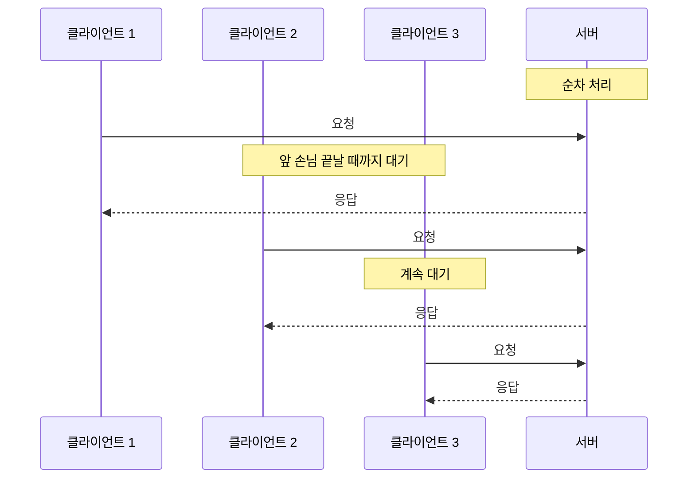
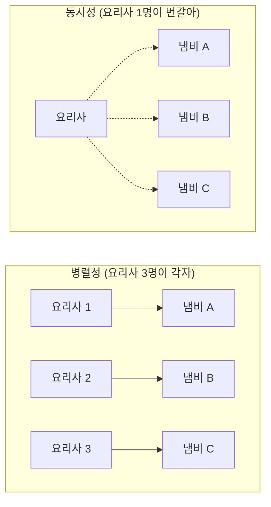
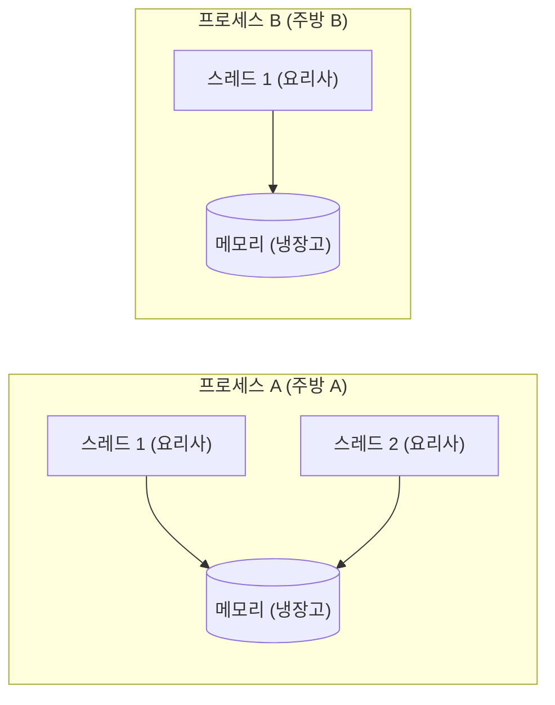
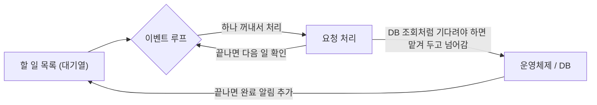
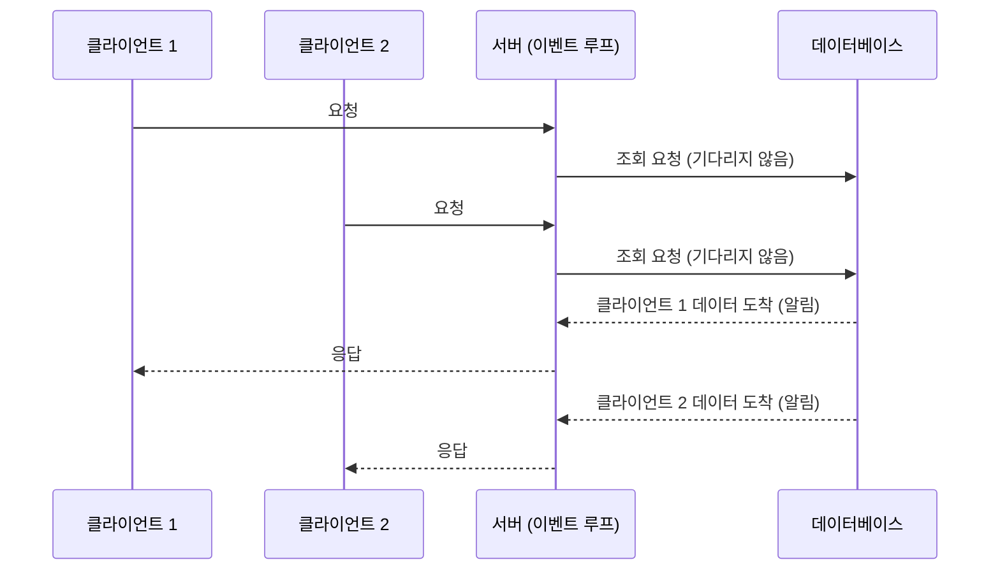
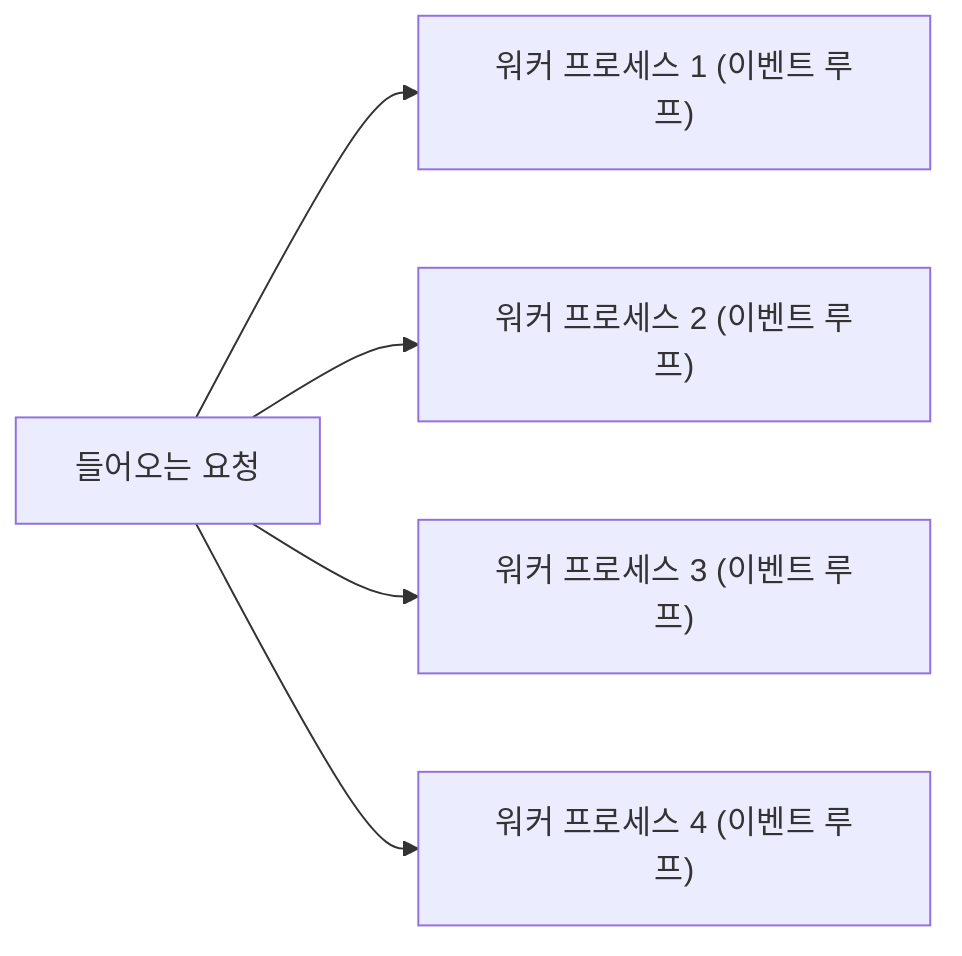

## 서버의 동시 처리 방식이란 ?
- 서버 하나가 여러 클라이언트의 요청을 한꺼번에 처리하는 방법
- 대표적으로 멀티 프로세스, 멀티 스레드, 이벤트 루프 세 가지 방식이 있다
- 서버가 연결을 받는 과정은 [소켓](../Network/소켓(Socket)/README.md) 문서에, 전체 구조는 [클라이언트-서버 구조](../클라이언트-서버%20구조(Client-Server%20Architecture)/README.md) 문서에 정리했다

<br/>

## 왜 필요할까
요리사가 한 명뿐인 식당을 떠올려 보자. 요리사가 손님 한 명의 주문을 받고, 요리하고, 음식을 내줄 때까지 다른 손님은 문 앞에서 기다려야 한다. 손님이 하나둘일 때는 괜찮지만 열 명, 백 명이 오면 대부분은 기다리다 돌아간다.

서버도 똑같다. 아무 장치 없이 만든 서버는 한 클라이언트와 대화가 끝나야 다음 클라이언트를 받는다. 이렇게 하나씩 차례로 처리하는 방식을 순차 처리(Sequential Processing)라고 한다.



웹 서비스에는 동시에 수백, 수천 명이 접속한다. 그래서 서버는 여러 요청을 한꺼번에 다룰 방법이 꼭 필요하다.

<br/>

## 먼저 알아 둘 용어
### 동시성 (Concurrency)과 병렬성 (Parallelism)
동시성(Concurrency)의 사전적 의미는 동시에 일어남. 병렬(Parallel)의 사전적 의미는 평행, 나란히 놓임.
공학적으로 동시성은 여러 일을 번갈아 처리해서 동시에 진행되는 것처럼 보이게 하는 것을 말한다. 병렬성은 여러 일을 실제로 같은 순간에 처리하는 것을 말한다.

요리사 한 명이 냄비 세 개를 번갈아 저으면 동시성이다. 한순간에는 냄비 하나만 젓지만, 세 요리가 함께 진행된다. 요리사 세 명이 냄비를 하나씩 맡으면 병렬성이다. 실제로 세 요리가 같은 순간에 만들어진다.



### 프로세스 (Process)
사전적 의미는 과정, 진행. 어떤 일이 진행되는 흐름이다.
공학적으로는 실행 중인 프로그램 하나를 말한다. 프로그램 파일은 그냥 저장된 레시피이고, 그걸 실행해서 실제로 움직이기 시작한 것이 프로세스다. 프로세스마다 운영체제가 따로 메모리 공간을 내준다.
식당으로 치면 주방 하나다. 주방마다 자기 냉장고와 조리 도구가 따로 있다.

### 스레드 (Thread)
사전적 의미는 실, 가닥. 하나의 긴 줄기다.
공학적으로는 프로세스 안에서 실제로 일을 하는 실행 흐름 하나를 말한다. 한 프로세스 안에 스레드가 여러 개 있을 수 있고, 같은 프로세스의 스레드끼리는 메모리를 함께 쓴다. 한 프로그램 안에서 여러 줄기의 일이 실처럼 나란히 흘러간다는 데서 비유할 수 있다.
식당으로 치면 한 주방 안의 요리사다. 같은 주방의 요리사들은 냉장고와 도구를 함께 쓴다.



### 서버의 일은 대부분 기다리기다
요청 하나를 처리하는 동안 서버가 실제로 계산하는 시간은 생각보다 짧다. 대부분은 데이터베이스의 대답을 기다리거나, 파일을 읽거나, 다른 서버의 응답을 기다리는 시간이다. 이런 입출력 작업을 I/O(Input/Output)라고 한다.
요리로 치면 손을 움직이는 시간보다 오븐이 다 구워지길 기다리는 시간이 훨씬 긴 셈이다. 동시 처리 방식은 결국 이 기다리는 시간을 어떻게 활용하느냐의 차이다.

<br/>

## 멀티 프로세스 (Multi-Process)
손님마다 주방을 하나씩 내주는 방식. 가장 단순한 형태는 요청이 들어올 때마다 서버가 자기 자신을 복제한 프로세스를 만들고(fork), 그 프로세스가 손님 한 명을 전담하는 것이다.

주방이 완전히 분리되어 있어서 한 주방에서 불이 나도 다른 주방은 멀쩡하다. 한 요청 처리 중에 프로그램이 죽어도 다른 요청에는 영향이 없다는 뜻이다.
대신 주방을 하나 만드는 데 비용이 크다. 프로세스마다 메모리를 따로 쓰기 때문에 손님이 많아지면 메모리가 빠르게 바닥난다. 주방끼리 재료를 나눠 쓰기도 어렵다.

요청마다 프로세스를 새로 만들면 손님이 문 앞에서 주방 공사가 끝나길 기다리는 셈이라 느리다. 그래서 주방을 미리 몇 개 지어 두고 손님이 오면 비어 있는 주방에 안내하는 방식도 쓴다. Apache httpd의 prefork 방식이 이렇게 동작한다. 공식 문서에 따르면 쉬고 있는 자식 프로세스를 늘 몇 개 띄워 두어서, 클라이언트가 새 프로세스가 만들어지길 기다리지 않아도 된다. 한 프로세스가 한 번에 한 연결을 맡는다는 점은 같다.

<br/>

## 멀티 스레드 (Multi-Thread)
주방은 하나만 두고, 손님이 올 때마다 요리사를 한 명씩 붙이는 방식. 서버 프로세스 안에서 요청마다 스레드 하나가 그 요청을 맡는다.

주방을 새로 만들 필요가 없으니 프로세스보다 가볍고, 같은 냉장고를 쓰니 재료(데이터)를 나누기도 쉽다.
대신 함께 쓰는 게 문제가 되기도 한다. 요리사 두 명이 동시에 냉장고의 마지막 계란을 집으려 하면 꼬인다. 이렇게 여러 스레드가 같은 데이터를 동시에 바꾸려다 결과가 엉키는 문제를 경쟁 상태(Race Condition)라고 한다. 이를 막으려면 한 번에 한 명만 쓰도록 순서를 정하는 장치(락, Lock)가 필요하고, 코드가 복잡해진다. 또 요리사 한 명이 프로그램 오류로 쓰러지면 같은 주방 전체가 멈출 수 있다.

### 스레드 풀 (Thread Pool)
손님이 올 때마다 요리사를 새로 뽑고, 손님이 가면 내보내는 것도 비용이다. 그래서 요리사를 미리 정해진 수만큼 고용해 두고, 손님이 오면 쉬고 있는 요리사에게 맡기는 방식을 쓴다. 풀(Pool)의 사전적 의미는 공동으로 모아 둔 것이다. 요리사가 모두 바쁘면 새 손님은 자리가 날 때까지 기다린다.

Tomcat 같은 서블릿 컨테이너(Servlet Container)가 이 방식을 쓴다. Java의 Spring MVC 애플리케이션을 Tomcat 위에서 돌리면 요청 하나를 스레드 풀의 스레드 하나가 맡는다. Spring 공식 문서는 서블릿 컨테이너가 요청 처리 중의 블로킹을 견디려고 큰 스레드 풀을 쓴다고 설명한다. 같은 Spring이라도 WebFlux는 다음에 볼 이벤트 루프 방식에 가깝다.

<br/>

## 이벤트 루프 (Event Loop)
### 이벤트 루프 (Event Loop)
이벤트(Event)의 사전적 의미는 사건, 일어난 일. 루프(Loop)의 사전적 의미는 고리, 고리 모양으로 도는 것.
공학적으로는 처리할 일이 생겼는지 계속 돌면서 확인하고, 생긴 일을 하나씩 처리하는 반복 구조를 말한다.

요리사 한 명이 모든 손님을 맡는데, 기다리는 시간에 멍하니 서 있지 않는 방식이다. 오븐에 빵을 넣고 다 구워질 때까지 기다리는 대신, 타이머를 맞춰 두고 바로 다음 손님 주문을 받는다. 타이머가 울리면(이벤트) 빵을 꺼내 마무리한다.

서버로 바꿔 말하면, 데이터베이스에 질문을 보내 놓고 대답을 기다리지 않는다(논블로킹, Non-blocking. 블로킹과의 차이는 [블로킹과 논블로킹](../블로킹과%20논블로킹(Blocking%20and%20Non-blocking)/README.md) 문서에 정리했다). 그사이 다른 요청을 처리하다가, 대답이 도착했다는 알림이 오면 이어서 처리한다.



요리사가 한 명이라 스레드끼리 같은 데이터를 동시에 바꾸는 문제가 없고, 요리사를 많이 둘 필요가 없어 메모리도 적게 쓴다. 다만 순서 꼬임이 아예 없는 것은 아니다. 손님 A의 빵을 오븐에 넣고 기다리는 사이 손님 B의 주문이 같은 재고를 써 버릴 수 있다. 기다리는 작업 사이에 다른 일이 끼어들기 때문에 생기는 문제라서, 이런 경우에는 여전히 순서를 신경 써야 한다. 기다리는 시간이 긴 일, 즉 I/O가 많은 서버에 잘 맞는다.
약점은 요리사가 한 명뿐이라는 것 자체다. 요리사가 반죽을 30분 동안 손으로 치대야 하는 일을 맡으면, 그동안 다른 손님은 아무도 응대받지 못한다. 서버에서도 복잡한 계산처럼 CPU를 오래 쓰는 작업 하나가 전체를 멈춰 세운다.

Node.js와 Nginx가 이 방식을 쓴다. Spring WebFlux도 적은 수의 고정된 스레드(이벤트 루프 워커)로 요청을 처리한다.



### 코드로 보기
Node.js에서 기다리는 작업과 오래 계산하는 작업이 어떻게 다른지 보여 주는 예시다.

```js
const http = require('http');

http.createServer((req, res) => {
  if (req.url === '/wait') {
    // 3초 기다리는 작업 (DB 조회를 흉내 냄). 기다리는 동안 다른 요청을 처리할 수 있다
    setTimeout(() => res.end('wait done'), 3000);
  } else if (req.url === '/heavy') {
    // 3초 동안 계속 계산하는 작업. 끝날 때까지 다른 모든 요청이 멈춘다
    const end = Date.now() + 3000;
    while (Date.now() < end) {}
    res.end('heavy done');
  } else {
    res.end('hello');
  }
}).listen(3000);
```

/wait을 요청한 직후 / 를 요청하면 바로 hello가 돌아온다. 반면 /heavy를 요청한 직후 / 를 요청하면 3초 동안 아무 대답이 없다. 직접 해 볼 때는 서버를 띄운 터미널과 다른 터미널(또는 브라우저 탭 두 개)에서 요청해야 한다. 같은 Node.js 프로그램 안에서 요청까지 보내면 그 프로그램도 함께 멈춰서 차이가 보이지 않는다.

<br/>

## 세 방식 비교
| 구분 | 멀티 프로세스 | 멀티 스레드 | 이벤트 루프 |
| --- | --- | --- | --- |
| 비유 | 손님마다 주방 하나 | 손님마다 요리사 한 명 | 요리사 한 명이 타이머로 번갈아 |
| 메모리 사용 | 많음 | 중간 | 적음 |
| 데이터 공유 | 어려움 | 쉬움 (대신 동시 수정 충돌 주의) | 쉬움 (동시 수정은 없지만 끼어들기 순서는 주의) |
| 하나가 죽으면 | 그 요청만 실패 | 프로세스 전체가 위험 | 프로세스 전체가 위험 |
| 잘 맞는 일 | 서로 격리가 중요한 일 | 계산과 기다림이 섞인 일 | 기다리는 시간이 긴 일 (I/O) |
| 약한 일 | 접속자가 아주 많은 경우 | 공유 데이터가 많은 경우 | CPU를 오래 쓰는 계산 |
| 예시 | Apache httpd (prefork) | Tomcat 위의 Spring MVC | Node.js, Nginx, Spring WebFlux |

<br/>

## 섞어서 쓰기
실제 서버는 한 가지 방식만 쓰기보다 섞어 쓰는 경우가 많다.

이벤트 루프는 요리사가 한 명이라 CPU 코어를 하나밖에 못 쓴다. 요즘 컴퓨터는 코어가 여러 개라서, 이벤트 루프를 돌리는 프로세스를 코어 수만큼 띄우는 식으로 보완한다. 주방을 몇 개 두고, 각 주방에서는 요리사 한 명이 타이머 방식으로 일하는 셈이다. Nginx는 워커 프로세스 여러 개가 각자 이벤트 루프로 동작하고, Node.js도 cluster 모듈로 같은 구성을 만들 수 있다. 무거운 계산만 따로 맡을 스레드를 두는 방법(Node.js의 worker_threads)도 있다.



<br/>

## 참고 자료
- Apache HTTP Server 2.4 문서, [prefork](https://httpd.apache.org/docs/2.4/mod/prefork.html)
- Spring Framework 문서, [Overview (WebFlux) > Concurrency Model](https://docs.spring.io/spring-framework/reference/web/webflux/new-framework.html)

<br/>

## 더 볼 것 (TODO)
- [컨텍스트 스위칭 (Context Switching)](../컨텍스트%20스위칭(Context%20Switching)/README.md)
- [락, 뮤텍스, 세마포어 같은 동기화 도구](../동기화%20도구(Synchronization%20Primitives)/README.md)
- [블로킹과 논블로킹, 동기와 비동기의 차이](../블로킹과%20논블로킹(Blocking%20and%20Non-blocking)/README.md)
- 브라우저와 Node.js의 이벤트 루프 구조 (콜 스택, 태스크 큐, 마이크로태스크 큐)
- [C10K 문제](../C10K%20문제(C10K%20Problem)/README.md)
- [코루틴과 async/await](../코루틴과%20async-await(Coroutine%20and%20async-await)/README.md)
