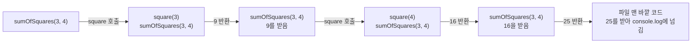

## 스택 프레임이란 ?
- 함수를 한 번 호출할 때마다 스택 영역에 만들어지는, 그 호출 하나만을 위한 메모리 묶음이다
- 매개변수, 지역 변수, 함수가 끝나면 돌아갈 주소, 바로 아래 프레임의 위치가 들어 있다
- 호출하면 스택 맨 위에 쌓이고, 함수가 끝나면 맨 위에서 빠진다. 이렇게 쌓인 프레임 전체를 호출 스택이라고 부른다

스택과 힙의 뜻, 변수가 어느 영역에 놓이는지는 [변수 노트의 변수가 사는 곳](../변수(Variable)/README.md#변수가-사는-곳)에서 다뤘다. 호출 스택이 함수의 반환을 어떻게 해결하는지는 [함수 설계 원리 노트의 호출 스택과 반환 메커니즘](../함수%20설계%20원리(Function%20Design%20Principles)/README.md#호출-스택과-반환-메커니즘)에서 다뤘다. 이 노트는 그 위에서 스택 안을 한 칸 더 들여다본다.

<br/>

## 단어의 뜻
### 스택 (Stack)
사전적 의미는 쌓아 올린 더미다. 공학적으로는 나중에 넣은 것을 먼저 꺼내는(LIFO, Last In First Out) 자료 구조, 그리고 그 방식으로 함수 호출 정보를 쌓는 메모리 영역을 함께 가리킨다. 변수 노트에서처럼 이 노트도 접시 더미로 비유한다. 접시는 맨 위에 올리고 맨 위에서 꺼낸다. 함수 설계 원리 노트의 메모지 더미와 같은 그림이다.

### 프레임 (Frame)
사전적 의미는 틀, 테두리, 액자다. 무언가를 둘러싸서 한 덩어리로 구분해 주는 경계를 말한다.

공학적으로 스택 프레임(Stack Frame)은 스택 위에서 함수 호출 하나가 쓰는 구역을 테두리로 묶은 것이다. 액자가 그림 한 장의 테두리를 정하듯, 프레임은 호출 하나의 정보가 어디서 어디까지인지 정한다. 같은 함수를 두 번 부르면 프레임도 두 개 생긴다. 이후 비유는 접시 더미로 통일해 접시 한 장을 프레임 하나로 본다. 활성 레코드(Activation Record)라고도 부른다.

### 호출 스택 (Call Stack)
call은 부르다라는 뜻이다. 호출 스택은 지금 실행 중인 함수부터 그 함수를 부른 함수들까지, 아직 끝나지 않은 호출의 프레임이 쌓여 있는 스택 전체를 말한다. 맨 위 프레임이 지금 실행 중인 함수다.

<br/>

## 프로그램 메모리의 영역
### 왜 나누는가
실행 중인 프로그램이 쓰는 메모리에는 성격이 다른 것들이 섞여 있다. 실행 내내 바뀌지 않는 명령어가 있고, 프로그램이 끝날 때까지 살아 있는 값이 있고, 함수 하나가 도는 동안만 필요한 값이 있다. 수명과 쓰는 방식이 다르니 영역을 나눠 각자에게 맞는 방식으로 관리한다.

작업실에 비유하면 설명서를 꽂아 두는 선반, 늘 붙어 있는 게시판, 필요할 때 빈자리에 물건을 두는 창고, 작업 중인 접시를 쌓는 자리가 따로 있는 것과 같다.

### 네 가지 영역
운영체제와 언어마다 세부는 다르지만 입문 수준에서는 보통 네 영역으로 나눠 설명한다.

| 영역 | 무엇이 놓이나 | 언제 잡히고 풀리나 |
|---|---|---|
| 코드 영역 (Code / Text) | 실행할 기계어 명령어 | 프로그램을 불러올 때 올라가고 끝날 때 내려간다 |
| 정적 영역 (Static / Data) | 전역 변수, 정적 변수 | 프로그램 시작부터 끝까지 |
| 힙 (Heap) | 실행 중 필요할 때 만드는 값 | 요청할 때 잡히고, 직접 해제하거나 가비지 컬렉터(Garbage Collector)가 풀 때까지 |
| 스택 (Stack) | 스택 프레임(매개변수, 지역 변수 등) | 함수를 호출할 때 잡히고 함수가 끝날 때 풀린다 |

정적 영역은 변수 노트와 같은 이름이고, 데이터 영역이라고도 부른다. 코드 영역을 텍스트(Text) 영역이라고도 부르는데, 여기서 텍스트는 글자가 아니라 프로그램 본문이라는 뜻으로 쓰인 이름이다. 이 노트에서 다루는 것은 이 가운데 스택이다.

<br/>

## 프레임이 쌓이고 빠지는 과정
### 호출하면 쌓인다
함수 설계 원리 노트의 예시를 다시 쓴다.

```js
const square = (n) => n * n;
const sumOfSquares = (a, b) => square(a) + square(b);

console.log(sumOfSquares(3, 4)); // 25
```

`sumOfSquares(3, 4)` 를 부르면 스택 맨 위에 `sumOfSquares` 의 프레임이 생긴다. 그 안에서 `square(3)` 을 부르면 `square` 의 프레임이 그 위에 생긴다. 이때 아래 프레임은 사라지지 않고 멈춘 채로 기다린다. `square(3)` 이 9를 돌려주면 `square` 의 프레임이 빠지고, `sumOfSquares` 가 멈췄던 자리부터 다시 실행된다. `square(4)` 도 같은 과정을 거친다.



그림에서 칸 하나가 그 순간의 스택이고, 위에 적힌 것이 맨 위 프레임이다. 그림에는 생략했지만 `sumOfSquares` 아래에는 `console.log(...)` 를 실행하는 파일 맨 바깥 코드의 프레임이 늘 깔려 있다. `sumOfSquares` 가 빠지면 25를 받는 것도 이 코드다.

### 끝나면 빠진다
함수가 끝나면 그 함수의 프레임은 통째로 빠진다. 프레임 안에 있던 매개변수와 지역 변수도 함께 사라진다. 변수 노트에서 지역 변수의 수명이 함수 호출 동안이라고 한 것은 이 때문이다. 개념상 지역 변수는 프레임 안에 살고, 프레임이 빠지면 같이 없어진다. 다만 자바스크립트의 클로저(Closure)처럼 함수가 끝난 뒤에도 지역 변수를 붙잡아 두는 언어에서는, 그런 변수를 엔진이 프레임 밖에 따로 보관한다(확인 필요).

<br/>

## 프레임 하나에 들어가는 것
### 네 가지 정보
프레임 하나에는 개념상 아래 네 가지가 들어간다.

1. 매개변수(Parameter). 호출할 때 넘겨받은 값이다. `square(3)` 의 프레임에는 `n` 이 3으로 들어 있다.
2. 지역 변수(Local Variable). 함수 안에서 만든 변수다. 계산 중간에 잠시 보관할 값도 여기에 둘 수 있다.
3. 돌아갈 주소(Return Address). 함수가 끝난 뒤 다음으로 실행할 명령어의 위치다. `square(3)` 의 프레임에는 `sumOfSquares` 안에서 `square(a)` 를 부른 바로 다음 자리가 적혀 있다.
4. 이전 프레임의 위치. 바로 아래 프레임이 어디서 시작하는지를 적어 둔다. 내 프레임이 빠진 뒤 아래 프레임을 다시 기준으로 삼기 위해서다.

접시 더미로 보면 접시 한 장 위에 그 함수가 쓸 재료(매개변수, 지역 변수)와 다 쓰면 돌아갈 곳을 적은 쪽지(돌아갈 주소)를 함께 올려 둔 것이다. 접시마다 크기가 달라서, 바로 아래 접시가 어디서 시작하는지도 표시해 둔다(이전 프레임 위치).

### 왜 돌아갈 주소가 필요한가
같은 함수를 여러 곳에서 부를 수 있기 때문이다. `square` 는 `square(a)` 에서도 불리고 `square(b)` 에서도 불린다. `square` 자신은 누가 불렀는지 모르므로, 부른 쪽이 돌아올 자리를 프레임에 남겨 둔다. 함수가 끝나면 이 주소를 읽어 그곳으로 돌아간다.

### 실제 모습은 환경마다 다르다
위 네 가지는 개념상 구성이다. 실제로는 CPU와 호출 규약(Calling Convention), 곧 함수끼리 값을 주고받는 약속에 따라 순서와 방식이 다르고, 매개변수 일부를 메모리 대신 CPU 내부의 저장 칸인 레지스터(Register)로 넘기기도 한다. 자바스크립트처럼 엔진 위에서 도는 언어는 엔진이 자기 방식으로 프레임을 관리한다. 어떤 값이 실제로 스택에 놓이는지는 언어와 엔진마다 다르므로 여기서는 단정하지 않는다.

<br/>

## 스택의 특징
### 빠르다
스택은 맨 위에서만 넣고 뺀다. 그래서 새 프레임을 잡을 때 빈자리를 찾을 필요가 없다. 지금 맨 위가 어디인지를 가리키는 표시 하나를 프레임 크기만큼 옮기면 끝이다. 접시를 올릴 때 놓을 자리를 고민하지 않고 맨 위에 얹기만 하면 되는 것과 같다.

힙은 크기와 수명이 제각각인 값이 섞여 있어서, 값을 만들 때 알맞은 빈자리를 찾고 다 쓰면 그 자리를 다시 쓸 수 있게 기록해야 한다. 창고에서 빈 선반을 찾아 물건을 두는 일과 같다.

### 자동으로 정리된다
프레임은 함수가 끝나는 순간 맨 위 표시를 되돌리는 것만으로 사라진다. 프로그래머가 따로 해제 코드를 쓰지 않아도 된다. 함수가 끝나는 시점이 곧 정리하는 시점이라 언제 지울지 판단할 필요도 없다.

### 크기가 정해져 있다
스택은 보통 프로그램(정확히는 실행 흐름 하나인 스레드(Thread))이 시작할 때 쓸 수 있는 최대 크기가 정해지고, 그 한도를 넘어 늘어나지 않는다. Go처럼 작은 스택으로 시작해 실행 중에 키우는 런타임도 있다. 그래서 프레임을 너무 많이 쌓거나, 프레임 하나가 아주 크면 정해진 크기를 넘친다. 기본 크기는 운영체제와 실행 환경마다 다르다. Node.js의 예는 아래 코드로 보기에서 본다.

<br/>

## 재귀 호출과 스택 오버플로
### 재귀 호출 (Recursive Call)
recursive는 되풀이되는, 다시 돌아오는이라는 뜻이다. 재귀 호출은 함수가 자기 자신에게 다시 돌아와 자신을 부르는 것을 말한다.

프레임은 호출마다 따로 생기므로, 같은 함수를 다시 불러도 이전 호출의 매개변수와 지역 변수를 덮어쓰지 않는다. 같은 함수가 쌓인 프레임 개수만큼 따로따로 살아 있다.

```js
function sum(n) {
  if (n === 0) return 0; // 종료 조건
  return n + sum(n - 1);
}

console.log(sum(5)); // 15
```

`sum(5)` 는 `sum(4)`, `sum(3)` 을 거쳐 `sum(0)` 까지 프레임 여섯 개를 쌓는다. `sum(0)` 이 종료 조건에 걸려 0을 돌려주면 그때부터 프레임이 하나씩 빠지면서 1, 3, 6, 10, 15가 차례로 계산된다. 각 프레임이 자기 `n` 을 따로 기억하고 있어서 가능한 일이다. 자바스크립트 관점의 설명은 [재귀 함수 노트](../../JavaScript/재귀%20함수(Recursive%20Function)/README.md)에 있다.

### 스택 오버플로 (Stack Overflow)
overflow는 넘쳐흐른다는 뜻이다. 스택 오버플로는 프레임이 쌓이다가 정해진 스택 크기를 넘쳐 프로그램이 더 이상 함수를 부를 수 없게 된 상태를 말한다. 접시를 계속 올리다 천장에 닿아 더 올릴 수 없게 된 것과 같다.

가장 흔한 원인은 종료 조건이 없는 재귀다. 위 `sum` 에서 `if (n === 0) return 0;` 을 지우면 `n` 이 음수로 내려가며 끝없이 자기를 부르고, 빠지는 프레임 없이 쌓이기만 한다. 종료 조건이 있어도 재귀가 너무 깊으면 같은 일이 생긴다. 실행 환경은 보통 이를 오류로 알리고 프로그램을 멈추거나 예외를 던진다. 어떤 방식으로 알리는지는 언어마다 다르다.

<br/>

## 지역 변수의 주소를 돌려주면 생기는 문제
### 무엇이 문제인가
함수가 끝나면 프레임이 빠지고 그 안의 지역 변수도 사라진다. 그런데 지역 변수의 값이 아니라 지역 변수가 있던 자리(주소)를 돌려주면, 받는 쪽은 이미 빠진 프레임 안을 가리키는 주소를 쥐게 된다. 그 자리는 다음 함수 호출이 새 프레임으로 덮어쓸 수 있으므로, 나중에 읽으면 엉뚱한 값이 나오거나 프로그램이 이상하게 동작한다.

변수 노트의 호텔 방 비유로 보면, 체크아웃한 방 번호를 친구에게 알려 주고 거기서 짐을 찾으라고 하는 것과 같다. 방 번호는 그대로지만 그 방에는 이미 다른 손님이 들어와 있을 수 있다.

### 어떤 언어에서 생기나
주소를 직접 다루는 C, C++ 같은 언어에서 생기는 문제다. 지역 변수의 값 자체를 돌려주는 것은 문제가 없다. 돌려줄 때 값이 복사되어 넘어가기 때문이다. 함수가 끝난 뒤에도 남아야 하는 값은 힙에 만들어 그 주소를 돌려준다.

자바스크립트나 파이썬처럼 주소를 직접 꺼낼 수 없는 언어에서는 이 실수를 코드로 쓸 수 없다. 함수 안에서 만든 객체를 돌려줘도 그대로 쓸 수 있다. 이런 언어가 그 객체를 실제로 어디에 두는지는 언어와 엔진마다 다르다.

<br/>

## 스택과 힙 비교
스택은 함수가 끝나면 맨 위 표시만 되돌려 자동으로 정리된다. 스레드마다 정해진 비교적 작은 크기 안에서 쓰고, 값의 수명은 함수 호출이 끝날 때까지다. 넘치면 스택 오버플로가 난다.

힙은 빈자리를 찾아 잡고, 프로그래머가 해제하거나 가비지 컬렉터가 치운다. 운영체제가 내주는 만큼 비교적 크게 쓸 수 있고, 값의 수명은 해제되거나 아무도 가리키지 않을 때까지다. 모자라면 메모리 부족 오류가 난다.

정리하면 크기를 미리 알고 함수 안에서만 쓰는 값은 스택이 잘 맞고, 크기가 실행 중에 바뀌거나 함수가 끝난 뒤에도 남아야 하는 값은 힙이 맞다.

<br/>

## 코드로 보기
아래 예시는 Windows 11(win32 x64), Node.js v24.22.1에서 2026-10-26에 실행했다. 깊이 숫자는 운영체제, Node.js 버전, 함수 모양에 따라 달라지고, 같은 환경에서도 실행할 때마다 조금씩 다르다.

### 재귀 깊이 재기
끝없이 자기를 부르는 함수를 만들고, 몇 번째 호출에서 넘치는지 센다. 아래 코드를 depth.js로 저장해 실행했다.

```js
let depth = 0;

function dive() {
  depth++;
  dive();
}

try {
  dive();
} catch (e) {
  console.log(e.name + ': ' + e.message);
  console.log('최대 깊이:', depth);
}
```

```
RangeError: Maximum call stack size exceeded
최대 깊이: 12520
```

세 번 실행했더니 12520, 12504, 12523이 나왔다. Node.js(V8 엔진)는 스택이 넘치면 프로그램을 바로 죽이지 않고 `RangeError` 를 던지므로 `try...catch` 로 잡을 수 있다.

프레임이 크면 같은 스택에 더 적게 쌓인다. 매개변수 다섯 개와 지역 변수 세 개를 둔 함수로 바꾸자 최대 깊이가 5435에서 5443 사이로 줄었다.

```js
let depth = 0;

function heavyDive(a, b, c, d, e) {
  const x = a + 1;
  const y = b + 2;
  const z = c + 3;
  depth++;
  heavyDive(x, y, z, d, e);
  return x + y + z; // 재귀 호출 뒤에도 x, y, z를 쓰게 해서 프레임에 남게 하려는 의도다
}

try {
  heavyDive(1, 2, 3, 4, 5);
} catch (e) {
  console.log('최대 깊이:', depth);
}
```

종료 조건이 있어도 너무 깊으면 넘친다. 앞의 `sum` 에 `sum(100000)` 을 넘기자 같은 `Maximum call stack size exceeded` 가 났다.

### 스택 크기 옵션
V8이 쓸 수 있는 스택 크기는 `--stack-size` 옵션으로 정한다. `node --v8-options` 출력에서 이 옵션의 설명과 기본값은 아래와 같았다(v24.22.1).

```
  --stack-size (default size of stack region v8 is allowed to use (in kBytes))
        type: int  default: --stack-size=984
```

기본값은 984KB다. `node --stack-size=2000 depth.js` 로 늘리자 첫 예시의 최대 깊이가 25520, `--stack-size=400` 으로 줄이자 5042가 나왔다. 스택 크기가 정해져 있고, 그 크기가 곧 쌓을 수 있는 프레임 수를 정한다는 것을 숫자로 볼 수 있다. 옵션 설명대로 이 값은 V8이 쓰도록 허락받은 크기다. 운영체제가 실제로 내준 스레드 스택보다 크게 잡으면 어떻게 되는지는 확인하지 못했다(확인 필요).

### 호출 스택 출력하기
지금 호출 스택에 어떤 프레임이 쌓여 있는지는 `Error` 객체의 `stack` 속성이나 `console.trace()` 로 볼 수 있다.

```js
function c() {
  console.log(new Error('여기까지 온 길').stack);
  console.trace('trace로 본 호출 스택');
}

function b() {
  c();
}

function a() {
  b();
}

a();
```

출력의 앞부분은 아래와 같다. 파일 경로는 실제 실행 경로 대신 `C:\example\trace.js` 로 바꿔 적었다.

```
Error: 여기까지 온 길
    at c (C:\example\trace.js:2:15)
    at b (C:\example\trace.js:7:3)
    at a (C:\example\trace.js:11:3)
    at Object.<anonymous> (C:\example\trace.js:14:1)
    at Module._compile (node:internal/modules/cjs/loader:1929:14)
    ...
Trace: trace로 본 호출 스택
    at c (C:\example\trace.js:3:11)
    at b (C:\example\trace.js:7:3)
    at a (C:\example\trace.js:11:3)
    at Object.<anonymous> (C:\example\trace.js:14:1)
    at Module._compile (node:internal/modules/cjs/loader:1929:14)
    ...
```

`at` 으로 시작하는 첫 줄이 지금 실행 중인 `c` 이고, 아래로 갈수록 그 함수를 부른 쪽이다. 맨 위 프레임부터 아래로 읽은 것과 같다. `파일:줄:칸` 은 맨 위 프레임이면 지금 실행 중인 위치이고, 그 아래 프레임이면 다른 함수를 부르고 멈춰 있는 호출 위치다. 함수가 끝나면 그 호출 바로 다음부터 이어서 실행한다. `Object.<anonymous>` 는 파일 맨 바깥 코드의 프레임이고(Node.js는 파일 전체를 함수 하나로 감싸 실행한다), `node:internal` 로 시작하는 줄은 Node.js가 파일을 불러오며 쌓은 프레임이다. 실제 출력은 `at` 으로 시작하는 프레임 10개에서 끊겼다. 이 환경에서 `Error.stackTraceLimit` 의 값이 10이었고, 이 값이 보여 줄 프레임 수를 정한다. 자바스크립트 관점의 호출 스택은 [콜스택과 실행 순서 노트](../../JavaScript/콜스택과%20실행%20순서(Call%20Stack)/README.md)에 있다.

<br/>

## 더 볼 것 (TODO)
- CPU 레지스터와 스택 포인터, 프레임 포인터(x86-64의 rsp, rbp 등)
- 호출 규약(Calling Convention): 매개변수를 레지스터와 스택 중 어디로 넘기는지
- 꼬리 호출 최적화(Tail Call Optimization)와 재귀를 반복문으로 바꾸기
- [가비지 컬렉션(Garbage Collection)의 동작 방식](../가비지%20컬렉션(Garbage%20Collection)/README.md)
- 클로저(Closure)가 붙잡은 지역 변수를 엔진이 어디에 보관하는지
- 힙 할당의 내부 구조(빈자리를 찾고 관리하는 방식)
- 스레드(Thread)마다 스택이 따로 있는 이유
- 운영체제별 기본 스택 크기와 바꾸는 방법
- C에서 지역 변수 주소를 돌려주는 실제 예시와 컴파일러 경고
