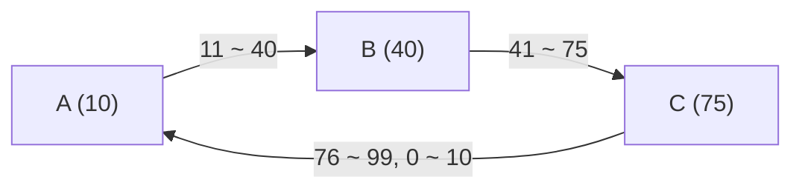

## 일관된 해싱이란 ?
- 일관된 해싱(Consistent Hashing)은 데이터를 여러 서버에 해시로 나눠 둘 때, 서버가 늘거나 줄어도 대부분의 데이터가 원래 서버에 그대로 남게 하는 방법이다
- 해시값의 범위를 원(해시 링, Hash Ring)으로 보고, 서버와 데이터를 같은 원 위에 올린 뒤 데이터를 시계 방향으로 처음 만나는 서버에 맡긴다
- 서버가 바뀔 때 옮겨야 하는 데이터가 전체의 일부뿐이라 분산 캐시, 분산 저장소, 로드 밸런서에서 쓴다

### 일관된 해싱 (Consistent Hashing)
Consistent는 사전적으로 한결같다, 앞뒤가 맞다는 뜻이다. 상황이 바뀌어도 태도나 결과가 크게 달라지지 않는다는 말이다.
공학적으로는 해시 함수가 나눠 줄 대상(서버 목록)이 바뀌어도 결과가 되도록 적게 바뀌는 해싱을 말한다. 처음 이 이름을 붙인 Karger 외(1997)의 논문도 일관된 해시 함수를 범위가 바뀔 때 결과가 최소한으로만 바뀌는 함수라고 설명한다. 서버 목록이 바뀌어도 키와 서버의 짝이 한결같이 유지되니 원래 뜻과 이어진다.

해시(Hash)의 뜻과 IP 해시는 [로드 밸런싱](../로드%20밸런싱(Load%20Balancing)/README.md) 노트의 IP 해시 부분에, 해시 함수가 갖춰야 할 조건은 [해시 함수](../../Algorithm/해시(Hash)/해시%20함수(Hash%20Function)/README.md) 노트에 정리했다. 이 노트에서는 같은 키(Key)를 늘 같은 서버로 보내는 해시 방식이 서버 수가 바뀔 때 어떻게 되는지부터 본다. 키는 사용자 IP, 캐시 항목 이름처럼 데이터를 찾을 때 쓰는 이름이다.

<br/>

## 왜 필요할까
### 나머지 방식 (해시 % 서버 수)
키를 서버에 나누는 가장 쉬운 방법은 키의 해시값을 서버 수로 나눈 나머지를 서버 번호로 쓰는 것이다. 서버가 4대면 해시값이 10인 키는 10 % 4 = 2번 서버로 간다. 같은 키는 늘 같은 해시값이 나오니 늘 같은 서버로 가고, 해시값이 고르게 퍼지면 서버마다 키도 고르게 나뉜다.

문제는 서버 수가 바뀔 때다. 서버를 5대로 늘리면 나누는 수가 4에서 5로 바뀐다. 해시값 10, 11, 12, 13은 4대일 때 2, 3, 0, 1번 서버로 갔는데, 5대가 되면 0, 1, 2, 3번 서버로 간다. 네 키가 모두 자리를 옮긴다.

몇 개나 남는지 세어 보면 4로 나눈 나머지와 5로 나눈 나머지가 같은 해시값만 남는다. 0부터 19까지 스무 개 가운데 그런 값은 0, 1, 2, 3 네 개뿐이고, 이 규칙은 20마다 반복된다. 해시값이 고르게 퍼져 있다면 남는 키는 20%, 옮겨지는 키는 80%다. 새 서버 하나가 맡아야 할 몫은 전체의 5분의 1인데, 실제로는 기존 서버끼리도 키를 주고받느라 그 네 배가 움직인다.

출석 번호를 반 수로 나눈 나머지로 반을 정하는 학교와 같다. 반이 하나 늘면 새 반으로 갈 학생만 움직이는 게 아니라, 나누는 수가 바뀌어 대부분의 학생이 반을 옮긴다.

### 키가 옮겨지면 생기는 일
[캐싱](../캐싱(Caching)/README.md) 노트에서 본 캐시 서버가 여러 대라고 해 보자. 키가 다른 서버로 옮겨지면, 새로 맡은 서버에는 그 키의 사본이 없으니 캐시 미스가 난다. 80%가 한꺼번에 옮겨지면 요청의 80% 가량이 동시에 원본(데이터베이스 등)으로 몰린다. Karger 외의 논문도 해시 함수의 범위가 바뀌면 거의 모든 항목이 새 위치로 해시되어, 캐시해 둔 데이터가 갑자기 쓸모없어진다고 지적한다.

데이터를 실제로 나눠 저장하는 분산 저장소라면 더 무겁다. 옮겨진 키의 데이터를 네트워크로 실제로 복사해야 한다. 서버 한 대를 추가하거나, 고장 난 서버 한 대를 빼는 흔한 일마다 전체 데이터 대부분을 옮겨야 한다.

그래서 서버가 바뀌어도 꼭 옮겨야 하는 키만 옮기는 방법이 필요하다. 서버를 하나 더하면 새 서버가 맡을 몫만큼만, 서버를 하나 빼면 그 서버가 맡던 키만 움직이게 하는 것이다.

<br/>

## 해시 링 (Hash Ring)
### 용어
Ring의 사전적 의미는 고리, 둥근 테다. 끝과 처음이 이어져 있다.
공학적으로 해시 링은 해시값의 범위를 직선이 아니라 원으로 본 것이다. 해시값이 0부터 2^32 - 1까지 나온다면, 가장 큰 값 다음에 다시 0이 오도록 양 끝을 이어 붙인다.

### 동작
1. 서버 이름을 해시해서 링 위에 점을 찍는다
2. 키도 같은 해시 함수로 해시해서 링 위에 놓는다
3. 키의 자리에서 시계 방향으로 돌다가 처음 만나는 서버가 그 키를 맡는다
4. 링의 끝을 넘으면 처음으로 돌아가 계속 찾는다

링을 0부터 99까지로 줄여서 보자. 서버 A, B, C의 해시값이 10, 40, 75라고 하자. 해시값이 25인 키는 시계 방향으로 가다 40에서 B를 만나므로 B가 맡는다. 해시값이 80인 키는 99를 넘어 0으로 돌아간 뒤 10에서 A를 만난다. 결국 각 서버는 바로 앞 서버 다음부터 자기 자리까지의 구간을 맡는다. A는 76부터 99, 0부터 10까지, B는 11부터 40까지, C는 41부터 75까지다.



화살표 위의 구간이 화살표 끝 서버가 맡는 키의 범위다.

원형 순환 버스 노선과 같다. 승객(키)은 자기가 선 자리에서 정해진 방향으로 버스를 타고 가다가 처음 나오는 정류장(서버)에서 내린다. 정류장 사이 구간에 선 승객은 모두 다음 정류장에서 내린다.

키를 찾을 때 서버 목록 전체를 훑을 필요는 없다. 서버 점들을 해시값 순서로 정렬해 두고, 키의 해시값 이상인 첫 점을 찾으면 된다. 정렬된 목록은 가운데를 보고 절반씩 버려 가며 찾는 이분 탐색(Binary Search)을 쓸 수 있어서, 서버 점이 많아도 빨리 찾는다.

### Karger 논문과의 차이
Karger 외의 논문은 원이 아니라 0과 1 사이의 구간(단위 구간, Unit Interval)에 서버와 키를 올리고, 키를 가장 가까운 서버 점에 맡기는 방식으로 설명한다. 지금 흔히 쓰는 원과 시계 방향 규칙은 Amazon의 Dynamo 논문(DeCandia 외, 2007) 같은 뒤의 설명에서 볼 수 있는 형태다. 어느 쪽이든 서버를 더하거나 뺄 때 그 서버 근처의 키만 움직인다는 핵심은 같다.

<br/>

## 서버를 더하거나 뺄 때
### 서버를 더할 때
위의 링에 서버 D를 60 자리에 더한다고 해 보자. D는 41부터 60까지를 맡게 되는데, 이 구간은 원래 C가 맡던 구간의 일부다. 그래서 C가 갖고 있던 키 가운데 41부터 60 사이의 키만 D로 옮겨진다. A와 B가 맡던 키는 아무것도 바뀌지 않는다.

### 서버를 뺄 때
반대로 B를 빼면 B가 맡던 11부터 40까지의 키는 시계 방향으로 다음 서버인 C가 맡는다. 옮겨지는 키는 B가 갖고 있던 키뿐이고, A와 C가 원래 갖고 있던 키는 그대로다.

### 왜 일부만 움직일까
나머지 방식은 모든 키의 자리가 서버 수라는 값 하나에 묶여 있다. 그 값이 바뀌면 모든 키의 계산 결과가 함께 바뀐다. 해시 링에서는 키의 자리가 서버 수와 상관없이 정해지고, 키가 어느 서버로 갈지는 시계 방향으로 가장 가까운 서버 하나만 보고 정한다. 서버 하나가 생기거나 없어지면 그 서버 바로 앞 구간의 키만 맡을 서버가 바뀐다.

논문도 새 서버가 더해질 때 움직이는 키는 새 서버의 점에 가장 가까워진 키뿐이고, 기존 서버끼리는 키가 오가지 않는다고 설명한다. 버스 노선에 정류장 하나가 새로 생기면 바로 앞 정류장과 새 정류장 사이에 선 승객만 내리는 곳이 바뀌는 것과 같다.

<br/>

## 가상 노드 (Virtual Node)
### 문제
서버 점이 몇 개뿐이면 점 사이 간격이 고르지 않다. 해시값은 무작위처럼 흩어지기 때문에, 서버 4대를 링에 찍으면 어떤 서버는 링의 절반을 맡고 어떤 서버는 아주 짧은 구간만 맡을 수 있다. 맡은 구간이 길면 키도 그만큼 많이 몰린다. 서버를 하나 뺄 때도 그 서버의 키가 전부 바로 다음 서버 하나에 쏟아진다.

### 용어
Virtual의 사전적 의미는 실제는 아니지만 사실상 그와 같은 효과를 내는 것이다. 노드(Node)는 원래 마디, 매듭이라는 뜻으로, 네트워크나 분산 시스템에서는 연결망을 이루는 컴퓨터 하나를 가리킨다. 이 노트에서 말하는 서버와 같다.
공학적으로 가상 노드는 실제 서버 하나를 링 위의 여러 점으로 찍은 것이다. 링 위에서는 서로 다른 서버처럼 보이지만 실제로는 같은 서버로 가므로 가상이다. 서버 이름 뒤에 번호를 붙여(S1#0, S1#1, S1#2 같은 식으로) 해시하면 한 서버가 여러 자리를 얻는다.

### 동작
한 서버가 링 곳곳에 점을 많이 찍으면, 짧은 구간과 긴 구간이 섞여 서버마다 맡는 전체 길이가 평균에 가까워진다. 서버를 뺄 때도 그 서버의 점들이 링 여기저기에 흩어져 있으니, 키가 한 서버로 몰리지 않고 여러 서버에 나뉘어 넘어간다. 서버를 더할 때는 새 서버가 여러 기존 서버로부터 조금씩 넘겨받는다.

성능이 다른 서버를 섞어 쓸 때도 쓸모가 있다. 성능이 두 배인 서버에 점을 두 배 찍으면 키도 대략 두 배로 받는다. 로드 밸런싱 노트의 가중 라운드 로빈과 비슷한 효과다.

앞의 버스 노선에서 정류장마다 담당 기사가 있다고 하자. 기사(서버) 한 명이 정류장 하나만 맡으면 담당 구간 길이가 운에 달리지만, 노선 곳곳의 정류장 여러 개를 맡으면 기사마다 맡는 구간의 합이 고르게 된다.

Karger 외의 논문도 서버마다 점을 log(서버 수)에 비례하는 개수만큼 찍어 서버를 여러 번 복제한 것처럼 다룬다. Dynamo 논문은 이것을 가상 노드라고 부르고, 서버가 빠질 때 부하가 남은 서버들에 고르게 흩어지는 점, 서버 성능에 맞춰 가상 노드 수를 정할 수 있는 점을 장점으로 든다. 대신 점이 많아질수록 정렬해 둘 목록이 커지고 메모리를 더 쓴다.

<br/>

## 직접 비교해 보기
키 1만 개(key-0부터 key-9999)를 서버 4대(S1~S4)에 나눈 뒤 서버를 5대(S5 추가)로 늘렸을 때, 서버가 바뀐 키가 몇 개인지 세 가지 방식으로 비교한다. 해시 함수는 MD5(입력을 128비트 값으로 바꾸는 해시 함수로, 여기서는 값을 고르게 흩는 성질만 빌려 쓴다) 결과의 앞 4바이트를 0부터 2^32 - 1 사이의 정수로 읽어 쓴다.

```js
const crypto = require('crypto');

// 문자열을 0 ~ 2^32-1 사이의 정수로 바꾼다 (MD5 앞 4바이트)
const hash = (str) => crypto.createHash('md5').update(str).digest().readUInt32BE(0);

const keys = Array.from({ length: 10000 }, (_, i) => `key-${i}`);
const before = ['S1', 'S2', 'S3', 'S4'];
const after = [...before, 'S5'];

// 1) 나머지 방식: 해시 % 서버 수
const modulo = (servers) => (key) => servers[hash(key) % servers.length];

// 2) 해시 링: 서버마다 vnodes개의 점을 링에 찍고, 키에서 시계 방향으로 처음 만나는 점의 서버
function ring(servers, vnodes) {
  const points = [];
  for (const s of servers) {
    for (let v = 0; v < vnodes; v++) points.push({ pos: hash(`${s}#${v}`), server: s });
  }
  points.sort((a, b) => a.pos - b.pos);
  return (key) => {
    const h = hash(key);
    let lo = 0, hi = points.length; // h 이상인 첫 점을 이분 탐색
    while (lo < hi) {
      const mid = (lo + hi) >> 1;
      if (points[mid].pos < h) lo = mid + 1; else hi = mid;
    }
    return points[lo % points.length].server; // 끝을 넘으면 처음으로 돌아간다
  };
}

function report(name, makeLookup) {
  const f1 = makeLookup(before);
  const f2 = makeLookup(after);
  let moved = 0, toNew = 0;
  const count1 = Object.fromEntries(before.map((s) => [s, 0]));
  const count2 = Object.fromEntries(after.map((s) => [s, 0]));
  for (const k of keys) {
    const a = f1(k), b = f2(k);
    count1[a]++; count2[b]++;
    if (a !== b) { moved++; if (b === 'S5') toNew++; }
  }
  console.log(`[${name}]`);
  console.log(`  옮겨진 키: ${moved} / ${keys.length} (${(moved / keys.length * 100).toFixed(1)}%)`);
  console.log(`  그중 S5로 간 키: ${toNew}`);
  console.log(`  4대일 때: ${JSON.stringify(count1)}`);
  console.log(`  5대일 때: ${JSON.stringify(count2)}`);
}

report('나머지 방식', modulo);
report('해시 링, 가상 노드 없음', (s) => ring(s, 1));
report('해시 링, 서버당 가상 노드 100개', (s) => ring(s, 100));
```

실행 결과는 아래와 같다.

```text
[나머지 방식]
  옮겨진 키: 8018 / 10000 (80.2%)
  그중 S5로 간 키: 2017
  4대일 때: {"S1":2490,"S2":2480,"S3":2523,"S4":2507}
  5대일 때: {"S1":2045,"S2":2004,"S3":2044,"S4":1890,"S5":2017}
[해시 링, 가상 노드 없음]
  옮겨진 키: 377 / 10000 (3.8%)
  그중 S5로 간 키: 377
  4대일 때: {"S1":2833,"S2":5262,"S3":1114,"S4":791}
  5대일 때: {"S1":2833,"S2":5262,"S3":1114,"S4":414,"S5":377}
[해시 링, 서버당 가상 노드 100개]
  옮겨진 키: 1803 / 10000 (18.0%)
  그중 S5로 간 키: 1803
  4대일 때: {"S1":2706,"S2":2601,"S3":1999,"S4":2694}
  5대일 때: {"S1":2066,"S2":2253,"S3":1755,"S4":2123,"S5":1803}
```

### 결과 읽기
나머지 방식은 분포가 가장 고르다. 4대일 때 서버마다 2,500개 안팎, 5대일 때 2,000개 안팎이다. 하지만 키의 80.2%가 옮겨졌다. 앞에서 계산한 80%와 거의 같다. S5로 간 키는 2,017개뿐이고, 나머지 6,001개는 기존 서버끼리 주고받은 것이다.

가상 노드 없는 해시 링은 옮겨진 키가 3.8%뿐이고, 옮겨진 키는 모두 S5로 갔다. 기존 서버끼리는 키가 오가지 않았다. 대신 분포가 크게 치우쳤다. 4대일 때 S2 혼자 5,262개(절반 이상)를 맡고 S4는 791개만 맡았다. S5도 링의 짧은 구간에 떨어져 377개만 받았다. 옮겨진 키가 적은 이유의 상당 부분은 새 서버가 제 몫을 받지 못했기 때문이다.

가상 노드를 100개씩 둔 해시 링은 18.0%가 옮겨졌고, 모두 S5로 갔다. 서버가 5대일 때 새 서버의 공정한 몫인 20%에 가깝다. 분포도 서버마다 1,755개에서 2,253개 사이로, 가상 노드가 없을 때보다 훨씬 고르다. 나머지 방식만큼 고르지는 않으므로, 더 고르게 하려면 가상 노드를 늘린다.

| 방식 | 옮겨진 키 | 기존 서버끼리 이동 | 5대일 때 서버별 키 수 |
| --- | --- | --- | --- |
| 나머지 방식 | 80.2% | 있음 (6,001개) | 1,890 ~ 2,045 |
| 해시 링, 가상 노드 없음 | 3.8% | 없음 | 377 ~ 5,262 |
| 해시 링, 가상 노드 100개 | 18.0% | 없음 | 1,755 ~ 2,253 |

키 이름, 서버 이름, 해시 함수가 바뀌면 숫자도 달라진다. 특히 가상 노드가 없을 때의 치우침 정도는 서버 점이 어디에 떨어지느냐에 따라 크게 달라진다.

<br/>

## 어디에 쓰일까
- 분산 캐시: 캐시 서버 여러 대에 항목을 나눌 때 쓴다. 처음 이 방법을 제안한 Karger 외의 논문도 웹 캐시 여러 대에 페이지를 나누는 문제에서 출발했다. 캐시 서버를 더하거나 빼도 대부분의 항목이 제자리에 있으니 캐시 미스가 한꺼번에 몰리지 않는다
- 분산 저장소: Dynamo 논문은 데이터를 저장 서버 여러 대에 나누는 방식으로 일관된 해싱과 가상 노드를 쓴다. 서버를 하나씩 늘려 가도 옮길 데이터가 적다
- 로드 밸런서: Nginx의 hash 지시어는 키를 해시해 서버를 고른다. 공식 문서에 따르면 기본 방식에서는 서버를 더하거나 빼면 대부분의 키가 다른 서버로 바뀔 수 있고, consistent 옵션을 붙이면 ketama라는 일관된 해싱 방식을 써서 일부 키만 바뀐다. 로드 밸런싱 노트에서 본 ip_hash에 대해서도 같은 문서는 서버를 잠시 뺄 때 목록에서 지우지 말고 down 표시를 해 두라고 안내한다. 지금의 IP별 배정을 지키기 위해서다

<br/>

## 참고 자료
- Karger, Lehman, Leighton, Panigrahy, Levine, Lewin, [Consistent Hashing and Random Trees: Distributed Caching Protocols for Relieving Hot Spots on the World Wide Web](https://cs.brown.edu/courses/csci2950-u/f09/papers/chash97stoc.pdf), STOC 1997: 1장 소개와 4장(일관된 해싱의 정의, 단위 구간 위의 구성, 서버마다 여러 점을 두는 방식, 정리 4.1의 증명 개요)을 읽었다. 4장의 수식 일부는 PDF에서 글자가 깨져 확인하지 못했다
- DeCandia 외, [Dynamo: Amazon's Highly Available Key-value Store](https://www.allthingsdistributed.com/files/amazon-dynamo-sosp2007.pdf), SOSP 2007: 4.2절 Partitioning Algorithm(링, 시계 방향 규칙, 가상 노드와 그 장점)
- Nginx 문서, [ngx_http_upstream_module](https://nginx.org/en/docs/http/ngx_http_upstream_module.html): hash 지시어의 consistent 옵션, ip_hash

<br/>

## 확인한 환경
예시 출력은 Node.js v24.22.1에서 실행한 결과다.

<br/>

## 더 볼 것 (TODO)
- 랑데부 해싱 (Rendezvous Hashing, HRW): 키마다 서버별 점수를 매겨 그 순서로 서버를 고르는 방식
- 점프 해시 (Jump Consistent Hash)
- 가상 노드 수와 분포의 관계, 서버 성능에 따른 가중치
- 해시 링 위의 복제 (Dynamo의 다음 서버들에 사본 두기)
- 일관된 해싱을 쓰는 Memcached 클라이언트(ketama)의 실제 구현
