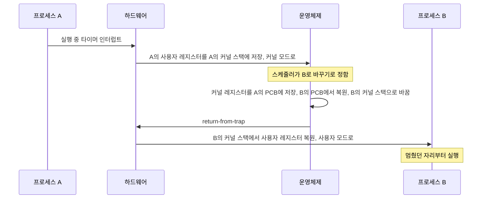

## 컨텍스트 스위칭이란 ?
- 컨텍스트 스위칭(Context Switching)은 운영체제가 CPU에서 돌던 작업(프로세스나 스레드)을 멈추고 다른 작업을 이어 돌리는 일이다
- 멈출 때는 그 작업을 다시 이어 가는 데 필요한 실행 상태를 저장해 두고, 다음 작업은 예전에 저장해 둔 실행 상태를 CPU에 되돌려 놓고 시작한다. 이 실행 상태를 문맥(컨텍스트)이라고 한다
- CPU 하나가 여러 작업을 번갈아 돌릴 수 있는 것은 이 저장과 복원 덕분이고, 바꿀 때마다 비용이 든다

이 노트는 [서버의 동시 처리 방식](../서버의%20동시%20처리%20방식(Server%20Concurrency)/README.md) 노트와 [블로킹과 논블로킹](../블로킹과%20논블로킹(Blocking%20and%20Non-blocking)/README.md) 노트의 TODO에서 나왔다. 블로킹과 논블로킹 노트의 [스레드마다 블로킹 I/O](../블로킹과%20논블로킹(Blocking%20and%20Non-blocking)/README.md#스레드마다-블로킹-io)에서 스레드가 많아지면 운영체제가 스레드를 번갈아 실행하는 비용이 커진다고 했는데, 그 비용이 무엇인지를 여기서 본다.

<br/>

## 단어의 뜻
### 컨텍스트 (Context)
사전적 의미는 맥락, 문맥이다. 어떤 말이나 일이 놓인 앞뒤 사정을 말한다. 같은 문장도 앞뒤 문맥을 알아야 뜻이 통한다.

공학적으로 컨텍스트(문맥)는 작업 하나가 멈춘 자리에서 그대로 다시 이어 가는 데 필요한 실행 상태를 말한다. CPU가 그 작업을 돌리며 쥐고 있던 값들, 곧 어디까지 실행했는지, 계산 중인 값이 무엇인지, 스택 맨 위가 어디인지 같은 정보다. 책을 읽다 덮을 때 몇 쪽 몇째 줄까지 읽었는지 알아야 다시 이어 읽을 수 있는 것처럼, 작업도 앞뒤 사정을 알아야 이어서 실행할 수 있다는 데서 이 이름이 왔다.

### 스위칭 (Switching)
switch의 사전적 의미는 바꾸다, 전환하다. 철도에서 열차가 다른 선로로 가도록 갈림길을 바꾸는 장치도 switch라고 부른다.

공학적으로 컨텍스트 스위칭(Context Switching)은 CPU가 쥐고 있는 문맥을 한 작업의 것에서 다른 작업의 것으로 바꿔 끼우는 일이다. 문맥 교환이라고 옮기기도 한다. 이 노트에서는 컨텍스트 스위칭으로 쓰고, 스레드 전환이나 프로세스 전환처럼 무엇을 바꾸는지 앞에 붙일 때만 전환이라는 말을 쓴다.

<br/>

## 먼저 알아 둘 용어
### 프로세스와 스레드
프로세스(Process)는 실행 중인 프로그램 하나이고, 운영체제가 프로세스마다 메모리 공간을 따로 내준다. 스레드(Thread)는 프로세스 안에서 실제로 명령어를 실행하는 흐름 하나이고, 같은 프로세스의 스레드끼리는 메모리를 함께 쓴다. 자세한 설명과 주방, 요리사 비유는 [서버의 동시 처리 방식 노트의 프로세스](../서버의%20동시%20처리%20방식(Server%20Concurrency)/README.md#프로세스-process)와 [스레드](../서버의%20동시%20처리%20방식(Server%20Concurrency)/README.md#스레드-thread) 부분에 있다. 이 노트에서는 운영체제가 CPU에 올려 돌리는 단위를 통틀어 작업이라고 부른다.

### CPU 하나가 여러 작업을 돌리는 방식
CPU 코어 하나는 한순간에 명령어 흐름 하나만 실행한다. 그런데 컴퓨터에서는 브라우저, 음악 플레이어, 백그라운드 프로그램이 함께 돌아가는 것처럼 보인다. 운영체제가 한 작업을 잠깐 돌리고, 멈추고, 다른 작업을 잠깐 돌리기를 아주 빠르게 되풀이하기 때문이다. OSTEP(Operating Systems: Three Easy Pieces) 6장은 이것을 CPU를 시간으로 나눠 쓴다는 뜻에서 시분할(Time Sharing)이라고 부른다.

[서버의 동시 처리 방식 노트의 동시성](../서버의%20동시%20처리%20방식(Server%20Concurrency)/README.md#동시성-concurrency과-병렬성-parallelism)에서 본 요리사 한 명이 냄비 세 개를 번갈아 젓는 그림이 바로 이것이다. 앞 노트에서는 요리사를 스레드에 빗댔지만, 이 노트에서는 요리사를 CPU 코어로, 냄비를 CPU에 올라갈 작업으로 본다. 주방은 그대로 프로세스다. 컨텍스트 스위칭은 요리사가 냄비 A에서 손을 떼고 냄비 B로 옮겨 가는 그 순간에 해당한다. 코어가 여러 개면 코어마다 따로 이런 번갈아 돌리기를 한다.

### 스케줄러 (Scheduler)
스케줄(Schedule)의 사전적 의미는 일정표다. 운영체제에서 다음에 CPU를 받을 작업을 고르는 부분을 스케줄러라고 부른다. 누구 차례인지 일정을 짜는 역할이라 이 이름이 붙었다. 언제 바꿀지, 누구로 바꿀지는 스케줄러가 정하고, 실제로 문맥을 저장하고 복원하는 일이 컨텍스트 스위칭이다.

### 사용자 모드와 커널 모드
CPU는 실행 권한을 두 단계 이상으로 나눈다. 사용자 모드(User Mode)에서는 일반 프로그램이 돌고, 디스크에 직접 입출력을 요청하는 것 같은 위험한 명령은 할 수 없다. 커널 모드(Kernel Mode)에서는 운영체제가 돌고 모든 명령을 쓸 수 있다(OSTEP 6.2절). 커널(Kernel)의 사전적 의미는 알맹이, 씨앗으로, 운영체제의 가장 안쪽 핵심이라는 뜻에서 왔다.

### 시스템 호출 (System Call)
일반 프로그램이 파일을 읽거나 네트워크로 데이터를 보내려면 운영체제에 부탁해야 한다. 이 부탁이 시스템 호출이다. 프로그램은 트랩(Trap)이라는 특별한 명령을 실행해 커널 모드로 들어가고, 운영체제가 일을 마치면 트랩에서 돌아가는 명령(return-from-trap)으로 사용자 모드로 돌아온다. 트랩의 사전적 의미는 덫으로, 실행 흐름이 운영체제 쪽으로 걸려 들어간다는 데서 왔다. 들어갈 때 하드웨어는 사용자 프로그램이 쓰던 레지스터(CPU 안의 저장 칸, 다음 섹션에서 본다) 일부를 운영체제가 작업마다 따로 둔 스택(커널 스택)에 저장했다가, 돌아올 때 되돌린다. 인터럽트(뒤에서 본다)가 걸렸을 때도 같은 방식으로 커널 모드에 들어가고 return-from-trap으로 돌아온다.

<br/>

## 문맥에 들어가는 것
### 레지스터 (Register)
사전적 의미는 기록부, 등록부다. 공학적으로는 CPU 안에 있는 아주 작고 빠른 저장 칸을 말한다. CPU는 메모리에서 값을 레지스터로 가져와 계산하고, 결과도 일단 레지스터에 적는다. 계산 중인 값을 그때그때 적어 두는 기록부라는 뜻으로 이어진다.

작업이 멈추는 순간 레지스터에는 그 작업이 계산하던 중간값이 들어 있다. 다른 작업이 CPU를 쓰면 이 값들이 덮이므로, 바꾸기 전에 어딘가에 옮겨 적어야 한다.

### 프로그램 카운터 (Program Counter)
counter는 세는 것, 계수기라는 뜻이다. 공학적으로 프로그램 카운터(PC)는 다음에 실행할 명령어가 메모리 어디에 있는지 가리키는 레지스터다. 명령어를 하나 실행할 때마다 다음 자리로 넘어가며 실행 위치를 세어 나간다는 데서 이 이름이 왔다. x86 계열에서는 명령어 포인터(Instruction Pointer)라고 부른다.

문맥 가운데 가장 중요한 값이다. 이 값을 잃으면 작업이 어디까지 실행됐는지 알 수 없다.

### 스택 포인터 (Stack Pointer)
pointer는 가리키는 것이라는 뜻이다. 공학적으로 스택 포인터는 그 작업의 호출 스택에서 지금 맨 위가 어디인지 가리키는 레지스터다. [스택 프레임 노트의 빠르다](../스택%20프레임(Stack%20Frame)/README.md#빠르다)에서 본, 맨 위가 어디인지 가리키는 표시 하나가 바로 이것이다. 스택에는 아직 끝나지 않은 함수 호출의 프레임이 쌓여 있으므로, 스택 포인터를 되돌려 놓으면 함수 호출의 흐름도 그대로 이어진다.

### 그 밖의 상태와 보관 장소
이 밖에 계산 결과의 부호나 넘침 여부 같은 상태 표시, 그 작업의 메모리 주소를 실제 메모리 위치로 바꾸는 표가 어디 있는지 같은 정보도 문맥에 들어간다. 정확히 어떤 레지스터를 저장하는지는 CPU와 운영체제마다 다르다.

운영체제는 이 문맥을 작업마다 하나씩 둔 관리용 자료 구조에 보관한다. 프로세스용은 프로세스 제어 블록(PCB, Process Control Block), 스레드용은 스레드 제어 블록(TCB, Thread Control Block)이라고 부른다. OSTEP 26장의 설명이다.

요리사로 비유하면, 냄비를 바꾸기 전에 레시피 몇째 줄까지 했는지(프로그램 카운터), 지금 손에 든 재료와 계량해 둔 양(레지스터)을 냄비마다 붙은 메모지에 적어 두는 것과 같다. 그 메모지가 PCB나 TCB다. 다시 그 냄비로 돌아오면 메모지를 읽고 멈춘 자리부터 잇는다.

<br/>

## 운영체제는 언제 바꾸나
작업이 CPU에서 돌고 있는 동안 운영체제는 CPU 위에 있지 않다. 그래서 운영체제가 바꾸기를 하려면 먼저 CPU를 되찾아야 한다. OSTEP 6장은 되찾는 길을 크게 두 가지로 설명한다.

### 작업이 스스로 내줄 때 (입출력 대기와 블로킹)
작업이 파일을 읽거나 네트워크로 데이터를 받으려고 시스템 호출을 하면 운영체제로 넘어간다. 그 일이 바로 끝나지 않으면 작업은 결과가 올 때까지 기다려야 한다. 이것이 [블로킹과 논블로킹 노트](../블로킹과%20논블로킹(Blocking%20and%20Non-blocking)/README.md#기다리는-동안-운영체제가-하는-일)에서 본 블로킹이다. 운영체제는 그 작업을 대기 상태로 옮기고, 준비 상태의 다른 작업으로 바꾼다. 입출력이 끝나면 장치가 인터럽트(뒤에서 본다)로 알리고, 운영체제는 기다리던 작업을 다시 준비 상태로 돌린다(OSTEP 7.8절). 이때 바로 그 작업으로 바꿀지는 스케줄러가 정한다.

오븐에 빵을 넣은 요리사가 기다리는 동안 다른 냄비로 옮겨 가는 것과 같다.

옛 운영체제 중에는 이렇게 작업이 스스로 내줄 때만 바꾸는 방식(협력적 방식, Cooperative)을 쓴 것이 있다. 이 방식은 작업이 무한 반복에 빠져 시스템 호출을 한 번도 하지 않으면 운영체제가 CPU를 되찾을 길이 없다. OSTEP은 그때 남는 방법이 재부팅뿐이라고 쓴다.

### 운영체제가 빼앗을 때 (타이머 인터럽트와 시간 할당량)
인터럽트(Interrupt)의 사전적 의미는 가로막다, 말을 끊고 끼어들다. 공학적으로는 하드웨어가 CPU에 신호를 보내 지금 하던 일을 멈추고 운영체제의 처리 코드를 먼저 실행하게 하는 것을 말한다.

OSTEP의 설명에서 운영체제는 부팅할 때 타이머 장치가 일정한 간격으로 인터럽트를 걸도록 설정해 둔다. 타이머 인터럽트(Timer Interrupt)가 걸리면 돌던 작업은 멈추고 운영체제가 CPU를 되찾는다. 작업이 협조하지 않아도 운영체제가 주기적으로 CPU를 되찾을 수 있게 해 주는 장치다. 이렇게 운영체제가 작업에게서 CPU를 빼앗는 방식을 선점(Preemption)이라고 한다. 선점의 사전적 의미는 남보다 먼저 차지함이다.

작업 하나에 한 번에 돌릴 시간을 정해 두고, 그 시간이 다 되면 다음 작업으로 바꾸는 방식이 라운드 로빈(Round Robin) 스케줄링이다. 이때 한 번에 주는 시간을 시간 할당량(Time Slice 또는 Quantum)이라고 한다. OSTEP 7.7절의 예시처럼 타이머가 10밀리초마다 울린다면 시간 할당량은 10밀리초, 20밀리초처럼 그 배수로 정한다. 실제 운영체제가 몇 밀리초를 쓰는지, 타이머를 늘 같은 간격으로 거는지는 운영체제와 설정마다 다르다(확인 필요).

주방에 모래시계를 두고, 모래가 다 떨어지면 하던 냄비가 끝나지 않았어도 다음 냄비로 옮겨 가는 것과 같다.

Node.js 문서의 `process.resourceUsage()` 설명도 컨텍스트 스위칭 횟수를 이 두 갈래로 나눈다. `voluntaryContextSwitches` 는 작업이 시간 할당량을 다 쓰기 전에 스스로 CPU를 내준 횟수(보통 무언가를 기다리느라)이고, `involuntaryContextSwitches` 는 더 우선순위가 높은 작업이 준비되었거나 시간 할당량을 넘겨서 바뀐 횟수다.

<br/>

## 저장과 복원 과정
OSTEP 6장은 프로세스 A에서 B로 바꾸는 과정을 아래 순서로 설명한다.

1. A가 돌던 중 타이머 인터럽트가 걸린다.
2. 하드웨어가 A의 사용자 프로그램이 쓰던 레지스터(사용자 레지스터)를 A의 커널 스택에 저장하고 커널 모드로 넘어간다.
3. 운영체제의 인터럽트 처리 코드가 돈다. 스케줄러가 A 대신 B를 돌리기로 정한다.
4. 운영체제가 A를 위해 돌던 커널 코드의 레지스터 값(커널 레지스터)을 A의 PCB에 저장하고, B의 PCB에서 B의 값을 꺼내 레지스터에 넣는다. 스택 포인터도 B의 커널 스택을 가리키게 바꾼다.
5. 운영체제가 return-from-trap을 실행한다. 이 명령은 지금 커널 스택에 있는 값을 레지스터로 되돌리는데, 스택이 B의 것으로 바뀌었으니 B의 사용자 레지스터가 되돌아온다. 사용자 모드로 내려가 B가 멈췄던 자리부터 실행된다.



OSTEP은 이 과정에 저장과 복원이 두 번 들어 있다는 점을 짚는다. 2단계는 인터럽트가 걸릴 때 하드웨어가 A의 사용자 레지스터를 커널 스택에 자동으로 저장하는 것이다. 4단계는 운영체제가 B로 바꾸기로 정한 뒤, A를 위해 돌던 커널 코드의 레지스터를 A의 PCB에 직접 저장하는 것이다. 저장하는 주체도, 저장하는 대상과 장소도 다르다. 4단계에서 커널 스택을 바꾸기 때문에, 운영체제는 A에서 들어왔다가 마치 처음부터 B에서 들어온 것처럼 B로 돌아간다.

<br/>

## 바꿀 때 드는 비용
### 직접 비용
바꾸는 동안 CPU는 어느 작업의 일도 하지 않는다. 레지스터를 저장하고 복원하고, 스케줄러가 다음 작업을 고르는 시간은 모두 운영체제가 쓰는 시간이다. 이것을 직접 비용이라고 부를 수 있다.

OSTEP 6장은 lmbench라는 측정 도구로 잰 값을 소개한다. 1996년 200MHz CPU에서 Linux 1.3.37을 돌렸을 때 시스템 호출은 약 4마이크로초, 컨텍스트 스위칭은 약 6마이크로초가 걸렸고, 2~3GHz CPU를 쓰는 요즘 시스템은 거의 10배 빨라져 1마이크로초 아래로 나온다고 쓴다. 다만 이 숫자는 그 책이 든 측정 사례이고, 지금 내 컴퓨터의 값은 CPU, 운영체제, 측정 방법마다 다르다(직접 재지 못했다).

### 간접 비용 (캐시와 TLB가 식는다)
OSTEP 7장은 비용이 레지스터 몇 개를 저장하고 복원하는 데서만 나오지 않는다고 쓴다. 작업이 돌면서 CPU 캐시, TLB, 분기 예측기(다음에 어느 쪽 코드로 갈지 미리 짐작해 두는 장치, Branch Predictor) 같은 칩 안의 하드웨어에 그 작업에 맞는 상태가 쌓이는데, 다른 작업으로 바꾸면 이 상태가 밀려나고 새 작업의 상태를 다시 채워야 해서 눈에 띄는 성능 비용이 생길 수 있다는 것이다.

CPU 캐시는 메모리에서 읽은 데이터의 사본을 CPU 가까이에 두는 저장소다([캐싱 노트](../캐싱(Caching)/README.md#왜-필요할까)). 한 작업이 오래 돌면 그 작업이 자주 쓰는 데이터가 캐시에 차 있어 빠르다. 다른 작업으로 바뀌면 새 작업의 데이터는 캐시에 없거나 일부만 있어서 처음 한동안 캐시 미스가 잦다. 이렇게 캐시가 새 작업에 맞게 다시 채워지기 전의 상태를 흔히 캐시가 식었다(Cold Cache)고 표현한다.

TLB(Translation Lookaside Buffer)는 주소 변환용 캐시다. 이름을 풀면 변환(Translation) 결과를 곁에서 먼저 들여다보는(Lookaside) 버퍼라는 뜻이다. OSTEP 19장은 lookaside buffer가 캐시의 옛 이름이었다고 설명하고, 더 알맞은 이름은 주소 변환 캐시라고 쓴다. 프로그램이 쓰는 메모리 주소(가상 주소)를 실제 메모리 위치로 바꾸려면 원래는 메모리에 있는 표(페이지 테이블)를 찾아봐야 하는데, 최근에 쓴 변환 결과를 CPU 안에 담아 두어 그 일을 줄인다(OSTEP 19장). 가상 메모리와 페이지 테이블 자체는 이 노트에서 깊게 다루지 않는다.

요리사로 비유하면, 냄비 A 옆에 늘어놓았던 양념과 도구를 치우고 냄비 B에 쓸 것을 다시 꺼내 놓는 시간이다. 메모지를 바꿔 드는 시간(직접 비용)만 비용이 아니라, 이쪽 비용도 작지 않을 수 있다.

### 시간 할당량과 비용의 줄다리기
시간 할당량이 짧으면 작업들이 자주 번갈아 돌아서 사람이 느끼는 반응은 빨라진다. 대신 바꾸는 횟수가 늘어 비용이 차지하는 몫이 커진다. OSTEP 7.7절은 가정한 숫자로 이를 보여 준다. 시간 할당량이 10밀리초이고 한 번 바꾸는 데 1밀리초가 든다면 시간의 약 10%를 바꾸는 데 쓰고, 시간 할당량을 100밀리초로 늘리면 1% 아래로 줄어든다. 분할 상환(Amortization)의 사전적 의미는 빚을 여러 번에 나눠 갚는 것이다. 여기서는 한 번 바꿀 때 드는 고정 비용을 긴 실행 시간에 나눠 실어, 전체에서 그 비용이 차지하는 몫을 줄인다는 뜻으로 쓴다. 이 1밀리초는 계산을 쉽게 하려고 잡은 가정이지 실제 측정값이 아니다.

<br/>

## 프로세스 전환과 스레드 전환
OSTEP 26장은 같은 프로세스 안의 스레드끼리 바꾸는 것도 프로세스끼리 바꾸는 것과 거의 같다고 설명한다. 한 스레드의 레지스터를 TCB에 저장하고 다른 스레드의 레지스터를 복원한다. 스레드마다 자기 프로그램 카운터, 레지스터, 스택이 따로 있기 때문이다.

큰 차이는 하나다. 같은 프로세스의 스레드는 주소 공간(메모리 공간)을 함께 쓰므로, 바꿀 때 페이지 테이블을 바꾸지 않아도 된다. 프로세스끼리 바꾸면 주소 공간이 달라지므로 페이지 테이블도 바꿔야 하고, 앞 작업의 주소 변환 결과가 담긴 TLB도 그대로 쓸 수 없다. OSTEP 19.5절은 이 문제를 바꿀 때마다 TLB를 비우는 방법으로 풀 수 있지만, 그러면 새 프로세스가 돌 때마다 TLB 미스를 다시 겪는다고 쓴다. 그래서 TLB 항목마다 어느 주소 공간의 것인지 표시인 주소 공간 식별자(ASID, Address Space Identifier)를 붙여 비우지 않고 함께 담아 두는 하드웨어도 있다.

정리하면 스레드 전환은 문맥을 바꾸되 주소 공간은 그대로 두고, 프로세스 전환은 주소 공간까지 바꾼다. 그래서 일반적으로 스레드 전환이 더 가볍다고 설명한다. 같은 프로세스의 스레드는 데이터도 함께 쓰므로 캐시에 남은 데이터를 다음 스레드가 이어 쓸 가능성도 있다. 다만 얼마나 가벼운지는 하드웨어와 운영체제, 두 스레드가 쓰는 데이터에 따라 달라 단정하기 어렵다.

같은 주방 안에서 요리사가 냄비만 바꾸는 것과, 아예 다른 주방으로 건너가 그 주방의 냉장고 배치부터 다시 익히는 것의 차이다.

<br/>

## 모드 전환과는 다르다
### 무엇이 다른가
[먼저 알아 둘 용어](#사용자-모드와-커널-모드)에서 본 사용자 모드와 커널 모드 사이를 오가는 일을 모드 전환(Mode Switch)이라고 한다. 모드 전환은 같은 작업이 권한만 바꿔 운영체제 코드를 잠깐 실행하는 것이다. 시스템 호출이 바로 끝나면 운영체제는 같은 작업으로 돌아간다. 작업은 바뀌지 않았으므로 컨텍스트 스위칭이 아니다. 반면 시스템 호출이 블로킹되거나 타이머 인터럽트가 걸린 김에 스케줄러가 다른 작업을 고르면, 그때 비로소 컨텍스트 스위칭이 일어난다. 모드 전환은 컨텍스트 스위칭의 앞뒤에 늘 끼어 있지만, 모드 전환이 일어났다고 늘 컨텍스트 스위칭이 일어나는 것은 아니다.

요리사가 출입증을 받아 직접 창고에 다녀오는 것이 모드 전환이다. 권한만 잠깐 바뀌었을 뿐 요리사는 여전히 같은 냄비를 맡고 있다. 창고에 재료가 없어 기다리게 되자 그사이 다른 냄비로 옮겨 가면 그때가 컨텍스트 스위칭이다.

| 구분 | 시스템 호출 (모드 전환만) | 스레드 전환 | 프로세스 전환 |
| --- | --- | --- | --- |
| 실행하는 작업 | 그대로 | 같은 프로세스의 다른 스레드로 | 다른 프로세스로 |
| 레지스터 저장과 복원 | 하드웨어가 커널 스택에 일부 저장했다가 되돌림 | 앞 스레드 것을 저장하고 다음 스레드 것을 복원 | 앞 프로세스 것을 저장하고 다음 프로세스 것을 복원 |
| 주소 공간 (페이지 테이블) | 그대로 | 그대로 | 바뀜 |
| 캐시와 TLB | 운영체제 코드가 일부를 씀 | 데이터를 함께 쓰면 일부 이어 쓸 수 있음 | TLB를 비우거나 ASID로 구분해야 함 |

<br/>

## 스레드를 많이 만들면 왜 느려질까
### 코어보다 많은 계산 스레드
계산만 하는 스레드가 코어 수보다 많으면, 한순간에 실제로 도는 스레드는 여전히 코어 수만큼이다. 나머지는 준비 상태에서 차례를 기다린다. 스레드를 늘려도 전체 계산 양은 같은데 번갈아 돌리는 횟수만 늘어나니, 늘어난 컨텍스트 스위칭과 식은 캐시만큼 오히려 손해다. 요리사(코어)는 한 명인데 맡길 냄비(스레드)를 열 개로 늘리면 요리는 빨라지지 않고 냄비 사이를 오가는 시간만 늘어나는 것과 같다.

### 요청마다 스레드 하나인 서버
[서버의 동시 처리 방식 노트의 멀티 스레드](../서버의%20동시%20처리%20방식(Server%20Concurrency)/README.md#멀티-스레드-multi-thread) 서버는 연결마다 스레드를 하나씩 두고, 각 스레드는 블로킹 입출력을 쓴다. 스레드가 데이터베이스 대답을 기다리며 블로킹될 때마다, 그리고 대답이 와서 다시 깨어나 차례를 받을 때마다 운영체제는 작업을 바꾼다. 연결이 수천 개면 이런 전환도 그만큼 잦아지고, 스레드마다 자기 데이터와 스택을 쓰니 캐시에 담길 몫도 나눠 가져야 한다.

### 이벤트 루프가 이것을 줄이는 이유
[이벤트 루프](../서버의%20동시%20처리%20방식(Server%20Concurrency)/README.md#이벤트-루프-event-loop)는 스레드 하나가 여러 연결을 맡는다. 소켓을 논블로킹으로 두고, I/O 다중화로 준비된 소켓만 골라 처리한다([블로킹과 논블로킹 노트의 이벤트 루프와 논블로킹 I/O](../블로킹과%20논블로킹(Blocking%20and%20Non-blocking)/README.md#이벤트-루프와-논블로킹-io)). 처리할 일이 남아 있는 동안 이 스레드는 블로킹되지 않으니 스스로 CPU를 내줄 일이 적다. 한 연결의 일을 마치면 운영체제를 거치지 않고 같은 스레드 안에서 다음 연결의 일로 넘어간다. 기다리는 자리는 준비된 소켓이 생길 때까지 기다리는 한 곳뿐이다.

요청마다 스레드가 하나씩이면 요청을 바꿀 때마다 운영체제가 문맥을 바꿔야 하지만, 이벤트 루프는 같은 스레드 안에서 다음 일을 꺼내 오는 것으로 대신한다. 컨텍스트 스위칭이 아예 없어지는 것은 아니다. 다른 프로그램과 CPU를 나눠 쓰는 한 타이머 인터럽트에 의한 전환은 계속 일어나고, 할 일이 없으면 이벤트 루프 스레드도 기다리며 잠든다. 줄어드는 것은 요청을 바꿀 때마다 생기던 전환이다.

<br/>

## 직접 관찰해 보기
윈도우는 성능 카운터로 컨텍스트 스위칭 횟수를 보여 준다. PowerShell에서 아래 명령으로 시스템 전체의 1초당 컨텍스트 스위칭 횟수, 스레드 수, 프로세스 수를 1초 간격으로 다섯 번 읽었다.

```powershell
Get-Counter '\System\Context Switches/sec','\System\Threads','\System\Processes' -SampleInterval 1 -MaxSamples 5
```

Windows 11 Pro, 8코어 8 논리 프로세서 CPU(하이퍼스레딩 없음), 평소 작업 중인 상태에서 2026-10-27에 실행했다. 출력을 읽기 쉽게 정리하면 아래와 같다.

```text
context switches/sec=111,495  threads=8,440  processes=503
context switches/sec=103,158  threads=8,434  processes=502
context switches/sec=99,600  threads=8,457  processes=509
context switches/sec=111,743  threads=8,488  processes=511
context switches/sec=99,706  threads=8,477  processes=513
```

특별히 무거운 일을 하지 않는데도 스레드가 8천 개가 넘고, 코어 8개에서 1초에 10만 번 안팎으로 작업을 바꾸고 있었다. 대부분의 스레드는 대기 상태로 잠들어 있다가 일이 생길 때 잠깐 깨어나 돌고 다시 잠든다. 숫자는 켜 둔 프로그램과 하는 일에 따라 크게 달라진다.

한 프로세스만의 전환 횟수를 Node.js의 `process.resourceUsage()` 로 보려 했지만, 이 환경(Node.js v24.22.1, 윈도우)에서는 `voluntaryContextSwitches` 와 `involuntaryContextSwitches` 가 둘 다 0으로 나왔다. Node.js 문서에 따르면 이 두 값은 윈도우에서 지원하지 않는다. 스레드 수를 늘려 처리 시간을 재는 실험도 해 봤지만, Node.js의 워커 스레드는 스레드마다 자바스크립트 엔진을 따로 띄워서 엔진 준비 시간이 섞여 컨텍스트 스위칭 비용만 떼어 볼 수 없었다. 그래서 노트에는 싣지 않았다.

<br/>

## 함께 보면 좋은 노트
- [서버의 동시 처리 방식](../서버의%20동시%20처리%20방식(Server%20Concurrency)/README.md)은 멀티 프로세스, 멀티 스레드, 이벤트 루프를 비교한다.
- [블로킹과 논블로킹](../블로킹과%20논블로킹(Blocking%20and%20Non-blocking)/README.md)은 작업이 블로킹될 때 운영체제가 상태를 어떻게 옮기는지 다룬다.
- [스택 프레임](../스택%20프레임(Stack%20Frame)/README.md)은 스택 포인터가 가리키는 호출 스택의 구조를 다룬다.
- [캐싱](../캐싱(Caching)/README.md)은 캐시 적중과 캐시 미스, 지역성을 다룬다.

<br/>

## 참고 자료
- Remzi H. Arpaci-Dusseau, Andrea C. Arpaci-Dusseau, [Operating Systems: Three Easy Pieces](https://pages.cs.wisc.edu/~remzi/OSTEP/) (Version 1.10)
  - 6장 [Mechanism: Limited Direct Execution](https://pages.cs.wisc.edu/~remzi/OSTEP/cpu-mechanisms.pdf): 사용자 모드와 커널 모드, 시스템 호출, 협력적 방식과 타이머 인터럽트, 저장과 복원 과정, lmbench 측정값
  - 7장 [Scheduling: Introduction](https://pages.cs.wisc.edu/~remzi/OSTEP/cpu-sched.pdf): 라운드 로빈과 시간 할당량, 분할 상환, 캐시와 TLB 같은 간접 비용, 입출력과 블로킹
  - 19장 [Paging: Faster Translations (TLBs)](https://pages.cs.wisc.edu/~remzi/OSTEP/vm-tlbs.pdf): 컨텍스트 스위칭 때 TLB 문제, ASID
  - 26장 [Concurrency: An Introduction](https://pages.cs.wisc.edu/~remzi/OSTEP/threads-intro.pdf): TCB, 스레드 전환과 프로세스 전환의 차이
- Node.js v24 문서, [process.resourceUsage()](https://nodejs.org/docs/latest-v24.x/api/process.html#processresourceusage): 자발적, 비자발적 컨텍스트 스위칭 횟수와 윈도우 미지원

<br/>

## 더 볼 것 (TODO)
- 프로세스와 스레드 깊게 보기 (프로세스의 상태, 생성과 종료, 스레드마다 스택이 따로 있는 이유)
- 스케줄링 알고리즘 (FIFO, SJF, 라운드 로빈, 다단계 피드백 큐)
- 리눅스 CFS, 윈도우 스케줄러처럼 실제 운영체제의 스케줄러 내부와 시간 할당량 값
- 실제 커널의 컨텍스트 스위칭 코드 (xv6의 swtch, 리눅스의 switch_to)
- 가상 메모리와 페이지 테이블, TLB의 구조
- 인터럽트와 인터럽트 처리 과정, 인터럽트 중에 또 인터럽트가 오면
- 멀티코어에서 작업을 어느 코어에 둘지 (CPU 친화도, Affinity)
- [사용자 수준 스레드와 코루틴이 운영체제 없이 문맥을 바꾸는 방법](../코루틴과%20async-await(Coroutine%20and%20async-await)/README.md)
- 컨텍스트 스위칭 비용을 직접 재는 방법 (lmbench, 리눅스 perf)
