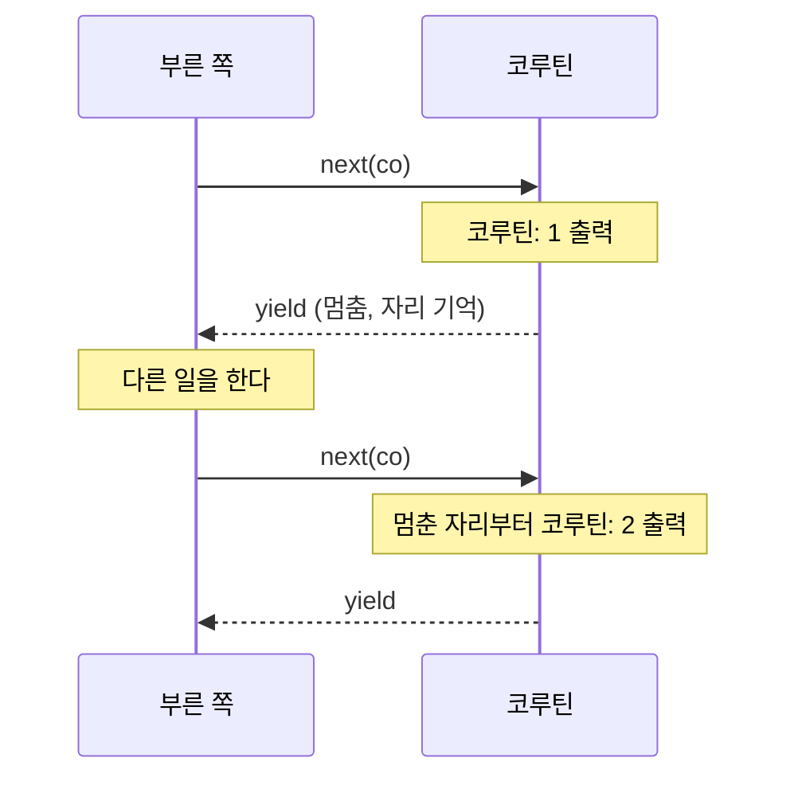
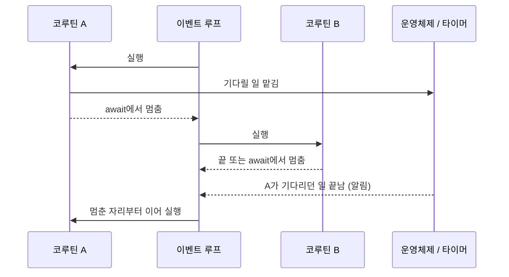

## 코루틴이란 ?
- 코루틴(Coroutine)은 실행 도중에 스스로 멈췄다가, 나중에 멈춘 자리부터 이어서 실행할 수 있는 함수다
- 보통 함수는 한 번 불리면 끝까지 실행하고 돌아오지만, 코루틴은 멈출 때 어디까지 했는지와 지역 변수를 남겨 두었다가 다시 불리면 그 자리부터 잇는다
- async/await는 이 성질을 이용해, 기다리는 일이 섞인 비동기 코드를 위에서 아래로 읽히는 동기 코드처럼 쓰게 해 주는 문법이다

이 노트는 세 노트의 TODO에서 나왔다. [서버의 동시 처리 방식](../서버의%20동시%20처리%20방식(Server%20Concurrency)/README.md)의 이벤트 루프, [블로킹과 논블로킹](../블로킹과%20논블로킹(Blocking%20and%20Non-blocking)/README.md)의 비동기 + 논블로킹, [컨텍스트 스위칭](../컨텍스트%20스위칭(Context%20Switching)/README.md)의 운영체제가 문맥을 바꾸는 과정을 먼저 읽고 오면 편하다. 이 노트에서는 그 내용을 다시 설명하지 않고 링크로 잇는다.

<br/>

## 단어의 뜻
### 루틴과 서브루틴 (Routine, Subroutine)
루틴(Routine)의 사전적 의미는 늘 하는 일, 정해진 순서대로 하는 일이다. 공학적으로는 정해진 일을 하는 명령어 묶음, 곧 함수를 말한다.

서브루틴(Subroutine)은 아래(sub)에 딸린 루틴이라는 뜻이다. 공학적으로는 다른 루틴이 불러 쓰는 함수를 말한다. 부른 쪽이 위, 불린 쪽이 아래에 놓이는 관계다. 서브루틴은 맨 위에서 시작해 끝까지 실행하고 부른 쪽으로 돌아간다. 우리가 평소에 쓰는 함수가 거의 다 서브루틴이다.

### 코루틴 (Coroutine)
co-는 함께, 서로라는 뜻의 접두사다. 코루틴은 서로 대등하게 주고받는 루틴이라는 뜻이다.
공학적으로는 실행을 여러 번 멈췄다가 이어 갈 수 있는 루틴을 말한다. 서브루틴은 부른 쪽 아래에 딸려서 한 번 들어가면 끝날 때까지 나오지 않는다. 코루틴은 중간에 실행을 상대에게 넘기고, 상대가 다시 넘겨주면 이어서 실행한다. 위아래가 아니라 서로 차례를 주고받는 관계라서 함께(co)라는 말이 붙었다. 다만 이 노트에서 볼 파이썬과 자바스크립트의 코루틴은 멈추면 늘 자기를 부른 쪽으로 돌아간다. 이렇게 돌아갈 곳이 정해진 형태를 비대칭 코루틴(Asymmetric Coroutine)이라고 부르기도 한다(확인 필요).

파이썬 용어집은 코루틴을 서브루틴을 일반화한 것으로 설명한다. 서브루틴은 한 지점으로 들어가 다른 한 지점에서 나오지만, 코루틴은 여러 지점에서 들어가고, 나오고, 다시 이어 갈(resume) 수 있다고 쓴다.

용어는 멜빈 콘웨이(Melvin Conway)가 1950년대 말에 만들었고 1963년 논문에 실렸다는 설명이 흔하다. 원문은 확인하지 못했다(확인 필요).

### yield
사전적 의미는 내주다, 양보하다다. 도로 표지판의 YIELD는 다른 차에 길을 양보하라는 뜻이다.
공학적으로 코루틴에서 yield는 지금 실행을 멈추고 차례를 넘기는 동작을 말한다. 값을 내주는 뜻과 차례를 양보하는 뜻이 함께 들어 있다. 파이썬과 자바스크립트의 제너레이터는 `yield` 라는 키워드로 이 동작을 한다.

### async와 await
async는 asynchronous(비동기)를 줄인 말이다. 비동기의 뜻은 [블로킹과 논블로킹 노트의 비동기](../블로킹과%20논블로킹(Blocking%20and%20Non-blocking)/README.md#비동기-asynchronous)에서 다뤘다. await의 사전적 의미는 기다리다다.
공학적으로 async는 이 함수가 중간에 멈출 수 있는 비동기 함수라는 표시이고, await는 이 자리에서 결과가 나올 때까지 이 함수의 실행을 멈추라는 표시다. 멈추는 것은 이 함수 하나이지, 프로그램 전체나 스레드가 아니다. 이 차이는 뒤의 [await는 스레드를 멈추지 않는다](#await는-스레드를-멈추지-않는다)에서 본다.

<br/>

## 서브루틴과 코루틴의 차이
### 서브루틴은 끝까지 간다
서브루틴을 부르면 [스택 프레임 노트의 호출하면 쌓인다](../스택%20프레임(Stack%20Frame)/README.md#호출하면-쌓인다)에서 본 대로 호출 스택에 프레임이 하나 쌓인다. 함수가 끝나면 프레임이 통째로 빠지고 지역 변수도 사라진다. 다시 부르면 처음부터 새로 시작한다.

심부름과 같다. 심부름을 보내면 다녀올 때까지 기다리고, 다녀온 뒤에는 그 심부름은 끝이다. 다음에 또 시키면 처음부터 다시 간다.

### 코루틴은 멈췄다가 잇는다
코루틴은 yield에서 멈출 때 어디까지 실행했는지와 지역 변수를 남겨 둔다. 그리고 부른 쪽으로 돌아간다. 부른 쪽이 다시 이어 달라고 하면 멈춘 자리 바로 다음부터 실행한다.

책갈피를 꽂고 책을 덮는 것과 같다. 덮은 사이에 다른 일을 하다가 다시 펴면 책갈피가 있는 쪽부터 읽는다. 처음부터 다시 읽지 않는다.

파이썬 제너레이터로 둘을 비교했다. 제너레이터 자체는 [파이썬 17장 제너레이터](../../Python/17_이터레이터와%20제너레이터(Iterator%20and%20Generator)/README.md#제너레이터-generator)에서 다뤘다. 여기서는 제너레이터를 가장 단순한 코루틴으로 보고 쓴다.

```python
def subroutine():
    print("서브루틴: 1")
    print("서브루틴: 2")
    return "끝"

def coroutine():
    print("코루틴: 1")
    yield
    print("코루틴: 2")
    yield

print(subroutine())
co = coroutine()
next(co)
print("호출한 쪽이 다른 일을 한다")
next(co)
```

```text
서브루틴: 1
서브루틴: 2
끝
코루틴: 1
호출한 쪽이 다른 일을 한다
코루틴: 2
```

서브루틴은 한 번 불리자 두 줄을 다 찍고 끝났다. 코루틴은 `코루틴: 1` 을 찍고 yield에서 멈춰 부른 쪽으로 돌아갔고, 부른 쪽이 자기 일을 한 뒤 `next(co)` 로 다시 넘겨주자 멈춘 자리부터 `코루틴: 2` 를 찍었다. 실행 흐름이 두 함수 사이를 오갔다.



### 왜 이게 쓸모 있을까
멈췄다가 잇는 함수가 있으면, 기다려야 하는 일 앞에서 그 함수만 멈춰 두고 다른 일을 할 수 있다. 기다림이 끝나면 멈춘 자리부터 잇는다. [서버의 동시 처리 방식 노트](../서버의%20동시%20처리%20방식(Server%20Concurrency)/README.md#서버의-일은-대부분-기다리기다)에서 서버의 일은 대부분 기다리기라고 했다. 요청 하나를 코루틴 하나로 처리하면, 기다리는 요청은 멈춰 두고 다른 요청을 처리하는 일을 함수 모양 그대로 쓸 수 있다. 뒤에서 볼 async/await가 이 생각을 문법으로 만든 것이다.

<br/>

## 협력적 멀티태스킹과 선점형 멀티태스킹
### 두 방식
멀티태스킹(Multitasking)은 여러 작업(task)을 번갈아 실행해 함께 진행되는 것처럼 보이게 하는 일이다. 번갈아 실행하려면 언젠가 지금 작업을 멈추고 다음 작업으로 넘어가야 한다. 누가 그 시점을 정하느냐에 따라 두 방식으로 나뉜다.

협력적 멀티태스킹(Cooperative Multitasking)은 작업이 스스로 차례를 넘길 때만 다음 작업으로 넘어가는 방식이다. cooperative의 사전적 의미는 협력하는, 협조하는이다. 모든 작업이 알아서 차례를 넘겨 주는 협조가 있어야 굴러간다는 뜻에서 이 이름이 왔다. 코루틴은 yield나 await로 스스로 멈출 때만 차례를 넘기므로 이 방식이다. Lua 공식 매뉴얼도 코루틴을 협력적 멀티스레딩(collaborative multithreading)이라고 부르고, 멀티스레드 시스템의 스레드와 달리 코루틴은 yield 함수를 명시적으로 부를 때만 실행을 멈춘다고 쓴다.

선점형 멀티태스킹(Preemptive Multitasking)은 작업이 원하지 않아도 바깥에서 차례를 빼앗는 방식이다. 선점(Preemption)의 사전적 의미는 남보다 먼저 차지함이다. 운영체제가 타이머 인터럽트로 스레드에게서 CPU를 되찾는 것이 이 방식이고, [컨텍스트 스위칭 노트의 운영체제가 빼앗을 때](../컨텍스트%20스위칭(Context%20Switching)/README.md#운영체제가-빼앗을-때-타이머-인터럽트와-시간-할당량)에서 다뤘다. 같은 노트의 [작업이 스스로 내줄 때](../컨텍스트%20스위칭(Context%20Switching)/README.md#작업이-스스로-내줄-때-입출력-대기와-블로킹)에서 본 옛 운영체제의 협력적 방식이 운영체제 수준의 협력적 멀티태스킹이다. 코루틴은 같은 생각을 한 프로그램 안에서 쓰는 셈이다.

회의에 빗대면, 협력적 방식은 발언자가 말을 마치고 스스로 마이크를 넘기는 회의다. 선점형은 사회자가 시간을 재다가 시간이 다 되면 마이크를 꺼 버리는 회의다.

### 코드로 보기: 차례를 넘기는 작업들
제너레이터 몇 개를 줄 세워 두고 하나씩 이어 실행하는 아주 작은 스케줄러를 만들었다. 스케줄러는 작업을 줄 앞에서 꺼내 한 번 이어 실행하고, 작업이 yield로 멈추면 다시 줄 끝에 세운다.

```python
from collections import deque

def task(name, count):
    for i in range(1, count + 1):
        print(f"{name} {i}번째 일")
        yield  # 여기서 스스로 차례를 넘긴다

queue = deque([task("A", 3), task("B", 2)])
while queue:
    t = queue.popleft()
    try:
        next(t)          # 멈춘 자리부터 이어서 실행
        queue.append(t)  # 다시 줄 끝에 세운다
    except StopIteration:
        pass             # 다 끝난 작업은 버린다
```

```text
A 1번째 일
B 1번째 일
A 2번째 일
B 2번째 일
A 3번째 일
```

스레드를 하나도 만들지 않았는데 A와 B가 번갈아 진행됐다. 차례를 바꾼 것은 운영체제가 아니라 위의 while 문 몇 줄이다.

### 협조하지 않는 작업이 있으면
협력적 방식은 모두가 협조할 때만 공평하다. 한 작업이 yield 없이 오래 일하면 다른 작업은 그동안 차례를 받지 못한다. 위 스케줄러에 yield 없이 세 번을 내리 일하는 작업을 끼워 넣었다.

```python
from collections import deque

def polite(name):
    for i in range(1, 3):
        print(f"{name} {i}번째 일")
        yield

def greedy():
    for i in range(1, 4):   # yield 없이 세 번 내리 일한다
        print(f"욕심쟁이 {i}번째 일")
    yield

queue = deque([polite("A"), greedy(), polite("B")])
while queue:
    t = queue.popleft()
    try:
        next(t)
        queue.append(t)
    except StopIteration:
        pass
```

```text
A 1번째 일
욕심쟁이 1번째 일
욕심쟁이 2번째 일
욕심쟁이 3번째 일
B 1번째 일
A 2번째 일
B 2번째 일
```

욕심쟁이가 세 번을 다 할 때까지 B는 첫 일도 시작하지 못했다. 이 루프가 세 번이 아니라 끝없이 돈다면 A와 B는 영영 차례를 받지 못한다. 스케줄러는 작업이 스스로 멈춰 주기 전에는 끼어들 방법이 없다. [서버의 동시 처리 방식 노트](../서버의%20동시%20처리%20방식(Server%20Concurrency)/README.md#이벤트-루프-event-loop)에서 CPU를 오래 쓰는 작업 하나가 이벤트 루프 전체를 멈춰 세운다고 한 것이 바로 이 약점이다.

대신 얻는 것도 있다. 작업은 자기가 정한 자리에서만 멈추므로, yield와 yield 사이의 코드는 다른 작업이 끼어들 걱정 없이 실행된다. 선점형 스레드처럼 아무 줄에서나 끊길 수 있는 환경보다 어디서 끼어들 수 있는지 찾기 쉽다. 다만 멈추는 자리 앞뒤로 데이터가 바뀔 수 있다는 점은 남는다. [서버의 동시 처리 방식 노트의 이벤트 루프](../서버의%20동시%20처리%20방식(Server%20Concurrency)/README.md#이벤트-루프-event-loop)에서 본 재고 예시가 그 경우다.

<br/>

## 운영체제 없이 문맥을 바꾸는 방법
### 무엇을 저장하나
[컨텍스트 스위칭 노트의 문맥에 들어가는 것](../컨텍스트%20스위칭(Context%20Switching)/README.md#문맥에-들어가는-것)에서 운영체제는 작업을 바꿀 때 레지스터, 프로그램 카운터, 스택 포인터를 PCB나 TCB에 저장한다고 했다. 코루틴도 멈췄다가 이으려면 비슷한 정보가 필요하다. 어디까지 실행했는지(이어 갈 자리)와 지역 변수의 값이다.

차이는 누가, 어디서 저장하느냐다. 코루틴의 문맥은 운영체제가 아니라 언어 런타임(프로그램이 실행될 때 함께 도는 언어의 실행 환경)이 프로그램 메모리 안의 객체에 담아 둔다. 파이썬과 자바스크립트에서는 제너레이터 객체나 코루틴 객체가 그 그릇이다. MDN 문서도 자바스크립트 제너레이터 함수를 빠져나갔다가 나중에 다시 들어갈 수 있고, 그 사이 변수 바인딩 같은 문맥이 저장된다고 설명한다. 함수가 끝나면 프레임이 빠지는 서브루틴과 달리([스택 프레임 노트의 끝나면 빠진다](../스택%20프레임(Stack%20Frame)/README.md#끝나면-빠진다)), 코루틴은 끝난 것이 아니라 멈춘 것이라 이 객체가 살아 있는 동안 지역 변수도 남는다. 이 객체를 실제로 메모리 어디에 어떻게 두는지는 언어와 런타임마다 달라 이 노트에서는 다루지 않는다.

### 어떻게 바꾸나
코루틴끼리 차례를 바꾸는 일은 평범한 함수 호출과 반환으로 이루어진다. 앞의 스케줄러 예시에서 `next(t)` 는 함수를 부르는 일이고, yield는 그 호출에서 돌아오는 일이다. 시스템 호출로 커널 모드에 들어가지 않고, 타이머 인터럽트도 필요 없다. 모두 사용자 모드에서 프로그램 스스로 한다. 운영체제는 이 프로그램 안에서 코루틴이 바뀐다는 것을 모른다. 운영체제가 보기에는 스레드 하나가 돌고 있을 뿐이다.

요리사 비유로 보면, 이번에는 요리사를 스레드 하나로, 냄비를 코루틴으로 본다(컨텍스트 스위칭 노트에서는 요리사가 CPU 코어, 냄비가 작업이었다). 운영체제의 선점은 모래시계가 다 떨어지면 요리사가 원하지 않아도 다른 냄비로 옮겨 가야 하는 일이었다. 코루틴은 요리사 혼자 냄비마다 메모지를 붙여 두고, 한 냄비가 끓기를 기다려야 할 때 스스로 다음 냄비로 옮겨 가는 일이다. 모래시계가 끼어들 일이 없다.

그래서 코루틴 사이의 전환은 운영체제의 스레드 전환보다 가볍다고 흔히 설명한다. 커널 모드로 들어가는 비용과 스케줄러가 끼어드는 비용이 없기 때문이다. 얼마나 가벼운지는 언어와 런타임마다 달라서 직접 재지 못했다(확인 필요). [컨텍스트 스위칭 노트의 간접 비용](../컨텍스트%20스위칭(Context%20Switching)/README.md#간접-비용-캐시와-tlb가-식는다)에서 본 캐시가 식는 문제도 같은 스레드 안에서 오가므로 줄어들 가능성이 있지만, 코루틴마다 쓰는 데이터가 다르면 그만큼은 생긴다.

사용자 수준 스레드(User-level Thread)도 같은 발상이다. 운영체제가 아니라 프로그램 안의 라이브러리나 런타임이 스레드 비슷한 실행 흐름을 여러 개 만들고 직접 번갈아 돌린다. 코루틴처럼 스스로 차례를 넘기게 만들 수도 있고, 런타임이 시점을 정해 바꾸게 만들 수도 있다. 구체적인 구현은 TODO로 남긴다.

### 스택이 있는 코루틴과 없는 코루틴
코루틴은 멈출 수 있는 자리에 따라 두 갈래로 나눠 설명한다.

스택이 있는 코루틴(Stackful Coroutine)은 코루틴마다 자기 호출 스택을 따로 가진다. 그래서 코루틴 본문이 부른 함수, 그 함수가 부른 함수 안에서도 멈출 수 있다. 멈추면 코루틴 본문부터 yield를 부른 함수까지 쌓인 프레임이 통째로 보관된다. Lua 매뉴얼은 yield가 중첩된 함수 호출 안에서 일어나도 그에 짝이 되는 resume이 곧바로 돌아온다고 쓴다. Lua의 코루틴이 이 갈래다.

스택이 없는 코루틴(Stackless Coroutine)은 자기 함수 본문 한 층에서만 멈출 수 있다. 스택이 없다는 말은 코루틴마다 호출 스택을 따로 두지 않는다는 뜻이고, 자기 함수 하나의 상태(이어 갈 자리와 지역 변수)는 앞에서 본 대로 코루틴 객체에 보관한다. 파이썬과 자바스크립트의 제너레이터와 async 함수가 이렇게 동작한다. 자바스크립트에서 async 함수 안의 일반 콜백 함수에서 await를 쓰면 문법 오류가 난다.

```js
const wait = (ms) => new Promise((resolve) => setTimeout(resolve, ms));

async function main() {
  [1, 2].forEach((n) => {
    await wait(100);
    console.log(n);
  });
}
```

```text
SyntaxError: await is only valid in async functions and the top level bodies of modules
```

forEach에 넘긴 화살표 함수는 async가 아닌 일반 함수라서 그 안에서 멈출 수 없다. 그래서 스택이 없는 코루틴에서는 멈출 수 있는 함수가 또 다른 멈출 수 있는 함수를 부를 때 그 호출 앞에도 await를 붙여, 멈춤이 한 층씩 위로 전해지게 쓴다.

화살표 함수에 async를 붙이면 문법 오류는 사라진다. 하지만 forEach는 그 함수가 멈춘 것을 기다리지 않고 다음으로 넘어간다. 위 예시의 콜백을 `async (n) => { ... }` 로 바꾸고 forEach 뒤에 `console.log('forEach 끝')` 을 두면 아래처럼 찍힌다.

```text
forEach 끝
1
2
```

멈춘 것은 콜백 각각이고, 그 멈춤이 forEach를 부른 main까지 전해지지 않았다.

책갈피에 빗대면, 스택이 있는 코루틴은 책 여러 권을 펼쳐 겹쳐 둔 채로 통째로 덮어 두는 것이다. 스택이 없는 코루틴은 책마다 책갈피를 따로 꽂아야 해서, 책갈피 칸이 있는 책(async 함수)에서만 멈출 수 있는 것이다.

두 갈래의 장단점과 언어별 구현은 이 노트에서 깊게 다루지 않는다.

<br/>

## 콜백에서 async/await까지
### 콜백 지옥
비동기 코드는 처음에는 콜백으로 썼다. 일을 맡기면서 끝나면 부를 함수를 넘겨 두는 방식이다([블로킹과 논블로킹 노트의 비동기 + 논블로킹](../블로킹과%20논블로킹(Blocking%20and%20Non-blocking)/README.md#비동기--논블로킹)). 앞 일이 끝나야 다음 일을 할 수 있으면 다음 일을 앞 일의 콜백 안에 써야 한다.

```js
function getUser(id, callback) {
  setTimeout(() => callback({ id, name: 'kim' }), 100);
}
function getPosts(user, callback) {
  setTimeout(() => callback(['글1', '글2']), 100);
}

getUser(1, (user) => {
  getPosts(user, (posts) => {
    console.log(user.name, posts);
  });
});
```

```text
kim [ '글1', '글2' ]
```

단계가 늘수록 들여쓰기가 오른쪽으로 깊어진다. 이렇게 콜백이 겹겹이 중첩된 코드를 콜백 지옥(Callback Hell)이라고 부른다. 흐름을 따라 읽기 어렵고, 단계마다 오류를 따로 처리해야 하고, 내 콜백을 언제 몇 번 부를지를 남의 함수가 정한다. 자세한 문제점과 프로미스로 푸는 과정은 [프로미스 노트의 콜백 헬](../../JavaScript/프로미스(Promise)/README.md#왜-필요할까-콜백-헬)에 정리했다.

### 프로미스
프로미스(Promise)는 나중에 나올 결과를 담는 객체다. 콜백을 넘기는 대신 결과를 담을 그릇을 먼저 돌려받고, then으로 다음 단계를 이어 붙인다. 중첩이 한 줄로 펴지지만, 여전히 다음 할 일을 함수로 감싸서 넘긴다는 점은 같다. 코드의 순서와 생각의 순서가 완전히 같아지지는 않는다.

### async/await
코루틴은 멈췄다가 잇는 함수였다. 그렇다면 결과를 기다려야 하는 자리에서 함수를 멈추고, 결과가 도착하면 그 자리부터 이어 가면 된다. 콜백에 다음 단계를 담아 넘길 필요 없이, 다음 단계를 그냥 다음 줄에 쓰면 된다. async/await가 이 일을 한다.

```js
const wait = (ms) => new Promise((resolve) => setTimeout(resolve, ms));

async function getUser(id) {
  await wait(100);
  return { id, name: 'kim' };
}
async function getPosts(user) {
  await wait(100);
  return ['글1', '글2'];
}

async function main() {
  const user = await getUser(1);
  const posts = await getPosts(user);
  console.log(user.name, posts);
}

main();
```

```text
kim [ '글1', '글2' ]
```

결과는 콜백 버전과 같은데, main 안은 위에서 아래로 읽힌다. 사용자를 받아 오고, 글을 받아 오고, 찍는다. 동기 코드와 모양이 같지만 각 await에서 실제로는 기다리는 동안 함수가 멈춘다.

요리사가 레시피를 처음부터 끝까지 순서대로 적어 두고, 중간에 오븐을 기다려야 하는 줄에만 표시를 해 둔 것과 같다. 요리사는 그 줄에 오면 책갈피를 꽂고 다른 일을 하러 갔다가, 오븐이 울리면 표시한 줄 다음부터 이어 읽는다. 레시피는 순서대로 적혀 있어서 읽기 쉽다.

MDN은 async 함수를 부르면 늘 새 프로미스를 돌려준다고 쓰고, async/await의 동작이 제너레이터와 프로미스를 합친 것과 비슷하다고 설명한다. 함수 본문은 await를 경계로 나뉜 여러 조각으로 볼 수 있고, 첫 await까지는 동기로 실행된다. 같은 MDN의 제너레이터 문서는 예전에는 제너레이터가 콜백 지옥을 피하는 비동기 프로그래밍 방식으로 쓰였지만, 지금은 더 단순한 async 함수와 프로미스로 해결한다고 쓴다. 코루틴(제너레이터)이 먼저 있었고, 그 위에 비동기 전용 문법이 올라온 흐름이다. 파이썬도 같아서, 파이썬 3.5에 들어온 PEP 492가 제너레이터로 쓰던 코루틴 대신 `async def` 와 `await` 를 추가했다.

<br/>

## await는 스레드를 멈추지 않는다
### 멈추는 것은 함수 하나다
await라는 이름 때문에 스레드가 그 자리에서 기다린다고 오해하기 쉽다. 실제로 멈추는 것은 await를 쓴 그 async 함수 하나다. 함수가 멈추면 실행은 그 함수를 부른 쪽으로 돌아가고, 스레드는 다른 일을 계속한다. MDN의 await 문서도 await는 메인 스레드를 막지 않고, 결과에 기대는 코드(await 뒤의 코드)만 미룬다고 쓴다.

```js
const wait = (ms) => new Promise((resolve) => setTimeout(resolve, ms));

async function cook() {
  console.log('1. 오븐에 넣음');
  await wait(100);
  console.log('4. 빵 꺼냄');
}

cook();
console.log('2. cook()이 돌아옴');
setTimeout(() => console.log('3. 그사이 다른 일'), 50);
```

```text
1. 오븐에 넣음
2. cook()이 돌아옴
3. 그사이 다른 일
4. 빵 꺼냄
```

cook은 await에서 멈추고 바로 부른 쪽으로 돌아갔다. 그래서 2번이 찍혔고, 스레드가 비어 있으니 50밀리초 뒤의 3번도 실행됐다. 100밀리초가 지나 기다리던 결과가 오자 cook이 멈춘 자리부터 이어서 4번을 찍었다.

### 블로킹 함수를 부르면 다 같이 멈춘다
반대로 코루틴 안에서 스레드 자체를 멈추는 블로킹 함수를 부르면, 그 스레드에서 도는 모든 코루틴이 함께 멈춘다. 협력적 방식이라 차례를 넘길 기회가 없기 때문이다. 파이썬 asyncio로 두 가지를 비교했다. asyncio에서는 이벤트 루프가 맡아 돌리는 코루틴 하나를 태스크(Task)라고 부른다. asyncio 문서는 `asyncio.sleep()` 이 늘 현재 태스크를 멈춰 다른 태스크가 돌 수 있게 한다고 쓴다. `time.sleep()` 은 스레드를 멈추는 일반 블로킹 함수다.

```python
import asyncio
import time

async def cook(name, seconds):
    print(f"{name} 시작")
    await asyncio.sleep(seconds)   # 기다리는 동안 다른 코루틴이 돈다
    print(f"{name} 끝")

async def main():
    start = time.perf_counter()
    await asyncio.gather(cook("빵", 1), cook("수프", 1))
    print(f"걸린 시간: {time.perf_counter() - start:.1f}초")

asyncio.run(main())
```

```text
빵 시작
수프 시작
빵 끝
수프 끝
걸린 시간: 1.0초
```

`await asyncio.sleep(seconds)` 를 `time.sleep(seconds)` 로만 바꿔 실행하면 아래처럼 나온다.

```text
빵 시작
빵 끝
수프 시작
수프 끝
걸린 시간: 2.0초
```

asyncio.sleep을 쓰면 빵이 기다리는 동안 수프가 시작해서 둘이 1초 만에 끝났다. time.sleep을 쓰면 빵이 스레드를 붙잡고 1초를 다 쓴 뒤에야 수프가 시작해 2초가 걸렸다. 앞의 욕심쟁이 작업과 같은 상황이다. [블로킹과 논블로킹 노트의 비동기인데 블로킹으로 기다리면](../블로킹과%20논블로킹(Blocking%20and%20Non-blocking)/README.md#비동기인데-블로킹으로-기다리면)에서 while 문이 스레드를 붙잡아 콜백이 실행되지 못한 것도 같은 이유다.

asyncio.gather는 여러 코루틴을 함께 돌리고 모두 끝날 때까지 기다리는 함수이고, asyncio.run은 이벤트 루프를 만들어 코루틴을 실행하는 함수다. 자바스크립트의 async 함수는 부르는 즉시 첫 await까지 실행되지만(앞의 cook 예시), 파이썬에서는 코루틴 함수를 부르면 코루틴 객체만 만들어지고 실행되지 않는다(asyncio 문서). 이렇게 await하거나 이벤트 루프에 맡겨야 실행된다.

<br/>

## 이벤트 루프와의 관계
코루틴은 멈췄다가 잇는 능력만 있다. 언제 누구를 이어 줄지는 따로 누가 정해야 한다. 앞의 작은 스케줄러에서 while 문이 그 역할을 했다. 실제 async/await 환경에서는 [이벤트 루프](../서버의%20동시%20처리%20방식(Server%20Concurrency)/README.md#이벤트-루프-event-loop)가 그 역할을 한다.

흐름은 아래와 같다.

1. 코루틴이 await에서 멈추면서 기다리는 일(타이머, 네트워크 응답 등)을 맡겨 둔다.
2. 이벤트 루프는 다른 코루틴이나 다른 할 일을 처리한다.
3. 기다리던 일이 끝났다는 알림이 오면, 이벤트 루프가 멈춰 있던 코루틴을 멈춘 자리부터 이어 실행한다.



이벤트 루프가 알림을 받는 방법, 곧 I/O 다중화나 비동기 I/O는 [블로킹과 논블로킹 노트의 이벤트 루프와 논블로킹 I/O](../블로킹과%20논블로킹(Blocking%20and%20Non-blocking)/README.md#이벤트-루프와-논블로킹-io)에서 다뤘다. 정리하면 이벤트 루프는 누가 언제 돌지 정하고, 코루틴은 멈췄다 이어지는 단위가 되고, async/await는 그 단위를 읽기 쉽게 쓰는 문법이다.

자바스크립트에서 await 뒤의 코드가 이어지는 정확한 순서는 마이크로태스크 큐라는 대기열이 정한다. MDN은 await한 값이 정해지면 멈춘 코드를 이어 갈 마이크로태스크가 예약되고, 이미 예약된 다른 마이크로태스크가 먼저 처리된다고 쓴다. 이 순서는 언어마다 다르고 자세한 내용은 TODO로 남긴다. 자바스크립트 쪽 설명은 [콜스택과 실행 순서 노트](../../JavaScript/콜스택과%20실행%20순서(Call%20Stack)/README.md#마이크로태스크와-태스크)에 있다.

<br/>

## 코드 실행 환경
노트의 예시는 모두 2026-10-29에 Windows 11에서 실행했다. 파이썬 예시는 Python 3.13.14, 자바스크립트 예시는 Node.js v24.22.1이다. 걸린 시간은 소수점 첫째 자리로 반올림한 값이고, 실행할 때마다 조금씩 다를 수 있다. 문법 오류 예시의 출력은 SyntaxError로 시작하는 줄만 옮겼다.

<br/>

## 함께 보면 좋은 노트
- [서버의 동시 처리 방식](../서버의%20동시%20처리%20방식(Server%20Concurrency)/README.md)은 이벤트 루프를 멀티 프로세스, 멀티 스레드와 비교한다.
- [블로킹과 논블로킹](../블로킹과%20논블로킹(Blocking%20and%20Non-blocking)/README.md)은 동기와 비동기, 블로킹과 논블로킹, 운영체제의 I/O 모델을 다룬다.
- [컨텍스트 스위칭](../컨텍스트%20스위칭(Context%20Switching)/README.md)은 운영체제가 스레드와 프로세스의 문맥을 바꾸는 과정과 비용을 다룬다.
- [스택 프레임](../스택%20프레임(Stack%20Frame)/README.md)은 함수 호출마다 쌓이고 빠지는 프레임을 다룬다.
- [파이썬 17장 이터레이터와 제너레이터](../../Python/17_이터레이터와%20제너레이터(Iterator%20and%20Generator)/README.md)는 yield와 제너레이터의 동작을 다룬다.
- [프로미스](../../JavaScript/프로미스(Promise)/README.md)는 콜백 헬과 프로미스 체이닝을 다룬다.

<br/>

## 참고 자료
- Python 3 문서, [Glossary](https://docs.python.org/3/glossary.html): coroutine, coroutine function 항목
- Python 3 문서, [Coroutines and Tasks](https://docs.python.org/3/library/asyncio-task.html): Coroutines 절(코루틴을 부르기만 해서는 실행되지 않음), Sleeping 절(asyncio.sleep이 현재 태스크를 멈춤)
- [PEP 492: Coroutines with async and await syntax](https://peps.python.org/pep-0492/): Python-Version 3.5, Rationale(제너레이터 기반 코루틴의 혼동)
- MDN, [async function](https://developer.mozilla.org/en-US/docs/Web/JavaScript/Reference/Statements/async_function): Description(프로미스를 돌려줌, await로 나뉘는 본문, 제너레이터와 프로미스의 결합과 비슷함)
- MDN, [await](https://developer.mozilla.org/en-US/docs/Web/JavaScript/Reference/Operators/await): Description(함수 실행을 멈추고 이어 감, 메인 스레드를 막지 않음, 마이크로태스크 예약)
- MDN, [function*](https://developer.mozilla.org/en-US/docs/Web/JavaScript/Reference/Statements/function*): 첫 설명(문맥을 저장한 채 빠져나갔다 다시 들어감), Description(제너레이터와 비동기 프로그래밍)
- Lua 5.4 Reference Manual, [2.6 Coroutines](https://www.lua.org/manual/5.4/manual.html#2.6): 협력적 멀티스레딩, 명시적 yield로만 멈춤, 중첩 호출 안의 yield

<br/>

## 더 볼 것 (TODO)
- 브라우저와 Node.js의 이벤트 루프 세부 (태스크 큐, 마이크로태스크 큐, await 뒤 코드의 실행 순서)
- 파이썬 asyncio 이벤트 루프의 구조와 태스크(Task), 퓨처(Future)
- 사용자 수준 스레드(그린 스레드)와 M:N 스레딩, 운영체제 스레드와의 대응
- 스택이 있는 코루틴과 없는 코루틴의 구현 (스택을 따로 두는 방식, 상태 기계로 바꾸는 방식)
- 언어별 코루틴 비교 (Lua, Kotlin 코루틴, Go 고루틴, C++20 코루틴)
- 코루틴 안에서 CPU를 오래 쓰는 일을 다루는 방법 (스레드 풀에 맡기기, 일부러 차례 넘기기)
- 코루틴이라는 용어의 유래 (콘웨이의 원 논문 확인)
- 대칭 코루틴과 비대칭 코루틴의 차이
- 코루틴 전환 비용과 스레드 전환 비용을 직접 재 보기
