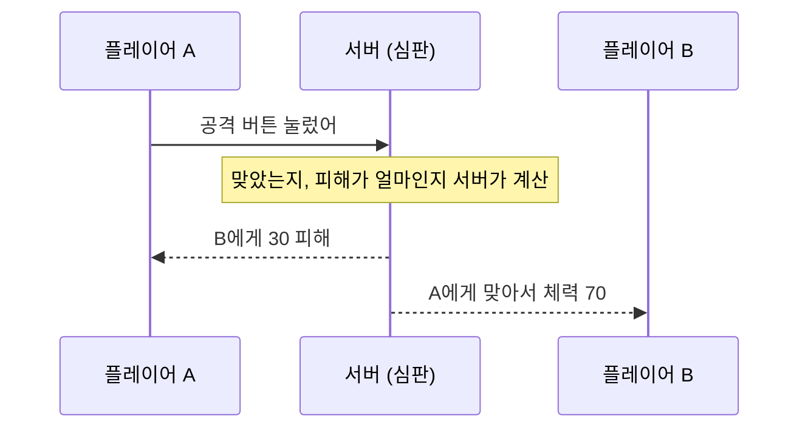
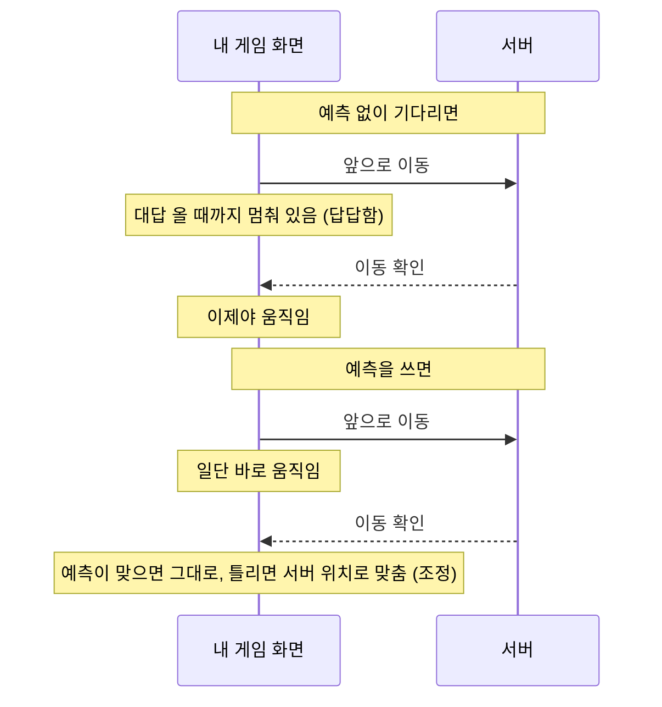
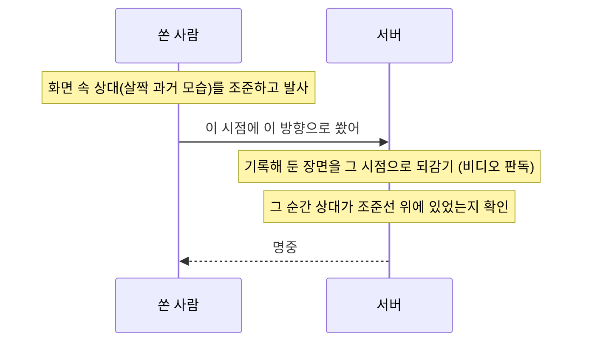
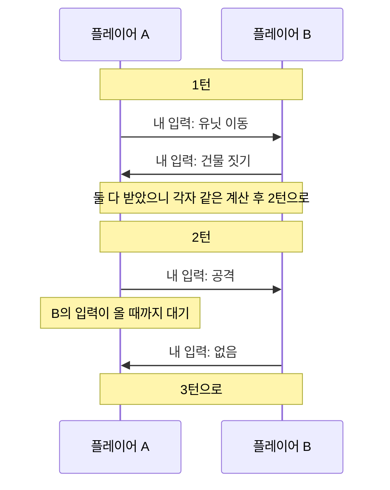
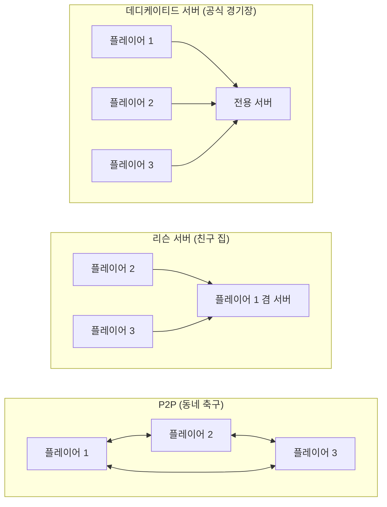

## 게임 관점의 클라이언트-서버란 ?
- 온라인 게임에서 클라이언트는 플레이어가 실행하는 게임 프로그램이고, 서버는 여러 플레이어가 같은 게임 세계를 함께 쓰도록 관리하는 프로그램이다
- 웹과 같은 구조를 쓰지만, 필요할 때만 요청하는 웹과 달리 게임은 1초에도 수십 번씩 정보를 주고받는다
- 기본 개념은 [클라이언트-서버 구조](../클라이언트-서버%20구조(Client-Server%20Architecture)/README.md) 문서에 정리했고, 이 문서는 실시간 게임에서 그 구조가 어떻게 달라지는지를 다룬다

 

## 웹과 무엇이 다를까
웹사이트에서 버튼을 누르고 0.3초 뒤에 화면이 바뀌어도 크게 불편하지 않다. 게임에서는 다르다. 키를 눌렀는데 0.3초 뒤에 캐릭터가 움직이면 바로 답답하다고 느낀다.

그래서 게임 네트워크는 두 가지를 동시에 해내야 한다.

1. 모든 플레이어가 같은 상황을 보게 하기 (동기화)
2. 인터넷이 느려도 조작이 바로바로 반응하게 하기 (반응성)

문제는 이 둘이 서로 부딪힌다는 점이다. 모두가 같은 상황을 보려면 서버의 확인을 기다려야 하고, 기다리면 반응이 늦어진다. 이 문서의 대부분은 이 둘 사이에서 균형을 잡는 방법에 대한 이야기다.

 

## 판정은 서버가 한다
### 권위 (Authority)
사전적 의미는 권위, 권한. 무엇이 옳은지 최종적으로 정할 수 있는 힘이다.
공학적으로는 게임에서 무엇이 사실인지 누가 정하느냐를 말한다. 권위를 가진 쪽이 정한 것이 정답이 된다.

### 권위 서버 (Authoritative Server)
축구 경기의 심판과 같다. 선수(클라이언트)는 공을 차고 달릴 뿐이고, 골인지 반칙인지는 심판(서버)이 정한다. 선수가 방금 골 넣었다고 주장해도 심판이 인정하지 않으면 골이 아니다.

게임에서는 클라이언트가 결과가 아니라 입력만 보낸다. 앞으로 이동, 공격 버튼 눌림 같은 것이다. 서버는 그 입력으로 게임을 진행시키고 결과를 모든 플레이어에게 알려 준다.

왜 이렇게 할까. 만약 클라이언트가 내 체력은 100이야, 나 벽 통과했어처럼 결과를 직접 보고하면, 프로그램을 조작한 플레이어가 거짓말을 할 수 있다. 권위 서버는 클라이언트를 믿지 않는다는 생각에서 출발하고, 핵(치트)을 막는 가장 기본적인 방법이다.

### 틱 (Tick)
사전적 의미는 시계의 째깍 소리. 시간이 한 칸씩 넘어가는 단위다.
공학적으로는 서버가 게임 상황을 한 번 새로 계산하는 주기를 말한다. 서버는 째깍할 때마다 그동안 들어온 입력을 모아서 처리하고, 결과를 플레이어들에게 보낸다.
1초에 몇 번 째깍하는지를 틱레이트(Tick Rate)라고 한다. 플립북(손으로 넘기는 만화책)을 생각하면 쉽다. 1초에 넘기는 장수가 많을수록 움직임이 부드럽고 정확하지만, 그만큼 서버가 바빠진다.

 

## 느린 인터넷을 숨기는 방법
권위 서버만 쓰면 문제가 남는다. 키를 누르면 입력이 서버까지 갔다가 결과가 돌아와야 캐릭터가 움직인다. 이 왕복 시간(RTT: Round Trip Time)만큼 항상 늦게 반응하게 된다. 그래서 게임은 몇 가지 요령으로 이 지연을 숨긴다.

### 클라이언트 측 예측 (Client-side Prediction)
메신저에서 메시지를 보내면 아직 전송 중이어도 내 화면에는 바로 말풍선이 뜨는 것과 같다. 게임도 서버의 대답을 기다리지 않고, 내 입력의 결과를 먼저 계산해서 화면에 보여 준다.
대부분은 서버도 같은 결과를 내기 때문에 플레이어는 지연을 느끼지 못한다.

### 서버 조정 (Server Reconciliation)
조정(Reconciliation)의 사전적 의미는 화해, 서로 다른 것을 맞추는 일이다.
공학적으로는 내가 예측한 결과와 서버가 보낸 정답이 다를 때 서버 쪽에 맞추는 과정을 말한다. 내 손목시계가 조금 틀렸을 때 표준시에 맞춰 다시 돌리는 것과 같다.
차이가 크면 캐릭터가 갑자기 뒤로 휙 돌아가는 것처럼 보인다. 흔히 렉 걸려서 순간이동했다고 말하는 현상이 이것이다.

### 보간 (Interpolation)
사전적 의미는 사이에 끼워 넣기. 알고 있는 두 값 사이를 채워 넣는 일이다.
공학적으로는 다른 플레이어의 위치가 띄엄띄엄 도착할 때, 그 사이를 부드럽게 이어서 그리는 방법을 말한다. 점 잇기 그림에서 점과 점 사이에 선을 긋는 것과 같다.
다만 두 점 사이를 이으려면 다음 점이 올 때까지 기다려야 한다. 그래서 내 화면에 보이는 다른 플레이어는 실제보다 아주 조금 과거의 모습이다.

### 지연 보상 (Lag Compensation)
보간 때문에 내가 보는 상대는 살짝 과거에 있다. 그래서 정확히 조준해서 쐈는데, 서버 기준으로는 상대가 이미 움직여서 빗나가는 일이 생긴다.

지연 보상은 축구의 비디오 판독(VAR)과 같다. 서버가 지난 장면들을 기록해 두었다가, 판정할 때 쏜 사람이 보고 있던 순간으로 되돌려서 맞았는지 확인한다.
쏜 사람 입장에서는 공정하다. 하지만 맞은 사람 입장에서는 벽 뒤로 이미 숨었는데 맞았다고 느끼는 일이 생긴다. 모두에게 완벽한 방법은 없고, 누구 쪽을 더 믿어 줄지 고르는 문제다.

 

## 모두의 화면을 맞추는 방식
### 상태 동기화 (State Synchronization)
서버가 게임 상황(위치, 체력 등)을 직접 계산해서 결과를 플레이어에게 보내 주는 방식. 앞에서 본 권위 서버가 이 방식이다. FPS나 MMORPG에서 주로 쓴다.

### 락스텝 (Lockstep)
사전적 의미는 발맞춰 걷기. 대열이 앞사람과 정확히 같은 보폭으로 걷는 행진 방식이다.
공학적으로는 모든 플레이어의 이번 턴 입력이 다 모인 뒤에야 다음 턴으로 넘어가는 방식을 말한다. 결과가 아니라 입력만 주고받고, 각자 같은 입력으로 같은 계산을 해서 같은 결과를 얻는다.

2인 3각 달리기를 떠올리면 쉽다. 둘 다 발을 내디뎌야 다음 걸음으로 넘어갈 수 있다. 그래서 가장 느린 사람에게 속도가 맞춰진다.
유닛이 수백 개씩 움직이는 전략 게임(RTS)처럼 모든 유닛의 위치를 일일이 보내기엔 양이 너무 많을 때 쓴다. 입력은 결과보다 훨씬 작기 때문이다. 대신 모두의 컴퓨터가 같은 입력으로 완전히 같은 결과를 내야 해서, 계산에 조금의 차이도 있으면 안 된다.

### 롤백 (Rollback)
사전적 의미는 되돌리기.
공학적으로는 상대 입력을 기다리지 않고 일단 상대가 직전과 같은 행동을 할 거라고 예상해서 먼저 진행하는 방식을 말한다. 실제 입력이 도착했는데 예상이 틀렸다면, 그 시점으로 되감아서 다시 계산한다. 문서 작업에서 실행 취소 후 다시 고쳐 쓰는 것과 비슷하다.
0.01초 차이로 승부가 갈리는 대전 격투 게임에서 많이 쓴다.

 

## 서버는 어디에 있을까
### 데디케이티드 서버 (Dedicated Server)
Dedicated의 사전적 의미는 전념하는, 전용의.
공학적으로는 게임 진행만을 위해 따로 운영하는 서버를 말한다. 중립 심판이 있는 공식 경기장과 같다. 공정하고 안정적이지만 운영 비용이 든다.

### 리슨 서버 (Listen Server)
플레이어 중 한 명의 컴퓨터가 서버 역할을 같이 하는 방식. 친구 집에서 게임할 때 집주인이 심판까지 맡는 것과 같다. 서버 비용이 들지 않지만, 집주인이 나가면 게임이 끝나고 집주인은 지연이 없어 유리하다.

### P2P
서버 없이 플레이어끼리 직접 주고받는 방식. 심판 없이 선수들끼리 합의하며 하는 동네 축구와 같다. 락스텝이나 롤백과 함께 쓰는 경우가 많다. 판정할 심판이 없어서 핵을 막기 어렵다.

 

## 데이터를 어떻게 보낼까
웹은 대부분 TCP라는 방식으로 데이터를 보내지만, 실시간 게임은 UDP를 많이 쓴다.

TCP는 등기우편과 같다. 반드시 도착하고 순서도 지켜진다. 대신 편지 하나가 사라지면 그걸 다시 보낼 때까지 뒤에 오는 편지도 전부 기다린다. 게임에서 이건 큰 문제다. 0.1초 전 위치를 다시 받느라 지금 위치가 늦게 도착하면 오히려 손해다.

UDP는 스포츠 생중계와 같다. 놓친 장면을 다시 보여 주지 않고 계속 지금 장면을 보낸다. 몇 장면 빠져도 지금 상황만 알면 되는 게임과 잘 맞는다.
그렇다고 모든 정보가 빠져도 되는 건 아니다. 그래서 게임은 UDP 위에 필요한 만큼만 확인 장치를 직접 만들어 쓴다. 위치처럼 최신 값만 중요한 정보는 빠지면 그냥 넘어가고, 아이템 획득처럼 꼭 전달돼야 하는 정보만 다시 보내는 식이다.

| 구분 | TCP | UDP |
| --- | --- | --- |
| 비유 | 등기우편 | 스포츠 생중계 |
| 도착 보장 | 보장 | 보장 안 함 |
| 순서 보장 | 보장 | 보장 안 함 |
| 하나가 빠지면 | 다시 받을 때까지 뒤도 대기 | 그냥 다음 것 받음 |
| 어울리는 곳 | 웹, 채팅, 파일 전송 | 실시간 게임, 영상 통화 |

 

## 더 볼 것 (TODO)
- TCP와 UDP 차이 자세히
- 장르별 넷코드(Netcode) 비교 (FPS, RTS, 격투 게임)
- MMORPG 서버 구조 (채널, 존, 샤딩)
- 매치메이킹 서버와 게임 서버의 분리
- 락스텝에서 계산 결과가 어긋나지 않게 하는 방법 (결정적 계산, Deterministic)
- 서버 권위 구조에서의 치트 탐지
