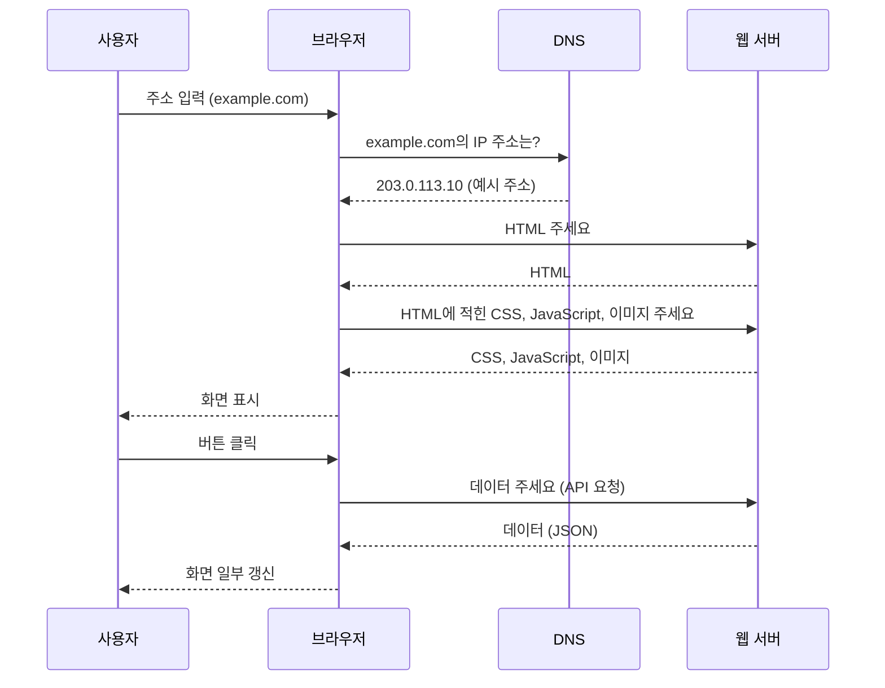
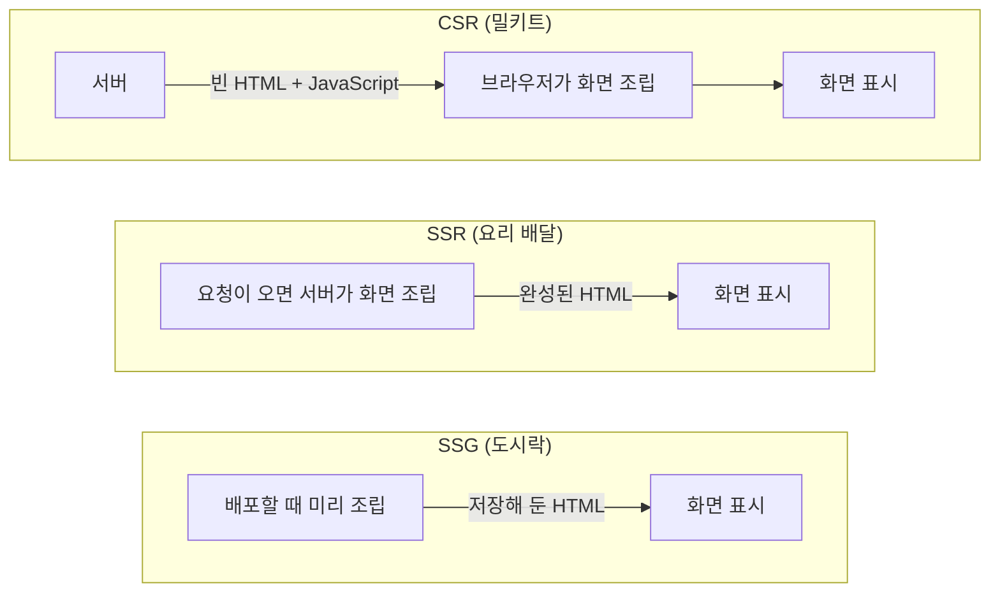
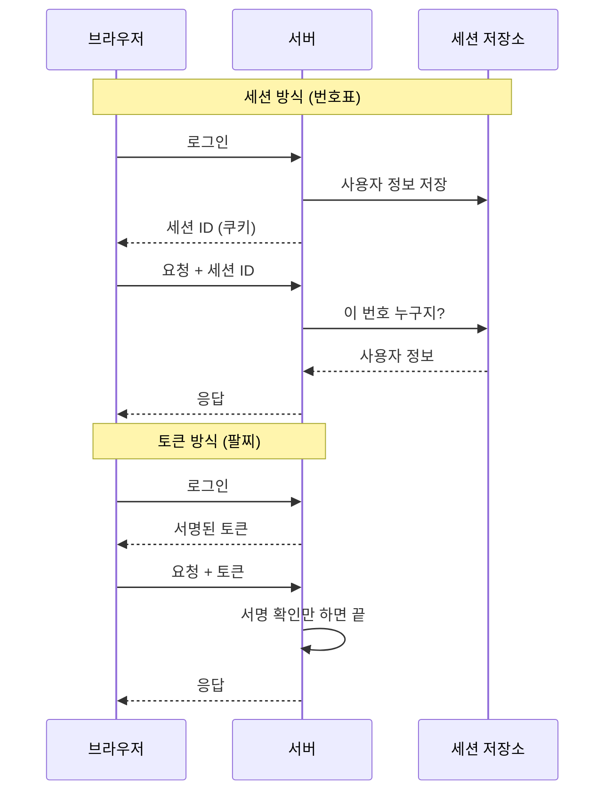
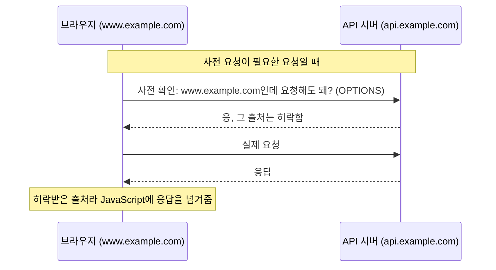
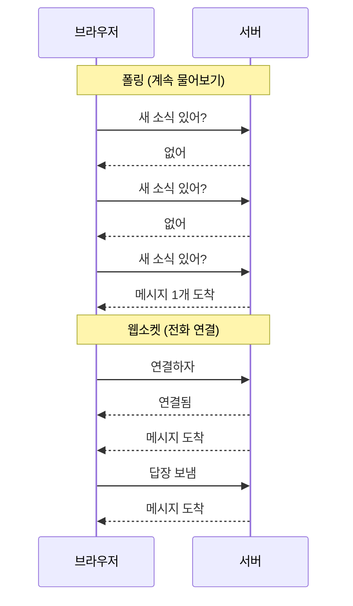

## 프론트엔드 관점의 클라이언트-서버란 ?
- 웹에서 클라이언트는 대부분 브라우저(Chrome, Safari 등)이고, 프론트엔드는 이 브라우저 안에서 돌아가는 코드를 만든다
- 브라우저는 서버에서 웹페이지 재료(HTML, CSS, JavaScript)를 받아 화면을 만들고, 그 뒤에도 필요한 데이터를 서버에 계속 요청한다
- 기본 개념은 [클라이언트-서버 구조](../클라이언트-서버%20구조(Client-Server%20Architecture)/README.md) 문서에 정리했고, 이 문서는 웹 화면을 만드는 입장에서 그 구조가 어떻게 보이는지를 다룬다

 

## 브라우저라는 클라이언트
### 브라우저 (Browser)
사전적 의미는 둘러보는 사람. 동사 browse(이것저것 훑어보다)에서 왔다.
공학적으로는 서버에서 웹 문서를 받아 읽고 화면에 보여 주는 프로그램을 말한다. 사용자가 이 페이지 저 페이지를 둘러보게 해 주는 도구라서 이런 이름이 어울린다.

### 페이지 하나가 뜨기까지
주소창에 주소를 입력하면 브라우저는 다음 순서로 움직인다.

그림의 IP 주소 203.0.113.10은 문서 예시용으로 예약된 주소(RFC 5737)다. example.com의 실제 주소는 때에 따라 바뀐다.

여기서 중요한 점은 페이지 하나를 보여 주는 데 요청이 한 번이 아니라 여러 번 오간다는 것이다. 이사 갈 때 짐을 트럭 한 대로 한 번에 옮기는 게 아니라 여러 번 나눠 옮기는 것과 같다. 그래서 요청의 수, 크기, 순서가 페이지가 뜨는 속도에 큰 영향을 준다. 서버가 느리거나, 받은 JavaScript를 실행하는 데 오래 걸리는 것처럼 다른 원인도 있다.

 

## 서버와 대화하는 방식
### 페이지 통째로 받기 vs 데이터만 받기
예전 웹은 링크를 누를 때마다 서버가 새 페이지를 통째로 보내 줬다. 책에서 한 글자만 고치고 싶은데 책 전체를 새로 받는 것과 같다. 화면이 하얗게 깜빡였다가 다시 뜨는 이유가 이것이다.

지금은 페이지는 그대로 두고 바뀐 데이터만 받아서 화면 일부만 고친다. 좋아요 버튼을 눌렀을 때 페이지가 새로고침되지 않고 숫자만 바뀌는 것이 이 방식이다. JavaScript가 서버에 데이터만 요청하고(fetch), 받은 데이터로 화면을 직접 고친다.

### API (Application Programming Interface)
인터페이스의 사전적 의미는 경계면, 접점. 서로 다른 두 영역이 맞닿는 면이다.
공학적으로는 프로그램끼리 대화하기 위해 정해 둔 규칙을 말한다. 식당의 메뉴판과 비슷하다. 손님은 메뉴판에 있는 것만 주문할 수 있고, 주문하면 무엇이 나오는지도 정해져 있다. 웹에서는 어떤 주소로 어떻게 요청하면 어떤 데이터가 돌아오는지를 정한 약속이 API다.

 

## 화면은 누가 만들까
### 렌더링 (Rendering)
사전적 의미는 표현, 묘사. 무언가를 그려 내는 일이다.
공학적으로는 데이터와 코드를 가지고 사용자가 볼 화면을 만들어 내는 과정을 말한다.

화면을 브라우저가 만드느냐, 서버가 만들어서 보내느냐에 따라 방식이 나뉜다. 음식에 비유하면 이해하기 쉽다.

### CSR (Client-Side Rendering)
밀키트 배송과 같다. 서버는 재료와 조리법(JavaScript)만 보내고, 요리(화면 만들기)는 집(브라우저)에서 한다.
받자마자 먹을 수는 없어서 첫 화면이 늦게 뜬다. 대신 한 번 준비가 끝나면 다음 요리는 집에서 금방 만들 수 있어서 페이지 이동이 빠르다.

### SSR (Server-Side Rendering)
완성된 요리 배달과 같다. 주문이 올 때마다 서버가 화면을 다 만들어서 보낸다.
받자마자 볼 수 있어서 첫 화면이 빠르다. 대신 주문마다 주방(서버)이 요리해야 하니 서버가 바쁘다.

### SSG (Static Site Generation)
미리 만들어 둔 편의점 도시락과 같다. 사이트를 배포할 때 화면을 미리 다 만들어 두고, 요청이 오면 만들어 둔 것을 그대로 준다.
가장 빠르고 서버도 편하지만, 내용이 자주 바뀌는 페이지에는 맞지 않는다. 이미 만들어 둔 도시락의 반찬은 바꿀 수 없기 때문이다.

| 구분 | CSR | SSR | SSG |
| --- | --- | --- | --- |
| 비유 | 밀키트 | 요리 배달 | 도시락 |
| 화면을 만드는 곳 | 브라우저 | 서버 (요청할 때마다) | 서버 (배포할 때 한 번) |
| 첫 화면 속도 | 느림 | 빠름 | 가장 빠름 |
| 서버 부담 | 적음 | 큼 | 적음 |
| 어울리는 페이지 | 로그인 후 관리 화면 | 자주 바뀌는 공개 페이지 | 블로그, 문서 |

### 하이드레이션 (Hydration)
사전적 의미는 수분 공급. 마른 것에 물을 부어 되살리는 일이다.
공학적으로는 서버가 보낸 화면에 브라우저가 JavaScript를 연결해서 버튼이 눌리는 화면으로 만드는 과정을 말한다. SSR이나 SSG로 받은 화면은 처음에는 JavaScript로 붙인 기능이 아직 동작하지 않는다. 일반 링크(`<a>`)를 누르거나 폼(`<form>`)을 제출하는 것처럼 HTML만으로 되는 동작은 되지만, JavaScript로 만든 버튼 클릭 처리나 화면 갱신은 반응하지 않는다. JavaScript가 연결되어야 비로소 움직이는데, 마른 화면에 물을 부어 살려내는 일로 비유할 수 있다.

 

## 서버는 나를 어떻게 알아볼까
웹에서 쓰는 HTTP는 서버가 이전 요청을 기억하지 않는 방식(무상태)이다. 방금 로그인했어도 다음 요청에서 서버는 내가 누군지 모른다. 그래서 브라우저가 요청할 때마다 "나 아까 로그인한 사람이다"라는 증거를 함께 보내야 한다.

### 쿠키 (Cookie)
사전적 의미는 과자. 기술 용어로는 프로그램끼리 주고받던 작은 데이터 조각을 부르던 매직 쿠키(Magic Cookie)라는 표현에서 왔다.
공학적으로는 서버가 브라우저에 맡겨 두는 작은 메모를 말한다. 브라우저는 이 메모를 저장해 두었다가, 같은 서버에 요청할 때마다 자동으로 함께 보낸다.

### 세션 방식
옷 보관소 번호표와 같다. 옷(사용자 정보)은 보관소(서버)가 맡아 두고, 손님은 번호표(세션 ID)만 들고 다닌다. 번호표를 보여 주면 보관소가 누구 옷인지 찾아 준다.
정보가 서버에 있어서 안전하지만, 보관소가 여러 곳으로 늘어나면 어느 보관소에 옷이 있는지 서로 공유해야 하는 문제가 생긴다.

### 토큰 방식
놀이공원 자유이용권 팔찌와 같다. 팔찌 자체에 정보(누구인지, 언제까지 유효한지)가 적혀 있고 위조 방지 표시(서명)가 있다. 직원은 장부를 뒤질 필요 없이 팔찌만 보고 들여보낸다.
서버가 따로 기억할 필요가 없어 편하지만, 이미 나눠 준 팔찌를 중간에 무효로 만들기가 어렵다.

### 브라우저 저장소
쿠키 말고도 브라우저에는 localStorage, sessionStorage 같은 저장 공간이 있다. 쿠키와 달리 요청에 자동으로 실려 가지 않고, JavaScript로 직접 꺼내 써야 한다.
JavaScript로 꺼낼 수 있다는 건 나쁜 스크립트도 꺼낼 수 있다는 뜻이다. 그래서 로그인 정보를 어디에 둘지는 보안을 함께 생각해서 정해야 한다.

 

## 다른 사이트의 데이터는 왜 막힐까
### 출처 (Origin)
사전적 의미는 기원, 근원. 무언가가 처음 나온 곳이다.
공학적으로는 웹페이지가 어디서 왔는지를 나타내는 주소 묶음을 말한다. 프로토콜(https), 도메인(example.com), 포트(443) 세 가지가 모두 같아야 같은 출처로 본다.

### 동일 출처 정책 (Same-Origin Policy)
브라우저는 기본적으로 한 출처에서 온 코드가 다른 출처의 응답을 읽지 못하게 막는다. 아파트에서 내 열쇠로 남의 집 우편함을 열 수 없는 것과 같다.

출처는 사이트(Site)보다 좁은 단위다. 사이트는 example.com처럼 등록 가능한 도메인을 기준으로 묶기 때문에 www.example.com과 api.example.com은 같은 사이트다. 하지만 호스트가 달라서 서로 다른 출처다. 동일 출처 정책은 출처를 기준으로 하므로 둘 사이에도 적용된다.
이 규칙이 없으면, 내가 은행에 로그인한 상태에서 수상한 사이트에 들어갔을 때 그 사이트가 몰래 은행 정보를 읽어 갈 수 있다.

### CORS (Cross-Origin Resource Sharing)
그런데 실제로는 화면 사이트(www.example.com)와 데이터 서버(api.example.com)의 주소가 다른 경우가 흔하다. 그래서 서버가 이 출처는 내 데이터를 읽어도 된다고 허락하는 규칙을 둔다. 집주인이 특정 사람에게만 우편함 비밀번호를 알려 주는 것과 같다.

브라우저가 허락을 확인하는 방법은 요청의 종류에 따라 다르다. GET, HEAD, POST 중 하나이고 정해진 몇 가지 헤더와 콘텐츠 타입(`application/x-www-form-urlencoded`, `multipart/form-data`, `text/plain`)만 쓰는 단순 요청(Simple Request)은 바로 보낸다. 그 밖의 요청, 예를 들어 `Content-Type: application/json` 을 붙이거나 직접 만든 헤더를 넣은 요청은 실제 요청 전에 OPTIONS 메서드로 사전 요청(Preflight)을 먼저 보낸다.

사전 요청에서 허락을 받지 못하면 실제 요청은 아예 보내지 않는다. 단순 요청은 사전 확인 없이 서버까지 가므로, 서버는 이미 요청을 처리했을 수 있다. 다만 응답에 허락 표시(`Access-Control-Allow-Origin`)가 없으면 브라우저가 JavaScript에 응답을 넘겨주지 않는다. 어느 경우든 CORS 오류는 서버가 허락 표시를 해 주지 않아서 생기는 것이고, 해결도 브라우저가 아니라 서버 설정에서 한다.

 

## 서버가 먼저 말을 걸려면
클라이언트-서버 구조에서는 항상 클라이언트가 먼저 묻는다. 그런데 채팅이나 알림처럼 서버에 새 소식이 생기면 바로 알려 줘야 하는 기능도 있다. 이를 위한 방법이 몇 가지 있다.

### 폴링 (Polling)
사전적 의미는 여론 조사. 여기서는 계속 물어본다는 뜻이다.
공학적으로는 브라우저가 일정 시간마다 서버에 새 소식이 있는지 반복해서 묻는 방식을 말한다. 택배를 기다리면서 5분마다 현관문을 열어 보는 것과 같다. 쉽지만 소식이 없어도 계속 물어보니 낭비가 크다.

### 롱 폴링 (Long Polling)
물어본 뒤 새 소식이 생길 때까지 전화를 끊지 않고 기다리는 방식. 소식이 오면 답을 받고, 바로 다시 전화를 건다.

### SSE (Server-Sent Events)
라디오 방송과 같다. 한 번 채널을 맞춰 두면 서버가 계속 소식을 보내 준다. 다만 듣기만 할 수 있고 라디오에 대고 말할 수는 없다(서버에서 브라우저 방향으로만 전달).

### 웹소켓 (WebSocket)
전화 통화와 같다. 한 번 연결하면 끊기 전까지 양쪽 모두 언제든 말할 수 있다. 채팅, 실시간 협업 도구처럼 주고받기가 많은 기능에 쓴다.

| 방식 | 비유 | 방향 | 특징 |
| --- | --- | --- | --- |
| 폴링 | 5분마다 현관문 열어 보기 | 브라우저가 묻고 서버가 답함 | 쉽지만 낭비가 큼 |
| 롱 폴링 | 답이 올 때까지 전화 들고 기다리기 | 브라우저가 묻고 서버가 답함 | 폴링보다 낭비가 적음 |
| SSE | 라디오 | 서버에서 브라우저로만 | 알림, 실시간 피드 |
| 웹소켓 | 전화 통화 | 양방향 | 채팅, 협업 도구 |

 

## 참고 자료
- MDN, [Cross-Origin Resource Sharing (CORS)](https://developer.mozilla.org/en-US/docs/Web/HTTP/Guides/CORS)
- MDN, [Site](https://developer.mozilla.org/en-US/docs/Glossary/Site)
- RFC 5737, [IPv4 Address Blocks Reserved for Documentation](https://www.rfc-editor.org/rfc/rfc5737.html)

 

## 더 볼 것 (TODO)
- 브라우저가 HTML을 화면으로 그리는 과정 (Critical Rendering Path)
- HTTP 캐시와 브라우저 캐시 (기존 [캐싱](../캐싱(Caching)/README.md) 문서와 연결)
- 쿠키 보안 설정 (HttpOnly, Secure, SameSite)
- CORS 사전 요청(Preflight) 응답 헤더와 자격 증명(쿠키)을 함께 보내는 요청
- BFF 패턴 (기존 Architecture/BFF 문서와 연결)
- HTTP/1.1, HTTP/2, HTTP/3 차이
