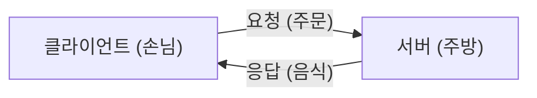
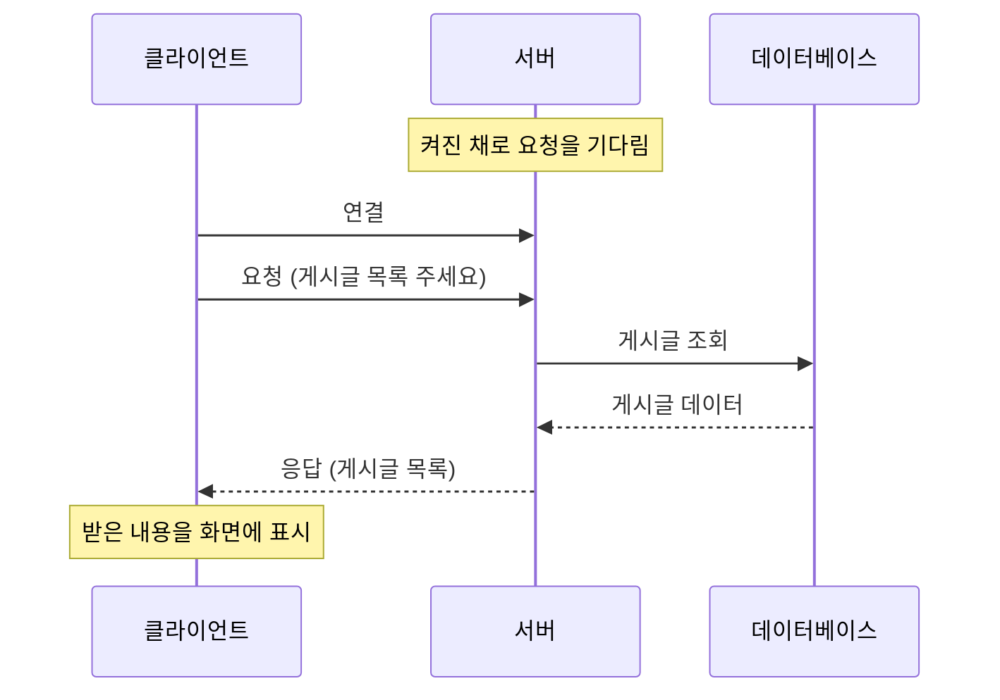
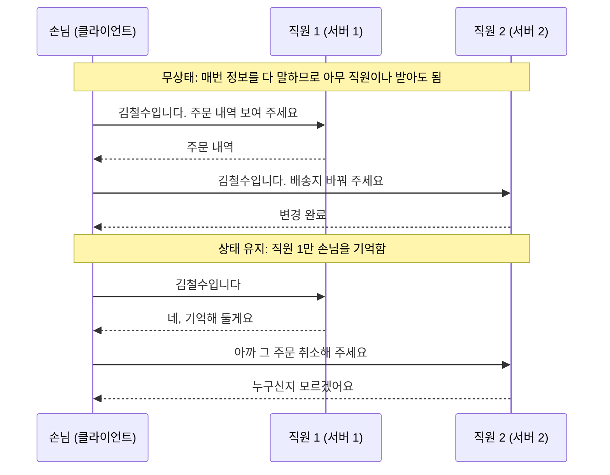
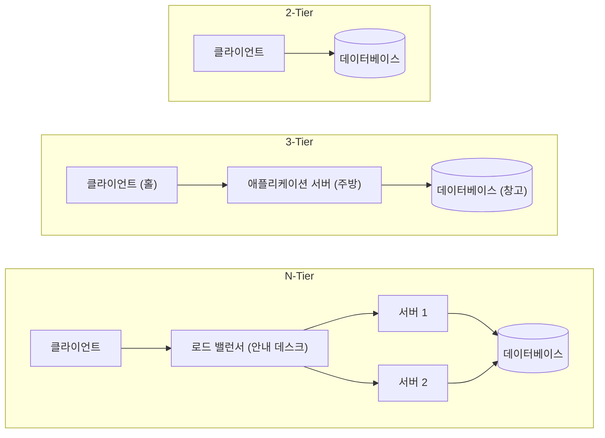
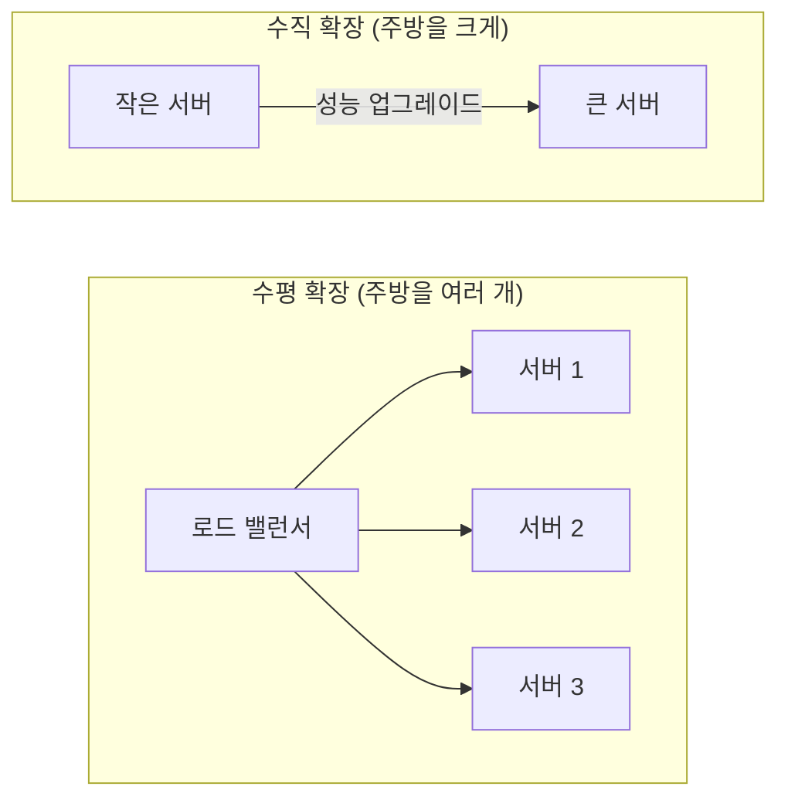
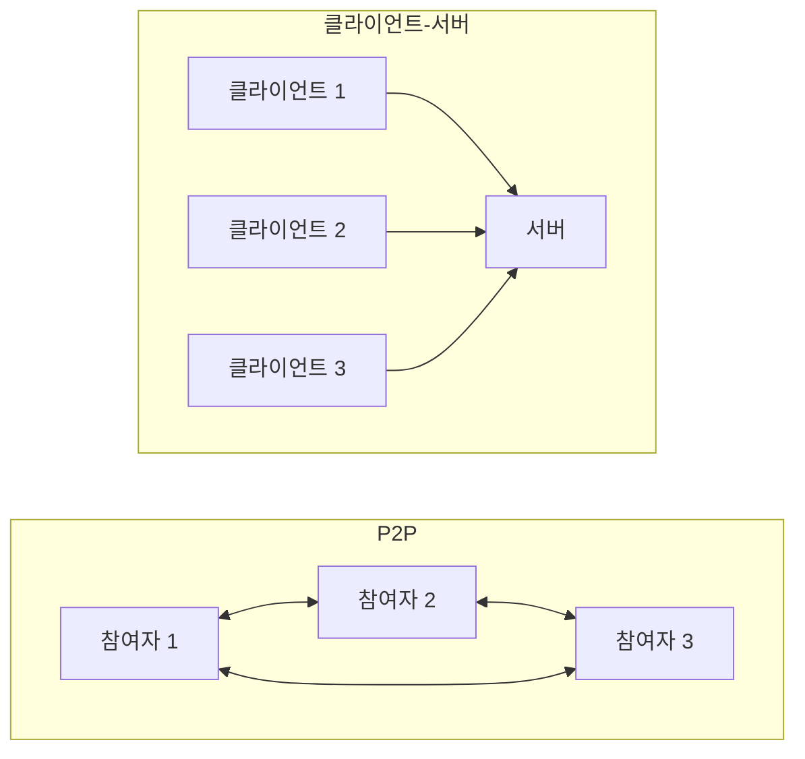

## 클라이언트-서버 구조란 ?
- 일을 부탁하는 쪽(클라이언트)과 부탁받은 일을 처리해 주는 쪽(서버)으로 역할을 나눈 구조
- 클라이언트가 요청(Request)을 보내면 서버가 처리해서 응답(Response)을 돌려준다
- 웹사이트 접속, 메일 확인, 앱에서 게시글 불러오기처럼 네트워크를 쓰는 대부분의 서비스가 이 구조로 동작한다

 

## 식당으로 이해하기
이 구조는 식당과 비슷하다. 손님은 메뉴를 보고 주문하고, 주방은 주문을 받아 음식을 만들어 내준다. 손님은 음식이 어떻게 만들어지는지 몰라도 되고, 주방은 손님이 누구든 같은 방식으로 주문을 처리한다.

| 식당 | 클라이언트-서버 |
| --- | --- |
| 손님 | 클라이언트 |
| 주방 | 서버 |
| 주문 | 요청 |
| 나온 음식 | 응답 |
| 주문서 양식 | 프로토콜 |
| 식당 주소 | 서버 주소 (IP 주소, 포트) |

이 비유로 보면 구조의 핵심이 보인다. 주문은 항상 손님이 먼저 하고, 주방은 주문이 오기 전까지 기다린다. 그리고 재료와 요리법은 주방 한곳에만 있다.

 

## 왜 이렇게 나눴을까
예전에는 아주 비싼 대형 컴퓨터(메인프레임) 한 대가 모든 계산과 데이터를 맡았다. 사용자는 화면과 키보드만 있는 단말기로 그 컴퓨터에 접속해 썼다. 모든 일이 컴퓨터 한 대에 몰리니 비싸고, 사용자가 늘어나면 감당하기 어려웠다.

개인용 컴퓨터가 흔해지면서 사용자 쪽 컴퓨터도 스스로 계산을 할 수 있게 됐다. 그래서 화면을 그리는 일처럼 각자 할 수 있는 일은 사용자 컴퓨터가 하고, 여러 사람이 함께 써야 하는 데이터만 중앙의 서버에 두는 방식이 자리 잡았다. 일은 나눠서 하고 데이터는 한곳에서 관리하자는 것이 이 구조가 나온 이유다.

 

## 구성 요소
### 클라이언트 (Client)
사전적 의미는 의뢰인, 고객. 전문가에게 일을 맡기고 결과를 받는 사람이다.
공학적으로는 서버에 서비스를 요청하는 쪽을 말한다. 일을 맡기는 쪽이라 항상 먼저 말을 건다. 그러려면 서버가 어디 있는지(주소)를 알고 있어야 한다.

### 서버 (Server)
사전적 의미는 시중드는 사람, 음식을 내어 주는 사람. 동사 serve(제공하다)에서 왔다.
공학적으로는 요청을 기다렸다가 처리하고 결과를 돌려주는 쪽을 말한다. 손님이 언제 올지 모르는 가게처럼 항상 켜져 있어야 하고, 찾아올 수 있도록 주소가 바뀌지 않아야 한다. 또 여러 손님을 동시에 받아야 하므로 많은 요청을 한꺼번에 처리할 수 있어야 한다.

### 프로토콜 (Protocol)
사전적 의미는 외교 의례. 나라끼리 만날 때 지켜야 할 형식과 순서를 정해 둔 약속이다.
공학적으로는 클라이언트와 서버가 대화할 때 지키는 규칙을 말한다. 주문서 양식이 정해져 있어야 주방이 주문을 알아듣는 것처럼, 메시지를 어떤 형식으로 어떤 순서로 보낼지 미리 정해 둔다. 덕분에 서로 다른 회사가 만든 프로그램끼리도 대화할 수 있다.
웹은 HTTP, 메일은 SMTP처럼 서비스마다 쓰는 프로토콜이 따로 있다.

 

## 동작 순서
1. 서버가 켜진 채로 요청을 기다린다
2. 클라이언트가 서버 주소로 연결한다
3. 클라이언트가 약속된 형식(프로토콜)에 맞춰 요청을 보낸다
4. 서버가 요청을 읽고 처리한다 (필요하면 데이터베이스에서 데이터를 꺼낸다)
5. 서버가 결과를 응답으로 돌려준다
6. 클라이언트가 응답을 받아 사용자에게 보여 준다

 

## 서버는 손님을 기억할까
### 무상태 (Stateless)
서버가 이전 요청을 기억하지 않는 방식. 손님이 올 때마다 처음 보는 손님처럼 대하는 가게와 같다. 그래서 손님은 매번 필요한 정보를 다시 말해야 한다.
불편해 보이지만 장점이 크다. 어떤 직원이 받아도 똑같이 처리할 수 있어서 직원(서버)을 늘리기 쉽다. 웹에서 쓰는 HTTP가 이 방식이다.

### 상태 유지 (Stateful)
서버가 손님별로 이전 대화를 기억하는 방식. 단골을 알아보는 가게처럼 매번 설명하지 않아도 된다.
대신 그 손님을 기억하는 직원만 응대할 수 있어서, 직원을 늘리거나 그 직원이 자리를 비우면 곤란해진다.

 

## 일을 어디서 더 많이 할까
### 씬 클라이언트 (Thin Client)
Thin은 얇다는 뜻. 클라이언트가 하는 일이 적고 대부분을 서버가 처리한다. 클라이언트는 가볍지만 서버가 바빠지고, 네트워크가 끊기면 아무것도 할 수 없다.

### 팻 클라이언트 (Fat Client)
Fat은 두껍다는 뜻. 클라이언트가 많은 일을 직접 처리한다. 서버 부담이 줄고 인터넷이 없어도 어느 정도 쓸 수 있지만, 사용자 컴퓨터마다 프로그램을 설치하고 업데이트해야 한다.

 

## 계층 구조 (Tier)
Tier는 층, 단이라는 뜻이다. 역할을 몇 층으로 나누느냐에 따라 구분한다.

### 2-Tier
클라이언트가 데이터베이스에 바로 붙는 구조. 손님이 주방을 거치지 않고 창고에 직접 들어가 재료를 꺼내는 것과 비슷하다. 단순하지만, 손님이 많아지면 창고가 붐비고 아무나 창고에 들어가니 보안에도 약하다.

### 3-Tier
화면(클라이언트), 처리(애플리케이션 서버), 저장(데이터베이스) 세 층으로 나눈 구조. 손님은 홀에서 주문만 하고, 주방이 요리하고, 재료는 창고에 있다. 손님은 창고에 들어갈 수 없다. 층마다 따로 고치거나 늘릴 수 있어서 지금 대부분의 웹 서비스가 이 구조를 쓴다.

### N-Tier
3-Tier에 층을 더 둔 구조. 손님이 많은 큰 식당에서 안내 데스크(로드 밸런서)를 두어 손님을 여러 주방에 나눠 보내는 식이다. 유연해지는 대신 관리할 것이 많아진다.

 

## 손님이 많아지면
### 수직 확장 (Scale-up)
서버 한 대를 더 좋은 컴퓨터로 바꾸는 방식. 주방 하나를 더 크게 넓히는 것과 같다. 간단하지만 무한히 키울 수는 없고 비용이 빠르게 오른다.

### 수평 확장 (Scale-out)
서버 대수를 늘리는 방식. 주방을 여러 개 두는 것과 같다. 계속 늘릴 수 있고 주방 하나가 멈춰도 나머지가 일한다. 대신 손님을 나눠 보낼 안내 데스크가 필요하다. 앞에서 본 무상태 방식이어야 어느 주방이 받아도 문제가 없어서 수평 확장이 쉽다.

 

## 장단점
### 장점
- 데이터가 서버 한곳에 있어서 관리, 백업, 보안이 쉽다
- 서버만 고치면 모든 사용자에게 바로 반영된다
- 클라이언트와 서버를 따로따로 개발하고 고칠 수 있다

### 단점
- 사용자가 몰리면 서버가 느려진다
- 서버가 멈추면 서비스 전체가 멈춘다. 이렇게 한 곳이 멈추면 전체가 멈추는 지점을 단일 장애 지점(SPOF: Single Point of Failure)이라고 한다
- 서버를 항상 켜 두어야 하니 운영 비용이 든다

 

## P2P 구조와 비교
P2P(Peer-to-Peer)에서 Peer는 동료, 대등한 사람이라는 뜻이다. 정해진 서버 없이 참여한 모두가 손님이면서 동시에 주방 역할을 한다. 친구끼리 음식을 나눠 먹는 포트럭 파티에 가깝다.

| 구분 | 클라이언트-서버 | P2P |
| --- | --- | --- |
| 역할 | 손님과 주방이 정해져 있음 | 모두가 손님이자 주방 |
| 데이터 위치 | 서버 한곳 | 참여자들에게 흩어져 있음 |
| 사람이 늘면 | 서버 부담이 커짐 | 나눠 줄 사람도 함께 늘어남 |
| 한 곳이 멈추면 | 서버가 멈추면 전체 중단 | 일부가 빠져도 계속 동작 |
| 관리 | 한곳에서 통제하기 쉬움 | 통제하고 믿기 어려움 |
| 예시 | 웹, 메일 | 토렌트, 블록체인 |

 

## 더 볼 것 (TODO)
- [프론트엔드 관점의 클라이언트-서버](../클라이언트-서버%20구조%20프론트엔드%20관점(Frontend)/README.md)
- [게임 관점의 클라이언트-서버](../클라이언트-서버%20구조%20게임%20관점(Game)/README.md)
- [소켓(Socket)과 포트, 서버가 연결을 받는 과정](../Network/소켓(Socket)/README.md)
- [서버가 여러 요청을 동시에 처리하는 방식](../서버의%20동시%20처리%20방식(Server%20Concurrency)/README.md)
- HTTP 메서드와 상태 코드
- [TCP 연결 과정 (3-way handshake)](../Network/TCP%20연결%20과정(TCP%20Handshake)/README.md)
- [로드 밸런싱 알고리즘](../로드%20밸런싱(Load%20Balancing)/README.md)
