# 클라이언트-서버 구조 강의 대본

대상은 프로그래밍 입문자, 시간은 50분 기준이다. 본문은 [클라이언트-서버 구조](./README.md) 노트를 따라가되, 씬/팻 클라이언트와 N-Tier는 시간 때문에 뺐고 포트 번호, 상태 코드, 쿠키 로그인은 시연을 위해 더 자세히 다뤘다.
대괄호 안은 진행 메모다. [그림]은 슬라이드에 띄울 그림, [코드]는 화면에 띄울 코드, [시연]은 직접 실행해 보여 줄 것, [질문]은 수강생에게 던질 질문이다. 그림과 코드는 말하는 순서대로 배치했다.
시연 코드 전체는 [demo/server.js](./demo/server.js), [demo/client.js](./demo/client.js)에 있다. 대본에는 설명하는 순서대로 나눠서 넣었다.

| 순서 | 내용 | 시간 |
| --- | --- | --- |
| 1 | 도입: 치킨 주문 한 번에 일어나는 일 | 5분 |
| 2 | 클라이언트, 서버, 프로토콜 | 10분 |
| 3 | 동작 순서와 시연 | 10분 |
| 4 | 무상태와 상태 유지 | 7분 |
| 5 | 계층 구조와 확장 | 8분 |
| 6 | 장단점, P2P 비교 | 6분 |
| 7 | 정리와 질문 | 4분 |

<br/>

## 1. 도입 (5분)

오늘은 클라이언트와 서버 이야기를 할 거야. 이름은 어렵게 들리는데, 사실 다들 오늘 아침에도 이 구조를 수십 번 썼어.

[질문] 오늘 일어나서 휴대폰으로 뭐 했어?

카톡 확인한 사람, 날씨 본 사람, 유튜브 본 사람 있을 거야. 이게 전부 클라이언트-서버 구조로 돌아가.

하나만 골라서 따라가 보자. 배달앱으로 치킨을 주문한다고 해 봐.

1. 앱을 열면 근처 치킨집 목록이 떠.
2. 가게를 누르면 메뉴랑 가격이 나와.
3. 주문 버튼을 누르면 주문 완료 화면이 떠.

[그림 1] 내가 보는 배달앱 화면

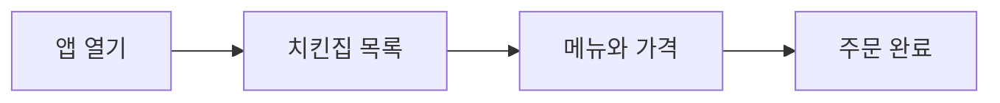

[그림 1 설명] 오늘 처음 나오는 플로우차트라 읽는 법부터 짚는다.

플로우차트는 무엇이 어디로 이어지는지를 그린 그림이야. 상자 하나가 하나의 대상이나 단계고, 화살표는 흐름의 방향이야.

이 그림의 상자 네 개는 내가 앱에서 보는 화면이야. 화살표 방향대로 앱을 열면 치킨집 목록이 나오고, 가게를 고르면 메뉴와 가격, 주문하면 주문 완료 화면으로 넘어가.

이 그림에는 서버가 안 보여. 사용자 눈에는 화면만 바뀌는 것처럼 보이니까. 바로 다음 그림 2가 이 화면들 뒤에서 무슨 일이 있었는지 보여 줘.

[질문] 그런데 그 치킨집 목록은 어디 있던 걸까? 내 휴대폰 안에 처음부터 들어 있었을까?

아니지. 가게는 매일 새로 생기고 문을 닫기도 하고, 가격도 바뀌어. 이걸 전국 사용자 휴대폰에 다 넣어 둘 수는 없어. 그래서 목록은 배달앱 회사 컴퓨터 한곳에 두고, 내 휴대폰은 필요할 때마다 그 컴퓨터에 물어봐. 근처 치킨집 알려 줘, 하고.

[그림 2] 화면 뒤에서 일어나는 일

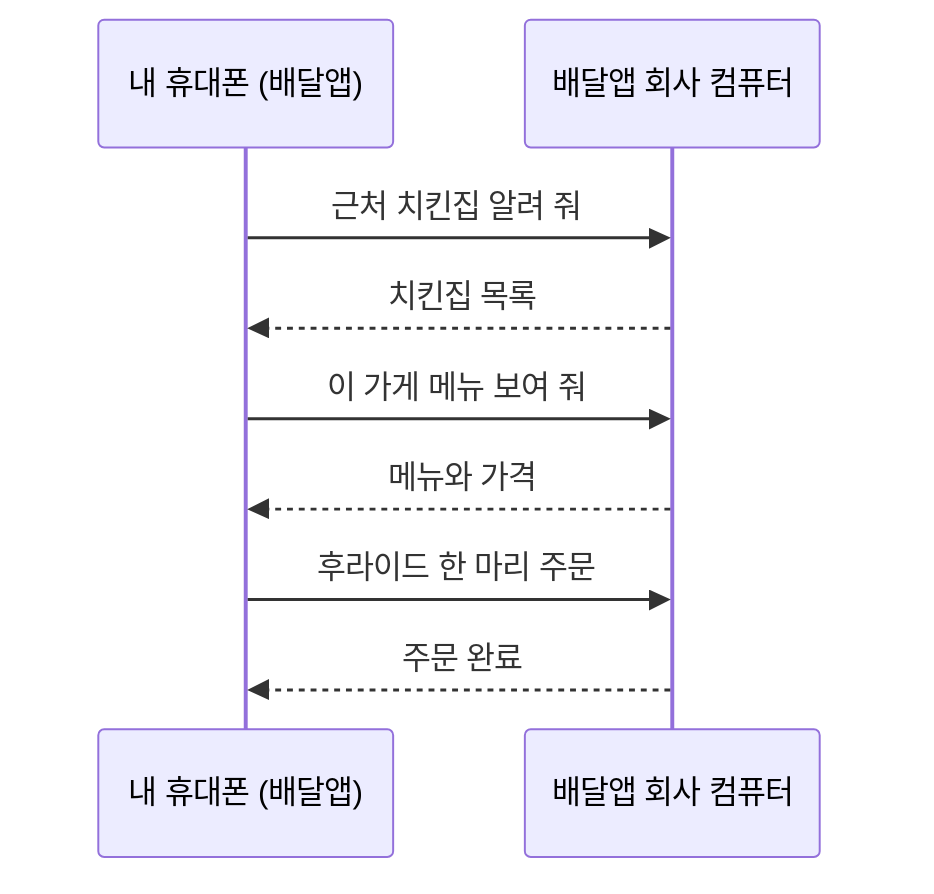

[그림 2 설명] 오늘 처음 나오는 시퀀스 다이어그램이라 읽는 법부터 짚는다.

시퀀스 다이어그램은 누가 누구한테 언제 말을 걸었는지를 시간 순서대로 그린 그림이야. 위쪽 상자가 등장인물이고, 상자에서 아래로 내려오는 세로줄이 그 등장인물의 시간이야. 위에서 아래로 갈수록 나중에 일어난 일이고. 가로 화살표 하나가 메시지 하나야. 실선 화살표는 요청, 점선 화살표는 그 요청에 대한 응답이라고 보면 돼.

이 그림에서 등장인물은 내 휴대폰 속 배달앱과 배달앱 회사 컴퓨터, 둘이야.

1. 앱이 회사 컴퓨터에 근처 치킨집 알려 달라고 요청해. 실선이야.
2. 회사 컴퓨터가 치킨집 목록으로 답해. 점선이야.
3. 내가 가게를 누르면 앱이 그 가게 메뉴를 다시 요청하고, 메뉴와 가격이 돌아와.
4. 주문 버튼을 누르면 주문 요청이 가고, 주문 완료가 돌아와.

여기서 봐야 할 건 두 가지야. 실선은 전부 왼쪽에서 오른쪽으로만 가. 말을 먼저 거는 쪽은 항상 앱이라는 뜻이야. 그리고 화면을 한 번 바꿀 때마다 요청과 응답이 한 쌍씩 오가. 앱은 아는 게 없어서 필요할 때마다 물어보는 거지.

여기서 물어보는 쪽, 내 휴대폰 속 앱이 클라이언트고, 대답해 주는 회사 컴퓨터가 서버야. 오늘 수업은 이 한 문장을 50분 동안 풀어 가는 시간이야.

<br/>

## 2. 클라이언트, 서버, 프로토콜 (10분)

### 식당 비유로 시작하기

식당을 떠올려 봐. 손님은 메뉴를 보고 주문해. 주방은 주문을 받아서 요리하고 음식을 내줘.

[그림 3] 식당 비유

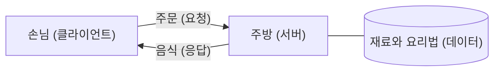

[그림 3 설명] 화살표 위에 붙은 글자는 그 화살표로 무엇이 오가는지야. 원통 모양 상자는 데이터를 쌓아 두는 곳을 뜻해. 앞으로 원통은 전부 데이터베이스나 창고라고 보면 돼.

1. 손님에서 주방으로 가는 화살표는 주문이야. 컴퓨터로 치면 요청이지.
2. 주방에서 손님으로 돌아오는 화살표는 음식이야. 컴퓨터로 치면 응답이야.
3. 주방 옆에 붙은 원통이 재료와 요리법이야. 주방과 화살표 없이 선으로만 이어져 있어. 주방 안에 딸린 것이라는 뜻이야.

손님에서 원통으로 가는 선이 없다는 걸 봐 둬. 손님은 재료에 직접 손대지 않고 주방을 통해서만 결과를 받아. 이 모양이 오늘 수업 내내 반복돼.

여기서 세 가지만 짚고 가자.

첫째, 주문은 항상 손님이 먼저 해. 주방장이 홀로 나와서 이거 드세요, 하지 않잖아. 클라이언트-서버도 똑같이 클라이언트가 먼저 말을 걸어.

둘째, 손님은 요리법을 몰라도 돼. 치킨을 몇 도에서 몇 분 튀기는지 몰라도 주문만 하면 치킨이 나와. 앱도 서버가 안에서 어떻게 처리하는지 몰라도 돼.

셋째, 재료랑 요리법은 주방 한곳에만 있어. 데이터가 서버 한곳에 모여 있다는 뜻이고, 이게 이 구조의 가장 큰 특징이야.

### 클라이언트 (Client)

클라이언트는 원래 의뢰인, 고객이라는 뜻이야. 변호사한테 사건을 맡기는 사람을 클라이언트라고 부르지. 전문가한테 일을 맡기고 결과를 받는 사람이야.

컴퓨터에서도 같아. 서버에 일을 맡기고 결과를 받는 프로그램이 클라이언트야. 크롬 같은 브라우저, 카카오톡 앱, 게임 프로그램이 다 클라이언트지.

클라이언트가 먼저 말을 걸려면 꼭 알아야 하는 게 하나 있어. 서버가 어디 있는지, 즉 주소야. 식당에 가려면 식당 주소를 알아야 하는 것처럼.

### 서버 (Server)

서버는 영어 serve, 제공하다에서 온 말이야. 테니스에서 공을 넣어 주는 것도 서브지. 음식을 내어 주는 사람, 시중드는 사람이라는 뜻이야.

컴퓨터에서는 요청을 기다렸다가 처리해서 결과를 돌려주는 프로그램, 또는 그 프로그램이 돌아가는 컴퓨터를 말해.

서버에는 클라이언트와 다른 조건이 세 가지 붙어.

1. 항상 켜져 있어야 해. 손님이 언제 올지 모르니까. 새벽 3시에 배달앱이 안 열리면 곤란하잖아.
2. 주소가 바뀌면 안 돼. 식당이 매일 이사 가면 손님이 못 찾아와.
3. 여러 손님을 동시에 받아야 해. 저녁 7시에 치킨 주문이 몰려도 버텨야 하니까.

[그림 4] 서버 하나에 여러 클라이언트

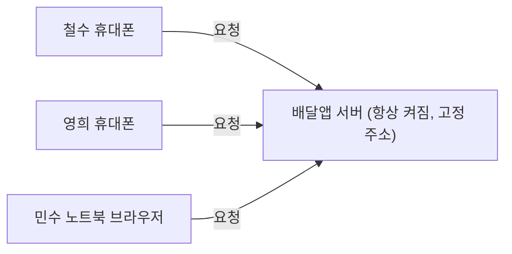

[그림 4 설명] 왼쪽 상자 셋이 클라이언트, 오른쪽 상자 하나가 서버야.

1. 철수 휴대폰, 영희 휴대폰, 민수 노트북 브라우저가 각자 서버로 요청을 보내.
2. 화살표가 셋인데 도착하는 곳은 하나야. 서버 한 대가 여러 손님을 동시에 받는 거지.
3. 서버 상자 안에 항상 켜짐, 고정 주소라고 적어 뒀어. 아까 말한 서버의 조건이야.

클라이언트끼리는 선이 하나도 없어. 철수와 영희는 서로 모르고, 각자 서버하고만 대화해. 그리고 휴대폰이든 노트북이든 상관없이 같은 서버에 붙을 수 있다는 것도 보여.

[질문] 그럼 서버는 특별한 컴퓨터일까?

꼭 그렇지는 않아. 성능 좋은 컴퓨터를 쓰긴 하지만, 본질은 역할이야. 지금 이 노트북에서도 서버 프로그램을 켜면 이 노트북이 서버가 돼. 이따 시연에서 보여 줄게.

### 프로토콜 (Protocol)

프로토콜은 원래 외교 의례라는 뜻이야. 정상 회담에서 누가 먼저 입장하고, 악수는 언제 하고, 어떤 순서로 말할지 정해 둔 약속.

식당으로 치면 주문서 양식이야. 테이블 번호, 메뉴, 수량을 정해진 칸에 적어야 주방이 바로 알아들어. 손님마다 아무렇게나 적어 내면 주방이 해석하느라 시간이 걸리겠지.

컴퓨터끼리도 메시지를 어떤 형식으로, 어떤 순서로 보낼지 미리 정해 둬. 이 약속이 프로토콜이야. 덕분에 크롬을 만든 회사랑 네이버 서버를 만든 회사가 서로 달라도 대화가 돼.

[그림 5] 같은 양식으로 주고받는 요청과 응답

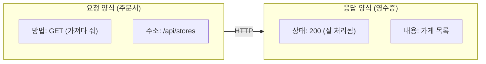

[그림 5 설명] 큰 테두리 상자는 안에 든 것들을 한 묶음으로 본다는 표시야. 여기서는 왼쪽 묶음이 요청 한 통, 오른쪽 묶음이 응답 한 통이야.

1. 왼쪽 요청 양식에는 칸이 두 개 있어. 방법 칸에는 GET, 즉 가져다 달라는 뜻이 들어가고, 주소 칸에는 무엇을 원하는지(/api/stores)가 들어가.
2. 가운데 화살표 위의 HTTP가 이 양식을 정해 둔 약속, 프로토콜이야.
3. 오른쪽 응답 양식에도 칸이 두 개 있어. 상태 칸에는 200처럼 잘 됐는지 숫자가 들어가고, 내용 칸에는 실제 가게 목록이 들어가.

양식이 정해져 있으니까 서버는 요청의 방법 칸과 주소 칸만 보면 뭘 해야 할지 알고, 클라이언트는 상태 칸만 보면 성공인지 알아. 시연 1에서 개발자 도구로 이 칸들을 실제로 보게 될 거야.

웹은 HTTP, 메일 보내기는 SMTP처럼 서비스마다 쓰는 프로토콜이 따로 있어. 주소창을 클릭하면 보이는 https의 http가 바로 이거야.

<br/>

## 3. 동작 순서와 시연 (10분)

### 순서

배달앱에서 가게 목록이 뜨는 과정을 단계로 나눠 보자.

1. 배달앱 서버는 켜진 채로 요청을 기다리고 있어.
2. 내가 앱을 열면, 앱이 서버 주소로 연결해.
3. 앱이 약속된 형식으로 요청을 보내. 내 위치 근처 치킨집 목록 줘.
4. 서버가 요청을 읽고 데이터베이스에서 가게 정보를 꺼내.
5. 서버가 그 결과를 응답으로 돌려줘.
6. 앱이 받은 목록을 화면에 그려.

[그림 6] 요청에서 응답까지

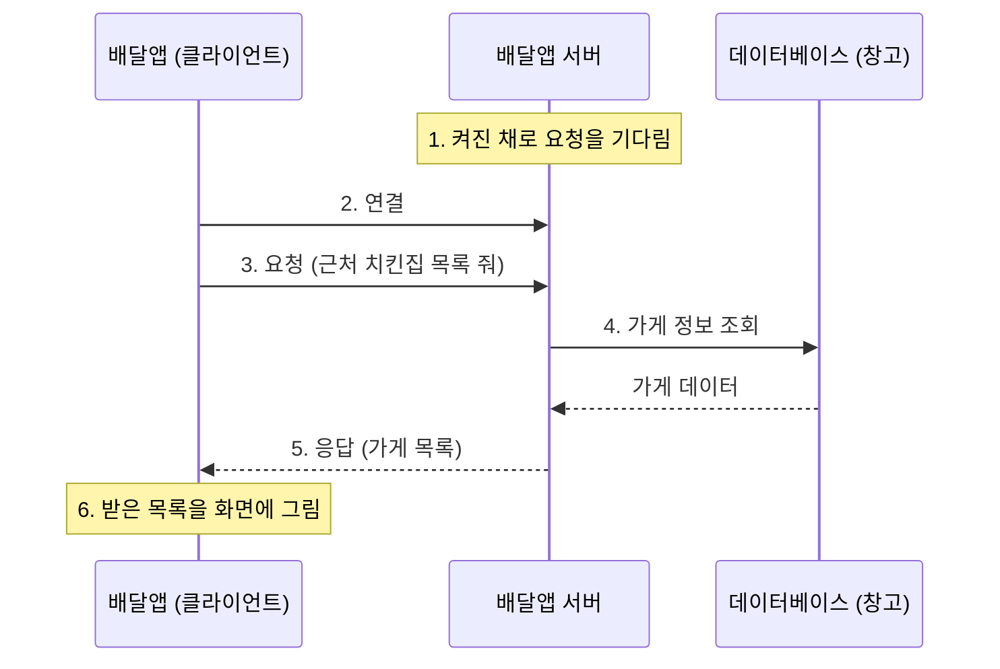

[그림 6 설명] 등장인물이 셋으로 늘었어. 배달앱, 배달앱 서버, 데이터베이스야. 세로줄 위에 걸쳐 있는 메모 상자(Note)는 메시지가 아니라 그 순간 그 등장인물이 하고 있는 일을 적은 거야.

1. 맨 위 메모를 보면 서버는 아무 요청이 없을 때도 켜진 채로 기다리고 있어. 이게 시작 상태야.
2. 앱이 서버 주소로 연결해. 전화를 거는 단계라고 보면 돼.
3. 연결된 다음에 앱이 진짜 요청을 보내. 근처 치킨집 목록 줘.
4. 서버는 목록을 직접 들고 있지 않아. 그래서 데이터베이스한테 가게 정보를 달라고 해. 여기서는 서버가 데이터베이스의 클라이언트가 되는 거야.
5. 데이터베이스가 가게 데이터를 돌려주면, 서버가 그걸 정리해서 앱에 응답해.
6. 마지막 메모는 앱이 받은 목록을 화면에 그리는 단계야.

앱은 데이터베이스와 직접 말하지 않아. 앱에서 데이터베이스로 바로 가는 화살표가 하나도 없지. 앱은 서버하고만 대화하고, 창고에는 서버만 들어가. 5장의 3-Tier가 바로 이 모양이야.

여기서 데이터베이스는 창고라고 생각하면 돼. 주방이 냉장고에서 재료를 꺼내 오듯, 서버가 데이터베이스에서 데이터를 꺼내 와.

중요한 건 역할 분담이야. 화면을 그리는 건 앱(클라이언트)의 일이고, 어떤 가게를 보여 줄지 고르는 건 서버의 일이야.

### 시연 1: 브라우저가 요청하는 모습 보기

[시연] 개발자 도구 열고 Network 탭으로 요청 목록 띄우기

크롬 개발자 도구가 한국어로 나오면 탭 이름이 Network는 네트워크, Application은 애플리케이션, Headers는 헤더, Preview는 미리보기, Response는 응답처럼 바뀐다. 위치는 같다. 아래는 영어 기준으로 쓰고 한국어는 괄호에 적었다. 한국어 표기는 크롬 버전마다 조금 다를 수 있으니 리허설 때 화면과 맞춰 본다.

1. 크롬에서 뉴스 사이트(예: 네이버 뉴스 첫 화면)를 연다.
2. F12를 누른다. 안 열리면 Ctrl+Shift+I(맥은 Cmd+Option+I), 또는 화면 빈 곳 우클릭 후 검사(Inspect)를 누른다.
3. 개발자 도구 위쪽 탭 줄에서 Network(네트워크)를 누른다. 탭이 안 보이면 탭 줄 오른쪽 끝의 >> 버튼을 눌러 목록에서 고른다.
4. Network 탭 바로 아래 도구 줄에서 Disable cache(캐시 사용 중지) 체크박스를 켠다. 끄고 있으면 한 번 받은 파일을 서버에 다시 묻지 않고 저장해 둔 것을 꺼내 써서, 서버가 실제로 응답하는 모습이 잘 안 보인다.
5. 이 상태에서 F5로 새로고침한다. Network 탭은 열려 있는 동안 생긴 요청만 기록하기 때문에, 개발자 도구를 먼저 열고 새로고침해야 목록이 채워진다.
6. 화면 맨 아래 상태 줄을 짚는다. 120 requests처럼 요청 개수가 나온다. 이 숫자를 읽어 주면서 페이지 하나에 요청이 이만큼 갔다고 말한다.
7. 목록 위쪽 필터 버튼 줄에서 Img를 누르면 이미지 요청만, Doc을 누르면 HTML 문서만 남는다. 종류별로 따로 요청했다는 걸 보여 준 뒤 All로 돌아온다.

지금 보이는 줄 하나하나가 요청 하나야. 페이지 하나 여는 데 요청이 몇 개나 갔는지 봐. 수십 개, 많으면 백 개가 넘어. 글자, 이미지, 디자인 파일을 각각 따로 달라고 한 거야.

[그림 7] 페이지 하나에 요청 여러 번

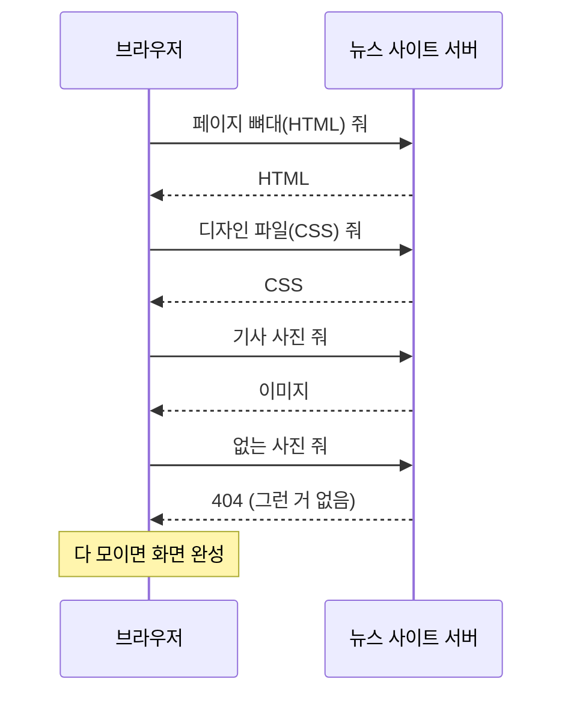

[그림 7 설명] 브라우저가 뉴스 페이지 하나를 열 때 실제로 오가는 요청을 줄여서 그린 거야. 개발자 도구 Network 탭의 줄 하나가 이 그림의 실선과 점선 한 쌍이야.

1. 브라우저는 먼저 페이지 뼈대인 HTML을 받아.
2. HTML을 읽어 보니 디자인 파일(CSS)이 필요하다고 적혀 있어. 그래서 CSS를 다시 요청해.
3. 기사 사진도 필요하니까 또 요청해.
4. 그중 하나는 서버에 없는 사진이었어. 서버는 404로 답해. 실패도 응답이야. 서버가 대답을 안 한 게 아니라 없다고 대답한 거지.
5. 필요한 게 다 모이면 브라우저가 화면을 완성해.

페이지 하나에 요청이 한 번이 아니라 여러 번이라는 게 핵심이야. 그리고 HTML을 받아 봐야 다음에 뭘 요청할지 안다는 것도 보여. 그래서 순서가 생겨.

[시연] 요청 하나를 열어서 HTTP 양식 보여 주기

1. 필터를 Doc으로 바꾸면 페이지 뼈대(HTML) 요청 한 줄만 남는다. 그 줄의 Name 칸을 클릭한다.
2. 오른쪽(또는 아래쪽)에 상세 창이 열리고, 그 위에 Headers, Preview, Response, Initiator, Timing 같은 탭이 생긴다. Headers(헤더) 탭을 누른다.
3. Headers 탭 맨 위 General(일반) 묶음을 짚는다. Request URL은 요청한 주소, Request Method는 GET, Status Code는 200이다. 그림 5의 요청 양식과 응답 양식 칸이 여기 그대로 있다고 연결한다.
4. 그 아래 Response Headers(응답 헤더)와 Request Headers(요청 헤더) 묶음은 펼쳐서 이런 것도 같이 오간다는 정도만 보여 주고 넘어간다.
5. 상세 창을 닫으려면 상세 창 왼쪽 위의 X를 누른다.

여기 Request Method에 GET이라고 쓰여 있지. 가져다 달라는 뜻이야. 그 아래 Status Code 200은 서버가 잘 처리했다는 뜻이고. 이게 방금 말한 주문서 양식, HTTP 프로토콜이 실제로 생긴 모습이야.

[질문] 404라는 숫자 본 적 있어?

없는 페이지에 들어가면 뜨는 그 404도 서버가 보낸 응답이야. 손님이 메뉴판에 없는 걸 주문했더니 주방이 그런 메뉴 없다고 답한 거지.

### 시연 2: 내 노트북을 서버로 만들기

이제 서버를 직접 만들어 보자. Node.js 18 이상이 깔려 있으면 외부 패키지 없이 바로 된다.

[준비] 실행 환경. 강의 전에 끝내 둔다.

설치할 라이브러리는 없다. server.js가 쓰는 http, crypto와 client.js가 쓰는 fetch는 전부 Node.js에 기본으로 들어 있다. 그래서 npm install도, package.json도 필요 없다. 필요한 건 Node.js 하나뿐이다.

Node.js 설치

1. 터미널을 열고 `node -v`를 입력한다. v18.0.0 이상이 나오면 설치는 건너뛴다. (이 대본을 만들 때 쓴 버전은 v22.13.0이고, v24.22.1에서도 demo 출력이 같았다. Node.js 18에서는 fetch가 실험 기능이라 client.js 실행 때 ExperimentalWarning 경고 줄이 더 나올 수 있다. 확인 필요.)
2. 명령을 찾을 수 없다고 나오거나 버전이 18보다 낮으면 nodejs.org에 들어가 LTS라고 적힌 버전을 받는다.
3. 윈도우는 받은 .msi 파일을 실행해서 라이선스 동의에 체크하고, 나머지는 기본값 그대로 계속(Next)을 누르면 된다. 맥은 .pkg 파일을 실행하거나 `brew install node`로 설치한다.
4. 설치가 끝나면 열려 있던 터미널을 전부 닫고 새로 연다. 기존 터미널은 설치 전 환경을 기억하고 있어서 node를 못 찾는다.
5. 다시 `node -v`로 버전이 나오는지 확인한다.

터미널 열고 demo 폴더로 이동하기

1. 윈도우는 시작 메뉴에서 터미널(또는 PowerShell)을 연다. VS Code나 WebStorm을 쓰면 아래쪽 Terminal 패널을 열어도 된다.
2. demo 폴더로 이동한다. 폴더 이름에 공백과 괄호가 있으니 경로를 꼭 큰따옴표로 감싼다. 경로는 노트 레포를 둔 위치에 맞게 바꾼다.

```powershell
cd "C:\Users\wkd58\WebstormProjects\Note\CS_Basic\클라이언트-서버 구조(Client-Server Architecture)\demo"
```

3. 탐색기에서 demo 폴더를 열고 주소창에 `powershell`이나 `cmd`를 입력하고 엔터를 쳐도 그 폴더에서 터미널이 열린다.
4. `dir`(맥은 `ls`)을 입력해서 server.js와 client.js가 보이면 제대로 온 것이다.

화면 배치

- 브라우저는 왼쪽 절반, 서버 터미널은 오른쪽 절반에 둔다. 창을 누르고 Win+←, Win+→를 누르면 반씩 붙는다. 요청을 보낼 때마다 오른쪽 로그가 바로 찍히는 게 보여야 한다.
- 개발자 도구는 브라우저 아래쪽에 붙인다. 개발자 도구 오른쪽 위 ⋮ 메뉴에서 Dock side(도킹 위치)의 아래쪽 아이콘을 누른다.
- 글자를 키운다. 브라우저 화면은 Ctrl++, 개발자 도구는 개발자 도구 안을 클릭한 뒤 Ctrl++, 터미널은 Ctrl+마우스 휠로 키운다. 뒷자리에서 읽힐 정도까지 키운다.
- 크롬은 게스트 창이나 시크릿 창을 쓴다. 확장 프로그램 요청이 Network 목록에 섞이거나, 북마크와 자동 완성이 화면에 노출되는 걸 막는다.
- 윈도우 알림은 집중 모드(방해 금지)로 꺼 둔다.

먼저 서버를 켜고 기다리게 하는 부분부터 볼게.

[코드 1] 서버 켜기

```js
const http = require('http');

const PORT = 8000;

const server = http.createServer((req, res) => {
  const url = new URL(req.url, `http://${req.headers.host}`);
  console.log(`[요청] ${req.method} ${decodeURIComponent(url.pathname + url.search)}`);

  // 여기에 주소별로 어떤 응답을 줄지 적는다 (코드 2, 3, 5, 6)
});

server.listen(PORT, () => {
  console.log(`서버가 켜졌다. 요청을 기다리는 중: http://localhost:${PORT}`);
});
```

http는 Node.js에 기본으로 들어 있는 모듈이야. createServer 안의 함수는 요청이 하나 올 때마다 한 번씩 실행돼. req는 손님이 낸 주문서, res는 손님에게 돌려줄 접시라고 생각하면 돼. listen은 8000번 문을 열고 손님을 기다리라는 뜻이야.

[시연] 서버 켜기

1. 오른쪽 터미널이 demo 폴더에 있는지 확인하고 아래 명령을 입력한다.

```powershell
node server.js
```

2. 아래 한 줄이 나오고 커서가 다음 줄에서 멈추면 성공이다. 프롬프트(PS C:\...>)가 다시 나오지 않는 게 정상이다. 서버가 계속 돌면서 기다리는 중이라서 그렇다.

```text
서버가 켜졌다. 요청을 기다리는 중: http://localhost:8000
```

이렇게 안 되면 아래를 본다.

| 증상 | 원인 | 해결 |
| --- | --- | --- |
| node 명령을 찾을 수 없다고 나옴 | Node.js가 없거나 설치 후 터미널을 새로 열지 않음 | 위 설치 단계를 다시 하고 터미널을 새로 연다 |
| Cannot find module ... server.js | demo 폴더가 아닌 곳에서 실행함 | `dir`로 server.js가 보이는 폴더인지 확인하고 cd를 다시 한다 |
| Error: listen EADDRINUSE ... 8000 | 8000번을 다른 프로그램이 쓰는 중. 아까 켠 서버를 안 끈 경우가 대부분 | 아래 포트 정리 명령을 쓴다 |
| 아무 출력 없이 바로 프롬프트로 돌아옴 | 경로 문제로 node가 바로 종료되는 경우가 있음 (대본 검증 환경에서 한글과 괄호가 든 경로일 때 겪음) | demo 폴더를 `C:\demo`처럼 영문 경로로 복사해서 거기서 실행한다 |

포트 정리 명령(윈도우). 마지막 칸 숫자가 PID다.

```powershell
netstat -ano | findstr :8000
taskkill /PID 12345 /F
```

맥은 `lsof -i :8000`으로 PID를 찾고 `kill -9 PID`로 끈다. 급하면 server.js의 `const PORT = 8000;`을 8001로 바꾸고, 대본의 주소도 전부 8001로 읽으면 된다.

터미널이 멈춰 있는 것처럼 보이지. 이게 바로 요청을 기다리는 상태야. 그림 6의 1번 단계지.

localhost는 내 컴퓨터 자신을 가리키는 주소고, 8000은 포트 번호야. 포트는 건물 안의 호수라고 생각하면 돼. 주소가 건물이면, 한 건물 안에 가게가 여러 개 있으니 몇 호인지까지 알려 줘야 하는 거지.

[그림 8] 주소와 포트

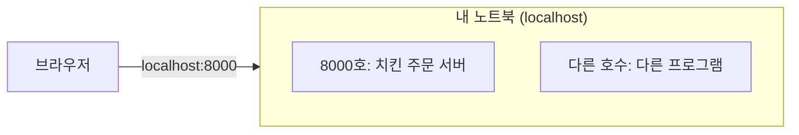

[그림 8 설명] 큰 테두리 상자가 내 노트북 한 대, 즉 건물 하나야. 그 안의 작은 상자가 건물 안의 호수, 즉 포트야.

1. 브라우저가 localhost:8000으로 요청을 보내. 콜론 앞의 localhost가 건물 주소, 뒤의 8000이 호수야.
2. 화살표는 건물 전체로 들어가지만, 8000이라는 호수를 들고 있으니 8000호의 치킨 주문 서버가 받아.
3. 같은 건물 안의 다른 호수에는 다른 프로그램이 있을 수 있어. 이 프로그램들은 8000번으로 온 요청을 받지 않아.

그래서 서버를 켤 때 8000번을 다른 프로그램이 쓰고 있으면 에러가 나. 한 호수에는 한 가게만 들어갈 수 있거든.

이제 서버에 메뉴판을 붙여 보자. 창고 역할을 할 데이터와, 그 데이터를 꺼내 주는 주소를 만든다.

[코드 2] 창고 데이터와 가게 목록 API

```js
// 데이터베이스(창고) 역할을 하는 배열
const stores = [
  { id: 1, name: '바삭치킨', menu: '후라이드', price: 18000 },
  { id: 2, name: '양념명가', menu: '양념치킨', price: 19000 },
  { id: 3, name: '간장한마리', menu: '간장치킨', price: 20000 },
];

function sendJson(res, status, data) {
  res.writeHead(status, { 'Content-Type': 'application/json; charset=utf-8' });
  res.end(JSON.stringify(data));
}

// createServer 안쪽
  // 1. 첫 화면: HTML 응답
  if (url.pathname === '/') {
    res.writeHead(200, { 'Content-Type': 'text/html; charset=utf-8' });
    res.end(`
      <h1>치킨 주문 서버</h1>
      <ul>
        <li><a href="/api/stores">가게 목록 (JSON)</a></li>
        <li><a href="/login?name=철수">철수로 로그인</a></li>
        <li><a href="/me">내가 누구인지 확인</a></li>
        <li><a href="/menu/pizza">없는 페이지 (404)</a></li>
      </ul>
    `);
    return;
  }

  // 2. 데이터만 주는 API: 서버가 창고(stores)에서 꺼내 JSON으로 응답
  if (url.pathname === '/api/stores') {
    sendJson(res, 200, stores);
    return;
  }
```

주소가 `/`면 화면(HTML)을 주고, `/api/stores`면 데이터(JSON)만 줘. writeHead의 200이 아까 개발자 도구에서 본 그 상태 코드야. 우리가 직접 정해서 보내는 거지.

[시연] 브라우저로 내 서버에 요청 보내기

1. 왼쪽 브라우저에서 새 탭을 열고 F12로 개발자 도구를 연 다음 Network(네트워크) 탭을 누른다. 요청을 보내기 전에 먼저 열어 둬야 기록된다.
2. Network 탭 아래 도구 줄에서 Preserve log(로그 보존) 체크박스를 켠다. 끄고 있으면 링크를 눌러 페이지가 바뀔 때마다 목록이 지워진다. Disable cache도 켜져 있는지 본다.
3. 주소창에 `localhost:8000`을 입력하고 엔터를 친다. 치킨 주문 서버라는 제목과 링크 네 개가 뜬다.
4. 오른쪽 터미널을 짚는다. [요청] GET / 한 줄이 새로 찍혔다.
5. 브라우저에서 가게 목록 (JSON) 링크를 누른다. 화면에 가게 3곳이 JSON으로 뜨고, 터미널에는 [요청] GET /api/stores가 찍힌다. 크롬 버전에 따라 JSON 위에 Pretty-print(자동 서식) 체크박스가 보이는데, 켜면 줄이 정리돼서 읽기 쉽다.
6. Network 목록에서 stores 줄을 클릭하고 Headers(헤더) 탭의 General(일반)을 짚는다. Request Method는 GET, Status Code는 200이다. 아까 뉴스 사이트에서 본 것과 같은 양식을 내가 만든 서버가 보낸 것이다.
7. 같은 상세 창에서 Response Headers(응답 헤더)를 펼쳐 Content-Type: application/json을 짚는다. 이번 응답은 화면이 아니라 데이터라고 서버가 표시해 보낸 것이다. 코드 2의 sendJson 안에 쓴 그 값이다.
8. Preview(미리보기) 탭을 누르면 가게 목록이 펼칠 수 있는 목록으로 보이고, Response(응답) 탭을 누르면 서버가 보낸 글자가 그대로 보인다. 둘 다 짧게 보여 준다.

터미널에는 이렇게 찍힌다.

```text
[요청] GET /
[요청] GET /api/stores
```

처음 접속할 때 [요청] GET /favicon.ico가 한 줄 더 찍힐 수 있다. 당황하지 말고 시연 소재로 쓴다. 브라우저가 탭에 띄울 작은 아이콘(파비콘)을 알아서 요청한 것이고, 우리 서버 메뉴판에 없는 주소라 404로 답한 것이다. 사용자가 누르지 않아도 브라우저가 스스로 요청을 보낸다는 좋은 예다.

[그림 9] 시연 2에서 오간 요청

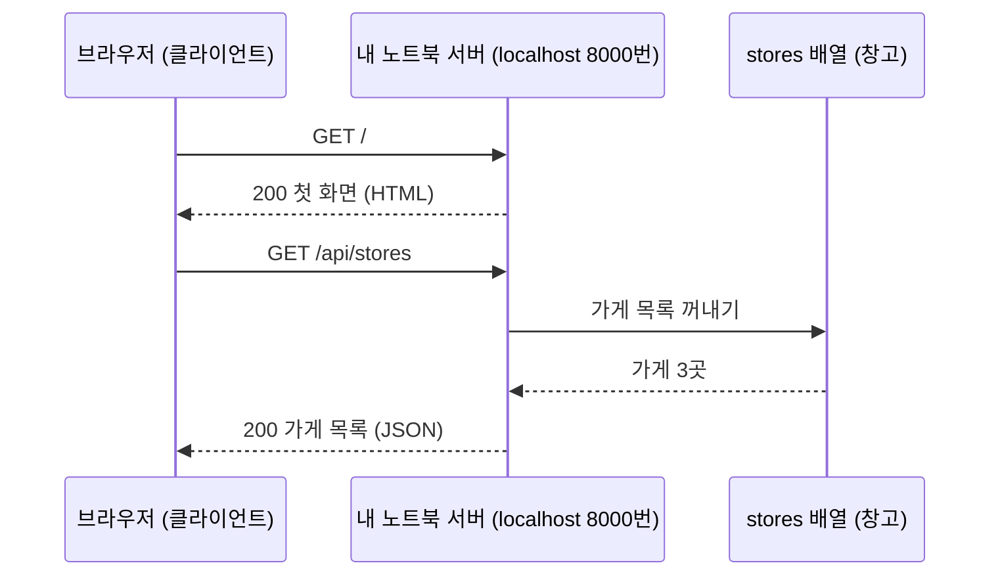

[그림 9 설명] 방금 시연에서 실제로 일어난 일을 그대로 그린 거야. 등장인물은 브라우저, 내 노트북에서 돌아가는 server.js, 그리고 코드 안의 stores 배열이야. 그림 6의 배달앱, 서버, 데이터베이스와 자리가 똑같아.

1. 주소창에 localhost:8000을 치면 브라우저가 GET / 요청을 보내. 터미널 로그 첫 줄이 이거야.
2. 서버는 코드 2의 첫 번째 if에 걸려서 첫 화면 HTML을 200과 함께 돌려줘.
3. 가게 목록 링크를 누르면 브라우저가 GET /api/stores 요청을 보내. 로그 둘째 줄이야.
4. 서버는 두 번째 if에 걸려서 stores 배열에서 가게 목록을 꺼내.
5. 꺼낸 가게 3곳을 JSON으로 바꿔서 200과 함께 돌려줘.

응답이 두 종류라는 걸 봐 둬. 첫 번째는 사람이 보는 화면(HTML)이고, 두 번째는 프로그램이 쓰는 데이터(JSON)야. 같은 서버가 주소에 따라 다른 걸 줘.

브라우저가 요청할 때마다 터미널에 한 줄씩 기록이 남았어. 그리고 가게 목록에서는 화면이 아니라 데이터만 왔지. 배달앱도 이렇게 데이터만 받아서 화면은 앱이 직접 그려.

다음은 메뉴판에 없는 주문을 받았을 때야.

[코드 3] 없는 주소는 404

```js
  // 5. 메뉴판에 없는 주문 (createServer 안쪽 맨 마지막 줄)
  sendJson(res, 404, { message: '그런 메뉴는 없어요.' });
```

위의 if에 하나도 안 걸리면 맨 마지막 줄까지 내려와서 404를 보내. 메뉴판을 위에서부터 훑어보다가 끝까지 없으면 없다고 답하는 거지.

[시연] 404 만들어 보기

1. 브라우저 뒤로 가기(Alt+←)로 첫 화면에 돌아와 없는 페이지 (404) 링크를 누른다.
2. 화면에 {"message":"그런 메뉴는 없어요."}가 뜬다.
3. Network 목록에서 pizza 줄이 빨간 글씨로 표시되고 Status 칸에 404가 찍힌 걸 짚는다. 실패한 요청은 빨갛게 보여서 눈에 잘 띈다.
4. 그 줄을 클릭하고 Headers 탭 General의 Status Code가 404인 걸 보여 준다.

터미널에는 이렇게 찍힌다.

```text
[요청] GET /menu/pizza
```

아까 말한 404를 직접 만들어 본 거야.

이번엔 브라우저 말고 다른 프로그램으로 요청해 보자.

[코드 4] 브라우저가 아닌 클라이언트 (client.js)

```js
async function main() {
  const res = await fetch('http://localhost:8000/api/stores');
  console.log('상태 코드:', res.status);

  const stores = await res.json();
  for (const store of stores) {
    console.log(`${store.name} - ${store.menu} ${store.price}원`);
  }
}

main().catch(() => {
  console.log('서버에 연결할 수 없다. server.js가 켜져 있는지 확인하자.');
});
```

fetch는 주소로 요청을 보내는 함수야. 응답이 오면 상태 코드를 찍고, 받은 가게 목록을 한 줄씩 출력해.

[시연] 두 번째 터미널에서 client.js 실행하기

서버 터미널은 지금 요청을 기다리느라 다른 명령을 받을 수 없다. 그래서 터미널을 하나 더 연다. 서버 터미널을 Ctrl+C로 끄면 안 된다.

1. 새 터미널을 연다. 윈도우 터미널이면 Ctrl+Shift+T로 새 탭, VS Code나 WebStorm이면 Terminal 패널의 + 버튼을 누른다.
2. 새 터미널은 demo 폴더가 아니라 처음 위치에서 열린다. 아까와 같은 cd 명령으로 demo 폴더로 이동한다.
3. 아래 명령을 입력한다.

```bash
node client.js
```

4. 아래처럼 가게 목록이 나오는 걸 보여 준다. 동시에 서버 터미널에도 [요청] GET /api/stores가 한 줄 더 찍힌다. 두 터미널을 번갈아 짚는다.

```text
상태 코드: 200
바삭치킨 - 후라이드 18000원
양념명가 - 양념치킨 19000원
간장한마리 - 간장치킨 20000원
```

[그림 10] 클라이언트는 프로그램 이름이 아니라 역할

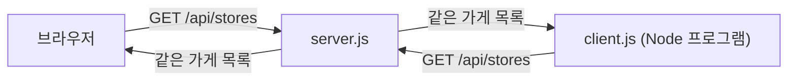

[그림 10 설명] 왼쪽 위는 브라우저, 왼쪽 아래는 client.js, 오른쪽은 server.js야.

1. 브라우저와 client.js가 똑같이 GET /api/stores를 보내. 화살표 위 글자가 완전히 같아.
2. server.js는 두 요청을 구별하지 않고 같은 가게 목록을 돌려줘.
3. 받은 다음에 하는 일은 달라. 브라우저는 JSON을 화면에 그대로 띄우고, client.js는 한 줄씩 정리해서 터미널에 찍어.

서버는 상대가 누구인지보다 요청 양식이 맞는지만 봐. 그래서 클라이언트는 브라우저든 앱이든 직접 짠 프로그램이든 될 수 있어.

client.js는 브라우저가 아니라 그냥 Node.js 프로그램이야. 그런데도 서버에 요청을 보내고 가게 목록을 받아 왔지. 서버 입장에서는 누가 보냈든 같은 양식이면 같은 응답을 줘. 클라이언트는 특정 프로그램 이름이 아니라 요청하는 역할이라는 거야.

[시연] 서버 끄고 실패 보여 주기

1. 서버 터미널(node server.js를 실행한 쪽)을 한 번 클릭해서 고른다. client.js 터미널에서 누르면 아무 일도 안 일어난다.
2. Ctrl+C를 누른다. 프롬프트(PS C:\...>)가 다시 나오면 서버가 꺼진 것이다.
3. 브라우저 주소창에 localhost:8000을 다시 입력하고 엔터를 친다. 404 시연 뒤라 F5를 누르면 /menu/pizza를 다시 요청하게 되니, 그림 11과 맞추려고 첫 화면 주소로 간다. 사이트에 연결할 수 없음 화면과 ERR_CONNECTION_REFUSED 문구가 뜬다.
4. Network 목록의 새 줄을 짚는다. Status 칸이 숫자가 아니라 (failed)로 빨갛게 나온다. 404 때는 숫자가 있었다는 점과 비교한다. 404는 서버가 대답한 것이고, (failed)는 대답할 서버가 없는 것이다.
5. client.js 터미널에서 ↑ 키를 누르면 방금 친 node client.js가 다시 나온다. 엔터를 친다. 아래 문구가 나온다.

```text
서버에 연결할 수 없다. server.js가 켜져 있는지 확인하자.
```

6. 다음 시연을 위해 서버 터미널에서 ↑ 키와 엔터로 node server.js를 다시 켜 둔다.

[그림 11] 서버가 꺼지면

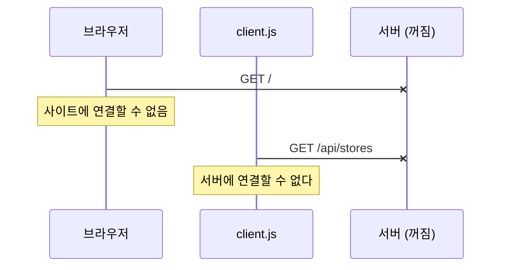

[그림 11 설명] 화살표 끝이 X로 끝나지. X는 메시지가 상대에게 도착하지 못했다는 표시야.

1. 서버를 끈 뒤 브라우저가 GET /를 보내. 그런데 8000번 문을 열고 기다리는 프로그램이 없으니 요청이 닿지 않아.
2. 브라우저는 사이트에 연결할 수 없다는 화면을 띄워.
3. client.js도 똑같이 GET /api/stores를 보내지만 닿지 않아.
4. client.js는 코드 4의 catch로 넘어가서 서버에 연결할 수 없다고 출력해.

그림 7의 404와 비교해 봐. 404는 서버가 살아 있어서 없다고 대답한 거야. 여기는 대답할 서버 자체가 없어서 점선 응답이 아예 없어. 둘 다 실패지만 원인이 완전히 달라.

서버를 끄니까 브라우저도 client.js도 둘 다 실패하지. 서버가 항상 켜져 있어야 하는 이유를 눈으로 본 거야.

<br/>

## 4. 무상태와 상태 유지 (7분)

### 서버는 나를 기억할까

[질문] 쇼핑몰에 로그인하고 다른 페이지로 넘어가도 로그인이 유지되잖아. 서버가 나를 기억하고 있는 걸까?

정답부터 말하면, 웹 서버는 기본적으로 기억하지 않아. HTTP는 무상태(Stateless) 방식이야. 요청 하나를 처리하고 나면 그 손님을 잊어버려.

### 무상태 (Stateless)

손님이 올 때마다 처음 보는 사람처럼 대하는 가게라고 생각해 봐. 매번 나 김철수인데, 하고 다시 말해야 해.

불편해 보이지. 그런데 큰 장점이 있어. 어떤 직원이 받아도 똑같이 처리할 수 있다는 거야. 손님이 필요한 정보를 매번 다 들고 오니까, 1번 직원이 받든 2번 직원이 받든 상관없어. 그래서 직원, 즉 서버를 늘리기가 쉬워.

[그림 12] 무상태: 아무 직원이나 받아도 된다

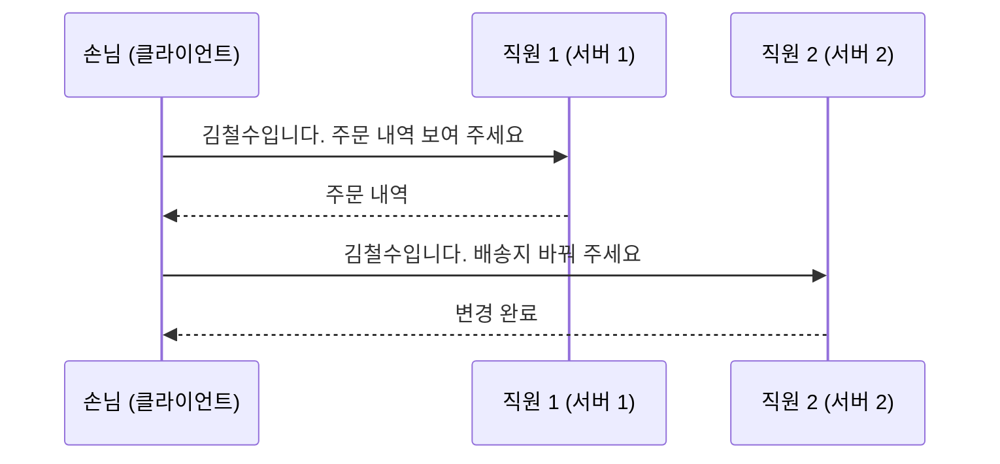

[그림 12 설명] 손님 한 명과 직원 두 명이 있어. 직원이 곧 서버고, 직원 둘은 서로 아무것도 공유하지 않는다고 생각해.

1. 손님이 직원 1에게 김철수라고 밝히면서 주문 내역을 달라고 해.
2. 직원 1이 주문 내역을 줘. 그러고는 손님을 잊어.
3. 다음 요청은 직원 2가 받았어. 손님이 또 김철수라고 밝히면서 배송지를 바꿔 달라고 해.
4. 직원 2는 처음 보는 손님이지만 요청 안에 누구인지가 다 들어 있으니 바로 처리해.

메시지마다 김철수입니다가 붙어 있는 게 핵심이야. 손님이 매번 정보를 다 들고 오니까, 어느 직원이 받아도 결과가 같아.

### 상태 유지 (Stateful)

반대로 단골을 알아보는 가게도 있어. 아까 그거, 하면 알아듣는 거지. 편하긴 한데 문제가 있어. 그 손님을 기억하는 직원이 1번 직원뿐이면, 2번 직원한테는 아까 그거가 안 통해.

[그림 13] 상태 유지: 기억한 직원만 알아듣는다

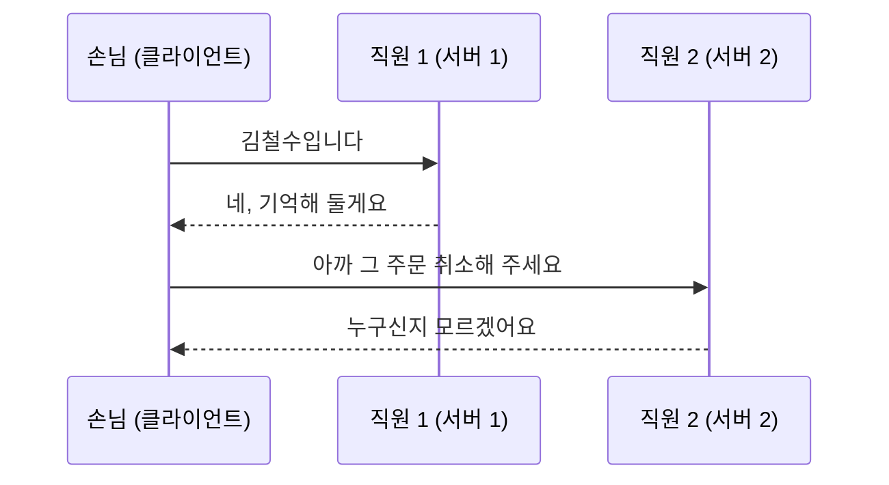

[그림 13 설명] 등장인물은 그림 12와 똑같아. 달라진 건 손님이 말하는 방식이야.

1. 손님이 직원 1에게 김철수라고 밝혀.
2. 직원 1이 기억해 두겠다고 해. 이제 김철수라는 정보는 직원 1의 머릿속에만 있어.
3. 다음 요청을 직원 2가 받았어. 손님은 이미 말했으니까 아까 그 주문 취소해 달라고만 해.
4. 직원 2는 아까가 언제인지, 이 사람이 누구인지 몰라. 그래서 처리할 수 없어.

그림 12와 나란히 놓고 보면 차이가 보여. 정보가 요청 안에 있으면 아무 직원이나 받아도 되고, 정보가 직원 머릿속에 있으면 그 직원만 받을 수 있어. 서버를 여러 대로 늘리면 바로 이 문제가 터져.

### 그럼 로그인은 어떻게 유지될까

웹은 무상태인데 로그인이 유지되는 비밀은 번호표에 있어. 옷 보관소를 생각해 봐. 옷을 맡기면 번호표를 줘. 다시 찾을 때 번호표만 보여 주면 돼.

쿠키(Cookie)는 원래 과자라는 뜻인데, 웹에서는 브라우저가 사이트별로 저장해 뒀다가 그 사이트에 요청할 때마다 자동으로 붙여 보내는 작은 메모를 말해.

로그인하면 서버가 브라우저에 번호표를 하나 줘. 브라우저는 이걸 쿠키에 담아 두고, 요청할 때마다 자동으로 같이 보내. 서버가 손님 얼굴을 기억하는 게 아니라, 장부에 적어 두고 요청마다 번호표로 찾아보는 거야. 요청 하나하나는 번호표만 있으면 처리할 수 있으니, 무상태 원칙은 지키면서 로그인을 유지하는 방법이지.

[그림 14] 옷 보관소 번호표

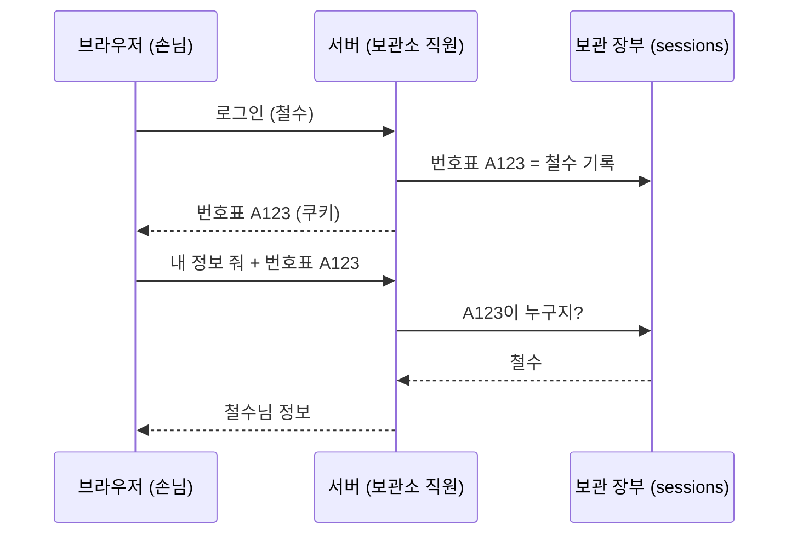

[그림 14 설명] 등장인물은 브라우저, 서버, 그리고 서버 옆에 있는 보관 장부야. 장부는 번호표와 사람 이름을 짝지어 적어 두는 공책이라고 생각하면 돼.

1. 브라우저가 철수로 로그인해 달라고 요청해.
2. 서버는 A123이라는 번호표를 새로 만들고, 장부에 A123은 철수라고 적어.
3. 서버가 브라우저에게 번호표 A123을 건네. 브라우저는 이걸 쿠키에 보관해.
4. 나중에 브라우저가 내 정보를 달라고 할 때 번호표 A123을 같이 보내. 쿠키라서 브라우저가 알아서 붙여 보내.
5. 서버는 철수를 기억하지 않아. 대신 장부를 펴서 A123이 누구인지 찾아봐.
6. 장부가 철수라고 알려 주면, 서버가 철수의 정보를 돌려줘.

그림 12와 비교하면 김철수입니다 대신 번호표 A123이 매 요청에 붙어 있는 거야. 정보를 요청 안에 들고 다닌다는 원칙은 같아. 이름 대신 번호표를 쓰면 남이 내 이름만 대고 들어올 수 없다는 게 다를 뿐이야.

코드로 직접 만들어 보자. 아까 서버에 번호표 장부와 주소 두 개를 더한다.

[코드 5] 번호표 장부와 로그인

```js
const crypto = require('crypto');

// 로그인 번호표(세션 ID)와 사용자 이름을 묶어 두는 보관소
const sessions = {};

// createServer 안쪽, /api/stores 아래
  // 3. 로그인: 서버가 번호표를 만들어 쿠키로 건넨다
  if (url.pathname === '/login') {
    const name = url.searchParams.get('name') || '손님';
    const sessionId = crypto.randomUUID();
    sessions[sessionId] = name;
    console.log(`  번호표 발급: ${sessionId} -> ${name}`);
    res.writeHead(200, {
      'Content-Type': 'text/html; charset=utf-8',
      'Set-Cookie': `sessionId=${sessionId}; HttpOnly; Path=/`,
    });
    res.end(`<p>${name}님 로그인 완료. <a href="/me">내 정보 보기</a></p>`);
    return;
  }
```

randomUUID는 겹치지 않는 긴 번호를 만들어 줘. 이걸 번호표로 쓰고, 장부(sessions)에 번호표와 이름을 같이 적어 둬. Set-Cookie는 브라우저한테 이 번호표를 보관해 두라고 건네는 부분이야.

[코드 6] 번호표 확인

```js
function getCookie(req, key) {
  const cookie = req.headers.cookie || '';
  const found = cookie.split('; ').find((item) => item.startsWith(key + '='));
  return found ? found.split('=')[1] : null;
}

// createServer 안쪽, /login 아래
  // 4. 내 정보: 서버는 기억하지 않고 매번 번호표를 보고 찾는다
  if (url.pathname === '/me') {
    const sessionId = getCookie(req, 'sessionId');
    console.log(`  받은 번호표: ${sessionId}`);
    const name = sessions[sessionId];
    if (!name) {
      sendJson(res, 401, { message: '번호표가 없어요. 먼저 로그인하세요.' });
      return;
    }
    sendJson(res, 200, { name });
    return;
  }
```

브라우저가 같이 보낸 쿠키에서 번호표를 꺼내고, 장부에서 찾아봐. 있으면 이름을 주고, 없으면 401을 보내. 401은 누군지 모르겠다는 뜻의 상태 코드야.

[시연] 번호표 발급과 확인 보여 주기

번호표 장부(sessions)는 서버 메모리에만 있어서 서버를 껐다 켜면 비워진다. 리허설 때 로그인해 둔 쿠키가 남아 있으면 순서가 꼬이니, 시작 전에 아래 Application 탭에서 localhost 쿠키를 지워 두거나 새 시크릿 창을 연다.

1. 서버가 켜져 있는지 오른쪽 터미널에서 확인한다. 꺼져 있으면 node server.js로 켠다.
2. 브라우저에서 `localhost:8000`을 열고, Network 탭이 열려 있고 Preserve log가 켜져 있는지 본다.
3. 내가 누구인지 확인 링크를 누른다. 화면에 번호표가 없다는 메시지가 뜬다. Network 목록의 me 줄이 빨간색 401인 걸 짚는다. 터미널에는 받은 번호표: null이 찍힌다.
4. 뒤로 가기로 첫 화면에 돌아와 철수로 로그인 링크를 누른다. 화면에 철수님 로그인 완료가 뜬다.
5. Network 목록에서 login 줄을 클릭하고 Headers 탭의 Response Headers(응답 헤더)를 펼친다. Set-Cookie: sessionId=... 줄을 짚는다. 서버가 번호표를 건넨 장면이다. 터미널의 번호표 발급 줄과 번호가 같은지 대조해 보여 준다.
6. 화면의 내 정보 보기 링크를 누른다. 화면에 {"name":"철수"}가 뜬다.
7. Network 목록에서 새로 생긴 me 줄을 클릭하고 Headers 탭의 Request Headers(요청 헤더)를 펼친다. Cookie: sessionId=... 줄을 짚는다. 이번엔 브라우저가 번호표를 들고 간 장면이다. 코드에 쿠키를 보내라는 줄이 없는데도 브라우저가 알아서 붙였다는 점을 강조한다.

터미널에는 이렇게 찍힌다.

```text
[요청] GET /me
  받은 번호표: null
[요청] GET /login?name=철수
  번호표 발급: 4882ec86-1548-483c-b5e8-8e807b8130a8 -> 철수
[요청] GET /me
  받은 번호표: 4882ec86-1548-483c-b5e8-8e807b8130a8
```

로그인 전에는 번호표가 null이라 서버가 너 누구냐고 해. 로그인하면 번호표 발급 로그가 찍히고, 그 뒤로는 요청마다 같은 번호표가 따라오지.

[시연] 쿠키 지우고 다시 확인하기

1. 개발자 도구 위쪽 탭 줄에서 Application(애플리케이션)을 누른다. 안 보이면 >> 버튼을 눌러 목록에서 고른다.
2. 왼쪽 사이드바의 Storage(저장용량) 묶음에서 Cookies(쿠키) 왼쪽 화살표를 눌러 펼치고, 그 아래 http://localhost:8000을 누른다.
3. 오른쪽 표에 Name이 sessionId인 줄이 있다. Value 칸의 번호가 아까 터미널의 번호표와 같다는 걸 짚는다. HttpOnly 칸에 체크가 있는 것도 보여 준다. 자바스크립트가 이 쿠키를 못 읽게 막아 둔 표시인데, 자세한 건 프론트엔드 관점 시간에 다룬다고만 말한다.
4. sessionId 줄을 클릭하고 키보드 Delete 키를 누른다. 우클릭 후 Delete(삭제)를 눌러도 된다. 표에서 줄이 사라진다.
5. 다시 Network 탭으로 돌아가 브라우저에서 F5를 누른다. 지금 화면이 /me라서 새로고침하면 내 정보 확인을 다시 요청한 것과 같다.
6. 화면에 다시 번호표가 없다는 메시지가 뜨고, Network에 401, 터미널에 받은 번호표: null이 찍힌다.

[그림 15] 로그인 시연 전체 흐름

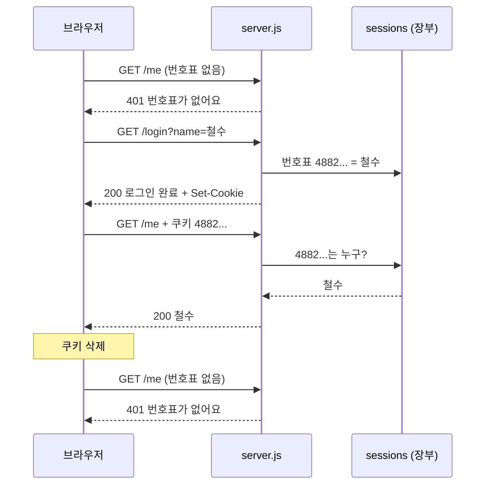

[그림 15 설명] 그림 14를 실제 코드와 실제 로그로 옮긴 거야. 위에서부터 시연한 순서 그대로야.

1. 로그인 전에 내 정보 확인을 누르면 브라우저가 GET /me를 보내. 아직 쿠키가 없으니 번호표 없이 가. 로그의 받은 번호표 null이 이거야.
2. 서버는 코드 6에서 장부를 찾아봐도 이름이 없으니까 401로 답해.
3. 철수로 로그인을 누르면 GET /login?name=철수가 가.
4. 서버는 코드 5에서 번호표 4882...를 만들고 장부(sessions)에 철수라고 적어. 로그의 번호표 발급 줄이야.
5. 응답에 Set-Cookie를 붙여서 번호표를 브라우저에 건네.
6. 다시 내 정보 확인을 누르면 이번엔 GET /me에 쿠키 4882...가 같이 가. 로그의 받은 번호표에 같은 번호가 찍혀.
7. 서버가 장부에서 4882...를 찾고, 철수라는 걸 알아내서 200으로 답해.
8. 메모 상자에서 쿠키를 지웠어. 브라우저가 번호표를 버린 거야.
9. 다시 GET /me를 보내면 번호표 없이 가고, 서버는 1번 때처럼 401로 답해.

장부에는 아직 4882... 철수가 적혀 있어. 그런데 어느 줄이 나인지 알려 줄 번호표가 없으니 찾을 수가 없어.

번호표를 버리니까 서버는 다시 나를 몰라. 서버가 나를 기억한 게 아니라 번호표를 확인한 거였다는 증거야.

쿠키, 세션, 토큰 이야기는 프론트엔드 관점 시간에 따로 자세히 다룰게.

<br/>

## 5. 계층 구조와 확장 (8분)

### 2-Tier와 3-Tier

Tier는 층이라는 뜻이야. 역할을 몇 층으로 나누느냐의 이야기지.

2-Tier는 클라이언트가 데이터베이스에 바로 붙는 구조야. 손님이 주방을 거치지 않고 창고에 직접 들어가서 재료를 꺼내는 셈이지. 단순하긴 한데, 손님이 많으면 창고가 붐비고 아무나 창고에 들어가니까 위험해.

[그림 16] 2-Tier

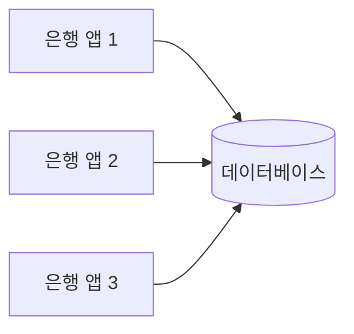

[그림 16 설명] 왼쪽 상자 셋은 사용자 휴대폰의 은행 앱이고, 오른쪽 원통은 은행 데이터베이스야.

1. 앱 셋이 각자 데이터베이스로 곧장 화살표를 그어. 중간에 아무것도 없어.
2. 층으로 세면 앱 한 층, 데이터베이스 한 층, 그래서 2-Tier야.

그림 3과 비교해 봐. 그림 3에서는 손님과 창고 사이에 주방이 있었는데, 여기서는 주방이 빠지고 손님이 창고로 바로 들어가. 사용자가 늘면 화살표가 전부 원통 하나에 몰리고, 앱마다 창고 열쇠(데이터베이스 비밀번호)를 들고 있어야 해.

예를 들어 은행 앱이 데이터베이스에 직접 접속한다고 해 봐. 그러면 앱을 뜯어봤을 때 데이터베이스 비밀번호가 들어 있을 거야. 누가 그걸 꺼내면 남의 계좌까지 볼 수 있게 되겠지.

3-Tier는 중간에 주방, 애플리케이션 서버를 둬. 손님은 홀에서 주문만 하고, 창고에는 주방만 들어가. 서버가 이 사람이 자기 계좌만 보려는 게 맞는지 확인한 다음 데이터베이스에서 꺼내 줘.

[그림 17] 3-Tier

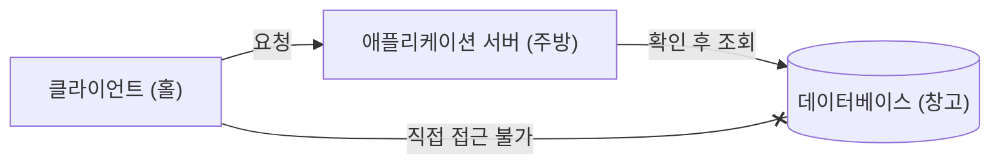

[그림 17 설명] 상자가 셋으로 늘었어. 클라이언트, 애플리케이션 서버, 데이터베이스, 그래서 3-Tier야. 끝이 X로 끝나는 선은 막혀 있다는 표시야.

1. 클라이언트는 애플리케이션 서버로 요청을 보내.
2. 서버는 이 요청이 정당한지 확인한 다음에 데이터베이스에서 조회해. 화살표 위에 확인 후 조회라고 적은 이유야.
3. 클라이언트에서 데이터베이스로 가는 선은 X로 막혀 있어. 클라이언트는 창고에 직접 들어갈 수 없어.

그림 16과 나란히 보면 달라진 건 중간 상자 하나야. 이 상자가 문지기 역할을 해서, 창고 열쇠는 서버만 들고 있으면 돼. 그림 6, 그림 9의 등장인물 셋이 바로 이 세 층이었어.

지금 웹 서비스 대부분이 이 구조야. 배달앱도 앱, 배달앱 서버, 데이터베이스의 3층이지. 아까 시연도 브라우저, server.js에 stores 배열이 창고 흉내를 낸 3층이었어.

### 손님이 몰리면: 수강신청과 티켓팅

[질문] 수강신청이나 콘서트 티켓팅 날 서버 터지는 거 겪어 본 사람?

평소에 1분에 100명 오던 사이트에 오전 10시 정각에 10만 명이 동시에 들어오면 서버가 감당을 못 해. 이걸 해결하는 방법이 두 가지 있어.

수직 확장(Scale-up)은 서버 한 대를 더 좋은 컴퓨터로 바꾸는 거야. 주방을 넓히고 화구를 늘리는 거지. 간단하지만 한계가 있어. 세상에서 제일 좋은 컴퓨터보다 더 좋게 만들 수는 없고, 좋아질수록 값이 훨씬 비싸져.

[그림 18] 수직 확장

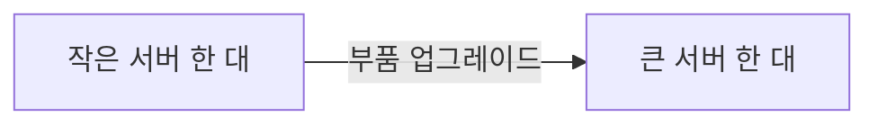

[그림 18 설명] 이 화살표는 요청이 아니라 시간에 따른 변화야. 왼쪽이 바꾸기 전, 오른쪽이 바꾼 후야.

1. 처음에는 작은 서버 한 대가 있어.
2. CPU나 메모리 같은 부품을 더 좋은 걸로 바꿔.
3. 결과는 여전히 서버 한 대야. 크기만 커졌어.

양쪽 다 한 대라는 게 핵심이야. 대수가 그대로니까 구조를 바꿀 필요가 없어서 간단해. 대신 이 한 대가 멈추면 여전히 전부 멈춰.

수평 확장(Scale-out)은 서버 대수를 늘리는 거야. 주방을 여러 개 두는 거지. 계속 늘릴 수 있고, 주방 하나가 고장 나도 나머지가 일해.

대신 손님을 어느 주방으로 보낼지 정하는 안내 데스크가 필요해. 이걸 로드 밸런서(Load Balancer)라고 해. load는 짐, balance는 균형이라는 뜻이라, 짐을 고르게 나눠 싣는 장치라는 이름이야. 놀이공원 입구에서 이쪽 줄로 가라고 나눠 주는 직원이라고 보면 돼.

[그림 19] 수평 확장과 로드 밸런서

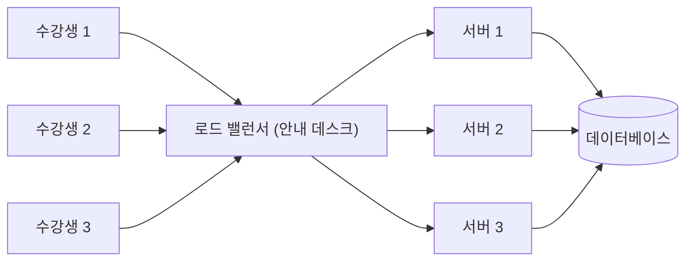

[그림 19 설명] 왼쪽부터 수강생, 로드 밸런서, 서버 세 대, 데이터베이스 순서로 읽으면 돼. 화살표는 요청이 흘러가는 방향이야.

1. 수강생 셋의 요청이 전부 로드 밸런서 한곳으로 모여.
2. 로드 밸런서가 요청을 서버 1, 2, 3에 나눠 보내. 한 서버에 몰리지 않게 골고루 배분하는 거야.
3. 서버 세 대는 모두 같은 데이터베이스 하나를 써.

마지막이 중요해. 서버는 셋으로 나뉘었는데 데이터는 하나야. 그래서 수강생 1의 요청을 서버 1이 받든 서버 3이 받든 같은 데이터를 보고 같은 결과를 줘. 서버가 손님 정보를 자기 머릿속에 두지 않는 무상태라서 가능한 구조야.

여기서 아까 배운 무상태가 다시 나와. 안내 데스크가 손님을 아무 주방에나 보내도 되려면, 어느 주방이든 그 손님을 처리할 수 있어야 하잖아. 서버가 손님을 기억하지 않는 무상태 방식이라서 수평 확장이 쉬운 거야. 그림 12를 다시 보면 직원 1, 직원 2가 바로 서버 1, 서버 2야. 4장이랑 5장이 이렇게 이어져.

번호표 장부까지 생각하면 하나 더 챙길 게 있어. 오늘 시연 서버는 한 대라서 장부를 서버 메모리에 뒀어. 서버를 여러 대 두면 장부도 모든 서버가 같이 보는 곳(데이터베이스 같은 공용 저장소)에 둬야 해. 안 그러면 서버 1에서 받은 번호표를 서버 2가 몰라서, 그림 13처럼 누구신지 모르겠다는 답이 다시 나와.

참고로 서버를 세 대로 늘려도 층은 그대로 3층이야. 층은 역할을 세는 거고, 같은 역할의 서버가 여러 대일 뿐이야.

<br/>

## 6. 장단점, P2P 비교 (6분)

### 장점

데이터가 한곳에 있어서 관리가 쉬워. 배달앱에서 치킨 가격이 바뀌면 서버 데이터만 고치면 돼. 전국 사용자 휴대폰을 일일이 업데이트할 필요가 없어. 백업도 한곳만 하면 되고, 보안도 한곳만 지키면 돼.

클라이언트랑 서버를 따로 개발할 수도 있어. 같은 서버를 두고 아이폰 앱, 안드로이드 앱, 웹사이트를 각각 만들 수 있는 이유야.

[그림 20] 서버 하나로 여러 클라이언트

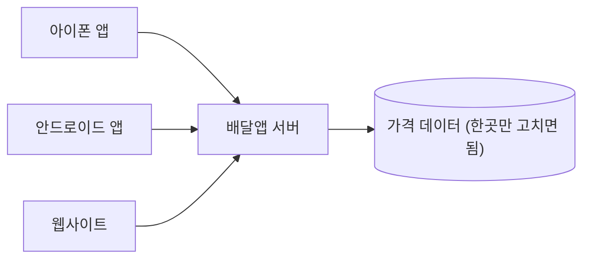

[그림 20 설명] 왼쪽 상자 셋은 생긴 게 전혀 다른 클라이언트야. 아이폰 앱, 안드로이드 앱, 웹사이트.

1. 셋 다 같은 배달앱 서버로 요청을 보내.
2. 서버는 하나의 가격 데이터를 보고 응답해.
3. 치킨 가격이 바뀌면 원통 하나만 고치면 돼. 왼쪽 세 클라이언트는 다음 요청부터 바뀐 가격을 받아.

만드는 사람이 다를 수도 있어. 아이폰 앱 팀, 안드로이드 앱 팀, 웹 팀이 각자 화면을 만들고, 서버 팀은 서버만 만들면 돼. 화살표 하나하나가 서로 약속한 양식(그림 5)으로 대화하니까 가능한 일이야.

### 단점

반대로 그 한곳이 멈추면 전부 멈춰. 이런 지점을 단일 장애 지점, 영어로 SPOF(Single Point of Failure)라고 해.

2022년 10월 판교 데이터센터 화재로 카카오톡이랑 카카오 서비스가 오랫동안 멈춘 거 기억나지. 내 휴대폰의 카카오톡 앱은 멀쩡했는데, 서버가 있는 곳에 문제가 생기니까 메시지를 보낼 수가 없었어. 클라이언트가 아무리 정상이어도 서버가 멈추면 소용없다는 걸 보여 준 사례야.

[그림 21] 단일 장애 지점

```mermaid
flowchart LR
    C1["철수 카카오톡 (정상)"] --x S["데이터센터 서버 (멈춤)"]
    C2["영희 카카오톡 (정상)"] --x S
    C3["민수 카카오톡 (정상)"] --x S
```

[그림 21 설명] 모양은 그림 4와 같아. 클라이언트 셋, 서버 하나. 다른 점은 화살표 끝이 전부 X라는 거야.

1. 철수, 영희, 민수의 카카오톡 앱은 상자에 적힌 대로 다 정상이야.
2. 그런데 셋이 보내는 요청이 전부 같은 데이터센터 서버로 가.
3. 서버가 멈췄으니 세 화살표가 동시에 막혀.

클라이언트 셋 중 누구도 고장 나지 않았는데 전부 못 써. 모든 화살표가 모이는 한 점이 멈추면 전체가 멈추는 것, 이게 단일 장애 지점이야. 그림 19처럼 서버를 여러 대 두면 서버 한 대가 멈춰도 버틸 수 있어. 다만 그림 19에서도 로드 밸런서와 데이터베이스는 하나라서, 큰 서비스는 이것까지 여러 벌 두고 여러 지역에 나눠 둬.

그리고 서버는 24시간 켜 둬야 하니까 전기료, 장비 비용, 관리 인력 같은 운영 비용이 계속 들어.

### P2P와 비교

클라이언트-서버와 반대되는 구조로 P2P(Peer-to-Peer)가 있어. Peer는 동료, 대등한 사람이라는 뜻이야. 정해진 서버 없이 모두가 손님이면서 주방이야. 각자 음식을 하나씩 싸 와서 나눠 먹는 포트럭 파티라고 생각하면 돼.

[그림 22] 클라이언트-서버와 P2P

```mermaid
flowchart TB
    subgraph CS["클라이언트-서버"]
        direction LR
        C1["클라이언트 1"] --> S["서버"]
        C2["클라이언트 2"] --> S
        C3["클라이언트 3"] --> S
    end
    subgraph P2P["P2P"]
        direction LR
        P1["참여자 1"] <--> P2["참여자 2"]
        P2 <--> P3["참여자 3"]
        P1 <--> P3
    end
    CS ~~~ P2P
```

[그림 22 설명] 위쪽 묶음이 클라이언트-서버, 아래쪽 묶음이 P2P야. 양쪽 화살표는 서로 주고받는다는 뜻이야.

1. 위쪽은 모든 화살표가 서버 하나로 모여. 클라이언트끼리는 이어져 있지 않아.
2. 아래쪽은 가운데가 없어. 참여자 셋이 서로서로 직접 이어져 있어.
3. 아래쪽 화살표는 양쪽 방향이야. 참여자 하나가 받기도 하고 주기도 해. 손님이면서 주방인 거지.

위쪽에서 서버를 지우면 남은 클라이언트끼리는 연결이 하나도 없어서 아무것도 못 해. 아래쪽에서 참여자 하나를 지우면 나머지 둘은 여전히 이어져 있어. 그림 21의 단일 장애 지점이 P2P에는 없는 이유야.

대표적인 예가 토렌트야. 파일 하나를 서버 한 대에서 받는 게 아니라, 이미 그 파일을 가진 여러 사람한테서 조각조각 받아. 받는 사람이 늘수록 나눠 줄 사람도 늘어나니까 오히려 빨라질 수도 있어. 한 사람이 빠져도 다른 사람이 있으니 계속 받을 수 있고.

대신 누가 뭘 가졌는지 통제하기 어렵고, 참여자를 믿을 수 있는지 확인하는 장치를 따로 둬야 해. 은행이나 쇼핑몰처럼 정확한 데이터를 한곳에서 책임져야 하는 서비스가 클라이언트-서버를 쓰는 이유가 이거야.

<br/>

## 7. 정리와 질문 (4분)

오늘 내용을 세 문장으로 정리해 보자.

1. 클라이언트는 요청하는 쪽, 서버는 기다렸다가 응답하는 쪽이고, 둘은 프로토콜이라는 약속으로 대화해.
2. 웹 서버는 손님을 기억하지 않는 무상태 방식이라 서버를 여러 대로 늘리기 쉽고, 로그인 같은 건 번호표를 매번 보여 주는 식으로 해결해.
3. 데이터를 한곳에서 관리하니 편하지만, 그 한곳이 멈추면 전체가 멈추는 약점이 있어.

[그림 23] 오늘 배운 것 한 장으로

```mermaid
flowchart LR
    C["클라이언트 (요청하는 쪽)"] -- "HTTP 요청 + 번호표" --> LB["로드 밸런서"]
    LB --> S1["서버 1 (무상태)"]
    LB --> S2["서버 2 (무상태)"]
    S1 --> DB[("데이터베이스 (한곳에서 관리)")]
    S2 --> DB
    S1 -- "응답" --> LB
    LB -- "응답" --> C
```

[그림 23 설명] 오늘 나온 그림들을 한 장에 합친 거야. 왼쪽에서 오른쪽으로 요청을 따라가고, 응답 화살표로 같은 길을 거꾸로 돌아오는 걸 보면 돼.

1. 클라이언트가 HTTP 양식에 맞춰 요청을 보내. 로그인했다면 번호표도 같이 가. 2장과 4장 내용이야.
2. 요청은 로드 밸런서를 거쳐 서버 1이나 서버 2로 가. 5장 수평 확장이야.
3. 두 서버 모두 무상태라서 어느 쪽이 받아도 똑같이 처리해. 4장 내용이야.
4. 서버는 하나의 데이터베이스에서 데이터를 꺼내. 데이터를 한곳에서 관리하는 3-Tier 구조고, 6장의 장점이자 단점이야.
5. 서버의 응답은 로드 밸런서를 거쳐 클라이언트에게 돌아가. 3장의 동작 순서가 여기서 한 바퀴 끝나.

그림에는 서버 1의 응답 화살표만 그렸지만, 서버 2가 받은 요청도 똑같이 서버 2가 응답해.

[질문] 마지막으로 확인 질문 두 개.

첫 번째. 유튜브 영상을 볼 때 클라이언트와 서버는 각각 뭘까?
예상 답: 클라이언트는 유튜브 앱이나 브라우저, 서버는 영상을 보내 주는 유튜브(구글)의 컴퓨터.

두 번째. 서버가 손님을 기억하지 않는 게 왜 장점이 될까?
예상 답: 어느 서버가 요청을 받아도 똑같이 처리할 수 있어서 서버를 늘리기 쉽기 때문.

다음 시간에는 오늘 배운 구조가 웹 화면을 만들 때 어떻게 보이는지, 프론트엔드 관점에서 이어 갈게.

<br/>

## 준비물 체크

강의 전날

- [ ] `node -v`가 v18 이상인지 확인 (설치법은 시연 2의 준비 항목)
- [ ] demo 폴더에서 `node server.js`, `node client.js`를 실제로 실행해 보기. 아무 출력 없이 끝나면 demo 폴더를 영문 경로로 복사해 두기
- [ ] 시연 1, 시연 2, 404, 서버 끄기, 로그인, 쿠키 삭제까지 대본 순서대로 한 번 끝까지 리허설하기
- [ ] 개발자 도구 언어(영어/한국어)를 확인하고, 대본의 탭 이름과 화면이 다르면 메모해 두기
- [ ] 슬라이드에 그림 1~23, 코드 1~6을 순서대로 배치

강의 직전

- [ ] 크롬 게스트 창이나 시크릿 창 열기, 다른 탭 닫기, 윈도우 알림 끄기
- [ ] 브라우저 왼쪽, 서버 터미널 오른쪽 배치. 브라우저, 개발자 도구, 터미널 글자 크기 키우기
- [ ] 개발자 도구 Network 탭에서 Disable cache, Preserve log 켜 두기
- [ ] 서버 터미널과 client.js 터미널 두 개를 미리 demo 폴더로 cd 해 두기
- [ ] 8000번 포트가 비어 있는지 확인 (`netstat -ano | findstr :8000`에서 아무것도 안 나오면 비어 있음)
- [ ] localhost:8000 쿠키 지워 두기 (로그인 시연이 401부터 시작하도록)
- [ ] 시연 1용 뉴스 사이트가 강의장 인터넷에서 열리는지 확인. 시연 2와 로그인 시연은 인터넷 없이도 된다
