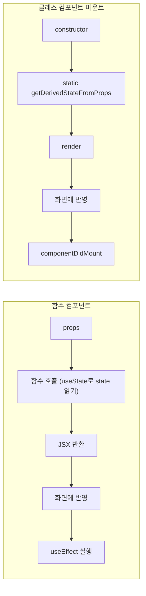

## 왜 프론트엔드 코드에는 함수가 많을까
- 자바스크립트는 ES2015부터 `class` 문법을 공식으로 제공하고, React도 예전에는 클래스 컴포넌트가 기본이었다
- 그런데 지금 웹 프론트엔드 코드에서는 클래스보다 함수를 훨씬 자주 본다. 클래스를 못 써서가 아니라 UI 코드에는 함수를 조합하는 방식이 더 잘 맞기 때문이다
- 이 노트는 그 이유와, 그래도 클래스가 자연스러운 자리가 어디인지를 정리한다. React 관점의 이야기가 많다

<br/>

## 훅이 클래스의 주요 쓰임을 대신했다
훅(Hook)은 사전적으로 갈고리다. React에서는 함수 컴포넌트가 React의 상태 관리나 생명주기 기능에 걸어 쓰는 함수를 말하고, 이름이 `use` 로 시작한다. 생명주기(Lifecycle)는 컴포넌트가 화면에 붙고, 바뀌고, 떨어지는 과정이고, 부수 효과(Side Effect)는 데이터 요청이나 타이머처럼 화면을 그리는 계산 밖에서 일어나는 일이다.

React 16.8에서 `useState`, `useEffect` 같은 훅이 들어오면서 클래스 컴포넌트에서만 되던 상태 관리, 생명주기 처리, 부수 효과 처리를 함수 컴포넌트에서도 할 수 있게 되었다. 함수로 대부분 되니 굳이 클래스를 쓸 이유가 줄었다.

다만 전부는 아니다. React 19.3 공식 문서(react.dev, 2026-10-25 확인)는 "There is currently no way to write an Error Boundary as a function component."라고 쓴다. 자식 컴포넌트의 렌더링 오류를 잡는 에러 경계(Error Boundary)는 지금도 클래스 컴포넌트의 `componentDidCatch`, `static getDerivedStateFromError` 로만 만들 수 있다. 그래서 react-error-boundary 같은 라이브러리가 클래스로 된 에러 경계를 감싸 함수 컴포넌트에서 쓰게 해 준다.

React 공식 문서는 새 컴포넌트를 함수로 쓰라고 권한다("We recommend defining components as functions instead of classes."). 클래스 컴포넌트도 여전히 지원한다.

<br/>

## 자바스크립트 클래스는 프로토타입 위에 있다
### 문법 설탕 (Syntax Sugar)
설탕은 음식을 먹기 좋게 할 뿐 요리 자체를 바꾸지는 않는다. 문법 설탕은 언어가 할 수 있는 일을 늘리지 않고, 이미 할 수 있는 일을 읽고 쓰기 쉽게 만든 문법을 말한다.

프로토타입(Prototype)은 사전적으로 원형, 본보기다. 자바스크립트에서는 객체가 자기에게 없는 속성이나 메서드를 대신 찾아보는 본보기 객체를 말한다. 자바스크립트의 `class` 를 흔히 프로토타입 기반 상속의 문법 설탕이라고 부른다. 클래스로 만든 객체도 메서드를 프로토타입에서 찾기 때문이다.

```js
class A {
  method() {}
}

// 메서드가 프로토타입에 있다는 점은 아래와 비슷하다
function B() {}
B.prototype.method = function () {};
```

### 완전히 같지는 않다
MDN은 클래스가 "built on prototypes but also have some syntax and semantics that are unique to classes"라고 설명한다. 프로토타입 위에 만들어졌지만 클래스에만 있는 규칙이 있다는 뜻이다. 그래서 위 두 코드를 똑같다고 보면 안 된다.

```js
try { A(); } catch (e) { console.log(e.message); } // Class constructor A cannot be invoked without 'new'
console.log(B());                    // undefined (함수는 new 없이도 실행된다)
console.log(Object.keys(A.prototype)); // [] (클래스 메서드는 열거되지 않는다)
console.log(Object.keys(B.prototype)); // [ 'method' ]
```

이 밖에도 클래스 본문은 `"use strict"` 없이도 엄격 모드(strict mode)로 실행된다. 엄격 모드는 실수하기 쉬운 문법을 오류로 막는 실행 방식이다. 또 클래스 선언은 `let`, `const` 처럼 선언 전에 쓰면 오류가 난다. 선언 전까지 이름을 쓸 수 없는 이 구간을 TDZ(Temporal Dead Zone)라고 한다. 위 출력은 Node.js v24.22.1에서 실행한 값이다.

### 상속보다 조합
상속(Inheritance)은 부모의 기능을 통째로 물려받는 것이고, 조합(Composition)은 필요한 부품을 골라 끼우는 것이다. 레고 블록을 끼워 맞추듯 작은 함수와 컴포넌트를 조립한다고 생각하면 된다. 클래스를 쓰면 상속으로 기능을 물려주는 설계로 가기 쉽다. UI는 작은 조각을 끼워 맞추는 일이 많아서, 상속 계층을 깊게 만들기보다 작은 함수와 컴포넌트를 조합하는 쪽이 고치기 쉽다. "상속보다 조합"은 원래 객체 지향 설계에서 나온 조언(GoF의 디자인 패턴)이라, 객체 지향을 버리자는 말이 아니라 객체 지향 안에서도 조합을 먼저 생각하라는 뜻이다.

<br/>

## React가 함수 쪽을 밀어준 이유
React는 화면을 상태를 받아 UI를 돌려주는 계산으로 본다. 이 생각은 함수 하나로 그대로 표현된다.

```jsx
function Button({ label }) {
  return <button>{label}</button>;
}
```

함수 컴포넌트에서는 `this` 가 없어서, 클래스에서 이벤트 핸들러를 넘길 때 `this` 를 묶어 줘야(bind) 하는 문제가 사라진다. 상태를 다루는 로직은 훅을 묶어 직접 만든 커스텀 훅으로 떼어 내 여러 컴포넌트에서 다시 쓸 수 있다.

두 방식이 화면을 그리는 흐름도 다르다. 함수 컴포넌트는 렌더링할 때마다 함수를 다시 부르고, 렌더링 사이의 상태는 훅이 기억한다. 클래스 컴포넌트는 인스턴스를 한 번 만들고, 상태를 인스턴스에 둔 채 단계마다 다른 메서드를 부른다. React 문서 기준으로 두 방식이 처음 화면에 붙을 때의 순서는 아래와 같다. 함수 컴포넌트의 state는 함수 밖에서 들어오는 값이 아니라, 호출 도중 `useState` 가 꺼내 주는 값이다.



<br/>

## 실무에서 함수 패턴이 많은 이유
프론트엔드 코드의 대부분은 데이터를 받아 바꾸고, 이벤트에 반응하고, 화면 상태를 바꾸는 일이다. 이런 일은 입력을 받아 결과를 돌려주면 끝나서, 상태를 오래 들고 있을 객체가 필요 없다. 그래서 작은 함수로 나눠 조합하기 좋다. 커스텀 훅(useAuth 등), 데이터를 바꾸는 유틸리티 함수, 조건에 따라 함수를 고르는 전략 패턴(Strategy), 설정을 받아 객체를 만드는 팩토리 함수가 모두 함수로 충분하다.

<br/>

## 그렇다면 클래스는 언제 쓸까
상태와 규칙과 동작을 하나로 묶어 오래 들고 있어야 하는 곳에서는 클래스가 자연스러울 수 있다. 아래는 그런 경우의 예다. 어느 쪽이 낫다는 정답이 있는 것은 아니고, 팀과 코드베이스에 따라 함수와 객체로 같은 일을 하기도 한다.

- 도메인 모델(Domain Model): 데이터와 규칙과 동작을 한 단위로 묶을 수 있다
- 서비스, 매니저 객체: API 호출, 의존성, 흐름을 하나의 객체로 묶을 수 있다
- WebSocket, RTC 연결, 상태 머신: 연결, 상태, 전이처럼 수명 주기를 관리해야 한다
- Canvas, 게임 오브젝트: 화면 속 물체 하나가 자기 상태와 동작을 가진다
- 엔진, SDK: 공개 API가 클래스로 되어 있는 라이브러리가 많다

클래스 중심 API를 가진 공개 라이브러리로는 three.js(3D), PixiJS(2D), Babylon.js(WebGL, WebGPU), Mapbox GL과 MapLibre GL(지도), Lit(웹 컴포넌트)이 있다. Angular도 컴포넌트와 서비스를 클래스로 쓴다. 다만 Angular도 라우트 가드를 `CanActivateFn` 같은 함수로 쓰는 등 함수 API가 늘고 있어서 모든 구성 요소가 클래스인 것은 아니다. 각 라이브러리의 버전별 구조는 확인 필요다.

<br/>

## 도메인 로직을 클래스로 떼어 낸 예
장바구니 수량을 늘리는 규칙이 화면 코드 안에 들어 있으면 같은 규칙을 다른 화면에서 다시 쓰기 어렵고, 규칙만 따로 테스트하기도 어렵다.

```jsx
setCart((prev) =>
  prev.map((item) => (item.id === id ? { ...item, qty: item.qty + 1 } : item))
);
```

규칙을 클래스로 떼어 내면 화면 코드는 이 상품 수량을 늘리라고 요청만 하고, 계산은 클래스가 맡는다. 클래스만 따로 불러 테스트할 수도 있다.

```ts
class CartItem {
  readonly id: string;
  readonly price: number;
  readonly qty: number;

  constructor(id: string, price: number, qty: number) {
    this.id = id;
    this.price = price;
    this.qty = qty;
  }

  increase(): CartItem {
    return new CartItem(this.id, this.price, this.qty + 1);
  }

  get total(): number {
    return this.price * this.qty;
  }
}

class Cart {
  readonly items: CartItem[];

  constructor(items: CartItem[]) {
    this.items = items;
  }

  increaseItem(id: string): Cart {
    return new Cart(this.items.map((i) => (i.id === id ? i.increase() : i)));
  }

  get total(): number {
    return this.items.reduce((sum, i) => sum + i.total, 0);
  }
}

const cart = new Cart([new CartItem('apple', 1000, 1), new CartItem('pear', 2000, 2)]);
const next = cart.increaseItem('apple');
console.log(cart.total); // 5000
console.log(next.total); // 6000
```

`increaseItem` 은 원래 장바구니를 바꾸지 않고 새 장바구니를 돌려준다. React 상태는 새 객체가 들어와야 바뀐 줄 알기 때문에, 컴포넌트에서는 `setCart((prev) => prev.increaseItem(id))` 처럼 쓸 수 있다. 위 코드는 Node.js v24.22.1의 타입 제거 실행(type stripping)으로 돌려 출력을 확인했다. tsc 타입 검사와 React 컴포넌트 안에서의 동작은 확인하지 않았다.

<br/>

## 참고 자료
- React 문서, [Component](https://react.dev/reference/react/Component)
- MDN, [Classes](https://developer.mozilla.org/en-US/docs/Web/JavaScript/Reference/Classes)
- Angular 문서, [Route guards](https://angular.dev/guide/routing/route-guards)

<br/>

## 더 볼 것 (TODO)
- 에러 경계를 함수 컴포넌트에서 쓰는 방법
- 프로토타입 체인이 메서드를 찾는 과정
- 클래스 필드와 private 필드(`#`)
