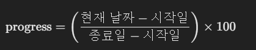

## 무엇을 계산하나
- 시작일과 종료일 사이에서 오늘이 어디쯤인지를 백분율(%)로 구하는 방법
- `Date` 객체를 밀리초 숫자로 바꿔 빼고 나누면 된다
- 구한 값은 프로젝트 진행률 막대(ProgressBar) 같은 화면에 그대로 쓸 수 있다

### 진행률 (Progress Rate)
progress의 사전적 의미는 앞으로 나아감, 진척이다.
여기서는 전체 기간 중 이미 지나간 기간이 차지하는 비율을 말한다. 날짜만 보고 계산하므로 실제 일이 얼마나 끝났는지가 아니라 시간이 얼마나 흘렀는지를 나타낸다.

30일짜리 여행에서 오늘이 며칠째인지 세는 것과 같다. 15일째라면 일정의 절반이 지난 것이지, 볼거리의 절반을 본 것은 아니다.

<br/>

## 계산 공식


- 지나간 시간: 현재 날짜 - 시작일
- 전체 기간: 종료일 - 시작일
- 둘을 나누고 100을 곱하면 백분율이 된다

`getTime()` 은 날짜를 1970년 1월 1일 UTC부터 지난 밀리초 숫자로 바꾼다. 자바스크립트에서는 `Date` 끼리 바로 빼도 내부에서 `valueOf()` 로 같은 숫자가 되어 계산은 된다(`new Date('2025-03-02') - new Date('2025-03-01')` 은 86400000). 그래도 `getTime()` 을 쓰면 숫자로 계산한다는 의도가 드러나고, TypeScript에서는 `Date` 끼리 빼면 `TS2362: The left-hand side of an arithmetic operation must be of type 'any', 'number', 'bigint' or an enum type.` 오류가 나므로 꼭 필요하다(TypeScript 5.6.3 strict에서 확인).

### 경계 처리
- 시작일 전이면 0%
- 종료일 뒤면 100%
- 전체 기간이 0이면(시작일과 종료일이 같으면) 0으로 나누게 된다. 지나간 시간도 0이면 0 / 0 이라 `NaN`, 0이 아니면 `Infinity` 나 `-Infinity` 가 된다
- 시작일이 종료일보다 늦게 잘못 들어온 경우도 막아 둔다

<br/>

## 진행률 계산 함수
```js
export const getProgress = (startDateStr, endDateStr, now = Date.now()) => {
  const start = new Date(startDateStr).getTime();
  const end = new Date(endDateStr).getTime();

  // 날짜를 읽지 못했거나 기간이 0 이하이면 계산하지 않는다
  if (Number.isNaN(start) || Number.isNaN(end) || end <= start) return 0;
  if (now <= start) return 0;   // 시작 전
  if (now >= end) return 100;   // 종료 후

  return ((now - start) / (end - start)) * 100;
};
```

`now` 를 인자로 받게 한 것은 결과를 확인하기 쉽게 하기 위해서다. 기본값은 지금 시각이지만, 날짜를 직접 넣으면 오늘이 언제든 같은 결과를 볼 수 있다.

```js
const t = (s) => new Date(s).getTime();

getProgress('2025-03-01', '2025-03-31', t('2025-03-16')); // 50
getProgress('2025-03-01', '2025-03-31', t('2025-02-20')); // 0
getProgress('2025-03-01', '2025-03-31', t('2025-04-02')); // 100
getProgress('2025-03-01', '2025-03-01', t('2025-03-01')); // 0 (기간이 0일 때)
getProgress('2025-03-01', '2025-03-31', t('2025-03-11')).toFixed(2); // '33.33'
```

시작 전과 종료 후를 먼저 걸러 내므로 마지막 계산은 항상 0과 100 사이다. 그래서 `Math.min(100, Math.max(0, progress))` 로 한 번 더 자를 필요가 없다. 기간 확인(`end <= start`)이 없던 버전은 시작 전, 종료 후를 `<`, `>` 로 걸렀다. 그래서 시작일과 종료일이 같고 지금이 정확히 그 시각이면 두 조건을 모두 지나 0 / 0 을 계산해 `NaN` 을 돌려줬고, `Math.min`, `Math.max` 도 `NaN` 을 그대로 돌려줬다. 지금 버전은 `<=`, `>=` 로 거르므로 그 경우에도 나눗셈까지 가지 않지만, 시작일이 종료일보다 늦게 들어온 잘못된 입력을 0으로 처리하려고 기간 확인을 맨 앞에 둔다. 소수점 둘째 자리까지 보이려면 `toFixed(2)` 로 문자열을 만들거나, 숫자가 필요하면 `parseFloat(progress.toFixed(2))` 를 쓴다.

### 날짜 문자열과 시간대
`'2025-03-01'` 처럼 날짜만 있는 문자열은 UTC 자정으로 읽힌다. 반면 `'2025-03-01T00:00:00'` 처럼 시각이 붙으면 실행하는 컴퓨터의 시간대 자정으로 읽힌다. 한국(Asia/Seoul)에서 둘을 비교하면 9시간(32,400,000밀리초) 차이가 났다.

그래서 날짜만 있는 문자열로 시작일을 정하면, 한국에서는 그날 오전 9시부터 진행률이 오르기 시작한다. 하루 단위 진행률이라 대개 문제가 되지 않지만, 시각까지 맞춰야 하는 화면이라면 문자열 형식을 한쪽으로 통일한다.

<br/>

## 진행률 막대에 적용하기
아래 예시는 React와 Tailwind CSS를 쓰는 프로젝트에서 계산 결과를 진행률 막대에 넘긴 코드다. `ProgressBar` 는 `percentage` 를 받아 그 값을 막대 너비(%)로 쓰는 컴포넌트이고, 만드는 방법은 [프로그래스 바](../../React/UI%20컴포넌트%20만들기(Building%20UI%20Components)/프로그래스%20바(Progress%20Bar)) 노트에서 다룬다. `percentage: number` 같은 타입은 숫자만 받게 할 뿐 0~100 범위까지 막지는 않는다. 범위는 `getProgress` 가 지켜 준다.

```tsx
import ProgressBar from '../ProgressBar';
import { getProgress } from '@/service/getProgress';

type Project = { startDate: string; endDate: string };

const ProjectInfo = ({ data }: { data: Project }) => {
  const progress = parseFloat(getProgress(data.startDate, data.endDate).toFixed(2));
  const started = new Date().toISOString().split('T')[0] >= data.startDate;

  return (
    <div className="bg-white p-8 rounded-lg shadow">
      <h2 className="text-2xl font-semibold">프로젝트 진행률</h2>
      <div className="mt-6">
        {started ? <ProgressBar percentage={progress} /> : <p>프로젝트 시작 전</p>}
      </div>
    </div>
  );
};

export default ProjectInfo;
```

`started` 는 `YYYY-MM-DD` 문자열끼리 비교한다. 이 형식은 앞자리부터 연, 월, 일 순서라 문자열 크기 비교가 날짜 순서와 같다. 다만 `toISOString()` 은 UTC 기준 날짜를 돌려주므로, 한국에서 오전 9시 전에는 하루 전 날짜가 나온다. 위 시간대 설명과 같은 이유다.

계산 예시는 Node.js v22.13.0(시간대 Asia/Seoul)에서 실행한 값이다. React 컴포넌트는 실행하지 않았다.

<br/>

## 더 볼 것 (TODO)
- 날짜를 다루는 `Intl.DateTimeFormat` 과 Temporal API
- 영업일(주말, 공휴일 제외) 기준 진행률
