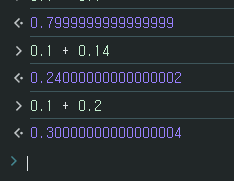

## 부동 소수점이란 ?
- 소수를 가수(significand, 유효 숫자)와 지수(exponent, 소수점 위치)로 나눠 저장하는 방식
- 자바스크립트의 `number` 는 모두 IEEE 754 배정밀도(64비트) 부동 소수점이다. 언어 명세에서는 정수도 같은 방식으로 다룬다
- 2진수로 정확히 나타낼 수 없는 소수가 많아서 `0.1 + 0.2` 가 `0.3` 이 되지 않는 오차가 생긴다

자바스크립트로 문제를 풀다가 소수 계산 결과가 예상과 달라 헷갈렸던 부분을 정리했다.

### 부동 소수점 (Floating Point)
부동(浮動)의 사전적 의미는 떠서 움직임이다. 고정되지 않고 떠다닌다는 뜻이다.
공학적으로는 소수점 위치가 고정되지 않고 지수에 따라 옮겨 다니는 수 표현을 말한다. `123.45` 를 `1.2345 × 10²` 로 쓰듯, 유효 숫자는 그대로 두고 소수점만 옮겨서 아주 큰 수와 아주 작은 수를 같은 칸 수로 저장한다.

<br/>

## 무슨 일이 생길까
```js
const floatJs = 0.1 + 0.2;

console.log(floatJs === 0.3); // false
console.log(floatJs);         // 0.30000000000000004
console.log(0.1 + 0.14);      // 0.24000000000000002
```

브라우저 콘솔에서 확인한 결과도 같다.



`0.3` 과 같은지 비교하면 `false` 가 나온다. 화면에 보여 줄 때만이 아니라 대소 비교, 같은지 비교에서도 틀린 결과가 나올 수 있다는 점이 문제다.

<br/>

## 왜 생길까
컴퓨터는 수를 2진수로 저장한다. 10진수 소수를 2진수로 바꾸면 끝나지 않고 무한히 반복되는 경우가 많다. 10진수에서 1/3이 0.333…으로 끝나지 않는 것과 같다. 0.1은 2진수로 `0.0001100110011…` 처럼 `0011` 이 끝없이 반복된다.

64비트 부동 소수점은 유효 숫자를 52비트(맨 앞 1을 포함하면 53비트)까지만 담는다. 그래서 반복되는 부분을 중간에서 끊고 가장 가까운 값으로 반올림해 저장한다. 저장된 0.1은 정확히 0.1이 아니라 아주 조금 큰 값이다.

```js
console.log((0.1).toPrecision(21)); // 0.100000000000000005551
```

0.1과 0.2에 각각 생긴 작은 오차가 더해지고, 더한 결과를 다시 53비트에 맞춰 반올림하면서 `0.3` 을 저장한 값과 달라진다. 반대로 2진수로 딱 떨어지는 소수(0.5, 0.25, 0.75처럼 분모가 2의 거듭제곱인 수)끼리는 오차가 없다.

```js
console.log(0.5 + 0.25 === 0.75); // true
```

같은 이유로 2⁵³을 넘는 정수는 모두 정확히 나타낼 수 없다. `Number.MAX_SAFE_INTEGER` 는 9007199254740991이고, 이보다 큰 `9007199254740993` 을 쓰면 `9007199254740992` 로 저장된다.

<br/>

## 해결 방법
### 화면에 보여 줄 때는 toFixed()
`toFixed(자릿수)` 는 소수점 아래 자릿수를 정해 반올림한 결과를 문자열로 돌려준다. 자릿수는 0부터 100까지 줄 수 있고(ES2018부터, 그 전에는 0부터 20까지), 벗어나면 RangeError가 난다.

```js
console.log((0.1 + 0.2).toFixed(2));         // 0.30 (문자열)
console.log(Number((0.1 + 0.2).toFixed(2))); // 0.3
console.log(+(0.1 + 0.2).toFixed(2));        // 0.3
```

결과가 문자열이라 다시 계산에 쓰려면 `Number()` 나 단항 `+` 로 숫자로 바꿔야 한다. 다만 `toFixed()` 도 저장된 2진수 값을 기준으로 반올림하므로, 사람이 기대하는 반올림과 다를 때가 있다.

```js
console.log((1.005).toFixed(2));       // 1.00 (1.01이 아니다)
console.log((1.005).toPrecision(20));  // 1.0049999999999998934
```

1.005는 실제로 1.00499…로 저장되어 있어서 내림처럼 보이는 결과가 나온다.

### 자릿수에 맞춰 반올림하려면 Math.round()
`Math.round()` 는 가장 가까운 정수로 반올림한다. 원하는 자릿수만큼 곱해 정수로 만든 뒤 반올림하고 다시 나누면 숫자 그대로 결과를 얻는다.

```js
console.log(Math.round((0.1 + 0.2) * 100) / 100); // 0.3
```

이 방법도 곱하는 순간 오차가 생기면 같은 함정에 빠진다. `1.005 * 100` 은 `100.49999999999999` 라서 `Math.round(1.005 * 100) / 100` 은 `1` 이 된다. 정확해야 하는 계산이면 아래처럼 처음부터 정수로 다룬다.

`Math` 에는 비슷한 메서드가 더 있다. 음수에서 차이가 난다.

| 메서드 | 하는 일 | `1.5` 결과 | `-1.5` 결과 |
| --- | --- | --- | --- |
| `Math.round()` | 가장 가까운 정수로, .5는 큰 쪽으로 | `2` | `-1` |
| `Math.floor()` | 작은 쪽 정수로 내림 | `1` | `-2` |
| `Math.ceil()` | 큰 쪽 정수로 올림 | `2` | `-1` |
| `Math.trunc()` | 소수 부분을 버림 | `1` | `-1` |

`Math.trunc()` 는 양수에서는 `Math.floor()` 와, 음수에서는 `Math.ceil()` 과 결과가 같다.

`Math.round(2.5)` 는 `3`, `Math.round(-2.5)` 는 `-2` 다. .5일 때 0에서 먼 쪽이 아니라 큰 쪽(양의 무한대 쪽)으로 올린다.

### 같은지 비교할 때는 오차 범위로
두 값의 차이가 아주 작으면 같다고 본다. `Number.EPSILON` 은 1과 그다음으로 큰 `number` 사이의 간격(약 2.22e-16)이다.

```js
console.log(Math.abs(0.1 + 0.2 - 0.3) < Number.EPSILON); // true
```

`Number.EPSILON` 은 1 근처의 간격이라 1보다 훨씬 큰 수끼리 비교할 때는 너무 작은 기준이 된다. 다루는 수의 크기에 맞는 허용 오차를 정하는 편이 안전하다.

### 돈처럼 정확해야 하면 정수로 계산
원 단위나 센트 단위처럼 가장 작은 단위를 정수로 두고 계산한 뒤, 보여 줄 때만 소수로 바꾼다. 정수끼리의 덧셈, 뺄셈, 곱셈은 2⁵³ 범위 안에서 오차가 없다.

<br/>

## 참고 자료
- [MDN: Number](https://developer.mozilla.org/ko/docs/Web/JavaScript/Reference/Global_Objects/Number)
- [MDN: Number.prototype.toFixed()](https://developer.mozilla.org/ko/docs/Web/JavaScript/Reference/Global_Objects/Number/toFixed)
- 예시는 Node.js v22.13.0에서 실행해 결과를 확인했다

<br/>

## 더 볼 것 (TODO)
- IEEE 754 배정밀도의 비트 구성(부호 1비트, 지수 11비트, 가수 52비트) 자세히
- 큰 정수를 정확히 다루는 `BigInt`
- 소수 계산용 라이브러리(decimal.js 등)는 언제 쓰는지
