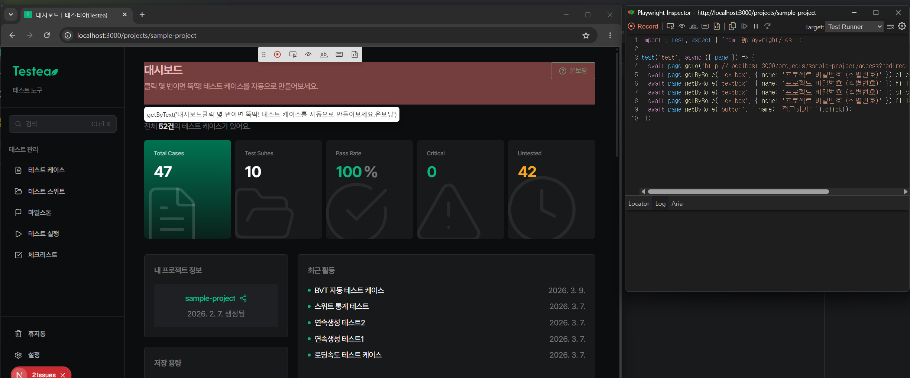

## Locator는 어떤 순서로 고를까
- [Locator](https://playwright.dev/docs/locators)는 페이지에서 요소를 찾는 방법이다. 단순한 셀렉터 문자열이 아니라 "이 요소를 무엇으로 알아볼지"를 정한 전략에 가깝다
- spec이 얼마나 안 깨지고 읽기 쉬운지는 Locator를 어떻게 고르느냐에 크게 달려 있다
- 이 장은 Locator 메서드를 고르는 순서와 그 이유, 메서드별 사용 예를 정리한다
- 예시의 동작은 @playwright/test 1.64.1, Chromium에서 실행해 확인했다

### 로케이터 (Locator)
locate의 사전적 의미는 위치를 알아내다, 찾아내다이다. locator는 위치를 찾아 주는 것이다.
Playwright에서는 요소를 찾는 방법을 담아 둔 객체를 말한다. 만드는 순간 요소를 찾지 않고, 클릭이나 단언처럼 실제로 쓰는 순간에 그 방법으로 요소를 찾는다. 그래서 페이지가 다시 그려져도 같은 Locator를 계속 쓸 수 있다.

<br/>

## 고르는 순서
| 순위 | API | 언제 쓰나 |
| --- | --- | --- |
| 1 | `getByRole` | 거의 항상 먼저. 접근성 트리의 역할(role)과 이름(name)으로 찾는다 |
| 2 | `getByLabel` | `<label>` 로 이름이 붙은 폼 요소(input, textarea, select) |
| 3 | `getByPlaceholder` | label 없이 placeholder만 있는 input |
| 4 | `getByText` | 버튼이나 링크가 아닌 본문 텍스트 |
| 5 | `getByAltText`, `getByTitle` | 이미지의 대체 텍스트, `title` 속성으로만 알아볼 수 있는 요소 |
| 6 | `getByTestId` | 위 방법으로 잡기 어려울 때 쓰는 마지막 보루(`data-testid`) |
| 7 | `locator(css/xpath)` | 정말 어쩔 수 없을 때 |

사용자가 화면에서 보고 알아보는 방식(역할, 레이블, 텍스트)에 가까울수록 위에, DOM 구조에 기댈수록 아래에 둔다. 위에 있는 Locator일수록 리팩터링이나 DOM 변경에 강하다.

이 표의 1번부터 7번까지 매긴 순위는 Playwright 공식 문서가 정한 것이 아니다. 공식 문서는 "역할 Locator를 우선하라(We recommend prioritizing role locators)", "사용자에게 보이는 속성과 명시적인 약속(test id)을 우선하라", "CSS와 XPath는 권하지 않는다" 정도만 말한다. 중간 순서는 Testing Library의 쿼리 우선순위와 거의 같고, 내가 실무에서 쓰는 기준으로 정리한 것이다.

<br/>

## 왜 이 순서일까
### 사용자가 알아보는 방식에 가까울수록 안정적이다
Playwright가 권하는 방향은 "실제 사용자가 화면에서 찾는 방식대로 요소를 찾자"이다. 사용자는 "저장 버튼"을 찾지 `.btn-primary[data-id="save"]` 를 찾지 않는다. 역할과 이름으로 찾으면 클래스 이름이나 DOM 구조가 바뀌어도 spec이 깨지지 않는다.

### 접근성도 함께 점검된다
`getByRole` 로 찾으려면 요소에 알맞은 역할과 접근 가능한 이름(accessible name)이 있어야 한다. 화면 낭독기(Screen Reader) 사용자가 요소를 찾는 방식과 `getByRole` 이 찾는 방식이 같아서, spec을 쓰는 동안 접근성도 자연스럽게 점검된다.

`<div onClick={...}>저장</div>` 같은 가짜 버튼은 `getByRole('button')` 으로 찾을 수 없다. 이 HTML에 진짜 `<button>저장하기</button>` 을 함께 두고 세어 보면 `getByRole('button')` 은 1개만 찾는다. spec을 쓰다가 이렇게 못 찾으면 "여기는 진짜 `<button>` 을 써야 한다"는 신호로 받아들인다.

### 구현 세부에 덜 기댄다
| 셀렉터 | 기대는 것 | 안정성 |
| --- | --- | --- |
| `getByRole('button', { name: '저장' })` | 역할과 이름(사용자가 보는 것) | 매우 높음 |
| `getByLabel('이메일')` | 폼 레이블(사용자가 보는 것) | 높음 |
| `getByText('이메일')` | 화면의 문구 | 보통(다국어 적용, 문구 변경에 약함) |
| `getByTestId('email-input')` | 일부러 붙인 test id | 안정적이지만 사용자와 무관 |
| `locator('.email-input')` | CSS 클래스 | 매우 낮음(디자인 변경에 깨짐) |

<br/>

## 순서를 잘못 쓰는 방법
처음에는 "`getByRole` 로 다 쓰고, 깨지면 한 단계씩 내려간다"는 식으로 썼는데 이건 잘못된 방법이었다.

일치하는 요소가 정확히 하나면 그 요소가 의도한 것이 아니어도 테스트는 통과한다. 그래서 실행해서 통과하는지로 고르면 잘못된 요소를 잡고 있어도 알아채지 못한다. 여러 개가 일치하면 strict mode 위반으로 실패하므로 그때는 드러난다.

순서는 실행해 보고 정하는 것이 아니라 요소마다 미리 판단하는 기준이다. DOM과 접근성 트리를 먼저 보고 그 요소에 역할과 접근 가능한 이름이 제대로 붙어 있는지 확인한 뒤, 가장 안정적인 방법을 고른다.

<br/>

## 메서드별 사용 예
### getByRole
```ts
page.getByRole('button', { name: '저장' });
page.getByRole('textbox', { name: '이메일' });
page.getByRole('link', { name: '대시보드' });
page.getByRole('heading', { level: 1, name: 'Testea' });
page.getByRole('listitem');
```

`name` 은 접근 가능한 이름이다. label, `aria-label`, 요소 안 텍스트 등에서 브라우저가 계산한다. 기본은 대소문자를 가리지 않는 부분 일치라서, `name: '저장'` 은 "저장하기" 버튼도 찾는다. 정확히 같은 이름만 찾으려면 `exact: true` 를 준다(실행 결과 부분 일치 1개, `exact: true` 0개).

### getByLabel
```ts
page.getByLabel('이메일').fill('a@b.com');
page.getByLabel('동의', { exact: true }).check();
```

`<label for="email">이메일</label><input id="email"/>` 처럼 연결된 구조를 찾는다. `aria-label`, `aria-labelledby` 로 붙인 이름도 찾는다.

### getByPlaceholder
```ts
page.getByPlaceholder('검색어 입력');
```

label이 없을 때 쓰는 차선책이다. placeholder는 입력을 시작하면 사라지므로 레이블을 대신하기에는 약하다.

### getByText
```ts
page.getByText('환영합니다');
page.getByText('저장되었습니다');  // 토스트 같은 알림을 확인할 때 자주 쓴다
```

기본은 대소문자를 가리지 않고 공백을 정리한 부분 일치다. 다국어를 적용하면 문구가 바뀌어 깨지기 쉽고, 매번 바뀌는 텍스트에는 맞지 않는다.

### getByTestId
```tsx
// 컴포넌트
<div data-testid="case-list" />

// 셀렉터
page.getByTestId('case-list');
```

접근성 정보로 잡기 어려운 컨테이너나 복잡한 UI에만 쓴다. 기본은 `data-testid` 속성을 보고, config의 `use.testIdAttribute` 로 다른 속성 이름을 쓰게 바꿀 수 있다. 운영 코드에 test id가 늘어나면 테스트만을 위한 속성이 마크업에 쌓인다는 점도 생각한다.

### locator()
```ts
page.locator('.dashboard-card:nth-child(2)');  // 권하지 않는다
page.locator('css=section.empty-state');
```

CSS와 XPath는 디자인이 바뀌면 가장 잘 깨진다. 위 방법으로 못 찾을 때만 쓴다.

<br/>

## 자주 쓰는 보조 패턴
### filter로 좁히기
```ts
page.getByRole('row').filter({ hasText: 'TC-123' });
page.getByRole('listitem').filter({ has: page.getByRole('button', { name: '삭제' }) });
```

### 이어서 찾기 (Chaining)
```ts
page.getByRole('navigation').getByRole('link', { name: '케이스' });
```

### exact 옵션
```ts
page.getByText('저장', { exact: true });  // '저장하기'와 구분한다
page.getByLabel('Name', { exact: true });
```

`<div>저장</div><button>저장하기</button>` 에서 `getByText('저장')` 은 2개, `exact: true` 를 주면 1개를 찾았다.

<br/>

## Codegen과 Inspector로 확인하기
어떤 Locator가 안정적인지 모르겠으면 Playwright가 추천하는 Locator를 본다.

```bash
pnpm exec playwright codegen http://localhost:3000
```

화면에서 요소를 클릭하면 추천 Locator가 만들어진다. 역할과 이름으로 잡을 수 있는 요소면 `getByRole` 을 먼저 제안한다.

아래는 `npx playwright codegen <url>` 로 연 화면이다. 왼쪽 브라우저에서 요소 위에 마우스를 올리면 추천 Locator가 뜨고, 오른쪽 Inspector에 기록된 코드가 쌓인다. 입력창과 버튼은 `getByRole('textbox', ...)`, `getByRole('button', ...)` 로 기록됐다. 반면 제목 영역은 역할을 가진 요소가 아니어서 안의 문구를 모두 이어 붙인 `getByText(...)` 가 추천됐다. 이렇게 긴 `getByText` 가 나오면 마크업에 제목 역할(`<h1>` 등)이 빠졌다는 신호다.



DOM과 접근성 트리를 미리 볼 수 있는 도구는 여러 가지다.

- `npx playwright test --ui`(UI 모드), Playwright Inspector, `page.pause()` 의 "Pick locator"로 요소를 집어 보고 일치하는 개수를 바로 확인한다
- VS Code Playwright 확장의 "Pick locator", 브라우저 개발자 도구의 접근성 패널
- 컴포넌트 소스를 직접 읽고 역할과 레이블을 확인한다

정리하면 `getByRole` 로 못 찾는 경우를 줄이는 것이 목표다. 못 찾는다면 대개 셀렉터 문제가 아니라 접근성 문제다.

<br/>

## 참고 자료
- [Locators](https://playwright.dev/docs/locators)
- [Best Practices: Use locators](https://playwright.dev/docs/best-practices#use-locators)
- [Codegen](https://playwright.dev/docs/codegen)
- [Testing Library: Priority](https://testing-library.com/docs/queries/about/#priority)

<br/>

[목차](../README.md) | [이전 장: page 객체 주요 메서드](../04_page%20객체%20주요%20메서드(page%20Methods)/README.md) | [다음 장: Locator 공식 문서 링크](../06_Locator%20공식%20문서%20링크(Locator%20Docs)/README.md)
