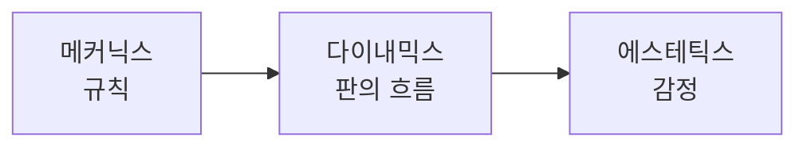

## 게임에서 재미란 ?
- 플레이어가 게임의 규칙과 주고받는 동안 느끼는 즐거움이다. [1장](../01.재미란%20무엇인가(What%20Is%20Fun)/README.md)에서 본 사람의 재미 일반과 같은 감정이지만, 게임 디자인이 다루는 게임에서는 그 감정을 누군가 일부러 설계한다는 점이 다르다
- 1장의 구분으로 보면 아이들이 규칙을 붙인 술래잡기도 게임이다. 다만 게임 디자인이 다루는 게임은 그 규칙을 플레이어가 아닌 디자이너가 미리 정해 둔다. 그래서 게임 디자인에서는 "재미있다"를 그대로 쓰기보다 어떤 종류의 재미인지, 어떤 규칙이 그것을 만드는지 나눠 말하려 한다
- 이 장은 재미를 나눠 부르는 말(MDA), 게임의 재미를 배움으로 본 관점(코스터), 게임이 재미를 만드는 재료, 게임을 계속 하게 만드는 힘(자기결정이론의 게임 적용)을 정리한다

 

## 왜 재미를 나눠서 봐야 할까
"이 게임은 재미없다"는 말은 고칠 곳을 알려 주지 않는다. 너무 어려워서인지, 할 것이 없어서인지, 같이 할 사람이 없어서인지에 따라 고치는 방법이 전혀 다르다.

음식에 비유하면 "맛없다"와 같다. 짜서인지, 싱거워서인지, 식어서인지 알아야 요리사가 고칠 수 있다. 맛을 짠맛, 단맛, 신맛으로 나눠 부르듯 재미도 나눠 부를 말이 필요하다.

MDA 논문은 이 문제를 직접 짚는다. 게임과 놀이를 이야기하기 어려운 이유는 쓰는 어휘가 좁기 때문이고, 그래서 "재미(fun)"나 "게임플레이(gameplay)" 같은 말에서 벗어나 더 구체적인 어휘로 가려 한다고 쓴다(Hunicke 외, 2004, Aesthetics 절).

 

## 재미는 여러 가지다 : MDA 프레임워크
### MDA란
로빈 휴니키(Robin Hunicke), 마크 르블랑(Marc LeBlanc), 로버트 주벡(Robert Zubek)이 쓴 논문 「MDA: A Formal Approach to Game Design and Game Research」에서 정리한 틀이다. 2001년부터 2004년까지 게임 개발자 콘퍼런스(GDC)의 Game Design and Tuning Workshop에서 가르친 내용이다. 이름은 게임을 나누는 세 층에서 따왔다.

- 메커닉스(Mechanics)는 게임을 이루는 구성 요소다. 논문은 데이터 표현과 알고리즘 수준의 구성 요소라고 쓴다. 보드게임이라면 말, 주사위, 규칙서다.
- 다이내믹스(Dynamics)는 메커닉스가 플레이어의 입력과 서로의 출력에 반응하며 시간에 따라 만들어 내는 실행 중의 행동이다. 주사위를 굴리고 말을 옮기며 실제로 벌어지는 판의 흐름이다.
- 에스테틱스(Aesthetics)는 사전적으로 미학, 아름다움을 느끼는 감각을 뜻한다. MDA는 이를 넓혀 플레이어가 게임과 주고받을 때 일어나기를 바라는 감정 반응이다. 이 판이 손에 땀을 쥐게 하는지, 웃기는지다.

논문은 소비자 쪽에서 본 게임의 세 부분인 규칙(Rules), 시스템(System), "재미(Fun)"에 각각 메커닉스, 다이내믹스, 에스테틱스를 짝지었다. 재미가 에스테틱스 자리에 놓인다.

### 디자이너와 플레이어는 반대쪽에서 본다
디자이너는 메커닉스에서 시작한다. 규칙을 정하면 거기서 다이내믹스가 생기고, 그 결과로 에스테틱스가 나온다. 플레이어는 반대로 에스테틱스부터 느낀다. 분위기를 먼저 느끼고, 판의 흐름을 보고, 마지막에야 규칙을 알게 된다.

디자이너는 왼쪽에서 오른쪽으로 만들고, 플레이어는 오른쪽에서 왼쪽으로 겪는다. 요리사는 재료와 조리법을 고르지만 손님은 맛부터 느끼는 것과 같다. 그래서 논문은 두 관점을 함께 보라고 하고, 플레이어를 생각하면 기능 중심이 아니라 경험 중심으로 설계하게 된다고 쓴다.

MDA의 흐름대로라면 디자이너가 손대는 곳은 메커닉스이고, 재미는 그 결과로 생긴다. 그래서 원하는 감정이 나오지 않으면 규칙으로 돌아가 고친다. 논문은 모노폴리를 예로 든다. 앞선 사람은 부자가 될수록 다른 사람에게 더 큰 손해를 입히고, 가난한 사람은 점점 더 가난해진다. 격차가 벌어지면 몇 사람(때로는 한 사람)만 판에 마음을 쏟고, 긴장감과 내가 판을 움직인다는 느낌이 사라진다. 논문은 뒤처진 사람에게 보조금을 주거나 부자에게 세금을 매기는 규칙을 고친 방법으로 든다. 그러면 독점의 현실을 재현하는 힘은 약해질 수 있지만 "현실이 늘 재미있지는 않다"고 덧붙인다.

### 여덟 가지 재미
논문은 "재미"를 대신할 어휘로 여덟 가지 에스테틱스를 든다. 이것이 전부는 아니라고 밝힌다.

| 에스테틱스 | 논문의 설명 | 풀어 쓰면 |
|-----------|-------------|-----------|
| 감각 (Sensation) | Game as sense-pleasure | 보고 듣고 손으로 느끼는 즐거움 |
| 판타지 (Fantasy) | Game as make-believe | 다른 세계, 다른 존재가 되어 보는 즐거움 |
| 서사 (Narrative) | Game as drama | 이야기가 펼쳐지는 즐거움 |
| 도전 (Challenge) | Game as obstacle course | 장애물을 넘는 즐거움 |
| 동료애 (Fellowship) | Game as social framework | 사람들과 함께하는 즐거움 |
| 발견 (Discovery) | Game as uncharted territory | 모르는 곳을 알아내는 즐거움 |
| 표현 (Expression) | Game as self-discovery | 나를 드러내고 나를 알아 가는 즐거움 |
| 시간 보내기 (Submission) | Game as pastime | 별생각 없이 시간을 맡기는 즐거움 |

논문은 같은 재미있는 게임이라도 재미의 구성이 다르다는 것을 네 게임으로 보인다. 몸짓으로 단어를 맞히는 놀이인 Charades는 동료애, 표현, 도전이고, 1인칭 슈팅 게임 Quake는 도전, 감각, 경쟁, 판타지다. The Sims는 발견, 판타지, 표현, 서사이고, Final Fantasy는 판타지, 서사, 표현, 발견, 도전, 시간 보내기다. Quake 목록의 경쟁(Competition)은 여덟 항목에 없는 말인데 논문에 그대로 쓰여 있다. 목록이 닫혀 있지 않다는 예로 볼 수 있다.

논문은 어떤 요소를 얼마나 섞으면 재미가 되는지 알려 주는 공식은 없다고 하면서도, 이 분류가 서로 다른 게임이 서로 다른 사람에게, 또는 같은 사람에게도 때에 따라 다르게 끌리는 이유를 설명해 준다고 쓴다.

1장의 카유아 분류와 겹쳐 보면 미미크리(흉내)는 판타지와, 아곤(경쟁)은 Quake 목록의 경쟁과, 일링크스(현기증)는 감각과 가깝다. 이 대응은 내 해석이다.

 

## 게임의 재미는 배우는 즐거움이다 : 코스터
게임 디자이너 라프 코스터(Raph Koster)는 『A Theory of Fun for Game Design』(2004)에서 게임의 재미를 배움과 묶었다. 이 책은 오스틴 게임 콘퍼런스 첫 회에서 한 강연에서 출발했다.

코스터는 2012년 강연 「Theory of Fun 10 Years Later」에서 생각을 이렇게 요약한다. 사람은 패턴을 배워 현실에 적용하는데, 그 대부분은 의식하지 못한 채 일어난다. 게임은 패턴을 배우도록 만든 체계이고, 재미는 계속 시도하도록 북돋는 뇌의 보상이다. 슬라이드에 실린 책의 문장은 이렇다.

> Fun in games arises out of mastery. It arises out of comprehension. It is the act of solving puzzles that makes games fun. With games, learning is the drug.

게임의 재미는 숙달과 이해에서 나오고, 퍼즐을 푸는 행위가 게임을 재미있게 만든다는 뜻이다. 처음 자전거를 배울 때를 떠올리면 된다. 넘어지다가 균형을 잡는 요령이 몸에 붙는 순간이 가장 신난다. 코스터의 주장으로 알려진 대로라면(아래 문단 참고), 다 익혀서 아무 생각 없이 탈 수 있게 되면 그 신남도 줄어든다.

흔히 코스터의 말로 인용되는 "재미는 배움의 다른 이름일 뿐(Fun is just another word for learning)"에 대해, 같은 강연 슬라이드는 이 문장에 크리스 크로퍼드(Chris Crawford)의 이름을 붙이고, 코스터 자신이 처음 한 말은 "재미는 배움에 대한 감정 반응(fun is the emotional response to learning)"이었다고 적는다. 슬라이드에는 자기가 말하는 재미를 kfun이라 부르며 "기본적으로 도파민 분비(kfun = dopamine release)"라고 적은 장도 있다. 도파민이 곧 즐거움인지에 대해서는 1장의 원함과 좋아함 구분을 함께 봐야 한다.

패턴을 다 익히면 재미가 사라지고 지루해진다는 설명이 책의 중심 주장으로 알려져 있다. 책 원문은 읽지 못해 확인 필요로 둔다. 강연에서 코스터는 재미와 플로(1장)가 같은 것이 아니라고 했고, 흔히 "재미"라고 부르는 것 가운데 상당수를 정의에서 일부러 뺐다고 했다. 슬라이드에는 순간의 기쁨(delight)은 재미가 아니고, 편안함(comfort)은 편안한 것이지 재미가 아니라고 적혀 있다. 모든 즐거움을 배움으로 설명하려는 이론은 아니라는 뜻이다.

 

## 게임이 재미를 만드는 재료
1장의 이론들을 게임에 대 보면, 게임이 재미를 만들 때 쓰는 재료 몇 가지가 겹쳐 나온다. 아래는 그 재료를 이 노트에서 읽은 자료에 기대어 모은 것이다. 업계에서 정해 둔 목록이 아니라 내가 묶은 것이다.

### 분명한 목표
플로의 첫 조건이 목표가 분명하고 나아가는 정도가 보이는 것이다(1장). 게임은 이 조건을 직접 만든다. 깃발에 닿기, 상대 왕을 잡기, 점수 넘기기처럼 무엇을 하면 되는지 처음부터 알려 준다. 일상의 일은 목표가 흐릿한 경우가 많은데, 게임은 그것을 분명하게 잘라 준다.

### 바로 오는 피드백
플로의 두 번째 조건은 한 일에 대한 반응이 분명하고 바로 오는 것이다. 게임에서는 버튼을 누르면 캐릭터가 바로 뛰고, 맞히면 점수가 바로 오른다. 피드백이 늦거나 흐릿하면 플레이어는 자기가 잘하고 있는지 알 수 없다. 1장의 예측 오차와 이어 보면, 피드백은 플레이어가 자기 예측이 맞았는지 확인하는 수단이기도 하다(이 연결은 내 해석이다).

### 결과의 불확실성
1장에서 본 카유아의 세 번째 성질, 결과가 정해져 있지 않다는 것을 게임은 두 가지로 만든다. 주사위처럼 운(알레아)으로 만들기도 하고, 상대의 실력이나 플레이어 자신의 실수 가능성(아곤)으로 만들기도 한다.

### 알맞은 어려움
플로의 세 번째 조건인 어려움과 실력의 균형을 게임은 난이도로 다룬다. 실력이 느는 만큼 어려움도 올려야 플레이어가 불안과 지루함 사이에 머문다. 위키백과 Flow 문서는 장르에 따라 일부러 균형을 비튼다고 소개한다. 공포 게임은 불안을 유지하려고 어려움을 실력보다 높게 두고, 편하게 즐기는 게임은 실력보다 낮게 둔다. 이 문서에는 1장에서 적은 언어 모델 작성 경고가 붙어 있다. 진 첸(Jenova Chen)이 석사 논문에서 출발해 만든 게임 『flOw』는 같은 문서에 따르면 플레이 중에 난이도를 맞춰 간다. 게임이 자동으로 맞추는지, 플레이어가 고르게 하는지는 확인 필요다.

### 흥미로운 선택
시드 마이어(Sid Meier)는 "게임은 흥미로운 결정의 연속이다(Games are a series of interesting decisions)"라고 말한 것으로 알려져 있다. Game Developer(당시 Gamasutra)의 2012년 GDC 강연 기사에 따르면, 그는 흥미롭지 않은 결정부터 정의하는 편이 쉽다고 했다. 늘 첫 번째 선택지를 고르게 되는 결정이 그렇다. 흥미로운 결정에는 보통 무언가를 얻고 무언가를 내주는 맞바꿈(tradeoff)이 있고, 좋은 결정은 상황에 따라 달라진다. 그는 리듬 게임이나 퍼즐 게임에는 이 관점이 늘 가장 좋은 렌즈는 아니라고도 했다.

선택은 1장 자기결정이론의 자율성과도 닿는다(내 해석). 마이어가 말한 늘 첫 번째를 고르게 되는 결정은, 고를 자유가 있어도 실제로는 고를 것이 없다.

### 재료는 섞여서 쓰인다
위 재료는 따로 쓰이지 않는다. 체스를 예로 들면 목표(왕 잡기)는 분명하고, 수마다 판이 바뀌는 피드백이 바로 오고, 상대의 수가 불확실성을 만들고, 비슷한 실력의 상대가 알맞은 어려움을 주고, 매 수가 맞바꿈이 있는 선택이다. 이 분석은 위 재료를 체스에 대 본 내 예시다.

 

## 왜 계속 하고 싶을까 : 자기결정이론의 게임 적용
1장의 리처드 라이언이 스콧 리그비(C. Scott Rigby), 앤드루 프시빌스키(Andrew Przybylski)와 함께 쓴 2006년 논문 「The Motivational Pull of Video Games」는 1장의 자기결정이론을 게임에 적용했다. 논문은 게임을 하는 사람이 대부분 돈을 내고 하며, 게임 밖에서 보상을 받지 않는다는 점을 든다. 그래서 사람들이 게임을 하는 이유는 그 자체로 만족스럽기 때문이라고 본다.

논문은 게임이 사람을 끌어당기는 힘이 자율성, 유능감, 관계성을 채워 주는 데서 크게 나온다고 보고, 게임에서 각 욕구가 언제 커지는지 이렇게 예상한다.

- 자율성은 움직임과 전략을 자유롭게 고를 수 있고, 과제와 목표를 고를 수 있고, 보상이 행동을 조종하기보다 정보를 주는 쪽으로 짜인 게임에서 커진다.
- 유능감은 조작이 직관적이어서 금방 익숙해지고, 알맞은 도전과 긍정적인 반응이 이어질 때 커진다. 논문은 이것을 게임이 주는 가장 중요한 만족 가운데 하나로 본다.
- 관계성은 여럿이 함께하는 게임에서 의미가 크다.

게임을 하나에서 네 개까지 하게 한 연구 1~3에서, 자율성과 유능감을 느낀 정도는 게임을 즐긴 정도, 선호, 플레이 전후의 행복감 변화와 관련이 있었다. 여럿이 하는 온라인 게임 이용자를 조사한 네 번째 연구에서는 세 욕구가 각각 따로 즐거움과 앞으로도 하려는 마음을 예측했다. 연구진은 놀이에서 욕구가 채워진 정도를 재는 새 측정 도구를 PENS(Player Experience of Need Satisfaction)라고 불렀다.

### 계속 하게 만드는 것과 즐겁게 만드는 것
1장에서 본 원함과 좋아함의 구분은 게임 디자인에서 특히 중요하다. 계속 누르게 만드는 것과 즐겁게 만드는 것은 다를 수 있다. 다음 보상이 언제 나올지 모르게 만드는 장치가 원함을 키운다는 이야기가 많지만, 직접 읽은 연구는 없어 확인 필요로 둔다. 1장에서 본 대로 보상이 정보를 주는 대신 행동을 조종하는 쪽으로 쓰이면 자율성이 꺾일 수 있다. 이 부분은 직접 연구를 읽고 따로 정리할 주제로 남긴다.

 

## 관점 비교
| 관점 | 게임의 재미를 어떻게 보나 | 디자이너에게 던지는 질문 |
|------|---------------------------|--------------------------|
| MDA | 규칙에서 생기는 여러 종류의 감정 반응 | 노리는 재미가 무엇이고, 어떤 규칙이 그것을 만드는가 |
| 코스터 | 패턴을 배우고 익히는 즐거움 | 플레이어가 아직 배울 것이 남아 있는가 |
| 재미를 만드는 재료(내 정리) | 목표, 피드백, 불확실성, 알맞은 어려움, 흥미로운 선택 | 이 게임은 어떤 재료에 기대고, 어떤 재료를 일부러 뺐는가 |
| 자기결정이론 | 자율성, 유능감, 관계성의 충족 | 플레이어가 스스로 고르고, 해내고, 이어져 있다고 느끼는가 |

 

## 게임관으로 이어 갈 질문
이 장은 남이 정리한 게임의 재미를 모은 것이다. [3장 게임관이란 무엇인가](../03.게임관이란%20무엇인가(What%20Is%20a%20Game%20Philosophy)/README.md)의 틀로 내 게임관을 쓸 때 아래 질문에 답한다.

- 내가 가장 오래 붙잡았던 게임은 여덟 가지 재미 중 무엇이 컸는가
- 코스터의 주장으로 알려진 대로 다 배운 게임은 지루해지는가, 아니면 다 알면서도 다시 하는 게임이 있는가. 있다면 그 재미는 무엇인가
- 운(알레아)이 큰 게임을 좋아하는가, 실력(아곤)이 드러나는 게임을 좋아하는가
- 혼자 하는 게임과 함께 하는 게임 중 어디에서 더 큰 재미를 느끼는가
- 내가 만든다면 어떤 재미 하나를 가장 먼저 노릴 것인가

 

## 참고 자료
- Robin Hunicke, Marc LeBlanc, Robert Zubek, [MDA: A Formal Approach to Game Design and Game Research](https://users.cs.northwestern.edu/~hunicke/MDA.pdf) (2004). Introduction, MDA, MDA in Detail(MDA as Lens, Aesthetics, Aesthetic Models, Dynamic Models) 절을 읽었다. 이 논문이 실린 학술 행사 이름은 PDF에 적혀 있지 않아 확인 필요
- Raph Koster, [Theory of Fun 10 Years Later](https://www.raphkoster.com/wp-content/uploads/2026/07/Theory-of-Fun-10-Years-Later.pdf) (2012년 강연 슬라이드). 책 『A Theory of Fun for Game Design』 원문은 읽지 못했고, 책 문장은 이 슬라이드에 인용된 것을 옮겼다
- Richard M. Ryan, C. Scott Rigby, Andrew Przybylski, [The Motivational Pull of Video Games: A Self-Determination Theory Approach](https://www.rochester.edu/warner/lida/wp-content/uploads/2022/11/02bfe513dd59366750000000.pdf), Motivation and Emotion 30(4), 2006, 347~363쪽. Abstract, 서론(PENS 소개 포함), Self-determination theory 절을 읽었다
- Leigh Alexander, [GDC 2012: Sid Meier on how to see games as sets of interesting decisions](https://www.gamedeveloper.com/design/gdc-2012-sid-meier-on-how-to-see-games-as-sets-of-interesting-decisions), Game Developer(당시 Gamasutra), 2012-03-07. 강연 영상은 보지 못했다. 이 말을 1989년 GDC에서 처음 했다는 이야기는 검색 결과로만 봤고 확인 필요
- Wikipedia, [Flow (psychology)](https://en.wikipedia.org/wiki/Flow_(psychology)) Applications의 Games and gaming 절 (2026-10-30 확인). 문서 전체에 언어 모델 작성 경고가 붙어 있다

 

[목차](../README.md) | [이전: 재미란 무엇인가](../01.재미란%20무엇인가(What%20Is%20Fun)/README.md) | [다음: 게임관이란 무엇인가](../03.게임관이란%20무엇인가(What%20Is%20a%20Game%20Philosophy)/README.md)
