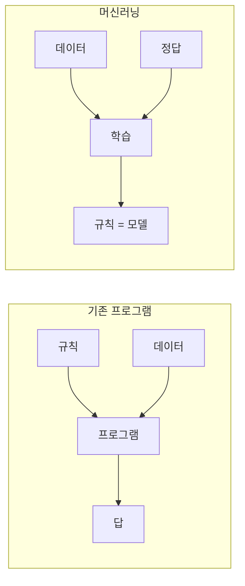
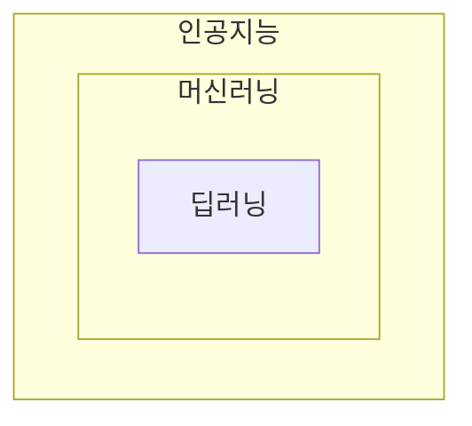
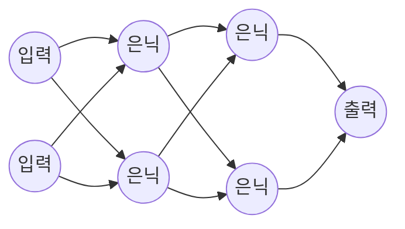

## 인공지능이란 ?
- 사람이 하던 판단, 인식, 예측 같은 지적인 일을 컴퓨터가 하도록 만드는 기술과 그 연구 분야
- 오늘날 쓰이는 인공지능은 대부분 사람이 규칙을 직접 적는 대신 데이터에서 규칙을 스스로 찾는 머신러닝 방식으로 만든다
- 챗봇, 번역기, 사진 속 얼굴 찾기, 추천 목록이 모두 인공지능의 예다

### 인공지능 (Artificial Intelligence, AI)
Artificial의 사전적 의미는 인공의, 사람이 만든이다. 자연에서 저절로 생긴 것이 아니라 사람 손으로 만든 것을 말한다. Intelligence는 지능, 즉 이해하고 배우고 판단하는 능력이다. 두 단어를 합치면 사람이 만든 지능이라는 뜻이 된다.
공학적으로는 사람의 지능이 하는 일(보고 알아보기, 말 이해하기, 결정하기)을 컴퓨터 프로그램으로 흉내 내는 기술을 말한다. 기계가 실제로 생각하는지와는 별개로, 결과가 지능적으로 보이면 인공지능이라고 부른다. 이 이름은 1956년 미국 다트머스 대학 워크숍을 제안한 1955년 문서에서 처음 쓰였고, 그 워크숍을 계기로 널리 퍼졌다.

 

## 규칙을 짜는 프로그램과 무엇이 다를까
### 기존 프로그램
보통 프로그램은 사람이 규칙을 하나하나 적는다. "제목에 '당첨'이 들어 있으면 스팸으로 분류한다"처럼 쓴다. 규칙이 분명한 일에는 이 방식이 정확하고 빠르다.

문제는 규칙을 말로 적기 어려운 일이다. 사진 속 동물이 고양이인지 개인지 가르는 규칙을 적어 보려 하면 귀 모양, 털 색, 각도, 조명 같은 경우의 수가 끝없이 늘어난다. 사람은 쉽게 하지만 어떻게 하는지는 설명하지 못하는 일이다.

### 인공지능(머신러닝) 방식
머신러닝은 규칙 대신 예시를 준다. 고양이 사진 수천 장과 개 사진 수천 장을 보여 주고, 둘을 가르는 기준은 컴퓨터가 찾게 한다.

요리로 비유하면 기존 프로그램은 레시피를 그대로 따라 하는 요리사이고, 머신러닝은 레시피 없이 맛을 보고 고치기를 반복하며 간을 맞추는 법을 익히는 요리사다. 앞의 요리사는 레시피에 없는 상황에서 멈추고, 뒤의 요리사는 처음 보는 재료도 비슷한 경험에 기대 어느 정도 해낸다.

 

## 인공지능, 머신러닝, 딥러닝의 관계
세 용어는 같은 뜻이 아니라 큰 원 안에 작은 원이 들어 있는 관계다. 인공지능이 가장 넓고, 그 안에 머신러닝이, 그 안에 딥러닝이 있다.

### 머신러닝 (Machine Learning)
Machine은 기계, Learning은 배움이다. 기계가 배운다는 뜻이다.
공학적으로는 데이터를 보고 그 안의 규칙(패턴)을 스스로 찾아내는 방법을 말한다. 사람이 규칙을 적지 않고 예시를 주면, 컴퓨터가 예시에 맞는 규칙을 만든다. 인공지능을 만드는 여러 방법 중 하나지만 지금은 가장 널리 쓰여서 두 말이 거의 같은 뜻처럼 쓰이기도 한다.

### 딥러닝 (Deep Learning)
Deep은 깊은이라는 뜻이다. 여기서 깊다는 것은 내용이 심오하다는 말이 아니라 층이 많이 쌓여 있다는 말이다.
공학적으로는 아래에서 볼 인공 신경망을 여러 층으로 깊게 쌓아 학습하는 머신러닝 방법을 말한다. 사진, 음성, 글처럼 사람이 특징을 정리해 주기 어려운 데이터에 특히 강하다. 요즘 이야기하는 챗봇과 이미지 생성 AI는 대부분 딥러닝으로 만든다.

 

## 머신러닝은 어떻게 배울까
### 모델 (Model)
사전적 의미는 모형, 본보기다. 실제 대상을 작게 줄이거나 단순하게 만들어 그 특징을 담은 것을 말한다. 비행기 모형은 진짜 비행기가 아니지만 모양과 비율을 담고 있다.
공학적으로는 학습을 통해 만들어진, 입력을 받아 출력을 내는 계산 덩어리를 말한다. 세상의 규칙을 단순하게 줄여 담은 것이라 모델이라고 부른다. 고양이 사진 분류 모델은 사진을 받으면 "고양이 92%" 같은 답을 낸다.

### 파라미터 (Parameter)
사전적 의미는 어떤 결과의 범위나 조건을 정하는 기준값이다.
공학적으로는 모델 안에서 학습하며 조금씩 바뀌는 숫자들을 말한다. 모델이 배운 내용은 결국 이 숫자들에 저장된다. 음향 믹서의 수많은 손잡이를 조금씩 돌려 원하는 소리를 맞추듯, 학습은 수많은 숫자를 조금씩 바꿔 정답에 가까운 출력이 나오게 맞추는 과정이다. 큰 모델은 이 숫자가 수십억 개를 넘는다. 프로그래밍에서 함수의 매개변수도 영어로 parameter지만, 여기서 말하는 것은 모델 안에 저장된 숫자다.

### 학습 (Training)
Training의 사전적 의미는 훈련, 연습이다. 반복해서 몸에 익히는 일을 말한다.
공학적으로는 데이터를 모델에 넣고, 모델의 답과 정답의 차이(오차)를 재고, 그 차이가 줄어드는 쪽으로 파라미터를 조금씩 고치는 일을 반복하는 과정이다.

1. 데이터를 모델에 넣어 답을 낸다
2. 모델의 답과 정답이 얼마나 다른지 잰다
3. 차이가 줄어드는 방향으로 파라미터를 조금 고친다
4. 1~3을 많은 데이터로 여러 번 반복한다

시험 문제를 풀고, 채점하고, 틀린 부분을 고쳐 다시 푸는 공부와 같다.

### 추론 (Inference)
사전적 의미는 이미 아는 것을 바탕으로 모르는 것을 미루어 생각해 내는 일이다.
공학적으로는 학습이 끝난 모델에 새 입력을 넣어 답을 얻는 단계를 말한다. 학습 때는 파라미터를 고치지만 추론 때는 고치지 않고 쓰기만 한다. 공부를 마친 학생이 처음 보는 시험지를 푸는 단계다. 우리가 챗봇에 질문하는 순간이 추론이다.

### 과적합 (Overfitting)
Over는 지나치게, Fit은 꼭 맞다는 뜻이다. 너무 꼭 맞는다는 말이다.
공학적으로는 모델이 학습 데이터에만 지나치게 맞춰져서 처음 보는 데이터에서는 오히려 성능이 떨어지는 현상을 말한다. 기출문제의 답을 통째로 외운 학생이 숫자만 바뀐 문제에서 틀리는 것과 같다. 그래서 학습에 쓰지 않은 데이터를 따로 남겨 두고 그 데이터로 성능을 잰다.

 

## 배우는 방식 세 가지
머신러닝은 무엇을 보고 배우느냐에 따라 크게 세 가지로 나눈다.

### 지도 학습 (Supervised Learning)
Supervise의 사전적 의미는 감독하다, 지도하다이다. 옆에서 정답을 알려 주는 선생님이 있다는 뜻이다.
공학적으로는 입력과 정답(레이블, Label)을 짝지어 주고 학습시키는 방식이다. "이 사진은 고양이", "이 메일은 스팸"처럼 정답이 붙은 데이터로 배운다. 정답지가 있는 문제집으로 공부하는 것과 같다.

### 비지도 학습 (Unsupervised Learning)
Un이 붙어 감독이 없다는 뜻이 된다. 정답을 알려 주는 선생님이 없다.
공학적으로는 정답 없이 데이터만 주고 그 안에서 비슷한 것끼리 묶거나 구조를 찾게 하는 방식이다. 쇼핑몰 고객을 구매 패턴이 비슷한 무리로 나누는 일이 예다. 정답지 없이 카드 더미를 받아 비슷한 그림끼리 나눠 놓는 것과 같다.

### 강화 학습 (Reinforcement Learning)
Reinforce의 사전적 의미는 강화하다, 보강하다이다. 심리학에서는 칭찬이나 보상으로 어떤 행동을 더 자주 하게 만드는 일을 강화라고 부른다.
공학적으로는 정답을 미리 주지 않고, 모델이 행동한 결과에 따라 보상이나 벌점을 주어 보상을 많이 받는 행동을 스스로 익히게 하는 방식이다. 모델이 행동하는 무대(게임 화면, 로봇이 걷는 공간)를 환경(Environment)이라고 부른다. 게임, 로봇 제어에 많이 쓴다. 강아지가 앉으면 간식을 주며 훈련하는 것과 같다.

| 구분 | 지도 학습 | 비지도 학습 | 강화 학습 |
| --- | --- | --- | --- |
| 주는 것 | 데이터와 정답 | 데이터만 | 환경과 보상 |
| 배우는 것 | 입력에서 정답을 맞히는 법 | 데이터 안의 묶음과 구조 | 보상을 많이 받는 행동 |
| 예 | 스팸 분류, 사진 분류 | 고객 묶기 | 게임 플레이, 로봇 걷기 |

 

## 딥러닝과 신경망
### 인공 신경망 (Artificial Neural Network)
Neural은 신경의, Network는 그물, 망이다. 신경이 그물처럼 얽힌 구조라는 뜻이다. 사람의 뇌는 신경세포(뉴런)들이 서로 신호를 주고받는 거대한 그물이다.
공학적으로는 뇌의 신경세포에서 아이디어를 얻은 계산 구조를 말한다. 작은 계산 단위인 노드(Node)가 앞 단위들로부터 숫자를 받아 각각 다른 비중인 가중치(Weight)를 곱해 더한다. 더한 값은 활성화 함수(Activation Function)라는 간단한 규칙을 한 번 거친 뒤 다음 단위로 넘어간다. 이 과정 덕분에 층을 쌓을수록 더 복잡한 관계를 표현할 수 있다. 가중치와 여기에 더해지는 편향(Bias)이 앞에서 본 파라미터다. 이름은 뇌에서 왔지만 실제 뇌와 똑같이 동작하는 것은 아니다.

### 층 (Layer)
사전적 의미는 겹, 층이다. 케이크처럼 차곡차곡 쌓인 한 단을 말한다.
공학적으로는 신경망에서 같은 단계에 있는 노드들의 묶음이다. 입력을 받는 입력층, 결과를 내는 출력층, 그 사이의 은닉층(Hidden Layer)으로 나뉜다. 은닉은 숨겨져 있다는 뜻이다. 입력과 출력처럼 바깥에서 직접 보이지 않는 가운데 층이라 이렇게 부른다. 은닉층이 여러 겹이면 딥러닝이라고 부른다.

공장의 조립 라인으로 생각하면 쉽다. 첫 작업대는 선과 점 같은 단순한 모양을 찾고, 다음 작업대는 그걸 모아 눈, 귀 같은 부분을 찾고, 마지막 작업대는 부분들을 모아 고양이라고 판단한다. 층이 깊을수록 더 복잡한 특징을 단계적으로 만들어 낼 수 있다. 다만 어느 작업대가 무엇을 찾을지는 사람이 정해 주지 않는다. 학습하면서 저절로 나뉜다. 위 순서도 사진을 다루는 신경망에서 흔히 관찰되는 모습이다.

 

## 생성형 AI와 거대 언어 모델
### 생성형 AI (Generative AI)
Generate의 사전적 의미는 만들어 내다, 낳다이다.
공학적으로는 글, 그림, 소리, 코드처럼 새로운 결과물을 만들어 내는 인공지능을 말한다. 앞에서 본 분류 모델이 "이건 고양이다"라고 고르는 일을 한다면, 생성형 AI는 고양이 그림을 새로 그린다. 고르는 AI와 만드는 AI의 차이다.

### 거대 언어 모델 (Large Language Model, LLM)
Large는 큰, Language는 언어, Model은 앞에서 본 모형이다. 언어를 다루는 큰 모형이라는 뜻이다.
공학적으로는 아주 많은 글을 학습해 사람의 말을 처리하고 만들어 내는 딥러닝 모델을 말한다. 파라미터 수와 학습한 글의 양이 매우 커서 거대라는 말이 붙는다. ChatGPT, Claude, Gemini 같은 챗봇이 LLM으로 만든 서비스다.

LLM이 하는 일의 핵심은 다음에 올 말 맞히기다. "오늘 날씨가 정말"이라는 글을 받으면 그다음에 올 말("좋다", "덥다" 등)마다 가능성을 계산하고, 그 가능성에 따라 하나를 고른다. 그래서 같은 질문에도 답이 조금씩 달라진다. 고른 말을 이어 붙이고 다시 다음 말을 고르기를 반복해 긴 답을 만든다. 스마트폰 키보드의 단어 추천을 아주 크고 정교하게 키운 것으로 보면 된다.

이때 정답은 사람이 따로 붙이지 않는다. 글의 다음 부분이 곧 정답이 되므로 이런 방식을 자기 지도 학습(Self-supervised Learning)이라고 부른다. 앞에서 본 세 가지 중 하나에 딱 들어가지 않는, 지도 학습과 비지도 학습 사이의 방식이다.

### 토큰 (Token)
사전적 의미는 표, 상징이다. 버스 토큰이나 게임 코인처럼 무언가를 대신하는 작은 조각을 말한다.
공학적으로는 LLM이 글을 다루는 최소 단위다. 모델은 글자를 그대로 읽지 않고 단어나 단어 조각으로 잘라 숫자로 바꾼 뒤 처리한다. 이 조각 하나가 토큰이다. 어떻게 자르는지는 모델마다 다르고, 한 단어가 토큰 여러 개로 나뉘기도 한다. 많은 AI 서비스가 이 토큰 수로 사용량과 요금을 센다. 앞에서 말한 다음 말 맞히기는 정확히는 다음 토큰 맞히기다. 실제로 글이 어떻게 잘리는지, 컨텍스트 창과 요금은 [토큰](./%5BAI%20활용%5D%20토큰(Token)/README.md) 문서에서 다룬다.

### 프롬프트 (Prompt)
사전적 의미는 재촉하다, 일깨우다이다. 연극에서 배우가 대사를 잊었을 때 무대 옆에서 다음 대사를 작게 일러 주는 일도 프롬프트라고 한다.
공학적으로는 AI에게 주는 입력, 즉 질문이나 지시문을 말한다. AI가 무엇을 말할지 일러 주는 역할이라 이 이름이 붙었다. 같은 모델이라도 프롬프트를 어떻게 쓰느냐에 따라 답의 질이 크게 달라진다.

### 환각 (Hallucination)
사전적 의미는 실제로 없는 것을 있는 것처럼 보고 듣는 일이다.
공학적으로는 AI가 사실이 아닌 내용을 그럴듯하게 지어내는 현상을 말한다. 앞에서 본 것처럼 LLM 자체는 사실을 찾아 확인하지 않고 다음에 올 법한 말을 고르기 때문에, 없는 논문 제목이나 틀린 숫자도 자연스러운 문장으로 만들어 낼 수 있다. 시험에서 모르는 문제를 그럴듯한 말로 채워 넣는 학생과 비슷하다. 그래서 AI의 답은 중요한 내용일수록 출처를 직접 확인해야 한다.

 

## 좁은 AI와 범용 AI
### 좁은 AI (Narrow AI)
Narrow의 사전적 의미는 좁은이다. 정해진 좁은 범위의 일만 한다는 뜻이다.
공학적으로는 정해진 한 가지 일만 잘하는 인공지능을 말한다. 바둑 AI는 바둑만 두고 번역기는 번역만 한다. 다만 LLM처럼 번역, 요약, 코드 작성을 두루 하는 모델이 나오면서, 이를 좁은 AI로 볼지 범용 AI에 가까워졌다고 볼지는 의견이 갈린다.

흔히 약한 AI(Weak AI)라고도 부르지만, 약한 AI와 강한 AI는 원래 철학자 존 설(John Searle)이 기계가 실제로 마음을 갖는지, 아니면 흉내만 내는지를 두고 나눈 말이라 뜻이 조금 다르다.

### 범용 인공지능 (Artificial General Intelligence, AGI)
General의 사전적 의미는 일반적인, 두루 쓰이는이다.
공학적으로는 특정 분야에 한정되지 않고 사람처럼 처음 보는 여러 종류의 일을 두루 해내는 인공지능을 말한다. 강한 AI와 섞어 부르기도 한다. 아직 연구 목표로 남아 있고, 언제 가능할지와 무엇을 기준으로 달성했다고 볼지는 전문가마다 의견이 다르다.

 

## 한눈에 보는 용어
| 용어 | 사전적 의미 | 쉽게 말하면 |
| --- | --- | --- |
| 인공지능 (AI) | 사람이 만든 지능 | 사람처럼 판단하는 일을 하는 프로그램 |
| 머신러닝 (Machine Learning) | 기계가 배움 | 규칙 대신 예시를 보고 스스로 규칙을 찾는 방법 |
| 딥러닝 (Deep Learning) | 깊게 배움 | 층을 여러 겹 쌓은 신경망으로 배우는 머신러닝 |
| 모델 (Model) | 모형, 본보기 | 학습으로 만들어진, 입력을 받아 답을 내는 계산 덩어리 |
| 파라미터 (Parameter) | 결과를 정하는 기준값 | 모델이 배운 내용이 저장되는 수많은 다이얼 |
| 학습 (Training) | 훈련, 연습 | 틀린 만큼 파라미터를 고치기를 반복하는 과정 |
| 추론 (Inference) | 아는 것으로 모르는 것을 미루어 생각함 | 다 배운 모델로 새 질문에 답하는 단계 |
| 과적합 (Overfitting) | 너무 꼭 맞음 | 기출만 외워서 새 문제를 못 푸는 상태 |
| 지도 학습 (Supervised Learning) | 감독받는 배움 | 정답지가 있는 문제집으로 공부하기 |
| 비지도 학습 (Unsupervised Learning) | 감독 없는 배움 | 정답 없이 비슷한 것끼리 묶기 |
| 강화 학습 (Reinforcement Learning) | 보상으로 행동을 굳힘 | 잘하면 간식, 못하면 벌점으로 익히기 |
| 자기 지도 학습 (Self-supervised Learning) | 스스로 감독하는 배움 | 글의 다음 부분을 정답 삼아 배우기 |
| 인공 신경망 (Artificial Neural Network) | 신경의 그물 | 뇌에서 아이디어를 얻은 계산 구조 |
| 노드 (Node) | 마디, 매듭 | 신경망의 작은 계산 단위 |
| 가중치 (Weight) | 무게 | 앞에서 받은 숫자마다 곱하는 비중 |
| 층 (Layer) | 겹, 층 | 신경망에서 같은 단계 노드들의 묶음 |
| 생성형 AI (Generative AI) | 만들어 내는 AI | 글, 그림 같은 새 결과물을 만드는 AI |
| 거대 언어 모델 (LLM) | 언어를 다루는 큰 모형 | 다음에 올 말을 맞히며 글을 만드는 큰 모델 |
| 토큰 (Token) | 표, 상징, 대신하는 조각 | LLM이 글을 잘라 다루는 최소 단위 |
| 프롬프트 (Prompt) | 대사를 일러 줌 | AI에게 주는 질문이나 지시문 |
| 환각 (Hallucination) | 없는 것을 보고 들음 | AI가 사실이 아닌 내용을 그럴듯하게 지어냄 |
| 좁은 AI (Narrow AI) | 좁은 범위의 AI | 한 가지 일만 잘하는 AI |
| 범용 인공지능 (AGI) | 두루 쓰이는 인공지능 | 사람처럼 여러 일을 두루 하는 AI, 아직 연구 목표 |

 

## 더 볼 것 (TODO)
- 트랜스포머(Transformer)와 어텐션(Attention): 지금 LLM 대부분이 쓰는 신경망 구조
- 학습 과정 자세히: 손실 함수, 경사 하강법, 역전파, 활성화 함수
- 자기 지도 학습과 사람의 피드백을 쓰는 강화 학습(RLHF): LLM이 만들어지는 단계
- 데이터셋 나누기: 학습, 검증, 테스트 데이터
- 임베딩(Embedding): 글이나 이미지를 숫자 벡터로 바꾸는 방법
- AI 활용 기법(프롬프트, 컨텍스트와 RAG, 하네스, 루프, 에이전트, 파인튜닝)은 [AI 활용 방법](./%5BAI%20활용%5D%20AI%20활용%20방법(AI%20Usage%20Methods)/README.md) 문서와 거기서 이어지는 주제별 문서에서 다룸
- 프론트엔드에서 AI API 쓰기(스트리밍 응답 처리 등)는 별도 문서로
