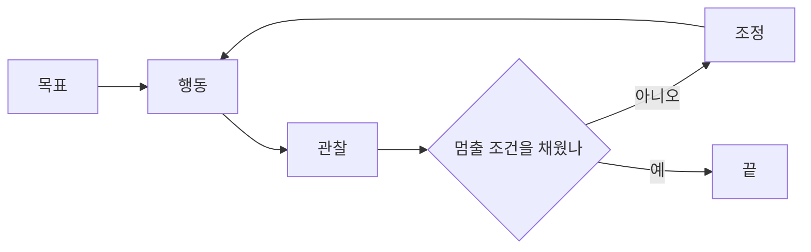

## 루프 엔지니어링이란 ?
- 사람이 매번 AI에게 지시하는 대신, AI를 일하게 하고 결과를 확인하고 다시 일하게 하는 반복 구조를 설계하는 기법
- [하네스](../%5BAI%20활용%5D%20하네스%20엔지니어링(Harness%20Engineering)/README.md)가 AI가 일하는 작업장이라면, 루프는 그 작업장을 언제 어떻게 돌릴지 정하는 업무 절차다
- 에이전트는 도구를 쓰며 여러 단계를 스스로 진행하는 AI를 말한다([워크플로와 에이전트](../%5BAI%20활용%5D%20워크플로와%20에이전트(Workflow%20and%20Agent)/README.md) 참고)
- 전체 흐름은 [AI 활용 방법](../%5BAI%20활용%5D%20AI%20활용%20방법(AI%20Usage%20Methods)/README.md) 문서에 있다

### 루프 (Loop)
사전적 의미는 고리, 둥글게 이어진 줄이다. 끝이 처음으로 돌아와 다시 이어지는 모양이다.
프로그래밍에서 루프는 같은 코드를 반복하는 반복문을 말한다. 루프 엔지니어링의 루프도 같은 뜻으로, AI가 일하고 확인받는 과정을 끝날 조건이 채워질 때까지 반복하는 고리다.

### 말이 생긴 배경
IBM은 루프 엔지니어링을 에이전트가 사람의 단계별 지시 없이 행동하고, 결과를 확인하고, 조정하는 작업 흐름을 설계하는 일이라고 설명한다(참고 자료 1).
Google의 애디 오스마니(Addy Osmani)는 2026년 6월 7일 글 "Loop Engineering"에서 루프를 목적을 정해 두면 AI가 그 목적을 다 이룰 때까지 스스로 다시 도는 목표라고 설명하고, 루프 엔지니어링을 에이전트에게 프롬프트를 보내는 사람의 자리를 시스템으로 바꾸는 일이라고 했다. 또 루프 엔지니어링이 하네스보다 한 층 위에 있다고 했다(참고 자료 2).

 

## 왜 필요할까
[하네스](../%5BAI%20활용%5D%20하네스%20엔지니어링(Harness%20Engineering)/README.md)를 잘 만들어도 사람이 매번 "이거 해 줘", "테스트 실패했으니 고쳐 줘"라고 말해야 한다면 사람이 병목이 된다. 루프는 이 왕복을 시스템에 넘긴다.

신입 사원이 매일 아침 업무 목록을 확인하고, 처리하고, 검수를 받고, 결과를 일지에 적는 절차가 정해져 있으면 팀장이 일일이 말하지 않아도 일이 굴러가는 것과 같다.

 

## 어떻게 동작할까
IBM은 루프를 네 단계로 설명한다(참고 자료 1).

1. 목표. 멈출 조건이 분명한 목표를 정한다. 예를 들면 모든 단위 테스트가 통과하고 요구 사항을 만족하면 멈춘다
2. 행동. 에이전트가 코드를 쓰거나 버그를 고친다
3. 관찰. CI(코드를 올릴 때마다 자동으로 테스트를 돌리는 장치) 같은 장치로 결과를 확인한다
4. 조정. 결과를 보고 접근 방식을 바꿔 다음 바퀴를 돈다

멈출 조건이 흐리면 루프는 끝나지 않거나, 덜 된 일을 끝났다고 착각한다. 목표 단계가 가장 중요한 이유다.

 

## 무엇으로 이루어질까
오스마니는 루프에 필요한 부품을 아래처럼 꼽았다(참고 자료 2). 스킬과 도구 연결은 [하네스 엔지니어링](../%5BAI%20활용%5D%20하네스%20엔지니어링(Harness%20Engineering)/README.md)에서, 하위 에이전트는 [컨텍스트 엔지니어링](../%5BAI%20활용%5D%20컨텍스트%20엔지니어링(Context%20Engineering)/README.md)에서 자세히 다룬다.

- 자동화. 정해진 시각에 일을 시작시킨다
- 워크트리(Worktree). Work는 작업, Tree는 나무다. Git에서 폴더가 나뭇가지처럼 뻗은 구조를 트리라고 부르고, 워크트리는 한 저장소를 여러 작업 폴더로 동시에 꺼내 쓰는 기능이다. 여러 에이전트가 서로의 작업을 덮어쓰지 않게 나눈다
- 스킬. 프로젝트 지식을 담는다
- 플러그인과 커넥터. 바깥 도구와 잇는다
- 하위 에이전트. 일을 제안하는 쪽과 검사하는 쪽을 나눈다
- 상태(State). 사전적 의미는 놓여 있는 모양이나 형편이다. 여기서는 대화 밖에 적어 두는 진행 기록을 말한다. 마크다운 파일이나 이슈 보드가 쓰인다

모델은 실행이 끝나면 모든 것을 잊기 때문에 기억은 컨텍스트가 아니라 디스크에 있어야 한다는 것이 오스마니의 설명이다(참고 자료 2). 컨텍스트 엔지니어링에서 본 메모 남기기와 같은 생각이다.

 

## 조심할 점
### 비용
오스마니도 토큰 비용을 반드시 조심하라고 했다. 하위 에이전트는 각자 모델과 도구를 쓰므로 토큰을 더 쓴다(참고 자료 2).

### 완료는 증명이 아니다
오스마니는 완료가 주장일 뿐 증명이 아니라고 했다(참고 자료 2). 그래서 루프가 끝났다고 해도 결과는 사람이 다시 확인해야 한다.

### 이해의 빚 (Comprehension Debt)
사람이 보지 않는 사이 코드가 쌓이면 나중에 아무도 그 코드를 이해하지 못하는 상태가 될 수 있다. 오스마니는 지켜보지 않는 루프가 이 빚을 키운다고 경고했다(참고 자료 2). 빚이라고 부르는 것은 당장은 편하지만 나중에 이해하는 데 드는 시간으로 갚아야 하기 때문이다.

### 기록 없는 루프
2026년 8월 연구는 루프를 쓰는 저장소 대부분이 루프 설정은 커밋하지만, 권장되는 상태 파일은 거의 커밋하지 않는다고 보고했다(참고 자료 3).

 

## 한눈에 보는 용어
| 용어 | 사전적 의미 | 쉽게 말하면 |
| --- | --- | --- |
| 루프 엔지니어링 (Loop Engineering) | 루프: 고리, 둥글게 이어진 줄 | 사람 대신 시스템이 AI를 일하게 하고 확인하는 반복 구조 설계 |
| 워크트리 (Worktree) | 작업 나무 | 한 저장소를 여러 작업 폴더로 나눠 쓰는 Git 기능 |
| 상태 (State) | 놓여 있는 모양이나 형편 | 대화 밖에 적어 두는 진행 기록 |
| CI (Continuous Integration) | 지속적 통합 | 코드를 올릴 때마다 자동으로 테스트를 돌리는 장치 |
| 이해의 빚 (Comprehension Debt) | 이해하지 못한 채 쌓인 빚 | 아무도 읽지 않은 코드가 쌓인 상태 |

 

## 참고 자료
날짜는 각 자료에 적힌 게시일이다. 루프 엔지니어링은 2026년에 쓰이기 시작한 이름이라 정의가 아직 굳지 않았고, 자료마다 범위가 조금씩 다르다.

1. IBM, [What Is Loop Engineering?](https://www.ibm.com/think/topics/loop-engineering), 2026-07-17
2. Addy Osmani, [Loop Engineering](https://addyosmani.com/blog/loop-engineering/), 2026-06-07
3. Lulla 외, [Loop Engineering: Building Blocks, Adoption, and Impact](https://arxiv.org/abs/2608.21884), arXiv, 2026-08

 

## 더 볼 것 (TODO)
- 루프 실습: 정해진 시각에 돌아가는 에이전트 루프와 상태 파일 설계
- 만드는 에이전트와 검사하는 에이전트를 나누는 구조
- 루프 비용 재기: 한 바퀴에 드는 토큰과 시간
