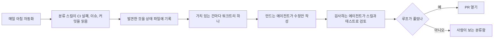

## 루프 엔지니어링 예시란 ?
- [루프 엔지니어링](../README.md) 문서에서 본 부품(목표와 멈출 조건, 자동화, 검사하는 쪽, 상태, 사람에게 넘기는 지점)을 실제로 어떻게 쓰는지 보여 주는 예시 모음
- 부품마다 원문에 나온 예를 먼저 요약하고 적용 예를 이어 붙였다. 이 노트 레포에서 실제로 쓰는 것은 그렇다고 밝혔고, 나머지는 설명을 위해 만든 예다
- 원문은 Claude Code 공식 문서 [/goal](https://code.claude.com/docs/en/goal)(참고 자료 1)과 [Run prompts on a schedule](https://code.claude.com/docs/en/scheduled-tasks)(참고 자료 2), 애디 오스마니의 [Loop Engineering](https://addyosmani.com/blog/loop-engineering/)(참고 자료 3), IBM의 [What Is Loop Engineering?](https://www.ibm.com/think/topics/loop-engineering)(참고 자료 4), 루프 사용 실태 연구(참고 자료 5)에서 가져왔다. 2026-10-21에 확인한 내용이다

### 좋은 루프의 기준
2026년 8월 연구는 3만 6710개 저장소를 조사해 그중 217개 저장소에서 실제로 돌아가는 에이전트 루프를 확인하고, 루프를 이루는 부품을 이렇게 정리했다(참고 자료 5). 기계가 확인할 수 있는 멈출 조건으로 범위가 정해진 실행, 계속 남는 상태 파일, 검사하는 하위 에이전트, 토큰 예산, 사람에게 넘기는 정해진 지점이다.
아래 절은 이 부품을 하나씩 다룬다.

<br/>

## 1. 멈출 조건 쓰기
### 원문 예
IBM은 측정할 수 있는 목표의 예로 "코드가 모든 단위 테스트를 통과하고 요청한 요구 사항을 만족하면 반복을 멈춘다"를 든다(참고 자료 4). 목표를 구체적이고 범위가 정해진, 시험할 수 있는 작은 일로 나누면 쓸데없는 반복이 줄고 토큰 비용도 줄어든다고 한다.
Claude Code의 `/goal` 은 이 멈출 조건을 명령 하나로 건다. 매 턴이 끝날 때마다 별도의 모델이 조건을 채웠는지 판단하고, 아직이면 Claude가 다음 턴을 이어 간다(참고 자료 1). 문서의 예는 아래와 같다.

```text
/goal all tests in test/auth pass and the lint step is clean
```

문서는 좋은 조건에 세 가지가 있다고 한다(참고 자료 1).

- 측정할 수 있는 끝 상태 하나: 테스트 결과, 빌드 종료 코드, 파일 개수, 빈 대기열
- 어떻게 증명할지: "`npm test` 가 0으로 끝난다", "`git status` 가 깨끗하다"처럼
- 지켜야 할 제약: "다른 테스트 파일은 고치지 않는다"처럼 가는 동안 바뀌면 안 되는 것

조건을 판단하는 모델은 명령을 직접 돌리거나 파일을 읽지 않고, 대화에 드러난 내용만 보고 판단한다. 그래서 Claude의 출력으로 보여 줄 수 있는 조건을 써야 한다. 오래 돌지 않게 하려면 "20턴이 지나면 멈춘다" 같은 턴이나 시간 제한을 조건에 함께 적으라고 한다.

### 적용 예
이 레포에 쓴다면 아래처럼 쓸 수 있다.

```text
피할 예
/goal 노트를 깔끔하게 정리한다

고친 예
/goal node .claude/scripts/check-links.js Python 의 결과가 "깨진 링크 0개"이고,
Python 폴더의 README에 긴 대시가 0개다. README가 아닌 파일은 고치지 않는다.
10턴이 지나면 멈추고 남은 문제를 보고한다.
```

피할 예는 "깔끔하게"를 증명할 방법이 없어서, 루프가 끝나지 않거나 덜 된 일을 끝났다고 판단할 수 있다.

<br/>

## 2. 시간에 맞춰 돌리기
### 원문 예
오스마니는 자동화를 루프의 심장 박동이라 부르며, 매일 아침 저장소에서 자동화가 돌아 어제의 CI 실패, 열린 이슈, 최근 커밋을 읽는 예를 든다(참고 자료 3).
Claude Code에서는 `/loop` 로 세션 안에서 프롬프트를 정해진 간격으로 다시 돌린다(참고 자료 2).

```text
/loop 5m check if the deployment finished and tell me what happened
```

간격을 빼면 Claude가 매번 관찰한 것에 따라 1분에서 1시간 사이로 다음 실행 시점을 고른다. `/loop` 만 쓰면 기본 유지 보수 프롬프트가 돈다. 이 프롬프트는 대화에서 끝나지 않은 일을 이어 가고, 현재 브랜치의 PR 리뷰 댓글과 실패한 CI를 살핀다. push나 삭제처럼 되돌리기 어려운 일은 대화에서 이미 허락한 일을 이어 가는 경우에만 한다(참고 자료 2).
`/loop` 에는 한계도 있다. 세션이 열려 있을 때만 돌고, 반복 작업은 만든 지 7일이 지나면 저절로 끝난다. 잊힌 루프가 끝없이 돌지 않게 하려는 장치다. 노트북을 닫아도 돌아야 하는 일은 클라우드 예약 작업이나 GitHub Actions를 쓰라고 안내한다.

### 적용 예
기본 프롬프트를 바꾸고 싶으면 `.claude/loop.md` 에 적는다(참고 자료 2). 이 레포에 둔다면 아래처럼 쓸 수 있다.

```markdown
node .claude/scripts/check-links.js . 를 돌린다.
깨진 링크가 있으면 어느 파일의 어느 링크인지 한 줄씩 보고하고, 고치지는 않는다.
깨진 링크가 없으면 한 줄로 그렇다고만 말한다.
```

고치지 말고 보고만 하라고 적은 것은 5절의 사람에게 넘기는 지점과 같은 생각이다.

<br/>

## 3. 만드는 쪽과 검사하는 쪽 나누기
### 원문 예
`/goal` 은 일을 한 모델이 아니라 새 모델이 완료 여부를 판단한다(참고 자료 1). 오스마니도 `/goal` 을 설명하며 이렇게 하면 코드를 쓴 에이전트가 자기 결과를 채점하지 않게 된다고 짚고, 흔한 나눔으로 탐색하는 에이전트, 구현하는 에이전트, 명세에 맞는지 검증하는 에이전트를 든다(참고 자료 3). IBM도 자기 확인보다 따로 지시를 받은 검사 에이전트가 품질을 더 잘 보장한다고 설명한다(참고 자료 4).
다만 하위 에이전트는 각자 모델과 도구를 써서 토큰을 더 쓰므로, 두 번째 의견이 그 비용만큼 값어치가 있는 곳에만 쓰라고 한다(참고 자료 3).

### 이 레포의 예
노트를 쓰는 주 세션이 만드는 쪽이고, 읽기 전용 도구만 가진 `note-reviewer` 에이전트가 검사하는 쪽이다. 자세한 구성은 [하네스 엔지니어링 예시](../../%5BAI%20활용%5D%20하네스%20엔지니어링(Harness%20Engineering)/예시(Examples)/README.md)에 있다.
아직 완전한 루프는 아니다. 리뷰를 부르는 일, 지적을 반영할지 정하는 일, 다시 리뷰할지 정하는 일을 주 세션이 사람의 요청을 받아 한다.

<br/>

## 4. 상태 파일 남기기
### 원문 예
오스마니는 모델이 실행이 끝나면 잊으므로, 무엇을 시도했고 무엇이 통과했고 무엇이 남았는지를 상태 파일에 적어 다음 실행이 이어서 시작하게 하라고 한다. 마크다운 파일이나 MCP로 연결한 이슈 보드를 예로 든다(참고 자료 3).
그런데 실태 연구는 저장소들이 루프 설정은 커밋하지만, 권장되는 상태 파일은 거의 커밋하지 않아 루프의 실행 상태가 버전 관리 밖에 남는다고 보고했다(참고 자료 5).

### 적용 예
```markdown
# PROGRESS.md
## 목표
Python 노트의 모든 장 README에 링크 깨짐 0개

## 시도한 것
- 2026-10-21 1차: 깨진 링크 3개 발견, 2개 수정 (02장, 18장)

## 통과한 것
- 01~17장

## 남은 것
- 19장 링크 1개: 대상 폴더 이름이 바뀐 것으로 보임. 사람 확인 필요
```

이 레포에서는 레포 밖의 Claude Code 메모리에 파이썬 노트를 몇 장까지 썼는지와 이어 쓸 때 확인할 것을 적어 두었다. 다음 세션이 이어서 시작하게 한다는 점에서 상태 파일과 같은 역할이지만, 연구가 지적한 것처럼 버전 관리 밖에 있다.

<br/>

## 5. 사람에게 넘기는 지점 정하기
### 원문 예
IBM은 사람이 머지를 검토하고 출시한 코드에 책임을 진다고 설명하며, 사람이 테스트하고 검토하기 전까지 브랜치 머지를 막아 두는 예를 든다(참고 자료 4). 오스마니의 예에서는 루프가 풀지 못한 것이 사람이 보는 분류함(triage inbox)으로 간다(참고 자료 3). 앞에서 본 `/loop` 기본 프롬프트도 되돌리기 어려운 일은 이미 허락된 경우에만 한다(참고 자료 2).
오스마니는 완료가 주장일 뿐 증명이 아니라고도 한다. 루프가 끝났다고 해도 결과는 사람이 다시 확인해야 한다(참고 자료 3).

### 이 레포의 예
이 레포에서는 커밋과 push가 사람에게 넘기는 지점이다. AI는 사용자가 그 자리에서 "커밋하고 푸시해"처럼 명령형으로 맡겼을 때만 커밋과 push를 한다. 맡았을 때도 원격으로 나갈 커밋에 AI가 만들지 않은 커밋이 섞여 있으면 push하지 않고 묻는다. 이 규칙이 생긴 과정은 [하네스 엔지니어링 예시](../../%5BAI%20활용%5D%20하네스%20엔지니어링(Harness%20Engineering)/예시(Examples)/README.md)의 스킬 절에 있다.

<br/>

## 6. 한 바퀴 그려 보기
오스마니가 든 하루 루프를 그림으로 옮기면 아래와 같다(참고 자료 3).



부품별로 보면 자동화(2절), 상태 파일(4절), 만드는 쪽과 검사하는 쪽(3절), 사람에게 넘기는 지점(5절)이 한 바퀴 안에 모두 들어 있다. 오스마니는 여러 에이전트를 동시에 돌릴 때 한계를 정하는 것은 도구가 아니라 사람이 검토할 수 있는 양이라고 경고한다(참고 자료 3).

<br/>

## 부품 요약
| 부품 | 한 줄 요약 | 적용 예 |
| --- | --- | --- |
| 멈출 조건 | 측정할 끝 상태, 증명 방법, 제약, 턴 제한 | 링크 점검 `/goal` (만든 예) |
| 자동화 | 정해진 간격이나 시각에 다시 돌리기 | `.claude/loop.md` 링크 보고 (만든 예) |
| 만드는 쪽과 검사하는 쪽 | 일한 모델이 스스로 채점하지 않게 | 이 레포의 note-reviewer 에이전트 |
| 상태 파일 | 시도, 통과, 남은 것을 파일에 | PROGRESS.md (만든 예), 이 레포의 메모리 |
| 사람에게 넘기는 지점 | 되돌리기 어려운 일은 사람이 정한다 | 이 레포의 커밋과 push 규칙 |

<br/>

## 참고 자료
1. Anthropic, [Keep Claude working toward a goal](https://code.claude.com/docs/en/goal), Claude Code 공식 문서, 2026-10-21 확인
2. Anthropic, [Run prompts on a schedule](https://code.claude.com/docs/en/scheduled-tasks), Claude Code 공식 문서, 2026-10-21 확인
3. Addy Osmani, [Loop Engineering](https://addyosmani.com/blog/loop-engineering/), 2026-06-07, 2026-10-21 확인
4. IBM, [What Is Loop Engineering?](https://www.ibm.com/think/topics/loop-engineering), 2026-07-17, 2026-10-21 확인
5. Lulla 외, [Loop Engineering: Building Blocks, Adoption, and Impact](https://arxiv.org/abs/2608.21884), arXiv, 2026-08, 2026-10-21 확인
